# AirStack-starling-max2 — Starling Max 2 × AirStack lab repo

> **Any unfamiliar term** (the commander, the panel, the interfaces, mocap bridge…) → [GLOSSARY.md](docs/GLOSSARY.md), one line each.

Two real ModalAI **Starling Max 2** drones, flown indoors with **OptiTrack** motion-capture positioning (mocap) by CMU's
**AirStack** ground-control stack (a known-good snapshot lives in [`AirStack/`](AirStack/)), with
three-drone swarms rehearsed in **Isaac Sim** before anything flies for real.

<a href="videos/cbf_teleop_two_drones_showcase.mp4">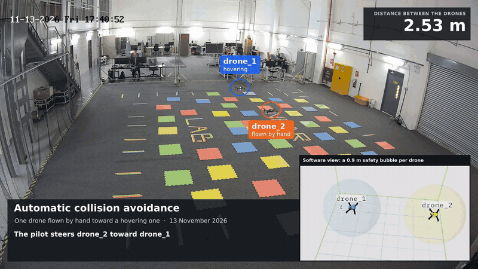</a><br>
*2026-11-13, two real Starlings, one flight. `drone_2` is flown by hand with a gamepad toward the hovering `drone_1`, and the collision filter (CBF) keeps them apart: [closest 1.76 m, pass mark 1.40 m](docs/record/LEDGER.md), ledger #37. [Full 46 s video (16 MB)](videos/cbf_teleop_two_drones_showcase.mp4) · [how it was run](docs/RUNBOOK.md#b10--two-real-drones-one-flown-by-hand).*

**Real drones:** ledger rows [#33 to #37](docs/record/LEDGER.md) (2026-11-11 to 2026-11-13) · not flown yet: formations, random goals, and with the gamepad the fence top, the +x wall and the pad unplugged<br>
**Simulator:** results in [record/LEDGER.md](docs/record/LEDGER.md), table 1<br>
**Before the next real flight:** the hazards in the first section of [MILESTONES.md](docs/MILESTONES.md#before-the-next-real-flight)

## I want to…

| | Go to |
|---|---|
| **fly in the simulator** | [RUNBOOK.md §A](docs/RUNBOOK.md) — one command opens four tabs; takeoff → land in ten minutes |
| **fly a real drone** | [PREFLIGHT.md](docs/PREFLIGHT.md) first, always; then [RUNBOOK.md §B](docs/RUNBOOK.md)<br>Which is which ([CONFIG.md](docs/CONFIG.md)): `drone_2` is the newer Starling. `drone_1` (older Starling): flies by the owner's decision, with a watcher on its front-right motor. |
| **fly a real drone with the gamepad** | [PREFLIGHT.md](docs/PREFLIGHT.md) first, then [RUNBOOK.md B9](docs/RUNBOOK.md#b9--fly-one-real-drone-with-the-gamepad) (one drone) or [B10](docs/RUNBOOK.md#b10--two-real-drones-one-flown-by-hand) (two drones, one flown by hand). Both start with [`tools/real.sh`](tools/README.md#real-drone-the-gamepad-check). |
| **set up a new laptop** | [SETUP.md](docs/SETUP.md) |
| **understand how it fits together** | [ARCHITECTURE.md](docs/ARCHITECTURE.md), one page |
| **find a value** (IP, parameter, which config we fly) | [CONFIG.md](docs/CONFIG.md) |
| **fix something** | [TROUBLESHOOTING.md](docs/TROUBLESHOOTING.md) — symptom → fix |
| **see where each project is, what passed, what is next** | [MILESTONES.md](docs/MILESTONES.md) (one screen) → [docs/projects/](docs/projects/HTX-R1.md) |
| **work with the AI assistant on this repo** | [AI_ASSIST.md](docs/AI_ASSIST.md) |
| **fly in the construction site** (sim): the scored camera run, or drone_1 yourself by keyboard | [localisation/README.md](localisation/README.md), its first table picks the run |

## What we have achieved so far

### Flown here

Real drones, newest first.

| | |
|---|---|
| 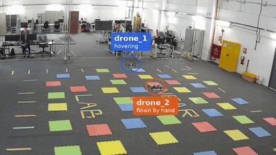<br>**2026-11-13 · one drone flown by hand at a hovering one, two real drones.** `drone_2` is flown with the gamepad toward the hovering `drone_1`. The collision filter (CBF) keeps them apart. Hangar camera at 3× speed, one flight ([ledger #37](docs/record/LEDGER.md)). [full video](videos/cbf_teleop_two_drones_real_labeled_1080p.mp4) | 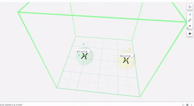<br>**The same flight on the panel.** The two keep-out spheres meet as `drone_2` closes in. [panel video](videos/cbf_teleop_two_drones_ui.mp4) · [hangar and panel together](videos/cbf_teleop_two_drones_combined.mp4) · [how it was run](docs/RUNBOOK.md#b10--two-real-drones-one-flown-by-hand) |
| 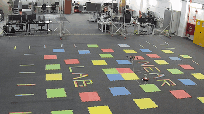<br>**2026-11-13 · first gamepad flight, one real drone.** `drone_2` is flown by hand with a Logitech F310 pad. The flight tested turning on the spot, the fence wall and letting go of the stick. Hangar camera at 2× speed ([ledger #36](docs/record/LEDGER.md)). [full video](videos/xbox_teleop_real_1080p.mp4) | 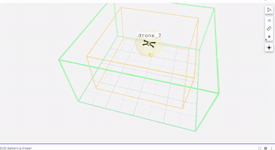<br>**The same flight on the panel**, its last part. The amber box is the teleop fence. [panel video](videos/xbox_teleop_ui.mp4) · [how it is run](docs/RUNBOOK.md#b9--fly-one-real-drone-with-the-gamepad) |
| 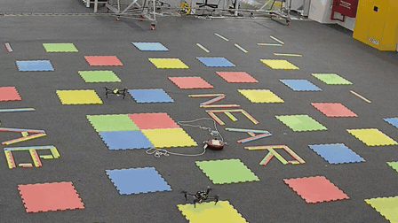<br>**2026-11-12 · two real drones, collision filter (CBF).** The GIF shows takeoff and return on the hangar camera. In the full video `drone_2` is sent toward the hovering `drone_1` and the filter holds it off. An observation, with no pass mark set beforehand ([ledger #35](docs/record/LEDGER.md)). [full video](videos/cbf_drone_real_1080p.mp4) | 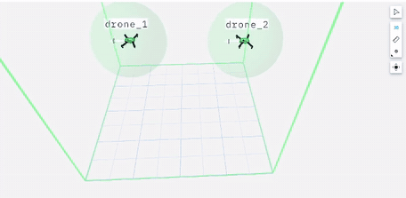<br>**The same flight on the panel**, where the filter is easiest to see: both keep-out spheres turn blue and the panel reads "CBF correcting drone_1, drone_2". [full video](videos/cbf_check_ui.mp4) · [how it was run](docs/RUNBOOK.md#c9--two-real-drones-with-the-collision-filter-cbf) |
| 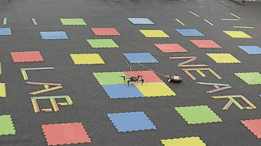<br>**2026-11-11 · the braking fence, one real drone.** Goals were sent past the +x fence wall, and the drone held at the wall. Distance past the wall not measured ([ledger #33](docs/record/LEDGER.md)). [full video](videos/geofence_test_real_1080p.mp4) | 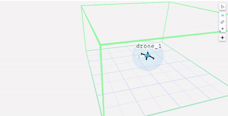<br>**The same test on the panel.** [full video](videos/geofence_test_ui.mp4) |

### Rehearsed in Isaac Sim

Simulation only. Nothing in this group flew on a real drone.

| | |
|---|---|
| 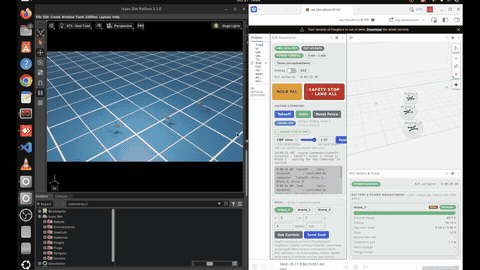<br>**2026-10-21 · random goals under the CBF, Isaac Sim.** Three Starling 2 Max models cross, and the collision filter alone keeps them apart. Sim only. [full video](videos/random_CBF_sim_edited.mp4) | 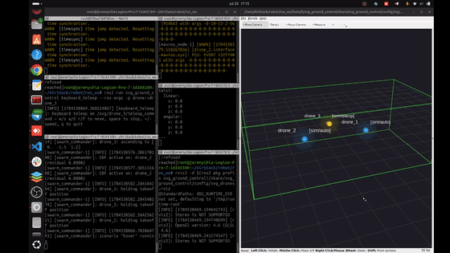<br>**Gamepad teleop with the braking geofence.** Sim only, on the previous software. [full video](videos/teleop_with_geofence.mp4) |
| 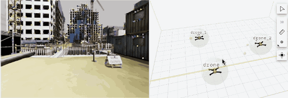<br>**2026-10-23 · random goals in the construction site, Isaac Sim.** Stereo VO (cuVSLAM) tracking on drone_1 while three Starlings fly. Sim only. Scored run: [localisation/README.md](localisation/README.md) | 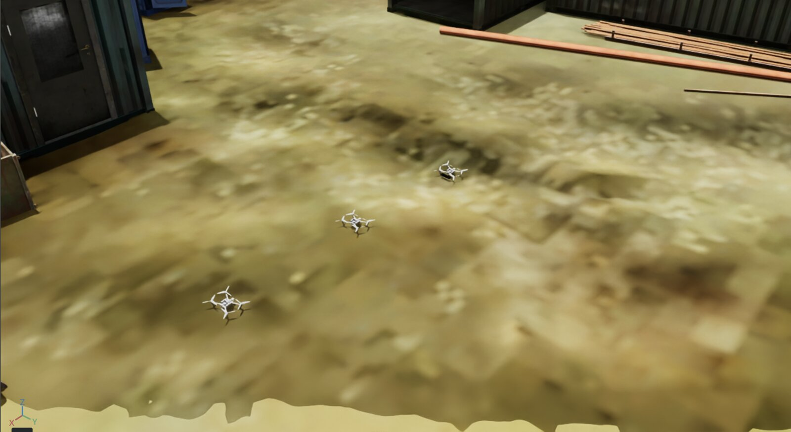<br>**The construction-site world.** The lab's UE4 site, flattened for Isaac and loaded with `ENV_USD`. [What it is](localisation/scenes/construction_site/README.md) |

### Flown at CMU with the same software (not our flights)

CMU AirLab's drones in CMU's lab. Random goals and the figure-eight are the next demos planned here. Neither is flown here yet.

| | |
|---|---|
| 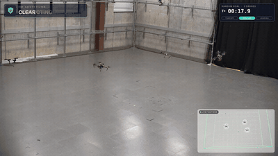<br>**Random goals.** Several drones fly to random points at once. 2× speed. | 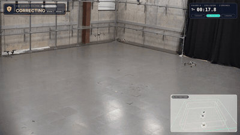<br>**Figure-eight, head-on.** Drones fly figure-eights toward each other. 2× speed. |

Both videos: AirLab, Carnegie Mellon University, CC BY-SA 4.0; re-encoded and cropped in time.

Milestone by milestone, with evidence: [record/LEDGER.md](docs/record/LEDGER.md) and the [project pages](docs/projects/HTX-R1.md). Earlier flights on the previous software (September 2026): [pictures/README.md](pictures/README.md#gifs-retired-from-the-readme-gallery) and [MIGRATION.md](docs/MIGRATION.md) §12.

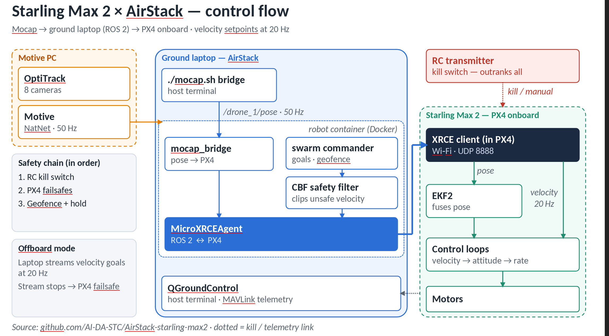

*(Drawn for the previous branch; four things moved since — the corrections are listed in
[ARCHITECTURE.md](docs/ARCHITECTURE.md).)*

## Two rules before anything else

1. **[PREFLIGHT.md](docs/PREFLIGHT.md) gates every real takeoff.** The commander's log is not an arming display; QGC is.
2. **Sim-only — never port to the drone:** the sim airframe's gains and limits, `cbf_sim.yaml`'s speeds and landing settle. The drone's parameters come from `starling_1_indoor_params.params` only (iron rule 9).

## What is in this repo

| File / folder | What it is |
|---|---|
| [SETUP.md](docs/SETUP.md) | New laptop: install, both clones, first build |
| [RUNBOOK.md](docs/RUNBOOK.md) | Session commands — sim §A, real drones §B (gamepad: B9 one drone, B10 two drones), goal flights §C |
| [PREFLIGHT.md](docs/PREFLIGHT.md) | The laminated card: checklist, emergencies, iron rules |
| [ARCHITECTURE.md](docs/ARCHITECTURE.md) | How it fits together, the lab network, whose doc is whose |
| [CONFIG.md](docs/CONFIG.md) | Every value we fly: IPs, parameters, which config, sim airframe |
| [SCENARIOS.md](docs/SCENARIOS.md) | The CBF filter and the swarm scenarios |
| [BASESTATION.md](docs/BASESTATION.md) | The Foxglove panel, chip by chip |
| [TELEOP.md](docs/TELEOP.md) | Gamepad flying through the commander. The real gamepad session is RUNBOOK B9. The sim keyboard session is in [localisation/README.md](localisation/README.md#fly-it-with-the-keyboard-one-drone-sim-only) |
| [MOCAP.md](docs/MOCAP.md) · [mocap.sh](mocap.sh) | The mocap bridge and the Motive PC |
| [DRONE_SETUP.md](docs/DRONE_SETUP.md) | Provisioning a Starling from the box |
| [TROUBLESHOOTING.md](docs/TROUBLESHOOTING.md) | Symptom → first check → fix |
| [MILESTONES.md](docs/MILESTONES.md) | One screen: where each Linear project is; then [projects/](docs/projects/HTX-R1.md) and [record/LEDGER.md](docs/record/LEDGER.md) |
| [MIGRATION.md](docs/MIGRATION.md) | Branch history and what changed |
| [GLOSSARY.md](docs/GLOSSARY.md) · [AI_ASSIST.md](docs/AI_ASSIST.md) | Terms · working with the assistant |
| [CLAUDE.md](CLAUDE.md) | The assistant's brief and the iron rules |
| [localisation/](localisation/README.md) | Camera-world sim runs: construction-site world, stereo VO (cuVSLAM), scoring, and the one-drone [keyboard session](localisation/README.md#fly-it-with-the-keyboard-one-drone-sim-only). A sibling of `AirStack/`, never inside CMU's tree |
| [AirStack/](AirStack/) | CMU AirStack snapshot, `yikuan/SVG_ground_control_dev` @ `b21d28c` ([its README](AirStack/README.md)) |
| [`starling_1_indoor_params.params`](starling_1_indoor_params.params) | The drone's parameter set (QGC export) |
| [tools/](tools/) · [patches/](patches/) | Sim session launcher, docs checker, the real-drone gamepad check [`tools/real.sh`](tools/README.md#real-drone-the-gamepad-check) · our bug-fix patches |
| [assets/](assets/) · [videos/](videos/) · [pictures/](pictures/) | GIFs, recordings, diagrams — [pictures/README.md](pictures/README.md) says which are current |
| [drone-backups/](drone-backups/) | Starling 1's factory `voxl-px4-start` |

## Clone, commit, push

```bash
git clone https://github.com/AI-DA-STC/AirStack-starling-max2.git
```

Two clones live on the lab laptop: `~/AirStack-starling-max2` is the **live** one (docker-mounted —
edit and commit there, on `main`); `~/Documents/GitHub/AirStack-starling-max2` is the **mirror** that
GitHub Desktop pushes from (`git -C ~/Documents/GitHub/AirStack-starling-max2 pull ~/AirStack-starling-max2 main`
first). Assistants never push. Details and the first build: [SETUP.md](docs/SETUP.md).
`omni_pass.env` / `user.config.json` are machine-local and must never be committed; the drone's
SSH password is in CONFIG.md on purpose — keep this repo private.
