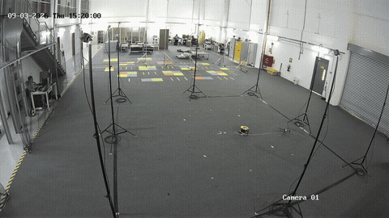
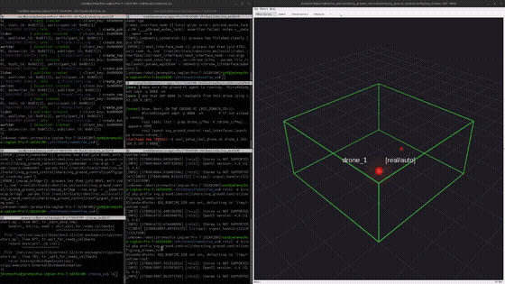
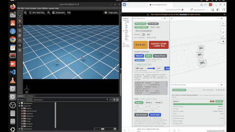
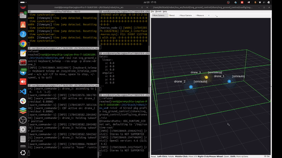
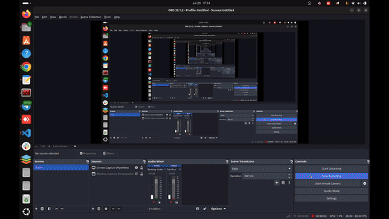
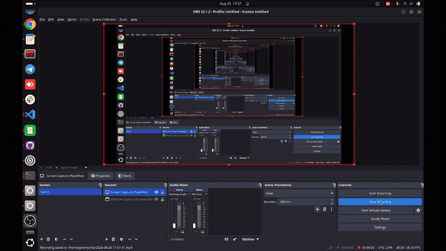
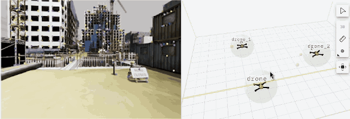
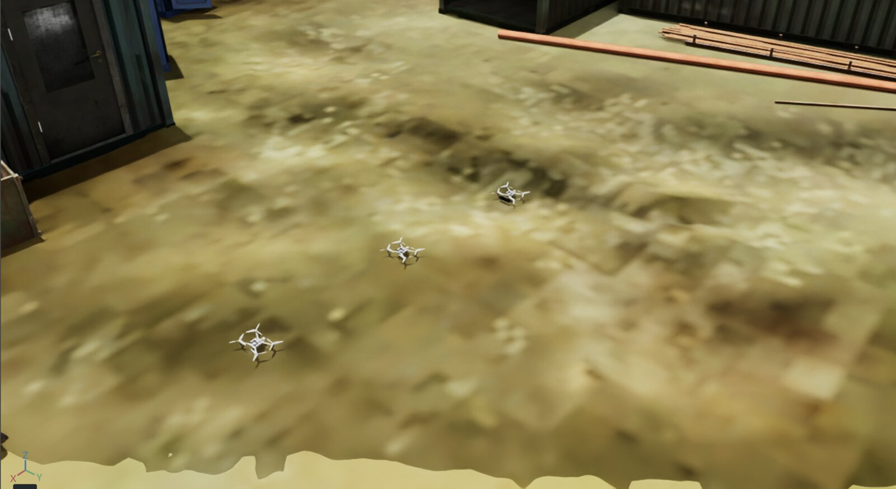
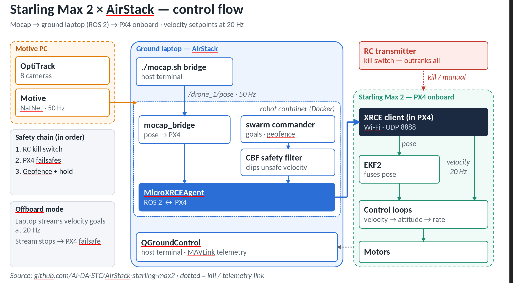

# AirStack-starling-max2 — Starling Max 2 × AirStack lab repo

> **Any unfamiliar term** (the commander, the panel, the interfaces, mocap bridge…) → [GLOSSARY.md](docs/GLOSSARY.md), one line each.

One real ModalAI **Starling Max 2**, flown indoors under **OptiTrack** motion capture by CMU's
**AirStack** ground-control stack (a known-good snapshot lives in [`AirStack/`](AirStack/)), with
three-drone swarms rehearsed in **Isaac Sim** before anything flies for real.

**Status:** snapshot `yikuan/SVG_ground_control_dev` @ `b21d28c` · sim results in [record/LEDGER.md](docs/record/LEDGER.md) · **nothing on this software has flown** — the hazards before the next real flight are the first section of [MILESTONES.md](docs/MILESTONES.md).

## I want to…

| | Go to |
|---|---|
| **fly in the simulator** | [RUNBOOK.md §A](docs/RUNBOOK.md) — one command opens four tabs; takeoff → land in ten minutes |
| **fly the real drone** | [PREFLIGHT.md](docs/PREFLIGHT.md) first, always; then [RUNBOOK.md §B](docs/RUNBOOK.md) |
| **set up a new laptop** | [SETUP.md](docs/SETUP.md) |
| **understand how it fits together** | [ARCHITECTURE.md](docs/ARCHITECTURE.md), one page |
| **find a value** (IP, parameter, which config we fly) | [CONFIG.md](docs/CONFIG.md) |
| **fix something** | [TROUBLESHOOTING.md](docs/TROUBLESHOOTING.md) — symptom → fix |
| **see where each project is, what passed, what is next** | [MILESTONES.md](docs/MILESTONES.md) (one screen) → [docs/projects/](docs/projects/HTX-R1.md) |
| **work with the AI assistant on this repo** | [AI_ASSIST.md](docs/AI_ASSIST.md) |
| **fly in the construction site with the camera** (sim stereo VO) | [localisation/README.md](localisation/README.md) |

## What we have achieved so far

| | |
|---|---|
| <br>**2026-09-03 · autonomous waypoint flight, real drone.** No sticks: mocap → PX4 → commander → goals, geofence, landing, auto-disarm. [full video](videos/Starling_goal_tracking_drone.mp4) | <br>**The same flight as the software saw it.** [full video](videos/Starling_goal_tracking_RVIZ.mp4) · operator view is now the Foxglove panel |
| <br>**2026-10-21 · random goals under the CBF, Isaac Sim.** Three Starling 2 Max models cross at 2 m/s; the collision filter alone keeps them apart. Sim only. [full video](videos/random_CBF_sim_edited.mp4) | <br>**Gamepad teleop with the braking geofence** (previous branch, sim). [full video](videos/teleop_with_geofence.mp4) |
| <br>**2026-09-01 · first offboard takeoff + landing**, position from mocap only, kill switch verified in flight. [full video](videos/takeoff_and_land.mp4) | <br>**The mocap chain proven by hand-carry** before any flight. [full video](videos/SVG_check_if_rviz_moves_by_movingdrone_manually.mp4) |
| <br>**2026-10-23 · random goals in the construction site, Isaac Sim.** Stereo VO (cuVSLAM) tracking on drone_1 while three Starlings fly. Sim only; scored run and numbers: [localisation/README.md](localisation/README.md) | <br>**The construction-site world.** The lab's UE4 site, flattened for Isaac and loaded with `ENV_USD`. [What it is](localisation/scenes/construction_site/README.md) |

Milestone by milestone, with evidence: [record/LEDGER.md](docs/record/LEDGER.md) and the [project pages](docs/projects/HTX-R1.md). History of the previous branch: [MIGRATION.md](docs/MIGRATION.md) §12.



*(Drawn for the previous branch; four things moved since — the corrections are listed in
[ARCHITECTURE.md](docs/ARCHITECTURE.md).)*

## Two rules before anything else

1. **[PREFLIGHT.md](docs/PREFLIGHT.md) gates every real takeoff.** The commander's log is not an arming display; QGC is.
2. **Sim-only — never port to the drone:** the sim airframe's gains and limits, `cbf_sim.yaml`'s speeds and landing settle. The drone's parameters come from `starling_1_indoor_params.params` only (iron rule 9).

## What is in this repo

| File / folder | What it is |
|---|---|
| [SETUP.md](docs/SETUP.md) | New laptop: install, both clones, first build |
| [RUNBOOK.md](docs/RUNBOOK.md) | Session commands — sim §A, real drone §B, goal flights §C |
| [PREFLIGHT.md](docs/PREFLIGHT.md) | The laminated card: checklist, emergencies, iron rules |
| [ARCHITECTURE.md](docs/ARCHITECTURE.md) | How it fits together, the lab network, whose doc is whose |
| [CONFIG.md](docs/CONFIG.md) | Every value we fly: IPs, parameters, which config, sim airframe |
| [SCENARIOS.md](docs/SCENARIOS.md) | The CBF filter and the swarm scenarios |
| [BASESTATION.md](docs/BASESTATION.md) | The Foxglove panel, chip by chip |
| [TELEOP.md](docs/TELEOP.md) | Gamepad flying through the commander |
| [MOCAP.md](docs/MOCAP.md) · [mocap.sh](mocap.sh) | The mocap bridge and the Motive PC |
| [DRONE_SETUP.md](docs/DRONE_SETUP.md) | Provisioning a Starling from the box |
| [TROUBLESHOOTING.md](docs/TROUBLESHOOTING.md) | Symptom → first check → fix |
| [MILESTONES.md](docs/MILESTONES.md) | One screen: where each Linear project is; then [projects/](docs/projects/HTX-R1.md) and [record/LEDGER.md](docs/record/LEDGER.md) |
| [MIGRATION.md](docs/MIGRATION.md) | Branch history and what changed |
| [GLOSSARY.md](docs/GLOSSARY.md) · [AI_ASSIST.md](docs/AI_ASSIST.md) | Terms · working with the assistant |
| [CLAUDE.md](CLAUDE.md) | The assistant's brief and the iron rules |
| [localisation/](localisation/README.md) | Camera-world sim runs: construction-site world, stereo VO (cuVSLAM), scoring. A sibling of `AirStack/`, never inside CMU's tree |
| [AirStack/](AirStack/) | CMU AirStack snapshot, `yikuan/SVG_ground_control_dev` @ `b21d28c` ([its README](AirStack/README.md)) |
| [`starling_1_indoor_params.params`](starling_1_indoor_params.params) | The drone's parameter set (QGC export) |
| [tools/](tools/) · [patches/](patches/) | Sim session launcher, docs checker · our bug-fix patches |
| [assets/](assets/) · [videos/](videos/) · [pictures/](pictures/) | GIFs, recordings, diagrams — [pictures/README.md](pictures/README.md) says which are current |
| [drone-backups/](drone-backups/) | Starling 1's factory `voxl-px4-start` |

## Clone, commit, push

```bash
git clone https://github.com/AI-DA-STC/AirStack-starling-max2.git
```

Two clones live on the lab laptop: `~/AirStack-starling-max2` is the **live** one (docker-mounted —
edit and commit there, on `main`); `~/Documents/GitHub/AirStack-starling-max2` is the **mirror** that
GitHub Desktop pushes from (`git -C ~/Documents/GitHub/AirStack-starling-max2 pull ~/AirStack-starling-max2 main`
first). Assistants never push. Details and the first build: [SETUP.md](docs/SETUP.md).
`omni_pass.env` / `user.config.json` are machine-local and must never be committed; the drone's
SSH password is in CONFIG.md on purpose — keep this repo private.
