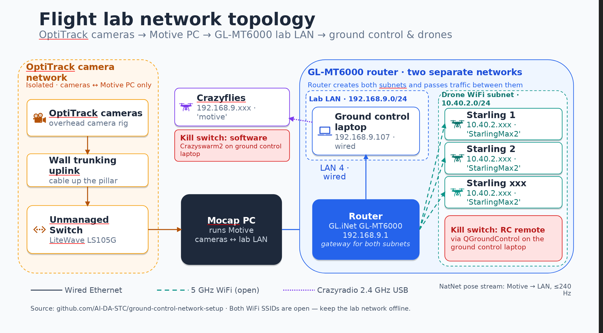
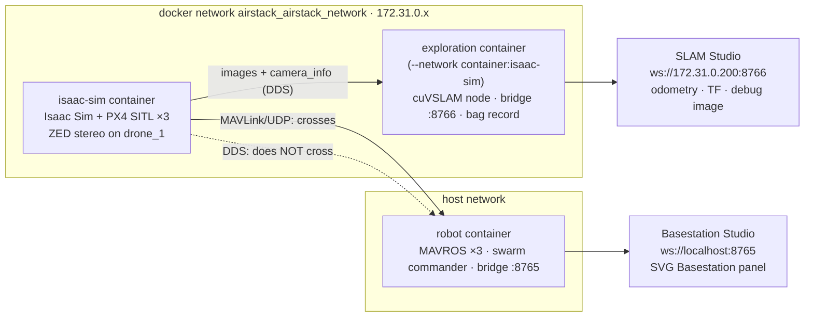

# ARCHITECTURE — how the system works

> **KNOW.** The one-page primer, the flight-lab network, and who wrote which document. Moved
> verbatim from the front-page README on 2026-10-21 so the README can be short. To *run*
> things: [RUNBOOK.md](RUNBOOK.md). Terms: [GLOSSARY.md](GLOSSARY.md).

## How the system works (one-page primer)

**PX4 is the pilot, AirStack is mission control, and the RC kill switch outranks both.**

| | Decides | Where it runs |
|---|---|---|
| **AirStack** (swarm commander) | *where to go* — takeoff, goals, hold, land; and *how fast to get there* (an acceleration-limited profile) | ground laptop |
| **PX4 autopilot** | *how to fly* — position hold, stabilization, motors, EKF2 state estimation, failsafes | on the drone |
| **RC pilot** | emergency veto — kill switch, mode override; or hand-flying through the commander's gamepad path | your hands |

We use a **thin slice** of AirStack: our **`./mocap.sh`** pose bridge (runs on the laptop —
see [MOCAP.md](MOCAP.md)) feeding AirStack's `mocap_bridge` node (mocap → PX4 EKF2), the laptop↔PX4 link
(uXRCE-DDS), and the swarm commander with its two safety layers: the **CBF collision
filter** (Control Barrier Function — a math filter that rewrites the velocity command so
drones keep a safety radius from each other; it is tunable in flight) and the **fence**
(either freeze-everyone `hold_all`, or a `keep_in` wall the drone brakes against).

The planner/perception layers stay dormant here; those belong to AirStack's outdoor missions,
where planning runs on the drone's own computer. The operator watches all of it in the
**Foxglove SVG Basestation** panel, fed by a 5 Hz status snapshot the commander publishes.
*(AirStack's own mocap driver, [`natnet_ros2`](https://github.com/L2S-lab/natnet_ros2), stays
vendored in the snapshot but is unused on our rig — our Motive broadcasts, which it can't
hear; full story in [MOCAP.md](MOCAP.md) §3.)*

*(Diagram drawn for the previous branch; four things moved since — read it with these
corrections: the laptop box is `./mocap.sh` (there is no `bridge` subcommand); between the
CBF and the MicroXRCEAgent sits `px4_interface`, which turns the command into PX4 messages
and carries arm/disarm/offboard; the commander→PX4 arrow is a **trajectory setpoint**
(position + velocity + acceleration), so PX4's chain is position → velocity → attitude → rate;
and the operator view is the Foxglove panel (plus the gamepad through the same CBF), with
QGC kept for arming truth. In sim the right-hand box is Isaac Sim + PX4 SITL over MAVROS.)*

**How the laptop↔drone leg works:** the laptop repackages everything into PX4's native
message format (`px4_msgs`), and the **MicroXRCEAgent** program ships those messages over
WiFi to a tiny **client built into PX4 itself** — so no ROS runs on the drone, and there is
nothing to install on it. The laptop does **no state estimation and no stabilization** — it
is a courier for mocap poses and a source of trajectory setpoints.

**Offboard mode** = PX4 outsources goal-generation to an external computer that must stream
setpoints continuously (≥2 Hz; ours: 20 Hz). Stream stops → PX4 failsafes; it never tumbles.
Onboard modes (Position/Hold/Mission…) = PX4 makes its own goals, fully self-contained.

**What we inject, and why it changed.** PX4's control is a cascade —
`POSITION ~50 Hz → VELOCITY ~50 Hz → ATTITUDE ~250 Hz → RATE ~1000 Hz → motors`, all
onboard. The previous branch streamed a bare **velocity** setpoint, bypassing PX4's position
loop and leaving the laptop to close it over WiFi (~0.7 s lag; the drone overshot goals and
fence walls).

This branch streams a **trajectory setpoint** — a reference position, the
velocity to get there, *and* the acceleration — so PX4's own position loop runs onboard
(~50 Hz, with the attitude loop below it at ~250 Hz) with feedforward, exactly like its Position flight mode. Tracking lag drops to
~0.1 s, a drone with the sticks released is held by PX4 rather than by the laptop, and a
WiFi hiccup leaves it parked on its last reference. Agility stays bounded (responsive, not
acrobatic; aerobatics would need attitude/rate streaming, which WiFi can't support).

**Safety chain, in authority order:**
1. **RC kill switch** — the only true motor cutoff.
2. **PX4 failsafes** — offboard-loss, low battery, RC override; PX4 can always fly itself.
3. **Commander fence + CBF + hold** — software velocity clips and holds, not a cutoff.

"The drone doesn't decide" holds only while everything is healthy — on any failure, deciding
snaps back onboard by design.

## Flight-lab network architecture

**Current topology (since 2026-08-27, unchanged by the branch switch):** the OptiTrack camera
rig sits on its own **isolated camera network** — the overhead camera rig runs wall-trunking
up the pillar to an unmanaged LiteWave LS105G switch that talks only to the cameras and the
**Mocap PC**; that traffic never touches the lab LAN. The Mocap PC runs Motive and bridges
the cameras to the lab LAN, broadcasting the NatNet pose stream there (≤240 Hz; ours runs
at 50 Hz). A **GL.iNet GL-MT6000 router at `192.168.9.1`** creates and routes between two
subnets: the **lab LAN `192.168.9.0/24`** — where the ground-control laptop is wired in on
LAN port 4 (`192.168.9.107`) and the Mocap PC lives — and the **`10.40.2.0/23` drone
segment** (gateway `10.40.2.1`), where the **Starlings** sit on WiFi SSID **`StarlingMax2`**
alongside the laptop's own WiFi NIC (`10.40.2.107`). Crazyflies stay on the lab LAN
(`192.168.9.x`, SSID `motive`).

> ⚠️ **Check the drone's actual address before every session** — [CONFIG.md](CONFIG.md) is
> the tie-breaker over this picture. The drone *dials the laptop*, so the laptop IP baked
> into it must be reachable from the drone's segment: the laptop's WiFi NIC
> (`10.40.2.107`) is same-subnet, and the router also routes to its wired `192.168.9.107`.
> Confirm with a ping from the drone before flying — a stale or unreachable value means
> [RUNBOOK](RUNBOOK.md) §B step 3 never gets `session established`.

The router serves both drone SSIDs open on 5 GHz **channel 36**. Crazyflies (also
`192.168.9.x`, SSID `motive`) are commanded over a **Crazyradio 2.4 GHz USB dongle** with a
Crazyswarm2 **software kill switch**, independent of WiFi; Starlings are commanded over
WiFi (uXRCE-DDS / MAVLink) with an **RC-remote hardware kill switch** plus QGroundControl
on the laptop. Exact per-device values (IPs, ports, static leases, SSIDs) live in
[CONFIG.md](CONFIG.md)'s network table — treat that as the single source of truth, since
several are DHCP-drifty until static leases land.

**Security note:** both SSIDs are open (no WPA) — keep the lab network offline / air-gapped
from the internet and any untrusted network.

Router configuration and how to reproduce this setup:
[AI-DA-STC/ground-control-network-setup](https://github.com/AI-DA-STC/ground-control-network-setup).

The earlier two-router topology (the `Mocap_QCGroundControl` D-Link setup, 2026-08-11) is
preserved, prose-only, in the [appendix](MIGRATION.md#12--moved-from-readme-showcase-milestones-in-brief-historical-appendix) at the bottom of
this file.

*(Paths written in prose — `pictures/…`, `patches/…` — are relative to the repo root.
Clickable links inside `docs/` use `../` because they resolve from that folder.)*

## Whose document is whose

There are two separate places documentation lives, written by two different groups:

**1. Written by us:** `README.md` and `CLAUDE.md` at the root, everything in
[`docs/`]() (`RUNBOOK`, `MIGRATION`, `BASESTATION`, `TELEOP`, `SCENARIOS`, `CONFIG`,
`MOCAP`, `PREFLIGHT`, `DRONE_SETUP`, `TROUBLESHOOTING`, `GLOSSARY`, `MILESTONES`), plus
`patches/` and `tools/` — our objective, our milestone structure, our lab's IPs/hardware,
our findings and fixes.

**2. Written by CMU — everything inside the [`AirStack/`](../AirStack/) folder** (a snapshot of
their code; the live working copy is `~/AirStack-starling-max2/AirStack/`). Their key guides,
well worth reading:

- [`AirStack/robot/ros_ws/src/svg_ground_control/experiment.md`](../AirStack/robot/ros_ws/src/svg_ground_control/experiment.md)
  — **CMU's maintained command reference** for the SVG ground-control experiments (Parts A–D:
  sim, real-drone bring-up, tasks, first flight). Written for CMU's three-drone rig, so
  substitute our IPs/names — and see the "corrections" tables in our docs where it disagrees
  with its own code.
- [`AirStack/robot/ros_ws/src/svg_ground_control/README.md`](../AirStack/robot/ros_ws/src/svg_ground_control/README.md)
  — CMU's package overview (architecture, scenarios, CBF, safety notes, and the
  "Update 2026-09-27" section describing this branch's flight bags).
- [`AirStack/robot/ros_ws/src/svg_ground_control/teleop.md`](../AirStack/robot/ros_ws/src/svg_ground_control/teleop.md)
  — CMU's gamepad guide (⚠️ its sign table contradicts the code — [TELEOP.md](TELEOP.md) §9).
- [`AirStack/robot/ros_ws/src/svg_ground_control/foxglove/svg-basestation/README.md`](../AirStack/robot/ros_ws/src/svg_ground_control/foxglove/svg-basestation/README.md)
  — CMU's Basestation panel manual.

When our runbooks and CMU's guide disagree, trust CMU's `experiment.md` for commands and our
documents for lab-specific substitutions and lessons learned — **except** where our
corrections tables show CMU's doc disagreeing with CMU's code; there the code wins.

## Moved from RUNBOOK (2026-10-21)

Explanation paragraphs lifted **verbatim** out of [RUNBOOK.md](RUNBOOK.md) §A / §B so the
runbook reads as commands and consequences; each RUNBOOK step keeps a "(why: …)" pointer here.

### Sim session anatomy

*(RUNBOOK §A intro)* GPU required (Isaac Sim is NVIDIA's GPU simulator). Four long-running things, one per tab:
the Isaac Sim spawn, the **interfaces** (one MAVROS node per drone — MAVROS turns PX4's
MAVLink into ROS topics), the **commander** (the ROS node that flies the swarm) and a
**cockpit** shell for the service calls. The **panel** (the Foxglove SVG Basestation) is the
operator view.

*(RUNBOOK §A0 — `~/AirStack-starling-max2/tools/sim_terminals.sh`)* It brings the containers up (`./airstack.sh up`) if they are not running, then opens ONE
Terminator window with the four tabs. Each tab is already inside the right container and
prints its commands at the top (that is `tools/sim_tab.sh <role>`). Work the tabs left to
right: **A1 = Isaac Sim tab, A2 = Interfaces tab, A3 = Commander tab, A4 = Cockpit tab.**
Whatever you start lives in its tab — keep the window open. (A tab stays open even if its
shell exits, because `sim_tab.sh` ends in `exec bash`.)

**Two networks in a sim session (2026-10-22).**

<!-- F1 · 2026-10-23 · summarises: TROUBLESHOOTING "ENABLE_CAMERA … no /clock" row, localisation/docker/up.sh, localisation/scripts/slam_up.sh, localisation/scripts/foxglove_bridge_isaac.sh · redraw if: ports 8765/8766, IP 172.31.0.200, container names, or the DDS fix in MILESTONES §6 change -->

*Two bridges because DDS never crosses the docker boundary; MAVLink does.* What you should see: SLAM Studio
shows `/drone_1/cuvslam/debug_image`, Basestation Studio shows the panel. Running it:
[localisation/README.md](../localisation/README.md) · open fix: [TROUBLESHOOTING.md](TROUBLESHOOTING.md#simulation-isaac-sim--px4-sitl--mavros).

### Workspace build and sourcing

*(RUNBOOK §A2)* You are already in `~/AirStack/robot/ros_ws`; the container's bashrc sourced the workspace
and set `ROS_DOMAIN_ID=1`.

- **Rebuild** (`bws && sws` — build the workspace, then source it) is needed only after NEW
  entry points or files, e.g. right after a snapshot bump. Edits to existing `.py`/`.yaml`
  need no rebuild (symlink install).

*(RUNBOOK §B step 2, tmux `bringup`)* Pane 0, only after NEW entry points or files (e.g. right after a snapshot bump):
`cd ~/AirStack/robot/ros_ws && bws && sws` — `bws` builds the workspace, `sws` sources it;
the other panes auto-source when it finishes. Edits to existing `.py`/`.yaml` need no
rebuild (symlink install). Every container step below names a pane. Need a shell outside
tmux? `./airstack.sh connect robot --command=bash` still works.

### Mocap receiver note

*(RUNBOOK §B step 4)* The mocap bridge is unchanged by the branch switch — our Motive broadcasts and the stock
driver can't hear it; story + troubleshooting in [MOCAP.md](MOCAP.md).

### Where things run (real-drone session)

*(RUNBOOK §B header — step numbers are §B's)*

> **Where things run.** Three KINDS of shell exist; each step names its kind:
>
> | Kind | Prompt looks like | How you get one | Runs |
> |---|---|---|---|
> | **Laptop (host)** — outside docker | `jeremychia@…$` | just open a terminal | step 0 ssh entry · step 1 IP checks · step 2 `airstack.sh up` · **step 3b QGC** · **step 4 mocap bridge** · **step 7 Foxglove Studio (if on the host)** — these do NOT run in docker |
> | **Container pane** — inside docker | `root@…#` | step 2's `connect` → tmux `bringup`, panes 0–7 | step 3 agent · step 5 interfaces · step 6 commander · step 8 cockpit · verify commands |
> | **Drone (ssh/adb)** | `starling2-max…$` | `ssh root@<DRONE_IP>` (step 0) or `adb shell` | one-time provisioning · clean shutdown |
>
> A full session = 3–4 laptop terminals + one tmux session. If a `ros2` command says
> "command not found" you're in a host shell; if `./mocap.sh` complains about ROS you're in
> the container — swap kinds.
