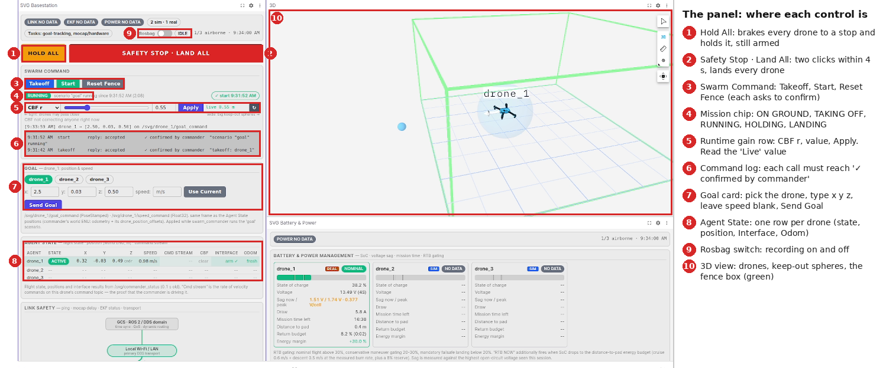
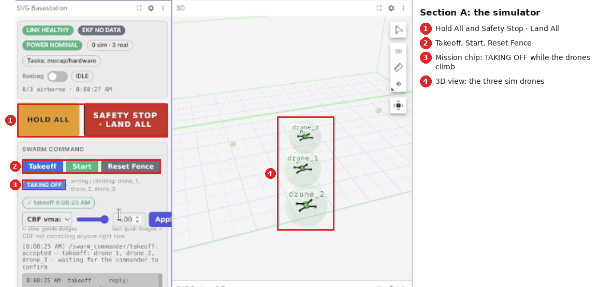
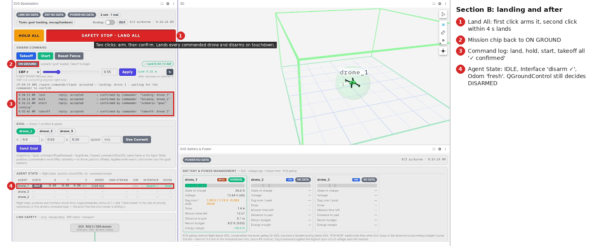
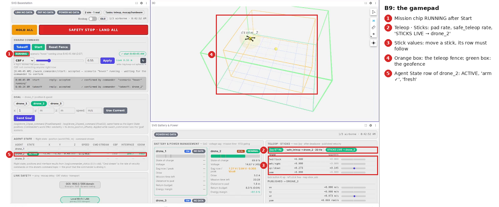
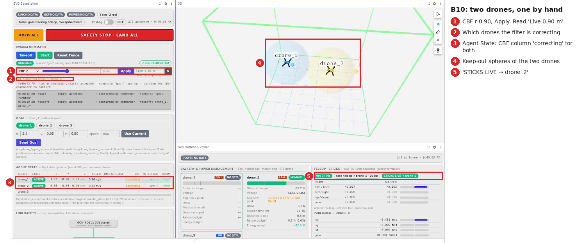
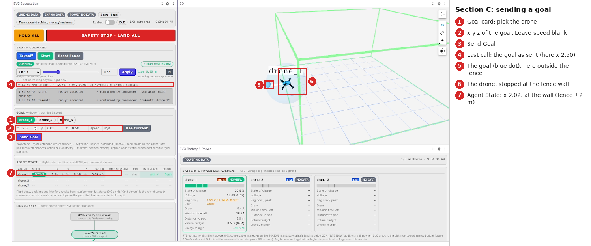
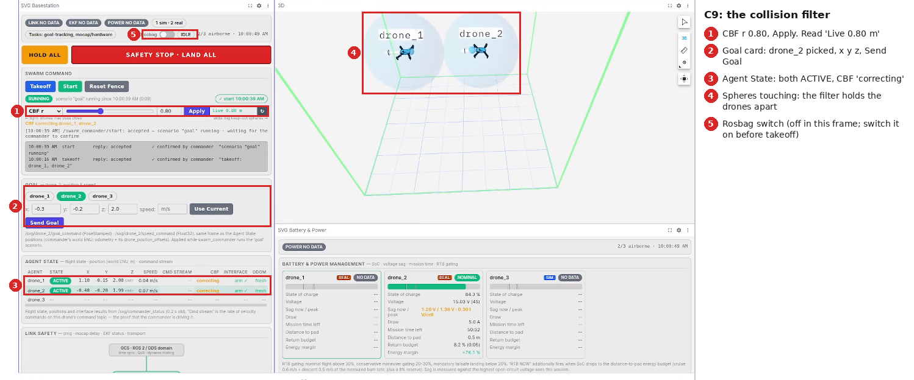

# RUNBOOK — start the pipeline fast

| Session | SIM or REAL | Go to |
|---|---|---|
| Fly in simulation with the four-tab window | SIM | [A](#a--fly-in-simulation--sim-validated-in-part-on-this-branch-recordledgermd) |
| Fly the simulation with the keyboard, one drone | SIM | [Keyboard teleop](../localisation/README.md#fly-it-with-the-keyboard-one-drone-sim-only) |
| One real drone, takeoff and land from the commander | REAL | [B](#b--real-drone-session-mocap-room) |
| One real drone on the gamepad | REAL | [B9](#b9--fly-one-real-drone-with-the-gamepad) |
| Two real drones, one flown by hand | REAL | [B10](#b10--two-real-drones-one-flown-by-hand) |
| One real drone flying to commanded goals | REAL | [C](#c--goal-flights-fly-to-commanded-waypoints) |
| Two real drones with the collision filter | REAL | [C9](#c9--two-real-drones-with-the-collision-filter-cbf) |
| Two real drones, random goals with the collision filter | REAL | [C10](#c10--two-real-drones-fly-random-goals-with-the-collision-filter) |
| Two real drones, CMU's figure-8 with the collision filter | REAL | [C11](#c11--two-real-drones-fly-cmus-figure-8-with-the-collision-filter) |
| Demo day: the three two-drone flights in order | REAL | [E](#e--demo-day--the-three-flights-in-order) |
| Pull and review the PX4 logs after a flight | REAL | [D](#d--post-flight--pull--review-the-px4-logs) |

For anyone whose machine is already set up. Every code block says where it runs. Unfamiliar term? See [GLOSSARY.md](GLOSSARY.md).

**Prompt rule:** `jeremychia@…$` = laptop · `root@…#` = inside the robot container (the docker
container that holds the ROS 2 workspace) · `starling2-max…$` = on the drone (adb/ssh) ·
`root@…:/exploration#` = the exploration container (camera-world runs — [localisation/README.md](../localisation/README.md)).

**Never paste across a `connect` line.** It opens a new shell and swallows what follows.

Iron rules, RC channels (ch5 arm · ch6 mode · ch8 KILL) and the emergency order: [PREFLIGHT.md](PREFLIGHT.md).

The `bringup` tmux session has 8 panes: pane 0 top-left, 1–4 across the top, 5–7 along the bottom. Each is a container shell with the workspace sourced. Sections B and C say "pane N". Section A says "`<name>` tab".

tmux moves: `Ctrl-b` then an arrow key switches panes. `Ctrl-b d` detaches. The session survives closing the terminal (`connect` again to return).

Where to look on the panel: [Figure 1](#fig-1).

<a id="fig-1"></a>


*Figure 1. The SVG Basestation panel in Foxglove during the one-drone goal flight of 11 November 2026 (frame from `videos/geofence_test_ui.mp4`, 9:33:59). Red boxes mark the controls this page uses. The banner's `EKF NO DATA` chip reads the same in every recorded session and is not the fusion check.*

---

## A · Fly in SIMULATION — sim validated in part on this branch ([record/LEDGER.md](record/LEDGER.md))

> **WORLD: SIMULATION — nothing in this section touches the drone.** Step 0, before anything else: the drone's battery is OUT and `./mocap.sh` is NOT running on the laptop (the sim shares DDS domain 1 and the `/drone_1` topic names with the real drone). ⚠️ Sim-only — never port to the drone: the sim airframe values and `cbf_sim.yaml` speeds/landing settle (iron rule 9).

### A0 — open the session (one command)

**1 · Laptop · the four tabs**
```bash
~/AirStack-starling-max2/tools/sim_terminals.sh
```
Must see: ONE Terminator window, four tabs (Isaac Sim, Interfaces, Commander, Cockpit), each already inside its container. Keep the window open.

### A1 — Isaac Sim tab: spawn the sim drones

**2 · Isaac Sim · spawn the drones.** Starling 2 Max model, Isaac window on. Paste as one block.
```bash
DRONE_USD=/isaac-sim/AirStack/simulation/isaac-sim/assets/robots/starling2max.usd PX4_VEHICLE_MODEL=pegasus_starling2max NUM_ROBOTS=3 SVG_DOMAIN_ID=1 PLAY_SIM_ON_START=true ISAAC_SIM_HEADLESS=false PYTHONPATH="$ISAAC_SIM_PYTHONPATH" /isaac-sim/python.sh /isaac-sim/AirStack/simulation/isaac-sim/launch_scripts/svg_multi_drone_single_domain.py --ext-folder ~/.local/share/ov/data/documents/Kit/shared/exts
```
Must see: `Ready for takeoff!` ×3. Leave running. Other launch lines: [§ Sim launch variants](#sim-launch-variants).

> ⚠️ **Never press Stop / Play in the Isaac window** to reset the drones. The new PX4s never connect and the whole stack has to be restarted ([TROUBLESHOOTING.md](TROUBLESHOOTING.md), "Pressed Stop ▶ Play").
> The only reset is Ctrl-C + relaunch of this script, then the Interfaces and Commander tabs.
> To bring landed drones back to their pads without a restart: `hold` → formation `home` → `land`. This works **only** under `scenario:=goal`.

### A2 — Interfaces tab: one MAVROS per drone

**3 · Interfaces · MAVROS.** Only after `Ready for takeoff!` ×3.
```bash
./src/svg_ground_control/scripts/launch_sim_interfaces.sh 3
```
Leave running.

### A3 — Commander tab: the commander + the panel

**4 · Commander · the commander** [Figure 2](#fig-2).
```bash
ros2 launch svg_ground_control ground_control.launch.py config:=$(ros2 pkg prefix svg_ground_control)/share/svg_ground_control/config/cbf_sim.yaml scenario:=random_goals use_foxglove_studio:=true
```
Must see: Foxglove Studio opens, already connected. Leave running.

<a id="fig-2"></a>


*Figure 2. The panel in a three-drone simulator session on 21 October 2026, just after Takeoff (frame from `videos/random_CBF_sim_edited.mp4`). The mission chip reads `TAKING OFF` while the drones climb.*

### A4 — Cockpit tab: fly

**Cockpit tab · paste this before takeoff, even if you fly from the panel.** It is your fallback if the panel freezes. Pasting runs nothing. Then type one word at a time, for example `land`.
```bash
takeoff() { ros2 service call /swarm_commander/takeoff std_srvs/srv/Trigger; }
start()   { ros2 service call /swarm_commander/start   std_srvs/srv/Trigger; }
hold()    { ros2 service call /swarm_commander/hold    std_srvs/srv/Trigger; }
land()    { ros2 service call /swarm_commander/land    std_srvs/srv/Trigger; }
reset_fence() { ros2 service call /swarm_commander/reset_fence std_srvs/srv/Trigger; }
```

**5 · Panel · takeoff.**
Swarm Command card: **Takeoff**, confirm. Or `takeoff` in the Cockpit tab. Arms and climbs.
Must see, the panel: command log `sent → accepted → ✓ confirmed`. Never click Takeoff twice because a reply was slow.
Must see: `holding takeoff position` ×3 (about 30 s). Only then `start`.

**6 · Panel · start.** Swarm Command card: **Start**, confirm. Or `start` in the Cockpit tab.
Must see, the panel: command log `sent → accepted → ✓ confirmed`, mission chip `RUNNING`.
Drones frozen with the `FENCE BREACH` chip (`hold_all` configs): `land`, then the panel's **Reset Fence** (or `reset_fence` in this tab), then `takeoff` + `start` again. `keep_in` configs never latch: the drone brakes at the wall.
A MAVROS node died and came back after 2 s (the respawn is sim-only — never port to the drone): PX4 has dropped to its offboard-loss failsafe. In this tab: `ros2 topic echo /drone_N/interface/mavros/state --once`. If `mode` ≠ `OFFBOARD`: `ros2 service call /drone_N/interface/mavros/set_mode mavros_msgs/srv/SetMode "{custom_mode: AUTO.LAND}"`, then the commander's `land`.

**7 · Panel · hold.** Safety bar: **Hold All**. Or `hold` in the Cockpit tab. Freezes the drones in a hover. Also the PANIC button.
Must see, the panel: mission chip `HOLDING`.

**8 · Panel · land.** Safety bar: **Safety Stop · Land All**, two clicks within 4 s. Or `land` in the Cockpit tab. Land from the hover — never mid-leg.
Must see, Commander tab, per drone: `touchdown at z=… settling 2.0 s before disarm`, then `landed, disarmed (attempt 1)`.
If not: PX4 refused the disarm. Up to 5 retries follow, 1 s apart, then ERROR `disarm not accepted after 5 tries` → the MAVROS recovery in step 6, and [TROUBLESHOOTING.md](TROUBLESHOOTING.md), "Landing ends with the drone still armed".

**9 · Cockpit · disarmed**
```bash
ros2 topic echo /drone_1/interface/mavros/state --once
```
Must see: `armed: false`. If not: [TROUBLESHOOTING.md](TROUBLESHOOTING.md), "Landing ends with the drone still armed".

**Shutdown.** Ctrl-C each tab's launch.

**10 · Laptop · stack down**
```bash
cd ~/AirStack-starling-max2/AirStack && ./airstack.sh down
```

---

## B · REAL DRONE session (mocap room)

> **WORLD: REAL DRONE.** One Starling (`drone_1`), `swarm_real_ours.yaml`: takeoff, hover, land. Motion-capture positioning (mocap). [PREFLIGHT.md](PREFLIGHT.md) gates every takeoff. Gates before the next real flight: [MILESTONES.md](MILESTONES.md#before-the-next-real-flight) "Before the next real flight".
> Which world: Isaac container NOT running, no `mavros_node` and no `svg_teleop` in `ros2 node list`. ⚠️ Never start Isaac Sim during a real session: the sim publishes on the real drone's topic names.
> **Panic:** the panel's **Hold All**, then **Safety Stop · Land All** (two clicks within 4 s), or `hold` then `land` in pane 4. Hold brakes to a stop point ahead and holds there, still ARMED. `hold` is not flown on the real drone: where it stops the drone is untested (NEAR-832).
> Anything scary: KILL (ch8), then `land` once. Takeover: ch6 MANUAL only.
> Until DISARMED, press Ctrl-C in pane 4 only.
> Prompts, panes and tmux moves: [top of this page](#runbook--start-the-pipeline-fast).

<!-- shared-opening -->

Every drone powered and booted. Laptop or its IP changed since the last session: re-provision ([DRONE_SETUP.md](DRONE_SETUP.md#4--point-px4-at-the-laptop-uxrce-dds-provisioning) §4).
Then REBOOT every drone, never `systemctl restart voxl-px4` (iron rule 7).

**1 · Laptop · no sim, mocap ports clear, every drone answers**
```bash
docker ps | grep isaac
ss -ulpn | grep -E ':(1510|1511)' || echo "ports clear"
ping -c2 10.40.2.11
```
Must see: nothing from `docker ps`, then `ports clear`, then ping replies.
If not: ports → `./mocap.sh stop`, re-check. No reply → IPs drift: [CONFIG.md](CONFIG.md) table.

<!-- /shared-opening -->

**2 · Laptop · today's IPs, Motive PC answers.** `<MOTIVE_IP>`: the network table in [CONFIG.md](CONFIG.md).
```bash
ip -4 -brief addr
ping -c2 <MOTIVE_IP>
```
Must see: `enp…` on `192.168.9.x` (mocap path) and `wlp…` on `10.40.2.x` (drone segment). Then ping replies.

<!-- shared-opening -->

**3 · Laptop · robot container up**
```bash
cd ~/AirStack-starling-max2/AirStack
./airstack.sh up robot-desktop
```

**4 · Laptop, new terminal · QGroundControl**
```bash
~/QGroundControl-x86_64.AppImage
```
Must see: `drone_1` in QGroundControl. Keep it visible. If not: [TROUBLESHOOTING.md](TROUBLESHOOTING.md), "QGC shows no vehicle" and "Two drones on, QGC shows only one".

**5 · Laptop, new terminal · mocap.** A Motive rigid body must exist for each drone (`drone_1`) before this starts ([MOCAP.md](MOCAP.md)).
```bash
cd ~/AirStack-starling-max2 && ./mocap.sh
```
Leave running.

**6 · Laptop · into the container**
```bash
cd ~/AirStack-starling-max2/AirStack && ./airstack.sh connect robot
```
Must see: tmux "bringup", prompt `root@…#`.

**7 · Pane 1 · the drone link**
```bash
MicroXRCEAgent udp4 -p 8888 -v4
```
Must see: `session established`. Leave running.
If not: a stale laptop IP on a drone means no session. Re-provision it ([DRONE_SETUP.md](DRONE_SETUP.md#4--point-px4-at-the-laptop-uxrce-dds-provisioning) §4), then reboot.

**8 · Pane 4 · link alive**
```bash
ros2 topic hz /drone_1/fmu/out/vehicle_status
```
Must see: about 30 Hz. Ctrl-C after each reading. If not: is pane 1 running? ([TROUBLESHOOTING.md](TROUBLESHOOTING.md), "`/fmu/*` topics look dead")

**9 · Pane 4 · pose alive**
```bash
ros2 topic hz /drone_1/pose
```
Must see: a steady rate, about 240 Hz. Ctrl-C after each reading. If not: `./mocap.sh check` on the laptop names the culprit.

**10 · Pane 2 · interfaces**
```bash
ros2 launch svg_ground_control real_interfaces.launch.py drones:=drone_1
```
Must see: the startup line of `drone_1` says `target_system=1`.
Leave running. If not: do not fly (iron rule 5).

<!-- /shared-opening -->

**11 · Pane 3 · the commander**
```bash
ros2 launch svg_ground_control ground_control.launch.py \
  config:=$(ros2 pkg prefix svg_ground_control)/share/svg_ground_control/config/swarm_real_ours.yaml \
  use_mocap:=true use_foxglove_studio:=true
```
Must see: Foxglove Studio opens, already pointed at the bridge. `foxglove_bridge` listening on 8765. Leave running.
Also expected: a WARN that `drone_position_offsets` are all zero (correct for mocap), and `LED daemon` warnings if no strip is fitted (harmless).

**12 · Pane 4 · odometry flowing**
```bash
ros2 topic hz /drone_1/odometry_conversion/odometry
```
Must see: a steady rate. Ctrl-C after the reading. If not: takeoff will be refused. [TROUBLESHOOTING.md](TROUBLESHOOTING.md), "Takeoff refused".

**13 · Pane 4 · mocap into PX4**
```bash
ros2 topic hz   /drone_1/fmu/in/vehicle_visual_odometry
```
Must see: about the mocap rate (mocap_bridge alive). Ctrl-C after the reading.

**14 · Pane 4 · EKF2 output, commander status.** ⚠️ Copy-paste these: arrow-key editing `in/` into `out/` gives a nonexistent `/fmu/inout/…` topic.
```bash
ros2 topic echo /drone_1/fmu/in/vehicle_visual_odometry --once --qos-reliability best_effort
ros2 topic echo /drone_1/fmu/out/vehicle_odometry --once --qos-reliability best_effort --qos-durability volatile
ros2 topic echo /svg/commander_status --once
```
Must see: the `out/…` position matches the `in/…` position within a few cm (EKF2 is fusing). `in/…` velocities read `.nan`: by design.
Must see: the status shows `drone_1`, `"odom_fresh": true`, `"state": "IDLE"`. If not IDLE: `land` once, drone on the floor ([TROUBLESHOOTING.md](TROUBLESHOOTING.md), "Takeoff refused").
Every `/fmu/*` echo needs `--qos-reliability best_effort` or it looks dead. `ros2 topic hz` does not accept that flag: run hz bare.

**15 · Floor · frame hand-check** (first flight of the day, and after any Motive recalibration or ground-plane change)

Carry the drone and re-run step 14's second echo (`out/…`) at each position.

Must see: North → `position[0]`↑, East → `[1]`↑, up → `[2]`↓. If not: wrong axes = DO NOT FLY ([PREFLIGHT.md](PREFLIGHT.md)).

**16 · Foxglove Studio · Basestation check, no arming.**

Must see: mission chip `ON GROUND`, the Agent State row for `drone_1` reads `IDLE · odom fresh · x y z tagged cmdr`, and the drone mesh in the 3D view follows the hand-carried drone.
The banner's EKF chip reads `EKF NO DATA` in every recording so far ([Figure 1](#fig-1)): not a fault, and not the fusion check (step 14 is).
If not: the row says `odom none` → step 10 must be running ([TROUBLESHOOTING.md](TROUBLESHOOTING.md), "No odometry reaching the commander").

**17 · Floor · go / no-go**

Every box on [PREFLIGHT.md](PREFLIGHT.md), and a briefed safety pilot holds the transmitter. Do not call `takeoff` before.
This session adds: `drone_1` flies by the owner's decision, with a second person watching its front-right motor at takeoff (iron rule 10).
⚠️ Kill-switch ground check (after any RC change, and once after the branch switch): props OFF, software takeoff, flip kill — motors cut instantly ([PREFLIGHT.md](PREFLIGHT.md), [DRONE_SETUP.md](DRONE_SETUP.md) §8). Then `land` once. Props on only after QGroundControl says DISARMED (iron rules 2, 3).
`drone_1` stands ON the takeoff point (x -0.5, y 0.0 in `swarm_real_ours.yaml`), nose toward +x (iron rule 10).

**Stop table.** The [PREFLIGHT.md](PREFLIGHT.md) emergency table comes first.

| What you see | Do this | Record |
|---|---|---|
| A motor of `drone_1` does not spin with the others at takeoff | KILL, then `land` once | hazard 6, [#34](record/LEDGER.md) |
| You need it down | `land` (pane 4, or the panel's Safety Stop, two clicks) | iron rule 2 |
| Fence latched: `FENCE BREACH` chip, the drone frozen, still ARMED (`swarm_real_ours.yaml` is `hold_all`) | `land`, then pane 4: `ros2 service call /swarm_commander/reset_fence std_srvs/srv/Trigger` (or the panel's Reset Fence). QGroundControl DISARMED, drone back ON its takeoff point (iron rule 10), then `takeoff` and `start` again | [TROUBLESHOOTING.md](TROUBLESHOOTING.md), "Fence breach" |
| The panel's command log after `takeoff`: `DENIED`, or no entry at all | `DENIED`: `land` once, hands clear, before touching switch or throttle. QGroundControl's message bar names why. Fix it, then `takeoff` again. No entry at all: `target_system` mismatch, do not fly until fixed ([TROUBLESHOOTING.md](TROUBLESHOOTING.md), "`takeoff` accepted") | iron rule 5 |
| You take over with the RC | flip ch6 straight to MANUAL, never Position/Altitude, or KILL. After ANY RC takeover: `land` once (drone on the floor) before the next takeoff | iron rules 1 and 3 |
| Anything scary | KILL (ch8), then `land` once with the drone on the floor | iron rule 3 |
| Landed, but QGroundControl still says ARMED | after about 10 s: KILL or arm switch (ch5) down. Nobody walks in | iron rule 2 |

**Pane 4 · paste this before takeoff, even if you fly from the panel.** It is your fallback if the panel freezes. Pasting runs nothing. Then type one word at a time, for example `land`.
```bash
takeoff() { ros2 service call /swarm_commander/takeoff std_srvs/srv/Trigger; }
start()   { ros2 service call /swarm_commander/start   std_srvs/srv/Trigger; }
hold()    { ros2 service call /swarm_commander/hold    std_srvs/srv/Trigger; }
land()    { ros2 service call /swarm_commander/land    std_srvs/srv/Trigger; }
reset_fence() { ros2 service call /swarm_commander/reset_fence std_srvs/srv/Trigger; }
```

**18 · Panel · takeoff.**
Everyone stays outside the net from takeoff until QGroundControl says DISARMED.
Swarm Command card: **Takeoff**, confirm. Or `takeoff` in pane 4.
Must see, the panel: command log `sent → accepted → ✓ confirmed`, Interface column `request offboard ✓ · arm ✓`. Never click Takeoff twice because a reply was slow.
Must see, pane 3: `holding takeoff position`. Only then `start`. If not: stop table, "`DENIED`, or no entry at all".

**19 · Panel · start.** Swarm Command card: **Start**, confirm. Or `start` in pane 4.
Must see, the panel: command log `sent → accepted → ✓ confirmed`, mission chip `RUNNING`.

**20 · Pane 4 · hover check.** Hover about 20 s before `land`.
```bash
ros2 topic hz /drone_1/fmu/trajectory_command
```
Must see: about 20 Hz. Ctrl-C after the reading. The panel's `Cmd stream` column reads `--` on a real drone ([BASESTATION.md](BASESTATION.md) §6).
If not: stop table, "You need it down".

**21 · Panel · land.** Safety bar: **Safety Stop · Land All**, two clicks within 4 s. Or `land` in pane 4. [Figure 3](#fig-3).
Must see: QGroundControl shows DISARMED before anyone walks in. If not: still ARMED after about 10 s → KILL or arm switch (ch5) down (iron rule 2).
At touchdown on this software the Interface column shows `disarm ✗` and QGroundControl one red "Disarming denied" until the landing test (NEAR-826) is re-observed: expected, not a fault.

<a id="fig-3"></a>


*Figure 3. The panel just after Land All on 11 November 2026 (frame from `videos/geofence_test_ui.mp4`, 9:34:15). That flight used `goal_single_ours.yaml`; the controls are the same here. QGroundControl, not the panel, says when the drone is DISARMED.*

**Shutdown.** Only after QGroundControl says DISARMED: Ctrl-C panes 3, 2, 1 and the mocap terminal.

**22 · Laptop, drone on USB-C · stack down, drone off**
```bash
cd ~/AirStack-starling-max2/AirStack && ./airstack.sh down
adb shell shutdown now
```
Then wait about 10 s, and unplug USB and the battery.
Already in the drone's own shell (adb or ssh)? Type `shutdown now` there instead. Never in a laptop or container shell: on the laptop it powers off the laptop.

### B9 — Fly one real drone with the gamepad

> **WORLD: REAL DRONE.** One Starling (`drone_2`), hand-flown with a Logitech F310 pad, motion-capture positioning (mocap). No Isaac Sim. [PREFLIGHT.md](PREFLIGHT.md) gates the takeoff.
> **Panic:** the panel's **Hold All**, then **Safety Stop · Land All** (two clicks within 4 s), or `hold` then `land` in pane 4. Anything scary: KILL (ch8), then `land` once with the drone on the floor. `hold` is not flown on a hand-flown real drone: where it stops the drone is untested (NEAR-832).
> Until DISARMED, press Ctrl-C in pane 4 only.
> Prompts, panes and tmux moves: [top of this page](#runbook--start-the-pipeline-fast).

**`drone_1` instead:** step 3 runs `tools/real.sh teleop drone_1`; paste the lines it prints (they say `drone_1` and `target_systems:=1`), ping `10.40.2.11`, read `drone_1` for `drone_2` in every check.
It flies by the owner's decision, with a watcher on its front-right motor at every takeoff ([hazard 6](projects/HTX-R2.md#before-the-next-real-flight)).

<!-- shared-opening -->

Every drone powered and booted. Laptop or its IP changed since the last session: re-provision ([DRONE_SETUP.md](DRONE_SETUP.md#4--point-px4-at-the-laptop-uxrce-dds-provisioning) §4).
Then REBOOT every drone, never `systemctl restart voxl-px4` (iron rule 7).

**1 · Laptop · no sim, mocap ports clear, every drone answers**
```bash
docker ps | grep isaac
ss -ulpn | grep -E ':(1510|1511)' || echo "ports clear"
ping -c2 10.40.2.10
```
Must see: nothing from `docker ps`, then `ports clear`, then ping replies.
If not: ports → `./mocap.sh stop`, re-check. No reply → IPs drift: [CONFIG.md](CONFIG.md) table.

**2 · Laptop · robot container up**
```bash
cd ~/AirStack-starling-max2/AirStack
./airstack.sh up robot-desktop
```

<!-- /shared-opening -->

**3 · Laptop · pad check, then the config.** Pad plugged in, back switch on **X**, MODE light **off**. Move each stick when asked.
```bash
cd ~/AirStack-starling-max2 && tools/real.sh teleop drone_2
```
Must see: `PAD CHECK: PASS — do not press MODE from now on`, then the takeoff point and the pane lines. Never press MODE after this.

<!-- shared-opening -->

**4 · Laptop, new terminal · QGroundControl**
```bash
~/QGroundControl-x86_64.AppImage
```
Must see: `drone_2` in QGroundControl. Keep it visible. If not: [TROUBLESHOOTING.md](TROUBLESHOOTING.md), "QGC shows no vehicle" and "Two drones on, QGC shows only one".

**5 · Laptop, new terminal · mocap.** A Motive rigid body must exist for each drone (`drone_2`) before this starts ([MOCAP.md](MOCAP.md)).
```bash
cd ~/AirStack-starling-max2 && MOCAP_BODIES="drone_2" ./mocap.sh
```
Leave running.

**6 · Laptop · into the container**
```bash
cd ~/AirStack-starling-max2/AirStack && ./airstack.sh connect robot
```
Must see: tmux "bringup", prompt `root@…#`.

**7 · Pane 1 · the drone link**
```bash
MicroXRCEAgent udp4 -p 8888 -v4
```
Must see: `session established`. Leave running.
If not: a stale laptop IP on a drone means no session. Re-provision it ([DRONE_SETUP.md](DRONE_SETUP.md#4--point-px4-at-the-laptop-uxrce-dds-provisioning) §4), then reboot.

**8 · Pane 4 · link alive**
```bash
ros2 topic hz /drone_2/fmu/out/vehicle_status
```
Must see: about 30 Hz. Ctrl-C after each reading. If not: is pane 1 running? ([TROUBLESHOOTING.md](TROUBLESHOOTING.md), "`/fmu/*` topics look dead")

**9 · Pane 4 · pose alive**
```bash
ros2 topic hz /drone_2/pose
```
Must see: a steady rate, about 240 Hz. Ctrl-C after each reading. If not: `./mocap.sh check` on the laptop names the culprit.

**10 · Pane 2 · interfaces**
```bash
ros2 launch svg_ground_control real_interfaces.launch.py drones:=drone_2 target_systems:=2
```
Must see: the startup line of `drone_2` says `target_system=2`.
Leave running. If not: do not fly (iron rule 5).

<!-- /shared-opening -->

**11 · Pane 5 · the pad, before the commander**
```bash
ros2 launch svg_ground_control teleop.launch.py config:=/tmp/svg_real/teleop_real_drone_2.yaml
```
Must see: a `pad:` line once a second; move each stick, the numbers must follow. No `REFUSING TO COMMAND`. Leave it running until DISARMED.
If not: [TROUBLESHOOTING.md](TROUBLESHOOTING.md), "Gamepad sticks do nothing" and "`safe_teleop` prints `pad: NO /joy` forever".

**12 · Pane 3 · the commander**
```bash
ros2 launch svg_ground_control ground_control.launch.py config:=/tmp/svg_real/teleop_real_drone_2.yaml use_mocap:=true use_foxglove_studio:=true
```
Must see: Foxglove Studio opens, already pointed at the bridge. Leave running.

**13 · Pane 4 · odometry flowing**
```bash
ros2 topic hz /drone_2/odometry_conversion/odometry
```
Must see: a steady rate. Ctrl-C after the reading. If not: takeoff will be refused. [TROUBLESHOOTING.md](TROUBLESHOOTING.md), "Takeoff refused".

**14 · Pane 4 · commander status**
```bash
ros2 topic echo /svg/commander_status --once
```
Must see: `drone_2`, `"state": "IDLE"`, `"odom_fresh": true`. If not IDLE: `land` once, drone on the floor ([TROUBLESHOOTING.md](TROUBLESHOOTING.md), "Takeoff refused").

**15 · Pane 4 · pad alive**
```bash
ros2 topic hz /svg/drone_2/teleop_command
```
Must see: about 20 Hz. Ctrl-C after the reading. If not: the pad pane stopped ([TROUBLESHOOTING.md](TROUBLESHOOTING.md), "Sticks ignored after `start`").

**16 · Floor · go / no-go**

Every box on [PREFLIGHT.md](PREFLIGHT.md), and a briefed safety pilot holds the transmitter. Do not call `takeoff` before.
Basestation: each drone's Agent State row reads `IDLE · odom fresh`. Frame hand-check on the first flight of the day and after any Motive recalibration or ground-plane change ([PREFLIGHT.md](PREFLIGHT.md)).
This session adds: `drone_2` stands ON the takeoff point step 3 printed (x -0.5, y 0.0 in `teleop_real_ours.yaml`), nose toward +x.

**What to expect**

| When | You see |
|---|---|
| `takeoff` | A STRAIGHT LINE from where the drone stands to the takeoff point (z 0.5): standing on the point, a climb. The fence does not act during the climb or the landing |
| Hover | The drone hovers on the point. The Basestation's Teleop · Sticks card: `STICKS PARKED` (press Start) |
| `start` | Pane 3: `drone_2: sticks live, holding [...] until moved`. The card reads `STICKS LIVE → drone_2` |
| Flight | The teleop fence (x and y −1.5 to 1.5 m, z 0.3 to 1.8 m) is meant to brake the drone at its walls. The −y wall was seen in one flight. The +x wall and the top are not flown |
| Speed | The cap is 0.5 m/s. It caps the command, not the drone |

What was seen: [HTX-R2.md, M5](projects/HTX-R2.md#m5--gamepad-flying-on-the-real-drone--real-drone).

**Stop table.** The [PREFLIGHT.md](PREFLIGHT.md) emergency table comes first.

| What you see | Do this | Record |
|---|---|---|
| Doubt, or the drone drifts with the sticks released | `hold` (pane 4 or the panel's Hold All), then `land`. After `hold` the sticks stay dead until `start` | not flown (`hold`: NEAR-832) |
| You need it down | `land` (pane 4, or the panel's Safety Stop, two clicks) | iron rule 2 |
| A motor of `drone_1` does not spin with the others at takeoff (`drone_1` variant) | KILL, then `land` once | hazard 6, [#34](record/LEDGER.md) |
| Sticks do nothing after `start` | pane 4: `ros2 topic hz /svg/drone_2/teleop_command`. Silent = the pad pane stopped, and no warning appears: `land`. Card says `press Start`: call `start` | [#36](record/LEDGER.md) |
| Pad unplugged in flight | do not replug it in flight. `land`. The code holds the drone where it is (a stale pad = zero command) | not flown |
| Near the top or the +x wall of the teleop fence | let go of the sticks. Still moving: `hold`, then `land` | not flown |
| You take over with the RC | flip ch6 straight to MANUAL, never Position/Altitude, or KILL. After ANY RC takeover: `land` once (drone on the floor) before the next takeoff | iron rules 1 and 3 |
| Anything scary | KILL (ch8), then `land` once with the drone on the floor | iron rule 3 |
| Landed, but QGroundControl still says ARMED | after about 10 s: KILL or arm switch (ch5) down. Nobody walks in | iron rule 2 |

**Pane 4 · paste this before takeoff, even if you fly from the panel.** It is your fallback if the panel freezes. Pasting runs nothing. Then type one word at a time, for example `land`.
```bash
takeoff() { ros2 service call /swarm_commander/takeoff std_srvs/srv/Trigger; }
start()   { ros2 service call /swarm_commander/start   std_srvs/srv/Trigger; }
hold()    { ros2 service call /swarm_commander/hold    std_srvs/srv/Trigger; }
land()    { ros2 service call /swarm_commander/land std_srvs/srv/Trigger; }
```

**17 · Panel · takeoff.**
Everyone stays outside the net from takeoff until QGroundControl says DISARMED.
Swarm Command card: **Takeoff**, confirm. Or `takeoff` in pane 4.
Must see, the panel: command log `sent → accepted → ✓ confirmed`. Never click Takeoff twice because a reply was slow.
Must see, pane 3: `holding takeoff position`. Only then `start`. If not: [TROUBLESHOOTING.md](TROUBLESHOOTING.md), "Takeoff refused" and "`takeoff` accepted, ack says **`DENIED`**".

**18 · Panel · start.** Swarm Command card: **Start**, confirm. Or `start` in pane 4. [Figure 4](#fig-4).
Must see, the panel: command log `sent → accepted → ✓ confirmed`.
Must see, pane 3: `drone_2: sticks live`. Wait for it before touching the sticks. If not: stop table, "Sticks do nothing after `start`".

<a id="fig-4"></a>


*Figure 4. The panel during the gamepad flight of 13 November 2026, after Start (frame from `videos/xbox_teleop_ui.mp4`). The Teleop · Sticks card shows `STICKS LIVE → drone_2`. The orange box in the 3D view is the teleop fence.*

**19 · Pad · fly.** First turn: slow and low, thumb on KILL.

| Control | What it does |
|---|---|
| Right stick | moves the drone in ROOM axes, not relative to its nose: up = +x, left = +y |
| Left stick | up and down = climb and descend · left and right = turn |
| LB | press once to lock climb and turn, press again to unlock. The right stick still works. Pane 5 shows `LOCKED` |
| Sticks released | the drone holds where it is |

**20 · Panel · land.** Safety bar: **Safety Stop · Land All**, two clicks within 4 s. Or `land` in pane 4.
Must see: QGroundControl shows DISARMED before anyone walks in. If not: still ARMED after about 10 s → KILL or arm switch (ch5) down (iron rule 2).
At touchdown on this software the Interface column shows `disarm ✗` and QGroundControl one red "Disarming denied" until the landing test (NEAR-826) is re-observed: expected, not a fault.

**Shutdown.** Only after QGroundControl says DISARMED: Ctrl-C panes 3, 5, 2, 1 and the mocap terminal.

**21 · Laptop, drone on USB-C · stack down, drone off**
```bash
cd ~/AirStack-starling-max2/AirStack && ./airstack.sh down
adb shell shutdown now
```
Then wait about 10 s, and unplug USB and the battery.

### B10 — Two real drones, one flown by hand

> **WORLD: REAL DRONE.** Both Starlings, motion-capture positioning (mocap). `drone_1` hovers on its takeoff point. `drone_2` is hand-flown at it with the Logitech F310, and the collision filter (CBF) keeps them apart. No Isaac Sim. [PREFLIGHT.md](PREFLIGHT.md) gates the takeoff.
> **Panic:** the panel's **Hold All**, then **Safety Stop · Land All** (two clicks within 4 s), or `hold` then `land` in pane 4. Hold All and Land All act on both drones. Anything scary: KILL (each pilot their own drone), then `land` once. Killing one leaves the other flying. `land` brings down EVERY airborne drone, including the one that was not killed. `hold` is not flown on a hand-flown real drone: where it stops the drone is untested (NEAR-832).
> Until DISARMED, press Ctrl-C in pane 4 only.
> Prompts, panes and tmux moves: [top of this page](#runbook--start-the-pipeline-fast).

<!-- shared-opening -->

Every drone powered and booted. Laptop or its IP changed since the last session: re-provision ([DRONE_SETUP.md](DRONE_SETUP.md#4--point-px4-at-the-laptop-uxrce-dds-provisioning) §4).
Then REBOOT every drone, never `systemctl restart voxl-px4` (iron rule 7).

**1 · Laptop · no sim, mocap ports clear, every drone answers**
```bash
docker ps | grep isaac
ss -ulpn | grep -E ':(1510|1511)' || echo "ports clear"
ping -c2 10.40.2.10
ping -c2 10.40.2.11
```
Must see: nothing from `docker ps`, then `ports clear`, then ping replies.
If not: ports → `./mocap.sh stop`, re-check. No reply → IPs drift: [CONFIG.md](CONFIG.md) table.

**2 · Laptop · robot container up**
```bash
cd ~/AirStack-starling-max2/AirStack
./airstack.sh up robot-desktop
```

<!-- /shared-opening -->

**3 · Laptop · pad check and the pad config for `drone_2`.** Pad plugged in, back switch on **X**, MODE light **off**. Move each stick when asked.
```bash
cd ~/AirStack-starling-max2 && tools/real.sh teleop drone_2
```
Must see: `PAD CHECK: PASS — do not press MODE from now on`. Never press MODE after this.
Use only its pane 5 line: its takeoff point and its other lines are for one drone, NOT used here. Do NOT launch pane 3 from that output: its commander line is for one drone.

<!-- shared-opening -->

**4 · Laptop, new terminal · QGroundControl**
```bash
~/QGroundControl-x86_64.AppImage
```
Must see: `drone_1, drone_2` in QGroundControl. Keep it visible. If not: [TROUBLESHOOTING.md](TROUBLESHOOTING.md), "QGC shows no vehicle" and "Two drones on, QGC shows only one".

<!-- /shared-opening -->

No takeoff until QGroundControl lists both drones (PREFLIGHT.md).

<!-- shared-opening -->

**5 · Laptop, new terminal · mocap.** A Motive rigid body must exist for each drone (`drone_1, drone_2`) before this starts ([MOCAP.md](MOCAP.md)).
```bash
cd ~/AirStack-starling-max2 && MOCAP_BODIES="drone_1 drone_2" ./mocap.sh
```
Leave running.

**6 · Laptop · into the container**
```bash
cd ~/AirStack-starling-max2/AirStack && ./airstack.sh connect robot
```
Must see: tmux "bringup", prompt `root@…#`.

**7 · Pane 1 · the drone link**
```bash
MicroXRCEAgent udp4 -p 8888 -v4
```
Must see: `session established`. Leave running.
If not: a stale laptop IP on a drone means no session. Re-provision it ([DRONE_SETUP.md](DRONE_SETUP.md#4--point-px4-at-the-laptop-uxrce-dds-provisioning) §4), then reboot.

**8 · Pane 4 · link alive**
```bash
ros2 topic hz /drone_1/fmu/out/vehicle_status
```
```bash
ros2 topic hz /drone_2/fmu/out/vehicle_status
```
Must see: about 30 Hz. Ctrl-C after each reading. If not: is pane 1 running? ([TROUBLESHOOTING.md](TROUBLESHOOTING.md), "`/fmu/*` topics look dead")

**9 · Pane 4 · pose alive**
```bash
ros2 topic hz /drone_1/pose
```
```bash
ros2 topic hz /drone_2/pose
```
Must see: a steady rate, about 240 Hz. Ctrl-C after each reading. If not: `./mocap.sh check` on the laptop names the culprit.

**10 · Pane 2 · interfaces**
```bash
ros2 launch svg_ground_control real_interfaces.launch.py drones:=drone_1,drone_2 target_systems:=1,2
```
Must see: the startup line of `drone_1` says `target_system=1`.
Must see: the startup line of `drone_2` says `target_system=2`.
Leave running. If not: do not fly (iron rule 5).

<!-- /shared-opening -->

**11 · Pane 5 · the pad for `drone_2`, before the commander**
```bash
ros2 launch svg_ground_control teleop.launch.py config:=/tmp/svg_real/teleop_real_drone_2.yaml
```
Must see: a `pad:` line once a second; move each stick, the numbers must follow. No `REFUSING TO COMMAND`. Leave it running until QGroundControl shows BOTH drones DISARMED.
If not: [TROUBLESHOOTING.md](TROUBLESHOOTING.md), "Gamepad sticks do nothing" and "`safe_teleop` prints `pad: NO /joy` forever".

**12 · Pane 3 · the commander**
```bash
ros2 launch svg_ground_control ground_control.launch.py \
  config:=/root/AirStack/robot/ros_ws/src/svg_ground_control/config/goal_two_ours.yaml \
  teleop_drones:=drone_2 use_mocap:=true use_foxglove_studio:=true
```
Must see: Foxglove Studio opens, already pointed at the bridge. Leave running.

**13 · Pane 4 · commander status and positions**
```bash
ros2 topic echo /svg/commander_status --once
```
Must see: both drones `"state": "IDLE"` and `"odom_fresh": true`, each `"position"` on its own takeoff point: `drone_1` x 1.0, y −0.2 · `drone_2` x −1.5, y −0.1.
If not: wrong side → carry the drones over, check again. Not IDLE: `land` once, drones on the floor ([TROUBLESHOOTING.md](TROUBLESHOOTING.md), "Takeoff refused").

**14 · Pane 4 · pad alive**
```bash
ros2 topic hz /svg/drone_2/teleop_command
```
Must see: about 20 Hz. Ctrl-C after the reading. If not: the pad pane stopped ([TROUBLESHOOTING.md](TROUBLESHOOTING.md), "Sticks ignored after `start`").

**15 · Pane 6 · separation readout.** Paste this block unchanged. Leave it running until both drones are DISARMED.
```bash
python3 -c "
import rclpy,numpy as np
from rclpy.node import Node
from rclpy.qos import qos_profile_sensor_data
from nav_msgs.msg import Odometry
rclpy.init();n=Node('sep');p={}
for d in('drone_1','drone_2'):
  n.create_subscription(Odometry,'/%s/odometry_conversion/odometry'%d,lambda m,d=d:p.__setitem__(d,np.array([m.pose.pose.position.x,m.pose.pose.position.y,m.pose.pose.position.z])),qos_profile_sensor_data)
n.create_timer(0.2,lambda:len(p)==2 and print('sep %.2f m'%np.linalg.norm(p['drone_1']-p['drone_2']),flush=True))
rclpy.spin(n)"
```
Must see: about 2.5 m (both drones on their points), five times a second.
If not: the block has no stale-data check. If the number stops changing while a drone moves, the readout is dead: let go of the sticks and `land`.

**16 · Floor · go / no-go**

Every box on [PREFLIGHT.md](PREFLIGHT.md).
Basestation: each drone's Agent State row reads `IDLE · odom fresh`. Frame hand-check on the first flight of the day and after any Motive recalibration or ground-plane change ([PREFLIGHT.md](PREFLIGHT.md)).
This session adds:
- Two people at takeoff (iron rule 10): the pilot, and a second person watching `drone_1`'s front-right motor. `drone_1` flies by the owner's decision. Everyone stays outside the net until QGroundControl shows both drones DISARMED.
- Each drone stands ON its own point (`hover_positions` in `goal_two_ours.yaml`, both z 1.0), nose toward +x. The points are 2.5 m apart.
- One KILL switch per drone and one person per transmitter. Confirm on the ground which transmitter is which drone.

**What to expect**

| When | You see |
|---|---|
| `takeoff` | Each drone flies a straight line to its takeoff point and hovers. The fence does not act during the climb or the landing |
| Near `drone_1` | The filter slows `drone_2`, and `drone_1` gives way |

What was seen: [projects/HTX-R2.md](projects/HTX-R2.md#m7--multi-drone--real-drone-three-drones-need-the-new-starlings), NEAR-840.

**Stop table.** The [PREFLIGHT.md](PREFLIGHT.md) emergency table comes first.

| What you see | Do this | Record |
|---|---|---|
| A motor of `drone_1` does not spin with the others at takeoff | KILL `drone_1` (its transmitter), then `land` once | hazard 6, [#34](record/LEDGER.md) |
| No stop distance is set | watch the pane 6 readout, let go once the filter resists, `land` if in doubt | the owner sets one before the next flight |
| The filter resists and `drone_1` is pushed toward its +x wall | let go of the stick | hazard 10, [#37](record/LEDGER.md) |
| `CBF emergency push-apart` in pane 3 | `land` | hazard 8 |
| You want a larger CBF radius while the drones are closer than twice the new radius | do not raise it. Fly `drone_2` back to its point first | hazard 8 |
| Sticks do nothing after `start` | pane 4: `ros2 topic hz /svg/drone_2/teleop_command`. Silent: `land` | [#36](record/LEDGER.md) |
| You take over with the RC | flip ch6 straight to MANUAL, never Position/Altitude, or KILL (each pilot their own drone). After ANY RC takeover: `land` once (drone on the floor) before the next takeoff | iron rules 1 and 3 |
| Anything scary | KILL (each pilot their own drone), then `land` once. Killing one leaves the other flying. `land` brings down EVERY airborne drone, including the one that was not killed | iron rule 3 |
| Doubt, or the drone drifts with the sticks released | `hold` (pane 4 or the panel's Hold All), then `land`. After `hold` the sticks stay dead until `start` | not flown (`hold`: NEAR-832) |
| You need it down | `land` (pane 4, or the panel's Safety Stop, two clicks) | iron rule 2 |
| Pad unplugged in flight | do not replug it in flight. `land`. The code holds the drone where it is (a stale pad = zero command) | not flown |
| Landed, but QGroundControl still says ARMED | after about 10 s: KILL or arm switch (ch5) down. Nobody walks in | iron rule 2 |

**Pane 4 · paste this before takeoff, even if you fly from the panel.** It is your fallback if the panel freezes. Pasting runs nothing. Then type one word at a time, for example `land`.
```bash
takeoff() { ros2 service call /swarm_commander/takeoff std_srvs/srv/Trigger; }
start()   { ros2 service call /swarm_commander/start std_srvs/srv/Trigger; }
hold()    { ros2 service call /swarm_commander/hold    std_srvs/srv/Trigger; }
land()    { ros2 service call /swarm_commander/land std_srvs/srv/Trigger; }
```

**17 · Panel · takeoff.**
Watcher on `drone_1`'s front-right motor, from outside the net ([hazard 6](projects/HTX-R2.md#before-the-next-real-flight)).
Swarm Command card: **Takeoff**, confirm. Or `takeoff` in pane 4.
Must see, the panel: command log `sent → accepted → ✓ confirmed`. Never click Takeoff twice because a reply was slow.
Must see, pane 3: `holding takeoff position` twice. Wait for both. Only then step 18 (radius), then step 19 (start). If not: [TROUBLESHOOTING.md](TROUBLESHOOTING.md), "Takeoff refused" and "`takeoff` accepted, ack says **`DENIED`**".

**18 · Panel · CBF radius 0.90, with both drones holding on their own points.** Runtime gain row: dropdown **CBF r**, 0.90, **Apply**. [Figure 5](#fig-5).
Must see, the panel: the `live` readout "Live 0.90 m", marked `✓`, before you go on.
Or pane 4:
```bash
ros2 param set /swarm_commander cbf_safety_radius_m 0.90
ros2 param get /swarm_commander cbf_safety_radius_m
```
Must see: the read-back says 0.9.
Skipping this step leaves the file's 0.55, which has not been flown with the pad. A commander restart puts it back to 0.55.

<a id="fig-5"></a>


*Figure 5. The panel during the two-drone gamepad flight of 13 November 2026 (frame from `videos/cbf_teleop_two_drones_ui.mp4`). The runtime gain row reads `Live 0.90 m` and the collision filter is correcting both drones.*

**19 · Panel · start: the sticks go live for `drone_2`.** Swarm Command card: **Start**, confirm. Or `start` in pane 4.
Must see, the panel: command log `sent → accepted → ✓ confirmed`.
If the sticks do nothing: stop table, "Sticks do nothing after `start`".

**20 · Pad · fly `drone_2` slowly toward `drone_1` along x, at the takeoff height.** Watch the readout in pane 6.
Other directions and height offsets are not flown.
The teleop fence (x and y −3.0 to 3.0 m, z 0.3 to 2.5 m) brakes `drone_2` only. The 3D view draws it as an amber box.
Around it, the geofence (x and y −3.25 to 3.25 m, z 0 to 4 m) brakes both drones. Flying into either wall: not flown.
Let go once the filter resists. No stop distance is set.

| Control | What it does |
|---|---|
| Right stick | moves the drone in ROOM axes, not relative to its nose: up = +x, left = +y |
| Left stick | up and down = climb and descend · left and right = turn |
| LB | press once to lock climb and turn, press again to unlock. The right stick still works. Pane 5 shows `LOCKED` |
| Sticks released | the drone holds where it is |

**21 · Panel · land both.** Safety bar: **Safety Stop · Land All**, two clicks within 4 s. Or `land` in pane 4.
Must see: QGroundControl shows BOTH drones DISARMED before anyone walks in.
If not: still ARMED after about 10 s → KILL or arm switch (ch5) down (iron rule 2).
At touchdown on this software the Interface column shows `disarm ✗` and QGroundControl one red "Disarming denied" until the landing test (NEAR-826) is re-observed: expected, not a fault.

**Shutdown.** Only after QGroundControl shows both drones DISARMED: Ctrl-C panes 6, 3, 5, 2, 1 and the mocap terminal.

**22 · Laptop, one drone on USB-C at a time · stack down, drones off**
```bash
cd ~/AirStack-starling-max2/AirStack && ./airstack.sh down
adb shell shutdown now
```
Then wait about 10 s, and unplug USB and the battery. Then the other drone: plug it in and run the `adb` line again.

---

## C · GOAL FLIGHTS (fly to commanded waypoints)

> **WORLD: REAL DRONE.** One Starling (`drone_1`), `goal_single_ours.yaml`: takeoff, fly to commanded goals, land. Motion-capture positioning (mocap). [PREFLIGHT.md](PREFLIGHT.md) gates every takeoff. Gates before the next real flight: [MILESTONES.md](MILESTONES.md#before-the-next-real-flight) "Before the next real flight". What was seen: [HTX-R2.md, M4](projects/HTX-R2.md#m4--goal-flights-with-the-braking-fence--real-drone).
> Which world: Isaac container NOT running, no `mavros_node` and no `svg_teleop` in `ros2 node list`. ⚠️ Never start Isaac Sim during a real session: the sim publishes on the real drone's topic names.
> **Panic:** the panel's **Hold All**, then **Safety Stop · Land All** (two clicks within 4 s), or `hold` then `land` in pane 4. Hold brakes to a stop point ahead and holds there, still ARMED. `hold` is not flown on the real drone: where it stops the drone is untested (NEAR-832).
> Anything scary: KILL (ch8), then `land` once. Takeover: ch6 MANUAL only.
> Until DISARMED, press Ctrl-C in pane 4 only.
> Prompts, panes and tmux moves: [top of this page](#runbook--start-the-pipeline-fast).

<!-- shared-opening -->

Every drone powered and booted. Laptop or its IP changed since the last session: re-provision ([DRONE_SETUP.md](DRONE_SETUP.md#4--point-px4-at-the-laptop-uxrce-dds-provisioning) §4).
Then REBOOT every drone, never `systemctl restart voxl-px4` (iron rule 7).

**1 · Laptop · no sim, mocap ports clear, every drone answers**
```bash
docker ps | grep isaac
ss -ulpn | grep -E ':(1510|1511)' || echo "ports clear"
ping -c2 10.40.2.11
```
Must see: nothing from `docker ps`, then `ports clear`, then ping replies.
If not: ports → `./mocap.sh stop`, re-check. No reply → IPs drift: [CONFIG.md](CONFIG.md) table.

<!-- /shared-opening -->

**2 · Laptop · today's IPs, Motive PC answers.** `<MOTIVE_IP>`: the network table in [CONFIG.md](CONFIG.md).
```bash
ip -4 -brief addr
ping -c2 <MOTIVE_IP>
```
Must see: `enp…` on `192.168.9.x` (mocap path) and `wlp…` on `10.40.2.x` (drone segment). Then ping replies.

<!-- shared-opening -->

**3 · Laptop · robot container up**
```bash
cd ~/AirStack-starling-max2/AirStack
./airstack.sh up robot-desktop
```

**4 · Laptop, new terminal · QGroundControl**
```bash
~/QGroundControl-x86_64.AppImage
```
Must see: `drone_1` in QGroundControl. Keep it visible. If not: [TROUBLESHOOTING.md](TROUBLESHOOTING.md), "QGC shows no vehicle" and "Two drones on, QGC shows only one".

**5 · Laptop, new terminal · mocap.** A Motive rigid body must exist for each drone (`drone_1`) before this starts ([MOCAP.md](MOCAP.md)).
```bash
cd ~/AirStack-starling-max2 && ./mocap.sh
```
Leave running.

**6 · Laptop · into the container**
```bash
cd ~/AirStack-starling-max2/AirStack && ./airstack.sh connect robot
```
Must see: tmux "bringup", prompt `root@…#`.

**7 · Pane 1 · the drone link**
```bash
MicroXRCEAgent udp4 -p 8888 -v4
```
Must see: `session established`. Leave running.
If not: a stale laptop IP on a drone means no session. Re-provision it ([DRONE_SETUP.md](DRONE_SETUP.md#4--point-px4-at-the-laptop-uxrce-dds-provisioning) §4), then reboot.

**8 · Pane 4 · link alive**
```bash
ros2 topic hz /drone_1/fmu/out/vehicle_status
```
Must see: about 30 Hz. Ctrl-C after each reading. If not: is pane 1 running? ([TROUBLESHOOTING.md](TROUBLESHOOTING.md), "`/fmu/*` topics look dead")

**9 · Pane 4 · pose alive**
```bash
ros2 topic hz /drone_1/pose
```
Must see: a steady rate, about 240 Hz. Ctrl-C after each reading. If not: `./mocap.sh check` on the laptop names the culprit.

**10 · Pane 2 · interfaces**
```bash
ros2 launch svg_ground_control real_interfaces.launch.py drones:=drone_1
```
Must see: the startup line of `drone_1` says `target_system=1`.
Leave running. If not: do not fly (iron rule 5).

<!-- /shared-opening -->

**11 · Pane 3 · the commander**
```bash
ros2 launch svg_ground_control ground_control.launch.py \
  config:=$(ros2 pkg prefix svg_ground_control)/share/svg_ground_control/config/goal_single_ours.yaml \
  use_mocap:=true use_foxglove_studio:=true
```
Must see: Foxglove Studio opens, already pointed at the bridge. `foxglove_bridge` listening on 8765. Leave running.
Also expected: a WARN that `drone_position_offsets` are all zero (correct for mocap), and `LED daemon` warnings if no strip is fitted (harmless).

**12 · Pane 4 · odometry flowing**
```bash
ros2 topic hz /drone_1/odometry_conversion/odometry
```
Must see: a steady rate. Ctrl-C after the reading. If not: takeoff will be refused. [TROUBLESHOOTING.md](TROUBLESHOOTING.md), "Takeoff refused".

**13 · Pane 4 · mocap into PX4**
```bash
ros2 topic hz   /drone_1/fmu/in/vehicle_visual_odometry
```
Must see: about the mocap rate (mocap_bridge alive). Ctrl-C after the reading.

**14 · Pane 4 · EKF2 output, commander status.** ⚠️ Copy-paste these: arrow-key editing `in/` into `out/` gives a nonexistent `/fmu/inout/…` topic.
```bash
ros2 topic echo /drone_1/fmu/in/vehicle_visual_odometry --once --qos-reliability best_effort
ros2 topic echo /drone_1/fmu/out/vehicle_odometry --once --qos-reliability best_effort --qos-durability volatile
ros2 topic echo /svg/commander_status --once
```
Must see: the `out/…` position matches the `in/…` position within a few cm (EKF2 is fusing). `in/…` velocities read `.nan`: by design.
Must see: the status shows `drone_1`, `"odom_fresh": true`, `"state": "IDLE"`. If not IDLE: `land` once, drone on the floor ([TROUBLESHOOTING.md](TROUBLESHOOTING.md), "Takeoff refused").
Every `/fmu/*` echo needs `--qos-reliability best_effort` or it looks dead. `ros2 topic hz` does not accept that flag: run hz bare.

**15 · Floor · frame hand-check** (first flight of the day, and after any Motive recalibration or ground-plane change)

Carry the drone and re-run step 14's second echo (`out/…`) at each position.

Must see: North → `position[0]`↑, East → `[1]`↑, up → `[2]`↓. If not: wrong axes = DO NOT FLY ([PREFLIGHT.md](PREFLIGHT.md)).

**16 · Foxglove Studio · Basestation check, no arming.**

Must see: mission chip `ON GROUND`, the Agent State row for `drone_1` reads `IDLE · odom fresh · x y z tagged cmdr`, and the drone mesh in the 3D view follows the hand-carried drone.
The banner's EKF chip reads `EKF NO DATA` in every recording so far ([Figure 1](#fig-1)): not a fault, and not the fusion check (step 14 is).
If not: the row says `odom none` → step 10 must be running ([TROUBLESHOOTING.md](TROUBLESHOOTING.md), "No odometry reaching the commander").

**17 · Floor · go / no-go**

Every box on [PREFLIGHT.md](PREFLIGHT.md), and a briefed safety pilot holds the transmitter. Do not call `takeoff` before.
This session adds: `drone_1` flies by the owner's decision, with a second person watching its front-right motor at takeoff (iron rule 10).
⚠️ Kill-switch ground check (after any RC change, and once after the branch switch): props OFF, software takeoff, flip kill — motors cut instantly ([PREFLIGHT.md](PREFLIGHT.md), [DRONE_SETUP.md](DRONE_SETUP.md) §8). Then `land` once. Props on only after QGroundControl says DISARMED (iron rules 2, 3).
`drone_1` stands on the floor ON the config's `hover_positions` x,y (x -0.5, y 0.0 in `goal_single_ours.yaml`), nose toward +x: takeoff flies to that ABSOLUTE point (iron rule 10).

**Stop table.** The [PREFLIGHT.md](PREFLIGHT.md) emergency table comes first.

| What you see | Do this | Record |
|---|---|---|
| A motor of `drone_1` does not spin with the others at takeoff | KILL, then `land` once | hazard 6, [#34](record/LEDGER.md) |
| You need it down | `land` (pane 4, or the panel's Safety Stop, two clicks) | iron rule 2 |
| The panel's command log after `takeoff`: `DENIED`, or no entry at all | `DENIED`: `land` once, hands clear, before touching switch or throttle. QGroundControl's message bar names why. Fix it, then `takeoff` again. No entry at all: `target_system` mismatch, do not fly until fixed ([TROUBLESHOOTING.md](TROUBLESHOOTING.md), "`takeoff` accepted") | iron rule 5 |
| You take over with the RC | flip ch6 straight to MANUAL, never Position/Altitude, or KILL. After ANY RC takeover: `land` once (drone on the floor) before the next takeoff | iron rules 1 and 3 |
| Anything scary | KILL (ch8), then `land` once with the drone on the floor | iron rule 3 |
| Landed, but QGroundControl still says ARMED | after about 10 s: KILL or arm switch (ch5) down. Nobody walks in | iron rule 2 |

**Pane 4 · paste this before takeoff, even if you fly from the panel.** It is your fallback if the panel freezes. Pasting runs nothing. Then type one word at a time, for example `land`.
```bash
takeoff() { ros2 service call /swarm_commander/takeoff std_srvs/srv/Trigger; }
start()   { ros2 service call /swarm_commander/start   std_srvs/srv/Trigger; }
hold()    { ros2 service call /swarm_commander/hold    std_srvs/srv/Trigger; }
land()    { ros2 service call /swarm_commander/land std_srvs/srv/Trigger; }
```

**18 · Panel · takeoff.**
Everyone stays outside the net from takeoff until QGroundControl says DISARMED.
Swarm Command card: **Takeoff**, confirm. Or `takeoff` in pane 4.
Must see, the panel: command log `sent → accepted → ✓ confirmed`, Interface column `request offboard ✓ · arm ✓`. Never click Takeoff twice because a reply was slow.
Must see, pane 3: `holding takeoff position`. Only then `start`. If not: stop table, "`DENIED`, or no entry at all".

**19 · Panel · start.** Swarm Command card: **Start**, confirm. Or `start` in pane 4.
Must see, the panel: command log `sent → accepted → ✓ confirmed`, mission chip `RUNNING`.
`start` begins the scenario and is REQUIRED before goals respond.

**20 · Panel · one goal.** Goal card: agent `drone_1`, x 0.5, y 0.0, z 1.0, speed left blank, **Send Goal**; its frame note must read `commander`. [Figure 6](#fig-6).
Coordinates are ABSOLUTE (same numbers as `/drone_1/pose`). Each publish REPLACES the goal.
Keep goals inside the fence (±2 m in `goal_single_ours.yaml`). Not measured: how far the drone goes past the wall.
Or pane 4:
```bash
ros2 topic pub --once /svg/drone_1/goal_command geometry_msgs/msg/PoseStamped \
  "{header: {frame_id: map}, pose: {position: {x: 0.5, y: 0.0, z: 1.0}}}"
```

<a id="fig-6"></a>


*Figure 6. The Goal card and the 3D view during the geofence test of 11 November 2026 (frame from `videos/geofence_test_ui.mp4`, 9:34:04). The goal (x 2.50) was sent outside the ±2 m fence on purpose and the drone stopped at the wall, x 2.02. In this section goals lie inside the fence.*

**21 · Pane 4 · square loop, two laps**
```bash
G() { ros2 topic pub --once /svg/drone_1/goal_command geometry_msgs/msg/PoseStamped "{header: {frame_id: map}, pose: {position: {x: $1, y: $2, z: $3}}}"; }
for lap in 1 2; do for c in "-0.5 -0.5" "0.5 -0.5" "0.5 0.5" "-0.5 0.5"; do G $c 1.0; sleep 5; done; done
```
The loop holds pane 4 for about 40 s and sends a new goal every 5 s. To stop early: the panel's Hold All or Safety Stop, or Ctrl-C the loop first, then `hold` or `land` in pane 4.

**22 · Panel · land.** Safety bar: **Safety Stop · Land All**, two clicks within 4 s. Or `land` in pane 4.
Must see: QGroundControl shows DISARMED before anyone walks in. If not: still ARMED after about 10 s → KILL or arm switch (ch5) down (iron rule 2).
At touchdown on this software the Interface column shows `disarm ✗` and QGroundControl one red "Disarming denied" until the landing test (NEAR-826) is re-observed: expected, not a fault.

**Shutdown.** Only after QGroundControl says DISARMED: Ctrl-C panes 3, 2, 1 and the mocap terminal.

**23 · Laptop, drone on USB-C · stack down, drone off**
```bash
cd ~/AirStack-starling-max2/AirStack && ./airstack.sh down
adb shell shutdown now
```
Then wait about 10 s, and unplug USB and the battery.
Already in the drone's own shell (adb or ssh)? Type `shutdown now` there instead. Never in a laptop or container shell: on the laptop it powers off the laptop.

---

### C9 — Two real drones with the collision filter (CBF)

> **WORLD: REAL DRONE.** Two Starlings, motion-capture positioning (mocap). No Isaac Sim. [PREFLIGHT.md](PREFLIGHT.md) gates the takeoff. One drone hovers while the other is flown toward it, to see the collision filter (CBF) keep them apart.
> The older Starling (`drone_1`) flies by the owner's decision, with a watcher on its front-right motor at every takeoff ([projects/HTX-R2.md](projects/HTX-R2.md#before-the-next-real-flight), hazard 6).
> On 2026-11-12 the takeoff height was 2.0 m. The file now says 1.0 m, and the goals below use 1.0 m.
> **Panic:** the panel's **Hold All**, then **Safety Stop · Land All** (two clicks within 4 s), or `hold` then `land` in pane 4. Hold All and Land All act on both drones. Then KILL (each pilot kills their own drone). `hold` is not flown on the real drone: where it stops the drone is untested (NEAR-832). After any kill or RC takeover call `land` once: the commander keeps sending setpoints (iron rule 3, [#34](record/LEDGER.md)).
> `land` brings down EVERY airborne drone, including one that was not killed. RC takeover is MANUAL or KILL, never Position or Altitude (iron rule 1).
> Until DISARMED, press Ctrl-C in pane 4 only.
> Prompts, panes and tmux moves: [top of this page](#runbook--start-the-pipeline-fast).

<!-- shared-opening -->

Every drone powered and booted. Laptop or its IP changed since the last session: re-provision ([DRONE_SETUP.md](DRONE_SETUP.md#4--point-px4-at-the-laptop-uxrce-dds-provisioning) §4).
Then REBOOT every drone, never `systemctl restart voxl-px4` (iron rule 7).

**1 · Laptop · no sim, mocap ports clear, every drone answers**
```bash
docker ps | grep isaac
ss -ulpn | grep -E ':(1510|1511)' || echo "ports clear"
ping -c2 10.40.2.10
ping -c2 10.40.2.11
```
Must see: nothing from `docker ps`, then `ports clear`, then ping replies.
If not: ports → `./mocap.sh stop`, re-check. No reply → IPs drift: [CONFIG.md](CONFIG.md) table.

**2 · Laptop · robot container up**
```bash
cd ~/AirStack-starling-max2/AirStack
./airstack.sh up robot-desktop
```

**3 · Laptop, new terminal · QGroundControl**
```bash
~/QGroundControl-x86_64.AppImage
```
Must see: `drone_1, drone_2` in QGroundControl. Keep it visible. If not: [TROUBLESHOOTING.md](TROUBLESHOOTING.md), "QGC shows no vehicle" and "Two drones on, QGC shows only one".

<!-- /shared-opening -->

No takeoff until QGroundControl lists both drones (PREFLIGHT.md).

<!-- shared-opening -->

**4 · Laptop, new terminal · mocap.** A Motive rigid body must exist for each drone (`drone_1, drone_2`) before this starts ([MOCAP.md](MOCAP.md)).
```bash
cd ~/AirStack-starling-max2 && MOCAP_BODIES="drone_1 drone_2" ./mocap.sh
```
Leave running.

**5 · Laptop · into the container**
```bash
cd ~/AirStack-starling-max2/AirStack && ./airstack.sh connect robot
```
Must see: tmux "bringup", prompt `root@…#`.

**6 · Pane 1 · the drone link**
```bash
MicroXRCEAgent udp4 -p 8888 -v4
```
Must see: `session established`. Leave running.
If not: a stale laptop IP on a drone means no session. Re-provision it ([DRONE_SETUP.md](DRONE_SETUP.md#4--point-px4-at-the-laptop-uxrce-dds-provisioning) §4), then reboot.

**7 · Pane 4 · link alive**
```bash
ros2 topic hz /drone_1/fmu/out/vehicle_status
```
```bash
ros2 topic hz /drone_2/fmu/out/vehicle_status
```
Must see: about 30 Hz. Ctrl-C after each reading. If not: is pane 1 running? ([TROUBLESHOOTING.md](TROUBLESHOOTING.md), "`/fmu/*` topics look dead")

**8 · Pane 4 · pose alive**
```bash
ros2 topic hz /drone_1/pose
```
```bash
ros2 topic hz /drone_2/pose
```
Must see: a steady rate, about 240 Hz. Ctrl-C after each reading. If not: `./mocap.sh check` on the laptop names the culprit.

**9 · Pane 2 · interfaces**
```bash
ros2 launch svg_ground_control real_interfaces.launch.py drones:=drone_1,drone_2 target_systems:=1,2
```
Must see: the startup line of `drone_1` says `target_system=1`.
Must see: the startup line of `drone_2` says `target_system=2`.
Leave running. If not: do not fly (iron rule 5).

<!-- /shared-opening -->

**10 · Pane 3 · the commander, two-drone config**
```bash
ros2 launch svg_ground_control ground_control.launch.py \
  config:=/root/AirStack/robot/ros_ws/src/svg_ground_control/config/goal_two_ours.yaml \
  use_mocap:=true use_foxglove_studio:=true
```
Must see: Foxglove Studio opens, already pointed at the bridge. Leave running.

**11 · Pane 4 · commander status**
```bash
ros2 topic echo /svg/commander_status --once
```
Must see: both drones `"state": "IDLE"` and `"odom_fresh": true`. Fence `keep_in`, min [-3.25,-3.25,0] max [3.25,3.25,4]. CBF `safety_radius_m` 0.55.
If not IDLE: `land` once, drones on the floor ([TROUBLESHOOTING.md](TROUBLESHOOTING.md), "Takeoff refused").

**12 · Floor · each drone on its own takeoff point**

**Hazard:** takeoff flies a straight line to each drone's takeoff point, so a drone standing on the wrong side is flown across the room at floor level ([#34](record/LEDGER.md)).
Stand each drone on its own point, nose toward +x: `drone_1` (+1.0, −0.2), `drone_2` (−1.5, −0.1), 2.5 m apart.
Must see: the panel's Agent State x, y per drone (or `"position"` in step 11's output) on that drone's point.
If not: wrong side → carry the drones over and check again (re-run step 11's command and read `"position"`). No takeoff until both match.

**13 · Panel · CBF radius 0.80, only after step 12 passes.** Runtime gain row: dropdown **CBF r**, 0.80, **Apply**.

A drone moved since → redo step 12 first.
**Hazard:** raising the radius while the drones are closer than twice the new radius fires `CBF emergency push-apart` (seen on the floor on 2026-11-12, drones 1.1 m apart).
The config ships 0.55 and a commander restart resets it to 0.55.
Must see, the panel: the `live` readout "Live 0.80 m", marked `✓`.
Or pane 4:
```bash
ros2 param set /swarm_commander cbf_safety_radius_m 0.80
ros2 param get /swarm_commander cbf_safety_radius_m
```
Must see: read back `0.8`.

**14 · Panel · recording on.** Banner: the **Rosbag** switch on.
Without the panel: paste this in pane 4, then type `rec_on`.
```bash
rec_on()  { ros2 service call /bag_recorder/record std_srvs/srv/SetBool "{data: true}"; }
rec_off() { ros2 service call /bag_recorder/record std_srvs/srv/SetBool "{data: false}"; }
```
Must see, the panel: the chip reads red `REC` with its duration and size growing.
Check, pane 4:
```bash
ros2 topic echo /svg/bag_recorder/status --once
```
Must see: `"recording": true`.

**15 · Pane 6 · separation readout.** Prints the centre-to-centre distance from odometry, five times a second.
```bash
python3 -c "
import rclpy,numpy as np
from rclpy.node import Node
from rclpy.qos import qos_profile_sensor_data
from nav_msgs.msg import Odometry
rclpy.init();n=Node('sep');p={}
for d in('drone_1','drone_2'):
  n.create_subscription(Odometry,'/%s/odometry_conversion/odometry'%d,lambda m,d=d:p.__setitem__(d,np.array([m.pose.pose.position.x,m.pose.pose.position.y,m.pose.pose.position.z])),qos_profile_sensor_data)
n.create_timer(0.2,lambda:len(p)==2 and print('sep %.2f m'%np.linalg.norm(p['drone_1']-p['drone_2']),flush=True))
rclpy.spin(n)"
```
Must see: about 2.5 m before takeoff. Leave it running: the stop table below depends on it.
The block has no stale-data check. If the number stops changing while a drone moves, the readout is dead: `land`.

**16 · Floor · go / no-go**

Every box on [PREFLIGHT.md](PREFLIGHT.md).
Basestation: each drone's Agent State row reads `IDLE · odom fresh`. Frame hand-check on the first flight of the day and after any Motive recalibration or ground-plane change ([PREFLIGHT.md](PREFLIGHT.md)).
This session adds:
- One KILL switch per drone and one person per transmitter. Which transmitter is bound to which drone is not written down yet: confirm it on the ground. Killing one drone leaves the other flying.
- The watcher on `drone_1`'s front-right motor (world line).
- Radius read back `0.8` (step 13), recording on (step 14), readout about 2.5 m (step 15).

**What to expect.** Settings: radius 0.80 (keep-out 1.60 m), takeoff height 1.0 m. What was seen: [HTX-R2.md, NEAR-840](projects/HTX-R2.md#m7--multi-drone--real-drone-three-drones-need-the-new-starlings).

| Phase | Expect |
|---|---|
| Takeoff | each drone flies a straight line to its own takeoff point at 1.0 m and holds. That is a plain climb only if the drone stands on its point (hazard 7). Readout about 2.5 m |
| Goal 1 (x −0.5) | `drone_2` flies toward `drone_1` and stops short of its goal, near the 1.60 m keep-out; the panel shows both keep-out spheres blue and "CBF correcting drone_1, drone_2" |
| Goal 2 (x −0.3) | `drone_2` barely moves although its goal is 0.2 m deeper; `drone_1` gives way along +x |
| Home | `drone_2` flies back to x −1.5; the readout rises |
| Land | both descend; QGroundControl must show both Disarmed |

**Stop table.** The actions on the [PREFLIGHT.md](PREFLIGHT.md) emergency table come first. The
2026-11-12 brief added the triggers below. These limits are for C9 only (goal-driven, set for radius 0.85).
They are not for B10 or for any other radius. They were not re-derived for 0.80.

| Trigger | Action |
|---|---|
| Either drone climbs or sinks more than 0.3 m | send `drone_2` home (step 21, last goal) |
| Readout under 1.2 m | hold |
| Readout under 0.7 m | both KILL switches, then `land` once. `land` brings down every airborne drone |
| `CBF emergency push-apart` in pane 3 | `land` and investigate (the PREFLIGHT.md emergency table) |

**Pane 4 · paste this before takeoff, even if you fly from the panel.** It is your fallback if the panel freezes. Pasting runs nothing. Then type one word at a time, for example `land`.
```bash
takeoff() { ros2 service call /swarm_commander/takeoff std_srvs/srv/Trigger; }
start()   { ros2 service call /swarm_commander/start   std_srvs/srv/Trigger; }
hold()    { ros2 service call /swarm_commander/hold    std_srvs/srv/Trigger; }
land()    { ros2 service call /swarm_commander/land std_srvs/srv/Trigger; }
rec_on()  { ros2 service call /bag_recorder/record std_srvs/srv/SetBool "{data: true}"; }
rec_off() { ros2 service call /bag_recorder/record std_srvs/srv/SetBool "{data: false}"; }
```

**17 · Panel · takeoff.**
**Hazard:** a motor that does not start sends the drone along the floor (7.5 m at up to 4.5 m/s, [#34](record/LEDGER.md)).
Everyone stays outside the net from takeoff until QGroundControl shows both drones Disarmed. A motor that does not spin up at arming means KILL.
Swarm Command card: **Takeoff**, confirm. Or `takeoff` in pane 4.
Must see, the panel: command log `sent → accepted → ✓ confirmed`. Never click Takeoff twice because a reply was slow.
Must see: WAIT for "holding takeoff position" twice in pane 3. Only then: step 18.
If not: [TROUBLESHOOTING.md](TROUBLESHOOTING.md), "Takeoff refused" and "`takeoff` accepted, ack says **`DENIED`**".

**18 · Panel · start.** Swarm Command card: **Start**, confirm. Or `start` in pane 4.
Must see, the panel: command log `sent → accepted → ✓ confirmed`, mission chip `RUNNING`.

**19 · Panel · goal 1 for `drone_2`.** Goal card: agent `drone_2`, x -0.5, y -0.2, z 1.0, speed left blank, **Send Goal**. [Figure 7](#fig-7).
Its frame note must read `commander`.
Goals 1 and 2 lie inside the keep-out (1.5 m and 1.3 m from `drone_1`'s point): `drone_2` is not meant to reach them.
Or pane 4:
```bash
ros2 topic pub --once /svg/drone_2/goal_command geometry_msgs/msg/PoseStamped \
  "{header: {frame_id: map}, pose: {position: {x: -0.5, y: -0.2, z: 1.0}}}"
```
Must see: What to expect, "Goal 1".

<a id="fig-7"></a>


*Figure 7. The panel during the two-drone flight of 12 November 2026 (frame from `videos/cbf_check_ui.mp4`, 10:00:49). The runtime gain row reads `Live 0.80 m`, both drones show `correcting` and their keep-out spheres touch. That flight used z 2.0; this section uses 1.0 m.*

**20 · Panel · goal 2 for `drone_2`.** Goal card: agent `drone_2`, x -0.3, y -0.2, z 1.0, speed left blank, **Send Goal**.
The brief waited about 10 s between goals.
Or pane 4:
```bash
ros2 topic pub --once /svg/drone_2/goal_command geometry_msgs/msg/PoseStamped \
  "{header: {frame_id: map}, pose: {position: {x: -0.3, y: -0.2, z: 1.0}}}"
```
Must see: What to expect, "Goal 2".

**21 · Panel · `drone_2` home.** Goal card: agent `drone_2`, x -1.5, y -0.1, z 1.0, speed left blank, **Send Goal**.
Or pane 4:
```bash
ros2 topic pub --once /svg/drone_2/goal_command geometry_msgs/msg/PoseStamped \
  "{header: {frame_id: map}, pose: {position: {x: -1.5, y: -0.1, z: 1.0}}}"
```
Must see: What to expect, "Home".

**22 · Panel · land both.** Safety bar: **Safety Stop · Land All**, two clicks within 4 s. Or `land` in pane 4.
Must see: QGroundControl shows BOTH Disarmed before anyone walks in. If not: still armed after about 10 s → KILL or arm switch (ch5) down (iron rule 2).
At touchdown on this software the Interface column shows `disarm ✗` and QGroundControl one red "Disarming denied" until the landing test (NEAR-826) is re-observed: expected, not a fault.

**23 · Panel · recording off.** Banner: the **Rosbag** switch off (without the panel: `rec_off` in pane 4).
Must see, the panel: the chip reads `IDLE`.

**Shutdown.** Only after QGroundControl shows both drones DISARMED: Ctrl-C panes 6, 3, 2, 1 and the mocap terminal.

**24 · Laptop, one drone on USB-C at a time · stack down, drones off**
```bash
cd ~/AirStack-starling-max2/AirStack && ./airstack.sh down
adb shell shutdown now
```
Then wait about 10 s, and unplug USB and the battery. Then the other drone: plug it in and run the `adb` line again.

### C10 — Two real drones fly random goals with the collision filter

> **WORLD: REAL DRONE.** Two Starlings, motion-capture positioning (mocap). No Isaac Sim. [PREFLIGHT.md](PREFLIGHT.md) gates the takeoff. Both drones fly CMU's random goals (`random_goals_two_ours.yaml`) flat at 2.0 m and 0.5 m/s, nobody on the sticks. The collision filter (CBF) keeps them at least 1.10 m apart.
> The older Starling (`drone_1`) flies by the owner's decision, with a watcher on its front-right motor at every takeoff ([projects/HTX-R2.md](projects/HTX-R2.md#before-the-next-real-flight), hazard 6).
> Expected: sooner or later both drones stop side by side, about 1.1 m apart, and hover until you land them. CMU picks each drone's goal on its own, so two goals can fall inside each other's keep-out (hazard 13, NEAR-985). Flown on 2026-11-16 (owner: worked, not recorded).
> **Panic:** the panel's **Hold All**, then **Safety Stop · Land All** (two clicks within 4 s), or `hold` then `land` in pane 4. Hold All and Land All act on both drones. Then KILL (each pilot kills their own drone). `hold` is not flown on the real drone: where it stops the drone is untested (NEAR-832). After any kill or RC takeover call `land` once: the commander keeps sending setpoints (iron rule 3, [#34](record/LEDGER.md)).
> `land` brings down EVERY airborne drone, including one that was not killed. RC takeover is MANUAL or KILL, never Position or Altitude (iron rule 1).
> Until DISARMED, press Ctrl-C in pane 4 only.
> Prompts, panes and tmux moves: [top of this page](#runbook--start-the-pipeline-fast).

<!-- shared-opening -->

Every drone powered and booted. Laptop or its IP changed since the last session: re-provision ([DRONE_SETUP.md](DRONE_SETUP.md#4--point-px4-at-the-laptop-uxrce-dds-provisioning) §4).
Then REBOOT every drone, never `systemctl restart voxl-px4` (iron rule 7).

**1 · Laptop · no sim, mocap ports clear, every drone answers**
```bash
docker ps | grep isaac
ss -ulpn | grep -E ':(1510|1511)' || echo "ports clear"
ping -c2 10.40.2.10
ping -c2 10.40.2.11
```
Must see: nothing from `docker ps`, then `ports clear`, then ping replies.
If not: ports → `./mocap.sh stop`, re-check. No reply → IPs drift: [CONFIG.md](CONFIG.md) table.

**2 · Laptop · robot container up**
```bash
cd ~/AirStack-starling-max2/AirStack
./airstack.sh up robot-desktop
```

**3 · Laptop, new terminal · QGroundControl**
```bash
~/QGroundControl-x86_64.AppImage
```
Must see: `drone_1, drone_2` in QGroundControl. Keep it visible. If not: [TROUBLESHOOTING.md](TROUBLESHOOTING.md), "QGC shows no vehicle" and "Two drones on, QGC shows only one".

<!-- /shared-opening -->

No takeoff until QGroundControl lists both drones (PREFLIGHT.md).

<!-- shared-opening -->

**4 · Laptop, new terminal · mocap.** A Motive rigid body must exist for each drone (`drone_1, drone_2`) before this starts ([MOCAP.md](MOCAP.md)).
```bash
cd ~/AirStack-starling-max2 && MOCAP_BODIES="drone_1 drone_2" ./mocap.sh
```
Leave running.

**5 · Laptop · into the container**
```bash
cd ~/AirStack-starling-max2/AirStack && ./airstack.sh connect robot
```
Must see: tmux "bringup", prompt `root@…#`.

**6 · Pane 1 · the drone link**
```bash
MicroXRCEAgent udp4 -p 8888 -v4
```
Must see: `session established`. Leave running.
If not: a stale laptop IP on a drone means no session. Re-provision it ([DRONE_SETUP.md](DRONE_SETUP.md#4--point-px4-at-the-laptop-uxrce-dds-provisioning) §4), then reboot.

**7 · Pane 4 · link alive**
```bash
ros2 topic hz /drone_1/fmu/out/vehicle_status
```
```bash
ros2 topic hz /drone_2/fmu/out/vehicle_status
```
Must see: about 30 Hz. Ctrl-C after each reading. If not: is pane 1 running? ([TROUBLESHOOTING.md](TROUBLESHOOTING.md), "`/fmu/*` topics look dead")

**8 · Pane 4 · pose alive**
```bash
ros2 topic hz /drone_1/pose
```
```bash
ros2 topic hz /drone_2/pose
```
Must see: a steady rate, about 240 Hz. Ctrl-C after each reading. If not: `./mocap.sh check` on the laptop names the culprit.

**9 · Pane 2 · interfaces**
```bash
ros2 launch svg_ground_control real_interfaces.launch.py drones:=drone_1,drone_2 target_systems:=1,2
```
Must see: the startup line of `drone_1` says `target_system=1`.
Must see: the startup line of `drone_2` says `target_system=2`.
Leave running. If not: do not fly (iron rule 5).

<!-- /shared-opening -->

**10 · Pane 3 · the commander, random goals**
```bash
ros2 launch svg_ground_control ground_control.launch.py \
  config:=/root/AirStack/robot/ros_ws/src/svg_ground_control/config/random_goals_two_ours.yaml \
  use_mocap:=true use_foxglove_studio:=true
```
Must see: Foxglove Studio opens, already pointed at the bridge. Leave running.

**11 · Pane 4 · commander status**
```bash
ros2 topic echo /svg/commander_status --once
```
Must see: `"scenario": "random_goals"`, both drones `"state": "IDLE"` and `"odom_fresh": true`. Fence `keep_in`, min [-3.25,-3.25,0] max [3.25,3.25,4]. CBF `safety_radius_m` 0.55.
Another scenario name means another file: Ctrl-C pane 3 and redo step 10.
If not IDLE: `land` once, drones on the floor ([TROUBLESHOOTING.md](TROUBLESHOOTING.md), "Takeoff refused").

**12 · Floor · each drone under its own takeoff point**

**Hazard:** takeoff flies a straight line to each drone's takeoff point, so a drone standing on the wrong side is flown across the room at floor level ([hazard 7](projects/HTX-R2.md#before-the-next-real-flight)).
The seed sets these points. The file's `hover_positions` equal them (CHG-0082). They are not B10's or C9's points.
Stand each drone on its own point, nose toward +x: `drone_1` (+0.55, −0.86), `drone_2` (−0.94, −0.82), 1.49 m apart. Both take off to 2.0 m.
Must see: the panel's Agent State x, y per drone (or `"position"` in step 11's output) within 0.2 m of that drone's point.
If not: wrong side → carry the drones over and check again (re-run step 11's command and read `"position"`). No takeoff until both match.

**13 · Panel · recording on.** Banner: the **Rosbag** switch on.
Without the panel: paste this in pane 4, then type `rec_on`.
```bash
rec_on()  { ros2 service call /bag_recorder/record std_srvs/srv/SetBool "{data: true}"; }
rec_off() { ros2 service call /bag_recorder/record std_srvs/srv/SetBool "{data: false}"; }
```
Must see, the panel: the chip reads red `REC` with its duration and size growing.
Check, pane 4:
```bash
ros2 topic echo /svg/bag_recorder/status --once
```
Must see: `"recording": true`.

**14 · Pane 6 · separation readout.** Prints the centre-to-centre distance from odometry, five times a second.
```bash
python3 -c "
import rclpy,numpy as np
from rclpy.node import Node
from rclpy.qos import qos_profile_sensor_data
from nav_msgs.msg import Odometry
rclpy.init();n=Node('sep');p={}
for d in('drone_1','drone_2'):
  n.create_subscription(Odometry,'/%s/odometry_conversion/odometry'%d,lambda m,d=d:p.__setitem__(d,np.array([m.pose.pose.position.x,m.pose.pose.position.y,m.pose.pose.position.z])),qos_profile_sensor_data)
n.create_timer(0.2,lambda:len(p)==2 and print('sep %.2f m'%np.linalg.norm(p['drone_1']-p['drone_2']),flush=True))
rclpy.spin(n)"
```
Must see: about 1.5 m before takeoff. Leave it running: the stop table below depends on it.
The block has no stale-data check. If the number stops changing while a drone moves, the readout is dead: `land`.

**15 · Floor · go / no-go**

Every box on [PREFLIGHT.md](PREFLIGHT.md).
Basestation: each drone's Agent State row reads `IDLE · odom fresh`. Frame hand-check on the first flight of the day and after any Motive recalibration or ground-plane change ([PREFLIGHT.md](PREFLIGHT.md)).
This session adds:
- One KILL switch per drone and one person per transmitter. Which transmitter is bound to which drone is not written down yet: confirm it on the ground. Killing one drone leaves the other flying.
- The watcher on `drone_1`'s front-right motor (world line).
- Recording on (step 13), readout about 1.5 m (step 14). The CBF radius stays at the file's 0.55: do not raise it.

**What to expect.** Settings: radius 0.55 (keep-out 1.10 m), height 2.0 m, 0.5 m/s, seed 114. What was seen: [HTX-R2.md, M7](projects/HTX-R2.md#m7--multi-drone--real-drone-three-drones-need-the-new-starlings).

| Phase | Expect |
|---|---|
| Takeoff | each drone flies a straight line to its own point at 2.0 m and holds. Readout about 1.5 m |
| Start | `drone_1` heads for (+0.14, −0.80), `drone_2` for (+1.19, +0.79), passing `drone_1`. The filter slows them as they pass |
| Running | each drone picks a new goal on arrival. Height stays 2.0 m. Offline they never came closer than 1.10 m (not measured in flight) |
| Stuck | both stop side by side, readout steady about 1.1 m, and hover. Offline: median 13 s into a run, seed 114 ran 107 s. Expected: land |
| Land | both descend; QGroundControl must show both Disarmed |

**Stop table.** The actions on the [PREFLIGHT.md](PREFLIGHT.md) emergency table come first.

| What you see | Do this | Record |
|---|---|---|
| A motor of `drone_1` does not spin with the others at takeoff | KILL `drone_1` (its transmitter), then `land` once | hazard 6, [#34](record/LEDGER.md) |
| Both drones stopped side by side, readout steady about 1.1 m, for 5 s | `land` (step 18). Expected, not a fault | hazard 13, NEAR-985 |
| 2 minutes since `start` | `land` (step 18) | the flight plan |
| One drone directly above the other | do not land while one drone is above the other. Wait until the 3D view shows them side by side, then `land` | not expected flat at 2.0 m ([SCENARIOS.md](SCENARIOS.md#7b--our-two-drone-files--random-goals-figure-8-and-swap)) |
| `CBF emergency push-apart` in pane 3 | `land` and investigate (the PREFLIGHT.md emergency table) | hazard 8 |
| The readout stops changing while a drone moves | `land`: the readout is dead | step 14 |
| You take over with the RC | flip ch6 straight to MANUAL, or KILL (each pilot their own drone). Then `land` once | iron rules 1 and 3 |
| Landed, but QGroundControl still says ARMED | after about 10 s: KILL or arm switch (ch5) down. Nobody walks in | iron rule 2 |

**Pane 4 · paste this before takeoff, even if you fly from the panel.** It is your fallback if the panel freezes. Pasting runs nothing. Then type one word at a time, for example `land`.
```bash
takeoff() { ros2 service call /swarm_commander/takeoff std_srvs/srv/Trigger; }
start()   { ros2 service call /swarm_commander/start   std_srvs/srv/Trigger; }
hold()    { ros2 service call /swarm_commander/hold    std_srvs/srv/Trigger; }
land()    { ros2 service call /swarm_commander/land std_srvs/srv/Trigger; }
rec_on()  { ros2 service call /bag_recorder/record std_srvs/srv/SetBool "{data: true}"; }
rec_off() { ros2 service call /bag_recorder/record std_srvs/srv/SetBool "{data: false}"; }
```

**16 · Panel · takeoff.**
Watcher on `drone_1`'s front-right motor, from outside the net ([hazard 6](projects/HTX-R2.md#before-the-next-real-flight)).
Everyone stays outside the net from takeoff until QGroundControl shows both drones Disarmed. A motor that does not spin up at arming means KILL.
Swarm Command card: **Takeoff**, confirm. Or `takeoff` in pane 4.
Must see, the panel: command log `sent → accepted → ✓ confirmed`. Never click Takeoff twice because a reply was slow.
Must see: WAIT for "holding takeoff position" twice in pane 3. Only then: step 17.
If not: [TROUBLESHOOTING.md](TROUBLESHOOTING.md), "Takeoff refused" and "`takeoff` accepted, ack says **`DENIED`**".

**17 · Panel · start: the random goals begin.** Swarm Command card: **Start**, confirm. Or `start` in pane 4.
Must see, the panel: command log `sent → accepted → ✓ confirmed`, mission chip `RUNNING`. Then What to expect, "Start".
Hands off. Watch the drones and the pane 6 readout, and note the time.

**18 · Panel · land both, when stuck 5 s or at 2 minutes.** Safety bar: **Safety Stop · Land All**, two clicks within 4 s. Or `land` in pane 4.
Land when both drones have stood side by side for 5 s (readout steady about 1.1 m), or 2 minutes after `start`, whichever comes first.
The stop side by side is expected, not a fault: [TROUBLESHOOTING.md](TROUBLESHOOTING.md), "Random goals … both drones stop side by side". Fix: NEAR-985.
Each drone comes straight down under wherever it is. Before any re-fly, carry each drone back to its own takeoff point (step 12).
Must see: QGroundControl shows BOTH Disarmed before anyone walks in. If not: still armed after about 10 s → KILL or arm switch (ch5) down (iron rule 2).
At touchdown on this software the Interface column shows `disarm ✗` and QGroundControl one red "Disarming denied" until the landing test (NEAR-826) is re-observed: expected, not a fault.

**19 · Panel · recording off.** Banner: the **Rosbag** switch off (without the panel: `rec_off` in pane 4).
Must see, the panel: the chip reads `IDLE`.

**Shutdown.** Only after QGroundControl shows both drones DISARMED: Ctrl-C panes 6, 3, 2, 1 and the mocap terminal.

**20 · Laptop, one drone on USB-C at a time · stack down, drones off**
```bash
cd ~/AirStack-starling-max2/AirStack && ./airstack.sh down
adb shell shutdown now
```
Then wait about 10 s, and unplug USB and the battery. Then the other drone: plug it in and run the `adb` line again.

### C11 — Two real drones fly CMU's figure-8 with the collision filter

> **WORLD: REAL DRONE.** Two Starlings, motion-capture positioning (mocap). No Isaac Sim. [PREFLIGHT.md](PREFLIGHT.md) gates the takeoff. Both drones fly CMU's figure-8 (`figure_eight_two_ours.yaml`) in opposite directions, nobody on the sticks. They meet head-on at the crossing and the collision filter (CBF) eases them apart.
> The older Starling (`drone_1`) flies by the owner's decision, with a watcher on its front-right motor at every takeoff ([projects/HTX-R2.md](projects/HTX-R2.md#before-the-next-real-flight), hazard 6).
> The eight: radius 1.5 m, 6 m long along y, plane tilted 30°, centre (1.5, 0, 2.3). It spans x 0.2 to 2.8, y −3.0 to 3.0, z 1.55 to 3.05 m. This file's own geofence: x −3.25 to 3.25, y −3.75 to 3.75, z 0 to 4.5 m. Needs patch 0008 ([MIGRATION.md](MIGRATION.md)).
> Flown on 2026-11-16 at up to 2.0 m/s (owner: worked, not recorded). The owner's video of that flight shows one drone passing above the other at a crossing (hazard 11, cause not investigated). It also shows the drones landing on swapped sides (hazard 12). That is expected: they swap loops at every crossing, and `land` brings each straight down.
> **Speed:** set it once, after takeoff and before `start` (step 17). Never change `scenario_speed_mps` while the eight runs: both drones' target points jump by metres (hazard 15).
> **Panic:** the panel's **Hold All**, then **Safety Stop · Land All** (two clicks within 4 s), or `hold` then `land` in pane 4. Hold All and Land All act on both drones. Then KILL (each pilot kills their own drone). `hold` is not flown on the real drone: where it stops the drone is untested (NEAR-832). After any kill or RC takeover call `land` once: the commander keeps sending setpoints (iron rule 3, [#34](record/LEDGER.md)). After Hold All in C11: land. Never press Start again (hazard 15).
> `land` brings down EVERY airborne drone, including one that was not killed. RC takeover is MANUAL or KILL, never Position or Altitude (iron rule 1).
> Until DISARMED, press Ctrl-C in pane 4 only.
> Prompts, panes and tmux moves: [top of this page](#runbook--start-the-pipeline-fast).

<!-- shared-opening -->

Every drone powered and booted. Laptop or its IP changed since the last session: re-provision ([DRONE_SETUP.md](DRONE_SETUP.md#4--point-px4-at-the-laptop-uxrce-dds-provisioning) §4).
Then REBOOT every drone, never `systemctl restart voxl-px4` (iron rule 7).

**1 · Laptop · no sim, mocap ports clear, every drone answers**
```bash
docker ps | grep isaac
ss -ulpn | grep -E ':(1510|1511)' || echo "ports clear"
ping -c2 10.40.2.10
ping -c2 10.40.2.11
```
Must see: nothing from `docker ps`, then `ports clear`, then ping replies.
If not: ports → `./mocap.sh stop`, re-check. No reply → IPs drift: [CONFIG.md](CONFIG.md) table.

**2 · Laptop · robot container up**
```bash
cd ~/AirStack-starling-max2/AirStack
./airstack.sh up robot-desktop
```

**3 · Laptop, new terminal · QGroundControl**
```bash
~/QGroundControl-x86_64.AppImage
```
Must see: `drone_1, drone_2` in QGroundControl. Keep it visible. If not: [TROUBLESHOOTING.md](TROUBLESHOOTING.md), "QGC shows no vehicle" and "Two drones on, QGC shows only one".

<!-- /shared-opening -->

No takeoff until QGroundControl lists both drones (PREFLIGHT.md).

<!-- shared-opening -->

**4 · Laptop, new terminal · mocap.** A Motive rigid body must exist for each drone (`drone_1, drone_2`) before this starts ([MOCAP.md](MOCAP.md)).
```bash
cd ~/AirStack-starling-max2 && MOCAP_BODIES="drone_1 drone_2" ./mocap.sh
```
Leave running.

**5 · Laptop · into the container**
```bash
cd ~/AirStack-starling-max2/AirStack && ./airstack.sh connect robot
```
Must see: tmux "bringup", prompt `root@…#`.

**6 · Pane 1 · the drone link**
```bash
MicroXRCEAgent udp4 -p 8888 -v4
```
Must see: `session established`. Leave running.
If not: a stale laptop IP on a drone means no session. Re-provision it ([DRONE_SETUP.md](DRONE_SETUP.md#4--point-px4-at-the-laptop-uxrce-dds-provisioning) §4), then reboot.

**7 · Pane 4 · link alive**
```bash
ros2 topic hz /drone_1/fmu/out/vehicle_status
```
```bash
ros2 topic hz /drone_2/fmu/out/vehicle_status
```
Must see: about 30 Hz. Ctrl-C after each reading. If not: is pane 1 running? ([TROUBLESHOOTING.md](TROUBLESHOOTING.md), "`/fmu/*` topics look dead")

**8 · Pane 4 · pose alive**
```bash
ros2 topic hz /drone_1/pose
```
```bash
ros2 topic hz /drone_2/pose
```
Must see: a steady rate, about 240 Hz. Ctrl-C after each reading. If not: `./mocap.sh check` on the laptop names the culprit.

**9 · Pane 2 · interfaces**
```bash
ros2 launch svg_ground_control real_interfaces.launch.py drones:=drone_1,drone_2 target_systems:=1,2
```
Must see: the startup line of `drone_1` says `target_system=1`.
Must see: the startup line of `drone_2` says `target_system=2`.
Leave running. If not: do not fly (iron rule 5).

<!-- /shared-opening -->

**10 · Pane 3 · the commander, figure-8**
```bash
ros2 launch svg_ground_control ground_control.launch.py \
  config:=/root/AirStack/robot/ros_ws/src/svg_ground_control/config/figure_eight_two_ours.yaml \
  use_mocap:=true use_foxglove_studio:=true
```
Must see, pane 3, this startup line:
`figure_eight geometry: centers [1.5, 1.5, 2.3] / [1.5, -1.5, 2.3], radius 1.50 m, crossing at [1.5, 0.0, 2.3]; 2.00 m/s -> eight 9.4 s, meeting every 4.7 s, centripetal 2.7 m/s2 (2r keep-out = 1.10 m)`
Must see: Foxglove Studio opens, already pointed at the bridge, and the 3D view draws the eight. Leave running.
Pane 3 says "requires exactly 3 drones" instead: CMU's code wants two drones on the eight plus a hand-flown intruder, and patch 0008 (two drones) is not loaded. Do not take off.
If not: [TROUBLESHOOTING.md](TROUBLESHOOTING.md), "Commander stops at launch with "figure_eight scenario requires exactly 3 drones"".

**11 · Pane 4 · commander status**
```bash
ros2 topic echo /svg/commander_status --once
```
Must see: `"scenario": "figure_eight"`, both drones `"state": "IDLE"` and `"odom_fresh": true`. Fence `keep_in`, min [-3.25,-3.75,0] max [3.25,3.75,4.5]. CBF `safety_radius_m` 0.55.
The amber teleop fence box is drawn too. No drone is hand-flown here, so it acts on neither.
If not IDLE: `land` once, drones on the floor ([TROUBLESHOOTING.md](TROUBLESHOOTING.md), "Takeoff refused").

**12 · Floor · each drone under its own end of the eight**

**Hazard:** takeoff flies a straight line to each drone's takeoff point, so a drone standing on the wrong side is flown across the room at floor level ([hazard 7](projects/HTX-R2.md#before-the-next-real-flight)).
The takeoff points are the eight's far ends. The file's `hover_positions` equal them (CHG-0082).
Stand each drone on its own point, nose toward +x: `drone_1` (+1.5, +3.0), `drone_2` (+1.5, −3.0), 6.0 m apart. Both take off to 2.3 m.
Must see: the panel's Agent State x, y per drone (or `"position"` in step 11's output) within 0.2 m of that drone's point.
If not: wrong side → carry the drones over and check again (re-run step 11's command and read `"position"`). No takeoff until both match.

**13 · Panel · recording on.** Banner: the **Rosbag** switch on.
Without the panel: paste this in pane 4, then type `rec_on`.
```bash
rec_on()  { ros2 service call /bag_recorder/record std_srvs/srv/SetBool "{data: true}"; }
rec_off() { ros2 service call /bag_recorder/record std_srvs/srv/SetBool "{data: false}"; }
```
Must see, the panel: the chip reads red `REC` with its duration and size growing.
Check, pane 4:
```bash
ros2 topic echo /svg/bag_recorder/status --once
```
Must see: `"recording": true`.

**14 · Pane 6 · separation readout.** Prints the centre-to-centre distance from odometry, five times a second.
```bash
python3 -c "
import rclpy,numpy as np
from rclpy.node import Node
from rclpy.qos import qos_profile_sensor_data
from nav_msgs.msg import Odometry
rclpy.init();n=Node('sep');p={}
for d in('drone_1','drone_2'):
  n.create_subscription(Odometry,'/%s/odometry_conversion/odometry'%d,lambda m,d=d:p.__setitem__(d,np.array([m.pose.pose.position.x,m.pose.pose.position.y,m.pose.pose.position.z])),qos_profile_sensor_data)
n.create_timer(0.2,lambda:len(p)==2 and print('sep %.2f m'%np.linalg.norm(p['drone_1']-p['drone_2']),flush=True))
rclpy.spin(n)"
```
Must see: about 6.0 m before takeoff. Leave it running: the stop table below and the landing depend on it.
It samples five times a second, so it is not a closest-approach measure (that comes from the bag).
The block has no stale-data check. If the number stops changing while a drone moves, the readout is dead: `land`.

**15 · Floor · go / no-go**

Every box on [PREFLIGHT.md](PREFLIGHT.md).
Basestation: each drone's Agent State row reads `IDLE · odom fresh`. Frame hand-check on the first flight of the day and after any Motive recalibration or ground-plane change ([PREFLIGHT.md](PREFLIGHT.md)).
This session adds:
- One KILL switch per drone and one person per transmitter. Which transmitter is bound to which drone is not written down yet: confirm it on the ground. Killing one drone leaves the other flying.
- The watcher on `drone_1`'s front-right motor (world line).
- The floor under the whole eight clear, x −0.1 to 3.1, y −3.3 to 3.3: each drone lands under wherever it is when you press land ([hazard 12](projects/HTX-R2.md#before-the-next-real-flight)).
- Recording on (step 13), readout about 6.0 m (step 14). The CBF radius stays at the file's 0.55: do not raise it.

**What to expect.** Settings: radius 0.55 (keep-out 1.10 m), the speed set in step 17 (the file's 2.0 m/s if skipped). What was seen: [HTX-R2.md, M7](projects/HTX-R2.md#m7--multi-drone--real-drone-three-drones-need-the-new-starlings).

| Phase | Expect |
|---|---|
| Takeoff | each drone flies a straight line to its end of the eight at 2.3 m and holds. Readout about 6.0 m |
| Start | both run the eight in opposite directions. At 2.0 m/s: one lap 9.4 s, head-on every 4.7 s, closing at about 4 m/s |
| Crossing | the filter eases them apart and the panel shows "CBF correcting drone_1, drone_2". The eight is tilted 30°, so on every approach one drone is higher than the other: that alone is not a stop trigger. Offline closest 1.16 m (not measured in flight) |
| After a dodge | a drone may catch up at up to 3.0 m/s and run up to 1.85 m off the eight, x up to 3.06 m near the +x wall (offline; hazard 14) |
| Land | at the speed it is flying, when the readout passes 3 m and is rising: each drone comes straight down under wherever it is, often on the other side from takeoff (hazard 12). QGroundControl must show both Disarmed |

**Stop table.** The actions on the [PREFLIGHT.md](PREFLIGHT.md) emergency table come first.

| What you see | Do this | Record |
|---|---|---|
| A motor of `drone_1` does not spin with the others at takeoff | KILL `drone_1` (its transmitter), then `land` once | hazard 6, [#34](record/LEDGER.md) |
| One drone directly over the other (under 0.5 m apart sideways in the 3D view) | land (step 19): start Land when the readout passes 3 m and is rising (click Safety Stop twice at once, or type `land` in pane 4). Above 3 m they are at least 2.6 m apart sideways | hazard 11, cause not investigated |
| Pane 3 prints `drone_1 outside the fence (x>max), keep_in pushing it back` (or the same for `drone_2`), or the panel shows a drone's x above 3.1 m | land (step 19): start Land when the readout passes 3 m and is rising (click Safety Stop twice at once, or type `land` in pane 4) | hazard 14 |
| `CBF emergency push-apart` in pane 3 | `land` and investigate (the PREFLIGHT.md emergency table) | hazard 8 |
| The readout stops changing while a drone moves | `land`: the readout is dead | step 14 |
| You take over with the RC | flip ch6 straight to MANUAL, or KILL (each pilot their own drone). Then `land` once | iron rules 1 and 3 |
| Landed, but QGroundControl still says ARMED | after about 10 s: KILL or arm switch (ch5) down. Nobody walks in | iron rule 2 |

**Pane 4 · paste this before takeoff, even if you fly from the panel.** It is your fallback if the panel freezes. Pasting runs nothing. Then type one word at a time, for example `land`.
```bash
takeoff() { ros2 service call /swarm_commander/takeoff std_srvs/srv/Trigger; }
start()   { ros2 service call /swarm_commander/start   std_srvs/srv/Trigger; }
hold()    { ros2 service call /swarm_commander/hold    std_srvs/srv/Trigger; }
land()    { ros2 service call /swarm_commander/land std_srvs/srv/Trigger; }
rec_on()  { ros2 service call /bag_recorder/record std_srvs/srv/SetBool "{data: true}"; }
rec_off() { ros2 service call /bag_recorder/record std_srvs/srv/SetBool "{data: false}"; }
```

**16 · Panel · takeoff.**
Watcher on `drone_1`'s front-right motor, from outside the net ([hazard 6](projects/HTX-R2.md#before-the-next-real-flight)).
Everyone stays outside the net from takeoff until QGroundControl shows both drones Disarmed. A motor that does not spin up at arming means KILL.
Swarm Command card: **Takeoff**, confirm. Or `takeoff` in pane 4.
Must see, the panel: command log `sent → accepted → ✓ confirmed`. Never click Takeoff twice because a reply was slow.
Must see: WAIT for "holding takeoff position" twice in pane 3. Only then: step 17.
If not: [TROUBLESHOOTING.md](TROUBLESHOOTING.md), "Takeoff refused" and "`takeoff` accepted, ack says **`DENIED`**".

**17 · Pane 4 · the speed, once: after takeoff, before `start`.** No panel control: the gain dropdown has no scenario speed.
Pick one of the three blocks below. On a first flight pick 1.0 or 1.5, and step up only on a later flight.
**Hazard:** never change the speed once the eight runs. Both drones' target points jump by metres ([hazard 15](projects/HTX-R2.md#before-the-next-real-flight)).
1.0 m/s:
```bash
ros2 param set /swarm_commander scenario_speed_mps 1.0
```
1.5 m/s:
```bash
ros2 param set /swarm_commander scenario_speed_mps 1.5
```
2.0 m/s, the file's value (a commander restart also resets it to 2.0):
```bash
ros2 param set /swarm_commander scenario_speed_mps 2.0
```
Must see: `Set parameter successful`.

**18 · Panel · start: the eight begins.** Swarm Command card: **Start**, confirm. Or `start` in pane 4.
Must see, the panel: command log `sent → accepted → ✓ confirmed`, mission chip `RUNNING`. Then What to expect, "Start" and "Crossing".
Hands off. Watch every crossing ([hazard 11](projects/HTX-R2.md#before-the-next-real-flight)) and the +x side ([hazard 14](projects/HTX-R2.md#before-the-next-real-flight)).
Leave the speed alone until both drones are DISARMED (hazard 15).

**19 · Panel · land both, when the readout passes 3 m and is rising.** Safety bar: **Safety Stop · Land All**, two clicks within 4 s. Or `land` in pane 4.
Land at the speed the drones are flying: do not change it first. Start Land when the readout passes 3 m and is rising (click Safety Stop twice at once, or type `land` in pane 4), so the drones are moving away from the crossing.
Each drone comes straight down under wherever it is. They swap loops at every crossing, so each often lands on the other side from takeoff: in the video `drone_1` landed on the right and `drone_2` on the left. Expected ([hazard 12](projects/HTX-R2.md#before-the-next-real-flight)).
Before any re-fly, carry each drone back to its own takeoff point (step 12).
Must see: QGroundControl shows BOTH Disarmed before anyone walks in. If not: still armed after about 10 s → KILL or arm switch (ch5) down (iron rule 2).
At touchdown on this software the Interface column shows `disarm ✗` and QGroundControl one red "Disarming denied" until the landing test (NEAR-826) is re-observed: expected, not a fault.

**20 · Panel · recording off.** Banner: the **Rosbag** switch off (without the panel: `rec_off` in pane 4).
Must see, the panel: the chip reads `IDLE`.

**Shutdown.** Only after QGroundControl shows both drones DISARMED: Ctrl-C panes 6, 3, 2, 1 and the mocap terminal.

**21 · Laptop, one drone on USB-C at a time · stack down, drones off**
```bash
cd ~/AirStack-starling-max2/AirStack && ./airstack.sh down
adb shell shutdown now
```
Then wait about 10 s, and unplug USB and the battery. Then the other drone: plug it in and run the `adb` line again.

## E · DEMO DAY — the three flights in order

The demo is three two-drone flights in one session, one config file each. Every flight runs its own section; this table only gives the order.

| Order | Section | Config file | Takeoff points (x, y, z) | What you see |
|---|---|---|---|---|
| 1 | [B10](#b10--two-real-drones-one-flown-by-hand) | `goal_two_ours.yaml`, `teleop_drones:=drone_2` | `drone_1` (+1.0, −0.2, 1.0) · `drone_2` (−1.5, −0.1, 1.0), nose toward +x | `drone_1` hovers, `drone_2` is flown at it by hand, the filter keeps them apart |
| 2 | [C10](#c10--two-real-drones-fly-random-goals-with-the-collision-filter) | `random_goals_two_ours.yaml` | `drone_1` (+0.55, −0.86, 2.0) · `drone_2` (−0.94, −0.82, 2.0), nose toward +x | random goals at 2.0 m; they end side by side, hovering (expected) |
| 3 | [C11](#c11--two-real-drones-fly-cmus-figure-8-with-the-collision-filter) | `figure_eight_two_ours.yaml` | `drone_1` (+1.5, +3.0, 2.3) · `drone_2` (+1.5, −3.0, 2.3), nose toward +x | CMU's figure-8, head-on at the crossing, up to 2.0 m/s. Set the speed after takeoff, before `start`; never change it while the eight runs; after Hold, land |

- Before each flight, check both batteries in QGroundControl.
- After a battery swap (the drone reboots), with C10's or C11's step numbers: step 1's ping for that drone; QGroundControl lists it again; pane 1 prints a new `session established` (do not start a second agent); steps 7 and 8 for that drone. If pane 2 has exited or shows an error for that drone, Ctrl-C pane 2 and redo step 9.
- Flight 1: B10 steps 1 to 21, not its shutdown. After B10 step 16 (go / no-go): panel **Rosbag** on, then in pane 4 `ros2 topic echo /svg/bag_recorder/status --once` must show `"recording": true`. After step 21 (both DISARMED): Rosbag off. Then Ctrl-C pane 5: nobody flies by hand in flights 2 and 3.
- Flights 2 and 3: the opening steps are still running. First the **Rosbag** switch off, and both drones `IDLE` and DISARMED in QGroundControl. Only then Ctrl-C pane 3: the recorder runs inside the commander launch. Then run the next section from step 10.
- While anyone is inside the net carrying drones: KILL (ch8) on, on both transmitters.
- Back outside the net: KILL off on both transmitters; QGroundControl still shows both Disarmed before the next go / no-go. Leave ch5 where it was.
- Carry the drones to the next file's takeoff points. Step 12 confirms each drone's point; the pane 6 readout (about 1.5 m / 6.0 m) is only a cross-check and cannot tell the drones apart.
- The pane 6 readout keeps running from flight 1: skip step 14 in C10 and C11.
- Record every flight and video every flight: C10 and C11 step 13 and their recording-off step. Do not skip the bag to save space: the two-drone bag of 12 Nov is 565 MB for 14 minutes (about 40 MB a minute), so the three demo flights need well under 1 GB. Before flight 1, `df -h ~` on the laptop must show at least 2 GB free. Without the bag there is no closest-approach number.
- Shut down once, after flight 3 (C11's shutdown and step 21). Before step 21, pull the PX4 logs of both drones ([D](#d--post-flight--pull--review-the-px4-logs)).
- The run sheet and the dress rehearsal: NEAR-984 "26 November demo: three two-drone flights, run sheet and dress rehearsal".

## D · POST-FLIGHT — pull & review the PX4 logs

Every arming writes a `.ulg` on the drone. **Laptop** terminal (password: CONFIG.md):
```bash
ssh root@<DRONE_IP> "ls -lt /data/px4/log/ | head -3"        # newest session dir
mkdir -p ~/flight_logs/$(date +%F)
scp root@<DRONE_IP>:/data/px4/log/sessNNN/logNNN.ulg ~/flight_logs/$(date +%F)/
```
⚠️ The drone's clock is often unsynced — **match logs by SIZE, not date**. Sessions
increment per boot; log numbers per arming.

Review: drag the `.ulg` onto **logs.px4.io** (Flight Review). Look at: EKF vision-fusion
health, actuator outputs, and the mode/arming timeline (every takeover and disarm is
recorded). **New tool:** `python3 AirStack/robot/ros_ws/src/svg_ground_control/scripts/ulog_param_diff.py a.ulg b.ulg MPC_ EKF2_`
(needs `pip install pyulog`) prints only the PX4 parameters that differ between two logs —
the first thing to run when "this flight behaved differently".

## Pocket reference

| Thing | Rule |
|---|---|
| `ros2` / `bws` / `rviz2` | container only (`root@`) — a sim-session tab or a `bringup` pane |
| `docker` / `airstack.sh` / `adb` / `ip addr` / `./mocap.sh` / `./svg_teleop.sh` / `tools/real.sh` | laptop only (`jeremychia@`) |
| Panic, in order | `hold` → `land` → **RC kill switch** — exact syntax: [PREFLIGHT.md](PREFLIGHT.md); the panel's Hold All / Safety Stop call the same services |
| `target_system` | must equal the drone's `MAV_SYS_ID` — check the `px4_interface` startup line; no ACK = mismatch |
| RC takeover | straight to **MANUAL** or **kill switch** ONLY (POSCTL/ALTCTL leak commander setpoints) |
| After landing | confirm **DISARMED** in QGC before approaching — the panel's Interface column is an ACK log, not an arming display |
| After RC takeover | call `land` once (drone on floor) to reset the commander |
| Drone power-off | `adb shell shutdown now` (laptop) → wait ~10 s → unplug USB, then battery |
| Drone after re-provisioning | **reboot**, never `systemctl restart voxl-px4` |

### Sim launch variants

| Variant | Change to the A1 spawn line |
|---|---|
| No Isaac window (lighter) | `ISAAC_SIM_HEADLESS=true` |
| CMU's Iris quad instead of the Starling | drop `DRONE_USD=…` and `PX4_VEHICLE_MODEL=…` |
| ZED stereo camera on drone_1 (needed for the camera world / stereo VO runs; costs GPU) | add `ENABLE_CAMERA=true CAMERA_DRONES=drone_1` in front; size `CAMERA_WIDTH=640 CAMERA_HEIGHT=480` (default since 2026-10-22). The images are visible only from a container on the Isaac network — [TROUBLESHOOTING](TROUBLESHOOTING.md#simulation-isaac-sim--px4-sitl--mavros) |
| Construction-site world (textured — stereo VO needs it) | add `ENV_USD=…/construction_site_full.usdc` (`_r40.usdc` = lighter 40 m crop) plus the ZED row's env in front; the stage takes ~90 s longer. Isaac start/stop has crashed the laptop's WiFi firmware ([TROUBLESHOOTING](TROUBLESHOOTING.md#simulation-isaac-sim--px4-sitl--mavros)) — run `localisation/scripts/sim_resources_watch.sh`. Full path, install, SLAM side, scoring: [localisation/README.md](../localisation/README.md) |
| CMU's measured 72 ms motor lag (experiments only — it tumbles the attitude loop) | add `STARLING_MOTOR_TAU=0.072` in front |

**tmux instead of Terminator.** Same commands, different windows. Laptop:
```bash
cd ~/AirStack-starling-max2/AirStack && ./airstack.sh up && ./airstack.sh connect isaac-sim --command=bash
```
→ run A1 there. New laptop terminal: `cd ~/AirStack-starling-max2/AirStack && ./airstack.sh connect robot`
→ tmux `bringup`: pane 1 = A2 (after `cd ~/AirStack/robot/ros_ws`), pane 2 = A3, pane 3 = A4.
The old `./airstack.sh connect robot --command=bash` still gives a throw-away container shell
outside tmux.
