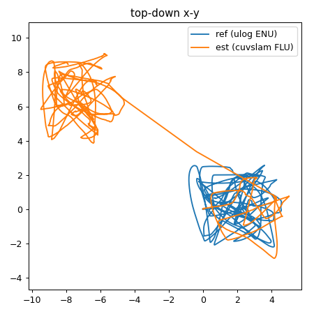
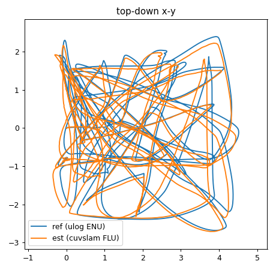
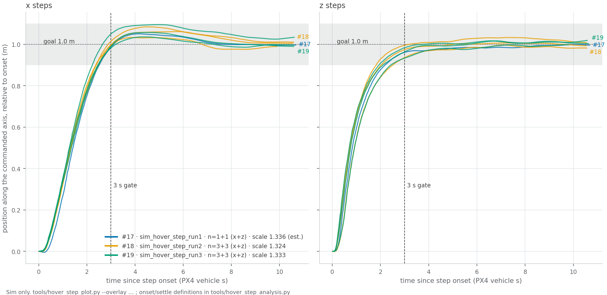
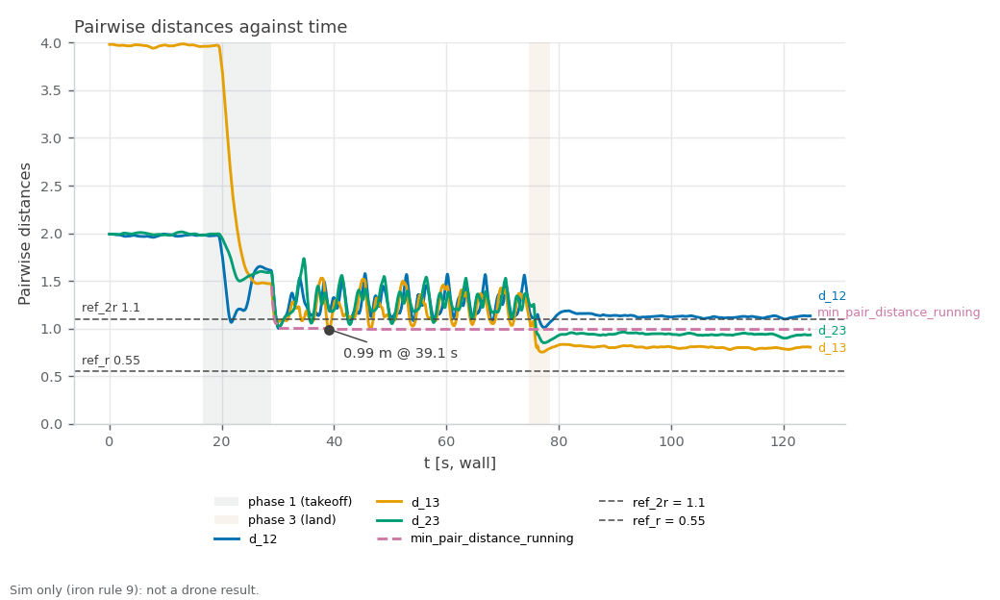

RECORD · SIM ONLY — every result on this page is Isaac Sim; nothing here flew a real drone. Codes, titles and "Done when" are Linear's, verbatim.

# HTX-R1 Swarm Sim Validation (Isaac)

Question (Linear): Does the candidate position source → PX4 → swarm controller and collision-avoidance pipeline work, and how does it fail? · Where: Isaac Sim on the lab laptop · [Linear project](https://linear.app/nearlab/project/htx-r1-swarm-sim-validation-isaac-649103a747b1) · Linear snapshot: 2026-11-11 · Evidence: [LEDGER](../record/LEDGER.md)

**How to read a result here:** every results block starts by saying which position source flew the drone (PX4's own sim estimate · sim mocap · cuVSLAM) and in which world. Flying and perception are separate pipelines on this branch until S6/S7 hands the position source over. **Work order** (Linear's milestone order; the codes do not sort): S1–S5 → S5d → S6 → S5e → S5b → S5c → S7 → S8 → S9 → S10.

**Sim vs real — what the sim does not match yet:**
- Command route: the sim flies commander → velocity → MAVROS, the real drone commander → trajectory → px4_interface. S5d moves the sim onto the real route.
- PX4 1.16.1 in sim, 1.14 on the drone; sim rate gains ×0.5 and motor lag off (sim-only, iron rule 9). Isaac's clock runs 1.3–2× wall time, so gates use PX4 time. Yaw: the sim uses a 15 Hz yaw torque filter (MC_YAW_TQ_CUTOFF, CHG-0023) and yaw-rate gains 0.25 / 0.2 (CHG-0024). The real drone has MC_YAW_CUTOFF 15 and gains 0.07 / 0.5. The gains are sim-only. That the two filters are the same is inferred, not confirmed in PX4's source.
- Every camera result so far is the ZED-style added camera (setup A). The Starling built-in sensors (setup B) arrive in S5c.

### S1 Starling 2 Max sim drones — SIM ONLY (Isaac)
**Purpose:** everything in sim depends on the drone model behaving like the real Starling. This built it from CMU's measured mass, inertia and motor data with the real controller gains, and proved three of them fly and land. Without it, no later sim result would mean anything.
Linear (snapshot 2026-11-13): target 2026-10-21 · 100 % · last ledger row #13 (2026-10-21) · Done when (Linear): not stated in the snapshot

| Issue | Title (Linear, verbatim) | Linear status | Result | Evidence |
|---|---|---|---|---|
| NEAR-782 | Build and fly the Starling 2 Max sim model | Done | spawns ×3 (#1, 2026-10-19); 3 drones random goals, 3 clean landings (#13, 2026-10-21) | [#1, #9, #10, #13](../record/LEDGER.md); `videos/random_CBF_sim_edited.mp4` |

Open: none. Re-run: `tools/sim_terminals.sh` with `DRONE_USD=… PX4_VEHICLE_MODEL=pegasus_starling2max` (RUNBOOK §A).

### S2 Stereo camera on a sim drone — SIM ONLY (Isaac)
**Purpose:** cuVSLAM needs camera images, and the real Starling will carry a camera. This put a simulated stereo camera on drone_1 so the perception pipeline could be exercised at all; it also found that Isaac's camera topics do not cross into the robot container.
Linear (snapshot 2026-11-13): target 2026-10-22 · 100 % · last ledger row #15 (2026-10-22) · Done when (Linear): not stated in the snapshot

| Issue | Title (Linear, verbatim) | Linear status | Result | Evidence |
|---|---|---|---|---|
| NEAR-783 | S2 Add a stereo camera to drone_1 and route its images | Done | pipeline works end to end (sim_cam_run1, 2026-10-22) | [#15](../record/LEDGER.md) → [record](../../localisation/results/sim_cam_run1_record.md) |

### S3 Evaluate cuVSLAM in sim — SIM ONLY (Isaac)
**Purpose:** before trusting cuVSLAM as a position source we need to know how good it is against something we trust. This scored it against PX4's own estimate and found that the empty world (sky plus a grid floor) breaks it.
Linear (snapshot 2026-11-13): target 2026-10-22 · 100 % · last ledger row #15 (2026-10-22) · Done when (Linear): not stated in the snapshot

| Issue | Title (Linear, verbatim) | Linear status | Result | Evidence |
|---|---|---|---|---|
| NEAR-784 | S3 Run cuVSLAM on drone_1 and score it | Done | APE RMSE 0.252 m, flat world, 480×300 — pipeline result, not accuracy (2026-10-22) | [#15](../record/LEDGER.md) → [record](../../localisation/results/sim_cam_run1_record.md) |

### S4 Construction-site environment — SIM ONLY (Isaac)
**Purpose:** S3 showed cuVSLAM needs texture to look at. This brought the lab's construction site into Isaac so the sim looks like the place the drones will fly, and showed cuVSLAM holds 0.08 m there.
Linear (snapshot 2026-11-13): target 2026-10-23 · 100 % · last ledger row #16 (2026-10-22) · Done when (Linear): not stated in the snapshot

| Issue | Title (Linear, verbatim) | Linear status | Result | Evidence |
|---|---|---|---|---|
| NEAR-785 | S4 Convert the construction site into an Isaac Sim world | Done | world loads (`ENV_USD`, 40 m crop); VO 0.081 m RMSE / 162 m, no jumps (2026-10-22) | [#16](../record/LEDGER.md) → [record](../../localisation/results/sim_site_run1_record.md) |
| NEAR-859 | Fly 3 drones with cuVSLAM in the construction site and score it | Done | 3 drones `random_goals`, 0.081 m RMSE over 162 m (sim_site_run1, 2026-10-22) | [#16](../record/LEDGER.md) → [record](../../localisation/results/sim_site_run1_record.md) |

S3/S4 result (sim only; reference = PX4 EKF2, not ground truth). [Figure 1](#fig-1) shows why the site matters: on the flat world cuVSLAM drifts and jumps away from the reference; in the construction site its track lies on top of it.

| | flat default world (`sim_cam_run2–4`) | construction site (`sim_site_run1`) |
|---|---|---|
| APE RMSE, SE(3)-aligned | 0.88–5.3 m, 2 jumps > 1 m per run (per sim_site_run1 record) | 0.081 m over 162 m, no jumps |

 
*Figure 1. Top-down path of drone_1, PX4 (blue) vs cuVSLAM (orange): flat world (left, sim_cam_run3, no record file) and construction site (right, sim_site_run1). `localisation/scripts/score_run.sh <run> 1`; ledger #15, #16.*

### S5 Finish basic sim flight checks — SIM ONLY (Isaac)
**Purpose:** the drone model, gains, airframe and commander all changed after S1. Before anything new is built on top, the basic flight behaviour is re-checked: does the drone still take off, hold, move 1 m cleanly and land (NEAR-786), still avoid the others (787), still take live gain changes (788)? The site items (789, 790, 860, and the keyboard work 920, 921) prepare S5b, because hand-flying is how the map gets built.
Linear (snapshot 2026-11-13): 81 % · last ledger row #32 (2026-11-03)

**Done when** (Linear's target, verbatim; a target, not a result): hover and 1 m steps are re-run and recorded; the three-drone crossing with collision avoidance is re-run and recorded; live gain tuning from the panel is tried in sim; drone_1 is hand-flown by keyboard in the construction site with cuVSLAM running, and the flight is scored.

| Issue | Title (Linear, verbatim) | Linear status | Result | Evidence |
|---|---|---|---|---|
| NEAR-786 | Re-run hover and 1 m step test on the updated sim drone | Done | PASS ×2 — x 0.095 m / 2.47 s, 2026-10-29 | [#18, #19](../record/LEDGER.md) → [run3 record](../record/sim_hover_step_run3_record.md) |
| NEAR-787 | Re-run three-drone crossing with collision avoidance and record it | Done | FAIL ×3 — min 1.00 m (#22), 2026-10-30 | [#20–#22](../record/LEDGER.md) → [record](../record/sim_crossing_run2_record.md), [#21 video](../../videos/cbf_test.mp4) |
| NEAR-788 | Try live gain tuning from the panel in sim | Done | Works — 5 of 5 changes applied, 2026-10-30 | [#23](../record/LEDGER.md) → [record](../record/sim_gains_run1_record.md) |
| NEAR-789 | Set up one-drone keyboard teleop in the construction site (keys move the drone, release holds) | Done | — | [video](../../videos/sim_keyboard_teleop_2026-11-04.mp4), 2026-11-04 |
| NEAR-790 | Hand-fly drone_1 with cuVSLAM running, record and score the flight | In Progress | — | — |
| NEAR-860 | Record the stereo camera images so a flight can be replayed through cuVSLAM | In Progress | — | — |
| NEAR-910 | Retune the sim airframe’s yaw-rate gains so the heading settles after a turn | Done | PASS — overshoot 1.65°, settle 0.03 s, 2026-11-02 | [#31](../record/LEDGER.md) → [record](../record/sim_yaw_run3_record.md) |
| NEAR-920 | Sim keyboard teleop flies in Drive mode (BODY), F switches to Room mode, with the forward-follows-the-nose test | Done | PASS — worst 0.9° off the nose, 2026-11-03 | [#32](../record/LEDGER.md) → [record](../record/sim_teleop_frame_run1_record.md) |
| NEAR-921 | Teleop strip inside the cuVSLAM Foxglove window, with a chase view | Done | — | [video](../../videos/sim_keyboard_teleop_2026-11-04.mp4), 2026-11-04 |

**NEAR-786: Re-run hover and 1 m step test on the updated sim drone.** This test checks the control loop only, so the camera and cuVSLAM are off and the world makes no difference. The gate-by-gate table for runs #3, #17, #18 and #19 is in [sim_notes_hover_step.md](../record/sim_notes_hover_step.md). Reading [Figure 2](#fig-2): every step is inside the settle band within 2.5 s and stays there; x overshoots by up to 0.095 m, z by almost nothing. The three runs lie on top of each other, so the result is repeatable. The settle time is set as much by the commander's braking ramp as by PX4: it describes the loop, not the airframe.

*Figure 2. Step response of drone_1 to 1 m commands, x (left) and z (right), #17–#19 overlaid, PX4 time. Dotted: goal. Shaded: ±0.1 m band. Dashed: 3 s gate. Backward steps sign-flipped. `tools/make_figures.sh`; records [#17](../record/sim_hover_step_run1_record.md), [#18](../record/sim_hover_step_run2_record.md), [#19](../record/sim_hover_step_run3_record.md).*

**NEAR-787: Re-run three-drone crossing with collision avoidance and record it.** This test checks that three drones crossing paths still avoid each other after the rebuild. The collision avoidance gives each drone a 0.55 m safety bubble, so two drones should stay at least 1.10 m apart. All runs are in simulation on a flat world, with PX4's own position estimate and no camera. The closest two drones came was 1.00 m in the clean run ([#22](../record/sim_crossing_run2_record.md)), against 1.02 m before the rebuild ([#4](../record/LEDGER.md)). Every run went about 0.1 m inside the 1.10 m line, so each one fails the gate. [Figure 3](#fig-3) shows why: the drones brake as they close in, but reach the line still moving and overshoot it before being pushed apart. They never touched, and every other check passed.

**NEAR-788: Try live gain tuning from the panel in sim.** This checks that a gain changed in the Foxglove panel reaches the commander while the drones fly. In run [#23](../record/sim_gains_run1_record.md), all five changes were applied on the next control tick, and the drones' spacing followed: the closest pair went from 0.99 m to about 1.4 m after the bubble grew from 0.55 to 0.75 m. A large jump is not safe, though: raising the bubble from 0.75 to 1.2 m in one step put every pair inside it at once, fired the emergency push-apart and threw a drone 0.55 m past the fence.

*Figure 3. Pairwise distances d_12, d_13, d_23 and their running minimum against time (wall clock), with the 1.10 m (2r) gate and 0.55 m (r) lines and the closest approach marked; shaded: takeoff and land. Live 40 Hz odometry, PX4 estimate. `tools/make_figures.sh`; record [#20](../record/sim_crossing_dry1_record.md).*

**NEAR-910: Retune the sim airframe’s yaw-rate gains so the heading settles after a turn.** This checks that the sim drone's heading settles after a yaw pulse, so a keyboard turn is not followed by a ring. Scope: flat world, one drone, PX4's own sim estimate, camera off, MAVROS route, gains as booted. Run [#31](../record/sim_yaw_run3_record.md) passed: overshoot 1.65°, settle 0.03 s, one ring crossing, swing-back 11.8 °/s, drift 0.056 m. The main cause of the old ring was the 2 Hz yaw filter (CHG-0023). The new gains 0.25 / 0.2 (CHG-0024) are sim-only. Details: [sim notes](../record/sim_notes_2026-11-02.md).

**NEAR-920: Sim keyboard teleop flies in Drive mode (BODY), F switches to Room mode, with the forward-follows-the-nose test.** This checks that the up arrow moves the drone where its nose points, whichever way it faces, so a pilot can fly it like a car. Scope: flat world, one drone, PX4's own sim estimate, our relay in the loop, and the stick driven by the test script, not the keyboard. Run [#32](../record/sim_teleop_frame_run1_record.md) passed. Forward pushes at 0°, 90°, 180° and 270° each went within 0.9° of the nose (gate 20°), moved 1.12–1.20 m and stopped within 0.17 m of where the key was let go (gate 0.30 m). One Room-mode push went 0.8° off +X. Drive mode and the relay are sim-only. The real drone keeps CMU's room-fixed teleop.

**NEAR-921: Teleop strip inside the cuVSLAM Foxglove window, with a chase view.** The pilot flies from one window: the cuVSLAM camera image, a chase view behind the drone, and a keyboard strip that flies only while it is clicked. `slam_up.sh` installs the strip, loads the layout and starts a grid that grows as the drone flies. It has no test or record. The owner flew it in the construction site and closed it with NEAR-789 on 2026-11-05. The [video](../../videos/sim_keyboard_teleop_2026-11-04.mp4) shows the strip flying drone_1 beside the cuVSLAM image and the chase view ([keyboard session](../../localisation/README.md#fly-it-with-the-keyboard-one-drone-sim-only)).

Open: NEAR-789 and NEAR-921 have a video but no test record, so their Result cells stay empty. Still to do: a recorded and scored hand flight (NEAR-790), and NEAR-860, where the offline replay of sim_site_hand3 differs from the live path by 60 m, not yet explained. NEAR-787 is closed in Linear; whether to keep the 1.10 m gate or loosen it to CMU's 0.825 m is now NEAR-878 (S5e). During a test run, leave the Foxglove panel alone. In flight, change the safety radius only in small steps (#23).

### S5d · Sim flies the real command route (px4_interface) — SIM ONLY (Isaac)
**Purpose:** every sim flight so far took a different command path from the real drone (MAVROS, with the commander holding position itself), and that path had two sim-only bugs: the release swing (patch 0006) and the turn orbit. Moving the sim onto px4_interface, the real drone's path, is what lets a sim result predict a real one, NUS policies included (S5e). NEAR-866 is the one-drone [trial](../superpowers/specs/2026-10-30-sim-real-route-trial-design.md).
Linear (snapshot 2026-11-13): 0 % · no ledger row yet

**Done when** (Linear's target, verbatim; a target, not a result): one sim drone takes off, hovers and lands through px4_interface with MAVROS not started; the hover and 1 m step test passes on gates no looser than ledger #17–#19, in vehicle time; the release and 90° turn test shows neither MAVROS-route bug; the crossing is re-run against ledger #22; every sim record names its route and camera setup and prints the remaining sim-vs-real differences.

| Issue | Title (Linear, verbatim) | Linear status | Result | Evidence |
|---|---|---|---|---|
| NEAR-866 | One sim drone flies takeoff, hover and land through px4_interface with MAVROS not started | Backlog | — | — |
| NEAR-867 | Sim records name and prove their command route and camera setup | Backlog | — | — |
| NEAR-868 | Re-run the hover and 1 m step test on the px4_interface route and compare with the MAVROS-route results | Backlog | — | — |
| NEAR-869 | Release-to-hold and 90° turn test on the px4_interface route | Backlog | — | — |
| NEAR-870 | Check which PX4 messages decode on the sim’s PX4 v1.16 | Backlog | — | — |
| NEAR-871 | Record Isaac’s real-time factor on every run and add a real-time pacing switch | Backlog | — | — |
| NEAR-872 | Re-run the three-drone crossing on the px4_interface route | Backlog | — | — |
| NEAR-873 | Print the remaining sim-vs-real differences on every sim record | Backlog | — | — |
| NEAR-911 | Check heading hold (MC_YAW_P) on the px4_interface route with the yaw-step test | Backlog | — | — |
| NEAR-912 | Match the sim airframe’s MPC speed and acceleration limits to the real drone’s | Backlog | — | — |
| NEAR-913 | Model rotor reaction torque and rotational drag in the sim Starling, then re-run the yaw-step test | Backlog | — | — |
| NEAR-916 | Compare every PX4 parameter between the sim and the real drone | Backlog | — | — |

### S6 Sim mocap — SIM ONLY (Isaac)
**Purpose:** the real indoor drones get their position from mocap, not GPS. Making the sim drones do the same (true position fed to PX4 as mocap, GPS off, the real estimator settings) means every later sim test exercises the real position path. Related: the laptop-side mocap bridge loopback, [#14](../record/LEDGER.md) (fake Motive, 49.998 Hz into the PX4 message — not sim mocap).
Linear (snapshot 2026-11-13): 0 % · no ledger row yet

**Done when** (Linear's target, verbatim; a target, not a result): three drones take off, fly random goals and land on sim mocap.

| Issue | Title (Linear, verbatim) | Linear status | Result | Evidence |
|---|---|---|---|---|
| NEAR-803 | Publish the simulator’s true drone positions | Backlog | — | — |
| NEAR-804 | Send them into PX4 as mocap-style position | Backlog | — | — |
| NEAR-805 | Sim setting that turns GPS off and uses the real drone’s estimator values | Backlog | — | — |
| NEAR-806 | Fly three drones on sim mocap: takeoff, random goals, land | Backlog | — | — |

### S5e · Evaluate NUS velocity policies in sim — SIM ONLY (Isaac)
**Purpose:** NUS writes the policies that decide where each drone goes. Each policy outputs one velocity per drone, and CMU's commander filters it with the collision avoidance (CBF). This milestone runs those policies in sim, on the real command route and with sim mocap, before any of them flies in NEAR Lab's mocap area (HTX-R2 M8).
Linear (snapshot 2026-11-13): 0 % · no ledger row yet · starts after S5d, S6 and NEAR-871 (the sim clock)

**Done when** (Linear's target, verbatim; a target, not a result): the velocity contract is written once and shared with NUS; the plug-in point and its teleop behaviour are decided; one, two and three policy drones fly in sim with collision avoidance on and off, each with one command and a record; the separation gate is agreed. Results say "observed in sim", never "validated".

| Issue | Title (Linear, verbatim) | Linear status | Result | Evidence |
|---|---|---|---|---|
| NEAR-874 | Write the velocity contract with NUS and CMU (frame, units, limits, rate, timeout) | Backlog | — | — |
| NEAR-875 | Decide how a policy drone plugs into the commander (leash, teleop fence, hold on timeout) | Backlog | — | — |
| NEAR-876 | Run a NUS policy in sim with one command and a record (gates written first) | Backlog | — | — |
| NEAR-877 | Fly one, two, then three policy drones in sim with collision avoidance on and off | Backlog | — | — |
| NEAR-878 | Agree the separation gate for policy runs | Backlog | — | — |

### S5b · Map the construction site with cuVSLAM — SIM ONLY (Isaac)
**Purpose:** if a saved map of the site lets a fresh drone find its own position in it, every drone can share one coordinate frame without extra hardware (UWB). This tests that idea in sim first.
Linear (snapshot 2026-11-13): 0 % · no ledger row yet

**Done when** (Linear's target, verbatim; a target, not a result): a map is saved; fresh runs localise from several starts/headings with success rate and time recorded; positions agree with simulator ground truth.

| Issue | Title (Linear, verbatim) | Linear status | Result | Evidence |
|---|---|---|---|---|
| NEAR-791 | Add a mapping mode to the cuVSLAM node | Backlog | — | — |
| NEAR-792 | Hand-fly a mapping loop and save the map | Backlog | — | — |
| NEAR-793 | Localise in the saved map from 5+ starting points | Backlog | — | — |
| NEAR-794 | Compare the localised position with the simulator’s position | Backlog | — | — |

### S5c · Compare the two camera setups for cuVSLAM and OpenVINS — SIM ONLY (Isaac)
**Purpose:** two camera setups are kept: the ZED-style added camera (setup A, behind every camera result so far) and the Starling 2 Max's own sensors (setup B). Each built-in sensor is modelled at its real mount, resolution and rate, then cuVSLAM and OpenVINS (what the drone runs) are scored on both setups, so the choice rests on measurements.
Linear (snapshot 2026-11-13): 0 % · no ledger row yet

**Done when** (Linear's target, verbatim; a target, not a result): every Starling built-in sensor is modelled at its real mount, resolution and rate; OpenVINS runs in sim; the flat-world and site VIO tests are re-run on the built-in sensors; one table scores cuVSLAM and OpenVINS on both setups.

| Issue | Title (Linear, verbatim) | Linear status | Result | Evidence |
|---|---|---|---|---|
| NEAR-800 | Run cuVSLAM in monocular mode on a replayed flight and score it against stereo | Backlog | — | — |
| NEAR-801 | List the Starling 2 Max’s sensors and check which modes cuVSLAM and OpenVINS support on them | Backlog | — | — |
| NEAR-802 | Decide the camera (built-in mono / built-in stereo / added stereo) and write down why | Canceled | — | — |
| NEAR-809 | Model the Starling built-in tracking_front camera (AR0144) in sim | Backlog | — | — |
| NEAR-879 | Model the Starling built-in tracking_down camera (AR0144) in sim | Backlog | — | — |
| NEAR-880 | Model the Starling built-in hires_front camera (IMX412) in sim | Backlog | — | — |
| NEAR-881 | Model the Starling built-in hires_down camera (IMX412) in sim | Backlog | — | — |
| NEAR-882 | Model the Starling built-in ToF depth sensor in sim | Backlog | — | — |
| NEAR-883 | Model the Starling built-in thermal camera (Lepton) in sim | Backlog | — | — |
| NEAR-884 | Model the Starling built-in IMUs (imu_apps, imu_px4) at their real mounts and rates | Backlog | — | — |
| NEAR-885 | Run OpenVINS in sim on the Starling built-in sensors | Backlog | — | — |
| NEAR-886 | Re-run the flat-world and construction-site VIO tests on the Starling built-in sensors | Backlog | — | — |
| NEAR-887 | Score cuVSLAM and OpenVINS on both camera setups in one table | Backlog | — | — |

NEAR-802 was canceled because both setups are kept; NEAR-887 holds the comparison. Mounts and rates come from drone m0054's config backup until NEAR-888 (HTX-R2 M2) copies each lab drone's files.

### S7 drone_1 flies on cuVSLAM — SIM ONLY (Isaac)
**Purpose:** the end goal is flying on the camera. This hands the position source from sim mocap to cuVSLAM with a fallback, so the switch and its failure cases are seen in sim before any real flight.
Linear (snapshot 2026-11-13): 0 % · no ledger row yet

**Done when** (Linear's target, verbatim; a target, not a result): source switching/fallback works; hand-flown hold, out-and-back, spin, open-view and hard-stick tests pass; a scripted flight is scored against true position.

| Issue | Title (Linear, verbatim) | Linear status | Result | Evidence |
|---|---|---|---|---|
| NEAR-795 | Position source switch: sim mocap or cuVSLAM, with automatic fallback | Backlog | — | — |
| NEAR-796 | Hand-flown handover tests (hold, out-and-back, spin, open view, hard stick) | Backlog | — | — |
| NEAR-797 | Scripted flight on cuVSLAM, scored against true position | Backlog | — | — |

### S8 Model the ZED-style added camera and Jetson payload — SIM ONLY (Isaac)
**Purpose:** the ZED-style added camera (setup A) and its Jetson add 300 to 360 g and change the drone. The model has to carry that weight and still pass hover, step and crossing before the real build is trusted.
Linear (snapshot 2026-11-13): 0 % · no ledger row yet

**Done when** (Linear's target, verbatim; a target, not a result): the camera feeds cuVSLAM; camera+IMU is scored against camera-only; the model with 300–360 g added passes hover, step and crossing checks.

| Issue | Title (Linear, verbatim) | Linear status | Result | Evidence |
|---|---|---|---|---|
| NEAR-798 | Add the Jetson and ZED-style camera weight to the Starling sim model | Backlog | — | — |
| NEAR-807 | Re-run hover, step and crossing tests on the heavier model | Backlog | — | — |
| NEAR-808 | Feed drone_1’s IMU into cuVSLAM (camera-only → camera + IMU) and compare the scores | Backlog | — | — |

### S9 Safe failover — SIM ONLY (Isaac)
**Purpose:** a position source can go stale, drop out or switch. The controller must not move the drone unsafely when that happens, and sim is where that is checked at no risk.
Linear (snapshot 2026-11-13): 0 % · no ledger row yet

**Done when** (Linear's target, verbatim; a target, not a result): no unsafe movement follows stale/missing positions, and source switching moves the drone less than 30 cm.

| Issue | Title (Linear, verbatim) | Linear status | Result | Evidence |
|---|---|---|---|---|
| NEAR-810 | Controller handles stale or missing positions (tests first) | Backlog | — | — |
| NEAR-811 | Measure and reduce the jump when the position source switches | Backlog | — | — |

### S10 Scale test — SIM ONLY (Isaac)
**Purpose:** the demo needs more drones than the lab has. Running 6 to 10 simulated drones shows where the controller and the recording hit their limits.
Linear (snapshot 2026-11-13): 0 % · no ledger row yet

**Done when** (Linear's target, verbatim; a target, not a result): 6–10 simulated drones run without cameras; controller load and recording size are measured.

| Issue | Title (Linear, verbatim) | Linear status | Result | Evidence |
|---|---|---|---|---|
| NEAR-812 | Run 6 then 10 headless sim drones | Backlog | — | — |
| NEAR-813 | Record controller load and recording size | Backlog | — | — |

## Without a milestone (Linear; follow-ups to NEAR-921, 2026-11-04)

| Issue | Title (Linear, verbatim) | Linear status | Result | Evidence |
|---|---|---|---|---|
| NEAR-922 | Launch one safe_teleop and relay per drone for keyboard switching | Backlog | — | — |
| NEAR-923 | Live cuVSLAM map panel in the teleop layout | Backlog | — | — |
| NEAR-924 | Draw the PX4 position in the chase view | Backlog | — | — |
| NEAR-925 | Find why the cuVSLAM image freezes briefly at takeoff in the teleop layout | Backlog | — | — |
| NEAR-954 | Sim: fly with the gamepad (Logitech F310), same pad check and profile as the real drone | In Progress | — | — |
| NEAR-955 | Isaac Lab: train in parallel with the Starling model and measure steps per second | In Progress | — | — |

## Sim debt (ours; only the clock gates a milestone: NEAR-871 → S5e)

| Item | Seen | Candidate fix (none tried) |
|---|---|---|
| Isaac's clock runs 1.3–2× wall time | [#18, #19](../record/LEDGER.md) scale 1.32–1.33 | NEAR-871: record it on every run; a real-time pacing switch |
| MAVROS route: a turned sim drone orbits (velocity labelled body frame) | PX4 log, 2026-10-30 | patch 0007 (sim-only) confirmed in flight, no orbit ([records](../record/sim_yaw_run1_record.md)); moot after S5d |
| Pegasus Stop ▶ Play leaks the stopped vehicles' physics callbacks | [#6](../record/LEDGER.md), 2026-10-20 | guard `PX4MavlinkBackend.update()` with `if not self._is_running: return`, or fix the callback removal by prefix |
| `mavros_node` segfault (exit −11) mid-flight, cause unknown (respawn masks it) | [#8, #11](../record/LEDGER.md) | set a file `core_pattern` on the host before a long sim session (apport eats cores today) |
| Isaac ROS 2 topics invisible to host-network containers (DDS does not cross the isaac docker network) | 2026-10-22 | isaac-sim on the host network, or keep `--network container:isaac-sim` (`localisation/docker/run.sh`) |
| No Isaac ground-truth publisher: every VO score is against EKF2, not the true pose | 2026-10-23 | one OmniGraph node behind an env flag in the launcher |
| Launcher edits in CMU's tree (`10b85b5` camera 640×480, `158204e` `ENV_USD`) | 2026-10-22 | `patches/0004`, `0005` (see `patches/`); re-apply on a fresh clone |
| `robot_interface_node` segfault on Ctrl-C of the interfaces launch (cosmetic) | dmesg, 2026-10-20 | report upstream, do not patch (node shared with the real path) |
