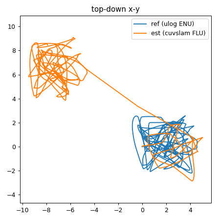
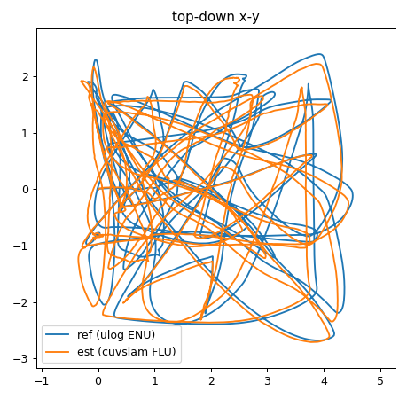
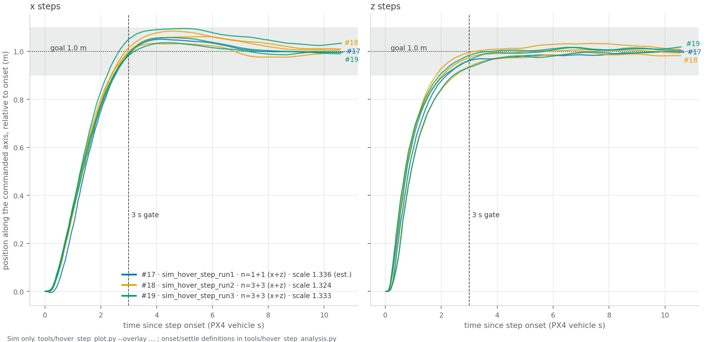

RECORD · SIM ONLY — every result on this page is Isaac Sim; nothing here has flown. Codes, titles and "Done when" are Linear's, verbatim.

# HTX-R1 Swarm Sim Validation (Isaac)

Question (Linear): Does the candidate position source → PX4 → swarm controller and collision-avoidance pipeline work, and how does it fail? · Where: Isaac Sim on the lab laptop · [Linear project](https://linear.app/nearlab/project/htx-r1-swarm-sim-validation-isaac-649103a747b1) · Linear snapshot: 2026-10-26 · Evidence: [LEDGER](../record/LEDGER.md)

**How to read a result here:** every results block starts by saying which position source flew the drone (PX4's own sim estimate · sim mocap · cuVSLAM) and in which world. Flying and perception are separate pipelines on this branch until S6/S7 hands the position source over.

### S1 Starling 2 Max sim drones — SIM ONLY (Isaac)
**Purpose:** everything in sim depends on the drone model behaving like the real Starling. This built it from CMU's measured mass, inertia and motor data with the real controller gains, and proved three of them fly and land. Without it, no later sim result would mean anything.
Linear (snapshot 2026-10-26): target 2026-10-21 · 100 % · last ledger row #13 (2026-10-21)
Done when (Linear): not stated in the snapshot — milestone at 100 %

| Issue | Title (Linear, verbatim) | Result | Evidence |
|---|---|---|---|
| NEAR-782 | Build and fly the Starling 2 Max sim model | spawns ×3 (#1, 2026-10-19); 3 drones random goals, 3 clean landings (#13, 2026-10-21) | [#1, #9, #10, #13](../record/LEDGER.md); `videos/random_CBF_sim_edited.mp4` |

Open: none. Re-run: `tools/sim_terminals.sh` with `DRONE_USD=… PX4_VEHICLE_MODEL=pegasus_starling2max` (RUNBOOK §A).

### S2 Stereo camera on a sim drone — SIM ONLY (Isaac)
**Purpose:** cuVSLAM needs camera images, and the real Starling will carry a camera. This put a simulated stereo camera on drone_1 so the perception pipeline could be exercised at all; it also found that Isaac's camera topics do not cross into the robot container.
Linear (snapshot 2026-10-26): target 2026-10-22 · 100 % · last ledger row #15 (2026-10-22)
Done when (Linear): not stated in the snapshot — milestone at 100 %

| Issue | Title (Linear, verbatim) | Result | Evidence |
|---|---|---|---|
| NEAR-783 | S2 Add a stereo camera to drone_1 and route its images | pipeline works end to end (sim_cam_run1, 2026-10-22) | [#15](../record/LEDGER.md) → [record](../../localisation/results/sim_cam_run1_record.md) |

### S3 Evaluate cuVSLAM in sim — SIM ONLY (Isaac)
**Purpose:** before trusting cuVSLAM as a position source we need to know how good it is against something we trust. This scored it against PX4's own estimate and found that the empty world (sky plus a grid floor) breaks it.
Linear (snapshot 2026-10-26): target 2026-10-22 · 100 % · last ledger row #15 (2026-10-22)
Done when (Linear): not stated in the snapshot — milestone at 100 %

| Issue | Title (Linear, verbatim) | Result | Evidence |
|---|---|---|---|
| NEAR-784 | S3 Run cuVSLAM on drone_1 and score it | APE RMSE 0.252 m, flat world, 480×300 — pipeline result, not accuracy (2026-10-22) | [#15](../record/LEDGER.md) → [record](../../localisation/results/sim_cam_run1_record.md) |

### S4 Construction-site environment — SIM ONLY (Isaac)
**Purpose:** S3 showed cuVSLAM needs texture to look at. This brought the lab's construction site into Isaac so the sim looks like the place the drones will fly, and showed cuVSLAM holds 0.08 m there.
Linear (snapshot 2026-10-26): target 2026-10-23 · 100 % · last ledger row #16 (2026-10-22)
Done when (Linear): not stated in the snapshot — milestone at 100 %

| Issue | Title (Linear, verbatim) | Result | Evidence |
|---|---|---|---|
| NEAR-785 | S4 Convert the construction site into an Isaac Sim world | world loads (`ENV_USD`, 40 m crop); VO 0.081 m RMSE / 162 m, no jumps (2026-10-22) | [#16](../record/LEDGER.md) → [record](../../localisation/results/sim_site_run1_record.md) |
| NEAR-859 | Fly 3 drones with cuVSLAM in the construction site and score it | 3 drones `random_goals`, 0.081 m RMSE over 162 m (sim_site_run1, 2026-10-22) | [#16](../record/LEDGER.md) → [record](../../localisation/results/sim_site_run1_record.md) |

S3/S4 result (sim only; reference = PX4 EKF2, not ground truth). [Figure 1](#fig-1) shows why the site matters: on the flat world cuVSLAM drifts and jumps away from the reference; in the construction site its track lies on top of it.

| | flat default world (`sim_cam_run2–4`) | construction site (`sim_site_run1`) |
|---|---|---|
| APE RMSE, SE(3)-aligned | 0.88–5.3 m, 2 jumps > 1 m per run (per sim_site_run1 record) | 0.081 m over 162 m, no jumps |

 
*Figure 1. Top-down path of drone_1, PX4 (blue) vs cuVSLAM (orange): flat world (left, sim_cam_run3, no record file) and construction site (right, sim_site_run1). `localisation/scripts/score_run.sh <run> 1`; ledger #15, #16.*

### S5 Finish basic sim flight checks — SIM ONLY (Isaac)
**Purpose:** the drone model, gains, airframe and commander all changed after S1. Before anything new is built on top, the basic flight behaviour is re-checked: does the drone still take off, hold, move 1 m cleanly and land (NEAR-786), still avoid the others (787), still take live gain changes (788)? The site items (789, 790, 860) prepare S5b, because hand-flying is how the map gets built.
Linear (snapshot 2026-10-26): 4 % · last ledger row #19 (2026-10-29)

**Done when** (Linear's target, verbatim; a target, not a result): hover and 1 m steps, three-drone collision-avoidance crossing and live gain tuning are tried and recorded; drone_1 is hand-flown in the construction site with cuVSLAM, camera recording and scoring.

| Issue | Title (Linear, verbatim) | Result | Evidence |
|---|---|---|---|
| NEAR-786 | Re-run hover and 1 m step test on the updated sim drone | PASS ×2 — x 0.095 m / 2.47 s, 2026-10-29 | [#18, #19](../record/LEDGER.md) → [run3 record](../record/sim_hover_step_run3_record.md) |
| NEAR-787 | Re-run three-drone crossing with collision avoidance and record it | — | baseline [#4](../record/LEDGER.md): 1.02 m, old asset, no bag |
| NEAR-788 | Try live gain tuning from the panel in sim | — | — |
| NEAR-789 | Set up one-drone gamepad teleop in the construction site (pad detected, sticks move the drone, release holds) | — | — |
| NEAR-790 | Hand-fly drone_1 with cuVSLAM running, record and score the flight | — | — |
| NEAR-860 | Record the stereo camera images so a flight can be replayed through cuVSLAM | — | — |

**What NEAR-786 measures:** the control loop only — commander goal → MAVROS → PX4, with PX4 positioning itself from Isaac's simulated sensors. The camera and cuVSLAM are not running and not in the loop. The world does not change this result (flat default world, same as #3); it changes only what the drone sees and the GPU load. cuVSLAM is scored offline in S3/S4 and starts positioning a drone only at S6/S7.

NEAR-786 — results (sim only; gates 0.15 m / 3.0 s PX4 vehicle time / 0 re-entries / thrust 0.12–0.20 — [tools/README.md](../../tools/README.md#thresholds); set 2026-10-19 around the Iris reading, not a flight requirement)

| | gate | #3 (19 Oct, old asset, 0.6 m/s, wall time) | #17 (28 Oct, n=1) | #18 (28 Oct, n=3) | #19 (29 Oct, n=3) |
|---|---|---|---|---|---|
| hover thrust | 0.12–0.20 (real 0.165) | 0.155 | 0.153 | 0.153 | 0.153 |
| PX4 s per wall s | — | — | 1.336 (est., overlay scale) | 1.324 | 1.333 |
| x overshoot, m | < 0.15 | 0.002 | 0.054 | 0.085 | 0.095 |
| x settle, s | < 3.0 | 2.75 | 2.49 | 2.47 | 2.47 |
| z overshoot, m | < 0.15 | 0.001 | 0.001 | 0.033 | 0.020 |
| z settle, s | < 3.0 | 0.75 | 2.16 | 2.50 | 2.42 |
| landed, DISARMED ×3 | yes | — | yes | yes | yes |
| verdict | | superseded | driver FAIL ×3, re-analysed PASS; drone_1 ulog lost | PASS | PASS |

Reading [Figure 2](#fig-2): every step is inside the settle band within 2.5 s and stays there; x overshoots by up to 0.095 m, z by almost nothing. The three runs lie on top of each other, so the result is repeatable. The settle time is set as much by the commander's braking ramp as by PX4: it describes the loop, not the airframe.

*Figure 2. Step response of drone_1 to 1 m commands, x (left) and z (right), #17–#19 overlaid, PX4 time. Dotted: goal. Shaded: ±0.1 m band. Dashed: 3 s gate. Backward steps sign-flipped. `tools/make_figures.sh`; records [#17](../record/sim_hover_step_run1_record.md), [#18](../record/sim_hover_step_run2_record.md), [#19](../record/sim_hover_step_run3_record.md).*

Open: nothing hand-flown yet — NEAR-789/790 count only with a video of the hand-flown flight the owner has watched (owner's rule, 2026-10-29); NEAR-787 at 2.0 / 4.0 m/s with a bag: `tools/sim.sh test crossing --ledger 20 --issue NEAR-787 <run>` ([TEST_STANDARD](../TEST_STANDARD.md)). Re-run: `LEDGER=20 ISSUE=NEAR-786 tools/sim_hover_step_run.sh all <new_run>` (hover) or `tools/sim.sh test crossing --ledger 20 --issue NEAR-787 <run>` (crossing).

### S5b · Map the construction site with cuVSLAM — SIM ONLY (Isaac)
**Purpose:** if a saved map of the site lets a fresh drone find its own position in it, every drone can share one coordinate frame without extra hardware (UWB). This tests that idea in sim first.
Linear (snapshot 2026-10-26): 0 % · no ledger row yet

**Done when** (Linear's target, verbatim; a target, not a result): a map is saved; fresh runs localise from several starts/headings with success rate and time recorded; positions agree with simulator ground truth.

| Issue | Title (Linear, verbatim) | Result | Evidence |
|---|---|---|---|
| NEAR-791 | Add a mapping mode to the cuVSLAM node | — | — |
| NEAR-792 | Hand-fly a mapping loop and save the map | — | — |
| NEAR-793 | Localise in the saved map from 5+ starting points | — | — |
| NEAR-794 | Compare the localised position with the simulator’s position | — | — |

### S5c · Choose the camera for cuVSLAM — DESK (decision)
**Purpose:** the camera the real Starling will carry has to be chosen before hardware is ordered. Mono versus stereo and the built-in camera are compared so the decision rests on measured results, not guesses.
Linear (snapshot 2026-10-26): 0 % · no ledger row yet

**Done when** (Linear's target, verbatim; a target, not a result): mono/stereo results are comparable, built-in camera suitability has a reasoned yes/no answer, and the decision is written and shared before ordering.

| Issue | Title (Linear, verbatim) | Result | Evidence |
|---|---|---|---|
| NEAR-800 | Run cuVSLAM in monocular mode on a replayed flight and score it against stereo | — | — |
| NEAR-801 | List the Starling 2 Max’s built-in cameras and check whether cuVSLAM can use them | — | — |
| NEAR-802 | Decide the camera (built-in mono / built-in stereo / added stereo) and write down why | — | — |

### S6 Sim mocap — SIM ONLY (Isaac)
**Purpose:** the real indoor drones get their position from mocap, not GPS. Making the sim drones do the same (true position fed to PX4 as mocap, GPS off, the real estimator settings) means every later sim test exercises the real position path.
Linear (snapshot 2026-10-26): 0 % · no ledger row yet

**Done when** (Linear's target, verbatim; a target, not a result): three drones take off, fly random goals and land on sim mocap.

| Issue | Title (Linear, verbatim) | Result | Evidence |
|---|---|---|---|
| NEAR-803 | Publish the simulator’s true drone positions | — | — |
| NEAR-804 | Send them into PX4 as mocap-style position | — | — |
| NEAR-805 | Sim setting that turns GPS off and uses the real drone’s estimator values | — | — |
| NEAR-806 | Fly three drones on sim mocap: takeoff, random goals, land | — | — |

Related: the laptop-side mocap bridge loopback, [#14](../record/LEDGER.md) (fake Motive, 49.998 Hz into the PX4 message — not sim mocap).

### S7 drone_1 flies on cuVSLAM — SIM ONLY (Isaac)
**Purpose:** the end goal is flying on the camera. This hands the position source from sim mocap to cuVSLAM with a fallback, so the switch and its failure cases are seen in sim before any real flight.
Linear (snapshot 2026-10-26): 0 % · no ledger row yet

**Done when** (Linear's target, verbatim; a target, not a result): source switching/fallback works; hand-flown hold, out-and-back, spin, open-view and hard-stick tests pass; a scripted flight is scored against true position.

| Issue | Title (Linear, verbatim) | Result | Evidence |
|---|---|---|---|
| NEAR-795 | Position source switch: sim mocap or cuVSLAM, with automatic fallback | — | — |
| NEAR-796 | Hand-flown handover tests (hold, out-and-back, spin, open view, hard stick) | — | — |
| NEAR-797 | Scripted flight on cuVSLAM, scored against true position | — | — |

### S8 Model the chosen camera and payload — SIM ONLY (Isaac)
**Purpose:** the chosen camera and its computer add 300 to 360 g and change the drone. The model has to carry that weight and still pass hover, step and crossing before the real build is trusted.
Linear (snapshot 2026-10-26): 0 % · no ledger row yet

**Done when** (Linear's target, verbatim; a target, not a result): the camera feeds cuVSLAM; camera+IMU is scored against camera-only; the model with 300–360 g added passes hover, step and crossing checks.

| Issue | Title (Linear, verbatim) | Result | Evidence |
|---|---|---|---|
| NEAR-798 | Add Jetson and camera weight to the Starling sim model | — | — |
| NEAR-807 | Re-run hover, step and crossing tests on the heavier model | — | — |
| NEAR-808 | Feed drone_1’s IMU into cuVSLAM (camera-only → camera + IMU) and compare the scores | — | — |
| NEAR-809 | Model the chosen camera on drone_1 in sim | — | — |

### S9 Safe failover — SIM ONLY (Isaac)
**Purpose:** a position source can go stale, drop out or switch. The controller must not move the drone unsafely when that happens, and sim is where that is checked at no risk.
Linear (snapshot 2026-10-26): 0 % · no ledger row yet

**Done when** (Linear's target, verbatim; a target, not a result): no unsafe movement follows stale/missing positions, and source switching moves the drone less than 30 cm.

| Issue | Title (Linear, verbatim) | Result | Evidence |
|---|---|---|---|
| NEAR-810 | Controller handles stale or missing positions (tests first) | — | — |
| NEAR-811 | Measure and reduce the jump when the position source switches | — | — |

### S10 Scale test — SIM ONLY (Isaac)
**Purpose:** the demo needs more drones than the lab has. Running 6 to 10 simulated drones shows where the controller and the recording hit their limits.
Linear (snapshot 2026-10-26): 0 % · no ledger row yet

**Done when** (Linear's target, verbatim; a target, not a result): 6–10 simulated drones run without cameras; controller load and recording size are measured.

| Issue | Title (Linear, verbatim) | Result | Evidence |
|---|---|---|---|
| NEAR-812 | Run 6 then 10 headless sim drones | — | — |
| NEAR-813 | Record controller load and recording size | — | — |

## Sim debt (ours; none of it gates a milestone)

| Item | Seen | Candidate fix (none tried) |
|---|---|---|
| Pegasus Stop ▶ Play leaks the stopped vehicles' physics callbacks | [#6](../record/LEDGER.md), 2026-10-20 | guard `PX4MavlinkBackend.update()` with `if not self._is_running: return`, or fix the callback removal by prefix |
| `mavros_node` segfault (exit −11) mid-flight, cause unknown (respawn masks it) | [#8, #11](../record/LEDGER.md) | set a file `core_pattern` on the host before a long sim session (apport eats cores today) |
| Isaac ROS 2 topics invisible to host-network containers (DDS does not cross the isaac docker network) | 2026-10-22 | isaac-sim on the host network, or keep `--network container:isaac-sim` (`localisation/docker/run.sh`) |
| No Isaac ground-truth publisher: every VO score is against EKF2, not the true pose | 2026-10-23 | one OmniGraph node behind an env flag in the launcher |
| Launcher edits in CMU's tree (`10b85b5` camera 640×480, `158204e` `ENV_USD`) | 2026-10-22 | `patches/0004`, `0005` (see `patches/`); re-apply on a fresh clone |
| `robot_interface_node` segfault on Ctrl-C of the interfaces launch (cosmetic) | dmesg, 2026-10-20 | report upstream, do not patch (node shared with the real path) |
