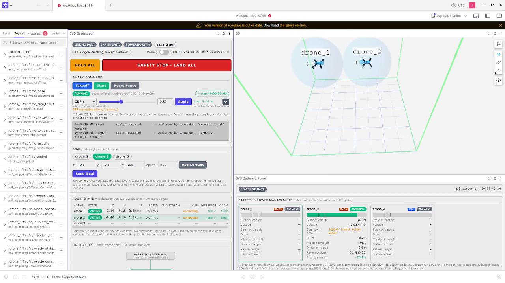

RECORD · REAL DRONE — first flights on this software: 2026-11-11, one Starling ([#33](../record/LEDGER.md)). A result cell is filled only from a LEDGER row marked REAL; the archived tables are observations on the previous software, not results. Codes, titles and "Done when" are Linear's, verbatim.

# HTX-R2 Starling Flight Bring-up (M2–M8)

Question: Does the same software fly real Starling 2 Max drones safely with motion-capture positioning (mocap)? · Where: mocap room · [Linear project](https://linear.app/nearlab/project/htx-r2-starling-flight-bring-up-m2-m7-269b3d72d5ce) · Linear snapshot: 2026-11-11 · Evidence: [LEDGER](../record/LEDGER.md) · Every flight follows [PREFLIGHT.md](../PREFLIGHT.md).

## Before the next real flight

Hazards the pilot assumes until the named issue re-earns them (iron rules in [PREFLIGHT.md](../PREFLIGHT.md)):

1. Software is blind to PX4 arming; the command-ACK message is unaudited against PX4 v1.14 — [PX4_MSGS_AUDIT.md](../PX4_MSGS_AUDIT.md), re-run at NEAR-821. Fly with QGC visible.
2. fly `_ours` configs (shipped real ones carry 0.3); `land_speed_mps` must stay 0.6 — 0.3 left the drone armed on the ground ([A21](../record/LEDGER.md#table-2--observed-on-the-previous-software-archived)); the landing is re-earned at NEAR-826.
3. Drone ID must equal the controller target (`MAV_SYS_ID` = `target_system`; no ACK at all = mismatch) — NEAR-819; exactly one uXRCE watchdog on the drone — NEAR-820.
4. After `voxl_setup_real_drone.sh`: reboot, never `systemctl restart voxl-px4` — NEAR-818.
5. RC takeover is MANUAL or KILL only: setpoints leak into POSCTL/ALTCTL (confirmed in the code 2026-10-29, accepted; iron rule 1), and the commander stays non-IDLE after a takeover (`land` once; iron rule 3). After any RC kill call `land` too: the commander keeps sending setpoints ([#34](../record/LEDGER.md)). No issue of their own; re-observed at NEAR-825 ([PX4_MSGS_AUDIT.md](../PX4_MSGS_AUDIT.md)).
6. The older Starling (`drone_1`) flies by the owner's decision, with a watcher on its front-right motor at every takeoff. That motor failed or started late in 5 of 7 arms on 2026-11-12, cause unknown ([#34](../record/LEDGER.md)). On 2026-11-13 all four motors started on time in the three flights checked.
7. Takeoff flies a straight line to the takeoff point: stand each drone on its own point ([#34](../record/LEDGER.md)). The fence does not act during the climb or the landing.
8. Do not raise the CBF radius while drones are inside the new keep-out: the emergency push-apart fires at once (seen on the ground 2026-11-12).
9. The commander gives no warning when no pad is sending commands: the drone holds as if the sticks were centred. Before takeoff check `ros2 topic hz /svg/drone_2/teleop_command` (about 20 Hz); keep the pad pane running until after landing ([#36](../record/LEDGER.md)).
10. With the stick held, the collision filter keeps pushing the hovering drone toward the wall behind it (0.29 m left on 2026-11-13). Let go once it resists ([#37](../record/LEDGER.md)).

Hazards 6–8 and the RC-kill line in 5 were found on 2026-11-12, hazards 9 and 10 on 2026-11-13. None is fixed. The owner decides.

## Carried over from the previous software — verdicts the pilot assumes until re-observed

| Hazard (observed on the previous software) | What changed on this software | Re-earned by |
|---|---|---|
| Control-authority leak: RC takeover only clean into MANUAL (setpoints leak into POSCTL/ALTCTL) | Confirmed in current code 2026-10-29 and ACCEPTED by the owner: takeover is MANUAL or KILL; see note below | NEAR-825 (re-observed; no issue of its own) |
| Commander touchdown disarm is a premature one-shot (one red QGC message per landing) | `px4_interface` logs the DENIED ack; `land_settle_s` + disarm retry exist (sim-closed, #13) | NEAR-826 |
| Commander stuck non-IDLE after any RC takeover (`land` once to reset) | `takeover_twins` + reference re-seed on `hold`/`land` are new; stuck-state logic unchanged | NEAR-825 (no issue of its own) |
| `test/functional_*.py` publish fake odometry on real topics | six scripts now (`squeeze`, `squeeze_lag`, `fence`, `single_goal`, `multi_goal`, `hybrid`) — same hazard | iron rule 4 — every session (no Linear issue) |
| PX4 v1.14 vs px4_msgs mismatch (`vehicle_status` echo silent; software blind to arming) | `VehicleCommandAck` newly subscribed; `TrajectorySetpoint`/`OffboardControlMode` acceleration newly populated | NEAR-821 ([audit](../PX4_MSGS_AUDIT.md)) |
| `land_speed_mps` 0.6 (0.3 left the drone armed on the ground) | shipped configs carry 0.3 / 0.8 / 1.0; our `_ours` configs carry 0.6 — fly those, change deliberately | NEAR-826 |
| WiFi reboot-persistence, drone IP drift, NatNet on WiFi | unchanged | NEAR-814, NEAR-816 |

Leak detail: `px4_interface` publishes the trajectory setpoint ungated, and PX4 v1.14's position controller takes the latest sample in POSCTL/ALTCTL. Takeover is MANUAL or KILL; the panel's stop is the software-side stop. Iron rule 1 stands.

### R1 · New mocap and network pipeline — REAL DRONE, mocap hardware, no flight
**Purpose:** nothing real can fly until the position pipeline works end to end: the upgraded OptiTrack streams, the laptop sits on the mocap subnet (multicast does not cross the router), the drone is reachable, and PX4 receives the pose with the right axes. Every later milestone assumes this.
Linear (snapshot 2026-11-13): 63 % · no ledger row on this software (first flights 2026-11-11: logs only)

**Done when** (Linear's target, verbatim; a target, not a result): Motive calibration, ground plane, axes and rigid body are configured; full-rate streaming lasts 10 minutes without stalls; laptop/drone communicate both ways; PX4 receives correct-axis mocap; settings are documented.

| Issue | Title (Linear, verbatim) | Linear status | Result | Evidence |
|---|---|---|---|---|
| NEAR-814 | Network: laptop on the mocap subnet (192.168.9.x) with the route to the drone subnet; drone gets its WiFi address; both ping each other | Done | — | — |
| NEAR-815 | Set up the upgraded Motive: calibrate (wand, ground plane, axis convention) and create the Starling rigid body | Done | — | — |
| NEAR-816 | Mocap stream end to end: laptop receives it at full rate for 10 min with no stalls, it reaches the drone’s PX4, and moving the drone by hand moves the position the same way on every axis | In Progress | — | laptop-side loopback with a fake Motive: [#14](../record/LEDGER.md) (sim, not the real stream) |
| NEAR-817 | Record the new Motive version, IP and streaming settings in the lab docs and pictures | In Progress | — | — |

Observed on the previous software (archived branch `archive/airstack-starling-max2`, 2026-07-20 → 09-03) — observations, not results on this software ([LEDGER table 2](../record/LEDGER.md#table-2--observed-on-the-previous-software-archived)):

| A# | Observed | Re-earned by |
|---|---|---|
| A2 | desk prep: host networking, NTP, NatNet ports clear (2026-07-21) | NEAR-814 |
| A3 | natnet ↔ Motive connected at 50 Hz (2026-07-22) | NEAR-816 |
| A4 | drone on lab WiFi, survives reboot (2026-07-22) | NEAR-814 |
| A8 | drone WiFi moved to a space-free SSID (2026-08-11) | NEAR-814 |
| A13 | mocap poses on the laptop via `./mocap.sh` at 50 Hz (2026-08-28) | NEAR-816 |
| A16 | frame hand-check, axes correct (2026-08-28) | NEAR-816 |

Decisive check: `./mocap.sh check` → `./mocap.sh` → `ros2 topic hz /drone_1/pose` (240 Hz) → panel EKF `EV FUSED` before any arming ([MOCAP.md](../MOCAP.md)). The laptop must sit on 192.168.9.x: NatNet is multicast and never crosses the router.

### M2 · Drone setup and hand-carry, propellers off — REAL DRONE, props off
**Purpose:** with the props off, every link in the chain is checked before anything can hurt anyone: the drone answers to the controller's id, one watchdog runs, the estimator fuses mocap, the panel tracks a hand-carried drone, the kill switch works.
Linear (snapshot 2026-11-13): 57 % · no ledger row on this software (first flights 2026-11-11: logs only)

**Done when** (Linear's target, verbatim; a target, not a result): drone ID matches controller target, only one watchdog runs, estimator fuses mocap, the panel tracks the hand-carried drone correctly, and kill switch is checked props-off.

| Issue | Title (Linear, verbatim) | Linear status | Result | Evidence |
|---|---|---|---|---|
| NEAR-818 | Re-run the drone setup script, then reboot the drone (never restart the flight software service) | Done | — | — |
| NEAR-819 | Confirm the drone ID matches the controller’s target | Done | — | — |
| NEAR-820 | Confirm only one connection watchdog runs on the drone | Backlog | — | — |
| NEAR-821 | Check the controller’s messages match the drone’s PX4 version | Backlog | — | [PX4_MSGS_AUDIT.md](../PX4_MSGS_AUDIT.md) (2026-08-11 audit; re-run method) |
| NEAR-822 | Hand-carry with props off: panel tracks the drone, estimator fuses mocap | Done | — | — |
| NEAR-823 | Props-off kill switch test | Done | — | — |
| NEAR-888 | Copy each Starling’s camera calibration and mount files (read only) | Backlog | — | — |
| NEAR-914 | Read the drone’s MPC speed and acceleration limits in QGC and record which set it flies | Canceled | — | — |

**NEAR-818: Re-run the drone setup script, then reboot the drone (never restart the flight software service).** Gate: `voxl_setup_real_drone.sh drone_1 <LAPTOP_IP> 1 8888` then `reboot` (never `systemctl restart voxl-px4`: it leaves the SLPI flight core dead) — [DRONE_SETUP.md](../DRONE_SETUP.md) §4.

**NEAR-819: Confirm the drone ID matches the controller’s target.** Gate: read `MAV_SYS_ID` back in QGC before the first arm (the 2026-09-04 export says 1, a 2026-09-18 note says 2); the `px4_interface` startup line must read `target_system=N` with the same N (`target_systems:=2` if the read-back says 2); no ACK at all = mismatch.

**NEAR-820: Confirm only one connection watchdog runs on the drone.** Gate: `systemctl status svg-microdds-watchdog` and `systemctl status voxl-dds-retry` — keep ONE, record which in [CONFIG.md](../CONFIG.md); both together is untested.

Observed on the previous software (archived branch `archive/airstack-starling-max2`, 2026-07-22 → 08-28) — observations, not results on this software ([LEDGER table 2](../record/LEDGER.md#table-2--observed-on-the-previous-software-archived)):

| A# | Observed | Re-earned by |
|---|---|---|
| A5 | PX4 topics on the laptop over WiFi, 24 `/drone_1/fmu/*` topics (2026-07-22) | NEAR-818 |
| A6 | EKF2 params applied via QGC (2026-07-29) | NEAR-822 |
| A7 | onboard VIO off, verified by read-back (2026-08-11) | NEAR-818 |
| A9 | drone re-pointed at the laptop IP, microdds client connected (2026-08-11) | NEAR-818 |
| A10 | PX4 topics re-verified on the new network (2026-08-11) | NEAR-818 |
| A11 | `vehicle_status` ~30 Hz but echo silent (2026-08-11) | NEAR-821 |
| A12 | QGC connected drone → Mocap PC (2026-08-11) | NEAR-822 |
| A14 | EKF2 fuses the mocap pose within ~2 cm (2026-08-28) | NEAR-822 |
| A15 | RViz tracks the hand-carried drone (2026-08-28) | NEAR-822 |

### M3 · First flight on the new software — REAL DRONE
**Purpose:** the first flight on this software proves the full loop in the air: commands are acknowledged, the fence holds, landing settles and disarms. It is also where the carried-over hazards (RC takeover, disarm) are re-observed.
Linear (snapshot 2026-11-13): 20 % · last ledger row #33 (2026-11-11)

**Done when** (Linear's target, verbatim; a target, not a result): every command is acknowledged; landing settles and disarms; dummy-payload hover yields hover throttle and flight time.

| Issue | Title (Linear, verbatim) | Linear status | Result | Evidence |
|---|---|---|---|---|
| NEAR-824 | Preflight card dry run with the new software | Backlog | — | — |
| NEAR-825 | First flight: takeoff, hover, land | Done | Flown — hover about 2 min 20 s, landed and disarmed, 2026-11-11 | [#33](../record/LEDGER.md) |
| NEAR-826 | Landing test: settle on the ground, then disarm | Backlog | — | — |
| NEAR-827 | Weigh the flight-ready drone and fit a dummy payload mass | Backlog | — | — |
| NEAR-828 | Dummy-payload hover: hover throttle and flight time to 20 % battery | Backlog | — | — |

**NEAR-825: First flight: takeoff, hover, land.** Also re-observes: RC takeover to MANUAL mid-hover, land by hand, `land` once to reset the commander (iron rules 1, 3); every command ACK seen in the Interface column; a `DENIED` = PX4 refused, no entry = `target_system` mismatch.

**NEAR-826: Landing test: settle on the ground, then disarm.** Sub-test (from the retired M3 procedure): fly `land_settle_s` 0.0 (what `swarm_real_ours.yaml` ships) until two landings end DISARMED in QGC; then set 2.0 live (`ros2 param set /swarm_commander land_settle_s 2.0`), land twice more, expect `touchdown … settling 2.0 s` then `landed, disarmed (attempt 1)` and QGC DISARMED within ~3 s, no re-climb; only then put 2.0 in the real config. The disarm retry cannot engage on real (`px4_interface.disarm()` returns true on send) — the `px4_interface` ACK log is the only evidence.

Observed on the previous software (archived branch `archive/airstack-starling-max2`, 2026-09-01 → 03) — observations, not results on this software ([LEDGER table 2](../record/LEDGER.md#table-2--observed-on-the-previous-software-archived)):

| A# | Observed | Re-earned by |
|---|---|---|
| A17 | first offboard flight: takeoff + hover under the commander, manual landing (2026-09-01) | NEAR-825 |
| A21 | landing auto-disarm at `land_speed_mps` 0.6; 0.3 left the drone armed (2026-09-03) | NEAR-826 |

Decisive check in hover: `ros2 topic hz /drone_1/fmu/trajectory_command` ≈ 20 Hz ([RUNBOOK.md](../RUNBOOK.md) §B step 8).

### M4 · Goal flights with the braking fence — REAL DRONE
**Purpose:** goal flights are the building block of every scenario. This checks the speed-limited profile, how hard the fence brakes at a wall, live gain changes and where a hold stops the drone, on one drone before any formation.
Linear (snapshot 2026-11-13): 19 % · last ledger row #37 (2026-11-13)

**Done when** (Linear's target, verbatim; a target, not a result): goal legs use the smooth speed-limited profile; wall braking distance is measured; gains change live; hold stops the drone where expected.

| Issue | Title (Linear, verbatim) | Linear status | Result | Evidence |
|---|---|---|---|---|
| NEAR-829 | Goal legs on the speed-limited profile | In Progress | Flown — 3 goals at 1.0 m/s, profile not measured, 2026-11-11 | [#33](../record/LEDGER.md) |
| NEAR-830 | Measure braking at the fence walls | In Progress | Held at the +x wall — distance not measured, 2026-11-11 | [#33](../record/LEDGER.md), [hangar video](../../videos/geofence_test_real_1080p.mp4) |
| NEAR-831 | Change gains live from the panel in flight | In Progress | Flown — one gain, the CBF radius 0.55 → 0.90, changed from the panel in flight and took effect, 2026-11-13 | [#37](../record/LEDGER.md) |
| NEAR-832 | Check where a hold stops the drone | Backlog | — | — |

Observed on the previous software (archived branch `archive/airstack-starling-max2`, 2026-09-03; freeze-fence, not the braking fence) — observations, not results on this software ([LEDGER table 2](../record/LEDGER.md#table-2--observed-on-the-previous-software-archived)):

| A# | Observed | Re-earned by |
|---|---|---|
| A18 | single-goal flight, drone flew to the goal and held | NEAR-829 |
| A19 | multi-goal square, 2 laps, all corners tracked | NEAR-829 |
| A20 | deliberate fence breach → freeze-hover, recovery clean | NEAR-830 |

Decisive check: wall test — goal 0.5 m past the `keep_in` wall at low speed: cruise, brake, stop, `fence_breached` stays `false` ([RUNBOOK.md](../RUNBOOK.md) §C). Config `goal_single_ours.yaml`.

### M5 · Gamepad flying on the real drone — REAL DRONE
**Purpose:** a person on the gamepad is both the backup pilot and the mapping tool (S5b). Yaw direction, the teleop fence, release-to-hold and coast distance cannot be proved in sim and must be seen on the real drone.
Linear (snapshot 2026-11-13): 38 % · last ledger row #36 (2026-11-13)

**Done when** (Linear's target, verbatim; a target, not a result): yaw direction is correct (not proved by sim), the gamepad fence holds, stick release holds position, and coast distance is measured.

| Issue | Title (Linear, verbatim) | Linear status | Result | Evidence |
|---|---|---|---|---|
| NEAR-833 | Check the yaw stick turns the drone the right way, slowly and low | Done | Flown — turned both ways, 0.05 m drift; direction per the owner's report, 2026-11-13 | [#36](../record/LEDGER.md) (the turn is not on video) |
| NEAR-834 | Gamepad fence test | In Progress | Held at the −y wall — 0.03 m past at most; +x wall and top unflown, 2026-11-13 | [#36](../record/LEDGER.md), [panel video](../../videos/xbox_teleop_ui.mp4) |
| NEAR-835 | Release-to-hold test and coast distance | In Progress | Flown — coast 0.05–0.28 m from about 0.5 m/s, stopped in 0.9–1.6 s; unplug unflown, 2026-11-13 | [#36](../record/LEDGER.md), [hangar video](../../videos/xbox_teleop_real_1080p.mp4) |
| NEAR-915 | Yaw-step check on the real Starling: overshoot and settle after a yaw pulse, compared with the sim | Backlog | — | — |

Pass lines fixed 2026-11-13, before any gamepad flight (owner). Pad: Logitech F310 on the `xbox_usb` profile. Front door: `tools/real.sh teleop drone_2` ([tools/README.md](../../tools/README.md)): it checks the pad, then prepares `teleop_real_ours.yaml` for the drone named. Every test flies at 1.0 m with a second person on the kill switch, a recording and a video. Distances come from the mocap pose. The 2026-11-13 flight differed from this plan: it flew at 0.4 to 1.0 m, the fence approaches were faster (0.44 to 0.66 m/s), and no rosbag was recorded, so the numbers are from the drone's own PX4 log.

**NEAR-833: Check the yaw stick turns the drone the right way, slowly and low.** Proves the one stick direction the sim cannot. A small push of the left stick to the left for about 1 s, then to the right. Pass: the drone turns left (anticlockwise seen from above) and then right, and drifts less than 0.3 m while turning. Wrong way: land and stop. `tools/real.sh` refuses a config that overrides the stick map, so a sign flip must be a recorded change first. Flown 2026-11-13 on `drone_2` with mocap, numbers from the drone's own PX4 log at 10 Hz because no rosbag was recorded ([#36](../record/LEDGER.md)): the heading followed the stick both ways and the drone moved at most 0.05 m during a 47° turn, inside the pass line. That it turned the way the stick was pushed is the owner's report: the turn is not on video and the stick was not recorded.

**NEAR-834: Gamepad fence test.** Proves the pilot cannot fly the drone out of the teleop fence (x and y ±1.5 m, height 0.3 to 1.8 m). Fly at 0.25 m/s into the +x wall and hold the stick for 5 s. Repeat on the −y wall and the top. Pass: never more than 0.10 m past a wall (x 1.60 m, y −1.60 m, height 1.90 m). That matches the 0.03 to 0.10 m by which the collision filter came inside its line ([#35](../record/LEDGER.md)), and it leaves 0.4 m to the geofence at 2.0 m. Flown 2026-11-13 ([#36](../record/LEDGER.md)): three approaches into the −y wall at 0.44, 0.56 and 0.66 m/s went at most 0.03 m past it, inside the pass line. The +x wall and the top are still to fly (highest point flown 0.99 m).

**NEAR-835: Release-to-hold test and coast distance.** Proves that letting go of the stick stops the drone. Fly at 0.25 m/s, then at 0.5 m/s (full stick), and release. Pass: stopped within 0.5 m and 2 s, then within 0.2 m of that point for 5 s. Also unplug the pad at 0.25 m/s: the code holds the last stick for up to 0.5 s, so the pass line is a stop within 0.75 m. Record the coast distance at each speed. Flown 2026-11-13 ([#36](../record/LEDGER.md)): four releases from about 0.5 m/s coasted 0.05 to 0.28 m, stopped 0.9 to 1.6 s after release and then stayed within 0.05 to 0.15 m for 5 s, inside the pass line. From about 0.25 m/s the coast was 0.01 to 0.15 m, and unplugging the pad in flight is still to fly.

### M6 · LED strips — REAL DRONE, cosmetic
**Purpose:** LED strips give everyone in the room a glance-level status: green ok, red when collision avoidance is acting. Optional hardware; starts when the strip arrives.
Linear (snapshot 2026-11-13): 0 % · no ledger row on this software · starts when the strip arrives

**Done when** (Linear's target, verbatim; a target, not a result): LED service runs on the drone; green by default, red when collision avoidance acts; motor LEDs muted.

| Issue | Title (Linear, verbatim) | Linear status | Result | Evidence |
|---|---|---|---|---|
| NEAR-836 | Fit the LED strip and start the LED service on the drone | Backlog | — | — |
| NEAR-837 | Check green / red behaviour in flight | Backlog | — | — |

Decisive check: `scripts/voxl_push_led.sh drone_1 <DRONE_IP>` then on the drone `systemctl status svg-led` → `opened … sink`, `PX4 ESC LED bits muted` ([BASESTATION.md](../BASESTATION.md) §8). The ESC LEDs then no longer show arm state — QGC is the arming display.

### M7 · Multi-drone — REAL DRONE, three drones need the new Starlings
**Purpose:** the project's goal is a swarm. Two, then three real drones fly formations, random goals with collision avoidance and the intruder squeeze. Two drones first flew on the lab's two Starlings (2026-11-12); three drones depend on the new Starlings arriving.
Linear (snapshot 2026-11-13): 20 % · last ledger row #37 (2026-11-13)

**Done when** (Linear's target, verbatim; a target, not a result): formations, random goals with collision avoidance and intruder-squeeze tests fly.

| Issue | Title (Linear, verbatim) | Linear status | Result | Evidence |
|---|---|---|---|---|
| NEAR-838 | Check the hardware order went out (Starlings, 2 stereo cameras, LED strip, 2.4 GHz radio) | Backlog | — | — |
| NEAR-839 | Set up each new Starling (one at a time, setup guide) | Backlog | — | — |
| NEAR-840 | Two drones: formation and random goals with collision avoidance | Done | Observed — two drones, closest 1.50 m against a 1.60 m keep-out, 2026-11-12 | [#35](../record/LEDGER.md), [hangar video](../../videos/cbf_drone_real_1080p.mp4), [#37](../record/LEDGER.md) |
| NEAR-841 | Three drones: intruder-squeeze test | Backlog | — | — |
| NEAR-951 | Two drones: formation and random goals | Backlog | — | — |

**NEAR-840: Two drones: formation and random goals with collision avoidance.** Checks that two real drones fly together under one commander and that the collision filter (CBF) keeps them apart, before formations and random goals are tried. Scope: both Starlings on motion-capture positioning (mocap) at 240 Hz, `goal_two_ours.yaml` at 0.5 m/s, one drone hovering while the other was sent toward it along x. No gate was fixed beforehand, so this is an observation, not a gated PASS.

First clean two-drone hover 2026-11-12 17:19:54 ([#35](../record/LEDGER.md)). At radius 0.80 (keep-out 1.60 m, centre to centre) the commanded drone stopped short and the hovering one gave way up to 0.38 m. Minimum separation 1.50 m from raw mocap and 1.52 m from odometry (17:45, recorded), 1.57 m at 18:00 with the goal on the other drone's point for 9 s ([hangar video](../../videos/cbf_drone_real_1080p.mp4), [panel video](../../videos/cbf_check_ui.mp4)). That is 0.03 to 0.10 m inside the line, the same shortfall as in sim ([#20–#22](../record/LEDGER.md)). Heights stayed within 1.97–2.04 m and no emergency push-apart fired. Two earlier attempts failed, and the older Starling's front-right motor fault is unexplained ([#34](../record/LEDGER.md)). Closed for collision avoidance by the owner, 2026-11-12. Still to fly, in NEAR-951: formations, random goals, both drones moving, a crossing, a recording at radius 0.55.

On 2026-11-13 `drone_2` was hand-flown with the gamepad at the hovering `drone_1`, three times along x, at radius 0.90 (keep-out 1.80 m) set from the panel in flight ([#37](../record/LEDGER.md), [hangar video, drones labelled](../../videos/cbf_teleop_two_drones_real_labeled_1080p.mp4)). Closest approach was 1.76 m against a pass line of 1.40 m fixed beforehand, and `drone_1` gave way up to 0.72 m, to 0.29 m from its +x wall. It was one flight at 1.0 m: other approach directions, height offsets and both drones moving were not flown.

[Figure 1](#fig-1) is the panel during the 18:00 flight. The filter is correcting both drones at once, so the hovering drone moves as well as the commanded one; that is why `drone_1` gave way. In this frame Agent State puts `drone_1` at x 1.10 and `drone_2` at x −0.48, about 1.58 m apart, with `drone_2`'s goal at x −0.3; the empty `drone_3` row is not part of this flight. It is one moment of one approach direction; the numbers above come from the recording and the video.

*Figure 1. Foxglove panel, 18:00 two-drone flight, 2026-11-12. The blue spheres in the 3D view are the two keep-out bubbles (radius 0.80 m); the panel reads "CBF r 0.80 · Live 0.80 m" and "CBF correcting drone_1, drone_2", and the Agent State table's CBF column reads "correcting" for both. Frame at 37.5 s of `videos/cbf_check_ui.mp4`, cut with `ffmpeg -ss 37.5`; [#35](../record/LEDGER.md).*

Each airframe: unique `MAV_SYS_ID` / `target_system`, DDS domain and Motive body ([DRONE_SETUP.md](../DRONE_SETUP.md)).

Open: formations, random goals, both drones moving, a crossing and a recording at radius 0.55 (NEAR-951); three drones (NEAR-841); the older Starling's motor fault (hazard 6). Re-run: [RUNBOOK.md](../RUNBOOK.md#c9--two-real-drones-with-the-collision-filter-cbf) C9.

### M8 · Evaluate NUS velocity policies on the real drones — REAL DRONE, NEAR Lab mocap area
**Purpose:** NUS policies are first checked in sim (HTX-R1 S5e). This milestone flies the same scenarios on real Starlings in NEAR Lab's mocap area, with the same gate numbers, so sim and real results can be compared directly. It starts only after M4 (fence braking measured), M7 (multi-drone) and S5e.
Linear (snapshot 2026-11-13): 0 % · no ledger row on this software

**Done when** (Linear's target, verbatim; a target, not a result): one, two, then three Starlings fly the S5e scenarios, speed capped below the sim-tested speed, fence on; the real results are compared with the sim results. Ticks only from real-flight records.

| Issue | Title (Linear, verbatim) | Linear status | Result | Evidence |
|---|---|---|---|---|
| NEAR-889 | One Starling flies a NUS policy, speed capped below the sim-tested speed, fence on | Backlog | — | — |
| NEAR-890 | Two Starlings fly the S5e scenario with collision avoidance | Backlog | — | — |
| NEAR-891 | Three Starlings fly the S5e scenarios with the same gates as in sim | Backlog | — | — |
| NEAR-892 | Compare the real-drone results with the sim results | Backlog | — | — |

RC takeover stays MANUAL or KILL, never Position/Altitude (iron rule 1). The velocity contract is NEAR-874 (HTX-R1).
