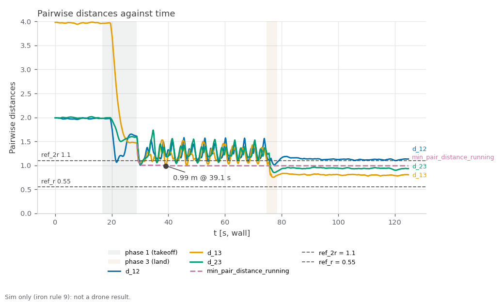

RECORD · SIM — sim_crossing_dry1. Sim-only (iron rule 9): none of these values is ported to the drone; cbf_sim.yaml speeds are sim-only (iron rule 9).

# sim_crossing_dry1 — three-drone CBF crossing, antipodal, live metrics (started 2026-10-29T22:52:02+08:00 +08; flight 14:54:03–14:55:21 UTC)

**Verdict: FAIL.** Re-run of the three-drone crossing with collision avoidance on the rebuilt asset at cbf_sim.yaml's 2.0 / 4.0 m/s, gated on live 40 Hz odometry (ledger #4 sampled the 5 Hz status string). For Linear NEAR-787 (milestone S5). PASS = every gate PASS; INCOMPLETE = no FAIL but ≥ 1 gate UNVERIFIED; FAIL = any gate FAIL; ABORTED = Ctrl-C landing, never a result. Report generated 2026-10-29 at repo `05635f7`.

**Scope:** PX4's own sim state estimate positions the drones (no mocap, no camera); flat default world; camera and cuVSLAM not in the loop; speeds are cbf_sim.yaml's sim-only values.

## Setup

| Item | Value |
|---|---|
| Sim | Isaac Sim, 3 Starling 2 Max (`DRONE_USD=starling2max.usd`, `PX4_VEHICLE_MODEL=pegasus_starling2max`), default flat world |
| Airframe | `10090_pegasus_starling2max` (sim-only airframe gains, see the S5 hover records) |
| Commander | `cbf_sim.yaml scenario:=antipodal`, tuning {"teleop_max_speed_mps": 1.2, "goal_accel_mps2": 6.0, "goal_settle_s": 0.3, "scenario_speed_mps": 2.0} |
| Driver | `tools/sim.sh test crossing`, repo commit `05635f76b037b1e7e81ac6294206f63e0b50f49d` (tools/ uncommitted changes: 0) |
| Started | 2026-10-29T22:52:02+08:00 +08 (laptop clock, `run_meta.txt`); flight 14:54:03–14:55:21 UTC (container clock) |
| Video | none (headless run) |

## Pass/fail

| Check | Criterion | Measured | Baseline | Verdict |
|---|---|---|---|---|
| Isaac launch: SYS_AUTOSTART=10090 x3 | SYS_AUTOSTART=10090 x3 | 3 | - | PASS |
| Isaac launch: Ready for takeoff x3 | Ready for takeoff x3 | 3 | - | PASS |
| Isaac launch: no 'Unknown model' | no 'Unknown model' | 0 | - | PASS |
| Isaac launch: no PhysX cooking warnings | no PhysX cooking warnings | 0 | - | PASS |
| Isaac launch: Starling2MaxConfig x3 | Starling2MaxConfig x3 (launcher print) | 6 | - | PASS |
| min pairwise distance ≥ 1.10 m (2r) | ≥ 1.10 m, binary (live 40 Hz odometry, phase 2) | `min_pair_distance`: 0.99 m (margin -0.11 m to the gate; pair `d_13` at t=39.1 s) | #4: 1.02 m (0.08 m inside, 10-19 asset, 3 m/s cap, no bag) | **FAIL** |
| vs ledger #4 | informational (min distance − 1.02 m) | `min_pair_distance` − 1.02 m: -0.03 m | #4: 1.02 m | info |
| emergency samples | 0 (5 Hz status string) | 0 CSV rows flagged (≈ 8 per 5 Hz status sample) | - | PASS |
| fence-breach samples | 0 (5 Hz status string) | 0 CSV rows flagged (≈ 8 per 5 Hz status sample) | - | PASS |
| CBF active on ≥ 1 drone at least once | /svg/cbf_active names ≥ 1 drone at least once (20 Hz) | drone_1, drone_2, drone_3 seen; 88.5 s active (any drone) | - | PASS |
| far goal reached per drone | closest approach ≤ 0.40 m (commander arrival radius; spec draft said 0.3 m) | `goal_dist_drone_1..3`: drone_1 0.23 m; drone_2 0.28 m; drone_3 0.14 m | - | PASS |
| peak speed ≤ 4.2 m/s | ≤ 4.2 m/s (cap 4.0 + 5 %), over every row including takeoff and landing (conservative) | `speed_drone_1..3`: 1.04 m/s (drone_1 1.01, drone_2 1.02, drone_3 1.04) | - | PASS |
| landed, disarmed ×3 (commander ACK) | informational (ACK log, not an arming display) | drone_1, drone_2, drone_3 | - | info |
| post-flight armed=false x3 (MAVROS state) | armed: false for drone_1, drone_2, drone_3 | drone_1 false, drone_2 false, drone_3 false | - | PASS |
| live vs bag recompute | live metrics.csv agrees with the rosbag recompute (minimum distance within tolerance; flags by count) | d_12 Δmax 0.003462 (tol 0.02); d_13 Δmax 0 (tol 0.02); d_23 Δmax 0.009708 (tol 0.02); min_pair_distance Δmax 0.003462 (tol 0.02); speed_drone_1 Δmax 0 (tol 0.1); speed_drone_2 Δmax 0.000857 (tol 0.1); speed_drone_3 Δmax 0 (tol 0.1); cbf_drone_1 Σ 3694 vs 3694; cbf_drone_2 Σ 3634 vs 3634; cbf_drone_3 Σ 3604 vs 3604; emergency Σ 0 vs 0; fence_breached Σ 0 vs 0; fence_margin Δmax 0 (tol 0.02); goal_dist_drone_1 Δmax 0 (tol 0.05); goal_dist_drone_2 Δmax 0.006801 (tol 0.05); goal_dist_drone_3 Δmax 0 (tol 0.05); min_pair_distance_running Δmax 0 (tol 0.02); unpaired 0.0 % | - | PASS |
| rosbag copied + readable | bag dir crossing_* with metadata.yaml under the heavy folder, and metrics.csv, metrics_bag.csv in the run folder | crossing_20261029_145255: 231 MB, metadata.yaml present | - | PASS |
| PX4 ulogs one per sysid 2/3/4 | ulog_sysid_map.txt lists sysids 2, 3, 4 (drone_1/2/3) | 3 files, sysids ['2', '3', '4'] | - | PASS |
| WiFi firmware alerts | 0 during the run | 0 | - | PASS |
| code that ran | informational (run_meta.txt head vs git HEAD at report time) | ran at 05635f7 | - | info |
| metrics node offsets (read once at start) | informational (CSV header) | offsets -2,0,0,0,0,0,2,0,0; t0_unix 1793285631.4053679 | - | info |
| window / samples | informational (phase 2) | 45.8 s, 1800 rows (4909 total), 39.3 Hz | - | info |

Rows marked info are informational and never pass or fail the run.

[Figure 1](#fig-1) plots the three pairwise distances and their running minimum against the 1.10 m (2r) gate. The closest approach was 0.99 m (d_13 at t=39.1 s), -0.11 m against the gate and -0.03 m against ledger #4's 1.02 m. Peak speed was 1.04 m/s (gate 4.2) and the far goals were reached to within 0.28 m.

<a id="fig-1"></a>


*Figure 1. Pairwise distances d_12, d_13 and d_23 and their running minimum against time, with the 1.10 m (2r) gate line and the 0.55 m (r) line; shaded bands mark the takeoff and land phases. Drawn from the run's metrics.csv by `tools/sim.sh figures crossing <run>`.*

## Driver verdict history

Every generation of this record (`verdicts.log`, newest last; the last line is this one):

```
2026-10-29T22:57:06+08:00 head=05635f7 verdict=FAIL fail=1 unverified=0
```

## Evidence

Flight script stdout (times are UTC, container clock):
```
[14:54:03] pre-takeoff: name:drone_1 state:IDLE position:[-1.993,0.013,0.028] name:drone_2 state:IDLE position:[-0.019,0.014,0.041] name:drone_3 state:IDLE position:[1.994,-0.0,0.007]
[14:54:04] takeoff: success=True, message='takeoff: drone_1, drone_2, drone_3'
[14:54:20] start: success=True, message='scenario "antipodal" running'
[14:54:20] window: 45 s
[14:55:05] land: success=True, message='landing: drone_1, drone_2, drone_3'
[14:55:21] landed: name:land name:drone_1 state:IDLE position:[0.392,0.565,0.024] name:drone_2 state:IDLE position:[-0.548,-0.073,0.043] name:drone_3 state:IDLE position:[0.397,-0.254,-0.009]
```

Metrics node log (tail):
```
[t= 113.0 s] phase=0 min_d=0.801 run_min=0.991 cbf=drone_1,drone_2,drone_3 emerg=0
[t= 114.0 s] phase=0 min_d=0.798 run_min=0.991 cbf=drone_1,drone_2,drone_3 emerg=0
[t= 115.0 s] phase=0 min_d=0.781 run_min=0.991 cbf=drone_1,drone_2,drone_3 emerg=0
[t= 116.0 s] phase=0 min_d=0.793 run_min=0.991 cbf=drone_1,drone_2,drone_3 emerg=0
[t= 117.0 s] phase=0 min_d=0.793 run_min=0.991 cbf=drone_1,drone_2,drone_3 emerg=0
[t= 118.0 s] phase=0 min_d=0.796 run_min=0.991 cbf=drone_1,drone_2,drone_3 emerg=0
[t= 119.0 s] phase=0 min_d=0.798 run_min=0.991 cbf=drone_1,drone_2,drone_3 emerg=0
[t= 120.0 s] phase=0 min_d=0.787 run_min=0.991 cbf=drone_1,drone_2,drone_3 emerg=0
[t= 121.0 s] phase=0 min_d=0.781 run_min=0.991 cbf=drone_1,drone_2,drone_3 emerg=0
[t= 122.0 s] phase=0 min_d=0.795 run_min=0.991 cbf=drone_1,drone_2,drone_3 emerg=0
[t= 123.0 s] phase=0 min_d=0.803 run_min=0.991 cbf=drone_1,drone_2,drone_3 emerg=0
[t= 124.0 s] phase=0 min_d=0.808 run_min=0.991 cbf=drone_1,drone_2,drone_3 emerg=0
```

Landing (commander ACK log) and post-flight MAVROS state:
```
[swarm_commander-2] [INFO] [1793285706.889475975] [swarm_commander]: drone_3: touchdown at z=0.12 m, settling 2.0 s before disarm
[swarm_commander-2] [INFO] [1793285707.589655979] [swarm_commander]: drone_1: touchdown at z=0.11 m, settling 2.0 s before disarm
[swarm_commander-2] [INFO] [1793285707.590148677] [swarm_commander]: drone_2: touchdown at z=0.09 m, settling 2.0 s before disarm
[swarm_commander-2] [INFO] [1793285708.940011509] [swarm_commander]: drone_3: landed, disarmed (attempt 1)
[swarm_commander-2] [INFO] [1793285709.689965485] [swarm_commander]: drone_1: landed, disarmed (attempt 1)
[swarm_commander-2] [INFO] [1793285709.690321232] [swarm_commander]: drone_2: landed, disarmed (attempt 1)
drone_1 armed: false
drone_2 armed: false
drone_3 armed: false
```

Live vs bag recompute:

| Column | Kind | Tolerance | Max diff | Σ live | Σ bag | Paired | Unpaired | OK |
|---|---|---|---|---|---|---|---|---|
| d_12 | continuous | 0.02 | 0.003462 | 6544.02 | 6544.01 | 4909 | 0.0 % | yes |
| d_13 | continuous | 0.02 | 0 | 7572.18 | 7572.18 | 4909 | 0.0 % | yes |
| d_23 | continuous | 0.02 | 0.009708 | 6287.28 | 6287.28 | 4909 | 0.0 % | yes |
| min_pair_distance | continuous | 0.02 | 0.003462 | 5713.6 | 5713.6 | 4909 | 0.0 % | yes |
| speed_drone_1 | continuous | 0.1 | 0 | 997.922 | 997.922 | 4909 | 0.0 % | yes |
| speed_drone_2 | continuous | 0.1 | 0.000857 | 968.403 | 968.403 | 4909 | 0.0 % | yes |
| speed_drone_3 | continuous | 0.1 | 0 | 917.054 | 917.054 | 4909 | 0.0 % | yes |
| cbf_drone_1 | flag | 0 | 0 | 3694 | 3694 | 4909 | 0.0 % | yes |
| cbf_drone_2 | flag | 0 | 0 | 3634 | 3634 | 4909 | 0.0 % | yes |
| cbf_drone_3 | flag | 0 | 0 | 3604 | 3604 | 4909 | 0.0 % | yes |
| emergency | flag | 0 | 0 | 0 | 0 | 4909 | 0.0 % | yes |
| fence_breached | flag | 0 | 0 | 0 | 0 | 4909 | 0.0 % | yes |
| fence_margin | continuous | 0.02 | 0 | 2010.2 | 2010.2 | 4909 | 0.0 % | yes |
| goal_dist_drone_1 | continuous | 0.05 | 0 | 2164.33 | 2164.33 | 4909 | 0.0 % | yes |
| goal_dist_drone_2 | continuous | 0.05 | 0.006801 | 2183.41 | 2183.41 | 4909 | 0.0 % | yes |
| goal_dist_drone_3 | continuous | 0.05 | 0 | 2219.1 | 2219.1 | 4909 | 0.0 % | yes |
| min_pair_distance_running | continuous | 0.02 | 0 | 3761.89 | 3761.89 | 4909 | 0.0 % | yes |

## Files

- Repo (this folder, `docs/record/sim_crossing_dry1/`): `armed_post.txt`, `bag_evidence.txt`, `bag_path.txt`, `bag_status_pre.json`, `clock_check.txt`, `commander.log`, `commands.sh`, `fig-1.png`, `interfaces.log`, `isaac.log`, `isaac.log.start`, `isaac_evidence.txt`, `landing_evidence.txt`, `metrics.csv`, `metrics_bag.csv`, `metrics_node.log`, `odom_hz.txt`, `params_mavros.txt`, `params_mavros_names.txt`, `params_ulog.txt`, `px4_arm_times.txt`, `res_watch.log`, `run.log`, `run_meta.txt`, `status_post.json`, `status_pre.json`, `test_stdout.log`, `topics_of_interest.txt`, `ulog_list.txt`, `ulog_sysid_map.txt`, `ulogs_copied.ok`, `verdicts.log`, `video.txt`.
- Not in the repo (`/home/jeremychia/flight_logs/sim/sim_crossing_dry1/`): `crossing_20261029_145255` (231 MB), `drone_1_sysid2_14_52_16.ulg` (62 MB), `drone_2_sysid3_14_52_16.ulg` (62 MB), `drone_3_sysid4_14_52_16.ulg` (61 MB).

## Caveats

- The 45 s window is wall-clock; PX4 lockstep runs about 1.3× faster than the wall clock, so it is about 34 s of vehicle time (the duration is not a gate).
- Reading for the flight-test decision. The drones start on a line at 2 m spacing (d_12 = 2, d_13 = 4, d_23 = 2) and their antipodal goals send all three through the same middle region at once.
- Peak speed was 1.04 m/s against the 2.0 m/s scenario speed because the CBF was active for 88.5 s of the run, so the ≤ 4.2 m/s gate passed on a quantity this scenario cannot produce.
- The closest pair sat under 1.10 m for 28 % of the crossing, in a limit cycle of about 3.5 s between about 1.0 and 1.5 m: the filter holds the pairs near its boundary, it did not slip once. The margin to the 0.55 m radius stayed above 0.4 m (no contact).
- After landing started, d_13 dropped to about 0.76 m and the landed drones sit about 0.8 m apart; no gate sees this.
- Options for the owner: a larger arena or goal radius, a different gate, or recording this result as the acceptance.

## Ledger row draft (docs/record/LEDGER.md table 1, #20, NEAR-787)

| 20 | 2026-10-29 | SIM | CBF crossing, 3 drones antipodal, cbf_sim.yaml 2.0 / 4.0 m/s, live metrics: FAIL — min pairwise distance 0.99 m (2r 1.10), emergency 0, fence breach 0, peak 1.04 m/s, CBF on 1,2,3, landed + DISARMED ×3 yes, bag cross-check PASS; FAIL: min pairwise distance ≥ 1.10 m (2r) | [sim_crossing_dry1_record.md](sim_crossing_dry1_record.md) | NEAR-787 |

