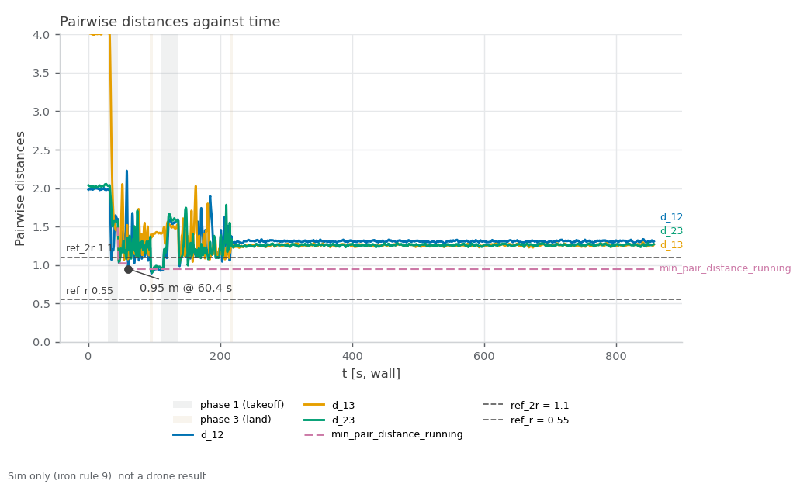

RECORD · SIM — sim_crossing_run1. Sim-only (iron rule 9): none of these values is ported to the drone; cbf_sim.yaml speeds are sim-only (iron rule 9).

# sim_crossing_run1 — three-drone CBF crossing, antipodal, live metrics (started 2026-10-30T02:07:48+08:00 +08; flight 18:10:06–18:11:29 UTC)

**Verdict: FAIL.** Re-run of the three-drone crossing with collision avoidance on the rebuilt asset at cbf_sim.yaml's 2.0 / 4.0 m/s, gated on live 40 Hz odometry (ledger #4 sampled the 5 Hz status string). For Linear NEAR-787 (milestone S5). PASS = every gate PASS; INCOMPLETE = no FAIL but ≥ 1 gate UNVERIFIED; FAIL = any gate FAIL; ABORTED = Ctrl-C landing, never a result. Report generated 2026-10-30 at repo `31e87e8`.

**Scope:** PX4's own sim state estimate positions the drones (no mocap, no camera); flat default world; camera and cuVSLAM not in the loop; speeds are cbf_sim.yaml's sim-only values.

## Setup

| Item | Value |
|---|---|
| Sim | Isaac Sim, 3 Starling 2 Max (`DRONE_USD=starling2max.usd`, `PX4_VEHICLE_MODEL=pegasus_starling2max`), default flat world |
| Airframe | `10090_pegasus_starling2max` (sim-only airframe gains, see the S5 hover records) |
| Commander | `cbf_sim.yaml scenario:=antipodal`, tuning {"teleop_max_speed_mps": 1.2, "goal_accel_mps2": 6.0, "goal_settle_s": 0.3, "scenario_speed_mps": 2.0} |
| Driver | `tools/sim.sh test crossing`, repo commit `31e87e820e236dbe132e10c90f5fe582809a9bfe` (tools/ uncommitted changes: 0) |
| Started | 2026-10-30T02:07:48+08:00 +08 (laptop clock, `run_meta.txt`); flight 18:10:06–18:11:29 UTC (container clock) |
| Video | videos/cbf_test.mp4 |

## Pass/fail

| Check | Criterion | Measured | Baseline | Verdict |
|---|---|---|---|---|
| Isaac launch: SYS_AUTOSTART=10090 x3 | SYS_AUTOSTART=10090 x3 | 3 | - | PASS |
| Isaac launch: Ready for takeoff x3 | Ready for takeoff x3 | 3 | - | PASS |
| Isaac launch: no 'Unknown model' | no 'Unknown model' | 0 | - | PASS |
| Isaac launch: no PhysX cooking warnings | no PhysX cooking warnings | 0 | - | PASS |
| Isaac launch: Starling2MaxConfig x3 | Starling2MaxConfig x3 (launcher print) | 6 | - | PASS |
| coverage: rows through the window | largest `t_s` gap over the phase-2 rows ≤ 0.5 s, ≥ 1 landing (`phase` 3) row, metrics node alive at stop | largest phase-2 gap 0.14 s; 3540 phase-2 rows, 245 landing rows | - | PASS |
| min pairwise distance ≥ 1.10 m (2r) | ≥ 1.10 m, binary (live 40 Hz odometry, phase 2) | `min_pair_distance`: 0.95 m (margin -0.15 m to the gate; pair `d_12` at t=60.4 s) | #4: 1.02 m (0.08 m inside, 10-19 asset, 3 m/s cap, no bag) | **FAIL** |
| vs ledger #4 | informational (min distance − 1.02 m) | `min_pair_distance` − 1.02 m: -0.07 m | #4: 1.02 m | info |
| min pairwise distance, all phases | informational (every row: takeoff, window, landing; not a gate) | `d_12`/`d_13`/`d_23`: 0.89 m (d_12 at t=95.8 s, landing) | - | info |
| emergency samples | 0 (5 Hz status string) | `emergency`: 0 CSV rows flagged (≈ 8 per 5 Hz status sample) | - | PASS |
| fence-breach samples | 0 (5 Hz status string) | `fence_breached`: 0 CSV rows flagged (≈ 8 per 5 Hz status sample) | - | PASS |
| CBF active on ≥ 1 drone at least once | /svg/cbf_active names ≥ 1 drone at least once (20 Hz) | `cbf_drone_1..3`: drone_1, drone_2, drone_3 seen; 139.0 s active (any drone) | - | PASS |
| far goal reached per drone | closest approach ≤ 0.40 m (commander arrival radius; spec draft said 0.3 m) | `goal_dist_drone_1..3`: drone_1 0.24 m; drone_2 0.02 m; drone_3 0.05 m | - | PASS |
| peak speed ≤ 4.2 m/s | ≤ 4.2 m/s (cap 4.0 + 5 %), over every row including takeoff and landing (conservative) | `speed_drone_1..3`: 1.11 m/s (drone_1 1.11, drone_2 1.04, drone_3 1.07) | - | PASS |
| landed, disarmed ×3 (commander ACK) | informational (ACK log, not an arming display) | drone_1, drone_2, drone_3 | - | info |
| post-flight armed=false x3 (MAVROS state) | armed: false for drone_1, drone_2, drone_3 | drone_1 false, drone_2 false, drone_3 false | - | PASS |
| live vs bag recompute | live metrics.csv agrees with the rosbag recompute (minimum distance within tolerance; flags by count) | d_12 Δmax 0 (tol 0.02); d_13 Δmax 0 (tol 0.02); d_23 Δmax 0 (tol 0.02); min_pair_distance Δmax 0 (tol 0.02); speed_drone_1 Δmax 0 (tol 0.1); speed_drone_2 Δmax 0 (tol 0.1); speed_drone_3 Δmax 0 (tol 0.1); cbf_drone_1 Σ 0 vs 0; cbf_drone_2 Σ 0 vs 0; cbf_drone_3 Σ 0 vs 0; emergency Σ 0 vs 0; fence_breached Σ 0 vs 0; fence_margin Δmax 0 (tol 0.02); goal_dist_drone_1 Δmax 0 (tol 0.05); goal_dist_drone_2 Δmax 0 (tol 0.05); goal_dist_drone_3 Δmax 0 (tol 0.05); min_pair_distance_running Δmax 0 (tol 0.02); unpaired 100.0 %; bag unpaired 100.0 % | - | **UNVERIFIED** |
| rosbag copied + readable | bag dir crossing_* with metadata.yaml under the heavy folder, and metrics.csv, metrics_bag.csv in the run folder | crossing_20261029_180849: 31 MB, metadata.yaml present | - | PASS |
| PX4 ulogs one per sysid 2/3/4 | ulog_sysid_map.txt lists sysids 2, 3, 4 (drone_1/2/3) | 6 files, sysids ['2', '2', '3', '3', '4', '4'] | - | **FAIL** |
| WiFi firmware alerts | 0 during the run | 0 | - | PASS |
| code that ran | informational (run_meta.txt head vs git HEAD at report time) | ran at 31e87e8 | - | info |
| metrics node offsets (read once at start) | informational (CSV header) | offsets -2,0,0,0,0,0,2,0,0; t0_unix 1793297381.7436056 | - | info |
| window / samples | informational (phase 2) | 170.6 s, 3540 rows (25179 total), 20.7 Hz | - | info |

Rows marked info are informational and never pass or fail the run.

[Figure 1](#fig-1) plots the three pairwise distances and their running minimum against the 1.10 m (2r) gate. The closest approach was 0.95 m (d_12 at t=60.4 s), -0.15 m against the gate and -0.07 m against ledger #4's 1.02 m. Peak speed was 1.11 m/s (gate 4.2) and the far goals were reached to within 0.24 m.

<a id="fig-1"></a>


*Figure 1. Pairwise distances d_12, d_13 and d_23 and their running minimum against wall-clock time, with the 1.10 m (2r) gate line and the 0.55 m (r) line; shaded bands mark the takeoff and land phases. Drawn from the run's metrics.csv by `tools/sim.sh figures crossing <run>`.*

## Driver verdict history

Every generation of this record (`verdicts.log`, newest last; the last line is this one):

```
2026-10-30T02:25:09+08:00 head=31e87e8 verdict=FAIL fail=2 unverified=1
2026-10-30T02:26:27+08:00 head=31e87e8 verdict=FAIL fail=2 unverified=1
```

## Evidence

Flight script stdout (times are UTC, container clock):
```
[18:10:06] pre-takeoff: name:drone_1 state:IDLE position:[-2.005,-0.008,0.03] name:drone_2 state:IDLE position:[-0.025,0.008,0.006] name:drone_3 state:IDLE position:[2.025,-0.008,0.025]
[18:10:07] takeoff: success=True, message='takeoff: drone_1, drone_2, drone_3'
[18:10:26] start: success=True, message='scenario "antipodal" running'
[18:10:26] window: 45 s
[18:11:11] land: success=True, message='landing: drone_1, drone_2, drone_3'
[18:11:29] landed: name:takeoff name:drone_1 state:ARMING position:[0.715,0.106,0.002] name:drone_2 state:ARMING position:[0.212,0.888,0.002] name:drone_3 state:ARMING position:[-0.647,0.46,0.034]
```

Metrics node log (tail):
```
[t= 846.0 s] phase=0 min_d=1.243 run_min=0.950 cbf= emerg=0
[t= 847.0 s] phase=0 min_d=1.243 run_min=0.950 cbf= emerg=0
[t= 848.0 s] phase=0 min_d=1.251 run_min=0.950 cbf= emerg=0
[t= 849.0 s] phase=0 min_d=1.264 run_min=0.950 cbf= emerg=0
[t= 850.0 s] phase=0 min_d=1.258 run_min=0.950 cbf= emerg=0
[t= 851.0 s] phase=0 min_d=1.259 run_min=0.950 cbf= emerg=0
[t= 852.0 s] phase=0 min_d=1.259 run_min=0.950 cbf= emerg=0
[t= 853.0 s] phase=0 min_d=1.261 run_min=0.950 cbf= emerg=0
[t= 854.0 s] phase=0 min_d=1.260 run_min=0.950 cbf= emerg=0
[t= 855.0 s] phase=0 min_d=1.257 run_min=0.950 cbf= emerg=0
[t= 856.0 s] phase=0 min_d=1.252 run_min=0.950 cbf= emerg=0
[t= 857.0 s] phase=0 min_d=1.259 run_min=0.950 cbf= emerg=0
```

Landing (commander ACK log) and post-flight MAVROS state:
```
[swarm_commander-2] [INFO] [1793297475.729826307] [swarm_commander]: drone_2: touchdown at z=0.09 m, settling 2.0 s before disarm
[swarm_commander-2] [INFO] [1793297476.581119135] [swarm_commander]: drone_1: touchdown at z=0.14 m, settling 2.0 s before disarm
[swarm_commander-2] [INFO] [1793297476.831130162] [swarm_commander]: drone_3: touchdown at z=0.11 m, settling 2.0 s before disarm
[swarm_commander-2] [INFO] [1793297477.781544901] [swarm_commander]: drone_2: landed, disarmed (attempt 1)
[swarm_commander-2] [INFO] [1793297478.681808499] [swarm_commander]: drone_1: landed, disarmed (attempt 1)
[swarm_commander-2] [INFO] [1793297478.930494812] [swarm_commander]: drone_3: landed, disarmed (attempt 1)
drone_1 armed: false
drone_2 armed: false
drone_3 armed: false
```

Live vs bag recompute:

| Column | Kind | Tolerance | Max diff | Σ live | Σ bag | Paired | Unpaired | OK |
|---|---|---|---|---|---|---|---|---|
| d_12 | continuous | 0.02 | 0 | 0 | 0 | 0 | 100.0 % | **no** |
| d_13 | continuous | 0.02 | 0 | 0 | 0 | 0 | 100.0 % | **no** |
| d_23 | continuous | 0.02 | 0 | 0 | 0 | 0 | 100.0 % | **no** |
| min_pair_distance | continuous | 0.02 | 0 | 0 | 0 | 0 | 100.0 % | **no** |
| speed_drone_1 | continuous | 0.1 | 0 | 0 | 0 | 0 | 100.0 % | **no** |
| speed_drone_2 | continuous | 0.1 | 0 | 0 | 0 | 0 | 100.0 % | **no** |
| speed_drone_3 | continuous | 0.1 | 0 | 0 | 0 | 0 | 100.0 % | **no** |
| cbf_drone_1 | flag | 0 | 0 | 0 | 0 | 0 | 100.0 % | **no** |
| cbf_drone_2 | flag | 0 | 0 | 0 | 0 | 0 | 100.0 % | **no** |
| cbf_drone_3 | flag | 0 | 0 | 0 | 0 | 0 | 100.0 % | **no** |
| emergency | flag | 0 | 0 | 0 | 0 | 0 | 100.0 % | **no** |
| fence_breached | flag | 0 | 0 | 0 | 0 | 0 | 100.0 % | **no** |
| fence_margin | continuous | 0.02 | 0 | 0 | 0 | 0 | 100.0 % | **no** |
| goal_dist_drone_1 | continuous | 0.05 | 0 | 0 | 0 | 0 | 100.0 % | **no** |
| goal_dist_drone_2 | continuous | 0.05 | 0 | 0 | 0 | 0 | 100.0 % | **no** |
| goal_dist_drone_3 | continuous | 0.05 | 0 | 0 | 0 | 0 | 100.0 % | **no** |
| min_pair_distance_running | continuous | 0.02 | 0 | 0 | 0 | 0 | 100.0 % | **no** |

## Files

- Repo (this folder, `docs/record/sim_crossing_run1/`): `armed_post.txt`, `armed_post_at_0212.txt`, `bag_evidence.txt`, `bag_path.txt`, `bag_status_pre.json`, `caveats.txt`, `clock_check.txt`, `commander.log`, `commands.sh`, `fig-1.png`, `interfaces.log`, `isaac.log`, `isaac.log.start`, `isaac_evidence.txt`, `landing_evidence.txt`, `metrics.csv`, `metrics_bag.csv`, `metrics_node.log`, `odom_hz.txt`, `params_mavros.txt`, `params_mavros_names.txt`, `params_ulog.txt`, `res_watch.log`, `run.log`, `run_meta.txt`, `status_post.json`, `status_pre.json`, `test_stdout.log`, `topics_of_interest.txt`, `ulog_list.txt`, `ulog_sysid_map.txt`, `ulogs_copied.ok`, `verdicts.log`, `video.txt`.
- Not in the repo (`/home/jeremychia/flight_logs/sim/sim_crossing_run1/`): `crossing_20261029_180849` (31 MB), `drone_1_sysid2_18_08_02.ulg` (55 MB), `drone_1_sysid2_18_11_33.ulg` (27 MB), `drone_2_sysid3_18_08_02.ulg` (55 MB), `drone_2_sysid3_18_11_33.ulg` (27 MB), `drone_3_sysid4_18_08_02.ulg` (56 MB), `drone_3_sysid4_18_11_33.ulg` (27 MB).

## Caveats

- The 45 s window is wall-clock; PX4 lockstep runs about 1.3× faster than the wall clock, so it is about 34 s of vehicle time (the duration is not a gate).
- Two crossings in this run. fly.sh flew the scripted one (takeoff 02:10:07, start 02:10:26, land 02:11:11 +08; metrics.csv t = 29.6–97.3 s). A second takeoff, start and land came from the Foxglove panel about 14 s after the first disarm (its command log reads 18:11:32, 18:11:57 and 18:13:17 UTC; metrics.csv t = 110–219 s). Both crossings' rows are in phase 2, so the gates judge both.
- Per crossing: the scripted crossing reached 0.95 m (d_12 at t = 60.4 s); the panel crossing reached 0.99 m (d_12 at t = 138.3 s). Both are below the 1.10 m gate, as were ledger #20 (0.99 m) and #4 (1.02 m).
- The bag stopped at 02:09:24 +08, 34 s after it started and before the flight: commander.log shows "bag_recorder: stopping recording" from a bag_recorder/record call the driver never makes; the Foxglove client reloaded its panels 2 s later and the panel's Rosbag switch reads IDLE in the video. The bag holds no flight rows, so the live-vs-bag cross-check paired nothing (UNVERIFIED); the gates use the live CSV alone.
- PX4 ulogs FAIL: the panel crossing armed the drones a second time, and PX4 starts a new log on each arming, so there are two per sysid (18_08_02 and 18_11_33). The same split stops the PX4 arm-time read (time-scale UNVERIFIED). Both are a consequence of the second flight, not of the scripted one.
- armed_post.txt: the driver's sample at 02:12:04 +08 read armed: true ×3 because the panel crossing was airborne (kept as armed_post_at_0212.txt). Re-sampled armed: false ×3 at 02:17 +08 after the second landing, stack still up; commander.log shows "landed, disarmed" ×3 for both flights.
- Video videos/cbf_test.mp4 (23 s, Isaac window + Foxglove basestation layout) covers the last ~20 s of the panel crossing and its landing, not the scripted crossing; the live test plots were not on screen.

## Ledger row draft (docs/record/LEDGER.md table 1, #21, NEAR-787)

| 21 | 2026-10-30 | SIM | CBF crossing, 3 drones antipodal, cbf_sim.yaml 2.0 / 4.0 m/s, live metrics: FAIL — min pairwise distance 0.95 m (2r 1.10), emergency 0, fence breach 0, peak 1.11 m/s, CBF on 1,2,3, landed + DISARMED ×3 yes, bag cross-check UNVERIFIED; FAIL: min pairwise distance ≥ 1.10 m (2r), PX4 ulogs one per sysid 2/3/4; UNVERIFIED: live vs bag recompute | [sim_crossing_run1_record.md](sim_crossing_run1_record.md) | NEAR-787 |

