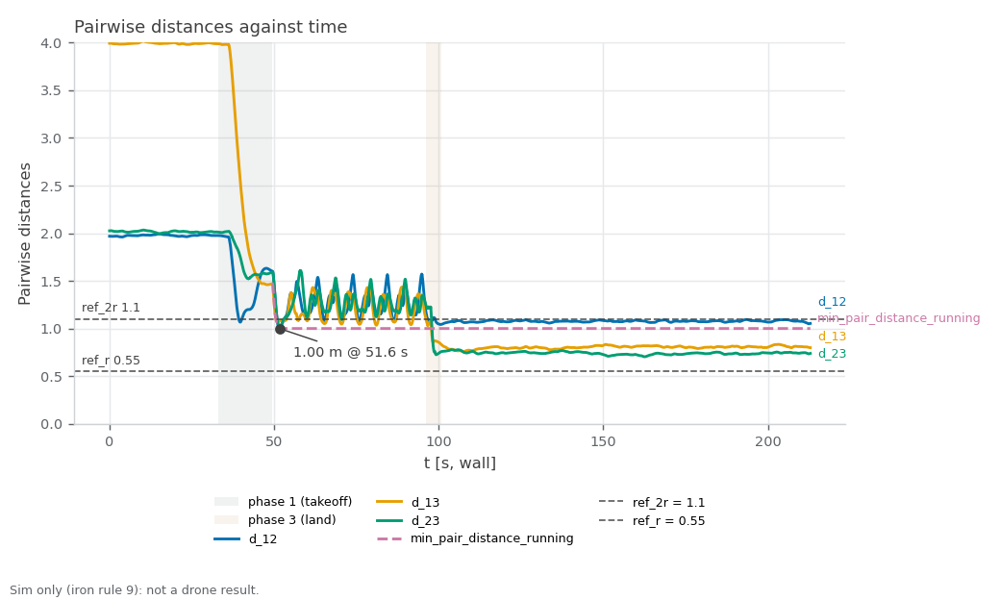

RECORD · SIM — sim_crossing_run2. Sim-only (iron rule 9): none of these values is ported to the drone; cbf_sim.yaml speeds are sim-only (iron rule 9).

# sim_crossing_run2 — three-drone CBF crossing, antipodal, live metrics (started 2026-10-30T02:32:03+08:00 +08; flight 18:34:26–18:35:51 UTC)

**Verdict: FAIL.** Re-run of the three-drone crossing with collision avoidance on the rebuilt asset at cbf_sim.yaml's 2.0 / 4.0 m/s, gated on live 40 Hz odometry (ledger #4 sampled the 5 Hz status string). For Linear NEAR-787 (milestone S5). PASS = every gate PASS; INCOMPLETE = no FAIL but ≥ 1 gate UNVERIFIED; FAIL = any gate FAIL; ABORTED = Ctrl-C landing, never a result. Report generated 2026-10-30 at repo `814c774`.

**Scope:** PX4's own sim state estimate positions the drones (no mocap, no camera); flat default world; camera and cuVSLAM not in the loop; speeds are cbf_sim.yaml's sim-only values.

## Setup

| Item | Value |
|---|---|
| Sim | Isaac Sim, 3 Starling 2 Max (`DRONE_USD=starling2max.usd`, `PX4_VEHICLE_MODEL=pegasus_starling2max`), default flat world |
| Airframe | `10090_pegasus_starling2max` (sim-only airframe gains, see the S5 hover records) |
| Commander | `cbf_sim.yaml scenario:=antipodal`, tuning {"teleop_max_speed_mps": 1.2, "goal_accel_mps2": 6.0, "goal_settle_s": 0.3, "scenario_speed_mps": 2.0} |
| Driver | `tools/sim.sh test crossing`, repo commit `3b28e16628816cbd77e113d610ff7c59adc8e471` (tools/ uncommitted changes: 0) |
| Started | 2026-10-30T02:32:03+08:00 +08 (laptop clock, `run_meta.txt`); flight 18:34:26–18:35:51 UTC (container clock) |
| Video | none of this flight; the scenario's video is videos/cbf_test.mp4, filmed in run #21 (sim_crossing_run1, same setup, its panel-flown crossing) |

## Pass/fail

| Check | Criterion | Measured | Baseline | Verdict |
|---|---|---|---|---|
| Isaac launch: SYS_AUTOSTART=10090 x3 | SYS_AUTOSTART=10090 x3 | 3 | - | PASS |
| Isaac launch: Ready for takeoff x3 | Ready for takeoff x3 | 3 | - | PASS |
| Isaac launch: no 'Unknown model' | no 'Unknown model' | 0 | - | PASS |
| Isaac launch: no PhysX cooking warnings | no PhysX cooking warnings | 0 | - | PASS |
| Isaac launch: Starling2MaxConfig x3 | Starling2MaxConfig x3 (launcher print) | 6 | - | PASS |
| coverage: rows through the window | largest `t_s` gap over the phase-2 rows ≤ 0.5 s, ≥ 1 landing (`phase` 3) row, metrics node alive at stop | largest phase-2 gap 0.07 s; 1202 phase-2 rows, 117 landing rows | - | PASS |
| min pairwise distance ≥ 1.10 m (2r) | ≥ 1.10 m, binary (live 40 Hz odometry, phase 2) | `min_pair_distance`: 1.00 m (margin -0.10 m to the gate; pair `d_12` at t=51.6 s) | #4: 1.02 m (0.08 m inside, 10-19 asset, 3 m/s cap, no bag) | **FAIL** |
| vs ledger #4 | informational (min distance − 1.02 m) | `min_pair_distance` − 1.02 m: -0.02 m | #4: 1.02 m | info |
| min pairwise distance, all phases | informational (every row: takeoff, window, landing; not a gate) | `d_12`/`d_13`/`d_23`: 0.70 m (d_23 at t=162.5 s, after landing) | - | info |
| emergency samples | 0 (5 Hz status string) | `emergency`: 0 CSV rows flagged (≈ 8 per 5 Hz status sample) | - | PASS |
| fence-breach samples | 0 (5 Hz status string) | `fence_breached`: 0 CSV rows flagged (≈ 8 per 5 Hz status sample) | - | PASS |
| CBF active on ≥ 1 drone at least once | /svg/cbf_active names ≥ 1 drone at least once (20 Hz) | `cbf_drone_1..3`: drone_1, drone_2, drone_3 seen; 153.9 s active (any drone) | - | PASS |
| far goal reached per drone | closest approach ≤ 0.40 m (commander arrival radius; spec draft said 0.3 m) | `goal_dist_drone_1..3`: drone_1 0.29 m; drone_2 0.27 m; drone_3 0.12 m | - | PASS |
| peak speed ≤ 4.2 m/s | ≤ 4.2 m/s (cap 4.0 + 5 %), over every row including takeoff and landing (conservative) | `speed_drone_1..3`: 1.04 m/s (drone_1 1.01, drone_2 1.00, drone_3 1.04) | - | PASS |
| landed, disarmed ×3 (commander ACK) | informational (ACK log, not an arming display) | drone_1, drone_2, drone_3 | - | info |
| post-flight armed=false x3 (MAVROS state) | armed: false for drone_1, drone_2, drone_3 | drone_1 false, drone_2 false, drone_3 false | - | PASS |
| live vs bag recompute | live metrics.csv agrees with the rosbag recompute (minimum distance within tolerance; flags by count) | d_12 Δmax 0.00222 (tol 0.02); d_13 Δmax 0 (tol 0.02); d_23 Δmax 0.003057 (tol 0.02); min_pair_distance Δmax 0.00222 (tol 0.02); speed_drone_1 Δmax 0 (tol 0.1); speed_drone_2 Δmax 0.002483 (tol 0.1); speed_drone_3 Δmax 0 (tol 0.1); cbf_drone_1 Σ 4194 vs 4194; cbf_drone_2 Σ 4179 vs 4179; cbf_drone_3 Σ 4089 vs 4089; emergency Σ 0 vs 0; fence_breached Σ 0 vs 0; fence_margin Δmax 0 (tol 0.02); goal_dist_drone_1 Δmax 0 (tol 0.05); goal_dist_drone_2 Δmax 0 (tol 0.05); goal_dist_drone_3 Δmax 0 (tol 0.05); min_pair_distance_running Δmax 0 (tol 0.02); unpaired 0.0 %; bag unpaired 2.4 % | - | PASS |
| rosbag copied + readable | bag dir crossing_* with metadata.yaml under the heavy folder, and metrics.csv, metrics_bag.csv in the run folder | crossing_20261029_183259: 246 MB, metadata.yaml present | - | PASS |
| PX4 ulogs one per sysid 2/3/4 | ulog_sysid_map.txt lists sysids 2, 3, 4 (drone_1/2/3) | 3 files, sysids ['2', '3', '4'] | - | PASS |
| WiFi firmware alerts | 0 during the run | 0 | - | PASS |
| code that ran | informational (run_meta.txt head vs git HEAD at report time) | ran at 3b28e16, report at 814c774 | - | info |
| metrics node offsets (read once at start) | informational (CSV header) | offsets -2,0,0,0,0,0,2,0,0; t0_unix 1793298840.1852098 | - | info |
| window / samples | informational (phase 2) | 46.8 s, 1202 rows (5476 total), 25.7 Hz | - | info |

Rows marked info are informational and never pass or fail the run.

[Figure 1](#fig-1) plots the three pairwise distances and their running minimum against the 1.10 m (2r) gate. The closest approach was 1.00 m (d_12 at t=51.6 s), -0.10 m against the gate and -0.02 m against ledger #4's 1.02 m. Peak speed was 1.04 m/s (gate 4.2) and the far goals were reached to within 0.29 m.

<a id="fig-1"></a>


*Figure 1. Pairwise distances d_12, d_13 and d_23 and their running minimum against wall-clock time, with the 1.10 m (2r) gate line and the 0.55 m (r) line; shaded bands mark the takeoff and land phases. Drawn from the run's metrics.csv by `tools/sim.sh figures crossing <run>`.*

## Driver verdict history

Every generation of this record (`verdicts.log`, newest last; the last line is this one):

```
2026-10-30T02:38:44+08:00 head=3b28e16 verdict=FAIL fail=1 unverified=0
2026-10-30T02:41:12+08:00 head=3b28e16 verdict=FAIL fail=1 unverified=0
2026-10-30T02:42:49+08:00 head=3b28e16 verdict=FAIL fail=1 unverified=0
```

## Evidence

Flight script stdout (times are UTC, container clock):
```
[18:34:26] pre-takeoff: name:drone_1 state:IDLE position:[-1.994,0.007,0.021] name:drone_2 state:IDLE position:[-0.012,-0.006,0.027] name:drone_3 state:IDLE position:[2.004,-0.015,-0.02]
[18:34:30] takeoff: success=True, message='takeoff: drone_1, drone_2, drone_3'
[18:34:49] start: success=True, message='scenario "antipodal" running'
[18:34:49] window: 45 s
[18:35:34] land: success=True, message='landing: drone_1, drone_2, drone_3'
[18:35:51] landed: name:land name:drone_1 state:IDLE position:[0.412,0.597,0.015] name:drone_2 state:IDLE position:[-0.443,-0.056,0.016] name:drone_3 state:IDLE position:[0.296,-0.187,-0.039]
```

Metrics node log (tail):
```
[t= 201.0 s] phase=0 min_d=0.741 run_min=1.001 cbf=drone_1,drone_2,drone_3 emerg=0
[t= 202.0 s] phase=0 min_d=0.749 run_min=1.001 cbf=drone_1,drone_2,drone_3 emerg=0
[t= 203.0 s] phase=0 min_d=0.752 run_min=1.001 cbf=drone_1,drone_2,drone_3 emerg=0
[t= 204.1 s] phase=0 min_d=0.743 run_min=1.001 cbf=drone_1,drone_2,drone_3 emerg=0
[t= 205.0 s] phase=0 min_d=0.749 run_min=1.001 cbf=drone_1,drone_2,drone_3 emerg=0
[t= 206.0 s] phase=0 min_d=0.749 run_min=1.001 cbf=drone_1,drone_2,drone_3 emerg=0
[t= 207.0 s] phase=0 min_d=0.750 run_min=1.001 cbf=drone_1,drone_2,drone_3 emerg=0
[t= 208.0 s] phase=0 min_d=0.746 run_min=1.001 cbf=drone_1,drone_2,drone_3 emerg=0
[t= 209.0 s] phase=0 min_d=0.742 run_min=1.001 cbf=drone_1,drone_2,drone_3 emerg=0
[t= 210.0 s] phase=0 min_d=0.745 run_min=1.001 cbf=drone_1,drone_2,drone_3 emerg=0
[t= 211.0 s] phase=0 min_d=0.748 run_min=1.001 cbf=drone_1,drone_2,drone_3 emerg=0
[t= 212.0 s] phase=0 min_d=0.738 run_min=1.001 cbf=drone_1,drone_2,drone_3 emerg=0
```

Landing (commander ACK log) and post-flight MAVROS state:
```
[swarm_commander-2] [INFO] [1793298937.610075738] [swarm_commander]: drone_3: touchdown at z=0.11 m, settling 2.0 s before disarm
[swarm_commander-2] [INFO] [1793298938.559112164] [swarm_commander]: drone_1: touchdown at z=0.14 m, settling 2.0 s before disarm
[swarm_commander-2] [INFO] [1793298938.908870261] [swarm_commander]: drone_2: touchdown at z=0.10 m, settling 2.0 s before disarm
[swarm_commander-2] [INFO] [1793298939.709555380] [swarm_commander]: drone_3: landed, disarmed (attempt 1)
[swarm_commander-2] [INFO] [1793298940.658653495] [swarm_commander]: drone_1: landed, disarmed (attempt 1)
[swarm_commander-2] [INFO] [1793298940.958385268] [swarm_commander]: drone_2: landed, disarmed (attempt 1)
drone_1 armed: false
drone_2 armed: false
drone_3 armed: false
```

Live vs bag recompute:

| Column | Kind | Tolerance | Max diff | Σ live | Σ bag | Paired | Unpaired | OK |
|---|---|---|---|---|---|---|---|---|
| d_12 | continuous | 0.02 | 0.00222 | 7059.59 | 7059.59 | 5476 | 0.0 % | yes |
| d_13 | continuous | 0.02 | 0 | 8275.66 | 8275.66 | 5476 | 0.0 % | yes |
| d_23 | continuous | 0.02 | 0.003057 | 6190.83 | 6190.83 | 5476 | 0.0 % | yes |
| min_pair_distance | continuous | 0.02 | 0.00222 | 5932.01 | 5932.01 | 5476 | 0.0 % | yes |
| speed_drone_1 | continuous | 0.1 | 0 | 730.609 | 730.609 | 5476 | 0.0 % | yes |
| speed_drone_2 | continuous | 0.1 | 0.002483 | 686.71 | 686.708 | 5476 | 0.0 % | yes |
| speed_drone_3 | continuous | 0.1 | 0 | 691.639 | 691.639 | 5476 | 0.0 % | yes |
| cbf_drone_1 | flag | 0 | 0 | 4194 | 4194 | 5476 | 0.0 % | yes |
| cbf_drone_2 | flag | 0 | 0 | 4179 | 4179 | 5476 | 0.0 % | yes |
| cbf_drone_3 | flag | 0 | 0 | 4089 | 4089 | 5476 | 0.0 % | yes |
| emergency | flag | 0 | 0 | 0 | 0 | 5476 | 0.0 % | yes |
| fence_breached | flag | 0 | 0 | 0 | 0 | 5476 | 0.0 % | yes |
| fence_margin | continuous | 0.02 | 0 | 1291.43 | 1291.43 | 5476 | 0.0 % | yes |
| goal_dist_drone_1 | continuous | 0.05 | 0 | 1576.69 | 1576.69 | 5476 | 0.0 % | yes |
| goal_dist_drone_2 | continuous | 0.05 | 0 | 1533.5 | 1533.5 | 5476 | 0.0 % | yes |
| goal_dist_drone_3 | continuous | 0.05 | 0 | 1545.8 | 1545.8 | 5476 | 0.0 % | yes |
| min_pair_distance_running | continuous | 0.02 | 0 | 4242.59 | 4242.59 | 5476 | 0.0 % | yes |

## Files

- Repo (this folder, `docs/record/sim_crossing_run2/`): `armed_post.txt`, `bag_evidence.txt`, `bag_path.txt`, `bag_status_pre.json`, `clock_check.txt`, `commander.log`, `commands.sh`, `fig-1.png`, `interfaces.log`, `isaac.log`, `isaac.log.start`, `isaac_evidence.txt`, `landing_evidence.txt`, `metrics.csv`, `metrics_bag.csv`, `metrics_node.log`, `odom_hz.txt`, `params_mavros.txt`, `params_mavros_names.txt`, `params_ulog.txt`, `px4_arm_times.txt`, `res_watch.log`, `run.log`, `run_meta.txt`, `status_post.json`, `status_pre.json`, `test_stdout.log`, `topics_of_interest.txt`, `ulog_list.txt`, `ulog_sysid_map.txt`, `ulogs_copied.ok`, `verdicts.log`, `video.txt`.
- Not in the repo (`/home/jeremychia/flight_logs/sim/sim_crossing_run2/`): `crossing_20261029_183259` (246 MB), `drone_1_sysid2_18_32_18.ulg` (48 MB), `drone_2_sysid3_18_32_18.ulg` (49 MB), `drone_3_sysid4_18_32_18.ulg` (48 MB).

## Caveats

- The 45 s window is wall-clock; PX4 lockstep runs about 1.3× faster than the wall clock, so it is about 34 s of vehicle time (the duration is not a gate).

## Ledger row draft (docs/record/LEDGER.md table 1, #22, NEAR-787)

| 22 | 2026-10-30 | SIM | CBF crossing, 3 drones antipodal, cbf_sim.yaml 2.0 / 4.0 m/s, live metrics: FAIL — min pairwise distance 1.00 m (2r 1.10), emergency 0, fence breach 0, peak 1.04 m/s, CBF on 1,2,3, landed + DISARMED ×3 yes, bag cross-check PASS; FAIL: min pairwise distance ≥ 1.10 m (2r) | [sim_crossing_run2_record.md](sim_crossing_run2_record.md) | NEAR-787 |

