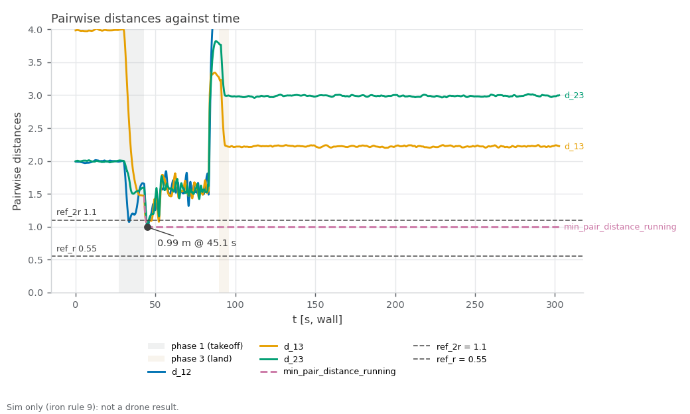

RECORD · SIM — sim_gains_run1. Sim-only (iron rule 9): none of these values is ported to the drone; cbf_sim.yaml speeds are sim-only (iron rule 9).

# sim_gains_run1 — three-drone CBF crossing, antipodal, live metrics (started 2026-10-30T03:33:59+08:00 +08; flight 19:36:27–19:37:51 UTC)

**Verdict: FAIL.** Re-run of the three-drone crossing with collision avoidance on the rebuilt asset at cbf_sim.yaml's 2.0 / 4.0 m/s, gated on live 40 Hz odometry (ledger #4 sampled the 5 Hz status string). For Linear NEAR-788 (milestone S5). PASS = every gate PASS; INCOMPLETE = no FAIL but ≥ 1 gate UNVERIFIED; FAIL = any gate FAIL; ABORTED = Ctrl-C landing, never a result. Report generated 2026-10-30 at repo `73b228c`.

**Scope:** PX4's own sim state estimate positions the drones (no mocap, no camera); flat default world; camera and cuVSLAM not in the loop; speeds are cbf_sim.yaml's sim-only values.

## Setup

| Item | Value |
|---|---|
| Sim | Isaac Sim, 3 Starling 2 Max (`DRONE_USD=starling2max.usd`, `PX4_VEHICLE_MODEL=pegasus_starling2max`), default flat world |
| Airframe | `10090_pegasus_starling2max` (sim-only airframe gains, see the S5 hover records) |
| Commander | `cbf_sim.yaml scenario:=antipodal`, tuning {"teleop_max_speed_mps": 1.2, "goal_accel_mps2": 6.0, "goal_settle_s": 0.3, "scenario_speed_mps": 2.0} |
| Driver | `tools/sim.sh test crossing`, repo commit `73b228c430f714818a745b04a8ae34ce6ef8cbae` (tools/ uncommitted changes: 0) |
| Started | 2026-10-30T03:33:59+08:00 +08 (laptop clock, `run_meta.txt`); flight 19:36:27–19:37:51 UTC (container clock) |
| Video | none recorded |

## Pass/fail

| Check | Criterion | Measured | Baseline | Verdict |
|---|---|---|---|---|
| Isaac launch: SYS_AUTOSTART=10090 x3 | SYS_AUTOSTART=10090 x3 | 3 | - | PASS |
| Isaac launch: Ready for takeoff x3 | Ready for takeoff x3 | 3 | - | PASS |
| Isaac launch: no 'Unknown model' | no 'Unknown model' | 0 | - | PASS |
| Isaac launch: no PhysX cooking warnings | no PhysX cooking warnings | 0 | - | PASS |
| Isaac launch: Starling2MaxConfig x3 | Starling2MaxConfig x3 (launcher print) | 6 | - | PASS |
| coverage: rows through the window | largest `t_s` gap over the phase-2 rows ≤ 0.5 s, ≥ 1 landing (`phase` 3) row, metrics node alive at stop | largest phase-2 gap 0.07 s; 1191 phase-2 rows, 155 landing rows | - | PASS |
| min pairwise distance ≥ 1.10 m (2r) | ≥ 1.10 m, binary (live 40 Hz odometry, phase 2) | `min_pair_distance`: 0.99 m (margin -0.11 m to the gate; pair `d_12` at t=45.1 s) | #4: 1.02 m (0.08 m inside, 10-19 asset, 3 m/s cap, no bag) | **FAIL** |
| vs ledger #4 | informational (min distance − 1.02 m) | `min_pair_distance` − 1.02 m: -0.03 m | #4: 1.02 m | info |
| min pairwise distance, all phases | informational (every row: takeoff, window, landing; not a gate) | `d_12`/`d_13`/`d_23`: 0.99 m (d_12 at t=45.1 s, test window) | - | info |
| emergency samples | 0 (5 Hz status string) | `emergency`: 5 CSV rows flagged (≈ 8 per 5 Hz status sample) | - | **FAIL** |
| fence-breach samples | 0 (5 Hz status string) | `fence_breached`: 6214 CSV rows flagged (≈ 8 per 5 Hz status sample) | - | **FAIL** |
| CBF active on ≥ 1 drone at least once | /svg/cbf_active names ≥ 1 drone at least once (20 Hz) | `cbf_drone_1..3`: drone_1, drone_2, drone_3 seen; 38.9 s active (any drone) | - | PASS |
| far goal reached per drone | closest approach ≤ 0.40 m (commander arrival radius; spec draft said 0.3 m) | `goal_dist_drone_1..3`: drone_1 0.31 m; drone_2 0.30 m; drone_3 0.27 m | - | PASS |
| peak speed ≤ 4.2 m/s | ≤ 4.2 m/s (cap 4.0 + 5 %), over every row including takeoff and landing (conservative) | `speed_drone_1..3`: 2.29 m/s (drone_1 2.29, drone_2 1.88, drone_3 0.99) | - | PASS |
| landed, disarmed ×3 (commander ACK) | informational (ACK log, not an arming display) | drone_1, drone_2, drone_3 | - | info |
| post-flight armed=false x3 (MAVROS state) | armed: false for drone_1, drone_2, drone_3 | drone_1 false, drone_2 false, drone_3 false | - | PASS |
| live vs bag recompute | live metrics.csv agrees with the rosbag recompute (minimum distance within tolerance; flags by count) | d_12 Δmax 0.000318 (tol 0.02); d_13 Δmax 0.000169 (tol 0.02); d_23 Δmax 0.000313 (tol 0.02); min_pair_distance Δmax 0.000318 (tol 0.02); speed_drone_1 Δmax 0 (tol 0.1); speed_drone_2 Δmax 0.000489 (tol 0.1); speed_drone_3 Δmax 0.000676 (tol 0.1); cbf_drone_1 Σ 1095 vs 1095; cbf_drone_2 Σ 1107 vs 1107; cbf_drone_3 Σ 967 vs 967; emergency Σ 5 vs 5; fence_breached Σ 6214 vs 6214; fence_margin Δmax 0.000198 (tol 0.02); goal_dist_drone_1 Δmax 0 (tol 0.05); goal_dist_drone_2 Δmax 0 (tol 0.05); goal_dist_drone_3 Δmax 0 (tol 0.05); min_pair_distance_running Δmax 0 (tol 0.02); unpaired 0.0 %; bag unpaired 1.7 % | - | PASS |
| rosbag copied + readable | bag dir crossing_* with metadata.yaml under the heavy folder, and metrics.csv, metrics_bag.csv in the run folder | crossing_20261029_193502: 343 MB, metadata.yaml present | - | PASS |
| PX4 ulogs one per sysid 2/3/4 | ulog_sysid_map.txt lists sysids 2, 3, 4 (drone_1/2/3) | 3 files, sysids ['2', '3', '4'] | - | PASS |
| WiFi firmware alerts | 0 during the run | 0 | - | PASS |
| code that ran | informational (run_meta.txt head vs git HEAD at report time) | ran at 73b228c | - | info |
| metrics node offsets (read once at start) | informational (CSV header) | offsets -2,0,0,0,0,0,2,0,0; t0_unix 1793302566.2115147 | - | info |
| window / samples | informational (phase 2) | 47.0 s, 1191 rows (8332 total), 25.3 Hz | - | info |

Rows marked info are informational and never pass or fail the run.

[Figure 1](#fig-1) plots the three pairwise distances and their running minimum against the 1.10 m (2r) gate. The closest approach was 0.99 m (d_12 at t=45.1 s), -0.11 m against the gate and -0.03 m against ledger #4's 1.02 m. Peak speed was 2.29 m/s (gate 4.2) and the far goals were reached to within 0.31 m.

<a id="fig-1"></a>


*Figure 1. Pairwise distances d_12, d_13 and d_23 and their running minimum against wall-clock time, with the 1.10 m (2r) gate line and the 0.55 m (r) line; shaded bands mark the takeoff and land phases. Drawn from the run's metrics.csv by `tools/sim.sh figures crossing <run>`.*

## Driver verdict history

Every generation of this record (`verdicts.log`, newest last; the last line is this one):

```
2026-10-30T03:42:22+08:00 head=73b228c verdict=FAIL fail=3 unverified=0
2026-10-30T03:43:06+08:00 head=73b228c verdict=FAIL fail=3 unverified=0
```

## Evidence

Flight script stdout (times are UTC, container clock):
```
[19:36:27] pre-takeoff: name:drone_1 state:IDLE position:[-1.986,-0.023,0.003] name:drone_2 state:IDLE position:[0.013,-0.002,-0.019] name:drone_3 state:IDLE position:[2.001,-0.001,-0.008]
[19:36:29] takeoff: success=True, message='takeoff: drone_1, drone_2, drone_3'
[19:36:49] start: success=True, message='scenario "antipodal" running'
[19:36:49] window: 45 s
[19:37:34] land: success=True, message='landing: drone_1, drone_2, drone_3'
[19:37:51] landed: name:land name:drone_1 state:IDLE position:[1.135,1.925,0.006] name:drone_2 state:IDLE position:[-2.064,-0.824,-0.005] name:drone_3 state:IDLE position:[0.867,-0.275,-0.001]
```

Metrics node log (tail):
```
[t= 291.0 s] phase=0 min_d=2.216 run_min=0.993 cbf= emerg=0
[t= 292.0 s] phase=0 min_d=2.217 run_min=0.993 cbf= emerg=0
[t= 293.0 s] phase=0 min_d=2.220 run_min=0.993 cbf= emerg=0
[t= 294.0 s] phase=0 min_d=2.217 run_min=0.993 cbf= emerg=0
[t= 295.0 s] phase=0 min_d=2.214 run_min=0.993 cbf= emerg=0
[t= 296.0 s] phase=0 min_d=2.224 run_min=0.993 cbf= emerg=0
[t= 297.0 s] phase=0 min_d=2.216 run_min=0.993 cbf= emerg=0
[t= 298.0 s] phase=0 min_d=2.222 run_min=0.993 cbf= emerg=0
[t= 299.0 s] phase=0 min_d=2.226 run_min=0.993 cbf= emerg=0
[t= 300.0 s] phase=0 min_d=2.235 run_min=0.993 cbf= emerg=0
[t= 301.0 s] phase=0 min_d=2.237 run_min=0.993 cbf= emerg=0
[t= 302.0 s] phase=0 min_d=2.228 run_min=0.993 cbf= emerg=0
```

Landing (commander ACK log) and post-flight MAVROS state:
```
[swarm_commander-2] [INFO] [1793302656.948402047] [swarm_commander]: drone_3: touchdown at z=0.13 m, settling 2.0 s before disarm
[swarm_commander-2] [INFO] [1793302658.997867294] [swarm_commander]: drone_3: landed, disarmed (attempt 1)
[swarm_commander-2] [INFO] [1793302659.797907479] [swarm_commander]: drone_2: touchdown at z=0.11 m, settling 2.0 s before disarm
[swarm_commander-2] [INFO] [1793302659.897589896] [swarm_commander]: drone_1: touchdown at z=0.10 m, settling 2.0 s before disarm
[swarm_commander-2] [INFO] [1793302661.847968689] [swarm_commander]: drone_2: landed, disarmed (attempt 1)
[swarm_commander-2] [INFO] [1793302661.947855258] [swarm_commander]: drone_1: landed, disarmed (attempt 1)
drone_1 armed: false
drone_2 armed: false
drone_3 armed: false
```

Live vs bag recompute:

| Column | Kind | Tolerance | Max diff | Σ live | Σ bag | Paired | Unpaired | OK |
|---|---|---|---|---|---|---|---|---|
| d_12 | continuous | 0.02 | 0.000318 | 29844.8 | 29844.8 | 8332 | 0.0 % | yes |
| d_13 | continuous | 0.02 | 0.000169 | 19285.1 | 19285.1 | 8332 | 0.0 % | yes |
| d_23 | continuous | 0.02 | 0.000313 | 22310.7 | 22310.7 | 8332 | 0.0 % | yes |
| min_pair_distance | continuous | 0.02 | 0.000318 | 17455.7 | 17455.7 | 8332 | 0.0 % | yes |
| speed_drone_1 | continuous | 0.1 | 0 | 814.046 | 814.046 | 8332 | 0.0 % | yes |
| speed_drone_2 | continuous | 0.1 | 0.000489 | 754.964 | 754.964 | 8332 | 0.0 % | yes |
| speed_drone_3 | continuous | 0.1 | 0.000676 | 623.542 | 623.541 | 8332 | 0.0 % | yes |
| cbf_drone_1 | flag | 0 | 0 | 1095 | 1095 | 8332 | 0.0 % | yes |
| cbf_drone_2 | flag | 0 | 0 | 1107 | 1107 | 8332 | 0.0 % | yes |
| cbf_drone_3 | flag | 0 | 0 | 967 | 967 | 8332 | 0.0 % | yes |
| emergency | flag | 0 | 0 | 5 | 5 | 8332 | 0.0 % | yes |
| fence_breached | flag | 0 | 0 | 6214 | 6214 | 8332 | 0.0 % | yes |
| fence_margin | continuous | 0.02 | 0.000198 | 917.601 | 917.601 | 8332 | 0.0 % | yes |
| goal_dist_drone_1 | continuous | 0.05 | 0 | 2390.33 | 2390.33 | 8332 | 0.0 % | yes |
| goal_dist_drone_2 | continuous | 0.05 | 0 | 2291.44 | 2291.44 | 8332 | 0.0 % | yes |
| goal_dist_drone_3 | continuous | 0.05 | 0 | 1898.73 | 1898.73 | 8332 | 0.0 % | yes |
| min_pair_distance_running | continuous | 0.02 | 0 | 7224.24 | 7224.24 | 8332 | 0.0 % | yes |

## Files

- Repo (this folder, `docs/record/sim_gains_run1/`): `armed_post.txt`, `bag_evidence.txt`, `bag_path.txt`, `bag_status_pre.json`, `caveats.txt`, `clock_check.txt`, `commander.log`, `commands.sh`, `fig-1.png`, `interfaces.log`, `isaac.log`, `isaac.log.start`, `isaac_evidence.txt`, `landing_evidence.txt`, `live_plot.log`, `metrics.csv`, `metrics_bag.csv`, `metrics_node.log`, `odom_hz.txt`, `params_mavros.txt`, `params_mavros_names.txt`, `params_ulog.txt`, `px4_arm_times.txt`, `res_watch.log`, `run.log`, `run_meta.txt`, `status_post.json`, `status_pre.json`, `test_stdout.log`, `topics_of_interest.txt`, `ulog_list.txt`, `ulog_sysid_map.txt`, `ulogs_copied.ok`, `verdicts.log`, `video.txt`.
- Not in the repo (`/home/jeremychia/flight_logs/sim/sim_gains_run1/`): `crossing_20261029_193502` (343 MB), `drone_1_sysid2_19_34_14.ulg` (50 MB), `drone_2_sysid3_19_34_14.ulg` (50 MB), `drone_3_sysid4_19_34_14.ulg` (49 MB).

## Caveats

- The 45 s window is wall-clock; PX4 lockstep runs about 1.3× faster than the wall clock, so it is about 34 s of vehicle time (the duration is not a gate).
- NEAR-788 live gain tuning: during the crossing the owner changed the CBF gains from the Foxglove panel five times, and commander.log shows each one accepted and applied on the next control tick: r 0.55 → 0.75 (t = 52.0 s), alpha 2.5 → 4.7 (62.1 s), alpha 4.7 → 6.7 (68.9 s), r 0.75 → 1.2 (83.1 s), r 1.2 → 0.65 (87.6 s).
- The drones followed the gains: the closest pair was 0.99 m at r 0.55, then 1.43 m and 1.32 m at r 0.75 (alpha 4.7 and 6.7), and 1.49 m in the 4.5 s after r rose to 1.2, after which the pairs spread to about 2.2–3.0 m (metrics.csv, phase 2).
- The pass/fail table gates the whole run against the starting 2r = 1.10 m, so its distance FAIL comes from the first crossing before any change; it is not the NEAR-788 result. No video was recorded for this run.
- Raising r from 0.75 to 1.2 m mid-flight (t = 83.1 s) put every pair deep inside the new 2.4 m keep-out at once: the CBF had no safe solution and fired its emergency push-apart (t = 83.4–83.5 s), which threw a drone 0.55 m past the geofence (fence_margin −0.55 m at t = 84.7 s). The commander latches the fence flag until Reset Fence, so fence_breached stays set from t = 84.2 s through landing (6214 rows); the emergency and fence FAILs come from this one change.

## Ledger row draft (docs/record/LEDGER.md table 1, #23, NEAR-788)

| 23 | 2026-10-30 | SIM | CBF crossing, 3 drones antipodal, cbf_sim.yaml 2.0 / 4.0 m/s, live metrics: FAIL — min pairwise distance 0.99 m (2r 1.10), emergency 5, fence breach 6214, peak 2.29 m/s, CBF on 1,2,3, landed + DISARMED ×3 yes, bag cross-check PASS; FAIL: min pairwise distance ≥ 1.10 m (2r), emergency samples, fence-breach samples | [sim_gains_run1_record.md](sim_gains_run1_record.md) | NEAR-788 |

