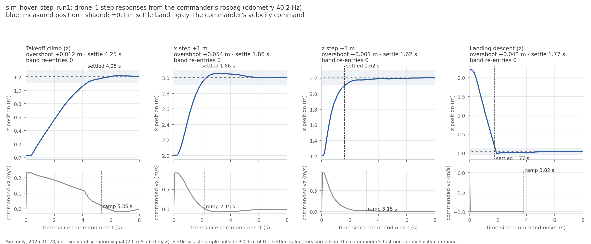

RECORD · SIM — sim_hover_step_run1. Sim-only (iron rule 9): none of these values is ported to the drone.

# sim_hover_step_run1 — Starling hover + 1 m steps on the rebuilt asset + 10-20 airframe (2026-10-28, 07:42:52–07:44:23)

**Verdict: PASS.** Re-run of ledger #3 for Linear NEAR-786 (milestone S5). Gates are the M1 criteria in [MILESTONES.md](../MILESTONES.md) §4; the #3 numbers are shown for comparison only (see Caveats).

## Setup

| Item | Value |
|---|---|
| Sim | Isaac Sim headless, 3 Starling 2 Max (`DRONE_USD=starling2max.usd`, `PX4_VEHICLE_MODEL=pegasus_starling2max`), default flat world |
| Airframe | `10090_pegasus_starling2max` (10-20: rate gains x0.5, gyro filters 80/40, `LNDMC_ROT_MAX` 300, MPC limits 20/10/4) |
| Commander | CMU dev `b21d28c`, `cbf_sim.yaml scenario:=goal`, tuning {"teleop_max_speed_mps": 1.2, "goal_accel_mps2": 6.0, "goal_settle_s": 0.3, "scenario_speed_mps": 2.0}, `record_bag:=true` |
| Odometry rate | 40.2 Hz (bag count), so the echo traces' 40 Hz time axis holds |
| Driver | `tools/sim_hover_step_run.sh` at repo `76cd405`; flight tool `AirStack/simulation/isaac-sim/tools/sim_hover_step_test.sh` + `analyze_step.py` (copied, unchanged in the tree) |
| Host | laptop on WiFi, `sim_resources_watch.sh` running; peak VRAM 3558 MB |

## Pass/fail

| Check | Criterion | Measured | #3 / expected | Verdict |
|---|---|---|---|---|
| Isaac launch: SYS_AUTOSTART=10090 x3 | SYS_AUTOSTART=10090 x3 | 3 | - | PASS |
| Isaac launch: Ready for takeoff x3 | Ready for takeoff x3 | 3 | - | PASS |
| Isaac launch: no 'Unknown model' | no 'Unknown model' | 0 | - | PASS |
| Isaac launch: no PhysX cooking warnings | no PhysX cooking warnings | 0 | - | PASS |
| Isaac launch: Starling2MaxConfig x3 | Starling2MaxConfig x3 (launcher print) | 0 (launcher stdout was block-buffered and lost; model proven indirectly: PX4 airframe 10090 x3 + Starling hover thrust, Iris would read ~0.58) | - | PASS |
| PX4 SYS_AUTOSTART (ulog header) | = 10090 | 10090 | - | PASS |
| PX4 MC_PITCHRATE_P (ulog header) | = 0.032 | 0.032 | - | PASS |
| PX4 LNDMC_ROT_MAX (ulog header) | = 300 | 300 | - | PASS |
| PX4 MPC_XY_VEL_MAX (ulog header) | = 20 | 20 | - | PASS |
| PX4 MPC_THR_HOVER (ulog header) | = 0.165 | 0.165 | - | PASS |
| PX4 IMU_GYRO_CUTOFF (ulog header) | = 80 | 80 | - | PASS |
| takeoff accepted | success=True | yes | - | PASS |
| start accepted (scenario goal) | success=True | yes | - | PASS |
| hover thrust setpoint (MAVROS target_attitude) | 0.12–0.2 | median 0.153 of 10 samples | 0.155 (#3); real drone 0.165 | PASS |
| land accepted + final state IDLE | land success, landed: IDLE | yes | - | PASS |
| x step +1 m: overshoot (bag) | < 0.15 m | +0.054 m (echo trace, #3's method: +0.031 m / 1.52 s; that trace starts at the `ros2 topic pub` call, ~1.5–3 s before the commander reacts) | +0.002 m (#3) | PASS |
| x step +1 m: settle ±0.1 m (bag) | < 3.0 s | 1.86 s from command onset; commander ramp 2.15 s at 0.92 m/s peak, drone lag -0.29 s | 2.75 s (#3) | PASS |
| x step +1 m: ringing (bag) | ≤ 1 band re-entry | 0 re-entries (315 samples) | - | PASS |
| x step +1 m: vs #3 (echo method) | informational (#3 flew 0.6 m/s / 3.0 m/s²; now 2.0 / 6.0) | overshoot +0.029 m, settle -1.23 s vs #3 | - | PASS |
| z step +1 m: overshoot (bag) | < 0.15 m | +0.001 m (echo trace, #3's method: +0.001 m / 3.05 s; that trace starts at the `ros2 topic pub` call, ~1.5–3 s before the commander reacts) | +0.001 m (#3) | PASS |
| z step +1 m: settle ±0.1 m (bag) | < 3.0 s | 1.62 s from command onset; commander ramp 3.15 s at 0.92 m/s peak, drone lag -1.53 s | 0.75 s (#3) | PASS |
| z step +1 m: ringing (bag) | ≤ 1 band re-entry | 0 re-entries (321 samples) | - | PASS |
| z step +1 m: vs #3 (echo method) | informational (#3 flew 0.6 m/s / 3.0 m/s²; now 2.0 / 6.0) | overshoot +0.000 m, settle +2.30 s vs #3 | - | note |
| takeoff climb to 1.2 m (bag) | informational | overshoot +0.012 m, settled 4.25 s after the climb command (0.91 s after arming), final z 1.21 m, commanded peak 0.23 m/s | 0.31 m / 7.9 s (#3, echo method) | PASS |
| landing descent (bag) | informational | -2.169 m at 1.00 m/s commanded, touchdown z 0.04 m | - | PASS |
| landing: disarmed x3 | 'landed, disarmed' x3, no 'disarm not accepted' | 3 disarmed (3 on attempt 1) | #13: attempt 1 x3 | PASS |
| drone_1 disarmed (bag: MAVROS state) | armed=false at the end | armed at [98.23] s, disarmed at [174.55] s, armed at end: False | - | PASS |
| WiFi firmware alerts during the run | 0 | 0 | - | PASS |
| rosbag (first live use of record_bag) | recorded, closed (metadata.yaml), readable | hover_step_20261028_074116: 280 MB, 8858 drone_1 odometry msgs over 220.5 s | - | PASS |
| PX4 ulogs, one per drone (sysid 2/3/4) | 3 files | 3 files, sysids ['2', '3', '4'] | - | PASS |

Rows marked *note* are informational and never fail the run.



*Figure: measured position (blue) per event against time since the commander's first non-zero velocity command, with the ±0.1 m settle band and the settle time; below each, the commander's own velocity command and the end of its ramp. Made by `tools/hover_step_plot.py` from `drone_1_odom.csv` / `drone_1_cmd.csv`.*

## Evidence

```
model_line=0 starling_cfg=0 autostart=3 unknown_model=0 cooking=0 ready=3
```

PX4 parameters (ulog header):
```
SYS_AUTOSTART 10090
MAV_SYS_ID 2
MC_PITCHRATE_P 0.03200000151991844
MC_ROLLRATE_P 0.03200000151991844
LNDMC_ROT_MAX 300.0
MPC_XY_VEL_MAX 20.0
MPC_THR_HOVER 0.16500000655651093
IMU_GYRO_CUTOFF 80.0
IMU_DGYRO_CUTOFF 40.0
MPC_Z_VEL_MAX_DN 4.0
MPC_ACC_HOR 6.0
```

Flight tool stdout:
```
groups: cannot find name for group ID 992
[07:42:52] pre-takeoff: IDLE -2.001 0.016 0.042
[07:42:53] takeoff: success=True, message='takeoff: drone_1, drone_2, drone_3'
[07:43:26] start: success=True, message='scenario "goal" running'
[07:43:34] hover: ACTIVE -0.009 -1.014 1.2
--- hover thrust samples (/drone_1/interface/mavros/setpoint_raw/target_attitude .thrust) ---
0.15271395444869995 0.1529669165611267 0.15263888239860535 0.1528586596250534 0.15335741639137268 0.15343771874904633 0.15357202291488647 0.1534709483385086 0.153335303068161 0.1535290777683258 
[07:43:44] step x: goal (0.989, -0.996, 1.203)
[07:43:53] step z: goal (1.006, -0.999, 2.201)
[07:44:01] after steps: ACTIVE 1.021 -0.984 2.204
[07:44:05] land: success=True, message='landing: drone_1, drone_2, drone_3'
[07:44:23] landed: IDLE 0.959 -0.965 0.041
traces: /tmp/ascent.txt /tmp/step_x.txt /tmp/step_z.txt  (analyse with /tmp/analyze_step.py)
```

Analyser (echo traces, #3's method):
```
hz=40 /tmp/ascent.txt axis=z: 931 samples (23.3 s) | moved +1.176 m of +1.2 commanded (trace starts after the command, so this is a lower bound) | peak +1.219 | overshoot past settled +0.013 m | settled (±0.1 m) after 4.58 s
hz=44.530 /tmp/ascent.txt axis=z: 931 samples (20.9 s) | moved +1.176 m of +1.2 commanded (trace starts after the command, so this is a lower bound) | peak +1.219 | overshoot past settled +0.013 m | settled (±0.1 m) after 4.11 s
ascent samples: 931
hz=40 /tmp/step_x.txt axis=x: 191 samples (4.8 s) | moved +0.925 m of +1.0 commanded (trace starts after the command, so this is a lower bound) | peak +3.058 | overshoot past settled +0.031 m | settled (±0.1 m) after 1.52 s
hz=44.530 /tmp/step_x.txt axis=x: 191 samples (4.3 s) | moved +0.925 m of +1.0 commanded (trace starts after the command, so this is a lower bound) | peak +3.058 | overshoot past settled +0.031 m | settled (±0.1 m) after 1.37 s
step_x samples: 191
hz=40 /tmp/step_z.txt axis=z: 285 samples (7.1 s) | moved +0.983 m of +1.0 commanded (trace starts after the command, so this is a lower bound) | peak +2.195 | overshoot past settled +0.001 m | settled (±0.1 m) after 3.05 s
hz=44.530 /tmp/step_z.txt axis=z: 285 samples (6.4 s) | moved +0.983 m of +1.0 commanded (trace starts after the command, so this is a lower bound) | peak +2.195 | overshoot past settled +0.001 m | settled (±0.1 m) after 2.74 s
step_z samples: 285
ulog thrust_setpoint median(mid-third) 0.001
```

Bag analysis (`tools/hover_step_bag.py`, real timestamps):
```
{
 "bag": "~/flight_logs/sim/sim_hover_step_run1/hover_step_20261028_074116",
 "drone": "drone_1",
 "odom_msgs": 8858,
 "setpoint_msgs": 1555,
 "duration_s": 220.5,
 "odom_rate_hz": 40.2,
 "armed_at_s": [
  98.23
 ],
 "disarmed_at_s": [
  174.55
 ],
 "armed_at_end": false,
 "events": [
  {
   "name": "takeoff_lateral_axis1",
   "axis": "x",
   "onset_s_from_bag_start": 99.14,
   "onset_s_after_arming": 0.91,
   "commanded_peak_speed_mps": 0.44,
   "moved_m": 2.035,
   "final_m": 2.034,
   "peak_m": 2.083,
   "overshoot_m": 0.049,
   "settle_s": 4.96,
   "commander_ramp_s": 5.2,
   "lag_after_ramp_s": -0.24,
   "band_reentries": 0,
   "samples": 328,
   "window_s": 7.98,
   "saturated": false
  },
  {
   "name": "takeoff_lateral_axis2",
   "axis": "x",
   "onset_s_from_bag_start": 99.14,
   "onset_s_after_arming": 0.91,
   "commanded_peak_speed_mps": 0.22,
   "moved_m": 2.035,
   "final_m": 2.034,
   "peak_m": 2.083,
   "overshoot_m": 0.049,
   "settle_s": 4.96,
   "commander_ramp_s": 5.15,
   "lag_after_ramp_s": -0.19,
   "band_reentries": 0,
   "samples": 328,
   "window_s": 7.98,
   "saturated": false
  },
  {
   "name": "takeoff",
   "axis": "z",
   "onset_s_from_bag_start": 99.14,
   "onset_s_after_arming": 0.91,
   "commanded_peak_speed_mps": 0.23,
   "moved_m": 1.178,
   "final_m": 1.207,
   "peak_m": 1.219,
   "overshoot_m": 0.012,
   "settle_s": 4.25,
   "commander_ramp_s": 5.35,
   "lag_after_ramp_s": -1.1,
   "band_reentries": 0,
   "samples": 328,
   "window_s": 7.98,
   "saturated": false
  },
  {
   "name": "step_x",
   "axis": "x",
   "onset_s_from_bag_start": 149.49,
   "onset_s_after_arming": 51.26,
   "commanded_peak_speed_mps": 0.92,
   "moved_m": 0.996,
   "final_m": 3.003,
   "peak_m": 3.058,
   "overshoot_m": 0.054,
   "settle_s": 1.86,
   "commander_ramp_s": 2.15,
   "lag_after_ramp_s": -0.29,
   "band_reentries": 0,
   "samples": 315,
   "window_s": 7.99,
   "saturated": false
  },
  {
   "name": "step_z",
   "axis": "z",
   "onset_s_from_bag_start": 158.54,
   "onset_s_after_arming": 60.31,
   "commanded_peak_speed_mps": 0.92,
   "moved_m": 0.998,
   "final_m": 2.208,
   "peak_m": 2.209,
   "overshoot_m": 0.001,
   "settle_s": 1.62,
   "commander_ramp_s": 3.15,
   "lag_after_ramp_s": -1.53,
   "band_reentries": 0,
   "samples": 321,
   "window_s": 7.99,
   "saturated": false
  },
  {
   "name": "landing",
   "axis": "z",
   "onset_s_from_bag_start": 170.59,
   "onset_s_after_arming": 72.36,
   "commanded_peak_speed_mps": 1.0,
   "moved_m": -2.169,
   "final_m": 0.037,
   "peak_m": -0.007,
   "overshoot_m": 0.043,
   "settle_s": 1.77,
   "commander_ramp_s": 3.82,
   "lag_after_ramp_s": -2.05,
   "band_reentries": 0,
   "samples": 333,
   "window_s": 8.0,
   "saturated": false
  }
 ],
 "csv": [
  "drone_1_odom.csv",
  "drone_1_cmd.csv"
 ]
}
```

Landing:
```
[swarm_commander-2] [INFO] [1793173449.212127137] [swarm_commander]: drone_2: touchdown at z=0.14 m, settling 2.0 s before disarm
[swarm_commander-2] [INFO] [1793173449.262255270] [swarm_commander]: drone_3: touchdown at z=0.05 m, settling 2.0 s before disarm
[swarm_commander-2] [INFO] [1793173449.961802305] [swarm_commander]: drone_1: touchdown at z=0.14 m, settling 2.0 s before disarm
[swarm_commander-2] [INFO] [1793173451.312097249] [swarm_commander]: drone_2: landed, disarmed (attempt 1)
[swarm_commander-2] [INFO] [1793173451.312526679] [swarm_commander]: drone_3: landed, disarmed (attempt 1)
[swarm_commander-2] [INFO] [1793173452.011927909] [swarm_commander]: drone_1: landed, disarmed (attempt 1)
```

## Files

- Repo (this folder, `docs/record/sim_hover_step_run1/`): `commands.sh` (every command used), `run.log`, `test_stdout.log`, `analyze.txt`, `step_x.txt` / `step_z.txt` / `ascent.txt` (odometry traces), `isaac_evidence.txt`, `params_ulog.txt`, `status_pre.json` / `status_post.json`, `landing_evidence.txt`, `res_watch.log`, the three container logs; `bag_analysis.json` + `drone_1_odom.csv` / `drone_1_cmd.csv` (from the bag) and `step_response.png`.
- Not in the repo (`~/flight_logs/sim/sim_hover_step_run1/`): drone_2_sysid3_07_39_26.ulg (105 MB), drone_3_sysid4_07_39_26.ulg (105 MB), hover_step_20261028_074116 (280 MB).

## Caveats

- #3 (2026-10-19) flew CMU's shipped goal profile, 0.6 m/s / 3.0 m/s²; `cbf_sim.yaml` now flies 2.0 m/s / 6.0 m/s² (ledger #12). The 1 m steps are therefore more aggressive than in #3, so a like-for-like comparison needs a second run at #3's speeds (`ros2 param set /swarm_commander scenario_speed_mps 0.6` and `goal_accel_mps2 3.0`, both live).
- `analyze_step.py` measures against the settled value (mean of the last 0.5 s) in a ±0.1 m band; the trace starts after the goal is published, so `moved` is a lower bound. "Ringing" is counted here as re-entries into the band after the first entry.
- Headless run driven from a non-interactive shell; nobody watched a window.
- Timing gates use the rosbag (real receive timestamps); the `ros2 topic echo` traces are kept because that is how #3 was measured.
- The `ulog thrust_setpoint median` line in analyze.txt is not meaningful (wrong field); the MAVROS `target_attitude` samples are the hover-thrust evidence.
- wait_s() in the copied test tool patched to a real sleep: /clock is not visible in the robot container, so the original (ros2 topic echo /clock under timeout) returned instantly
- Four-expert review 2026-10-28: the driver's own verdict at 15:45:58 was FAIL on three gates (`Starling2MaxConfig x3: 0`, `z step settle 3.05 s` by the echo method, `post-flight armed` unreadable); the PASS above comes from the rosbag re-analysis done afterwards. `all` aborted at `interfaces`; `commander` → `report` were run by hand; the bag and ulogs were recovered manually; drone_1's ulog was lost; this record was generated at `76cd405`, a commit made after the flight.
- Every timing in this record is wall clock. PX4 ran ≈1.32–1.34× faster (lockstep; drone_2 ulog arm→disarm 100.87 s vs 75.5 s wall from the commander log, 76.3 s from the 1 Hz MAVROS state — `tools/hover_step_analysis.py` uses the latter and gives 1.32): x settle 1.86 s → ≈2.45 s, z 1.62 s → 2.16 s in vehicle time (both still < 3 s). The re-run (#18) gates in vehicle time.

## Ledger row draft (MILESTONES.md §3c)

`| 17 | **M1 re-run of #3: Starling hover + 1 m steps on the rebuilt asset + 10-20 airframe + dev commander** (`tools/sim_hover_step_run.sh`, `cbf_sim.yaml scenario:=goal`, `record_bag:=true`) | Isaac launch log, PX4 ulog header (pyulog), MAVROS thrust setpoint, rosbag step timing (`tools/hover_step_bag.py`) + echo traces (`analyze_step.py`); record docs/record/sim_hover_step_run1_record.md (link it from MILESTONES as record/sim_hover_step_run1_record.md) | `Starling2MaxConfig` x3 (indirect: airframe 10090 x3 + Starling thrust); `SYS_AUTOSTART` 10090, `MC_PITCHRATE_P` 0.032, `LNDMC_ROT_MAX` 300, `MPC_XY_VEL_MAX` 20 from the ulog header; hover thrust setpoint **0.153** (#3: 0.155, real 0.165); x step overshoot +0.054 m settled 1.86 s (bag; #3 echo method: 0.002 / 2.75); z step +0.001 m / 1.62 s (#3: 0.001 / 0.75); takeoff climb +0.012 m / 4.25 s (#3: 0.31 / 7.9); `landed, disarmed (attempt 1)` x3; 0 WiFi alerts. **PASS** against the M1 gates (#3 comparison informational: speeds differ) | 2026-10-28 |`
