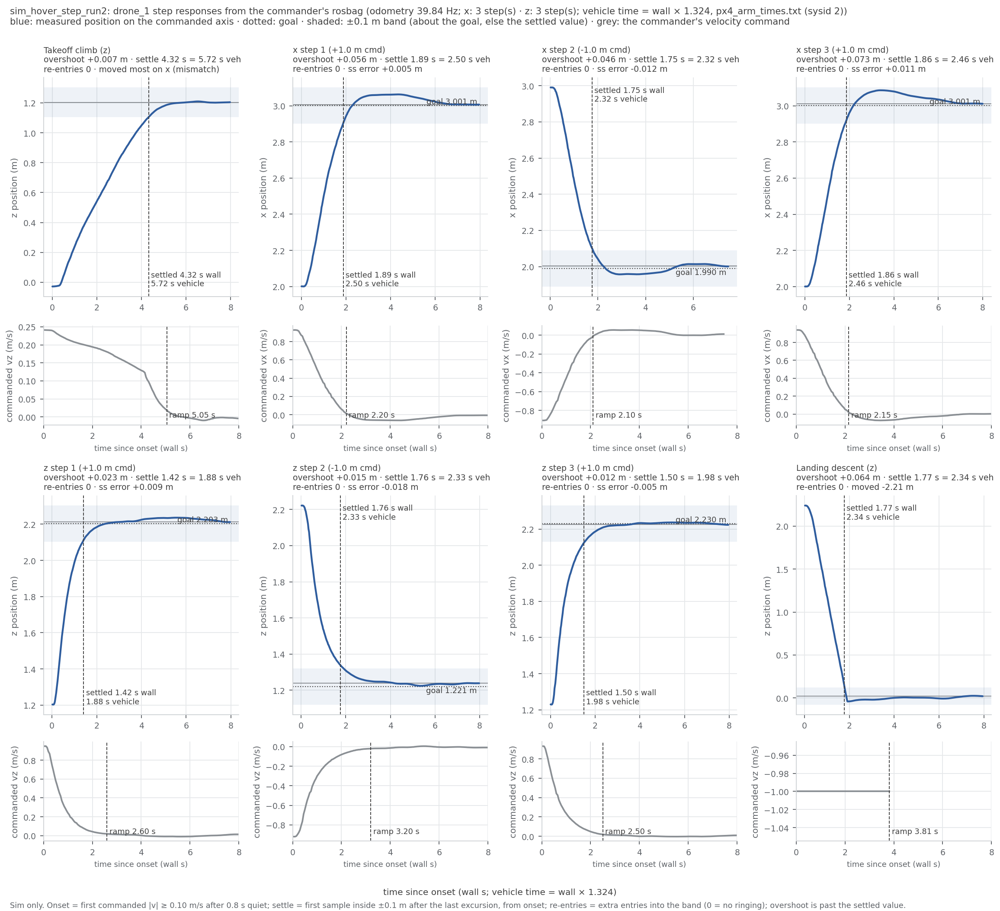

RECORD · SIM — sim_hover_step_run2. Sim-only (iron rule 9): none of these values is ported to the drone.

# sim_hover_step_run2 — Starling hover + 1 m steps (sim, 3 per axis), gated in PX4 vehicle time (started 2026-10-28T23:21:00+08:00 +08; flight 15:22:21–15:24:30 UTC (container clock))

**Verdict: PASS.** Re-run of ledger #17 with the fixed tooling, for Linear NEAR-786 (milestone S5). Gates are the S5 hover + step thresholds in [tools/README.md](../../tools/README.md#thresholds); PASS = every gate PASS, INCOMPLETE = no FAIL but ≥ 1 gate UNVERIFIED (evidence missing or unreadable), FAIL = any gate FAIL. Report generated 2026-10-28 at repo `24efe02`.

## Setup

| Item | Value |
|---|---|
| Sim | Isaac Sim headless, 3 Starling 2 Max (`DRONE_USD=starling2max.usd`, `PX4_VEHICLE_MODEL=pegasus_starling2max`), default flat world |
| Airframe | `10090_pegasus_starling2max` (10-20: rate gains x0.5, gyro filters 80/40, `LNDMC_ROT_MAX` 300, MPC limits 20/10/4) — sim-only |
| Commander | CMU dev `b21d28c`, `cbf_sim.yaml scenario:=goal`, tuning {"teleop_max_speed_mps": 1.2, "goal_accel_mps2": 6.0, "goal_settle_s": 0.3, "scenario_speed_mps": 2.0}, `record_bag:=true` |
| Odometry rate | 39.84 Hz (bag count over its duration) |
| Time scale | 1.3237 PX4 s per wall s (px4_arm_times.txt (sysid 2)); gated durations are vehicle time, wall in brackets |
| Driver | `tools/sim_hover_step_run.sh` + `tools/sim_hover_step_test.sh` + `tools/analyze_step.py`, repo commit `24efe0211b4db6e0da7e89ef4d50ce33234c973a` (`run_meta.txt`; tools/ uncommitted changes: 0); analysis `tools/hover_step_analysis.py`, report `tools/hover_step_report.py` |
| Started | 2026-10-28T23:21:00+08:00 +08 (laptop clock, `run_meta.txt`); flight 15:22:21–15:24:30 UTC (container clock, `test_stdout.log`) |
| Host | laptop; `sim_resources_watch.sh` peak VRAM 4051 MB |

## Pass/fail

| Check | Criterion | Measured | #3 / expected | Verdict |
|---|---|---|---|---|
| Isaac launch: SYS_AUTOSTART=10090 x3 | SYS_AUTOSTART=10090 x3 | 3 | - | PASS |
| Isaac launch: Ready for takeoff x3 | Ready for takeoff x3 | 3 | - | PASS |
| Isaac launch: no 'Unknown model' | no 'Unknown model' | 0 | - | PASS |
| Isaac launch: no PhysX cooking warnings | no PhysX cooking warnings | 0 | - | PASS |
| Isaac launch: Starling2MaxConfig x3 | Starling2MaxConfig x3 (launcher print) | 6 | - | PASS |
| PX4 SYS_AUTOSTART (ulog header) | = 10090 | 10090 | - | PASS |
| PX4 MC_PITCHRATE_P (ulog header) | = 0.032 | 0.032 | - | PASS |
| PX4 LNDMC_ROT_MAX (ulog header) | = 300 | 300 | - | PASS |
| PX4 MPC_XY_VEL_MAX (ulog header) | = 20 | 20 | - | PASS |
| PX4 MPC_THR_HOVER (ulog header) | = 0.165 | 0.165 | - | PASS |
| PX4 IMU_GYRO_CUTOFF (ulog header) | = 80 | 80 | - | PASS |
| takeoff accepted | success=True | yes | - | PASS |
| start accepted (scenario goal) | success=True | yes | - | PASS |
| land accepted + landed: IDLE | land success=True and final state IDLE | yes | - | PASS |
| hover thrust setpoint (MAVROS target_attitude) | 0.12–0.20 | median 0.153 of 10 samples (min 0.153, max 0.154) | 0.155 (#3); real drone 0.165 | PASS |
| time scale (PX4 s per wall s) | from px4_arm_times.txt, 0.5 < scale < 3.0 | 1.3237 (px4_arm_times.txt (sysid 2); PX4 arm→disarm 150.615 s vs bag 113.785 s, ulog 15_21_15.ulg) | 1.0 = real time | PASS |
| x step: overshoot max | < 0.15 m | 0.085 m (tail-referenced max 0.073 m, goal-referenced max 0.085 m; n = 3) | +0.002 m (#3) | PASS |
| x step: settle ±0.1 m vs goal (max of 3) | < 3.0 s (PX4 vehicle time) | 2.47 s [1.86 s wall] max, median 2.40 s [1.82 s wall]; worst step_x_1: commander ramp 2.91 s [2.20 s wall], peak 0.93 m/s | 2.75 s (#3, wall, echo) | PASS |
| x step: ringing | 0 band re-entries (±0.1 m) | max 0 re-entries over 3 steps (step_x_1: 0, step_x_2: 0, step_x_3: 0) | - | PASS |
| x step: commanded axis moved most | odometry moved most on the commanded axis, every step | yes: step_x_1 → x, step_x_2 → x, step_x_3 → x | - | PASS |
| x step: settle ±0.05 / ±0.02 m vs goal (median) | informational | 6.55 s [4.95 s wall] / 8.70 s [6.57 s wall] | - | info |
| x step: steady-state error max | informational (\|final − goal\|) | 0.012 m (step_x_1: +0.005, step_x_2: -0.012, step_x_3: +0.011) | - | info |
| x step: velocity tracking | informational (odometry velocity vs command; lag in vehicle time) | step_x_1: lag 0.46 s [0.35 s wall], gain 0.60, residual 0.126 m/s; step_x_2: lag 0.43 s [0.33 s wall], gain 0.62, residual 0.115 m/s; step_x_3: lag 0.46 s [0.35 s wall], gain 0.56, residual 0.127 m/s | - | info |
| x step: settle vs tail (old method) | informational (±0.1 m around the settled value, #17's reference) | step_x_1: 2.50 s [1.89 s wall]; step_x_2: 2.32 s [1.75 s wall]; step_x_3: 2.46 s [1.86 s wall] | - | info |
| x step: vs #3 (echo method) | informational (#3 flew 0.6 m/s / 3.0 m/s²; now 2.0 / 6.0; echo traces, wall time) | step_x_1.txt (hz=40): overshoot +0.055 m, settle 1.82 s; step_x_2.txt (hz=40): overshoot +0.024 m, settle 3.70 s; step_x_3.txt (hz=40): overshoot +0.070 m, settle 1.85 s — vs #3: +0.053 m / -0.93 s on the first step | +0.002 m (#3) / 2.75 s (#3, wall, echo) | info |
| z step: overshoot max | < 0.15 m | 0.033 m (tail-referenced max 0.023 m, goal-referenced max 0.033 m; n = 3) | +0.001 m (#3) | PASS |
| z step: settle ±0.1 m vs goal (max of 3) | < 3.0 s (PX4 vehicle time) | 2.50 s [1.89 s wall] max, median 2.03 s [1.53 s wall]; worst step_z_2: commander ramp 4.24 s [3.20 s wall], peak 0.92 m/s | 0.75 s (#3, wall, echo) | PASS |
| z step: ringing | 0 band re-entries (±0.1 m) | max 0 re-entries over 3 steps (step_z_1: 0, step_z_2: 0, step_z_3: 0) | - | PASS |
| z step: commanded axis moved most | odometry moved most on the commanded axis, every step | yes: step_z_1 → z, step_z_2 → z, step_z_3 → z | - | PASS |
| z step: settle ±0.05 / ±0.02 m vs goal (median) | informational | 2.57 s [1.94 s wall] / 5.40 s [4.08 s wall] | - | info |
| z step: steady-state error max | informational (\|final − goal\|) | 0.018 m (step_z_1: +0.009, step_z_2: -0.018, step_z_3: -0.005) | - | info |
| z step: velocity tracking | informational (odometry velocity vs command; lag in vehicle time) | step_z_1: lag 0.23 s [0.17 s wall], gain 1.01, residual 0.032 m/s; step_z_2: lag 0.30 s [0.23 s wall], gain 1.03, residual 0.057 m/s; step_z_3: lag 0.20 s [0.15 s wall], gain 1.10, residual 0.032 m/s | - | info |
| z step: settle vs tail (old method) | informational (±0.1 m around the settled value, #17's reference) | step_z_1: 1.88 s [1.42 s wall]; step_z_2: 2.33 s [1.76 s wall]; step_z_3: 1.98 s [1.50 s wall] | - | info |
| z step: vs #3 (echo method) | informational (#3 flew 0.6 m/s / 3.0 m/s²; now 2.0 / 6.0; echo traces, wall time) | step_z_1.txt (hz=40): overshoot +0.000 m, settle 2.33 s; step_z_2.txt (hz=40): overshoot +0.001 m, settle 3.35 s; step_z_3.txt (hz=40): overshoot +0.001 m, settle 3.42 s — vs #3: -0.001 m / +1.58 s on the first step | +0.001 m (#3) / 0.75 s (#3, wall, echo) | info |
| takeoff climb | informational | 5.72 s [4.32 s wall] settle vs tail, overshoot +0.007 m, onset 0.74 s wall after arming, final z 1.20 m, commanded peak 0.24 m/s (axis_mismatch flagged: the three takeoff axes move together — expected) | 0.31 m / 7.9 s (#3, echo method) | info |
| landing descent | informational | -2.215 m at 1.00 m/s commanded peak, touchdown z 0.02 m, descent command ramp 5.05 s [3.81 s wall] | - | info |
| landing: 'landed, disarmed' x3 (commander ACK log, not an arming display) | informational | 3 'landed, disarmed' (3 on attempt 1) | #13: attempt 1 x3 | info |
| post-flight armed=false x3 (MAVROS state) | armed: false for drone_1, drone_2, drone_3 | drone_1 false, drone_2 false, drone_3 false | - | PASS |
| WiFi firmware alerts | 0 during the run | 0 | - | PASS |
| rosbag copied + readable | bag dir with metadata.yaml under the heavy folder, drone_1 odometry > 0 msgs | hover_step_20261028_152150: 249 MB, metadata.yaml present, 7783 drone_1 odometry msgs over 195.34 s at 39.84 Hz | - | PASS |
| PX4 ulogs one per sysid 2/3/4 | ulog_sysid_map.txt lists sysids 2, 3, 4 (drone_1/2/3) | 3 files, sysids ['2', '3', '4'] | - | PASS |
| /clock visible in the robot container | informational (rc 0 = topic exists) | no (clock_rc=1: the flight tool's wait_s is a real sleep) | - | info |
| code that ran | informational (run_meta.txt head vs git HEAD at report time) | ran at 24efe02 | - | info |
| driver verdict history | informational (every earlier generation of this record, newest last) | none — first generation | - | info |

Rows marked info are informational and never pass or fail the run.

**Thresholds:** 0.15 m / 3.0 s / 0 re-entries / thrust 0.12–0.20 come from MILESTONES §4 (set 2026-10-19 in docs/superpowers/plans/2026-10-19-starling2max-sim.md, bracketed by the Iris reading of ledger #2 — 0.14 m / 3.6 s — not derived from a flight requirement). Gated values are PX4 vehicle time; wall-clock values in brackets.



*Figure: measured position per event against time since the commander's first non-zero velocity command (wall s; the title names the vehicle-time scale), with the goal (dotted), the ±0.1 m band and the settle time; below each, the commander's own velocity command and the end of its ramp. Made by `tools/hover_step_plot.py` from `drone_1_odom.csv` / `drone_1_cmd.csv`.*

## Driver verdict history

Every generation of this record (`verdicts.log`, newest last; the last line is this one):

```
2026-10-28T23:26:12+08:00 head=24efe02 verdict=PASS fail=0 unverified=0
```

## Evidence

Isaac launch evidence:
```
model_line=1 starling_cfg=6 autostart=3 unknown_model=0 cooking=0 ready=3
```

PX4 parameters (ulog header, sysid 2):
```
SYS_AUTOSTART 10090
MAV_SYS_ID 2
MC_PITCHRATE_P 0.03200000151991844
MC_ROLLRATE_P 0.03200000151991844
LNDMC_ROT_MAX 300.0
MPC_XY_VEL_MAX 20.0
MPC_THR_HOVER 0.16500000655651093
IMU_GYRO_CUTOFF 80.0
IMU_DGYRO_CUTOFF 40.0
MPC_Z_VEL_MAX_DN 4.0
MPC_ACC_HOR 6.0
```

Flight tool stdout (times are UTC, container clock):
```
[15:22:21] pre-takeoff: IDLE -1.988 -0.007 -0.002
[15:22:22] takeoff: success=True, message='takeoff: drone_1, drone_2, drone_3'
[15:22:54] start: success=True, message='scenario "goal" running'
[15:23:02] hover: ACTIVE 0.0 -0.987 1.205
--- hover thrust samples (/drone_1/interface/mavros/setpoint_raw/target_attitude .thrust) ---
0.15303875505924225 0.15316402912139893 0.15347890555858612 0.15326336026191711 0.1533837765455246 0.15351614356040955 0.15318569540977478 0.1530720293521881 0.1534132957458496 0.1535298228263855 
[15:23:09] step x1: goal (1.0, -0.989, 1.214) delta 1.0
[15:23:21] step x2: goal (0.014, -0.977, 1.213) delta -1.0
[15:23:30] step x3: goal (1.014, -0.983, 1.219) delta 1.0
[15:23:42] step z1: goal (1.038, -0.979, 2.226) delta 1.0
[15:23:51] step z2: goal (1.03, -0.98, 1.23) delta -1.0
[15:24:03] step z3: goal (1.022, -0.973, 2.233) delta 1.0
[15:24:11] after steps: ACTIVE 1.026 -0.969 2.235
[15:24:12] land: success=True, message='landing: drone_1, drone_2, drone_3'
[15:24:30] landed: IDLE 1.032 -0.943 -0.034
traces: /tmp/ascent.txt /tmp/step_x_*.txt /tmp/step_z_*.txt  (analyse with /tmp/analyze_step.py <trace> <axis> <delta>)
```

Analyser (echo traces, #3's method, informational):
```
hz=40 /tmp/ascent.txt axis=z: 985 samples (24.6 s) | moved +1.202 m of +1.2 commanded (trace starts after the command, so this is a lower bound) | peak +1.212 | overshoot past settled +0.009 m | settled (±0.1 m) after 5.90 s
hz=44.039 /tmp/ascent.txt axis=z: 985 samples (22.4 s) | moved +1.202 m of +1.2 commanded (trace starts after the command, so this is a lower bound) | peak +1.212 | overshoot past settled +0.009 m | settled (±0.1 m) after 5.36 s
ascent samples: 985
hz=40 /tmp/step_x_1.txt axis=x: 285 samples (7.1 s) | moved +1.006 m of +1.0 commanded (trace starts after the command, so this is a lower bound) | peak +3.063 | overshoot past settled +0.055 m | settled (±0.1 m) after 1.82 s
hz=44.039 /tmp/step_x_1.txt axis=x: 285 samples (6.5 s) | moved +1.006 m of +1.0 commanded (trace starts after the command, so this is a lower bound) | peak +3.063 | overshoot past settled +0.055 m | settled (±0.1 m) after 1.66 s
step_x_1 samples: 285
hz=40 /tmp/step_z_1.txt axis=z: 244 samples (6.1 s) | moved +1.023 m of +1.0 commanded (trace starts after the command, so this is a lower bound) | peak +2.235 | overshoot past settled +0.000 m | settled (±0.1 m) after 2.33 s
hz=44.039 /tmp/step_z_1.txt axis=z: 244 samples (5.5 s) | moved +1.023 m of +1.0 commanded (trace starts after the command, so this is a lower bound) | peak +2.235 | overshoot past settled +0.000 m | settled (±0.1 m) after 2.11 s
step_z_1 samples: 244
hz=40 /tmp/step_x_2.txt axis=x: 287 samples (7.2 s) | moved -1.018 m of -1.0 commanded (trace starts after the command, so this is a lower bound) | peak +1.957 | overshoot past settled +0.024 m | settled (±0.1 m) after 3.70 s
hz=44.039 /tmp/step_x_2.txt axis=x: 287 samples (6.5 s) | moved -1.018 m of -1.0 commanded (trace starts after the command, so this is a lower bound) | peak +1.957 | overshoot past settled +0.024 m | settled (±0.1 m) after 3.36 s
step_x_2 samples: 287
hz=40 /tmp/step_z_2.txt axis=z: 286 samples (7.2 s) | moved -0.991 m of -1.0 commanded (trace starts after the command, so this is a lower bound) | peak +1.224 | overshoot past settled +0.001 m | settled (±0.1 m) after 3.35 s
hz=44.039 /tmp/step_z_2.txt axis=z: 286 samples (6.5 s) | moved -0.991 m of -1.0 commanded (trace starts after the command, so this is a lower bound) | peak +1.224 | overshoot past settled +0.001 m | settled (±0.1 m) after 3.04 s
step_z_2 samples: 286
hz=40 /tmp/step_x_3.txt axis=x: 288 samples (7.2 s) | moved +1.014 m of +1.0 commanded (trace starts after the command, so this is a lower bound) | peak +3.085 | overshoot past settled +0.070 m | settled (±0.1 m) after 1.85 s
hz=44.039 /tmp/step_x_3.txt axis=x: 288 samples (6.5 s) | moved +1.014 m of +1.0 commanded (trace starts after the command, so this is a lower bound) | peak +3.085 | overshoot past settled +0.070 m | settled (±0.1 m) after 1.68 s
step_x_3 samples: 288
hz=40 /tmp/step_z_3.txt axis=z: 284 samples (7.1 s) | moved +0.993 m of +1.0 commanded (trace starts after the command, so this is a lower bound) | peak +2.236 | overshoot past settled +0.001 m | settled (±0.1 m) after 3.42 s
hz=44.039 /tmp/step_z_3.txt axis=z: 284 samples (6.4 s) | moved +0.993 m of +1.0 commanded (trace starts after the command, so this is a lower bound) | peak +2.236 | overshoot past settled +0.001 m | settled (±0.1 m) after 3.11 s
step_z_3 samples: 284
```

Bag analysis (`tools/hover_step_analysis.py`; onset/settle definitions in its docstring):
```
{
 "drone": "drone_1",
 "odom_msgs": 7783,
 "cmd_msgs": 2301,
 "duration_s": 195.34,
 "odom_rate_hz": 39.84,
 "armed_at_s": [
  32.42
 ],
 "disarmed_at_s": [
  146.205
 ],
 "armed_at_end": false,
 "time_scale": 1.3237,
 "time_scale_source": "px4_arm_times.txt (sysid 2)",
 "px4_arm_interval_s": 150.615,
 "bag_arm_interval_s": 113.785,
 "events": [
  {
   "name": "takeoff_lateral_x",
   "axis": "x",
   "onset_s_from_bag_start": 33.158,
   "moved_most_axis": "x",
   "axis_mismatch": false,
   "onset_s_after_arming": 0.738,
   "commanded_peak_speed_mps": 0.432,
   "commanded_delta_m": null,
   "commander_ramp_s": 5.298,
   "start_m": 0.002,
   "final_m": 2.039,
   "peak_m": 2.064,
   "moved_m": 2.037,
   "samples": 324,
   "window_s": 7.985,
   "tail": {
    "overshoot_m": 0.026,
    "settle_s": 5.063,
    "band_reentries": 0,
    "saturated": false
   },
   "goal": null,
   "velocity_tracking": {
    "lag_s": 0.525,
    "gain": 0.88,
    "residual_rms_mps": 0.072
   },
   "vehicle_time": {
    "settle_s": 6.702,
    "commander_ramp_s": 7.013,
    "settle_0p1_s": null,
    "settle_0p05_s": null,
    "settle_0p02_s": null,
    "lag_s": 0.695
   }
  },
  {
   "name": "takeoff_lateral_y",
   "axis": "y",
   "onset_s_from_bag_start": 33.158,
   "moved_most_axis": "x",
   "axis_mismatch": true,
   "onset_s_after_arming": 0.738,
   "commanded_peak_speed_mps": 0.219,
   "commanded_delta_m": null,
   "commander_ramp_s": 5.298,
   "start_m": -0.009,
   "final_m": -1.02,
   "peak_m": -1.028,
   "moved_m": -1.01,
   "samples": 324,
   "window_s": 7.985,
   "tail": {
    "overshoot_m": 0.008,
    "settle_s": 4.817,
    "band_reentries": 0,
    "saturated": false
   },
   "goal": null,
   "velocity_tracking": {
    "lag_s": 0.575,
    "gain": 0.895,
    "residual_rms_mps": 0.039
   },
   "vehicle_time": {
    "settle_s": 6.376,
    "commander_ramp_s": 7.013,
    "settle_0p1_s": null,
    "settle_0p05_s": null,
    "settle_0p02_s": null,
    "lag_s": 0.761
   }
  },
  {
   "name": "takeoff",
   "axis": "z",
   "onset_s_from_bag_start": 33.158,
   "moved_most_axis": "x",
   "axis_mismatch": true,
   "onset_s_after_arming": 0.738,
   "commanded_peak_speed_mps": 0.241,
   "commanded_delta_m": null,
   "commander_ramp_s": 5.049,
   "start_m": -0.028,
   "final_m": 1.203,
   "peak_m": 1.21,
   "moved_m": 1.231,
   "samples": 324,
   "window_s": 7.985,
   "tail": {
    "overshoot_m": 0.007,
    "settle_s": 4.323,
    "band_reentries": 0,
    "saturated": false
   },
   "goal": null,
   "velocity_tracking": {
    "lag_s": 0.375,
    "gain": 1.403,
    "residual_rms_mps": 0.026
   },
   "vehicle_time": {
    "settle_s": 5.722,
    "commander_ramp_s": 6.683,
    "settle_0p1_s": null,
    "settle_0p05_s": null,
    "settle_0p02_s": null,
    "lag_s": 0.496
   }
  },
  {
   "name": "step_x_1",
   "axis": "x",
   "onset_s_from_bag_start": 77.156,
   "moved_most_axis": "x",
   "axis_mismatch": false,
   "onset_s_after_arming": 44.736,
   "commanded_peak_speed_mps": 0.928,
   "commanded_delta_m": 1.0,
   "commander_ramp_s": 2.2,
   "start_m": 2.001,
   "final_m": 3.006,
   "peak_m": 3.063,
   "moved_m": 1.005,
   "samples": 319,
   "window_s": 7.981,
   "tail": {
    "overshoot_m": 0.056,
    "settle_s": 1.886,
    "band_reentries": 0,
    "saturated": false
   },
   "goal": {
    "goal_m": 3.001,
    "overshoot_m": 0.062,
    "steady_state_error_m": 0.005,
    "settle_0p1_s": 1.864,
    "reentries_0p1": 0,
    "saturated_0p1": false,
    "settle_0p05_s": 4.946,
    "reentries_0p05": 1,
    "settle_0p02_s": 6.051,
    "reentries_0p02": 1
   },
   "velocity_tracking": {
    "lag_s": 0.35,
    "gain": 0.598,
    "residual_rms_mps": 0.126
   },
   "vehicle_time": {
    "settle_s": 2.496,
    "commander_ramp_s": 2.912,
    "settle_0p1_s": 2.467,
    "settle_0p05_s": 6.547,
    "settle_0p02_s": 8.01,
    "lag_s": 0.463
   }
  },
  {
   "name": "step_x_2",
   "axis": "x",
   "onset_s_from_bag_start": 90.656,
   "moved_most_axis": "x",
   "axis_mismatch": false,
   "onset_s_after_arming": 58.236,
   "commanded_peak_speed_mps": 0.908,
   "commanded_delta_m": -1.0,
   "commander_ramp_s": 2.1,
   "start_m": 2.99,
   "final_m": 2.003,
   "peak_m": 1.957,
   "moved_m": -0.988,
   "samples": 297,
   "window_s": 7.486,
   "tail": {
    "overshoot_m": 0.046,
    "settle_s": 1.752,
    "band_reentries": 0,
    "saturated": false
   },
   "goal": {
    "goal_m": 1.99,
    "overshoot_m": 0.033,
    "steady_state_error_m": -0.012,
    "settle_0p1_s": 1.8,
    "reentries_0p1": 0,
    "saturated_0p1": false,
    "settle_0p05_s": 2.009,
    "reentries_0p05": 0,
    "settle_0p02_s": 6.824,
    "reentries_0p02": 2
   },
   "velocity_tracking": {
    "lag_s": 0.325,
    "gain": 0.617,
    "residual_rms_mps": 0.115
   },
   "vehicle_time": {
    "settle_s": 2.319,
    "commander_ramp_s": 2.78,
    "settle_0p1_s": 2.383,
    "settle_0p05_s": 2.659,
    "settle_0p02_s": 9.033,
    "lag_s": 0.43
   }
  },
  {
   "name": "step_x_3",
   "axis": "x",
   "onset_s_from_bag_start": 98.156,
   "moved_most_axis": "x",
   "axis_mismatch": false,
   "onset_s_after_arming": 65.736,
   "commanded_peak_speed_mps": 0.94,
   "commanded_delta_m": 1.0,
   "commander_ramp_s": 2.15,
   "start_m": 2.001,
   "final_m": 3.012,
   "peak_m": 3.085,
   "moved_m": 1.011,
   "samples": 322,
   "window_s": 7.997,
   "tail": {
    "overshoot_m": 0.073,
    "settle_s": 1.86,
    "band_reentries": 0,
    "saturated": false
   },
   "goal": {
    "goal_m": 3.001,
    "overshoot_m": 0.085,
    "steady_state_error_m": 0.011,
    "settle_0p1_s": 1.816,
    "reentries_0p1": 0,
    "saturated_0p1": false,
    "settle_0p05_s": 4.98,
    "reentries_0p05": 1,
    "settle_0p02_s": 6.57,
    "reentries_0p02": 1
   },
   "velocity_tracking": {
    "lag_s": 0.35,
    "gain": 0.56,
    "residual_rms_mps": 0.127
   },
   "vehicle_time": {
    "settle_s": 2.462,
    "commander_ramp_s": 2.846,
    "settle_0p1_s": 2.404,
    "settle_0p05_s": 6.592,
    "settle_0p02_s": 8.697,
    "lag_s": 0.463
   }
  },
  {
   "name": "step_z_1",
   "axis": "z",
   "onset_s_from_bag_start": 111.657,
   "moved_most_axis": "z",
   "axis_mismatch": false,
   "onset_s_after_arming": 79.237,
   "commanded_peak_speed_mps": 0.948,
   "commanded_delta_m": 1.0,
   "commander_ramp_s": 2.599,
   "start_m": 1.203,
   "final_m": 2.213,
   "peak_m": 2.236,
   "moved_m": 1.009,
   "samples": 318,
   "window_s": 7.966,
   "tail": {
    "overshoot_m": 0.023,
    "settle_s": 1.418,
    "band_reentries": 0,
    "saturated": false
   },
   "goal": {
    "goal_m": 2.203,
    "overshoot_m": 0.033,
    "steady_state_error_m": 0.009,
    "settle_0p1_s": 1.373,
    "reentries_0p1": 0,
    "saturated_0p1": false,
    "settle_0p05_s": 1.656,
    "reentries_0p05": 0,
    "settle_0p02_s": 7.103,
    "reentries_0p02": 1
   },
   "velocity_tracking": {
    "lag_s": 0.175,
    "gain": 1.013,
    "residual_rms_mps": 0.032
   },
   "vehicle_time": {
    "settle_s": 1.877,
    "commander_ramp_s": 3.44,
    "settle_0p1_s": 1.817,
    "settle_0p05_s": 2.192,
    "settle_0p02_s": 9.402,
    "lag_s": 0.232
   }
  },
  {
   "name": "step_z_2",
   "axis": "z",
   "onset_s_from_bag_start": 120.656,
   "moved_most_axis": "z",
   "axis_mismatch": false,
   "onset_s_after_arming": 88.236,
   "commanded_peak_speed_mps": 0.921,
   "commanded_delta_m": -1.0,
   "commander_ramp_s": 3.2,
   "start_m": 2.221,
   "final_m": 1.239,
   "peak_m": 1.224,
   "moved_m": -0.982,
   "samples": 319,
   "window_s": 7.978,
   "tail": {
    "overshoot_m": 0.015,
    "settle_s": 1.76,
    "band_reentries": 0,
    "saturated": false
   },
   "goal": {
    "goal_m": 1.221,
    "overshoot_m": 0.0,
    "steady_state_error_m": -0.018,
    "settle_0p1_s": 1.887,
    "reentries_0p1": 0,
    "saturated_0p1": false,
    "settle_0p05_s": 2.455,
    "reentries_0p05": 0,
    "settle_0p02_s": 4.082,
    "reentries_0p02": 0
   },
   "velocity_tracking": {
    "lag_s": 0.225,
    "gain": 1.026,
    "residual_rms_mps": 0.057
   },
   "vehicle_time": {
    "settle_s": 2.33,
    "commander_ramp_s": 4.236,
    "settle_0p1_s": 2.498,
    "settle_0p05_s": 3.25,
    "settle_0p02_s": 5.403,
    "lag_s": 0.298
   }
  },
  {
   "name": "step_z_3",
   "axis": "z",
   "onset_s_from_bag_start": 132.656,
   "moved_most_axis": "z",
   "axis_mismatch": false,
   "onset_s_after_arming": 100.236,
   "commanded_peak_speed_mps": 0.931,
   "commanded_delta_m": 1.0,
   "commander_ramp_s": 2.5,
   "start_m": 1.23,
   "final_m": 2.225,
   "peak_m": 2.236,
   "moved_m": 0.995,
   "samples": 319,
   "window_s": 7.971,
   "tail": {
    "overshoot_m": 0.012,
    "settle_s": 1.498,
    "band_reentries": 0,
    "saturated": false
   },
   "goal": {
    "goal_m": 2.23,
    "overshoot_m": 0.007,
    "steady_state_error_m": -0.005,
    "settle_0p1_s": 1.534,
    "reentries_0p1": 0,
    "saturated_0p1": false,
    "settle_0p05_s": 1.94,
    "reentries_0p05": 0,
    "settle_0p02_s": 2.375,
    "reentries_0p02": 0
   },
   "velocity_tracking": {
    "lag_s": 0.15,
    "gain": 1.1,
    "residual_rms_mps": 0.032
   },
   "vehicle_time": {
    "settle_s": 1.983,
    "commander_ramp_s": 3.309,
    "settle_0p1_s": 2.031,
    "settle_0p05_s": 2.568,
    "settle_0p02_s": 3.144,
    "lag_s": 0.199
   }
  },
  {
   "name": "landing",
   "axis": "z",
   "onset_s_from_bag_start": 141.857,
   "moved_most_axis": "z",
   "axis_mismatch": false,
   "onset_s_after_arming": 109.437,
   "commanded_peak_speed_mps": 1.0,
   "commanded_delta_m": null,
   "commander_ramp_s": 3.812,
   "start_m": 2.239,
   "final_m": 0.024,
   "peak_m": -0.04,
   "moved_m": -2.215,
   "samples": 324,
   "window_s": 7.964,
   "tail": {
    "overshoot_m": 0.064,
    "settle_s": 1.771,
    "band_reentries": 0,
    "saturated": false
   },
   "goal": null,
   "velocity_tracking": {
    "lag_s": 0.275,
    "gain": 1.113,
    "residual_rms_mps": 0.879
   },
   "vehicle_time": {
    "settle_s": 2.344,
    "commander_ramp_s": 5.046,
    "settle_0p1_s": null,
    "settle_0p05_s": null,
    "settle_0p02_s": null,
    "lag_s": 0.364
   }
  }
 ],
 "skipped_events": [],
 "steps": {
  "x": {
   "n": 3,
   "names": [
    "step_x_1",
    "step_x_2",
    "step_x_3"
   ],
   "settle_0p1_max_veh_s": 2.467,
   "settle_0p1_median_veh_s": 2.404,
   "overshoot_max_m": 0.085,
   "steady_state_error_max_m": 0.012,
   "reentries_0p1_max": 0,
   "any_axis_mismatch": false,
   "any_saturated": false
  },
  "z": {
   "n": 3,
   "names": [
    "step_z_1",
    "step_z_2",
    "step_z_3"
   ],
   "settle_0p1_max_veh_s": 2.498,
   "settle_0p1_median_veh_s": 2.031,
   "overshoot_max_m": 0.033,
   "steady_state_error_max_m": 0.018,
   "reentries_0p1_max": 0,
   "any_axis_mismatch": false,
   "any_saturated": false
  }
 }
}
```

Landing (commander ACK log) and post-flight MAVROS state:
```
[swarm_commander-2] [INFO] [1793201056.547658481] [swarm_commander]: drone_2: touchdown at z=0.12 m, settling 2.0 s before disarm
[swarm_commander-2] [INFO] [1793201056.548187470] [swarm_commander]: drone_3: touchdown at z=0.11 m, settling 2.0 s before disarm
[swarm_commander-2] [INFO] [1793201057.297852822] [swarm_commander]: drone_1: touchdown at z=0.11 m, settling 2.0 s before disarm
[swarm_commander-2] [INFO] [1793201058.598007193] [swarm_commander]: drone_2: landed, disarmed (attempt 1)
[swarm_commander-2] [INFO] [1793201058.598387640] [swarm_commander]: drone_3: landed, disarmed (attempt 1)
[swarm_commander-2] [INFO] [1793201059.347639592] [swarm_commander]: drone_1: landed, disarmed (attempt 1)
drone_1 armed: false
drone_2 armed: false
drone_3 armed: false
```

## Files

- Repo (this folder, `docs/record/sim_hover_step_run2/`): `analyze.txt`, `armed_post.txt`, `ascent.txt`, `bag_analysis.json`, `bag_evidence.txt`, `bag_path.txt`, `bag_status_pre.json`, `clock_check.txt`, `commander.log`, `commands.sh`, `drone_1_cmd.csv`, `drone_1_odom.csv`, `drone_1_state.csv`, `interfaces.log`, `isaac.log`, `isaac.log.start`, `isaac_evidence.txt`, `landing_evidence.txt`, `odom_hz.txt`, `params_mavros.txt`, `params_mavros_names.txt`, `params_ulog.txt`, `px4_arm_times.txt`, `res_watch.log`, `run.log`, `run_meta.txt`, `status_post.json`, `status_pre.json`, `step_response.png`, `step_x_1.txt`, `step_x_2.txt`, `step_x_3.txt`, `step_z_1.txt`, `step_z_2.txt`, `step_z_3.txt`, `test_stdout.log`, `topics_of_interest.txt`, `ulog_list.txt`, `ulog_sysid_map.txt`, `ulogs_copied.ok`, `verdicts.log`.
- Not in the repo (`/home/jeremychia/flight_logs/sim/sim_hover_step_run2/`): `drone_1_sysid2_15_21_15.ulg` (67 MB), `drone_2_sysid3_15_21_15.ulg` (67 MB), `drone_3_sysid4_15_21_15.ulg` (67 MB), `hover_step_20261028_152150` (249 MB).

## Caveats

- Sim path: the commander's TwistStamped velocity command goes through MAVROS setpoint_velocity to PX4 SITL; the real drone flies the trajectory-setpoint path (px4_interface). The step numbers characterise the sim loop, not the drone.
- n = STEPS_PER_AXIS steps per axis (±1 m alternating), one Isaac launch, one commander process: a single-launch sample, not a campaign.
- The ±0.1 m settle time is shaped by the commander's braking law (goal_accel / goal_settle_s) as much as by PX4: the command itself ramps for most of the settle window (see `commander_ramp_s`), so it is a loop figure, not a plant figure.
- `vs #3 (echo method)` rows are informational: #3 (2026-10-19) flew CMU's 0.6 m/s / 3.0 m/s² profile, `cbf_sim.yaml` now flies 2.0 / 6.0, and the echo traces start at the `ros2 topic pub` call, 1.5–3 s before the commander reacts.
- The commander's `landed, disarmed` lines and the panel are ACK logs, not an arming display (iron rules 2 and 5); the arming gate is the MAVROS `armed: false` x3 read after the flight.

## Ledger row draft (as filed in docs/record/LEDGER.md table 1, #18 — old multi-cell format kept as written)

`| 18 | **M1 re-run of #17 with the fixed tooling: Starling hover + 1 m steps, 3 per axis (±1 m alternating), gated in PX4 vehicle time** — `tools/sim_hover_step_run.sh all sim_hover_step_run2`, `cbf_sim.yaml scenario:=goal`, `record_bag:=true` | Isaac launch log; PX4 ulog header (pyulog); MAVROS `target_attitude` thrust samples; rosbag → `tools/hover_step_analysis.py` (commanded axis, goal-referenced, time scale from the ulog arm/disarm vs MAVROS state); `tools/hover_step_report.py` fail-closed; record `docs/record/sim_hover_step_run2_record.md` (link it from MILESTONES as `record/sim_hover_step_run2_record.md`), artefacts `docs/record/sim_hover_step_run2/`, bag + 3 ulogs (sysid 2/3/4 = drone_1/2/3) in `~/flight_logs/sim/sim_hover_step_run2/` | `Starling2MaxConfig` ×6, `SYS_AUTOSTART` 10090 ×3, `Ready for takeoff` ×3; ulog `MC_PITCHRATE_P` 0.032 / `LNDMC_ROT_MAX` 300 / `MPC_XY_VEL_MAX` 20 / `MPC_THR_HOVER` 0.165; hover thrust setpoint **0.153** (#17: 0.153, real 0.165); time scale **1.3237** PX4 s per wall s (px4_arm_times.txt (sysid 2)); odometry 39.84 Hz; x steps (3): overshoot max 0.085 m, settle ±0.1 m vs goal max **2.47 s** vehicle [1.86 s wall], median 2.40 s, ±0.05 m median 6.55 s, steady-state error max 0.012 m, velocity lag 0.46 s / gain 0.60 / residual 0.126 m/s; 0 band re-entries max; z steps (3): overshoot max 0.033 m, settle ±0.1 m vs goal max **2.50 s** vehicle [1.89 s wall], median 2.03 s, ±0.05 m median 2.57 s, steady-state error max 0.018 m, velocity lag 0.23 s / gain 1.03 / residual 0.032 m/s; 0 band re-entries max; takeoff climb +0.007 m / 5.72 s vehicle; 3 'landed, disarmed' (3 on attempt 1) (ACK log); MAVROS drone_1 false, drone_2 false, drone_3 false (PASS); 0 WiFi alerts; driver verdict history: 1 generation, latest `PASS`. **PASS** on the hover + step row of M1 (sim path, n = 3 per axis, one launch). Thresholds 0.15 m / 3 s / 0 re-entries are tools/README.md#thresholds' (bracketed by the Iris #2 reading, not derived). Sim-only (iron rule 9) | 2026-10-28 |`
