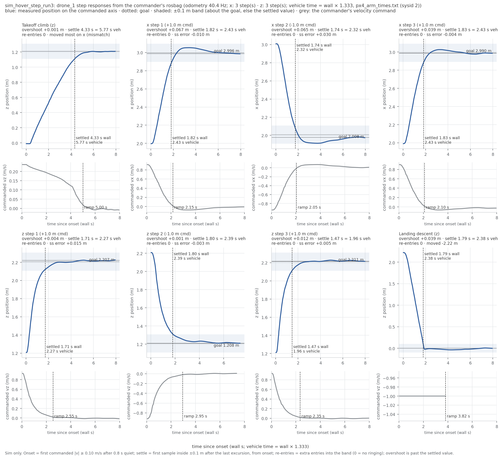

RECORD · SIM — sim_hover_step_run3. Sim-only (iron rule 9): none of these values is ported to the drone.

# sim_hover_step_run3 — Starling hover + 1 m steps (sim, 3 per axis), gated in PX4 vehicle time (started 2026-10-28T23:30:31+08:00 +08; flight 15:32:52–15:35:02 UTC (container clock))

**Verdict: PASS.** Hover + 1 m step run on the fixed tooling (lineage: ledger #3 → #17 → #18), for Linear NEAR-786 (milestone S5). Gates are the S5 hover + step thresholds in [tools/README.md](../../tools/README.md#thresholds); PASS = every gate PASS, INCOMPLETE = no FAIL but ≥ 1 gate UNVERIFIED (evidence missing or unreadable), FAIL = any gate FAIL. Report generated 2026-10-29 at repo `5738122`.

## Setup

| Item | Value |
|---|---|
| Sim | Isaac Sim headless, 3 Starling 2 Max (`DRONE_USD=starling2max.usd`, `PX4_VEHICLE_MODEL=pegasus_starling2max`), default flat world |
| Airframe | `10090_pegasus_starling2max` (10-20: rate gains x0.5, gyro filters 80/40, `LNDMC_ROT_MAX` 300, MPC limits 20/10/4) — sim-only |
| Commander | CMU dev `b21d28c`, `cbf_sim.yaml scenario:=goal`, tuning {"teleop_max_speed_mps": 1.2, "goal_accel_mps2": 6.0, "goal_settle_s": 0.3, "scenario_speed_mps": 2.0}, `record_bag:=true` |
| Odometry rate | 40.4 Hz (bag count over its duration) |
| Time scale | 1.3329 PX4 s per wall s (px4_arm_times.txt (sysid 2)); gated durations are vehicle time, wall in brackets |
| Driver | `tools/sim_hover_step_run.sh` + `tools/sim_hover_step_test.sh` + `tools/analyze_step.py`, repo commit `d9a07159bf51c998bec830863a127ee9d4187729` (`run_meta.txt`; tools/ uncommitted changes: 0); analysis `tools/hover_step_analysis.py`, report `tools/hover_step_report.py` |
| Started | 2026-10-28T23:30:31+08:00 +08 (laptop clock, `run_meta.txt`); flight 15:32:52–15:35:02 UTC (container clock, `test_stdout.log`) |
| Host | laptop; `sim_resources_watch.sh` peak VRAM 4235 MB |

## Pass/fail

| Check | Criterion | Measured | #3 / expected | Verdict |
|---|---|---|---|---|
| Isaac launch: SYS_AUTOSTART=10090 x3 | SYS_AUTOSTART=10090 x3 | 3 | - | PASS |
| Isaac launch: Ready for takeoff x3 | Ready for takeoff x3 | 3 | - | PASS |
| Isaac launch: no 'Unknown model' | no 'Unknown model' | 0 | - | PASS |
| Isaac launch: no PhysX cooking warnings | no PhysX cooking warnings | 0 | - | PASS |
| Isaac launch: Starling2MaxConfig x3 | Starling2MaxConfig x3 (launcher print) | 6 | - | PASS |
| PX4 SYS_AUTOSTART (ulog header) | = 10090 | 10090 | - | PASS |
| PX4 MC_PITCHRATE_P (ulog header) | = 0.032 | 0.032 | - | PASS |
| PX4 LNDMC_ROT_MAX (ulog header) | = 300 | 300 | - | PASS |
| PX4 MPC_XY_VEL_MAX (ulog header) | = 20 | 20 | - | PASS |
| PX4 MPC_THR_HOVER (ulog header) | = 0.165 | 0.165 | - | PASS |
| PX4 IMU_GYRO_CUTOFF (ulog header) | = 80 | 80 | - | PASS |
| takeoff accepted | success=True | yes | - | PASS |
| start accepted (scenario goal) | success=True | yes | - | PASS |
| land accepted + landed: IDLE | land success=True and final state IDLE | yes | - | PASS |
| hover thrust setpoint (MAVROS target_attitude) | 0.12–0.20 | median 0.153 of 10 samples (min 0.153, max 0.154) | 0.155 (#3); real drone 0.165 | PASS |
| time scale (PX4 s per wall s) | from px4_arm_times.txt, 0.5 < scale < 3.0 | 1.3329 (px4_arm_times.txt (sysid 2); PX4 arm→disarm 151.045 s vs bag 113.323 s, ulog 15_30_45.ulg) | 1.0 = real time | PASS |
| x step: overshoot max | < 0.15 m | 0.095 m (tail-referenced max 0.067 m, goal-referenced max 0.095 m; n = 3) | +0.002 m (#3) | PASS |
| x step: settle ±0.1 m vs goal (max of 3) | < 3.0 s (PX4 vehicle time) | 2.47 s [1.85 s wall] max, median 2.46 s [1.85 s wall]; worst step_x_3: commander ramp 2.80 s [2.10 s wall], peak 0.90 m/s | 2.75 s (#3, wall, echo) | PASS |
| x step: ringing | 0 band re-entries (±0.1 m) | max 0 re-entries over 3 steps (step_x_1: 0, step_x_2: 0, step_x_3: 0) | - | PASS |
| x step: commanded axis moved most | odometry moved most on the commanded axis, every step | yes: step_x_1 → x, step_x_2 → x, step_x_3 → x | - | PASS |
| x step: settle ±0.05 / ±0.02 m vs goal (median) | informational | 5.40 s [4.05 s wall] / 6.77 s [5.08 s wall] | - | info |
| x step: steady-state error max | informational (\|final − goal\|) | 0.030 m (step_x_1: -0.010, step_x_2: +0.030, step_x_3: -0.004) | - | info |
| x step: velocity tracking | informational (odometry velocity vs command; lag in vehicle time) | step_x_1: lag 0.40 s [0.30 s wall], gain 0.56, residual 0.124 m/s; step_x_2: lag 0.47 s [0.35 s wall], gain 0.63, residual 0.119 m/s; step_x_3: lag 0.43 s [0.33 s wall], gain 0.59, residual 0.115 m/s | - | info |
| x step: settle vs tail (old method) | informational (±0.1 m around the settled value, #17's reference) | step_x_1: 2.43 s [1.82 s wall]; step_x_2: 2.32 s [1.74 s wall]; step_x_3: 2.43 s [1.83 s wall] | - | info |
| x step: vs #3 (echo method) | informational (#3 flew 0.6 m/s / 3.0 m/s²; now 2.0 / 6.0; echo traces, wall time) | step_x_1.txt (hz=40): overshoot +0.059 m, settle 1.75 s; step_x_2.txt (hz=40): overshoot +0.033 m, settle 3.52 s; step_x_3.txt (hz=40): overshoot +0.049 m, settle 2.40 s — vs #3: +0.057 m / -1.00 s on the first step | +0.002 m (#3) / 2.75 s (#3, wall, echo) | info |
| z step: overshoot max | < 0.15 m | 0.020 m (tail-referenced max 0.012 m, goal-referenced max 0.020 m; n = 3) | +0.001 m (#3) | PASS |
| z step: settle ±0.1 m vs goal (max of 3) | < 3.0 s (PX4 vehicle time) | 2.42 s [1.82 s wall] max, median 2.08 s [1.56 s wall]; worst step_z_2: commander ramp 3.93 s [2.95 s wall], peak 0.92 m/s | 0.75 s (#3, wall, echo) | PASS |
| z step: ringing | 0 band re-entries (±0.1 m) | max 0 re-entries over 3 steps (step_z_1: 0, step_z_2: 0, step_z_3: 0) | - | PASS |
| z step: commanded axis moved most | odometry moved most on the commanded axis, every step | yes: step_z_1 → z, step_z_2 → z, step_z_3 → z | - | PASS |
| z step: settle ±0.05 / ±0.02 m vs goal (median) | informational | 2.78 s [2.08 s wall] / 3.30 s [2.48 s wall] | - | info |
| z step: steady-state error max | informational (\|final − goal\|) | 0.015 m (step_z_1: +0.015, step_z_2: -0.003, step_z_3: +0.005) | - | info |
| z step: velocity tracking | informational (odometry velocity vs command; lag in vehicle time) | step_z_1: lag 0.20 s [0.15 s wall], gain 0.96, residual 0.035 m/s; step_z_2: lag 0.30 s [0.23 s wall], gain 1.02, residual 0.064 m/s; step_z_3: lag 0.20 s [0.15 s wall], gain 1.09, residual 0.031 m/s | - | info |
| z step: settle vs tail (old method) | informational (±0.1 m around the settled value, #17's reference) | step_z_1: 2.27 s [1.71 s wall]; step_z_2: 2.39 s [1.80 s wall]; step_z_3: 1.96 s [1.47 s wall] | - | info |
| z step: vs #3 (echo method) | informational (#3 flew 0.6 m/s / 3.0 m/s²; now 2.0 / 6.0; echo traces, wall time) | step_z_1.txt (hz=40): overshoot +0.002 m, settle 3.30 s; step_z_2.txt (hz=40): overshoot +0.005 m, settle 3.45 s; step_z_3.txt (hz=40): overshoot +0.003 m, settle 1.57 s — vs #3: +0.001 m / +2.55 s on the first step | +0.001 m (#3) / 0.75 s (#3, wall, echo) | info |
| takeoff climb | informational | 5.77 s [4.33 s wall] settle vs tail, overshoot +0.001 m, onset 0.81 s wall after arming, final z 1.21 m, commanded peak 0.24 m/s (axis_mismatch flagged: the three takeoff axes move together — expected) | 0.31 m / 7.9 s (#3, echo method) | info |
| landing descent | informational | -2.220 m at 1.00 m/s commanded peak, touchdown z 0.00 m, descent command ramp 5.09 s [3.82 s wall] | - | info |
| landing: 'landed, disarmed' x3 (commander ACK log, not an arming display) | informational | 3 'landed, disarmed' (3 on attempt 1) | #13: attempt 1 x3 | info |
| post-flight armed=false x3 (MAVROS state) | armed: false for drone_1, drone_2, drone_3 | drone_1 false, drone_2 false, drone_3 false | - | PASS |
| WiFi firmware alerts | 0 during the run | 0 | - | PASS |
| rosbag copied + readable | bag dir with metadata.yaml under the heavy folder, drone_1 odometry > 0 msgs | hover_step_20261028_153125: 320 MB, metadata.yaml present, 10100 drone_1 odometry msgs over 249.97 s at 40.4 Hz | - | PASS |
| PX4 ulogs one per sysid 2/3/4 | ulog_sysid_map.txt lists sysids 2, 3, 4 (drone_1/2/3) | 3 files, sysids ['2', '3', '4'] | - | PASS |
| /clock visible in the robot container | informational (rc 0 = topic exists) | no (clock_rc=1: the flight tool's wait_s is a real sleep) | - | info |
| code that ran | informational (run_meta.txt head vs git HEAD at report time) | ran at d9a0715, report at 5738122 | - | info |
| driver verdict history | informational (every earlier generation of this record, newest last) | `2026-10-28T23:36:42+08:00 head=d9a0715 verdict=PASS fail=0 unverified=0` | - | info |

Rows marked info are informational and never pass or fail the run.

**Thresholds:** 0.15 m / 3.0 s / 0 re-entries / thrust 0.12–0.20 come from MILESTONES §4 (set 2026-10-19 in docs/superpowers/plans/2026-10-19-starling2max-sim.md, bracketed by the Iris reading of ledger #2 — 0.14 m / 3.6 s — not derived from a flight requirement). Gated values are PX4 vehicle time; wall-clock values in brackets.



*Figure: measured position per event against time since the commander's first non-zero velocity command (wall s; the title names the vehicle-time scale), with the goal (dotted), the ±0.1 m band and the settle time; below each, the commander's own velocity command and the end of its ramp. Made by `tools/hover_step_plot.py` from `drone_1_odom.csv` / `drone_1_cmd.csv`.*

## Driver verdict history

Every generation of this record (`verdicts.log`, newest last; the last line is this one):

```
2026-10-28T23:36:42+08:00 head=d9a0715 verdict=PASS fail=0 unverified=0
2026-10-29T01:41:30+08:00 head=d9a0715 verdict=PASS fail=0 unverified=0
```

## Evidence

Isaac launch evidence:
```
model_line=1 starling_cfg=6 autostart=3 unknown_model=0 cooking=0 ready=3
```

PX4 parameters (ulog header, sysid 2):
```
SYS_AUTOSTART 10090
MAV_SYS_ID 2
MC_PITCHRATE_P 0.03200000151991844
MC_ROLLRATE_P 0.03200000151991844
LNDMC_ROT_MAX 300.0
MPC_XY_VEL_MAX 20.0
MPC_THR_HOVER 0.16500000655651093
IMU_GYRO_CUTOFF 80.0
IMU_DGYRO_CUTOFF 40.0
MPC_Z_VEL_MAX_DN 4.0
MPC_ACC_HOR 6.0
```

Flight tool stdout (times are UTC, container clock):
```
[15:32:52] pre-takeoff: IDLE -2.007 -0.012 -0.02
[15:32:54] takeoff: success=True, message='takeoff: drone_1, drone_2, drone_3'
[15:33:26] start: success=True, message='scenario "goal" running'
[15:33:34] hover: ACTIVE 0.0 -0.99 1.207
--- hover thrust samples (/drone_1/interface/mavros/setpoint_raw/target_attitude .thrust) ---
0.15339432656764984 0.15335462987422943 0.15335668623447418 0.15371626615524292 0.1534225195646286 0.1532207727432251 0.15308192372322083 0.15318524837493896 0.1535780429840088 0.15358412265777588 
[15:33:44] step x1: goal (0.979, -1.007, 1.206) delta 1.0
[15:33:53] step x2: goal (-0.013, -1.004, 1.196) delta -1.0
[15:34:05] step x3: goal (0.961, -1.019, 1.204) delta 1.0
[15:34:14] step z1: goal (0.987, -1.002, 2.21) delta 1.0
[15:34:26] step z2: goal (0.99, -1.015, 1.218) delta -1.0
[15:34:35] step z3: goal (1.007, -1.019, 2.218) delta 1.0
[15:34:43] after steps: ACTIVE 1.011 -1.01 2.212
[15:34:44] land: success=True, message='landing: drone_1, drone_2, drone_3'
[15:35:02] landed: IDLE 1.02 -0.962 -0.008
traces: /tmp/ascent.txt /tmp/step_x_*.txt /tmp/step_z_*.txt  (analyse with /tmp/analyze_step.py <trace> <axis> <delta>)
```

Analyser (echo traces, #3's method, informational):
```
hz=40 /tmp/ascent.txt axis=z: 992 samples (24.8 s) | moved +1.228 m of +1.2 commanded (trace starts after the command, so this is a lower bound) | peak +1.211 | overshoot past settled +0.011 m | settled (±0.1 m) after 5.85 s
hz=44.472 /tmp/ascent.txt axis=z: 992 samples (22.3 s) | moved +1.228 m of +1.2 commanded (trace starts after the command, so this is a lower bound) | peak +1.211 | overshoot past settled +0.011 m | settled (±0.1 m) after 5.26 s
ascent samples: 992
hz=40 /tmp/step_x_1.txt axis=x: 282 samples (7.0 s) | moved +0.998 m of +1.0 commanded (trace starts after the command, so this is a lower bound) | peak +3.053 | overshoot past settled +0.059 m | settled (±0.1 m) after 1.75 s
hz=44.472 /tmp/step_x_1.txt axis=x: 282 samples (6.3 s) | moved +0.998 m of +1.0 commanded (trace starts after the command, so this is a lower bound) | peak +3.053 | overshoot past settled +0.059 m | settled (±0.1 m) after 1.57 s
step_x_1 samples: 282
hz=40 /tmp/step_z_1.txt axis=z: 286 samples (7.2 s) | moved +1.017 m of +1.0 commanded (trace starts after the command, so this is a lower bound) | peak +2.224 | overshoot past settled +0.002 m | settled (±0.1 m) after 3.30 s
hz=44.472 /tmp/step_z_1.txt axis=z: 286 samples (6.4 s) | moved +1.017 m of +1.0 commanded (trace starts after the command, so this is a lower bound) | peak +2.224 | overshoot past settled +0.002 m | settled (±0.1 m) after 2.97 s
step_z_1 samples: 286
hz=40 /tmp/step_x_2.txt axis=x: 286 samples (7.2 s) | moved -1.051 m of -1.0 commanded (trace starts after the command, so this is a lower bound) | peak +1.913 | overshoot past settled +0.033 m | settled (±0.1 m) after 3.52 s
hz=44.472 /tmp/step_x_2.txt axis=x: 286 samples (6.4 s) | moved -1.051 m of -1.0 commanded (trace starts after the command, so this is a lower bound) | peak +1.913 | overshoot past settled +0.033 m | settled (±0.1 m) after 3.17 s
step_x_2 samples: 286
hz=40 /tmp/step_z_2.txt axis=z: 276 samples (6.9 s) | moved -0.982 m of -1.0 commanded (trace starts after the command, so this is a lower bound) | peak +1.215 | overshoot past settled +0.005 m | settled (±0.1 m) after 3.45 s
hz=44.472 /tmp/step_z_2.txt axis=z: 276 samples (6.2 s) | moved -0.982 m of -1.0 commanded (trace starts after the command, so this is a lower bound) | peak +1.215 | overshoot past settled +0.005 m | settled (±0.1 m) after 3.10 s
step_z_2 samples: 276
hz=40 /tmp/step_x_3.txt axis=x: 288 samples (7.2 s) | moved +1.006 m of +1.0 commanded (trace starts after the command, so this is a lower bound) | peak +3.026 | overshoot past settled +0.049 m | settled (±0.1 m) after 2.40 s
hz=44.472 /tmp/step_x_3.txt axis=x: 288 samples (6.5 s) | moved +1.006 m of +1.0 commanded (trace starts after the command, so this is a lower bound) | peak +3.026 | overshoot past settled +0.049 m | settled (±0.1 m) after 2.16 s
step_x_3 samples: 288
hz=40 /tmp/step_z_3.txt axis=z: 287 samples (7.2 s) | moved +1.014 m of +1.0 commanded (trace starts after the command, so this is a lower bound) | peak +2.228 | overshoot past settled +0.003 m | settled (±0.1 m) after 1.57 s
hz=44.472 /tmp/step_z_3.txt axis=z: 287 samples (6.5 s) | moved +1.014 m of +1.0 commanded (trace starts after the command, so this is a lower bound) | peak +2.228 | overshoot past settled +0.003 m | settled (±0.1 m) after 1.42 s
step_z_3 samples: 287
```

Bag analysis (`tools/hover_step_analysis.py`; onset/settle definitions in its docstring):
```
{
 "drone": "drone_1",
 "odom_msgs": 10100,
 "cmd_msgs": 2298,
 "duration_s": 249.97,
 "odom_rate_hz": 40.4,
 "armed_at_s": [
  90.243
 ],
 "disarmed_at_s": [
  203.566
 ],
 "armed_at_end": false,
 "time_scale": 1.3329,
 "time_scale_source": "px4_arm_times.txt (sysid 2)",
 "px4_arm_interval_s": 151.045,
 "bag_arm_interval_s": 113.323,
 "events": [
  {
   "name": "takeoff_lateral_x",
   "axis": "x",
   "onset_s_from_bag_start": 91.055,
   "moved_most_axis": "x",
   "axis_mismatch": false,
   "onset_s_after_arming": 0.812,
   "commanded_peak_speed_mps": 0.442,
   "commanded_delta_m": null,
   "commander_ramp_s": 5.249,
   "start_m": -0.012,
   "final_m": 2.042,
   "peak_m": 2.054,
   "moved_m": 2.054,
   "samples": 328,
   "window_s": 7.966,
   "tail": {
    "overshoot_m": 0.011,
    "settle_s": 5.069,
    "band_reentries": 0,
    "saturated": false
   },
   "goal": null,
   "velocity_tracking": {
    "lag_s": 0.525,
    "gain": 0.915,
    "residual_rms_mps": 0.076
   },
   "vehicle_time": {
    "settle_s": 6.756,
    "commander_ramp_s": 6.996,
    "settle_0p1_s": null,
    "settle_0p05_s": null,
    "settle_0p02_s": null,
    "lag_s": 0.7
   }
  },
  {
   "name": "takeoff_lateral_y",
   "axis": "y",
   "onset_s_from_bag_start": 91.055,
   "moved_most_axis": "x",
   "axis_mismatch": true,
   "onset_s_after_arming": 0.812,
   "commanded_peak_speed_mps": 0.203,
   "commanded_delta_m": null,
   "commander_ramp_s": 5.049,
   "start_m": -0.003,
   "final_m": -1.01,
   "peak_m": -1.017,
   "moved_m": -1.007,
   "samples": 328,
   "window_s": 7.966,
   "tail": {
    "overshoot_m": 0.007,
    "settle_s": 4.648,
    "band_reentries": 0,
    "saturated": false
   },
   "goal": null,
   "velocity_tracking": {
    "lag_s": 0.55,
    "gain": 0.956,
    "residual_rms_mps": 0.031
   },
   "vehicle_time": {
    "settle_s": 6.195,
    "commander_ramp_s": 6.73,
    "settle_0p1_s": null,
    "settle_0p05_s": null,
    "settle_0p02_s": null,
    "lag_s": 0.733
   }
  },
  {
   "name": "takeoff",
   "axis": "z",
   "onset_s_from_bag_start": 91.055,
   "moved_most_axis": "x",
   "axis_mismatch": true,
   "onset_s_after_arming": 0.812,
   "commanded_peak_speed_mps": 0.237,
   "commanded_delta_m": null,
   "commander_ramp_s": 4.998,
   "start_m": -0.01,
   "final_m": 1.208,
   "peak_m": 1.209,
   "moved_m": 1.218,
   "samples": 328,
   "window_s": 7.966,
   "tail": {
    "overshoot_m": 0.001,
    "settle_s": 4.327,
    "band_reentries": 0,
    "saturated": false
   },
   "goal": null,
   "velocity_tracking": {
    "lag_s": 0.375,
    "gain": 1.272,
    "residual_rms_mps": 0.021
   },
   "vehicle_time": {
    "settle_s": 5.767,
    "commander_ramp_s": 6.662,
    "settle_0p1_s": null,
    "settle_0p05_s": null,
    "settle_0p02_s": null,
    "lag_s": 0.5
   }
  },
  {
   "name": "step_x_1",
   "axis": "x",
   "onset_s_from_bag_start": 137.605,
   "moved_most_axis": "x",
   "axis_mismatch": false,
   "onset_s_after_arming": 47.362,
   "commanded_peak_speed_mps": 0.914,
   "commanded_delta_m": 1.0,
   "commander_ramp_s": 2.148,
   "start_m": 1.996,
   "final_m": 2.987,
   "peak_m": 3.053,
   "moved_m": 0.99,
   "samples": 313,
   "window_s": 7.968,
   "tail": {
    "overshoot_m": 0.067,
    "settle_s": 1.821,
    "band_reentries": 0,
    "saturated": false
   },
   "goal": {
    "goal_m": 2.996,
    "overshoot_m": 0.057,
    "steady_state_error_m": -0.01,
    "settle_0p1_s": 1.846,
    "reentries_0p1": 0,
    "saturated_0p1": false,
    "settle_0p05_s": 4.051,
    "reentries_0p05": 1,
    "settle_0p02_s": 5.08,
    "reentries_0p02": 1
   },
   "velocity_tracking": {
    "lag_s": 0.3,
    "gain": 0.562,
    "residual_rms_mps": 0.124
   },
   "vehicle_time": {
    "settle_s": 2.427,
    "commander_ramp_s": 2.863,
    "settle_0p1_s": 2.46,
    "settle_0p05_s": 5.399,
    "settle_0p02_s": 6.771,
    "lag_s": 0.4
   }
  },
  {
   "name": "step_x_2",
   "axis": "x",
   "onset_s_from_bag_start": 148.603,
   "moved_most_axis": "x",
   "axis_mismatch": false,
   "onset_s_after_arming": 58.36,
   "commanded_peak_speed_mps": 0.947,
   "commanded_delta_m": -1.0,
   "commander_ramp_s": 2.05,
   "start_m": 3.008,
   "final_m": 1.978,
   "peak_m": 1.913,
   "moved_m": -1.03,
   "samples": 319,
   "window_s": 7.985,
   "tail": {
    "overshoot_m": 0.065,
    "settle_s": 1.743,
    "band_reentries": 0,
    "saturated": false
   },
   "goal": {
    "goal_m": 2.008,
    "overshoot_m": 0.095,
    "steady_state_error_m": 0.03,
    "settle_0p1_s": 1.677,
    "reentries_0p1": 0,
    "saturated_0p1": false,
    "settle_0p05_s": 5.867,
    "reentries_0p05": 1,
    "settle_0p02_s": 7.985,
    "reentries_0p02": 0
   },
   "velocity_tracking": {
    "lag_s": 0.35,
    "gain": 0.628,
    "residual_rms_mps": 0.119
   },
   "vehicle_time": {
    "settle_s": 2.323,
    "commander_ramp_s": 2.732,
    "settle_0p1_s": 2.235,
    "settle_0p05_s": 7.82,
    "settle_0p02_s": 10.643,
    "lag_s": 0.467
   }
  },
  {
   "name": "step_x_3",
   "axis": "x",
   "onset_s_from_bag_start": 159.253,
   "moved_most_axis": "x",
   "axis_mismatch": false,
   "onset_s_after_arming": 69.01,
   "commanded_peak_speed_mps": 0.903,
   "commanded_delta_m": 1.0,
   "commander_ramp_s": 2.1,
   "start_m": 1.99,
   "final_m": 2.987,
   "peak_m": 3.026,
   "moved_m": 0.996,
   "samples": 321,
   "window_s": 7.973,
   "tail": {
    "overshoot_m": 0.039,
    "settle_s": 1.826,
    "band_reentries": 0,
    "saturated": false
   },
   "goal": {
    "goal_m": 2.99,
    "overshoot_m": 0.035,
    "steady_state_error_m": -0.004,
    "settle_0p1_s": 1.854,
    "reentries_0p1": 0,
    "saturated_0p1": false,
    "settle_0p05_s": 2.042,
    "reentries_0p05": 0,
    "settle_0p02_s": 4.272,
    "reentries_0p02": 1
   },
   "velocity_tracking": {
    "lag_s": 0.325,
    "gain": 0.593,
    "residual_rms_mps": 0.115
   },
   "vehicle_time": {
    "settle_s": 2.434,
    "commander_ramp_s": 2.799,
    "settle_0p1_s": 2.471,
    "settle_0p05_s": 2.722,
    "settle_0p02_s": 5.694,
    "lag_s": 0.433
   }
  },
  {
   "name": "step_z_1",
   "axis": "z",
   "onset_s_from_bag_start": 169.603,
   "moved_most_axis": "z",
   "axis_mismatch": false,
   "onset_s_after_arming": 79.36,
   "commanded_peak_speed_mps": 0.931,
   "commanded_delta_m": 1.0,
   "commander_ramp_s": 2.55,
   "start_m": 1.207,
   "final_m": 2.222,
   "peak_m": 2.227,
   "moved_m": 1.015,
   "samples": 320,
   "window_s": 7.962,
   "tail": {
    "overshoot_m": 0.004,
    "settle_s": 1.706,
    "band_reentries": 0,
    "saturated": false
   },
   "goal": {
    "goal_m": 2.207,
    "overshoot_m": 0.02,
    "steady_state_error_m": 0.015,
    "settle_0p1_s": 1.558,
    "reentries_0p1": 0,
    "saturated_0p1": false,
    "settle_0p05_s": 2.084,
    "reentries_0p05": 0,
    "settle_0p02_s": 2.475,
    "reentries_0p02": 0
   },
   "velocity_tracking": {
    "lag_s": 0.15,
    "gain": 0.964,
    "residual_rms_mps": 0.035
   },
   "vehicle_time": {
    "settle_s": 2.274,
    "commander_ramp_s": 3.399,
    "settle_0p1_s": 2.077,
    "settle_0p05_s": 2.778,
    "settle_0p02_s": 3.299,
    "lag_s": 0.2
   }
  },
  {
   "name": "step_z_2",
   "axis": "z",
   "onset_s_from_bag_start": 181.603,
   "moved_most_axis": "z",
   "axis_mismatch": false,
   "onset_s_after_arming": 91.36,
   "commanded_peak_speed_mps": 0.92,
   "commanded_delta_m": -1.0,
   "commander_ramp_s": 2.95,
   "start_m": 2.208,
   "final_m": 1.211,
   "peak_m": 1.21,
   "moved_m": -0.997,
   "samples": 291,
   "window_s": 7.362,
   "tail": {
    "overshoot_m": 0.001,
    "settle_s": 1.796,
    "band_reentries": 0,
    "saturated": false
   },
   "goal": {
    "goal_m": 1.208,
    "overshoot_m": 0.0,
    "steady_state_error_m": -0.003,
    "settle_0p1_s": 1.816,
    "reentries_0p1": 0,
    "saturated_0p1": false,
    "settle_0p05_s": 2.528,
    "reentries_0p05": 0,
    "settle_0p02_s": 4.476,
    "reentries_0p02": 1
   },
   "velocity_tracking": {
    "lag_s": 0.225,
    "gain": 1.023,
    "residual_rms_mps": 0.064
   },
   "vehicle_time": {
    "settle_s": 2.394,
    "commander_ramp_s": 3.932,
    "settle_0p1_s": 2.42,
    "settle_0p05_s": 3.369,
    "settle_0p02_s": 5.966,
    "lag_s": 0.3
   }
  },
  {
   "name": "step_z_3",
   "axis": "z",
   "onset_s_from_bag_start": 189.003,
   "moved_most_axis": "z",
   "axis_mismatch": false,
   "onset_s_after_arming": 98.76,
   "commanded_peak_speed_mps": 0.934,
   "commanded_delta_m": 1.0,
   "commander_ramp_s": 2.35,
   "start_m": 1.211,
   "final_m": 2.216,
   "peak_m": 2.228,
   "moved_m": 1.005,
   "samples": 318,
   "window_s": 7.974,
   "tail": {
    "overshoot_m": 0.012,
    "settle_s": 1.472,
    "band_reentries": 0,
    "saturated": false
   },
   "goal": {
    "goal_m": 2.211,
    "overshoot_m": 0.017,
    "steady_state_error_m": 0.005,
    "settle_0p1_s": 1.443,
    "reentries_0p1": 0,
    "saturated_0p1": false,
    "settle_0p05_s": 1.813,
    "reentries_0p05": 0,
    "settle_0p02_s": 2.196,
    "reentries_0p02": 0
   },
   "velocity_tracking": {
    "lag_s": 0.15,
    "gain": 1.093,
    "residual_rms_mps": 0.031
   },
   "vehicle_time": {
    "settle_s": 1.962,
    "commander_ramp_s": 3.132,
    "settle_0p1_s": 1.923,
    "settle_0p05_s": 2.416,
    "settle_0p02_s": 2.927,
    "lag_s": 0.2
   }
  },
  {
   "name": "landing",
   "axis": "z",
   "onset_s_from_bag_start": 199.604,
   "moved_most_axis": "z",
   "axis_mismatch": false,
   "onset_s_after_arming": 109.361,
   "commanded_peak_speed_mps": 1.0,
   "commanded_delta_m": null,
   "commander_ramp_s": 3.821,
   "start_m": 2.221,
   "final_m": 0.001,
   "peak_m": -0.037,
   "moved_m": -2.22,
   "samples": 333,
   "window_s": 7.978,
   "tail": {
    "overshoot_m": 0.039,
    "settle_s": 1.786,
    "band_reentries": 0,
    "saturated": false
   },
   "goal": null,
   "velocity_tracking": {
    "lag_s": 0.275,
    "gain": 1.13,
    "residual_rms_mps": 0.88
   },
   "vehicle_time": {
    "settle_s": 2.381,
    "commander_ramp_s": 5.093,
    "settle_0p1_s": null,
    "settle_0p05_s": null,
    "settle_0p02_s": null,
    "lag_s": 0.367
   }
  }
 ],
 "skipped_events": [],
 "steps": {
  "x": {
   "n": 3,
   "names": [
    "step_x_1",
    "step_x_2",
    "step_x_3"
   ],
   "settle_0p1_max_veh_s": 2.471,
   "settle_0p1_median_veh_s": 2.46,
   "overshoot_max_m": 0.095,
   "steady_state_error_max_m": 0.03,
   "reentries_0p1_max": 0,
   "any_axis_mismatch": false,
   "any_saturated": false
  },
  "z": {
   "n": 3,
   "names": [
    "step_z_1",
    "step_z_2",
    "step_z_3"
   ],
   "settle_0p1_max_veh_s": 2.42,
   "settle_0p1_median_veh_s": 2.077,
   "overshoot_max_m": 0.02,
   "steady_state_error_max_m": 0.015,
   "reentries_0p1_max": 0,
   "any_axis_mismatch": false,
   "any_saturated": false
  }
 }
}
```

Landing (commander ACK log) and post-flight MAVROS state:
```
[swarm_commander-2] [INFO] [1793201688.143911859] [swarm_commander]: drone_2: touchdown at z=0.11 m, settling 2.0 s before disarm
[swarm_commander-2] [INFO] [1793201688.144320453] [swarm_commander]: drone_3: touchdown at z=0.12 m, settling 2.0 s before disarm
[swarm_commander-2] [INFO] [1793201688.893779934] [swarm_commander]: drone_1: touchdown at z=0.09 m, settling 2.0 s before disarm
[swarm_commander-2] [INFO] [1793201690.243940126] [swarm_commander]: drone_2: landed, disarmed (attempt 1)
[swarm_commander-2] [INFO] [1793201690.244267933] [swarm_commander]: drone_3: landed, disarmed (attempt 1)
[swarm_commander-2] [INFO] [1793201690.943874219] [swarm_commander]: drone_1: landed, disarmed (attempt 1)
drone_1 armed: false
drone_2 armed: false
drone_3 armed: false
```

## Files

- Repo (this folder, `docs/record/sim_hover_step_run3/`): `analyze.txt`, `armed_post.txt`, `ascent.txt`, `bag_analysis.json`, `bag_evidence.txt`, `bag_path.txt`, `bag_status_pre.json`, `clock_check.txt`, `commander.log`, `commands.sh`, `drone_1_cmd.csv`, `drone_1_odom.csv`, `drone_1_state.csv`, `interfaces.log`, `isaac.log`, `isaac.log.start`, `isaac_evidence.txt`, `landing_evidence.txt`, `odom_hz.txt`, `params_mavros.txt`, `params_mavros_names.txt`, `params_ulog.txt`, `px4_arm_times.txt`, `res_watch.log`, `run.log`, `run_meta.txt`, `status_post.json`, `status_pre.json`, `step_response.png`, `step_x_1.txt`, `step_x_2.txt`, `step_x_3.txt`, `step_z_1.txt`, `step_z_2.txt`, `step_z_3.txt`, `test_stdout.log`, `topics_of_interest.txt`, `ulog_list.txt`, `ulog_sysid_map.txt`, `ulogs_copied.ok`, `verdicts.log`.
- Not in the repo (`/home/jeremychia/flight_logs/sim/sim_hover_step_run3/`): `drone_1_sysid2_15_30_45.ulg` (90 MB), `drone_2_sysid3_15_30_45.ulg` (90 MB), `drone_3_sysid4_15_30_45.ulg` (90 MB), `hover_step_20261028_153125` (320 MB).

## Caveats

- Sim path: the commander's TwistStamped velocity command goes through MAVROS setpoint_velocity to PX4 SITL; the real drone flies the trajectory-setpoint path (px4_interface). The step numbers characterise the sim loop, not the drone.
- n = STEPS_PER_AXIS steps per axis (±1 m alternating), one Isaac launch, one commander process: a single-launch sample, not a campaign.
- The ±0.1 m settle time is shaped by the commander's braking law (goal_accel / goal_settle_s) as much as by PX4: the command itself ramps for most of the settle window (see `commander_ramp_s`), so it is a loop figure, not a plant figure.
- `vs #3 (echo method)` rows are informational: #3 (2026-10-19) flew CMU's 0.6 m/s / 3.0 m/s² profile, `cbf_sim.yaml` now flies 2.0 / 6.0, and the echo traces start at the `ros2 topic pub` call, 1.5–3 s before the commander reacts.
- The commander's `landed, disarmed` lines and the panel are ACK logs, not an arming display (iron rules 2 and 5); the arming gate is the MAVROS `armed: false` x3 read after the flight.

## Ledger row draft (as filed in docs/record/LEDGER.md table 1, #19 — old multi-cell format kept as written)

`| 19 | **M1 Starling hover + 1 m steps on the fixed tooling (lineage #3 → #17 → #18), 3 per axis (±1 m alternating), gated in PX4 vehicle time** — `tools/sim_hover_step_run.sh all sim_hover_step_run3`, `cbf_sim.yaml scenario:=goal`, `record_bag:=true` | Isaac launch log; PX4 ulog header (pyulog); MAVROS `target_attitude` thrust samples; rosbag → `tools/hover_step_analysis.py` (commanded axis, goal-referenced, time scale from the ulog arm/disarm vs MAVROS state); `tools/hover_step_report.py` fail-closed; record `docs/record/sim_hover_step_run3_record.md` (link it from MILESTONES as `record/sim_hover_step_run3_record.md`), artefacts `docs/record/sim_hover_step_run3/`, bag + 3 ulogs (sysid 2/3/4 = drone_1/2/3) in `~/flight_logs/sim/sim_hover_step_run3/` | `Starling2MaxConfig` ×6, `SYS_AUTOSTART` 10090 ×3, `Ready for takeoff` ×3; ulog `MC_PITCHRATE_P` 0.032 / `LNDMC_ROT_MAX` 300 / `MPC_XY_VEL_MAX` 20 / `MPC_THR_HOVER` 0.165; hover thrust setpoint **0.153** (#17: 0.153, real 0.165); time scale **1.3329** PX4 s per wall s (px4_arm_times.txt (sysid 2)); odometry 40.4 Hz; x steps (3): overshoot max 0.095 m, settle ±0.1 m vs goal max **2.47 s** vehicle [1.85 s wall], median 2.46 s, ±0.05 m median 5.40 s, steady-state error max 0.030 m, velocity lag 0.43 s / gain 0.59 / residual 0.119 m/s; 0 band re-entries max; z steps (3): overshoot max 0.020 m, settle ±0.1 m vs goal max **2.42 s** vehicle [1.82 s wall], median 2.08 s, ±0.05 m median 2.78 s, steady-state error max 0.015 m, velocity lag 0.20 s / gain 1.02 / residual 0.035 m/s; 0 band re-entries max; takeoff climb +0.001 m / 5.77 s vehicle; 3 'landed, disarmed' (3 on attempt 1) (ACK log); MAVROS drone_1 false, drone_2 false, drone_3 false (PASS); 0 WiFi alerts; driver verdict history: 2 generations, latest `PASS`. **PASS** on the hover + step row of M1 (sim path, n = 3 per axis, one launch). Thresholds 0.15 m / 3 s / 0 re-entries are tools/README.md#thresholds' (bracketed by the Iris #2 reading, not derived). Sim-only (iron rule 9) | 2026-10-29 |`
