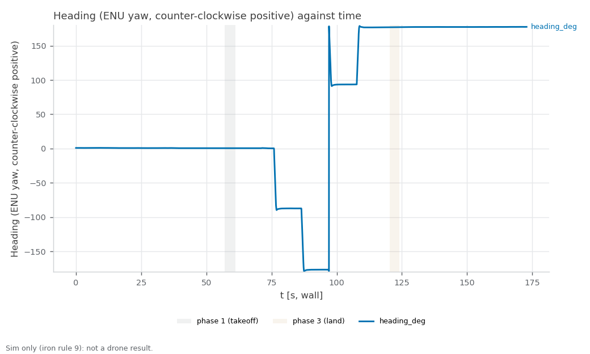

RECORD · SIM — sim_teleop_frame_run1. Sim-only (iron rule 9): none of these values is ported to the drone; the relay, the push speed and the gates are sim-only (iron rule 9).

# sim_teleop_frame_run1 — one-drone teleop frame: a forward push follows the nose (Drive mode) and +X (Room mode) (started 2026-11-03T03:13:03+08:00 +08; flight 19:15:10–19:16:37 UTC)

**Verdict: PASS.** Show that a forward push on the stick moves the drone where its nose points in Drive mode, at headings 0, 90, 180 and 270, and along +X in Room mode. The relay turns the stick from the drone's frame into the room's frame before the commander sees it. For Linear NEAR-789 (milestone S5). PASS = every gate PASS; INCOMPLETE = no FAIL but ≥ 1 gate UNVERIFIED; FAIL = any gate FAIL; ABORTED = Ctrl-C landing, never a result. Report generated 2026-11-03 at repo `737022d`.

**Scope:** PX4's own sim state estimate positions the drone (no mocap, no camera); flat default world; one drone. The teleop_frame relay is in the loop. safe_teleop and the keyboard are NOT: fly.sh publishes on the relay's input topic /svg/drone_1/teleop_command_stick itself.

## Setup

| Item | Value |
|---|---|
| Sim | Isaac Sim, 1 Starling 2 Max (`DRONE_USD=starling2max.usd`, `PX4_VEHICLE_MODEL=pegasus_starling2max`), default flat world |
| Airframe | `10090_pegasus_starling2max` (sim-only airframe gains, see the S5 hover records) |
| Commander | `teleop_single_ours.yaml scenario:=hover`, tuning {"teleop_max_speed_mps": 2.0, "goal_accel_mps2": 3.0, "goal_settle_s": 0.3, "scenario_speed_mps": 0.6} |
| Driver | `tools/sim.sh test teleop_frame`, repo commit `737022d2216a0c164ca9be7e6f3d7abbeb3a8afc` (tools/ uncommitted changes: 0) |
| Started | 2026-11-03T03:13:03+08:00 +08 (laptop clock, `run_meta.txt`); flight 19:15:10–19:16:37 UTC (container clock) |
| Video | none recorded |

## Changes in this run

What changed while this run flew (docs/CODING_STANDARD.md §3), from three sources. PX4's own list (the ulog) is the ground truth and wins a conflict.

**Logged by the tools (`changes.log`):**

none logged

**PX4 ulog, parameters changed after boot (vehicle time, t > 2 s; 23 boot-time settings not listed):**

none after boot

**Parameter snapshot, start → end of the flight (MAVROS for PX4, `ros2 param dump /swarm_commander`; catches Foxglove, QGC, `ros2 param set`):**

```
drone_1/COM_FLIGHT_UUID 0 -> 1
drone_1/LND_FLIGHT_T_LO 0 -> 122177781
```

**PX4 at the start vs the airframe file (drone_1):**

all 49 airframe values in force

**Conflicts and unlogged changes:**

- PX4 bookkeeping (not a tuning change): drone_1/COM_FLIGHT_UUID 0 → 1 (snapshot)
- PX4 bookkeeping (not a tuning change): drone_1/LND_FLIGHT_T_LO 0 → 122177781 (snapshot)

## Pass/fail

| Check | Criterion | Measured | Baseline | Verdict |
|---|---|---|---|---|
| Isaac launch: SYS_AUTOSTART=10090 x1 | SYS_AUTOSTART=10090 x1 | 1 | - | PASS |
| Isaac launch: Ready for takeoff x1 | Ready for takeoff x1 | 1 | - | PASS |
| Isaac launch: no 'Unknown model' | no 'Unknown model' | 0 | - | PASS |
| Isaac launch: no PhysX cooking warnings | no PhysX cooking warnings | 0 | - | PASS |
| Isaac launch: Starling2MaxConfig x1 | Starling2MaxConfig x1 (launcher print) | 2 | - | PASS |
| coverage: rows through the window | largest `t_s` gap over the phase-2 rows ≤ 0.5 s, ≥ 1 landing (`phase` 3) row, metrics node alive at stop | largest phase-2 gap 0.05 s; 3370 phase-2 rows, 230 landing rows | - | PASS |
| relay stick_frame recorded | fly.sh printed `relay: stick_frame=body` (the relay's own start line): the Drive-mode pushes ran through a BODY relay | stick_frame=body | - | PASS |
| odometry rate ≥ 10 Hz | ≥ 10 Hz (`ros2 topic hz` of /drone_1/odometry_conversion/odometry before the flight); below = INCOMPLETE | 59.3 Hz | - | PASS |
| pushes flown | fly.sh stamped onset + release for pushes 0, 90, 180, 270 (Drive mode) and world (Room mode) | 5 of 5 | - | PASS |
| push 0: heading reached | \|onset heading − 0°\| ≤ 10° (wrapped; a miss judges the yaw loop, not the relay: UNVERIFIED) | 359.5° at onset (0.5° off) | none (first run sets it) | PASS |
| push 0: direction within 20° of the nose | direction within 20° of the nose at onset (Drive mode; nose = (cos ψ, sin ψ), ψ = −heading) | 0.9° from nose; move (+1.20, -0.01) m, heading 359.5° at onset | none (first run sets it) | PASS |
| push 0: moved ≥ 0.15 m | \|xy move\| from onset to release ≥ 0.15 m | 1.20 m | none (first run sets it) | PASS |
| push 0: parked within 0.30 m | \|xy at release + 3 s − xy at release\| ≤ 0.30 m (3 s of wall clock; PX4 lockstep runs about 1.3× it, so about 3.9 s of vehicle time) | 0.17 m | none (first run sets it) | PASS |
| push 90: heading reached | \|onset heading − 90°\| ≤ 10° (wrapped; a miss judges the yaw loop, not the relay: UNVERIFIED) | 87.2° at onset (2.8° off) | none (first run sets it) | PASS |
| push 90: direction within 20° of the nose | direction within 20° of the nose at onset (Drive mode; nose = (cos ψ, sin ψ), ψ = −heading) | 0.1° from nose; move (+0.05, -1.14) m, heading 87.2° at onset | none (first run sets it) | PASS |
| push 90: moved ≥ 0.15 m | \|xy move\| from onset to release ≥ 0.15 m | 1.15 m | none (first run sets it) | PASS |
| push 90: parked within 0.30 m | \|xy at release + 3 s − xy at release\| ≤ 0.30 m (3 s of wall clock; PX4 lockstep runs about 1.3× it, so about 3.9 s of vehicle time) | 0.14 m | none (first run sets it) | PASS |
| push 180: heading reached | \|onset heading − 180°\| ≤ 10° (wrapped; a miss judges the yaw loop, not the relay: UNVERIFIED) | 176.6° at onset (3.4° off) | none (first run sets it) | PASS |
| push 180: direction within 20° of the nose | direction within 20° of the nose at onset (Drive mode; nose = (cos ψ, sin ψ), ψ = −heading) | 0.9° from nose; move (-1.14, -0.05) m, heading 176.6° at onset | none (first run sets it) | PASS |
| push 180: moved ≥ 0.15 m | \|xy move\| from onset to release ≥ 0.15 m | 1.14 m | none (first run sets it) | PASS |
| push 180: parked within 0.30 m | \|xy at release + 3 s − xy at release\| ≤ 0.30 m (3 s of wall clock; PX4 lockstep runs about 1.3× it, so about 3.9 s of vehicle time) | 0.13 m | none (first run sets it) | PASS |
| push 270: heading reached | \|onset heading − 270°\| ≤ 10° (wrapped; a miss judges the yaw loop, not the relay: UNVERIFIED) | 266.5° at onset (3.5° off) | none (first run sets it) | PASS |
| push 270: direction within 20° of the nose | direction within 20° of the nose at onset (Drive mode; nose = (cos ψ, sin ψ), ψ = −heading) | 0.9° from nose; move (-0.09, +1.11) m, heading 266.5° at onset | none (first run sets it) | PASS |
| push 270: moved ≥ 0.15 m | \|xy move\| from onset to release ≥ 0.15 m | 1.12 m | none (first run sets it) | PASS |
| push 270: parked within 0.30 m | \|xy at release + 3 s − xy at release\| ≤ 0.30 m (3 s of wall clock; PX4 lockstep runs about 1.3× it, so about 3.9 s of vehicle time) | 0.12 m | none (first run sets it) | PASS |
| push world: heading reached | \|onset heading − 180°\| ≤ 10° (wrapped; a miss judges the yaw loop, not the relay: UNVERIFIED) | 183.3° at onset (3.3° off) | none (first run sets it) | PASS |
| push world: direction within 20° of +X | direction within 20° of +X (Room mode; the nose at about 180° points the other way, so Drive mode would fail) | 0.8° from +X; move (+1.14, -0.02) m, heading 183.3° at onset | none (first run sets it) | PASS |
| push world: moved ≥ 0.15 m | \|xy move\| from onset to release ≥ 0.15 m | 1.14 m | none (first run sets it) | PASS |
| push world: parked within 0.30 m | \|xy at release + 3 s − xy at release\| ≤ 0.30 m (3 s of wall clock; PX4 lockstep runs about 1.3× it, so about 3.9 s of vehicle time) | 0.12 m | none (first run sets it) | PASS |
| worst direction error | informational (largest direction error over the measured pushes) | 0.9° (push 270; gate 20°) | none (first run sets it) | info |
| emergency samples | informational (5 Hz status string) | `emergency`: 0 CSV rows flagged | - | info |
| fence_breached samples | informational (5 Hz status string) | `fence_breached`: 0 CSV rows flagged | - | info |
| landed, disarmed (commander ACK) | informational (ACK log, not an arming display) | drone_1 | - | info |
| post-flight armed=false x1 (MAVROS state) | armed: false for drone_1 | drone_1 false | - | PASS |
| live vs bag recompute | live metrics.csv agrees with the rosbag recompute (every column but heading_deg (plotted only; it wraps at ±180°) within tolerance; flags by count) | x_m Δmax 0 (tol 0.02); y_m Δmax 0 (tol 0.02); xy_drift_m Δmax 0 (tol 0.02); speed_drone_1 Δmax 0 (tol 0.1); fence_breached Σ 0 vs 0; emergency Σ 0 vs 0; unpaired 0.0 %; bag unpaired 3.2 % | - | PASS |
| rosbag copied + readable | bag dir teleop_frame_* with metadata.yaml under the heavy folder, and metrics.csv, metrics_bag.csv in the run folder | teleop_frame_20261102_191344: 139 MB, metadata.yaml present | - | PASS |
| PX4 ulogs one per sysid 2 | ulog_sysid_map.txt lists sysids 2 (drone_1) | 1 files, sysids ['2'] | - | PASS |
| WiFi firmware alerts | 0 during the run | 0 | - | PASS |
| code that ran | informational (run_meta.txt head vs git HEAD at report time) | ran at 737022d | - | info |

Rows marked info are informational and never pass or fail the run.

[Figure 1](#fig-1) plots the heading, the x and y position and the speed against wall-clock time. The worst direction error was 0.9° (push 270; gate 20°). Each push moved 1.12–1.20 m (gate ≥ 0.15 m) and the drone stayed within 0.17 m of the release point 3 s later (gate 0.30 m).

<a id="fig-1"></a>


*Figure 1. Heading (ENU yaw), x and y position and speed of drone_1 against wall-clock time, from the 40 Hz odometry. Each step in heading is a yaw to the next push heading; each ramp in x or y is a 2 s forward push. Drawn from metrics.csv by `tools/sim.sh figures teleop_frame <run>`.*

## Driver verdict history

Every generation of this record (`verdicts.log`, newest last; the last line is this one):

```
2026-11-03T03:18:19+08:00 head=737022d verdict=PASS fail=0 unverified=0
```

## Evidence

Flight script stdout (times are UTC, container clock):
```
[19:15:10] relay: started (pid 12320, log /tmp/svg_test/teleop_frame.log)
[19:15:11] relay status: frame=body pending=none heading_deg=359.5 heading_age_s=0.01 guard=ok input=none
[19:15:11] relay: stick_frame=body (start line: drone_1 stick_frame=body in=/svg/drone_1/teleop_command_stick out=/svg/drone_1/teleop_command odom=/drone_1/odometry_conversion/odometry)
[19:15:11] pre-takeoff: name:drone_1 state:IDLE position:[0.013,0.018,0.001]
[19:15:12] takeoff: success=True, message='takeoff: drone_1'
[19:15:19] start: success=True, message='scenario "hover" running'
[19:15:19] pushes: settle 4 s after each yaw, push 0.25 x teleop_max_speed_mps for 2.0 s
[19:15:19] teleop_frame subscribed to /svg/drone_1/teleop_command_stick, swarm_commander to /svg/drone_1/teleop_command; 2 s more before the first yaw
[19:15:24] push speed: 0.25 x teleop_max_speed_mps = 0.50 m/s for 2.0 s
[19:15:24] yaw to 0: reached (heading 359.4)
[19:15:28] relay status before push 0: frame=body pending=none heading_deg=359.5 heading_age_s=0.00 guard=ok input=ok
[1793646928.103846] push 0 onset heading=359.5
[1793646930.103948] push 0 release heading=359.3
[19:15:34] yaw to 90: reached (heading 87.5)
[19:15:38] relay status before push 90: frame=body pending=none heading_deg=87.2 heading_age_s=0.01 guard=ok input=ok
[1793646938.629209] push 90 onset heading=87.2
[1793646940.629295] push 90 release heading=87.2
[19:15:45] yaw to 180: reached (heading 177.0)
[19:15:49] relay status before push 180: frame=body pending=none heading_deg=176.6 heading_age_s=0.02 guard=ok input=ok
[1793646949.194779] push 180 onset heading=176.6
[1793646951.194881] push 180 release heading=176.6
[19:15:55] yaw to 270: reached (heading 267.9)
[19:15:59] relay status before push 270: frame=body pending=none heading_deg=266.5 heading_age_s=0.00 guard=ok input=ok
[1793646959.800707] push 270 onset heading=266.5
[1793646961.800811] push 270 release heading=266.5
[19:16:05] relay status: frame=world (set through /teleop_frame/set_parameters)
[19:16:06] yaw to 180: reached (heading 182.6)
[19:16:10] relay status before push world: frame=world pending=none heading_deg=183.3 heading_age_s=0.01 guard=ok input=ok
[1793646970.438431] push world onset heading=183.3
[1793646972.438553] push world release heading=183.3
[19:16:16] push program done (rc 0); zeros published
[19:16:17] land: success=True, message='landing: drone_1'
[19:16:33] landed: name:land name:drone_1 state:IDLE position:[1.015,0.003,-0.005]
[19:16:37] relay stopped (zeros published on /svg/drone_1/teleop_command_stick first)
  relay log: [INFO] [1793646965.303620163] [teleop_frame]: teleop_frame: mode -> world (pending until centred)
  relay log: [INFO] [1793646965.305089000] [teleop_frame]: teleop_frame: mode = world
```

Metrics node log (tail):
```
[t= 161.0 s] phase=0 heading_deg=177.410 cbf= emerg=0
[t= 162.0 s] phase=0 heading_deg=177.401 cbf= emerg=0
[t= 163.0 s] phase=0 heading_deg=177.381 cbf= emerg=0
[t= 164.0 s] phase=0 heading_deg=177.387 cbf= emerg=0
[t= 165.0 s] phase=0 heading_deg=177.385 cbf= emerg=0
[t= 166.0 s] phase=0 heading_deg=177.439 cbf= emerg=0
[t= 167.0 s] phase=0 heading_deg=177.472 cbf= emerg=0
[t= 168.0 s] phase=0 heading_deg=177.479 cbf= emerg=0
[t= 169.0 s] phase=0 heading_deg=177.474 cbf= emerg=0
[t= 170.0 s] phase=0 heading_deg=177.489 cbf= emerg=0
[t= 171.0 s] phase=0 heading_deg=177.510 cbf= emerg=0
[t= 172.0 s] phase=0 heading_deg=177.471 cbf= emerg=0
```

Landing (commander ACK log) and post-flight MAVROS state:
```
[swarm_commander-2] [INFO] [1793646979.776152243] [swarm_commander]: drone_1: touchdown at z=0.14 m, settling 2.0 s before disarm
[swarm_commander-2] [INFO] [1793646981.826329844] [swarm_commander]: drone_1: landed, disarmed (attempt 1)
armed_post.txt: unreadable
```

Live vs bag recompute:

| Column | Kind | Tolerance | Max diff | Σ live | Σ bag | Paired | Unpaired | OK |
|---|---|---|---|---|---|---|---|---|
| x_m | continuous | 0.02 | 0 | 4750.8 | 4750.8 | 10345 | 0.0 % | yes |
| y_m | continuous | 0.02 | 0 | -1138.37 | -1138.37 | 10345 | 0.0 % | yes |
| xy_drift_m | continuous | 0.02 | 0 | 2745.37 | 2745.37 | 10345 | 0.0 % | yes |
| speed_drone_1 | continuous | 0.1 | 0 | 397.679 | 397.679 | 10345 | 0.0 % | yes |
| fence_breached | flag | 0 | 0 | 0 | 0 | 10345 | 0.0 % | yes |
| emergency | flag | 0 | 0 | 0 | 0 | 10345 | 0.0 % | yes |

## Files

- Repo (this folder, `docs/record/sim_teleop_frame_run1/`): `armed_post.txt`, `bag_evidence.txt`, `bag_path.txt`, `bag_status_pre.json`, `changes.log`, `clock_check.txt`, `commander.log`, `commands.sh`, `fig-1.png`, `interfaces.log`, `isaac.log`, `isaac.log.start`, `isaac_evidence.txt`, `landing_evidence.txt`, `live_plot.log`, `metrics.csv`, `metrics_bag.csv`, `metrics_node.log`, `odom_hz.txt`, `params_diff.txt`, `params_mavros.txt`, `params_mavros_names.txt`, `params_ulog.txt`, `px4_arm_times.txt`, `px4_param_changes.txt`, `px4_param_changes_all.txt`, `res_watch.log`, `run.log`, `run_meta.txt`, `status_post.json`, `status_pre.json`, `test_stdout.log`, `topics_of_interest.txt`, `ulog_list.txt`, `ulog_sysid_map.txt`, `ulogs_copied.ok`, `verdicts.log`, `video.txt`.
- Not in the repo (`/home/jeremychia/flight_logs/sim/sim_teleop_frame_run1/`): `drone_1_sysid2_19_13_19.ulg` (99 MB), `params_end_drone_1.yaml` (0 MB), `params_end_swarm_commander.yaml` (0 MB), `params_start_drone_1.yaml` (0 MB), `params_start_swarm_commander.yaml` (0 MB), `px4_drone_1.csv` (2 MB), `teleop_frame_20261102_191344` (139 MB).

## Caveats

- Stamps are wall clock; they are placed on metrics.csv through its t0_unix header (t_s = stamp − t0_unix), the same mapping as yaw_step's live check. PX4 lockstep runs about 1.3× the wall clock, so a 2 s push is about 2.6 s of vehicle time.
- The nose reference comes from the same odometry quaternion and frame.yaw_from_quat the relay uses, so the direction gates check that the relay agrees with the odometry, not an independent truth.

## Ledger row draft (docs/record/LEDGER.md table 1, #32, NEAR-789)

| 32 | 2026-11-03 | SIM | teleop frame, 1 drone, teleop_single_ours.yaml, relay stick_frame=body, forward pushes at 0/90/180/270 (Drive) + 180 (Room): PASS — worst direction error 0.9° (gate 20°), odometry 59 Hz; landed + DISARMED yes | [sim_teleop_frame_run1_record.md](sim_teleop_frame_run1_record.md) | NEAR-789 |

