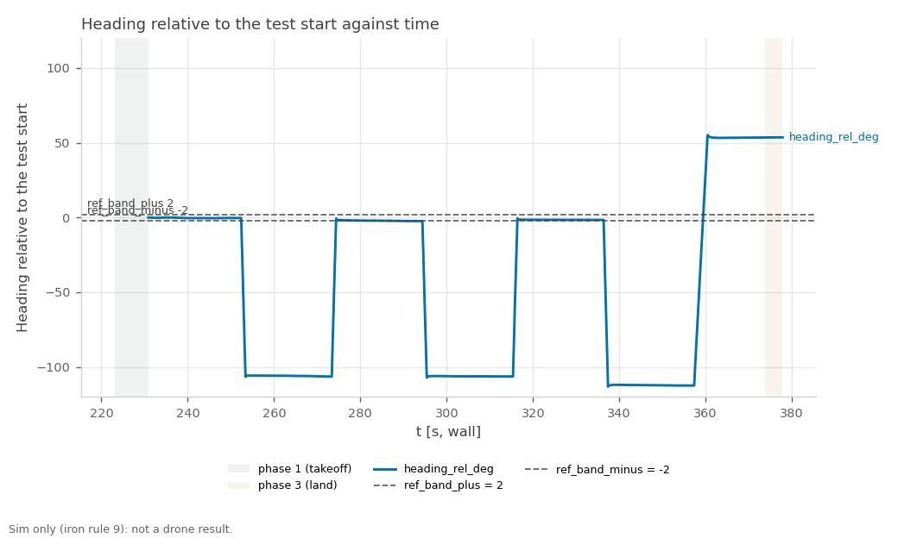

RECORD · SIM — sim_yaw_run2. Sim-only (iron rule 9): none of these values is ported to the drone; the sim airframe's yaw gains and any gain the sweep sets live are sim-only (iron rule 9).

# sim_yaw_run2 — one-drone yaw-step: heading ring-down after a yaw pulse, PX4 vehicle time (started 2026-11-02T21:31:06+08:00 +08; flight 13:36:08–13:38:57 UTC)

**Verdict: INCOMPLETE.** Measure how the sim drone's heading settles after a yaw pulse is released (overshoot, ring, settle time, swing-back rate, drift) from the PX4 ulog in vehicle time, so the sim airframe's yaw gains can be retuned; the keyboard sessions of 2026-10-30 showed a ±8–17° ring at ~0.8 Hz. For Linear NEAR-789 (milestone S5). PASS = every gate PASS; INCOMPLETE = no FAIL but ≥ 1 gate UNVERIFIED; FAIL = any gate FAIL; ABORTED = Ctrl-C landing, never a result. Report generated 2026-11-02 at repo `85081be`.

**Scope:** PX4's own sim state estimate positions the drone (no mocap, no camera); flat default world; one drone; commander teleop input only (safe_teleop and the keyboard not in the loop); time gates read PX4 vehicle time from the ulog.

## Setup

| Item | Value |
|---|---|
| Sim | Isaac Sim, 1 Starling 2 Max (`DRONE_USD=starling2max.usd`, `PX4_VEHICLE_MODEL=pegasus_starling2max`), default flat world |
| Airframe | `10090_pegasus_starling2max` (sim-only airframe gains, see the S5 hover records) |
| Commander | `teleop_single.yaml scenario:=hover`, tuning {"teleop_max_speed_mps": 2.0, "goal_accel_mps2": 3.0, "goal_settle_s": 0.3, "scenario_speed_mps": 0.6} |
| Driver | `tools/sim.sh test yaw_step`, repo commit `c66f0105f1d309a64b489526baf3a0b34ea09961` (tools/ uncommitted changes: 0) |
| Started | 2026-11-02T21:31:06+08:00 +08 (laptop clock, `run_meta.txt`); flight 13:36:08–13:38:57 UTC (container clock) |
| Video | \ |

## Changes in this run

What changed while this run flew (docs/CODING_STANDARD.md §3), from three sources. PX4's own list (the ulog) is the ground truth and wins a conflict.

**Logged by the tools (`changes.log`):**

none logged

**PX4 ulog, parameters changed after boot (vehicle time, t > 2 s; 23 boot-time settings not listed):**

none after boot

**Parameter snapshot, start → end of the flight (MAVROS for PX4, `ros2 param dump /swarm_commander`; catches Foxglove, QGC, `ros2 param set`):**

```
drone_1/COM_FLIGHT_UUID 0 -> 1
drone_1/LND_FLIGHT_T_LO 0 -> 287231274
```

**PX4 at the start vs the airframe file (drone_1):**

all 49 airframe values in force

**Conflicts and unlogged changes:**

- PX4 bookkeeping (not a tuning change): drone_1/COM_FLIGHT_UUID 0 → 1 (snapshot)
- PX4 bookkeeping (not a tuning change): drone_1/LND_FLIGHT_T_LO 0 → 287231274 (snapshot)

## Pass/fail

| Check | Criterion | Measured | Baseline | Verdict |
|---|---|---|---|---|
| Isaac launch: SYS_AUTOSTART=10090 x1 | SYS_AUTOSTART=10090 x1 | 1 | - | PASS |
| Isaac launch: Ready for takeoff x1 | Ready for takeoff x1 | 1 | - | PASS |
| Isaac launch: no 'Unknown model' | no 'Unknown model' | 0 | - | PASS |
| Isaac launch: no PhysX cooking warnings | no PhysX cooking warnings | 0 | - | PASS |
| Isaac launch: Starling2MaxConfig x1 | Starling2MaxConfig x1 (launcher print) | 2 | - | PASS |
| coverage: rows through the window | largest `t_s` gap over the phase-2 rows ≤ 0.5 s, ≥ 1 landing (`phase` 3) row, metrics node alive at stop | largest phase-2 gap 0.04 s; 8129 phase-2 rows, 228 landing rows | - | PASS |
| set-0 pulses flown and analysable | fly.sh stamped 2N = 6 set-0 pulses; the ulog shows the same (order, sign, onset spacing); each released with ≥ 3 s of NaN-free data after it | n/a — the ulog shows 6 yaw pulses, fly.sh stamped 7 | keyboard 2026-10-30: ±8–17° ring ~0.8 Hz, no ulog | **UNVERIFIED** |
| heading overshoot ≤ 3.0° | max over set-0 pulses of the heading's overrun past its final value after release (PX4 ulog, unwrapped ENU) | n/a — match: the ulog shows 6 yaw pulses, fly.sh stamped 7 | keyboard 2026-10-30: ±8–17° ring ~0.8 Hz, no ulog | **UNVERIFIED** |
| settle to ±2° ≤ 2.0 s (vehicle) | time from release until the heading stays within ±2° of its final value, PX4 vehicle time; not settled in the window = FAIL | n/a — match: the ulog shows 6 yaw pulses, fly.sh stamped 7 | keyboard 2026-10-30: ±8–17° ring ~0.8 Hz, no ulog | **UNVERIFIED** |
| ring crossings ≤ 1 | zero crossings of (heading − final) after it first enters the band, 0.5° hysteresis | n/a — match: the ulog shows 6 yaw pulses, fly.sh stamped 7 | keyboard 2026-10-30: ±8–17° ring ~0.8 Hz, no ulog | **UNVERIFIED** |
| swing back ≤ 30 °/s | yaw_core `peak_rate_dps`: fastest body yaw rate AGAINST the turn in [release, +3 s] (PX4 vehicle_angular_velocity); `peak_rate_abs_dps` is info | n/a — match: the ulog shows 6 yaw pulses, fly.sh stamped 7 | keyboard 2026-10-30: ±8–17° ring ~0.8 Hz, no ulog | **UNVERIFIED** |
| xy drift ≤ 0.15 m | max horizontal distance from the onset position over pulse + window (PX4 vehicle_local_position) | n/a — match: the ulog shows 6 yaw pulses, fly.sh stamped 7 | keyboard 2026-10-30: ±8–17° ring ~0.8 Hz, no ulog | **UNVERIFIED** |
| yaw sign | +angular.z (ENU, CCW) raises the ENU heading: ulog `turn_deg` and live `heading_rel_deg` change over the pulse both along the command | n/a — match: the ulog shows 6 yaw pulses, fly.sh stamped 7 | - | **UNVERIFIED** |
| booted gains = airframe file | ulog header MC_YAW_P, MC_YAWRATE_P/I/D/K = the `param set-default` lines of 10090_pegasus_starling2max (rel 1e-3), and set 0 flew them | ulog header MC_YAW_P 2.8, MC_YAWRATE_P/I/D/K 0.25/0.2/0/1 = airframe file | - | PASS |
| live vs ulog overshoot | per set-0 pulse, overshoot from live `heading_rel_deg` (yaw_core.measure_pulse on metrics.csv, stamps via t0_unix) within 1.0° of the ulog's | n/a — match: the ulog shows 6 yaw pulses, fly.sh stamped 7 | - | **UNVERIFIED** |
| live parameter changes logged | informational (no sweep in this run) | none — ulog and changes.log list no change | - | info |
| sweep completed | informational (no sweep in this run) | set 0 only; 1 set(s) flown | - | info |
| booted gains restored | informational (no sweep in this run) | nothing to restore | - | info |
| landed, disarmed (commander ACK) | informational (ACK log, not an arming display) | drone_1 | - | info |
| post-flight armed=false x1 (MAVROS state) | armed: false for drone_1 | drone_1 false | - | PASS |
| live vs bag recompute | live metrics.csv agrees with the rosbag recompute (heading_rel_deg within tolerance; flags by count) | heading_rel_deg Δmax 0 (tol 0.5); heading_deg Δmax 0 (tol 0.5); yaw_rate_dps Δmax 0 (tol 2); xy_drift_m Δmax 0 (tol 0.02); fence_breached Σ 0 vs 0; emergency Σ 0 vs 0; unpaired 0.0 %; bag unpaired 2.4 % | - | PASS |
| rosbag copied + readable | bag dir yaw_step_* with metadata.yaml under the heavy folder, and metrics.csv, metrics_bag.csv in the run folder | yaw_step_20261102_133148: 305 MB, metadata.yaml present | - | PASS |
| PX4 ulogs one per sysid 2 | ulog_sysid_map.txt lists sysids 2 (drone_1) | 1 files, sysids ['2'] | - | PASS |
| WiFi firmware alerts | 0 during the run | 0 | - | PASS |
| code that ran | informational (run_meta.txt head vs git HEAD at report time) | ran at c66f010, report at 85081be | - | info |
| ulog pulse 1 (−) | informational (match unverified: the ulog shows 6 yaw pulses, fly.sh stamped 7) | on 604.5 s, os 0.8°, settle 0.03 s, ring 1, swing 12 °/s (abs 56), drift 0.04 m, plat 56 °/s, scale 1.89 | - | info |
| ulog pulse 2 (+) | informational (match unverified: the ulog shows 6 yaw pulses, fly.sh stamped 7) | on 644.2 s, os 1.4°, settle 0.03 s, ring 1, swing 11 °/s (abs 56), drift 0.03 m, plat 56 °/s, scale 1.89 | - | info |
| ulog pulse 3 (−) | informational (match unverified: the ulog shows 6 yaw pulses, fly.sh stamped 7) | on 683.9 s, os 0.9°, settle 0.06 s, ring 1, swing 12 °/s (abs 56), drift 0.04 m, plat 56 °/s, scale 1.85 | - | info |
| ulog pulse 4 (+) | informational (match unverified: the ulog shows 6 yaw pulses, fly.sh stamped 7) | on 723.6 s, os 1.1°, settle 0.01 s, ring 1, swing 11 °/s (abs 56), drift 0.04 m, plat 56 °/s, scale 1.90 | - | info |
| ulog pulse 5 (−) | informational (match unverified: the ulog shows 6 yaw pulses, fly.sh stamped 7) | on 763.5 s, os 1.1°, settle 0.03 s, ring 1, swing 12 °/s (abs 56), drift 0.05 m, plat 56 °/s, scale 2.00 | - | info |
| ulog pulse 6 (+) | informational (match unverified: the ulog shows 6 yaw pulses, fly.sh stamped 7) | on 803.6 s, os 1.8°, settle 0.00 s, ring 1, swing 9 °/s (abs 28), drift 0.79 m, plat 28 °/s, scale 5.94 | - | info |
| patch-0007 tap | informational: room-frame +x tap after the turn; a direction error ≈ the turn angle = the body-frame orbit (before patch 0007) | n/a — match: the ulog shows 6 yaw pulses, fly.sh stamped 7 | - | info |
| pulse marker (U3) | informational: which PX4 topic marks onset/release | vehicle_attitude_setpoint.yaw_sp_move_rate (20 Hz; U3: it carries the pulses in offboard) | - | info |
| plateau measured vs commanded (U4) | informational: body yaw rate during set-0 pulses vs the 57.3 °/s commanded | n/a — no set-0 pulse with numbers | - | info |
| time scale (vehicle s per wall s) | informational, never a gate | onset spacing median 1.895; per pulse n/a | - | info |
| px4_param_changes.txt | informational: MC_YAW* changes PX4 applied (vehicle time) | none | - | info |
| odometry yaw rate (U5) | informational: odometry twist.angular.z (live `yaw_rate_dps`) is plotted only, never gated | present: max \|`yaw_rate_dps`\| 67.2 °/s, `heading_rel_deg` span 168° | - | info |

Rows marked info are informational and never pass or fail the run.

[Figure 1](#fig-1) plots the heading relative to the test start (live odometry, wall clock) with the ±2° settle band. The PX4 ulog could not be matched to the scripted pulses, so no vehicle-time value is reported.

<a id="fig-1"></a>


*Figure 1. Heading relative to the test start (`heading_rel_deg`, unwrapped, 40 Hz odometry) against wall-clock time, with the ±2° settle band; shaded bands mark takeoff and land. The gates are measured from the PX4 ulog in vehicle time, not on this axis. Drawn from metrics.csv by `tools/sim.sh figures yaw_step <run>`.*

## Driver verdict history

Every generation of this record (`verdicts.log`, newest last; the last line is this one):

```
2026-11-02T21:41:03+08:00 head=c66f010 verdict=INCOMPLETE fail=0 unverified=8
2026-11-02T22:17:15+08:00 head=c66f010 verdict=INCOMPLETE fail=0 unverified=8
2026-11-02T22:26:52+08:00 head=c66f010 verdict=INCOMPLETE fail=0 unverified=8
```

## Evidence

Flight script stdout (times are UTC, container clock):
```
[13:36:08] pre-takeoff: name:drone_1 state:IDLE position:[0.016,0.013,-0.015]
[13:36:10] takeoff: success=True, message='takeoff: drone_1'
[13:36:19] start: success=True, message='scenario "hover" running'
[13:36:19] pulses: gap 20 s (wall), 3 per direction, rate 1.0 rad/s, pulse 1.0 s, sweep 'none'
[1793626579.518289] pulse 0/1 onset sign=+1 rate=1.000
[1793626580.518516] pulse 0/1 release
[1793626600.518587] pulse 0/2 onset sign=-1 rate=1.000
[1793626601.518722] pulse 0/2 release
[1793626621.518843] pulse 0/3 onset sign=+1 rate=1.000
[1793626622.518984] pulse 0/3 release
[1793626642.519114] pulse 0/4 onset sign=-1 rate=1.000
[1793626643.519233] pulse 0/4 release
[1793626663.519353] pulse 0/5 onset sign=+1 rate=1.000
[1793626664.519475] pulse 0/5 release
[1793626684.519580] pulse 0/6 onset sign=-1 rate=1.000
[1793626685.519701] pulse 0/6 release
[1793626705.519826] turn onset sign=+1 rate=0.500
[1793626708.659950] turn release
[1793626713.660069] tap onset vx=0.500
[1793626715.160192] tap release
[13:38:41] pulse program done (rc 0); zeros published
[13:38:41] land: success=True, message='landing: drone_1'
[13:38:57] landed: name:land name:drone_1 state:IDLE position:[0.732,0.004,0.014]
```

Metrics node log (tail):
```
[t= 428.0 s] phase=0 heading_rel_deg=nan cbf= emerg=0
[t= 429.0 s] phase=0 heading_rel_deg=nan cbf= emerg=0
[t= 430.0 s] phase=0 heading_rel_deg=nan cbf= emerg=0
[t= 431.0 s] phase=0 heading_rel_deg=nan cbf= emerg=0
[t= 432.0 s] phase=0 heading_rel_deg=nan cbf= emerg=0
[t= 433.0 s] phase=0 heading_rel_deg=nan cbf= emerg=0
[t= 434.0 s] phase=0 heading_rel_deg=nan cbf= emerg=0
[t= 435.0 s] phase=0 heading_rel_deg=nan cbf= emerg=0
[t= 436.0 s] phase=0 heading_rel_deg=nan cbf= emerg=0
[t= 437.0 s] phase=0 heading_rel_deg=nan cbf= emerg=0
[t= 438.0 s] phase=0 heading_rel_deg=nan cbf= emerg=0
[t= 439.0 s] phase=0 heading_rel_deg=nan cbf= emerg=0
```

Landing (commander ACK log) and post-flight MAVROS state:
```
[swarm_commander-2] [INFO] [1793626723.939690165] [swarm_commander]: drone_1: touchdown at z=0.13 m, settling 2.0 s before disarm
[swarm_commander-2] [INFO] [1793626725.989276432] [swarm_commander]: drone_1: landed, disarmed (attempt 1)
armed_post.txt: unreadable
```

Live vs bag recompute:

| Column | Kind | Tolerance | Max diff | Σ live | Σ bag | Paired | Unpaired | OK |
|---|---|---|---|---|---|---|---|---|
| heading_rel_deg | continuous | 0.5 | 0 | -341621 | -341621 | 25080 | 0.0 % | yes |
| heading_deg | continuous | 0.5 | 0 | -117028 | -117028 | 25080 | 0.0 % | yes |
| yaw_rate_dps | continuous | 2 | 0 | 1718.39 | 1718.39 | 25080 | 0.0 % | yes |
| xy_drift_m | continuous | 0.02 | 0 | 644.603 | 644.603 | 25080 | 0.0 % | yes |
| fence_breached | flag | 0 | 0 | 0 | 0 | 25080 | 0.0 % | yes |
| emergency | flag | 0 | 0 | 0 | 0 | 25080 | 0.0 % | yes |

## Files

- Repo (this folder, `docs/record/sim_yaw_run2/`): `armed_post.txt`, `bag_evidence.txt`, `bag_path.txt`, `bag_status_pre.json`, `caveats.txt`, `changes.log`, `clock_check.txt`, `commander.log`, `commands.sh`, `fig-1.png`, `interfaces.log`, `isaac.log`, `isaac.log.start`, `isaac_evidence.txt`, `landing_evidence.txt`, `live_plot.log`, `metrics.csv`, `metrics_bag.csv`, `metrics_node.log`, `odom_hz.txt`, `params_diff.txt`, `params_mavros.txt`, `params_mavros_names.txt`, `params_ulog.txt`, `px4_arm_times.txt`, `px4_param_changes.txt`, `px4_param_changes_all.txt`, `res_watch.log`, `run.log`, `run_meta.txt`, `status_post.json`, `status_pre.json`, `test_stdout.log`, `topics_of_interest.txt`, `ulog_list.txt`, `ulog_sysid_map.txt`, `ulogs_copied.ok`, `verdicts.log`, `video.txt`.
- Not in the repo (`/home/jeremychia/flight_logs/sim/sim_yaw_run2/`): `drone_1_sysid2_13_31_22.ulg` (224 MB), `params_end_drone_1.yaml` (0 MB), `params_end_swarm_commander.yaml` (0 MB), `params_start_drone_1.yaml` (0 MB), `params_start_swarm_commander.yaml` (0 MB), `px4_drone_1.csv` (5 MB), `yaw_step_20261102_133148` (305 MB).

## Caveats

- The 20 s gap between pulses is wall-clock; in vehicle time it is the gap × the time scale (1.89 here; ~1.3 on the flat world). Every time gate is PX4 vehicle time from the ulog; the figure's axis is wall clock.
- Pulse 0/1, the first of six, was lost before the commander had subscribed (discovery), fixed by CHG-0025, so INCOMPLETE is a test-script result, not a drone result.

## Ledger row draft (docs/record/LEDGER.md table 1, #30, NEAR-789)

| 30 | 2026-11-02 | SIM | yaw step, 1 drone, teleop_single.yaml, 6 pulses ±1 rad/s per set, vehicle time: INCOMPLETE — overshoot n/a, settle n/a, ring n/a, swing back n/a, drift n/a (set 0: MC_YAW_P 2.8, MC_YAWRATE_P/I/D/K 0.25/0.2/0/1); sweep 0 of 0 set(s) flown; landed + DISARMED yes; UNVERIFIED: set-0 pulses flown and analysable, heading overshoot ≤ 3.0°, settle to ±2° ≤ 2.0 s (vehicle), ring crossings ≤ 1, swing back ≤ 30 °/s, xy drift ≤ 0.15 m, yaw sign, live vs ulog overshoot | [sim_yaw_run2_record.md](sim_yaw_run2_record.md) | NEAR-789 |

