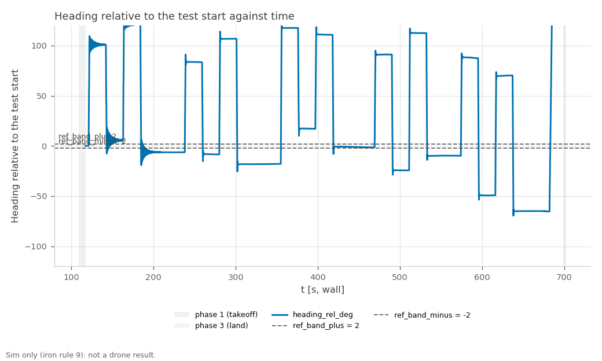

RECORD · SIM — sim_yaw_sweep3. Sim-only (iron rule 9): none of these values is ported to the drone; the sim airframe's yaw gains and any gain the sweep sets live are sim-only (iron rule 9).

# sim_yaw_sweep3 — one-drone yaw-step: heading ring-down after a yaw pulse, PX4 vehicle time (started 2026-11-02T19:26:03+08:00 +08; flight 11:29:15–11:39:22 UTC)

**Verdict: FAIL.** Measure how the sim drone's heading settles after a yaw pulse is released (overshoot, ring, settle time, swing-back rate, drift) from the PX4 ulog in vehicle time, so the sim airframe's yaw gains can be retuned; the keyboard sessions of 2026-10-30 showed a ±8–17° ring at ~0.8 Hz. For Linear NEAR-789 (milestone S5). PASS = every gate PASS; INCOMPLETE = no FAIL but ≥ 1 gate UNVERIFIED; FAIL = any gate FAIL; ABORTED = Ctrl-C landing, never a result. Report generated 2026-11-02 at repo `ff32099`.

**Scope:** PX4's own sim state estimate positions the drone (no mocap, no camera); flat default world; one drone; commander teleop input only (safe_teleop and the keyboard not in the loop); time gates read PX4 vehicle time from the ulog.

## Setup

| Item | Value |
|---|---|
| Sim | Isaac Sim, 1 Starling 2 Max (`DRONE_USD=starling2max.usd`, `PX4_VEHICLE_MODEL=pegasus_starling2max`), default flat world |
| Airframe | `10090_pegasus_starling2max` (sim-only airframe gains, see the S5 hover records) |
| Commander | `teleop_single.yaml scenario:=hover`, tuning {"teleop_max_speed_mps": 2.0, "goal_accel_mps2": 3.0, "goal_settle_s": 0.3, "scenario_speed_mps": 0.6} |
| Driver | `tools/sim.sh test yaw_step`, repo commit `31abf12a4a2e53c6002c165b874a50f973570af3` (tools/ uncommitted changes: 1) |
| Started | 2026-11-02T19:26:03+08:00 +08 (laptop clock, `run_meta.txt`); flight 11:29:15–11:39:22 UTC (container clock) |
| Video | none recorded |

## Changes in this run

What changed while this run flew (docs/CODING_STANDARD.md §3), from three sources. PX4's own list (the ulog) is the ground truth and wins a conflict.

**Logged by the tools (`changes.log`):**

```
2026-11-02T11:31:08+00:00 · drone_1/MC_YAWRATE_P · 0.07 → 0.14 · yaw_step-sweep-set-1 (via ros2 param set) · readback 0.14
2026-11-02T11:31:23+00:00 · drone_1/MC_YAWRATE_I · 0.5 → 0.5 · yaw_step-sweep-set-1 (via ros2 param set) · readback 0.5
2026-11-02T11:33:05+00:00 · drone_1/MC_YAWRATE_P · 0.14 → 0.14 · yaw_step-sweep-set-2 (via ros2 param set) · readback 0.14
2026-11-02T11:33:20+00:00 · drone_1/MC_YAWRATE_I · 0.5 → 0.2 · yaw_step-sweep-set-2 (via ros2 param set) · readback 0.2
2026-11-02T11:35:02+00:00 · drone_1/MC_YAWRATE_P · 0.14 → 0.25 · yaw_step-sweep-set-3 (via ros2 param set) · readback 0.25
2026-11-02T11:35:14+00:00 · drone_1/MC_YAWRATE_I · 0.2 → 0.3 · yaw_step-sweep-set-3 (via ros2 param set) · readback 0.3
2026-11-02T11:36:50+00:00 · drone_1/MC_YAWRATE_P · 0.25 → 0.25 · yaw_step-sweep-set-4 (via ros2 param set) · readback 0.25
2026-11-02T11:36:59+00:00 · drone_1/MC_YAWRATE_I · 0.3 → 0.5 · yaw_step-sweep-set-4 (via ros2 param set) · readback 0.5
2026-11-02T11:38:40+00:00 · drone_1/MC_YAWRATE_P · 0.25 → 0.07 · restore-yaw_step-after-the-sweep-before-the-patch-0007-check (via ros2 param set) · readback 0.07
2026-11-02T11:38:50+00:00 · drone_1/MC_YAWRATE_I · 0.5 → 0.5 · restore-yaw_step-after-the-sweep-before-the-patch-0007-check (via ros2 param set) · readback 0.5
```

**PX4 ulog, parameters changed after boot (vehicle time, t > 2 s; 23 boot-time settings not listed):**

```
629.177 drone_1 MC_YAWRATE_P 0.14
913.239 drone_1 MC_YAWRATE_I 0.2
913.239 drone_1 MC_YAWRATE_P 0.14
1113.539 drone_1 MC_YAWRATE_P 0.25
1136.956 drone_1 MC_YAWRATE_I 0.3
1352.915 drone_1 MC_YAWRATE_I 0.5
1352.915 drone_1 MC_YAWRATE_P 0.25
1577.732 drone_1 MC_YAWRATE_P 0.07
```

**Parameter snapshot, start → end of the flight (MAVROS for PX4, `ros2 param dump /swarm_commander`; catches Foxglove, QGC, `ros2 param set`):**

```
drone_1/COM_FLIGHT_UUID 0 -> 1
drone_1/LND_FLIGHT_T_LO 0 -> 1232386749
```

**PX4 at the start vs the airframe file (drone_1):**

all 48 airframe values in force

**Conflicts and unlogged changes:**

- PX4 bookkeeping (not a tuning change): drone_1/COM_FLIGHT_UUID 0 → 1 (snapshot)
- PX4 bookkeeping (not a tuning change): drone_1/LND_FLIGHT_T_LO 0 → 1232386749 (snapshot)

## Pass/fail

| Check | Criterion | Measured | Baseline | Verdict |
|---|---|---|---|---|
| Isaac launch: SYS_AUTOSTART=10090 x1 | SYS_AUTOSTART=10090 x1 | 1 | - | PASS |
| Isaac launch: Ready for takeoff x1 | Ready for takeoff x1 | 1 | - | PASS |
| Isaac launch: no 'Unknown model' | no 'Unknown model' | 0 | - | PASS |
| Isaac launch: no PhysX cooking warnings | no PhysX cooking warnings | 0 | - | PASS |
| Isaac launch: Starling2MaxConfig x1 | Starling2MaxConfig x1 (launcher print) | 2 | - | PASS |
| coverage: rows through the window | largest `t_s` gap over the phase-2 rows ≤ 0.5 s, ≥ 1 landing (`phase` 3) row, metrics node alive at stop | largest phase-2 gap 0.07 s; 36464 phase-2 rows, 276 landing rows | - | PASS |
| set-0 pulses flown and analysable | fly.sh stamped 2N = 4 set-0 pulses; the ulog shows the same (order, sign, onset spacing); each released with ≥ 3 s of NaN-free data after it | 4 stamped, 4 with numbers (sign + spacing match the stamps) | keyboard 2026-10-30: ±8–17° ring ~0.8 Hz, no ulog | PASS |
| heading overshoot ≤ 3.0° | max over set-0 pulses of the heading's overrun past its final value after release (PX4 ulog, unwrapped ENU) | `overshoot_deg`: worst 13.33° (pulse 0/2 (−)); 4 of 4 set-0 pulses with numbers | keyboard 2026-10-30: ±8–17° ring ~0.8 Hz, no ulog | **FAIL** |
| settle to ±2° ≤ 2.0 s (vehicle) | time from release until the heading stays within ±2° of its final value, PX4 vehicle time; not settled in the window = FAIL | `settle_s`: worst not settled (pulse 0/1 (+)); 4 of 4 set-0 pulses with numbers | keyboard 2026-10-30: ±8–17° ring ~0.8 Hz, no ulog | **FAIL** |
| ring crossings ≤ 1 | zero crossings of (heading − final) after it first enters the band, 0.5° hysteresis | `ring_crossings`: worst 24 (pulse 0/1 (+)); 4 of 4 set-0 pulses with numbers | keyboard 2026-10-30: ±8–17° ring ~0.8 Hz, no ulog | **FAIL** |
| swing back ≤ 30 °/s | yaw_core `peak_rate_dps`: fastest body yaw rate AGAINST the turn in [release, +3 s] (PX4 vehicle_angular_velocity); `peak_rate_abs_dps` is info | `peak_rate_dps`: worst 81.6 °/s (pulse 0/2 (−)); 4 of 4 set-0 pulses with numbers | keyboard 2026-10-30: ±8–17° ring ~0.8 Hz, no ulog | **FAIL** |
| xy drift ≤ 0.15 m | max horizontal distance from the onset position over pulse + window (PX4 vehicle_local_position) | `xy_drift_m`: worst 0.048 m (pulse 0/1 (+)); 4 of 4 set-0 pulses with numbers | keyboard 2026-10-30: ±8–17° ring ~0.8 Hz, no ulog | PASS |
| yaw sign | +angular.z (ENU, CCW) raises the ENU heading: ulog `turn_deg` and live `heading_rel_deg` change over the pulse both along the command | ulog `turn_deg` along the command 4/4, live `heading_rel_deg` change 4/4 (pulse 0/1 (+): ulog +108.0°, live +100.2°) | - | PASS |
| booted gains = airframe file | ulog header MC_YAW_P, MC_YAWRATE_P/I/D/K = the `param set-default` lines of 10090_pegasus_starling2max (rel 1e-3), and set 0 flew them | ulog header MC_YAW_P 2.8, MC_YAWRATE_P/I/D/K 0.07/0.5/0/1 = airframe file | - | PASS |
| live vs ulog overshoot | per set-0 pulse, overshoot from live `heading_rel_deg` (yaw_core.measure_pulse on metrics.csv, stamps via t0_unix) within 1.0° of the ulog's | max \|live − ulog\| 0.32° (pulse 0/2 (−): live 13.65°, ulog 13.33°); 4 of 4 compared | - | PASS |
| live parameter changes logged | every MC_YAW* change in the ulog (px4_param_changes.txt) has a changes.log line, same name and value (owner rule 2026-11-02) | ulog 8 change(s), changes.log 10 line(s) | - | PASS |
| sweep completed | fly.sh flew every requested gain set (2N stamped pulses each) and printed no PARAM MISMATCH, REFUSED or UNVERIFIED (each set read back through px4_param_set.sh) | 5 of 5 sets flown (set 0 + 4 of 4 sweep sets) | - | PASS |
| booted gains restored | every MC_YAW* the sweep changed is back at its ulog-header (booted) value before the patch-0007 turn (ulog changed_parameters) | all 2 back at booted | - | PASS |
| landed, disarmed (commander ACK) | informational (ACK log, not an arming display) | drone_1 | - | info |
| post-flight armed=false x1 (MAVROS state) | armed: false for drone_1 | drone_1 false | - | PASS |
| live vs bag recompute | live metrics.csv agrees with the rosbag recompute (heading_rel_deg within tolerance; flags by count) | heading_rel_deg Δmax 0 (tol 0.5); heading_deg Δmax 0 (tol 0.5); yaw_rate_dps Δmax 0 (tol 2); xy_drift_m Δmax 0 (tol 0.02); fence_breached Σ 0 vs 0; emergency Σ 0 vs 0; unpaired 0.0 %; bag unpaired 1.9 % | - | PASS |
| rosbag copied + readable | bag dir yaw_step_* with metadata.yaml under the heavy folder, and metrics.csv, metrics_bag.csv in the run folder | yaw_step_20261102_112648: 648 MB, metadata.yaml present | - | PASS |
| PX4 ulogs one per sysid 2 | ulog_sysid_map.txt lists sysids 2 (drone_1) | 1 files, sysids ['2'] | - | PASS |
| WiFi firmware alerts | 0 during the run | 0 | - | PASS |
| code that ran | informational (run_meta.txt head vs git HEAD at report time) | ran at 31abf12, report at ff32099 (tools/ had uncommitted changes) | - | info |
| pulse 0/1 (+) | informational (set 0; PX4 ulog, vehicle time) | on 442.5 s, os 8.3°, settle not settled, ring 24, swing 51 °/s (abs 51), drift 0.05 m, plat 72 °/s, scale 1.86 | - | info |
| pulse 0/2 (−) | informational (set 0; PX4 ulog, vehicle time) | on 482.7 s, os 13.3°, settle not settled, ring 24, swing 82 °/s (abs 82), drift 0.03 m, plat 80 °/s, scale 1.71 | - | info |
| pulse 0/3 (+) | informational (set 0; PX4 ulog, vehicle time) | on 520.7 s, os 5.4°, settle 10.28 s, ring 24, swing 33 °/s (abs 33), drift 0.03 m, plat 65 °/s, scale 2.09 | - | info |
| pulse 0/4 (−) | informational (set 0; PX4 ulog, vehicle time) | on 565.4 s, os 13.2°, settle 11.90 s, ring 24, swing 80 °/s (abs 84), drift 0.05 m, plat 53 °/s, scale 2.25 | - | info |
| pulse 1/1 (+) | informational (set 1; PX4 ulog, vehicle time) | on 683.9 s, os 7.4°, settle 0.70 s, ring 5, swing 44 °/s (abs 57), drift 0.02 m, plat 55 °/s, scale 1.61 | - | info |
| pulse 1/2 (−) | informational (set 1; PX4 ulog, vehicle time) | on 722.7 s, os 7.2°, settle 0.69 s, ring 4, swing 44 °/s (abs 57), drift 0.04 m, plat 55 °/s, scale 1.65 | - | info |
| pulse 1/3 (+) | informational (set 1; PX4 ulog, vehicle time) | on 767.8 s, os 7.3°, settle 0.64 s, ring 3, swing 43 °/s (abs 54), drift 0.04 m, plat 57 °/s, scale 2.11 | - | info |
| pulse 1/4 (−) | informational (set 1; PX4 ulog, vehicle time) | on 811.0 s, os 7.5°, settle 0.68 s, ring 4, swing 43 °/s (abs 55), drift 0.05 m, plat 56 °/s, scale 2.25 | - | info |
| pulse 2/1 (+) | informational (set 2; PX4 ulog, vehicle time) | on 934.4 s, os 7.3°, settle 0.50 s, ring 1, swing 27 °/s (abs 56), drift 0.03 m, plat 56 °/s, scale 2.40 | - | info |
| pulse 2/2 (−) | informational (set 2; PX4 ulog, vehicle time) | on 974.2 s, os 7.3°, settle 0.49 s, ring 1, swing 27 °/s (abs 57), drift 0.06 m, plat 57 °/s, scale 1.80 | - | info |
| pulse 2/3 (+) | informational (set 2; PX4 ulog, vehicle time) | on 1015.8 s, os 7.4°, settle 0.51 s, ring 1, swing 27 °/s (abs 57), drift 0.04 m, plat 57 °/s, scale 1.69 | - | info |
| pulse 2/4 (−) | informational (set 2; PX4 ulog, vehicle time) | on 1055.0 s, os 7.3°, settle 0.48 s, ring 1, swing 27 °/s (abs 56), drift 0.04 m, plat 57 °/s, scale 1.97 | - | info |
| pulse 3/1 (+) | informational (set 3; PX4 ulog, vehicle time) | on 1152.9 s, os 4.0°, settle 0.24 s, ring 5, swing 37 °/s (abs 58), drift 0.03 m, plat 55 °/s, scale 1.64 | - | info |
| pulse 3/2 (−) | informational (set 3; PX4 ulog, vehicle time) | on 1194.1 s, os 4.5°, settle 0.26 s, ring 3, swing 38 °/s (abs 56), drift 0.03 m, plat 56 °/s, scale 2.05 | - | info |
| pulse 3/3 (+) | informational (set 3; PX4 ulog, vehicle time) | on 1237.8 s, os 4.5°, settle 0.25 s, ring 2, swing 38 °/s (abs 56), drift 0.05 m, plat 56 °/s, scale 2.50 | - | info |
| pulse 3/4 (−) | informational (set 3; PX4 ulog, vehicle time) | on 1281.8 s, os 4.1°, settle 0.28 s, ring 5, swing 38 °/s (abs 57), drift 0.05 m, plat 56 °/s, scale 2.15 | - | info |
| pulse 4/1 (+) | informational (set 4; PX4 ulog, vehicle time) | on 1364.9 s, os 4.1°, settle 0.42 s, ring 5, swing 41 °/s (abs 59), drift 0.04 m, plat 56 °/s, scale 1.80 | - | info |
| pulse 4/2 (−) | informational (set 4; PX4 ulog, vehicle time) | on 1410.3 s, os 4.3°, settle 0.43 s, ring 6, swing 42 °/s (abs 55), drift 0.03 m, plat 56 °/s, scale 2.46 | - | info |
| pulse 4/3 (+) | informational (set 4; PX4 ulog, vehicle time) | on 1457.7 s, os 3.9°, settle 0.49 s, ring 6, swing 42 °/s (abs 57), drift 0.03 m, plat 55 °/s, scale 2.09 | - | info |
| pulse 4/4 (−) | informational (set 4; PX4 ulog, vehicle time) | on 1506.8 s, os 4.6°, settle 0.42 s, ring 6, swing 42 °/s (abs 55), drift 0.03 m, plat 56 °/s, scale 2.45 | - | info |
| pulse turn (patch-0007) | informational (0.5 rad/s for 3.14 s wall = 90° × the time scale in vehicle time, then the tap) | turn +207° at 29 °/s, not gated; flew booted gains | - | info |
| set 0: booted gains (gated) | informational (gains in force from the ulog's changed_parameters) | MC_YAW_P 2.8, MC_YAWRATE_P/I/D/K 0.07/0.5/0/1 — overshoot max 13.3°, settle max inf s, ring max 24, swing max 82 °/s, drift max 0.05 m; 4 of 4 with numbers | - | info |
| set 1: sweep (info) | informational (gains in force from the ulog's changed_parameters) | MC_YAW_P 2.8, MC_YAWRATE_P/I/D/K 0.14/0.5/0/1 — overshoot max 7.5°, settle max 0.70 s, ring max 5, swing max 44 °/s, drift max 0.05 m; 4 of 4 with numbers | - | info |
| set 2: sweep (info) | informational (gains in force from the ulog's changed_parameters) | MC_YAW_P 2.8, MC_YAWRATE_P/I/D/K 0.14/0.2/0/1 — overshoot max 7.4°, settle max 0.51 s, ring max 1, swing max 27 °/s, drift max 0.06 m; 4 of 4 with numbers | - | info |
| set 3: sweep (info) | informational (gains in force from the ulog's changed_parameters) | MC_YAW_P 2.8, MC_YAWRATE_P/I/D/K 0.25/0.3/0/1 — overshoot max 4.5°, settle max 0.28 s, ring max 5, swing max 38 °/s, drift max 0.05 m; 4 of 4 with numbers | - | info |
| set 4: sweep (info) | informational (gains in force from the ulog's changed_parameters) | MC_YAW_P 2.8, MC_YAWRATE_P/I/D/K 0.25/0.5/0/1 — overshoot max 4.6°, settle max 0.49 s, ring max 6, swing max 42 °/s, drift max 0.04 m; 4 of 4 with numbers | - | info |
| patch-0007 tap | informational: room-frame +x tap after the turn; a direction error ≈ the turn angle = the body-frame orbit (before patch 0007) | direction error 4.8°, heading change -1.4°, displacement 0.46 m (vehicle 1630.1–1633.3 s) | - | info |
| pulse marker (U3) | informational: which PX4 topic marks onset/release | vehicle_attitude_setpoint.yaw_sp_move_rate (20 Hz; U3: it carries the pulses in offboard) | - | info |
| plateau measured vs commanded (U4) | informational: body yaw rate during set-0 pulses vs the 57.3 °/s commanded | measured 53.3–79.9 °/s, setpoint 57.3 °/s, commanded 57.3 °/s | - | info |
| time scale (vehicle s per wall s) | informational, never a gate | onset spacing median 2.068; per pulse 1.86, 1.71, 2.09, 2.25 | - | info |
| px4_param_changes.txt | informational: MC_YAW* changes PX4 applied (vehicle time) | 629.3 s MC_YAWRATE_P=0.14; 913.3 s MC_YAWRATE_I=0.2; 913.3 s MC_YAWRATE_P=0.14; 1114.0 s MC_YAWRATE_P=0.25; 1137.1 s MC_YAWRATE_I=0.3; 1353.1 s MC_YAWRATE_I=0.5 … | - | info |
| odometry yaw rate (U5) | informational: odometry twist.angular.z (live `yaw_rate_dps`) is plotted only, never gated | present: max \|`yaw_rate_dps`\| 114.1 °/s, `heading_rel_deg` span 218° | - | info |

Rows marked info are informational and never pass or fail the run.

[Figure 1](#fig-1) plots the heading relative to the test start (live odometry, wall clock) with the ±2° settle band. Worst set-0 pulse after release, PX4 vehicle time: overshoot 13.33° (gate 3.0), settle not reached (gate 2.0 s), 24 ring crossing(s) (gate 1), swing back 81.6 °/s (gate 30), drift 0.048 m (gate 0.15).

<a id="fig-1"></a>


*Figure 1. Heading relative to the test start (`heading_rel_deg`, unwrapped, 40 Hz odometry) against wall-clock time, with the ±2° settle band; shaded bands mark takeoff and land. The gates are measured from the PX4 ulog in vehicle time, not on this axis. Drawn from metrics.csv by `tools/sim.sh figures yaw_step <run>`.*

## Driver verdict history

Every generation of this record (`verdicts.log`, newest last; the last line is this one):

```
2026-11-02T19:43:22+08:00 head=31abf12 verdict=FAIL fail=4 unverified=0
```

## Evidence

Flight script stdout (times are UTC, container clock):
```
[11:29:15] pre-takeoff: name:drone_1 state:IDLE position:[-0.004,-0.009,0.021]
[11:29:16] takeoff: success=True, message='takeoff: drone_1'
[11:29:25] start: success=True, message='scenario "hover" running'
[11:29:25] pulses: gap 20 s (wall), 2 per direction, rate 1.0 rad/s, pulse 1.0 s, sweep 'MC_YAWRATE_P=0.14,MC_YAWRATE_I=0.5;MC_YAWRATE_P=0.14,MC_YAWRATE_I=0.2;MC_YAWRATE_P=0.25,MC_YAWRATE_I=0.3;MC_YAWRATE_P=0.25,MC_YAWRATE_I=0.5'
[1793618969.482155] pulse 0/1 onset sign=+1 rate=1.000
[1793618970.482282] pulse 0/1 release
[1793618990.482401] pulse 0/2 onset sign=-1 rate=1.000
[1793618991.482531] pulse 0/2 release
[1793619011.482662] pulse 0/3 onset sign=+1 rate=1.000
[1793619012.482783] pulse 0/3 release
[1793619032.482891] pulse 0/4 onset sign=-1 rate=1.000
[1793619033.482967] pulse 0/4 release
[11:30:53] set 1: MC_YAWRATE_P=0.14, MC_YAWRATE_I=0.5
2026-11-02T11:31:08+00:00 · drone_1/MC_YAWRATE_P · 0.07 → 0.14 · yaw_step-sweep-set-1 (via ros2 param set) · readback 0.14
2026-11-02T11:31:23+00:00 · drone_1/MC_YAWRATE_I · 0.5 → 0.5 · yaw_step-sweep-set-1 (via ros2 param set) · readback 0.5
[1793619086.557698] pulse 1/1 onset sign=+1 rate=1.000
[1793619087.557831] pulse 1/1 release
[1793619107.557964] pulse 1/2 onset sign=-1 rate=1.000
[1793619108.558101] pulse 1/2 release
[1793619128.558231] pulse 1/3 onset sign=+1 rate=1.000
[1793619129.558353] pulse 1/3 release
[1793619149.558527] pulse 1/4 onset sign=-1 rate=1.000
[1793619150.558650] pulse 1/4 release
[11:32:50] set 2: MC_YAWRATE_P=0.14, MC_YAWRATE_I=0.2
2026-11-02T11:33:05+00:00 · drone_1/MC_YAWRATE_P · 0.14 → 0.14 · yaw_step-sweep-set-2 (via ros2 param set) · readback 0.14
2026-11-02T11:33:20+00:00 · drone_1/MC_YAWRATE_I · 0.5 → 0.2 · yaw_step-sweep-set-2 (via ros2 param set) · readback 0.2
[1793619203.456398] pulse 2/1 onset sign=+1 rate=1.000
[1793619204.456512] pulse 2/1 release
[1793619224.456584] pulse 2/2 onset sign=-1 rate=1.000
[1793619225.456740] pulse 2/2 release
[1793619245.456875] pulse 2/3 onset sign=+1 rate=1.000
[1793619246.456996] pulse 2/3 release
[1793619266.457136] pulse 2/4 onset sign=-1 rate=1.000
[1793619267.465724] pulse 2/4 release
[11:34:47] set 3: MC_YAWRATE_P=0.25, MC_YAWRATE_I=0.3
2026-11-02T11:35:02+00:00 · drone_1/MC_YAWRATE_P · 0.14 → 0.25 · yaw_step-sweep-set-3 (via ros2 param set) · readback 0.25
2026-11-02T11:35:14+00:00 · drone_1/MC_YAWRATE_I · 0.2 → 0.3 · yaw_step-sweep-set-3 (via ros2 param set) · readback 0.3
[1793619317.600876] pulse 3/1 onset sign=+1 rate=1.000
[1793619318.600999] pulse 3/1 release
[1793619338.601116] pulse 3/2 onset sign=-1 rate=1.000
[1793619339.601239] pulse 3/2 release
[1793619359.601340] pulse 3/3 onset sign=+1 rate=1.000
[1793619360.601447] pulse 3/3 release
[1793619380.601564] pulse 3/4 onset sign=-1 rate=1.000
[1793619381.601709] pulse 3/4 release
[11:36:41] set 4: MC_YAWRATE_P=0.25, MC_YAWRATE_I=0.5
2026-11-02T11:36:50+00:00 · drone_1/MC_YAWRATE_P · 0.25 → 0.25 · yaw_step-sweep-set-4 (via ros2 param set) · readback 0.25
2026-11-02T11:36:59+00:00 · drone_1/MC_YAWRATE_I · 0.3 → 0.5 · yaw_step-sweep-set-4 (via ros2 param set) · readback 0.5
[1793619422.526690] pulse 4/1 onset sign=+1 rate=1.000
[1793619423.526804] pulse 4/1 release
[1793619443.526907] pulse 4/2 onset sign=-1 rate=1.000
[1793619444.527016] pulse 4/2 release
[1793619464.527126] pulse 4/3 onset sign=+1 rate=1.000
[1793619465.527248] pulse 4/3 release
[1793619485.527388] pulse 4/4 onset sign=-1 rate=1.000
[1793619486.527501] pulse 4/4 release
[11:38:26] restoring the booted gains (after the sweep before the patch-0007 check): MC_YAWRATE_P=0.07, MC_YAWRATE_I=0.5
2026-11-02T11:38:40+00:00 · drone_1/MC_YAWRATE_P · 0.25 → 0.07 · restore-yaw_step-after-the-sweep-before-the-patch-0007-check (via ros2 param set) · readback 0.07
2026-11-02T11:38:50+00:00 · drone_1/MC_YAWRATE_I · 0.5 → 0.5 · restore-yaw_step-after-the-sweep-before-the-patch-0007-check (via ros2 param set) · readback 0.5
[1793619530.446929] booted gains restored: MC_YAWRATE_P=0.07, MC_YAWRATE_I=0.5
[1793619530.446937] turn onset sign=+1 rate=0.500
[1793619533.587021] turn release
[1793619538.587126] tap onset vx=0.500
[1793619540.087246] tap release
[11:39:06] pulse program done (rc 0); zeros published
terminate called without an active exception
/tmp/svg_test/fly.sh: line 303: 22343 Aborted                 (core dumped) CHANGES_LOG="$HERE/changes.log" PARAM_HELPER="$HERE/px4_param_set.sh" PYTHONPATH="$HERE${PYTHONPATH:+:$PYTHONPATH}" python3 - yaw_step/fly.sh "$GAP" "$N" "$RATE" "$PULSE" "$SWEEP" <<'PY'
import os, re, signal, subprocess, sys, threading, time

import rclpy
from geometry_msgs.msg import TwistStamped
try:
    from rclpy.signals import SignalHandlerOptions
except ImportError:          # older rclpy: no option, rclpy's own handler stays
    SignalHandlerOptions = None
import changes_log

GAP, N, RATE, PULSE = float(sys.argv[2]), int(float(sys.argv[3])), float(sys.argv[4]), float(sys.argv[5])
SWEEP = sys.argv[6] if len(sys.argv) > 6 else ""
TOPIC = "/svg/drone_1/teleop_command"
PNODE = "/drone_1/interface/mavros/param"
DRONE = "drone_1"                         # the helper's <drone_n> is 1: changes.log lines read drone_1/NAME
HELPER = os.environ.get("PARAM_HELPER", "px4_param_set.sh")
HELPER_TIMEOUT_S = 300                    # the helper's own ros2 calls time out within 4 x 30 s + 120 s
LOG = os.environ.get("CHANGES_LOG", "changes.log")
TURN_RAD_S, TURN_S, TAP_MPS, TAP_S, SETTLE_S = 0.5, 3.14, 0.5, 1.5, 5.0     # patch-0007 check: +90 deg in real time (x the sim time scale in vehicle time), then 0.75 m east


class Stop(Exception):
    pass


def on_signal(signum, _frame):
    raise Stop(signal.Signals(signum).name)


def stamp(text):
    print("[%.6f] %s" % (time.time(), text), flush=True)


def say(text):
    print("[%s] %s" % (time.strftime("%H:%M:%S"), text), flush=True)


cmd = {"wz": 0.0, "vx": 0.0}
lock = threading.Lock()


def set_cmd(wz=0.0, vx=0.0):
    with lock:
        cmd["wz"], cmd["vx"] = float(wz), float(vx)


# every ros2 call of this program and the helper discovers LOCALHOST only (the helper sets it too): a MAVROS on the lab
# subnet with the same name never answers. rclpy's own node (the teleop publisher) keeps the container's settings.
CHILD_ENV = dict(os.environ, ROS_AUTOMATIC_DISCOVERY_RANGE="LOCALHOST")
CHILD_ENV.pop("ROS_STATIC_PEERS", None)


def sh(line, timeout):
    try:
        r = subprocess.run(["bash", "-c", line], capture_output=True, text=True, timeout=timeout, env=CHILD_ENV)
        return r.returncode, r.stdout + r.stderr
    except subprocess.TimeoutExpired:
        return 124, "timeout after %d s: %s" % (timeout, line)


def param_get(p):
    """Read only: drone_1's MAVROS value of p (the booted value, read before the sweep first sets p). Never sets."""
    _, out = sh("ros2 param get %s %s" % (PNODE, p), 30)
    m = re.search(r"value is:\s*([-+0-9.eE]+)", out)
    return float(m.group(1)) if m else None


def helper_set(p, val, who, old):
    """One set through px4_param_set.sh (it checks the sim PX4, sets, pulls, reads back and writes the changes.log line).
    Returns (kind, the parsed changes.log line): kind None = read back as set; "MISMATCH" / "REFUSED" (nothing sent) / "UNVERIFIED".
    A call cut short (SIGINT/SIGTERM, our timeout) may still have reached PX4: its line is written here, UNVERIFIED."""
    t = time.time()
    try:
        r = subprocess.run(["bash", HELPER, "1", p, repr(float(val)), who, LOG], capture_output=True, text=True,
                           timeout=HELPER_TIMEOUT_S, env=CHILD_ENV)
    except subprocess.TimeoutExpired:
        return "UNVERIFIED", changes_log.parse_change(changes_log.append_change(
            LOG, t, "%s/%s" % (DRONE, p), old, val, who + " timed-out",
            unverified="px4_param_set.sh killed after %d s, outcome unknown" % HELPER_TIMEOUT_S))
    except BaseException:
        changes_log.append_change(LOG, t, "%s/%s" % (DRONE, p), old, val, who + " interrupted before px4_param_set.sh returned",
                                  unverified="stopped while the set ran, outcome unknown")
        raise
    out = [l for l in r.stdout.splitlines() if l.strip()]
    for l in out[:-1] + r.stderr.splitlines():
        print("  helper: " + l, flush=True)            # indented: gates.py reads only fly.sh's own PARAM lines
    c = changes_log.parse_change(out[-1]) if out else None
    if c is None:                                      # no line from the helper: write one, nothing hides
        why = "px4_param_set.sh exit %d without a changes.log line: %s" % (r.returncode, (r.stderr.strip().splitlines() or ["no output"])[-1])
        if r.returncode in (2, 3):                     # bad arguments / no such parameter: nothing was sent
            c = changes_log.parse_change(changes_log.append_change(LOG, t, "%s/%s" % (DRONE, p), old, val, who, refused=why))
            return "REFUSED", c
        return "UNVERIFIED", changes_log.parse_change(changes_log.append_change(LOG, t, "%s/%s" % (DRONE, p), old, val, who, unverified=why))
    print(out[-1], flush=True)                         # the changes.log line
    kind = "MISMATCH" if c["mismatch"] else "REFUSED" if c["refused"] else "UNVERIFIED" if c["unverified"] or r.returncode else None
    return kind, c


def parse_sweep(s):
    sets = []
    for part in s.split(";"):
        part = part.strip()
        if not part:
            continue
        g = []
        for kv in part.split(","):
            name, _, val = kv.partition("=")
            if not re.fullmatch(r"MC_YAW(RATE)?_[A-Z]+", name.strip()):
                raise ValueError("sweep: only MC_YAW* parameters may be set (got %r)" % name)
            g.append((name.strip(), float(val)))
        sets.append(g)
    return sets


touched = {}                  # parameter -> its booted value (read before this run first changed it), first-touch order
current = {}                  # parameter -> the value the last confirmed set read back
booted = {}                   # parameter -> param_get() before the first sweep set (read only)
restored = {"done": False}


def set_and_log(gs, who, stop_on_fail):
    """Set (name, value) pairs through the helper, in order: one changes.log line each, also when interrupted (written
    by helper_set). Returns [(name, value, readback, kind, detail)] that did not take; with stop_on_fail the first one
    ends the set (the sweep), without it every pair is tried (the restore)."""
    bad = []
    for p, val in gs:
        new_touch = p not in touched
        if new_touch:
            touched[p] = booted.get(p)
        kind, c = helper_set(p, val, who, current.get(p, touched[p]))
        if touched.get(p) is None and c["old"] is not None:
            touched[p] = c["old"]
        if kind is None:
            current[p] = c["readback"]
        if kind == "REFUSED" and new_touch:
            del touched[p]                             # nothing was sent: nothing to restore
        if kind is not None:
            bad.append((p, val, c["readback"], kind, c["refused"] or c["unverified"] or ""))
            if stop_on_fail:
                break
    return bad


def apply_set(k, gs):
    """Gain set k of the sweep. True = every parameter read back as set through px4_param_set.sh."""
    bad = set_and_log(gs, "yaw_step-sweep-set-%d" % k, stop_on_fail=True)
    for p, val, r, kind, why in bad:
        print("PARAM %s: %s/%s set %r, read back %s%s -- sweep stopped"
              % (kind, DRONE, p, val, "n/a" if r is None else "%g" % r, (": " + why) if why else ""), flush=True)
    return not bad


def restore_booted(why):
    """Every parameter the sweep touched back to its booted value through the helper (who = restore-…). A failure
    prints one `CAVEAT: ` line naming what the running PX4 is left with (sim.sh copies it into the record)."""
    if not touched or restored["done"]:
        return True
    gs = [(p, b) for p, b in touched.items() if b is not None]
    say("restoring the booted gains (%s): %s" % (why, ", ".join("%s=%g" % g for g in gs) or "none known"))
    bad = set_and_log(gs, "restore-yaw_step-" + re.sub(r"[^A-Za-z0-9_.-]+", "-", why).strip("-"), stop_on_fail=False)
    left = ["%s=%s (booted %g, %s)" % (p, "?" if r is None else "%g" % r, b, kind) for p, b, r, kind, _ in bad]
    left += ["%s=? (booted value never read)" % p for p, b in touched.items() if b is None]
    restored["done"] = True                            # only once it ran to the end: a restore cut short runs again on exit
    if left:
        print("CAVEAT: the running PX4 may be left with non-booted gains after the yaw_step sweep (restore not confirmed): %s"
              % ", ".join(left), flush=True)
        return False
    stamp("booted gains restored: %s" % ", ".join("%s=%g" % g for g in gs))
    return True


def hold(seconds):
    time.sleep(seconds)


def main(node, pub):
    sets = parse_sweep(SWEEP)
    for p in dict.fromkeys(name for gs in sets for name, _ in gs):
        booted[p] = param_get(p)                        # read only: what a cut-short first set is restored to
    for k, gs in enumerate([[]] + sets):
        if k > 0:
            say("set %d: %s" % (k, ", ".join("%s=%g" % g for g in gs)))
            if not apply_set(k, gs):
                return 1
            hold(3.0)
        for i in range(2 * N):
            sign = 1 if i % 2 == 0 else -1
            stamp("pulse %d/%d onset sign=%+d rate=%.3f" % (k, i + 1, sign, RATE))
            set_cmd(wz=sign * RATE)
            hold(PULSE)
            set_cmd()
            stamp("pulse %d/%d release" % (k, i + 1))
            hold(GAP)
    restore_booted("after the sweep before the patch-0007 check")   # the turn, the tap and the landing fly the booted gains
    # patch-0007 turn-then-tap check (INFO in gates.py; never gated as a yaw pulse)
    stamp("turn onset sign=+1 rate=%.3f" % TURN_RAD_S)
    set_cmd(wz=TURN_RAD_S)
    hold(TURN_S)
    set_cmd()
    stamp("turn release")
    hold(SETTLE_S)
    stamp("tap onset vx=%.3f" % TAP_MPS)
    set_cmd(vx=TAP_MPS)
    hold(TAP_S)
    set_cmd()
    stamp("tap release")
    hold(SETTLE_S)
    return 0


if SignalHandlerOptions is not None:
    rclpy.init(signal_handler_options=SignalHandlerOptions.NO)
else:
    rclpy.init()
signal.signal(signal.SIGTERM, on_signal)
signal.signal(signal.SIGINT, on_signal)
node = rclpy.create_node("svg_yaw_step_fly")
pub = node.create_publisher(TwistStamped, TOPIC, 10)


def message():
    m = TwistStamped()
    m.header.stamp = node.get_clock().now().to_msg()
    m.header.frame_id = "map"
    with lock:
        m.twist.angular.z, m.twist.linear.x = cmd["wz"], cmd["vx"]
    return m


node.create_timer(0.05, lambda: pub.publish(message()))
threading.Thread(target=rclpy.spin, args=(node,), daemon=True).start()
rc = 1
try:
    rc = main(node, pub)
except Stop as e:
    say("pulse program stopped by %s" % e)
except Exception as e:  # noqa: BLE001 -- any error: zeros first, then report
    say("pulse program error: %s: %s" % (type(e).__name__, e))
finally:
    set_cmd()
    for _ in range(20):          # 1 s of zeros from this thread too, in case the spin thread is gone
        try:
            pub.publish(message())
        except Exception:  # noqa: BLE001
            break
        time.sleep(0.05)
    say("pulse program done (rc %d); zeros published" % rc)
    signal.signal(signal.SIGTERM, signal.SIG_IGN)       # a second stop must not cut the restore short
    signal.signal(signal.SIGINT, signal.SIG_IGN)
    try:
        restore_booted("on exit rc %d" % rc)            # a stopped or mismatched sweep: no-op when already restored
    except Exception as e:  # noqa: BLE001
        print("CAVEAT: restoring the booted gains failed (%s: %s); the running PX4 may keep the sweep gains %s"
              % (type(e).__name__, e, ", ".join(touched)), flush=True)
    try:
        node.destroy_node()
        rclpy.shutdown()
    except Exception:  # noqa: BLE001
        pass
sys.exit(rc)
PY

[11:39:06] land: success=True, message='landing: drone_1'
[11:39:22] landed: name:land name:drone_1 state:IDLE position:[0.739,-0.033,0.0]
```

Metrics node log (tail):
```
[t= 848.0 s] phase=0 heading_rel_deg=nan cbf= emerg=0
[t= 849.0 s] phase=0 heading_rel_deg=nan cbf= emerg=0
[t= 850.0 s] phase=0 heading_rel_deg=nan cbf= emerg=0
[t= 851.0 s] phase=0 heading_rel_deg=nan cbf= emerg=0
[t= 852.0 s] phase=0 heading_rel_deg=nan cbf= emerg=0
[t= 853.0 s] phase=0 heading_rel_deg=nan cbf= emerg=0
[t= 854.0 s] phase=0 heading_rel_deg=nan cbf= emerg=0
[t= 855.0 s] phase=0 heading_rel_deg=nan cbf= emerg=0
[t= 856.0 s] phase=0 heading_rel_deg=nan cbf= emerg=0
[t= 857.0 s] phase=0 heading_rel_deg=nan cbf= emerg=0
[t= 858.0 s] phase=0 heading_rel_deg=nan cbf= emerg=0
[t= 859.0 s] phase=0 heading_rel_deg=nan cbf= emerg=0
```

Landing (commander ACK log) and post-flight MAVROS state:
```
[swarm_commander-2] [INFO] [1793619548.726831812] [swarm_commander]: drone_1: touchdown at z=0.14 m, settling 2.0 s before disarm
[swarm_commander-2] [INFO] [1793619550.827032424] [swarm_commander]: drone_1: landed, disarmed (attempt 1)
armed_post.txt: unreadable
```

Live vs bag recompute:

| Column | Kind | Tolerance | Max diff | Σ live | Σ bag | Paired | Unpaired | OK |
|---|---|---|---|---|---|---|---|---|
| heading_rel_deg | continuous | 0.5 | 0 | 1.05492e+06 | 1.05492e+06 | 55965 | 0.0 % | yes |
| heading_deg | continuous | 0.5 | 0 | 2.75429e+06 | 2.75429e+06 | 55965 | 0.0 % | yes |
| yaw_rate_dps | continuous | 2 | 0 | 4394.62 | 4394.62 | 55965 | 0.0 % | yes |
| xy_drift_m | continuous | 0.02 | 0 | 1225.98 | 1225.98 | 55965 | 0.0 % | yes |
| fence_breached | flag | 0 | 0 | 0 | 0 | 55965 | 0.0 % | yes |
| emergency | flag | 0 | 0 | 0 | 0 | 55965 | 0.0 % | yes |

## Files

- Repo (this folder, `docs/record/sim_yaw_sweep3/`): `armed_post.txt`, `bag_evidence.txt`, `bag_path.txt`, `bag_status_pre.json`, `changes.log`, `clock_check.txt`, `commander.log`, `commands.sh`, `fig-1.png`, `interfaces.log`, `isaac.log`, `isaac.log.start`, `isaac_evidence.txt`, `landing_evidence.txt`, `live_plot.log`, `metrics.csv`, `metrics_bag.csv`, `metrics_node.log`, `odom_hz.txt`, `params_diff.txt`, `params_mavros.txt`, `params_mavros_names.txt`, `params_ulog.txt`, `px4_arm_times.txt`, `px4_param_changes.txt`, `px4_param_changes_all.txt`, `res_watch.log`, `run.log`, `run_meta.txt`, `status_post.json`, `status_pre.json`, `test_stdout.log`, `topics_of_interest.txt`, `ulog_list.txt`, `ulog_sysid_map.txt`, `ulogs_copied.ok`, `verdicts.log`, `video.txt`.
- Not in the repo (`/home/jeremychia/flight_logs/sim/sim_yaw_sweep3/`): `drone_1_sysid2_11_26_17.ulg` (453 MB), `params_end_drone_1.yaml` (0 MB), `params_end_swarm_commander.yaml` (0 MB), `params_start_drone_1.yaml` (0 MB), `params_start_swarm_commander.yaml` (0 MB), `px4_drone_1.csv` (11 MB), `yaw_step_20261102_112648` (648 MB).

## Caveats

- The 20 s gap between pulses is wall-clock; in vehicle time it is the gap × the time scale (2.07 here; ~1.3 on the flat world). Every time gate is PX4 vehicle time from the ulog; the figure's axis is wall clock.

## Ledger row draft (docs/record/LEDGER.md table 1, #27, NEAR-789)

| 27 | 2026-11-02 | SIM | yaw step, 1 drone, teleop_single.yaml, 4 pulses ±1 rad/s per set, vehicle time: FAIL — overshoot 13.33°, settle not reached, ring 24, swing back 81.6 °/s, drift 0.048 m (set 0: MC_YAW_P 2.8, MC_YAWRATE_P/I/D/K 0.07/0.5/0/1); sweep 4 of 4 set(s) flown; landed + DISARMED yes; FAIL: heading overshoot ≤ 3.0°, settle to ±2° ≤ 2.0 s (vehicle), ring crossings ≤ 1, swing back ≤ 30 °/s | [sim_yaw_sweep3_record.md](sim_yaw_sweep3_record.md) | NEAR-789 |

