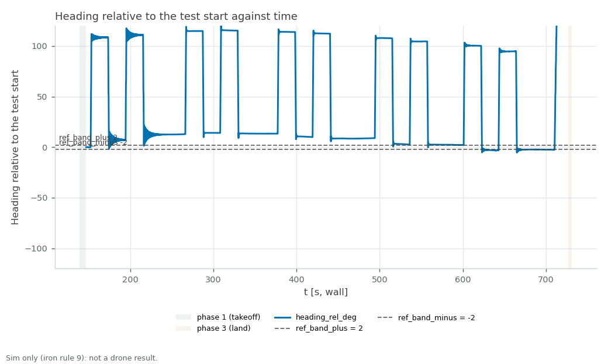

RECORD · SIM — sim_yaw_sweep4. Sim-only (iron rule 9): none of these values is ported to the drone; the sim airframe's yaw gains and any gain the sweep sets live are sim-only (iron rule 9).

# sim_yaw_sweep4 — one-drone yaw-step: heading ring-down after a yaw pulse, PX4 vehicle time (started 2026-11-02T19:59:55+08:00 +08; flight 12:03:41–12:13:47 UTC)

**Verdict: FAIL.** Measure how the sim drone's heading settles after a yaw pulse is released (overshoot, ring, settle time, swing-back rate, drift) from the PX4 ulog in vehicle time, so the sim airframe's yaw gains can be retuned; the keyboard sessions of 2026-10-30 showed a ±8–17° ring at ~0.8 Hz. For Linear NEAR-789 (milestone S5). PASS = every gate PASS; INCOMPLETE = no FAIL but ≥ 1 gate UNVERIFIED; FAIL = any gate FAIL; ABORTED = Ctrl-C landing, never a result. Report generated 2026-11-02 at repo `ba2f3c4`.

**Scope:** PX4's own sim state estimate positions the drone (no mocap, no camera); flat default world; one drone; commander teleop input only (safe_teleop and the keyboard not in the loop); time gates read PX4 vehicle time from the ulog.

## Setup

| Item | Value |
|---|---|
| Sim | Isaac Sim, 1 Starling 2 Max (`DRONE_USD=starling2max.usd`, `PX4_VEHICLE_MODEL=pegasus_starling2max`), default flat world |
| Airframe | `10090_pegasus_starling2max` (sim-only airframe gains, see the S5 hover records) |
| Commander | `teleop_single.yaml scenario:=hover`, tuning {"teleop_max_speed_mps": 2.0, "goal_accel_mps2": 3.0, "goal_settle_s": 0.3, "scenario_speed_mps": 0.6} |
| Driver | `tools/sim.sh test yaw_step`, repo commit `ba2f3c4f91364e84d617d32457a694c0d10e3998` (tools/ uncommitted changes: 1) |
| Started | 2026-11-02T19:59:55+08:00 +08 (laptop clock, `run_meta.txt`); flight 12:03:41–12:13:47 UTC (container clock) |
| Video | none recorded |

## Changes in this run

What changed while this run flew (docs/CODING_STANDARD.md §3), from three sources. PX4's own list (the ulog) is the ground truth and wins a conflict.

**Logged by the tools (`changes.log`):**

```
2026-11-02T12:05:33+00:00 · drone_1/MC_YAWRATE_P · 0.07 → 0.25 · yaw_step-sweep-set-1 (via ros2 param set) · readback 0.25
2026-11-02T12:05:48+00:00 · drone_1/MC_YAWRATE_I · 0.5 → 0.2 · yaw_step-sweep-set-1 (via ros2 param set) · readback 0.2
2026-11-02T12:07:30+00:00 · drone_1/MC_YAWRATE_P · 0.25 → 0.35 · yaw_step-sweep-set-2 (via ros2 param set) · readback 0.35
2026-11-02T12:07:39+00:00 · drone_1/MC_YAWRATE_I · 0.2 → 0.2 · yaw_step-sweep-set-2 (via ros2 param set) · readback 0.2
2026-11-02T12:09:21+00:00 · drone_1/MC_YAWRATE_P · 0.35 → 0.35 · yaw_step-sweep-set-3 (via ros2 param set) · readback 0.35
2026-11-02T12:09:36+00:00 · drone_1/MC_YAWRATE_I · 0.2 → 0.1 · yaw_step-sweep-set-3 (via ros2 param set) · readback 0.1
2026-11-02T12:11:12+00:00 · drone_1/MC_YAWRATE_P · 0.35 → 0.45 · yaw_step-sweep-set-4 (via ros2 param set) · readback 0.45
2026-11-02T12:11:23+00:00 · drone_1/MC_YAWRATE_I · 0.1 → 0.2 · yaw_step-sweep-set-4 (via ros2 param set) · readback 0.2
2026-11-02T12:13:03+00:00 · drone_1/MC_YAWRATE_P · 0.45 → 0.07 · restore-yaw_step-after-the-sweep-before-the-patch-0007-check (via ros2 param set) · readback 0.07
2026-11-02T12:13:15+00:00 · drone_1/MC_YAWRATE_I · 0.2 → 0.5 · restore-yaw_step-after-the-sweep-before-the-patch-0007-check (via ros2 param set) · readback 0.5
```

**PX4 ulog, parameters changed after boot (vehicle time, t > 2 s; 23 boot-time settings not listed):**

```
600.820 drone_1 MC_YAWRATE_P 0.25
622.098 drone_1 MC_YAWRATE_I 0.2
808.299 drone_1 MC_YAWRATE_P 0.35
1035.376 drone_1 MC_YAWRATE_I 0.1
1035.376 drone_1 MC_YAWRATE_P 0.35
1212.839 drone_1 MC_YAWRATE_P 0.45
1231.637 drone_1 MC_YAWRATE_I 0.2
1411.979 drone_1 MC_YAWRATE_P 0.07
1434.697 drone_1 MC_YAWRATE_I 0.5
```

**Parameter snapshot, start → end of the flight (MAVROS for PX4, `ros2 param dump /swarm_commander`; catches Foxglove, QGC, `ros2 param set`):**

```
drone_1/COM_FLIGHT_UUID 0 -> 1
drone_1/LND_FLIGHT_T_LO 0 -> 1068993090
```

**PX4 at the start vs the airframe file (drone_1):**

all 48 airframe values in force

**Conflicts and unlogged changes:**

- PX4 bookkeeping (not a tuning change): drone_1/COM_FLIGHT_UUID 0 → 1 (snapshot)
- PX4 bookkeeping (not a tuning change): drone_1/LND_FLIGHT_T_LO 0 → 1068993090 (snapshot)

## Pass/fail

| Check | Criterion | Measured | Baseline | Verdict |
|---|---|---|---|---|
| Isaac launch: SYS_AUTOSTART=10090 x1 | SYS_AUTOSTART=10090 x1 | 1 | - | PASS |
| Isaac launch: Ready for takeoff x1 | Ready for takeoff x1 | 1 | - | PASS |
| Isaac launch: no 'Unknown model' | no 'Unknown model' | 0 | - | PASS |
| Isaac launch: no PhysX cooking warnings | no PhysX cooking warnings | 0 | - | PASS |
| Isaac launch: Starling2MaxConfig x1 | Starling2MaxConfig x1 (launcher print) | 2 | - | PASS |
| coverage: rows through the window | largest `t_s` gap over the phase-2 rows ≤ 0.5 s, ≥ 1 landing (`phase` 3) row, metrics node alive at stop | largest phase-2 gap 0.08 s; 31581 phase-2 rows, 226 landing rows | - | PASS |
| set-0 pulses flown and analysable | fly.sh stamped 2N = 4 set-0 pulses; the ulog shows the same (order, sign, onset spacing); each released with ≥ 3 s of NaN-free data after it | 4 stamped, 4 with numbers (sign + spacing match the stamps) | keyboard 2026-10-30: ±8–17° ring ~0.8 Hz, no ulog | PASS |
| heading overshoot ≤ 3.0° | max over set-0 pulses of the heading's overrun past its final value after release (PX4 ulog, unwrapped ENU) | `overshoot_deg`: worst 10.85° (pulse 0/4 (−)); 4 of 4 set-0 pulses with numbers | keyboard 2026-10-30: ±8–17° ring ~0.8 Hz, no ulog | **FAIL** |
| settle to ±2° ≤ 2.0 s (vehicle) | time from release until the heading stays within ±2° of its final value, PX4 vehicle time; not settled in the window = FAIL | `settle_s`: worst not settled (pulse 0/2 (−)); 4 of 4 set-0 pulses with numbers | keyboard 2026-10-30: ±8–17° ring ~0.8 Hz, no ulog | **FAIL** |
| ring crossings ≤ 1 | zero crossings of (heading − final) after it first enters the band, 0.5° hysteresis | `ring_crossings`: worst 24 (pulse 0/1 (+)); 4 of 4 set-0 pulses with numbers | keyboard 2026-10-30: ±8–17° ring ~0.8 Hz, no ulog | **FAIL** |
| swing back ≤ 30 °/s | yaw_core `peak_rate_dps`: fastest body yaw rate AGAINST the turn in [release, +3 s] (PX4 vehicle_angular_velocity); `peak_rate_abs_dps` is info | `peak_rate_dps`: worst 64.5 °/s (pulse 0/4 (−)); 4 of 4 set-0 pulses with numbers | keyboard 2026-10-30: ±8–17° ring ~0.8 Hz, no ulog | **FAIL** |
| xy drift ≤ 0.15 m | max horizontal distance from the onset position over pulse + window (PX4 vehicle_local_position) | `xy_drift_m`: worst 0.064 m (pulse 0/2 (−)); 4 of 4 set-0 pulses with numbers | keyboard 2026-10-30: ±8–17° ring ~0.8 Hz, no ulog | PASS |
| yaw sign | +angular.z (ENU, CCW) raises the ENU heading: ulog `turn_deg` and live `heading_rel_deg` change over the pulse both along the command | ulog `turn_deg` along the command 4/4, live `heading_rel_deg` change 4/4 (pulse 0/1 (+): ulog +111.2°, live +106.0°) | - | PASS |
| booted gains = airframe file | ulog header MC_YAW_P, MC_YAWRATE_P/I/D/K = the `param set-default` lines of 10090_pegasus_starling2max (rel 1e-3), and set 0 flew them | ulog header MC_YAW_P 2.8, MC_YAWRATE_P/I/D/K 0.07/0.5/0/1 = airframe file | - | PASS |
| live vs ulog overshoot | per set-0 pulse, overshoot from live `heading_rel_deg` (yaw_core.measure_pulse on metrics.csv, stamps via t0_unix) within 1.0° of the ulog's | max \|live − ulog\| 0.25° (pulse 0/4 (−): live 11.10°, ulog 10.85°); 4 of 4 compared | - | PASS |
| live parameter changes logged | every MC_YAW* change in the ulog (px4_param_changes.txt) has a changes.log line, same name and value (owner rule 2026-11-02) | ulog 9 change(s), changes.log 10 line(s) | - | PASS |
| sweep completed | fly.sh flew every requested gain set (2N stamped pulses each) and printed no PARAM MISMATCH, REFUSED or UNVERIFIED (each set read back through px4_param_set.sh) | 5 of 5 sets flown (set 0 + 4 of 4 sweep sets) | - | PASS |
| booted gains restored | every MC_YAW* the sweep changed is back at its ulog-header (booted) value before the patch-0007 turn (ulog changed_parameters) | all 2 back at booted | - | PASS |
| landed, disarmed (commander ACK) | informational (ACK log, not an arming display) | drone_1 | - | info |
| post-flight armed=false x1 (MAVROS state) | armed: false for drone_1 | drone_1 false | - | PASS |
| live vs bag recompute | live metrics.csv agrees with the rosbag recompute (heading_rel_deg within tolerance; flags by count) | heading_rel_deg Δmax 0 (tol 0.5); heading_deg Δmax 0 (tol 0.5); yaw_rate_dps Δmax 0 (tol 2); xy_drift_m Δmax 0 (tol 0.02); fence_breached Σ 0 vs 0; emergency Σ 0 vs 0; unpaired 0.0 %; bag unpaired 2.2 % | - | PASS |
| rosbag copied + readable | bag dir yaw_step_* with metadata.yaml under the heavy folder, and metrics.csv, metrics_bag.csv in the run folder | yaw_step_20261102_120039: 518 MB, metadata.yaml present | - | PASS |
| PX4 ulogs one per sysid 2 | ulog_sysid_map.txt lists sysids 2 (drone_1) | 1 files, sysids ['2'] | - | PASS |
| WiFi firmware alerts | 0 during the run | 0 | - | PASS |
| code that ran | informational (run_meta.txt head vs git HEAD at report time) | ran at ba2f3c4 (tools/ had uncommitted changes) | - | info |
| pulse 0/1 (+) | informational (set 0; PX4 ulog, vehicle time) | on 431.3 s, os 3.5°, settle 5.64 s, ring 24, swing 22 °/s (abs 22), drift 0.03 m, plat 68 °/s, scale 1.91 | - | info |
| pulse 0/2 (−) | informational (set 0; PX4 ulog, vehicle time) | on 470.0 s, os 9.0°, settle not settled, ring 24, swing 55 °/s (abs 55), drift 0.06 m, plat 77 °/s, scale 1.80 | - | info |
| pulse 0/3 (+) | informational (set 0; PX4 ulog, vehicle time) | on 508.6 s, os 6.8°, settle 11.55 s, ring 24, swing 41 °/s (abs 41), drift 0.05 m, plat 68 °/s, scale 1.89 | - | info |
| pulse 0/4 (−) | informational (set 0; PX4 ulog, vehicle time) | on 547.2 s, os 10.9°, settle not settled, ring 24, swing 65 °/s (abs 65), drift 0.05 m, plat 79 °/s, scale 1.75 | - | info |
| pulse 1/1 (+) | informational (set 1; PX4 ulog, vehicle time) | on 638.7 s, os 4.3°, settle 0.28 s, ring 3, swing 35 °/s (abs 56), drift 0.03 m, plat 56 °/s, scale 1.79 | - | info |
| pulse 1/2 (−) | informational (set 1; PX4 ulog, vehicle time) | on 677.4 s, os 4.4°, settle 0.29 s, ring 3, swing 35 °/s (abs 56), drift 0.03 m, plat 56 °/s, scale 1.81 | - | info |
| pulse 1/3 (+) | informational (set 1; PX4 ulog, vehicle time) | on 715.9 s, os 4.6°, settle 0.69 s, ring 3, swing 34 °/s (abs 56), drift 0.04 m, plat 57 °/s, scale 1.80 | - | info |
| pulse 1/4 (−) | informational (set 1; PX4 ulog, vehicle time) | on 754.5 s, os 4.5°, settle 0.28 s, ring 3, swing 35 °/s (abs 56), drift 0.05 m, plat 56 °/s, scale 1.80 | - | info |
| pulse 2/1 (+) | informational (set 2; PX4 ulog, vehicle time) | on 840.4 s, os 2.6°, settle 0.41 s, ring 6, swing 41 °/s (abs 61), drift 0.03 m, plat 54 °/s, scale 1.79 | - | info |
| pulse 2/2 (−) | informational (set 2; PX4 ulog, vehicle time) | on 878.7 s, os 2.8°, settle 0.37 s, ring 8, swing 41 °/s (abs 60), drift 0.03 m, plat 56 °/s, scale 1.90 | - | info |
| pulse 2/3 (+) | informational (set 2; PX4 ulog, vehicle time) | on 917.1 s, os 3.0°, settle 0.40 s, ring 7, swing 41 °/s (abs 61), drift 0.03 m, plat 55 °/s, scale 1.84 | - | info |
| pulse 2/4 (−) | informational (set 2; PX4 ulog, vehicle time) | on 955.3 s, os 3.0°, settle 0.37 s, ring 8, swing 41 °/s (abs 60), drift 0.02 m, plat 55 °/s, scale 1.89 | - | info |
| pulse 3/1 (+) | informational (set 3; PX4 ulog, vehicle time) | on 1051.8 s, os 2.5°, settle 0.42 s, ring 6, swing 40 °/s (abs 60), drift 0.06 m, plat 55 °/s, scale 1.76 | - | info |
| pulse 3/2 (−) | informational (set 3; PX4 ulog, vehicle time) | on 1090.3 s, os 2.6°, settle 0.42 s, ring 6, swing 40 °/s (abs 60), drift 0.05 m, plat 54 °/s, scale 1.85 | - | info |
| pulse 3/3 (+) | informational (set 3; PX4 ulog, vehicle time) | on 1128.8 s, os 2.9°, settle 0.37 s, ring 7, swing 40 °/s (abs 60), drift 0.03 m, plat 56 °/s, scale 1.85 | - | info |
| pulse 3/4 (−) | informational (set 3; PX4 ulog, vehicle time) | on 1167.4 s, os 2.8°, settle 0.39 s, ring 6, swing 41 °/s (abs 60), drift 0.05 m, plat 55 °/s, scale 1.85 | - | info |
| pulse 4/1 (+) | informational (set 4; PX4 ulog, vehicle time) | on 1246.2 s, os 3.0°, settle 1.21 s, ring 16, swing 31 °/s (abs 38), drift 0.05 m, plat 58 °/s, scale 1.80 | - | info |
| pulse 4/2 (−) | informational (set 4; PX4 ulog, vehicle time) | on 1284.9 s, os 2.5°, settle 0.51 s, ring 28, swing 39 °/s (abs 43), drift 0.03 m, plat 49 °/s, scale 1.89 | - | info |
| pulse 4/3 (+) | informational (set 4; PX4 ulog, vehicle time) | on 1323.4 s, os 3.1°, settle 1.20 s, ring 20, swing 33 °/s (abs 38), drift 0.05 m, plat 54 °/s, scale 1.80 | - | info |
| pulse 4/4 (−) | informational (set 4; PX4 ulog, vehicle time) | on 1362.0 s, os 3.0°, settle 1.20 s, ring 27, swing 39 °/s (abs 51), drift 0.05 m, plat 54 °/s, scale 1.75 | - | info |
| pulse turn (patch-0007) | informational (0.5 rad/s for 3.14 s wall = 90° × the time scale in vehicle time, then the tap) | turn +160° at 29 °/s, not gated; flew booted gains | - | info |
| set 0: booted gains (gated) | informational (gains in force from the ulog's changed_parameters) | MC_YAW_P 2.8, MC_YAWRATE_P/I/D/K 0.07/0.5/0/1 — overshoot max 10.9°, settle max inf s, ring max 24, swing max 65 °/s, drift max 0.06 m; 4 of 4 with numbers | - | info |
| set 1: sweep (info) | informational (gains in force from the ulog's changed_parameters) | MC_YAW_P 2.8, MC_YAWRATE_P/I/D/K 0.25/0.2/0/1 — overshoot max 4.6°, settle max 0.69 s, ring max 3, swing max 35 °/s, drift max 0.05 m; 4 of 4 with numbers | - | info |
| set 2: sweep (info) | informational (gains in force from the ulog's changed_parameters) | MC_YAW_P 2.8, MC_YAWRATE_P/I/D/K 0.35/0.2/0/1 — overshoot max 3.0°, settle max 0.41 s, ring max 8, swing max 41 °/s, drift max 0.03 m; 4 of 4 with numbers | - | info |
| set 3: sweep (info) | informational (gains in force from the ulog's changed_parameters) | MC_YAW_P 2.8, MC_YAWRATE_P/I/D/K 0.35/0.1/0/1 — overshoot max 2.9°, settle max 0.42 s, ring max 7, swing max 41 °/s, drift max 0.06 m; 4 of 4 with numbers | - | info |
| set 4: sweep (info) | informational (gains in force from the ulog's changed_parameters) | MC_YAW_P 2.8, MC_YAWRATE_P/I/D/K 0.45/0.2/0/1 — overshoot max 3.1°, settle max 1.21 s, ring max 28, swing max 39 °/s, drift max 0.05 m; 4 of 4 with numbers | - | info |
| patch-0007 tap | informational: room-frame +x tap after the turn; a direction error ≈ the turn angle = the body-frame orbit (before patch 0007) | direction error 1.7°, heading change -0.5°, displacement 0.93 m (vehicle 1459.2–1461.9 s) | - | info |
| pulse marker (U3) | informational: which PX4 topic marks onset/release | vehicle_attitude_setpoint.yaw_sp_move_rate (20 Hz; U3: it carries the pulses in offboard) | - | info |
| plateau measured vs commanded (U4) | informational: body yaw rate during set-0 pulses vs the 57.3 °/s commanded | measured 67.9–78.8 °/s, setpoint 57.3 °/s, commanded 57.3 °/s | - | info |
| time scale (vehicle s per wall s) | informational, never a gate | onset spacing median 1.834; per pulse 1.91, 1.80, 1.89, 1.75 | - | info |
| px4_param_changes.txt | informational: MC_YAW* changes PX4 applied (vehicle time) | 601.3 s MC_YAWRATE_P=0.25; 622.1 s MC_YAWRATE_I=0.2; 808.7 s MC_YAWRATE_P=0.35; 1035.5 s MC_YAWRATE_I=0.1; 1035.5 s MC_YAWRATE_P=0.35; 1212.9 s MC_YAWRATE_P=0.45 … | - | info |
| odometry yaw rate (U5) | informational: odometry twist.angular.z (live `yaw_rate_dps`) is plotted only, never gated | present: max \|`yaw_rate_dps`\| 115.4 °/s, `heading_rel_deg` span 166° | - | info |

Rows marked info are informational and never pass or fail the run.

[Figure 1](#fig-1) plots the heading relative to the test start (live odometry, wall clock) with the ±2° settle band. Worst set-0 pulse after release, PX4 vehicle time: overshoot 10.85° (gate 3.0), settle not reached (gate 2.0 s), 24 ring crossing(s) (gate 1), swing back 64.5 °/s (gate 30), drift 0.064 m (gate 0.15).

<a id="fig-1"></a>


*Figure 1. Heading relative to the test start (`heading_rel_deg`, unwrapped, 40 Hz odometry) against wall-clock time, with the ±2° settle band; shaded bands mark takeoff and land. The gates are measured from the PX4 ulog in vehicle time, not on this axis. Drawn from metrics.csv by `tools/sim.sh figures yaw_step <run>`.*

## Driver verdict history

Every generation of this record (`verdicts.log`, newest last; the last line is this one):

```
2026-11-02T20:15:49+08:00 head=ba2f3c4 verdict=FAIL fail=4 unverified=0
```

## Evidence

Flight script stdout (times are UTC, container clock):
```
[12:03:41] pre-takeoff: name:drone_1 state:IDLE position:[0.012,0.002,-0.002]
[12:03:43] takeoff: success=True, message='takeoff: drone_1'
[12:03:52] start: success=True, message='scenario "hover" running'
[12:03:52] pulses: gap 20 s (wall), 2 per direction, rate 1.0 rad/s, pulse 1.0 s, sweep 'MC_YAWRATE_P=0.25,MC_YAWRATE_I=0.2;MC_YAWRATE_P=0.35,MC_YAWRATE_I=0.2;MC_YAWRATE_P=0.35,MC_YAWRATE_I=0.1;MC_YAWRATE_P=0.45,MC_YAWRATE_I=0.2'
[1793621037.526853] pulse 0/1 onset sign=+1 rate=1.000
[1793621038.527398] pulse 0/1 release
[1793621058.527578] pulse 0/2 onset sign=-1 rate=1.000
[1793621059.527704] pulse 0/2 release
[1793621079.527838] pulse 0/3 onset sign=+1 rate=1.000
[1793621080.527963] pulse 0/3 release
[1793621100.528076] pulse 0/4 onset sign=-1 rate=1.000
[1793621101.528257] pulse 0/4 release
[12:05:21] set 1: MC_YAWRATE_P=0.25, MC_YAWRATE_I=0.2
2026-11-02T12:05:33+00:00 · drone_1/MC_YAWRATE_P · 0.07 → 0.25 · yaw_step-sweep-set-1 (via ros2 param set) · readback 0.25
2026-11-02T12:05:48+00:00 · drone_1/MC_YAWRATE_I · 0.5 → 0.2 · yaw_step-sweep-set-1 (via ros2 param set) · readback 0.2
[1793621151.395404] pulse 1/1 onset sign=+1 rate=1.000
[1793621152.395573] pulse 1/1 release
[1793621172.395729] pulse 1/2 onset sign=-1 rate=1.000
[1793621173.395863] pulse 1/2 release
[1793621193.395985] pulse 1/3 onset sign=+1 rate=1.000
[1793621194.396117] pulse 1/3 release
[1793621214.396247] pulse 1/4 onset sign=-1 rate=1.000
[1793621215.396501] pulse 1/4 release
[12:07:15] set 2: MC_YAWRATE_P=0.35, MC_YAWRATE_I=0.2
2026-11-02T12:07:30+00:00 · drone_1/MC_YAWRATE_P · 0.25 → 0.35 · yaw_step-sweep-set-2 (via ros2 param set) · readback 0.35
2026-11-02T12:07:39+00:00 · drone_1/MC_YAWRATE_I · 0.2 → 0.2 · yaw_step-sweep-set-2 (via ros2 param set) · readback 0.2
[1793621262.538393] pulse 2/1 onset sign=+1 rate=1.000
[1793621263.538549] pulse 2/1 release
[1793621283.538714] pulse 2/2 onset sign=-1 rate=1.000
[1793621284.538834] pulse 2/2 release
[1793621304.538946] pulse 2/3 onset sign=+1 rate=1.000
[1793621305.539086] pulse 2/3 release
[1793621325.539207] pulse 2/4 onset sign=-1 rate=1.000
[1793621326.539332] pulse 2/4 release
[12:09:06] set 3: MC_YAWRATE_P=0.35, MC_YAWRATE_I=0.1
2026-11-02T12:09:21+00:00 · drone_1/MC_YAWRATE_P · 0.35 → 0.35 · yaw_step-sweep-set-3 (via ros2 param set) · readback 0.35
2026-11-02T12:09:36+00:00 · drone_1/MC_YAWRATE_I · 0.2 → 0.1 · yaw_step-sweep-set-3 (via ros2 param set) · readback 0.1
[1793621379.424367] pulse 3/1 onset sign=+1 rate=1.000
[1793621380.424501] pulse 3/1 release
[1793621400.424582] pulse 3/2 onset sign=-1 rate=1.000
[1793621401.424719] pulse 3/2 release
[1793621421.424852] pulse 3/3 onset sign=+1 rate=1.000
[1793621422.424990] pulse 3/3 release
[1793621442.425127] pulse 3/4 onset sign=-1 rate=1.000
[1793621443.425258] pulse 3/4 release
[12:11:03] set 4: MC_YAWRATE_P=0.45, MC_YAWRATE_I=0.2
2026-11-02T12:11:12+00:00 · drone_1/MC_YAWRATE_P · 0.35 → 0.45 · yaw_step-sweep-set-4 (via ros2 param set) · readback 0.45
2026-11-02T12:11:23+00:00 · drone_1/MC_YAWRATE_I · 0.1 → 0.2 · yaw_step-sweep-set-4 (via ros2 param set) · readback 0.2
[1793621486.319430] pulse 4/1 onset sign=+1 rate=1.000
[1793621487.319540] pulse 4/1 release
[1793621507.319646] pulse 4/2 onset sign=-1 rate=1.000
[1793621508.319770] pulse 4/2 release
[1793621528.319892] pulse 4/3 onset sign=+1 rate=1.000
[1793621529.320028] pulse 4/3 release
[1793621549.320146] pulse 4/4 onset sign=-1 rate=1.000
[1793621550.320270] pulse 4/4 release
[12:12:50] restoring the booted gains (after the sweep before the patch-0007 check): MC_YAWRATE_P=0.07, MC_YAWRATE_I=0.5
2026-11-02T12:13:03+00:00 · drone_1/MC_YAWRATE_P · 0.45 → 0.07 · restore-yaw_step-after-the-sweep-before-the-patch-0007-check (via ros2 param set) · readback 0.07
2026-11-02T12:13:15+00:00 · drone_1/MC_YAWRATE_I · 0.2 → 0.5 · restore-yaw_step-after-the-sweep-before-the-patch-0007-check (via ros2 param set) · readback 0.5
[1793621595.580985] booted gains restored: MC_YAWRATE_P=0.07, MC_YAWRATE_I=0.5
[1793621595.580997] turn onset sign=+1 rate=0.500
[1793621598.721094] turn release
[1793621603.721215] tap onset vx=0.500
[1793621605.221337] tap release
[12:13:31] pulse program done (rc 0); zeros published
[12:13:31] land: success=True, message='landing: drone_1'
[12:13:47] landed: name:land name:drone_1 state:IDLE position:[0.763,-0.021,0.018]
```

Metrics node log (tail):
```
[t= 766.0 s] phase=0 heading_rel_deg=nan cbf= emerg=0
[t= 767.0 s] phase=0 heading_rel_deg=nan cbf= emerg=0
[t= 768.0 s] phase=0 heading_rel_deg=nan cbf= emerg=0
[t= 769.0 s] phase=0 heading_rel_deg=nan cbf= emerg=0
[t= 770.0 s] phase=0 heading_rel_deg=nan cbf= emerg=0
[t= 771.0 s] phase=0 heading_rel_deg=nan cbf= emerg=0
[t= 772.0 s] phase=0 heading_rel_deg=nan cbf= emerg=0
[t= 773.0 s] phase=0 heading_rel_deg=nan cbf= emerg=0
[t= 774.0 s] phase=0 heading_rel_deg=nan cbf= emerg=0
[t= 775.0 s] phase=0 heading_rel_deg=nan cbf= emerg=0
[t= 776.0 s] phase=0 heading_rel_deg=nan cbf= emerg=0
[t= 777.0 s] phase=0 heading_rel_deg=nan cbf= emerg=0
```

Landing (commander ACK log) and post-flight MAVROS state:
```
[swarm_commander-2] [INFO] [1793621614.402269325] [swarm_commander]: drone_1: touchdown at z=0.13 m, settling 2.0 s before disarm
[swarm_commander-2] [INFO] [1793621616.502430159] [swarm_commander]: drone_1: landed, disarmed (attempt 1)
armed_post.txt: unreadable
```

Live vs bag recompute:

| Column | Kind | Tolerance | Max diff | Σ live | Σ bag | Paired | Unpaired | OK |
|---|---|---|---|---|---|---|---|---|
| heading_rel_deg | continuous | 0.5 | 0 | 1.5461e+06 | 1.5461e+06 | 42466 | 0.0 % | yes |
| heading_deg | continuous | 0.5 | 0 | 1.93318e+06 | 1.93318e+06 | 42466 | 0.0 % | yes |
| yaw_rate_dps | continuous | 2 | 0 | 4656.64 | 4656.64 | 42466 | 0.0 % | yes |
| xy_drift_m | continuous | 0.02 | 0 | 1001.71 | 1001.71 | 42466 | 0.0 % | yes |
| fence_breached | flag | 0 | 0 | 0 | 0 | 42466 | 0.0 % | yes |
| emergency | flag | 0 | 0 | 0 | 0 | 42466 | 0.0 % | yes |

## Files

- Repo (this folder, `docs/record/sim_yaw_sweep4/`): `armed_post.txt`, `bag_evidence.txt`, `bag_path.txt`, `bag_status_pre.json`, `changes.log`, `clock_check.txt`, `commander.log`, `commands.sh`, `fig-1.png`, `interfaces.log`, `isaac.log`, `isaac.log.start`, `isaac_evidence.txt`, `landing_evidence.txt`, `live_plot.log`, `metrics.csv`, `metrics_bag.csv`, `metrics_node.log`, `odom_hz.txt`, `params_diff.txt`, `params_mavros.txt`, `params_mavros_names.txt`, `params_ulog.txt`, `px4_arm_times.txt`, `px4_param_changes.txt`, `px4_param_changes_all.txt`, `res_watch.log`, `run.log`, `run_meta.txt`, `status_post.json`, `status_pre.json`, `test_stdout.log`, `topics_of_interest.txt`, `ulog_list.txt`, `ulog_sysid_map.txt`, `ulogs_copied.ok`, `verdicts.log`, `video.txt`.
- Not in the repo (`/home/jeremychia/flight_logs/sim/sim_yaw_sweep4/`): `drone_1_sysid2_12_00_11.ulg` (402 MB), `params_end_drone_1.yaml` (0 MB), `params_end_swarm_commander.yaml` (0 MB), `params_start_drone_1.yaml` (0 MB), `params_start_swarm_commander.yaml` (0 MB), `px4_drone_1.csv` (9 MB), `yaw_step_20261102_120039` (518 MB).

## Caveats

- The 20 s gap between pulses is wall-clock; in vehicle time it is the gap × the time scale (1.83 here; ~1.3 on the flat world). Every time gate is PX4 vehicle time from the ulog; the figure's axis is wall clock.

## Ledger row draft (docs/record/LEDGER.md table 1, #28, NEAR-789)

| 28 | 2026-11-02 | SIM | yaw step, 1 drone, teleop_single.yaml, 4 pulses ±1 rad/s per set, vehicle time: FAIL — overshoot 10.85°, settle not reached, ring 24, swing back 64.5 °/s, drift 0.064 m (set 0: MC_YAW_P 2.8, MC_YAWRATE_P/I/D/K 0.07/0.5/0/1); sweep 4 of 4 set(s) flown; landed + DISARMED yes; FAIL: heading overshoot ≤ 3.0°, settle to ±2° ≤ 2.0 s (vehicle), ring crossings ≤ 1, swing back ≤ 30 °/s | [sim_yaw_sweep4_record.md](sim_yaw_sweep4_record.md) | NEAR-789 |

