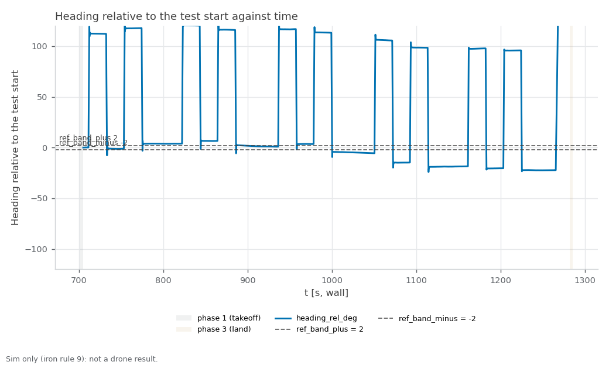

RECORD · SIM — sim_yaw_sweep5. Sim-only (iron rule 9): none of these values is ported to the drone; the sim airframe's yaw gains and any gain the sweep sets live are sim-only (iron rule 9).

# sim_yaw_sweep5 — one-drone yaw-step: heading ring-down after a yaw pulse, PX4 vehicle time (started 2026-11-02T20:40:22+08:00 +08; flight 12:53:27–13:03:25 UTC)

**Verdict: FAIL.** Measure how the sim drone's heading settles after a yaw pulse is released (overshoot, ring, settle time, swing-back rate, drift) from the PX4 ulog in vehicle time, so the sim airframe's yaw gains can be retuned; the keyboard sessions of 2026-10-30 showed a ±8–17° ring at ~0.8 Hz. For Linear NEAR-789 (milestone S5). PASS = every gate PASS; INCOMPLETE = no FAIL but ≥ 1 gate UNVERIFIED; FAIL = any gate FAIL; ABORTED = Ctrl-C landing, never a result. Report generated 2026-11-02 at repo `1934471`.

**Scope:** PX4's own sim state estimate positions the drone (no mocap, no camera); flat default world; one drone; commander teleop input only (safe_teleop and the keyboard not in the loop); time gates read PX4 vehicle time from the ulog.

## Setup

| Item | Value |
|---|---|
| Sim | Isaac Sim, 1 Starling 2 Max (`DRONE_USD=starling2max.usd`, `PX4_VEHICLE_MODEL=pegasus_starling2max`), default flat world |
| Airframe | `10090_pegasus_starling2max` (sim-only airframe gains, see the S5 hover records) |
| Commander | `teleop_single.yaml scenario:=hover`, tuning {"teleop_max_speed_mps": 2.0, "goal_accel_mps2": 3.0, "goal_settle_s": 0.3, "scenario_speed_mps": 0.6} |
| Driver | `tools/sim.sh test yaw_step`, repo commit `19344713c85fa3a6f1363b2f89a048eb45fccacc` (tools/ uncommitted changes: 1) |
| Started | 2026-11-02T20:40:22+08:00 +08 (laptop clock, `run_meta.txt`); flight 12:53:27–13:03:25 UTC (container clock) |
| Video | none recorded |

## Changes in this run

What changed while this run flew (docs/CODING_STANDARD.md §3), from three sources. PX4's own list (the ulog) is the ground truth and wins a conflict.

**Logged by the tools (`changes.log`):**

```
2026-11-02T12:55:15+00:00 · drone_1/MC_YAWRATE_P · 0.07 → 0.07 · yaw_step-sweep-set-1 (via ros2 param set) · readback 0.07
2026-11-02T12:55:27+00:00 · drone_1/MC_YAWRATE_I · 0.5 → 0.2 · yaw_step-sweep-set-1 (via ros2 param set) · readback 0.2
2026-11-02T12:57:06+00:00 · drone_1/MC_YAWRATE_P · 0.07 → 0.14 · yaw_step-sweep-set-2 (via ros2 param set) · readback 0.14
2026-11-02T12:57:21+00:00 · drone_1/MC_YAWRATE_I · 0.2 → 0.5 · yaw_step-sweep-set-2 (via ros2 param set) · readback 0.5
2026-11-02T12:59:02+00:00 · drone_1/MC_YAWRATE_P · 0.14 → 0.14 · yaw_step-sweep-set-3 (via ros2 param set) · readback 0.14
2026-11-02T12:59:16+00:00 · drone_1/MC_YAWRATE_I · 0.5 → 0.2 · yaw_step-sweep-set-3 (via ros2 param set) · readback 0.2
2026-11-02T13:00:54+00:00 · drone_1/MC_YAWRATE_P · 0.14 → 0.25 · yaw_step-sweep-set-4 (via ros2 param set) · readback 0.25
2026-11-02T13:01:06+00:00 · drone_1/MC_YAWRATE_I · 0.2 → 0.2 · yaw_step-sweep-set-4 (via ros2 param set) · readback 0.2
2026-11-02T13:02:43+00:00 · drone_1/MC_YAWRATE_P · 0.25 → 0.07 · restore-yaw_step-after-the-sweep-before-the-patch-0007-check (via ros2 param set) · readback 0.07
2026-11-02T13:02:53+00:00 · drone_1/MC_YAWRATE_I · 0.2 → 0.5 · restore-yaw_step-after-the-sweep-before-the-patch-0007-check (via ros2 param set) · readback 0.5
```

**PX4 ulog, parameters changed after boot (vehicle time, t > 2 s; 23 boot-time settings not listed):**

```
1843.106 drone_1 MC_YAWRATE_I 0.2
1843.106 drone_1 MC_YAWRATE_P 0.07
2042.146 drone_1 MC_YAWRATE_P 0.14
2072.603 drone_1 MC_YAWRATE_I 0.5
2303.680 drone_1 MC_YAWRATE_I 0.2
2303.680 drone_1 MC_YAWRATE_P 0.14
2508.119 drone_1 MC_YAWRATE_P 0.25
2725.117 drone_1 MC_YAWRATE_I 0.2
2725.117 drone_1 MC_YAWRATE_P 0.07
2747.095 drone_1 MC_YAWRATE_I 0.5
```

**Parameter snapshot, start → end of the flight (MAVROS for PX4, `ros2 param dump /swarm_commander`; catches Foxglove, QGC, `ros2 param set`):**

```
drone_1/COM_FLIGHT_UUID 0 -> 1
drone_1/LND_FLIGHT_T_LO 0 -> 1177462242
```

**PX4 at the start vs the airframe file (drone_1):**

all 49 airframe values in force

**Conflicts and unlogged changes:**

- PX4 bookkeeping (not a tuning change): drone_1/COM_FLIGHT_UUID 0 → 1 (snapshot)
- PX4 bookkeeping (not a tuning change): drone_1/LND_FLIGHT_T_LO 0 → 1177462242 (snapshot)

## Pass/fail

| Check | Criterion | Measured | Baseline | Verdict |
|---|---|---|---|---|
| Isaac launch: SYS_AUTOSTART=10090 x1 | SYS_AUTOSTART=10090 x1 | 1 | - | PASS |
| Isaac launch: Ready for takeoff x1 | Ready for takeoff x1 | 1 | - | PASS |
| Isaac launch: no 'Unknown model' | no 'Unknown model' | 0 | - | PASS |
| Isaac launch: no PhysX cooking warnings | no PhysX cooking warnings | 0 | - | PASS |
| Isaac launch: Starling2MaxConfig x1 | Starling2MaxConfig x1 (launcher print) | 2 | - | PASS |
| coverage: rows through the window | largest `t_s` gap over the phase-2 rows ≤ 0.5 s, ≥ 1 landing (`phase` 3) row, metrics node alive at stop | largest phase-2 gap 0.07 s; 35040 phase-2 rows, 219 landing rows | - | PASS |
| set-0 pulses flown and analysable | fly.sh stamped 2N = 4 set-0 pulses; the ulog shows the same (order, sign, onset spacing); each released with ≥ 3 s of NaN-free data after it | 4 stamped, 4 with numbers (sign + spacing match the stamps) | keyboard 2026-10-30: ±8–17° ring ~0.8 Hz, no ulog | PASS |
| heading overshoot ≤ 3.0° | max over set-0 pulses of the heading's overrun past its final value after release (PX4 ulog, unwrapped ENU) | `overshoot_deg`: worst 7.04° (pulse 0/4 (−)); 4 of 4 set-0 pulses with numbers | keyboard 2026-10-30: ±8–17° ring ~0.8 Hz, no ulog | **FAIL** |
| settle to ±2° ≤ 2.0 s (vehicle) | time from release until the heading stays within ±2° of its final value, PX4 vehicle time; not settled in the window = FAIL | `settle_s`: worst 0.86 s (pulse 0/2 (−)); 4 of 4 set-0 pulses with numbers | keyboard 2026-10-30: ±8–17° ring ~0.8 Hz, no ulog | PASS |
| ring crossings ≤ 1 | zero crossings of (heading − final) after it first enters the band, 0.5° hysteresis | `ring_crossings`: worst 3 (pulse 0/2 (−)); 4 of 4 set-0 pulses with numbers | keyboard 2026-10-30: ±8–17° ring ~0.8 Hz, no ulog | **FAIL** |
| swing back ≤ 30 °/s | yaw_core `peak_rate_dps`: fastest body yaw rate AGAINST the turn in [release, +3 s] (PX4 vehicle_angular_velocity); `peak_rate_abs_dps` is info | `peak_rate_dps`: worst 32.0 °/s (pulse 0/1 (+)); 4 of 4 set-0 pulses with numbers | keyboard 2026-10-30: ±8–17° ring ~0.8 Hz, no ulog | **FAIL** |
| xy drift ≤ 0.15 m | max horizontal distance from the onset position over pulse + window (PX4 vehicle_local_position) | `xy_drift_m`: worst 0.042 m (pulse 0/3 (+)); 4 of 4 set-0 pulses with numbers | keyboard 2026-10-30: ±8–17° ring ~0.8 Hz, no ulog | PASS |
| yaw sign | +angular.z (ENU, CCW) raises the ENU heading: ulog `turn_deg` and live `heading_rel_deg` change over the pulse both along the command | ulog `turn_deg` along the command 4/4, live `heading_rel_deg` change 4/4 (pulse 0/1 (+): ulog +112.8°, live +105.4°) | - | PASS |
| booted gains = airframe file | ulog header MC_YAW_P, MC_YAWRATE_P/I/D/K = the `param set-default` lines of 10090_pegasus_starling2max (rel 1e-3), and set 0 flew them | ulog header MC_YAW_P 2.8, MC_YAWRATE_P/I/D/K 0.07/0.5/0/1 = airframe file | - | PASS |
| live vs ulog overshoot | per set-0 pulse, overshoot from live `heading_rel_deg` (yaw_core.measure_pulse on metrics.csv, stamps via t0_unix) within 1.0° of the ulog's | max \|live − ulog\| 0.07° (pulse 0/2 (−): live 6.56°, ulog 6.64°); 4 of 4 compared | - | PASS |
| live parameter changes logged | every MC_YAW* change in the ulog (px4_param_changes.txt) has a changes.log line, same name and value (owner rule 2026-11-02) | ulog 10 change(s), changes.log 10 line(s) | - | PASS |
| sweep completed | fly.sh flew every requested gain set (2N stamped pulses each) and printed no PARAM MISMATCH, REFUSED or UNVERIFIED (each set read back through px4_param_set.sh) | 5 of 5 sets flown (set 0 + 4 of 4 sweep sets) | - | PASS |
| booted gains restored | every MC_YAW* the sweep changed is back at its ulog-header (booted) value before the patch-0007 turn (ulog changed_parameters) | all 2 back at booted | - | PASS |
| landed, disarmed (commander ACK) | informational (ACK log, not an arming display) | drone_1 | - | info |
| post-flight armed=false x1 (MAVROS state) | armed: false for drone_1 | drone_1 false | - | PASS |
| live vs bag recompute | live metrics.csv agrees with the rosbag recompute (heading_rel_deg within tolerance; flags by count) | heading_rel_deg Δmax 0 (tol 0.5); heading_deg Δmax 0 (tol 0.5); yaw_rate_dps Δmax 0 (tol 2); xy_drift_m Δmax 0 (tol 0.02); fence_breached Σ 0 vs 0; emergency Σ 0 vs 0; unpaired 0.0 %; bag unpaired 2.2 % | - | PASS |
| rosbag copied + readable | bag dir yaw_step_* with metadata.yaml under the heavy folder, and metrics.csv, metrics_bag.csv in the run folder | yaw_step_20261102_124108: 945 MB, metadata.yaml present | - | PASS |
| PX4 ulogs one per sysid 2 | ulog_sysid_map.txt lists sysids 2 (drone_1) | 1 files, sysids ['2'] | - | PASS |
| WiFi firmware alerts | 0 during the run | 0 | - | PASS |
| code that ran | informational (run_meta.txt head vs git HEAD at report time) | ran at 1934471 (tools/ had uncommitted changes) | - | info |
| pulse 0/1 (+) | informational (set 0; PX4 ulog, vehicle time) | on 1634.2 s, os 7.0°, settle 0.84 s, ring 2, swing 32 °/s (abs 55), drift 0.03 m, plat 56 °/s, scale 2.05 | - | info |
| pulse 0/2 (−) | informational (set 0; PX4 ulog, vehicle time) | on 1677.1 s, os 6.6°, settle 0.86 s, ring 3, swing 31 °/s (abs 55), drift 0.03 m, plat 56 °/s, scale 2.05 | - | info |
| pulse 0/3 (+) | informational (set 0; PX4 ulog, vehicle time) | on 1720.4 s, os 6.9°, settle 0.85 s, ring 3, swing 32 °/s (abs 55), drift 0.04 m, plat 56 °/s, scale 2.16 | - | info |
| pulse 0/4 (−) | informational (set 0; PX4 ulog, vehicle time) | on 1763.9 s, os 7.0°, settle 0.84 s, ring 3, swing 31 °/s (abs 54), drift 0.03 m, plat 56 °/s, scale 2.04 | - | info |
| pulse 1/1 (+) | informational (set 1; PX4 ulog, vehicle time) | on 1859.0 s, os 8.2°, settle 0.75 s, ring 2, swing 18 °/s (abs 56), drift 0.05 m, plat 56 °/s, scale 2.10 | - | info |
| pulse 1/2 (−) | informational (set 1; PX4 ulog, vehicle time) | on 1902.2 s, os 8.0°, settle 0.72 s, ring 1, swing 17 °/s (abs 56), drift 0.05 m, plat 56 °/s, scale 2.05 | - | info |
| pulse 1/3 (+) | informational (set 1; PX4 ulog, vehicle time) | on 1945.6 s, os 8.0°, settle 0.73 s, ring 1, swing 17 °/s (abs 55), drift 0.03 m, plat 56 °/s, scale 1.95 | - | info |
| pulse 1/4 (−) | informational (set 1; PX4 ulog, vehicle time) | on 1989.0 s, os 7.9°, settle 0.73 s, ring 2, swing 17 °/s (abs 56), drift 0.05 m, plat 57 °/s, scale 2.04 | - | info |
| pulse 2/1 (+) | informational (set 2; PX4 ulog, vehicle time) | on 2090.9 s, os 5.2°, settle 0.38 s, ring 1, swing 19 °/s (abs 56), drift 0.03 m, plat 56 °/s, scale 2.05 | - | info |
| pulse 2/2 (−) | informational (set 2; PX4 ulog, vehicle time) | on 2134.4 s, os 5.3°, settle 0.37 s, ring 0, swing 18 °/s (abs 56), drift 0.04 m, plat 56 °/s, scale 2.05 | - | info |
| pulse 2/3 (+) | informational (set 2; PX4 ulog, vehicle time) | on 2177.1 s, os 5.2°, settle 0.40 s, ring 1, swing 18 °/s (abs 56), drift 0.04 m, plat 56 °/s, scale 1.95 | - | info |
| pulse 2/4 (−) | informational (set 2; PX4 ulog, vehicle time) | on 2219.5 s, os 5.0°, settle 0.39 s, ring 1, swing 18 °/s (abs 56), drift 0.04 m, plat 56 °/s, scale 2.09 | - | info |
| pulse 3/1 (+) | informational (set 3; PX4 ulog, vehicle time) | on 2322.3 s, os 5.3°, settle 0.79 s, ring 1, swing 8 °/s (abs 57), drift 0.04 m, plat 58 °/s, scale 1.99 | - | info |
| pulse 3/2 (−) | informational (set 3; PX4 ulog, vehicle time) | on 2365.7 s, os 4.9°, settle 0.70 s, ring 1, swing 8 °/s (abs 57), drift 0.04 m, plat 57 °/s, scale 2.15 | - | info |
| pulse 3/3 (+) | informational (set 3; PX4 ulog, vehicle time) | on 2409.2 s, os 5.3°, settle 0.81 s, ring 1, swing 9 °/s (abs 57), drift 0.04 m, plat 58 °/s, scale 2.00 | - | info |
| pulse 3/4 (−) | informational (set 3; PX4 ulog, vehicle time) | on 2452.2 s, os 5.2°, settle 0.72 s, ring 0, swing 8 °/s (abs 56), drift 0.02 m, plat 57 °/s, scale 2.15 | - | info |
| pulse 4/1 (+) | informational (set 4; PX4 ulog, vehicle time) | on 2547.3 s, os 1.2°, settle 0.03 s, ring 1, swing 11 °/s (abs 56), drift 0.03 m, plat 56 °/s, scale 2.06 | - | info |
| pulse 4/2 (−) | informational (set 4; PX4 ulog, vehicle time) | on 2590.5 s, os 1.3°, settle 0.02 s, ring 1, swing 11 °/s (abs 57), drift 0.05 m, plat 56 °/s, scale 2.16 | - | info |
| pulse 4/3 (+) | informational (set 4; PX4 ulog, vehicle time) | on 2633.7 s, os 1.1°, settle 0.00 s, ring 1, swing 11 °/s (abs 56), drift 0.03 m, plat 56 °/s, scale 2.11 | - | info |
| pulse 4/4 (−) | informational (set 4; PX4 ulog, vehicle time) | on 2677.1 s, os 1.3°, settle 0.01 s, ring 1, swing 12 °/s (abs 57), drift 0.03 m, plat 56 °/s, scale 2.15 | - | info |
| pulse turn (patch-0007) | informational (0.5 rad/s for 3.14 s wall = 90° × the time scale in vehicle time, then the tap) | turn +178° at 29 °/s, not gated; flew booted gains | - | info |
| set 0: booted gains (gated) | informational (gains in force from the ulog's changed_parameters) | MC_YAW_P 2.8, MC_YAWRATE_P/I/D/K 0.07/0.5/0/1 — overshoot max 7.0°, settle max 0.86 s, ring max 3, swing max 32 °/s, drift max 0.04 m; 4 of 4 with numbers | - | info |
| set 1: sweep (info) | informational (gains in force from the ulog's changed_parameters) | MC_YAW_P 2.8, MC_YAWRATE_P/I/D/K 0.07/0.2/0/1 — overshoot max 8.2°, settle max 0.75 s, ring max 2, swing max 18 °/s, drift max 0.05 m; 4 of 4 with numbers | - | info |
| set 2: sweep (info) | informational (gains in force from the ulog's changed_parameters) | MC_YAW_P 2.8, MC_YAWRATE_P/I/D/K 0.14/0.5/0/1 — overshoot max 5.3°, settle max 0.40 s, ring max 1, swing max 19 °/s, drift max 0.04 m; 4 of 4 with numbers | - | info |
| set 3: sweep (info) | informational (gains in force from the ulog's changed_parameters) | MC_YAW_P 2.8, MC_YAWRATE_P/I/D/K 0.14/0.2/0/1 — overshoot max 5.3°, settle max 0.81 s, ring max 1, swing max 9 °/s, drift max 0.04 m; 4 of 4 with numbers | - | info |
| set 4: sweep (info) | informational (gains in force from the ulog's changed_parameters) | MC_YAW_P 2.8, MC_YAWRATE_P/I/D/K 0.25/0.2/0/1 — overshoot max 1.3°, settle max 0.03 s, ring max 1, swing max 12 °/s, drift max 0.05 m; 4 of 4 with numbers | - | info |
| patch-0007 tap | informational: room-frame +x tap after the turn; a direction error ≈ the turn angle = the body-frame orbit (before patch 0007) | direction error 2.0°, heading change +0.0°, displacement 1.01 m (vehicle 2773.6–2776.7 s) | - | info |
| pulse marker (U3) | informational: which PX4 topic marks onset/release | vehicle_attitude_setpoint.yaw_sp_move_rate (20 Hz; U3: it carries the pulses in offboard) | - | info |
| plateau measured vs commanded (U4) | informational: body yaw rate during set-0 pulses vs the 57.3 °/s commanded | measured 55.7–56.3 °/s, setpoint 57.3 °/s, commanded 57.3 °/s | - | info |
| time scale (vehicle s per wall s) | informational, never a gate | onset spacing median 2.058; per pulse 2.05, 2.05, 2.16, 2.04 | - | info |
| px4_param_changes.txt | informational: MC_YAW* changes PX4 applied (vehicle time) | 1843.5 s MC_YAWRATE_I=0.2; 1843.5 s MC_YAWRATE_P=0.07; 2042.4 s MC_YAWRATE_P=0.14; 2072.8 s MC_YAWRATE_I=0.5; 2303.8 s MC_YAWRATE_I=0.2; 2303.8 s MC_YAWRATE_P=0.14 … | - | info |
| odometry yaw rate (U5) | informational: odometry twist.angular.z (live `yaw_rate_dps`) is plotted only, never gated | present: max \|`yaw_rate_dps`\| 88.2 °/s, `heading_rel_deg` span 183° | - | info |

Rows marked info are informational and never pass or fail the run.

[Figure 1](#fig-1) plots the heading relative to the test start (live odometry, wall clock) with the ±2° settle band. Worst set-0 pulse after release, PX4 vehicle time: overshoot 7.04° (gate 3.0), settle 0.86 s (gate 2.0 s), 3 ring crossing(s) (gate 1), swing back 32.0 °/s (gate 30), drift 0.042 m (gate 0.15).

<a id="fig-1"></a>


*Figure 1. Heading relative to the test start (`heading_rel_deg`, unwrapped, 40 Hz odometry) against wall-clock time, with the ±2° settle band; shaded bands mark takeoff and land. The gates are measured from the PX4 ulog in vehicle time, not on this axis. Drawn from metrics.csv by `tools/sim.sh figures yaw_step <run>`.*

## Driver verdict history

Every generation of this record (`verdicts.log`, newest last; the last line is this one):

```
2026-11-02T21:05:42+08:00 head=1934471 verdict=FAIL fail=3 unverified=0
```

## Evidence

Flight script stdout (times are UTC, container clock):
```
[12:53:27] pre-takeoff: name:drone_1 state:IDLE position:[-0.03,0.021,-0.018]
[12:53:28] takeoff: success=True, message='takeoff: drone_1'
[12:53:33] start: success=True, message='scenario "hover" running'
[12:53:33] pulses: gap 20 s (wall), 2 per direction, rate 1.0 rad/s, pulse 1.0 s, sweep 'MC_YAWRATE_P=0.07,MC_YAWRATE_I=0.2;MC_YAWRATE_P=0.14,MC_YAWRATE_I=0.5;MC_YAWRATE_P=0.14,MC_YAWRATE_I=0.2;MC_YAWRATE_P=0.25,MC_YAWRATE_I=0.2'
[1793624019.930233] pulse 0/1 onset sign=+1 rate=1.000
[1793624020.930353] pulse 0/1 release
[1793624040.930467] pulse 0/2 onset sign=-1 rate=1.000
[1793624041.930577] pulse 0/2 release
[1793624061.930640] pulse 0/3 onset sign=+1 rate=1.000
[1793624062.930756] pulse 0/3 release
[1793624082.930876] pulse 0/4 onset sign=-1 rate=1.000
[1793624083.931000] pulse 0/4 release
[12:55:03] set 1: MC_YAWRATE_P=0.07, MC_YAWRATE_I=0.2
2026-11-02T12:55:15+00:00 · drone_1/MC_YAWRATE_P · 0.07 → 0.07 · yaw_step-sweep-set-1 (via ros2 param set) · readback 0.07
2026-11-02T12:55:27+00:00 · drone_1/MC_YAWRATE_I · 0.5 → 0.2 · yaw_step-sweep-set-1 (via ros2 param set) · readback 0.2
[1793624130.866125] pulse 1/1 onset sign=+1 rate=1.000
[1793624131.866244] pulse 1/1 release
[1793624151.866378] pulse 1/2 onset sign=-1 rate=1.000
[1793624152.866526] pulse 1/2 release
[1793624172.866656] pulse 1/3 onset sign=+1 rate=1.000
[1793624173.866789] pulse 1/3 release
[1793624193.866913] pulse 1/4 onset sign=-1 rate=1.000
[1793624194.867023] pulse 1/4 release
[12:56:54] set 2: MC_YAWRATE_P=0.14, MC_YAWRATE_I=0.5
2026-11-02T12:57:06+00:00 · drone_1/MC_YAWRATE_P · 0.07 → 0.14 · yaw_step-sweep-set-2 (via ros2 param set) · readback 0.14
2026-11-02T12:57:21+00:00 · drone_1/MC_YAWRATE_I · 0.2 → 0.5 · yaw_step-sweep-set-2 (via ros2 param set) · readback 0.5
[1793624244.892381] pulse 2/1 onset sign=+1 rate=1.000
[1793624245.892529] pulse 2/1 release
[1793624265.892724] pulse 2/2 onset sign=-1 rate=1.000
[1793624266.892881] pulse 2/2 release
[1793624286.893002] pulse 2/3 onset sign=+1 rate=1.000
[1793624287.893133] pulse 2/3 release
[1793624307.893278] pulse 2/4 onset sign=-1 rate=1.000
[1793624308.893437] pulse 2/4 release
[12:58:48] set 3: MC_YAWRATE_P=0.14, MC_YAWRATE_I=0.2
2026-11-02T12:59:02+00:00 · drone_1/MC_YAWRATE_P · 0.14 → 0.14 · yaw_step-sweep-set-3 (via ros2 param set) · readback 0.14
2026-11-02T12:59:16+00:00 · drone_1/MC_YAWRATE_I · 0.5 → 0.2 · yaw_step-sweep-set-3 (via ros2 param set) · readback 0.2
[1793624359.075012] pulse 3/1 onset sign=+1 rate=1.000
[1793624360.075131] pulse 3/1 release
[1793624380.075243] pulse 3/2 onset sign=-1 rate=1.000
[1793624381.075348] pulse 3/2 release
[1793624401.075452] pulse 3/3 onset sign=+1 rate=1.000
[1793624402.075576] pulse 3/3 release
[1793624422.075691] pulse 3/4 onset sign=-1 rate=1.000
[1793624423.075809] pulse 3/4 release
[13:00:43] set 4: MC_YAWRATE_P=0.25, MC_YAWRATE_I=0.2
2026-11-02T13:00:54+00:00 · drone_1/MC_YAWRATE_P · 0.14 → 0.25 · yaw_step-sweep-set-4 (via ros2 param set) · readback 0.25
2026-11-02T13:01:06+00:00 · drone_1/MC_YAWRATE_I · 0.2 → 0.2 · yaw_step-sweep-set-4 (via ros2 param set) · readback 0.2
[1793624469.834209] pulse 4/1 onset sign=+1 rate=1.000
[1793624470.834324] pulse 4/1 release
[1793624490.834463] pulse 4/2 onset sign=-1 rate=1.000
[1793624491.834642] pulse 4/2 release
[1793624511.834768] pulse 4/3 onset sign=+1 rate=1.000
[1793624512.834905] pulse 4/3 release
[1793624532.835029] pulse 4/4 onset sign=-1 rate=1.000
[1793624533.835147] pulse 4/4 release
[13:02:33] restoring the booted gains (after the sweep before the patch-0007 check): MC_YAWRATE_P=0.07, MC_YAWRATE_I=0.5
2026-11-02T13:02:43+00:00 · drone_1/MC_YAWRATE_P · 0.25 → 0.07 · restore-yaw_step-after-the-sweep-before-the-patch-0007-check (via ros2 param set) · readback 0.07
2026-11-02T13:02:53+00:00 · drone_1/MC_YAWRATE_I · 0.2 → 0.5 · restore-yaw_step-after-the-sweep-before-the-patch-0007-check (via ros2 param set) · readback 0.5
[1793624573.966537] booted gains restored: MC_YAWRATE_P=0.07, MC_YAWRATE_I=0.5
[1793624573.966546] turn onset sign=+1 rate=0.500
[1793624577.106631] turn release
[1793624582.106774] tap onset vx=0.500
[1793624583.607013] tap release
[13:03:09] pulse program done (rc 0); zeros published
[13:03:09] land: success=True, message='landing: drone_1'
[13:03:25] landed: name:land name:drone_1 state:IDLE position:[0.753,0.09,-0.031]
```

Metrics node log (tail):
```
[t=1322.0 s] phase=0 heading_rel_deg=nan cbf= emerg=0
[t=1323.0 s] phase=0 heading_rel_deg=nan cbf= emerg=0
[t=1324.0 s] phase=0 heading_rel_deg=nan cbf= emerg=0
[t=1325.0 s] phase=0 heading_rel_deg=nan cbf= emerg=0
[t=1326.0 s] phase=0 heading_rel_deg=nan cbf= emerg=0
[t=1327.0 s] phase=0 heading_rel_deg=nan cbf= emerg=0
[t=1328.0 s] phase=0 heading_rel_deg=nan cbf= emerg=0
[t=1329.0 s] phase=0 heading_rel_deg=nan cbf= emerg=0
[t=1330.0 s] phase=0 heading_rel_deg=nan cbf= emerg=0
[t=1331.0 s] phase=0 heading_rel_deg=nan cbf= emerg=0
[t=1332.0 s] phase=0 heading_rel_deg=nan cbf= emerg=0
[t=1333.0 s] phase=0 heading_rel_deg=nan cbf= emerg=0
```

Landing (commander ACK log) and post-flight MAVROS state:
```
[swarm_commander-2] [INFO] [1793624592.323013552] [swarm_commander]: drone_1: touchdown at z=0.11 m, settling 2.0 s before disarm
[swarm_commander-2] [INFO] [1793624594.373123068] [swarm_commander]: drone_1: landed, disarmed (attempt 1)
armed_post.txt: unreadable
```

Live vs bag recompute:

| Column | Kind | Tolerance | Max diff | Σ live | Σ bag | Paired | Unpaired | OK |
|---|---|---|---|---|---|---|---|---|
| heading_rel_deg | continuous | 0.5 | 0 | 1.45307e+06 | 1.45307e+06 | 82581 | 0.0 % | yes |
| heading_deg | continuous | 0.5 | 0 | 2.0765e+06 | 2.0765e+06 | 82581 | 0.0 % | yes |
| yaw_rate_dps | continuous | 2 | 0 | 4935.37 | 4935.37 | 82581 | 0.0 % | yes |
| xy_drift_m | continuous | 0.02 | 0 | 1076.39 | 1076.39 | 82581 | 0.0 % | yes |
| fence_breached | flag | 0 | 0 | 0 | 0 | 82581 | 0.0 % | yes |
| emergency | flag | 0 | 0 | 0 | 0 | 82581 | 0.0 % | yes |

## Files

- Repo (this folder, `docs/record/sim_yaw_sweep5/`): `armed_post.txt`, `bag_evidence.txt`, `bag_path.txt`, `bag_status_pre.json`, `changes.log`, `clock_check.txt`, `commander.log`, `commands.sh`, `fig-1.png`, `interfaces.log`, `isaac.log`, `isaac.log.start`, `isaac_evidence.txt`, `landing_evidence.txt`, `live_plot.log`, `metrics.csv`, `metrics_bag.csv`, `metrics_node.log`, `odom_hz.txt`, `params_diff.txt`, `params_mavros.txt`, `params_mavros_names.txt`, `params_ulog.txt`, `px4_arm_times.txt`, `px4_param_changes.txt`, `px4_param_changes_all.txt`, `res_watch.log`, `run.log`, `run_meta.txt`, `status_post.json`, `status_pre.json`, `test_stdout.log`, `topics_of_interest.txt`, `ulog_list.txt`, `ulog_sysid_map.txt`, `ulogs_copied.ok`, `verdicts.log`, `video.txt`.
- Not in the repo (`/home/jeremychia/flight_logs/sim/sim_yaw_sweep5/`): `drone_1_sysid2_12_40_37.ulg` (752 MB), `params_end_drone_1.yaml` (0 MB), `params_end_swarm_commander.yaml` (0 MB), `params_start_drone_1.yaml` (0 MB), `params_start_swarm_commander.yaml` (0 MB), `px4_drone_1.csv` (18 MB), `yaw_step_20261102_124108` (945 MB).

## Caveats

- The 20 s gap between pulses is wall-clock; in vehicle time it is the gap × the time scale (2.06 here; ~1.3 on the flat world). Every time gate is PX4 vehicle time from the ulog; the figure's axis is wall clock.

## Ledger row draft (docs/record/LEDGER.md table 1, #29, NEAR-789)

| 29 | 2026-11-02 | SIM | yaw step, 1 drone, teleop_single.yaml, 4 pulses ±1 rad/s per set, vehicle time: FAIL — overshoot 7.04°, settle 0.86 s, ring 3, swing back 32.0 °/s, drift 0.042 m (set 0: MC_YAW_P 2.8, MC_YAWRATE_P/I/D/K 0.07/0.5/0/1); sweep 4 of 4 set(s) flown; landed + DISARMED yes; FAIL: heading overshoot ≤ 3.0°, ring crossings ≤ 1, swing back ≤ 30 °/s | [sim_yaw_sweep5_record.md](sim_yaw_sweep5_record.md) | NEAR-789 |

