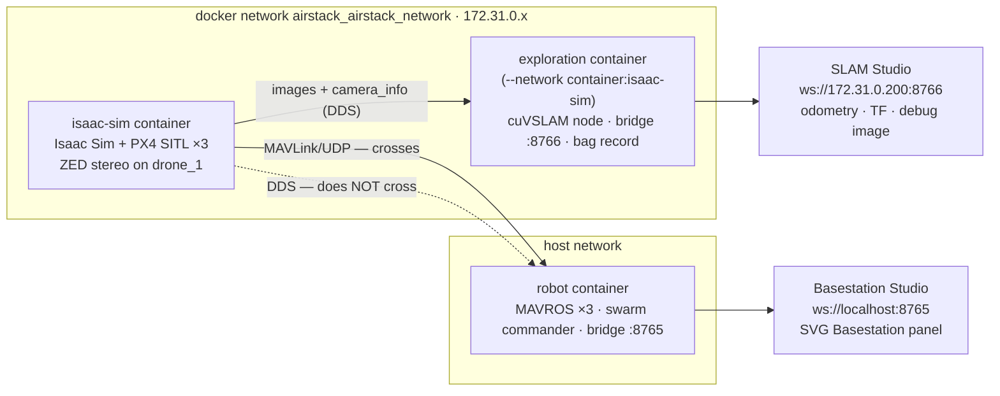
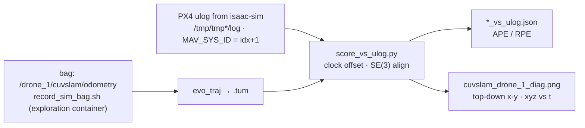

# Camera-world / stereo-VO docs — panel review and chair's consolidated plan (2026-10-23)

> Status: PROPOSED, awaiting owner approval. Nothing executed; nothing committed. Produced by three
> independent reviews (newcomer reader / visual explainer / maintainer) and a chair that checked every
> claim against the live files (`~/AirStack-starling-max2` @ `158204e`, `~/localisation-exploration` @ `d2f1bbf`)
> and test-ran every media command in the scratchpad. Owner's brief: *"easy to read just like how it is
> now; more graphics, less words"*. Standing rules kept: docs are for AirStack newcomers; CMU's `AirStack/`
> tree is not edited; the owner pushes; one Terminator window, four tabs (Isaac Sim · Interfaces · Commander · Cockpit).

## 0 · Deliberation

Facts the chair verified that the seats got right: exploration repo = 17 commits on `master`, 48 tracked
files, three live `results/*.log` tracked and dirty, a tracked LibreOffice lock file; mirror 2 commits behind
(`10b85b5`, `158204e` unpushed); stray `~/AirStack-starling-max2/50MB`; every exploration script is
`dirname $0`-relative so the folder name is free; `slam_up.sh` runs on the laptop (it calls `docker`) and
already guards against a second node; `git subtree`, `ffmpeg`, `convert` all present; the docs contain zero
mermaid blocks and zero mentions of `ENV_USD`, cuVSLAM, VO/VIO or "construction site".

Corrections to the seats: `full_sim_run.png` is **post-landing**, not pre-takeoff (panel: `✓ land 4:05:07 PM`,
shot at `4:05:27 PM GMT` = 00:05 local 10-23); the video (`00:09` local 10-23) is a later **unscored** full-site
flight — no bag covers that time (`sim_site_run2` is 23:09, 5.7 MB) — so neither may carry `sim_site_run1`'s
numbers. `cuvslam_drone_1_diag.png` for the flat runs lives only in the ignored `results/bags/sim_cam_run3/`.
Patches are numbered 0001–0003, so the launcher patches become 0004/0005. At 1600 px the three screenshots are
0.8–1.8 MB as PNG but 120–263 KB as JPG q85, still legible (tested).

| # | Issue | Seats | DECISION | Why |
|---|---|---|---|---|
| a | Numbers in docs | maintainer: link only, never repeat · newcomer/visuals: a flat-vs-site figure with the RMSE numbers | **Both.** Numbers live in `localisation/results/<run>_record.md` (source) and appear once more in figure F3's caption, dated and linked to the record. Prose, ledger rows, gallery captions never carry a score | A comparison figure without its numbers says nothing; a caption with a date and a link cannot silently rot |
| b | SLAM side: fifth tab or laptop terminal | maintainer: optional fifth laptop terminal · newcomer: fifth shell kind | **Optional fifth laptop terminal — not a tab.** `tools/sim_terminals.sh` unchanged (four tabs stay the convention); `tools/sim_tab.sh` isaac heredoc gains the camera-world paste line + the Ethernet warning; the RUNBOOK prompt rule gains one clause for the exploration container; a "where it runs" table lives on `localisation/README.md` | Tabs are "already inside a container"; `slam_up.sh` runs on the laptop, so it does not fit the tab model. Ctrl-Shift-T in the same window is fine |
| c | Mermaid | visuals: five · docs today: none | **Two now:** F1 two-networks (ARCHITECTURE) and F2 scoring pipeline (`localisation/README.md`), each ≤ 6 nodes, GitHub-native. F4 ladder and F5 WiFi chain rejected; F3/F6 are images. Staleness guard = dated HTML comment naming the source files before every block + checker `mermaid-values` | Introduce the habit with the two diagrams that replace the most prose; the ladder is already a table; a 5-node linear chain is a sentence |
| d | Iron rule for Isaac over WiFi-only remote desktop | all three: no | **Confirmed: no iron rule.** AI_ASSIST §4 never-do row + TROUBLESHOOTING Simulation row (first row) + the RUNBOOK variant row says "Ethernet or sit at the laptop" | Iron rules are flight safety; this is a sim comfort/time loss. PREFLIGHT and CLAUDE.md untouched |
| e | Move the exploration repo | all three: yes, `git subtree add` | **Confirmed**, prefix `localisation/` (sibling of `AirStack/`), history kept, nested `.gitignore` carries over; §2 has the exact commands incl. the pre-move cleanup | Three docs already cite its scripts; it was never pushed (no backup); scripts are path-agnostic |
| f | Media policy | maintainer ≤1600 px/≤500 KB · visuals tested ffmpeg lines | **Adopted with one change:** the three screenshots ship as **JPG q85** at 1600 px (PNG exceeds 500 KB); small frames/crops stay PNG; GIF = visuals' tested 10 s/10 fps/64-colour line (2.1 MB) in `assets/`; contact sheet at 512 px as JPG (210 KB, not 0.9 MB PNG) in `pictures/`; originals in `~/Pictures/airstack-originals/`; **no new mp4 in git** — delete the untracked `videos/randompos_construction.mp4` copy | Measured, not assumed |
| g | VO vs VIO | newcomer: VO now, VIO later | **"stereo VO (cuVSLAM)"** everywhere; "VIO" only in the GLOSSARY entry ("VO + IMU — not yet: the node has no IMU input") and in record files as written | The node is stereo-only; naming it VIO misleads the next reader |
| h | Where the camera-world DO content lives | newcomer: RUNBOOK A1-cam/A5/A6 · visuals: new `docs/VIO_SIM.md` · maintainer: one RUNBOOK row | **`localisation/README.md` becomes the page** (DO · SIM banner, figure-first, ≤ 700 words); RUNBOOK gets one variant row + two one-line pointers; no new `docs/` page | RUNBOOK is over budget; the track is exploratory, not a milestone gate; README "I want to…" and CLAUDE.md rows make it findable |
| i | Ledger rows | maintainer: #15 only · newcomer: #15 + #16 | **Two rows**: #15 `sim_cam_run1` (pipeline end-to-end, DDS finding, flat world, 480×300), #16 `sim_site_run1` — each a link + verdict word, no numbers | Every run gets a row; the records hold the numbers |

## 1 · Decision summary
1. Move `~/localisation-exploration` → `~/AirStack-starling-max2/localisation/` via `git subtree add` after the §2 cleanup; rsync the 3.1 GB ignored data; keep the old folder renamed until one `slam_up.sh` succeeds.
2. `localisation/README.md` is the newcomer's camera-world page (DO · SIM); `docs/` pages get rows, pointers and two figures, not sections.
3. Scores live in the record files and in F3's dated caption only.
4. SLAM side = optional fifth laptop terminal; four tabs unchanged; `sim_tab.sh` prints the camera-world paste line.
5. Two mermaid blocks now (F1, F2), dated-comment guard, checker grep later.
6. No iron rule for the WiFi crash: AI_ASSIST row + TROUBLESHOOTING first sim row + RUNBOOK variant note.
7. Media: JPG q85 ≤1600 px ≤500 KB for screenshots, PNG for small frames, GIF ≤3 MB in `assets/`, no mp4, every file catalogued in `pictures/README.md`.
8. Term = "stereo VO (cuVSLAM)"; "Isaac Sim tab" everywhere; paths repo-relative (`localisation/…`).
9. Launcher commits `10b85b5`/`158204e` get `patches/0004`, `0005` (SHOULD); `AirStack/README.md` row only if the owner okays.
10. Checker additions are listed, not implemented (LATER).

## 2 · Pre-move cleanup checklist (run in order; `E=~/localisation-exploration`, `M=~/AirStack-starling-max2`)
| # | Command (one line) | Expect |
|---|---|---|
| 1 | `git -C ~/localisation-exploration status --short` | 3 `M results/*.log`, 2 `?? results/frame_site_drone_1*.png` |
| 2 | `printf 'results/*.log\n.~lock.*#\n' >> ~/localisation-exploration/.gitignore` | two new ignore rows |
| 3 | `git -C ~/localisation-exploration rm --cached -q results/cuvslam_node.log results/foxglove_bridge.log results/foxglove_studio.log 'reports/.~lock.Multi drone localisation methods review.md#'` | 4 files untracked, still on disk |
| 4 | `mv ~/localisation-exploration/results/frame_site_drone_1*.png ~/localisation-exploration/results/site_ladder/` | evidence kept locally in the ignored ladder folder (`_b` is 4.9 KB, near-empty) |
| 5 | `sed -i '3i > **Camera note (2026-10-23):** this run used the pre-10-22 default **480×300, fx 184**. The launcher default is 640×480 (fx 245) since 2026-10-22 — do not compare these numbers with later runs.' ~/localisation-exploration/results/sim_cam_run1_record.md` | banner line under the title |
| 6 | `git -C ~/localisation-exploration add -A && git -C ~/localisation-exploration commit -qm "pre-move: untrack live logs + lock file; cam_run1 labelled 480x300"` | 18th commit |
| 7 | `rm ~/AirStack-starling-max2/50MB ~/AirStack-starling-max2/videos/randompos_construction.mp4` | stray file gone; the mp4 original stays in `~/Videos/` |
| 8 | `mkdir -p ~/Pictures/airstack-originals && mv ~/AirStack-starling-max2/pictures/{construction_site,drones_in_construction_site,full_sim_run}.png ~/Pictures/airstack-originals/` | 3408×2130 originals out of the repo (derivatives come back in Phase C) |
| 9 | `git -C ~/Documents/GitHub/AirStack-starling-max2 pull ~/AirStack-starling-max2 main` | mirror at `158204e`; **owner pushes** (two commits) |
| 10 | `git -C ~/AirStack-starling-max2 status --short` | only `??` lines (`QGroundControl-x86_64.AppImage`, `starling max2 voxl setup.txt` — out of scope, leave untracked). `git subtree add` refuses a dirty index/worktree |
| 11 | `git -C ~/AirStack-starling-max2 subtree add --prefix=localisation ~/localisation-exploration master -m "localisation/: camera-world exploration moved in as a subtree (history kept)"` | one merge commit; `localisation/` = 44 tracked files |
| 12 | `rsync -a --ignore-existing ~/localisation-exploration/ ~/AirStack-starling-max2/localisation/` | ignored data arrives (data 712 M, bags 734 M, UE4 1.6 G, build 99 M, studio-data); ~1 min, same filesystem |
| 13 | `git -C ~/AirStack-starling-max2 status --short \| grep localisation` | empty — the nested `.gitignore` is honoured |
| 14 | `mv ~/localisation-exploration ~/localisation-exploration.moved-2026-10-23` | delete after the first successful `localisation/scripts/slam_up.sh` |
| 15 | `grep -rn 'localisation-exploration' ~/AirStack-starling-max2/docs ~/AirStack-starling-max2/localisation --include='*.md' --include='*.sh'` | the doc hits re-pointed in §3 (TROUBLESHOOTING:138, MILESTONES:615, VALIDATION.md:27, localisation/README.md:1 title) plus the `docker/up.sh` message; the plan file itself and the docker image/container **name** `localisation-exploration` (docker/*.sh, slam_*.sh, score_run.sh, smoke_test.sh) stay |

Assistant-side (outside the repo, same sitting): re-point `~/localisation-exploration/…` in memory files `isaac-wifi-firmware-crash.md` (2 paths) and add one line to `airstack-starling-project.md`.

## 3 · Page-by-page change spec
MUST = before the commit · SHOULD = same sitting if time allows · LATER = next docs pass. Anchors are existing headings unless marked *new*.

### CLAUDE.md
| Where | Change | Figure | Pri |
|---|---|---|---|
| Doc table, after `tools/` row | row: `[localisation/](localisation/README.md)` — "camera-world sim runs: construction-site world (`ENV_USD`), stereo VO with cuVSLAM, scoring vs PX4 ulog, validation ladder — **sim-only exploration, nothing flies**" | — | MUST |

### README.md
| Where | Change | Figure | Pri |
|---|---|---|---|
| "I want to…" table | row: **fly in the construction site with the camera (sim stereo VO)** → `localisation/README.md` | — | MUST |
| "What is in this repo" table, after `AirStack/` | row: `localisation/` — camera-world exploration (sibling of `AirStack/`, never inside CMU's tree) | — | MUST |
| "What we have achieved" gallery, new last row | GIF cell: *2026-10-23 · random goals in the construction site, stereo VO (cuVSLAM) tracking on drone_1. Sim only. Scored run and numbers: `localisation/README.md`* — no number in the caption | F7 | SHOULD |

### docs/RUNBOOK.md
| Where | Change | Figure | Pri |
|---|---|---|---|
| "Prompt rule" line | add `· root@…:/exploration# = the exploration container (camera-world runs — [localisation/README.md](../localisation/README.md))` | — | MUST |
| §A1 "Variants:" line | add `· construction-site world → § Sim launch variants` | — | MUST |
| "Sim launch variants" ZED row | reword to "ZED stereo camera on drone_1 (needed for the camera world / VO runs; costs GPU)" — drop "skip unless needed"; keep the TROUBLESHOOTING link | — | MUST |
| "Sim launch variants", new row after ZED | **Construction-site world (textured — VO needs it)**: add `ENV_USD=…/construction_site_full.usdc` (`_r40.usdc` = lighter fallback) + the ZED row's env in front; wait ~90 s longer for the stage. **Plug in Ethernet or sit at the laptop before launching** (Isaac start/stop crashes the WiFi firmware — TROUBLESHOOTING). Full path, install, SLAM side and scoring: `localisation/README.md`. Basename only here (full path lives in the site README and `sim_tab.sh`) | — | MUST |
| "Alternatives to the tabs" | one line: *Optional fifth terminal (laptop, not a tab — Ctrl-Shift-T is fine): `localisation/scripts/slam_up.sh` after `Ready for takeoff!` ×3 — the SLAM side* | — | SHOULD |
| §A "What success looks like" | append `· camera world: [localisation/README.md](../localisation/README.md)` | — | SHOULD |

### docs/ARCHITECTURE.md
| Where | Change | Figure | Pri |
|---|---|---|---|
| "Sim session anatomy" › "Two networks in a sim session" paragraph | **replace the 9-line paragraph** with F1 (guard comment + mermaid) + one italic caption + one "what you should see" line + link to `localisation/README.md` and the TROUBLESHOOTING row | F1 | MUST |

### docs/TROUBLESHOOTING.md (Simulation table; rows ≤ 40 words)
| Where | Change | Figure | Pri |
|---|---|---|---|
| New **first** row | *Laptop "hangs" / remote desktop drops within 30 s of an Isaac start or stop* → Intel BE200 WiFi firmware crash, not a hang — Isaac keeps running. `journalctl -k \| grep iwlwifi`. Ethernet or sit at the laptop before launching; keep `localisation/scripts/sim_resources_watch.sh` running (prints `WIFI-ALERT`). Source: ladder step 0 | — | MUST |
| Existing `ENABLE_CAMERA=true … no /clock` row | trim to ≤ 40 words: symptom → "DDS never crosses the isaac docker network; MAVROS (UDP) does — [F1](ARCHITECTURE.md#sim-session-anatomy). Consume Isaac topics from `localisation/docker/run.sh` (`--network container:isaac-sim`). Both sides at once: MILESTONES §6" | F1 link | MUST |
| New row | *VO pose jumps 5–10 m whenever drone_1 faces the arena edge (sky + grid in view)* → the flat default world starves the tracker — launch with `ENV_USD` (construction site): `localisation/scenes/construction_site/README.md` | — | SHOULD |
| New row | *VO odometry / TF flips between two poses* → two `cuvslam_stereo_node` instances (a hand-started one beside `slam_up.sh`): `localisation/scripts/slam_status.sh`, then `slam_down.sh` → `slam_up.sh` | — | SHOULD |
| New row | *`ENV_USD` set but the world loads flat / empty* → `install.sh` not run on this laptop or Scene02 references missing — the world files are laptop-only: site README "install" | — | SHOULD |

### docs/GLOSSARY.md (bullet format `- **Term** — …`, ≤ 2 lines each)
| Where | Change | Pri |
|---|---|---|
| New entries near "Foxglove bridge" | **cuVSLAM** (NVIDIA's GPU visual-SLAM library; our node runs it stereo-only) · **Visual odometry (VO) / VIO** (VO = pose from camera frames alone; VIO adds an IMU — not yet, the node has no IMU input; sim scores are vs PX4 EKF2, *a reference, not ground truth*) · **APE / RPE** (absolute / relative pose error after SE(3) alignment, from `evo`) · **`ENV_USD`** (launcher env var: load a world USD instead of Pegasus' flat grid; `construction_site_full.usdc` default, `_r40` fallback) · **Construction-site arena** (the textured world; full vs r40 crop; laptop-only files) · **Exploration container / SLAM terminal** (`localisation-exploration`, joined to the Isaac network; opened by `slam_up.sh` from a laptop terminal, the optional fifth terminal) · **Validation ladder** (one-change-per-step sim checks in `VALIDATION.md`) | SHOULD |
| "Foxglove bridge" entry | append: "The camera-world runs start a **second** bridge inside the exploration container on `ws://172.31.0.200:8766` (SLAM Studio); the commander's stays on 8765 (Basestation Studio)" | SHOULD |
| "Sim session (Terminator tabs)" entry | append one clause: "optional fifth *laptop* terminal for the SLAM side — not a tab" | SHOULD |

### docs/AI_ASSIST.md
| Where | Change | Pri |
|---|---|---|
| §4 never-do table, new row | *Launch or stop Isaac while the user's only link is a WiFi remote desktop* / BE200 firmware crash drops the session (TROUBLESHOOTING); Ethernet or local first, `sim_resources_watch.sh` running | MUST |
| §4 never-do table, new row | *Call a sim VO score "ground truth"* / the reference is PX4 EKF2 on simulated GPS; say "vs EKF2" (record files) | SHOULD |
| §2 recipes, item 7 | **"Score the run."** `localisation/scripts/score_run.sh <run> 1` (laptop; isaac-sim + exploration containers up) → APE/RPE json + diag plot in `localisation/results/bags/<run>/`; F2 shows the pipeline | SHOULD |

### docs/MILESTONES.md
| Where | Change | Pri |
|---|---|---|
| Header box line "Sim: ledger #1–#14" | → "#1–#16" | MUST |
| §3 status table, M1 row "ledger #1–#13" | → "#1–#13, #15–#16 (camera-world stereo VO, sim-only)" — chair verification 10-23 found this second count | MUST |
| §3c ledger, rows 15–16 | **15** `sim_cam_run1` — first stereo VO pipeline end-to-end in sim (flat world, 480×300), DDS two-networks finding → `localisation/results/sim_cam_run1_record.md`, verdict "pipeline works; not an accuracy result", 2026-10-22 · **16** `sim_site_run1` — same tracker in the construction site, ladder steps 1–7 passed → `localisation/results/sim_site_run1_record.md`, verdict "holds in a textured world; vs EKF2, sim-only", 2026-10-22. No numbers | MUST |
| §6 "Sim debt" DDS bullet | re-point `~/localisation-exploration/docker/run.sh` → `localisation/docker/run.sh`; add "(F1 in ARCHITECTURE)" | MUST |
| §6 "Sim debt", two new bullets | *Isaac ground-truth publisher* (all VO scores are vs EKF2 until it exists) · *launcher commits `10b85b5` (camera 640×480) and `158204e` (`ENV_USD`) edit CMU's tree — `patches/0004`, `0005` record them* | SHOULD |

### docs/SETUP.md
| Where | Change | Pri |
|---|---|---|
| "Running AirStack" › after the "Two ways into the containers" paragraph | one line: *Optional camera world (sim stereo VO): the construction-site files are **not in git** and exist only on the lab laptop — install and prerequisites in `localisation/scenes/construction_site/README.md`; session steps in `localisation/README.md`* | SHOULD |

### pictures/README.md
| Where | Change | Pri |
|---|---|---|
| Under the RECORD banner | **Size policy (2026-10-23):** ≤ 1600 px wide, ≤ 500 KB; JPG q85 for renders/desktop screenshots, PNG for small UI/plot crops; originals in `~/Pictures/airstack-originals/` (not git); GIFs ≤ 3 MB in `assets/`; **no new mp4 in git** (the six existing stay) | MUST |
| Table, 8 new rows | `construction_site.jpg` · `drones_in_construction_site.jpg` · `full_sim_run.jpg` (annotated, post-landing) · `vo_flat_frame.png` · `vo_site_frame.png` · `vo_flat_xy_cam_run3.png` · `vo_site_xy_site_run1.png` · `randompos_construction_sheet.jpg` — each with *what it shows · used by · status "Current (sim, construction site, 2026-10-22/23)"* | MUST |
| "Pictures this branch still needs" item 1 | mark "partly done 2026-10-23: `full_sim_run.jpg` (Isaac viewport + panel + SLAM Studio, post-landing); the clean four-tab Terminator shot is still open" | SHOULD |

### tools/sim_tab.sh (ours)
| Where | Change | Pri |
|---|---|---|
| `isaac` heredoc, after the "Wait for Ready…" line | 3 lines: blank · `Camera world (optional, stereo VO runs — localisation/README.md): put this in front of the line above:` · `ENV_USD=/isaac-sim/.local/share/ov/data/scenes/construction_site/construction_site_full.usdc ENABLE_CAMERA=true CAMERA_DRONES=drone_1` · `Ethernet or sit at the laptop first — Isaac start/stop crashes the WiFi firmware (TROUBLESHOOTING).` No new role | MUST |

### localisation/README.md (rewrite; DO · SIM; ≤ 700 prose words; figure-first)
| Order | Content | Figure | Pri |
|---|---|---|---|
| 1 | Title "localisation/ — camera-world sim runs (stereo VO with cuVSLAM)"; banner `> **DO · SIM.** …` 2 sentences: what, who; "a sibling of `AirStack/`, never inside CMU's tree; nothing here touches the real drone" (replaces "Lives OUTSIDE the AirStack clones") | — | MUST |
| 2 | Hero image, width 600, caption | F6 | SHOULD |
| 3 | **Where it runs** table: laptop `jeremychia@…$` = `slam_up.sh`, `score_run.sh`, `sim_resources_watch.sh`, `install.sh` · exploration container `root@…:/exploration#` (`docker/run.sh`) = `record_sim_bag.sh`, `sim_check.py`, `grab_frame.py` · Isaac Sim tab = the launch line · Interfaces/Commander/Cockpit tabs = RUNBOOK §A2–A4 unchanged | — | MUST |
| 4 | **Run it** table `Step · Where · Command · Expect`: 1 Isaac Sim tab launch with `ENV_USD` + camera (`Ready for takeoff!` ×3, ~90 s longer) · 2 laptop `scripts/slam_up.sh` (`tracker ready`, status ≥ 10 Hz, SLAM Studio opens on :8766; first time import `foxglove/cuvslam_slam_view.json`) · 3 exploration container `scripts/record_sim_bag.sh <run>` · 4 RUNBOOK §A2–A4 (`random_goals`) · 5 Ctrl-C the record · 6 laptop `scripts/score_run.sh <run> 1` → `results/bags/<run>/*_vs_ulog.json` + `cuvslam_drone_1_diag.png` · 7 `scripts/slam_down.sh` | — | MUST |
| 5 | **What you should see**: annotated screenshot + 5-item legend (①–⑤) + the line "post-landing; `LINK DEGRADED · EKF NO DATA · 0 sim · 3 real` on the Basestation are known sim cosmetics; `1970-01-01` is the sim clock" | F4 | MUST |
| 6 | **How a run is scored**: F2 mermaid + caption *Reference = PX4 EKF2 on simulated GPS, not ground truth* | F2 | MUST |
| 7 | **Why the construction site**: F3 2×2 table + dated caption with the two numbers + link to both records; one sentence "same tracker, same drone, different world" | F3 | MUST |
| 8 | **Prerequisites (laptop-only)** 3 lines: the exploration image (`docker/build.sh`, ~30 GB) · the world files (`scenes/construction_site/build/*.usdc`, gitignored, built by `install.sh` from `~/Documents/Meerkat_robot_JAZZY/…` + `~/.venvs/usd`) · Ethernet or local for Isaac starts | — | MUST |
| 9 | **Folder map** table (existing bullets → rows; keep `reports/`, `research_notes/`, licence note); links: site README, `VALIDATION.md`, records, `effort_log.md` | — | MUST |
| 10 | GIF + contact sheet under "The flight on video", caption without numbers (unscored 10-23 flight) | F7, F8 | SHOULD |

### localisation/scenes/construction_site/README.md
| Where | Change | Figure | Pri |
|---|---|---|---|
| Title | "(textured world for the camera/VIO sim runs)" → "(textured world for the camera / stereo-VO sim runs)"; "VIO" → "VO" in the body (2 hits) | — | MUST |
| Line 29 "Launch:" | "usual Isaac tab line" → "usual **Isaac Sim tab** line (RUNBOOK §A1)"; state once: `_full` default, `_r40` fallback | — | MUST |
| After "Why" paragraph | annotated overview, width 850, caption | F5 | SHOULD |
| "Known texture limitation" | unchanged | — | — |

### localisation/scenes/construction_site/VALIDATION.md
| Where | Change | Pri |
|---|---|---|
| Line 27 | `cd ~/localisation-exploration` → `cd ~/AirStack-starling-max2/localisation` | MUST |
| Step 5 | "(exploration container)" → "(laptop)" | MUST |
| "Isaac tab" ×2 (line 19, 30) | → "Isaac Sim tab" | MUST |
| Step 0 | unchanged — it is the WiFi source paragraph that TROUBLESHOOTING/AI_ASSIST link to | — |

### localisation/docker/up.sh · install.sh
| Where | Change | Pri |
|---|---|---|
| `up.sh:7` message | "run tools/sim_terminals.sh" → "run ~/AirStack-starling-max2/tools/sim_terminals.sh" | SHOULD |
| `install.sh:38` echo | "plus the usual Isaac tab line" → "Isaac Sim tab line" | SHOULD |

### patches/ (ours)
| Change | Pri |
|---|---|
| `git -C ~/AirStack-starling-max2 diff 10b85b5^ 10b85b5 -- AirStack/ > patches/0004-sim-camera-640x480-default.patch` and `git diff 158204e^ 158204e -- AirStack/ > patches/0005-sim-launcher-env-usd-world.patch`; header comment per patch like 0001–0003. A row in `AirStack/README.md`'s patch list **only if the owner okays** (CMU-tree rule) | SHOULD |

## 4 · Figure list
| Id | Page · anchor | Type | Content (one line) | Source |
|---|---|---|---|---|
| F1 | ARCHITECTURE › Sim session anatomy | mermaid, 5 nodes | Two networks, two Studios: DDS stays inside the Isaac docker network, MAVLink crosses | inline below |
| F2 | localisation/README › How a run is scored | mermaid, 6 nodes | bag + ulog → `score_vs_ulog.py` → APE/RPE json + diag plot | inline below |
| F3 | localisation/README › Why the construction site | 2×2 image table | camera frame + top-down x-y, flat vs site, numbers in the caption | 4 files, commands below |
| F4 | localisation/README › What you should see | annotated screenshot (JPG 1600 px) | the whole desktop after landing: SLAM Studio, debug image, status line, record log, Basestation Studio | `full_sim_run.jpg`, callouts below |
| F5 | site README › after "Why" | annotated screenshot (JPG 1600 px) | the 40 m site: cranes/scaffolding = what VO tracks, excavation = 8 m exclusion, clear patch = origin | `construction_site.jpg` |
| F6 | localisation/README › hero | screenshot (JPG 1600 px, shown at 600) | three Starlings on the sand beside containers; drone_1 carries the ZED | `drones_in_construction_site.jpg` |
| F7 | README gallery · localisation/README | GIF 584×200, 10 s, 2.1 MB | debug image + Basestation 3D side by side, drones airborne | `assets/randompos_construction_10fps.gif` |
| F8 | localisation/README (under F7) | contact sheet 2×3, JPG | both Studio windows every 8 s over 48 s | `pictures/randompos_construction_sheet.jpg` |

**F1 source** (ARCHITECTURE; the HTML comment is the staleness guard and stays with the block)
```
<!-- F1 · 2026-10-23 · summarises: TROUBLESHOOTING "ENABLE_CAMERA … no /clock" row, localisation/docker/up.sh, localisation/scripts/slam_up.sh · redraw if: ports 8765/8766, IP 172.31.0.200, container names, or the DDS fix in MILESTONES §6 change -->
```

Caption: *Two bridges because DDS never crosses the docker boundary; MAVLink does.* What you should see: SLAM Studio shows `/drone_1/cuvslam/debug_image`, Basestation Studio shows the panel.

**F2 source** (localisation/README)
```
<!-- F2 · 2026-10-23 · summarises: localisation/scripts/record_sim_bag.sh, score_run.sh, score_vs_ulog.py · redraw if: topics, ulog location or the scorer's outputs change -->
```

Caption: *Reference = PX4 EKF2 on simulated GPS, not ground truth.* One line: `scripts/score_run.sh <run> 1` (laptop).

**F3 layout and files** (run from `~/AirStack-starling-max2`; the flat-run diag lives in an ignored folder — copying freezes it, which is the intent)
```
cp localisation/results/cuvslam_debug_frame_640x480.png pictures/vo_flat_frame.png                                   # 88 KB
cp localisation/results/site_ladder/check_full_b.png pictures/vo_site_frame.png                                     # 368 KB
convert localisation/results/bags/sim_cam_run3/cuvslam_drone_1_diag.png -crop 450x450+0+0 +repage pictures/vo_flat_xy_cam_run3.png   # 56 KB
convert localisation/results/sim_site_run1_diag.png -crop 450x450+0+0 +repage pictures/vo_site_xy_site_run1.png                       # 133 KB
```
| | Flat default world | Construction site |
|---|---|---|
| Camera frame (640×480) | `vo_flat_frame.png` — features on the horizon and one grid ray; sky above, void below | `vo_site_frame.png` — scaffolding, crane, containers 4–20 m away |
| Top-down x-y, ref (blue) vs VO (orange) | `vo_flat_xy_cam_run3.png` — orange cloud ~10 m from the reference | `vo_site_xy_site_run1.png` — orange on blue inside the ±2 m box |

Caption (the only place outside the records that carries numbers): *Same tracker, same drone, different world — APE RMSE 0.88–5.3 m with 1–4 jumps > 1 m per run on the flat grid (`sim_cam_run2–4`, 2026-10-22) vs **0.081 m over 162 m, 0 jumps** in the site (`sim_site_run1`, 2026-10-22, r40 crop; reference = EKF2). Records: `results/sim_site_run1_record.md`.*

**Screenshots — crop, downscale, annotate** (`O=~/Pictures/airstack-originals`; all three originals are 3408×2130; tested sizes in comments)
```
convert $O/full_sim_run.png -crop 3281x2069+127+61 +repage -resize 1600x -strip -alpha off -quality 85 pictures/full_sim_run.jpg                   # 218 KB, 1600×1009
convert $O/construction_site.png -crop 2186x1261+224+236 +repage -resize 1600x -strip -alpha off -quality 85 pictures/construction_site.jpg        # 263 KB
convert $O/drones_in_construction_site.png -crop 2186x1261+224+236 +repage -resize 1600x -strip -alpha off -quality 85 pictures/drones_in_construction_site.jpg   # 120 KB
```
Callouts are drawn on the 1600-px JPG (coordinates below are in that frame; the drone ones are verified, the F4 ones were checked against the rendered crop, F5's are by eye — the editor views the result before committing):
```
convert pictures/full_sim_run.jpg -fill none -stroke '#ff3b30' -strokewidth 5 -draw "circle 294,99 334,99" -draw "circle 614,302 654,302" -draw "circle 520,569 560,569" -draw "circle 698,742 738,742" -draw "circle 1185,84 1225,84" -fill '#ff3b30' -stroke none -pointsize 44 -annotate +330+70 '1' -annotate +650+273 '2' -annotate +556+540 '3' -annotate +734+713 '4' -annotate +1221+55 '5' pictures/full_sim_run.jpg
```
| Figure | Callout → legend text | Centre (1600-px frame) |
|---|---|---|
| F4 | ① SLAM Studio, `ws://172.31.0.200:8766` | 294,99 |
| F4 | ② `/drone_1/cuvslam/debug_image` — feature dots on the tower | 614,302 |
| F4 | ③ `slam_up.sh` status line `rate 14 Hz track_ms 5.5` | 520,569 |
| F4 | ④ record log `tracked … lost:0` | 698,742 |
| F4 | ⑤ Basestation Studio `ws://localhost:8765` — `LINK DEGRADED · EKF NO DATA · 0 sim · 3 real` are sim cosmetics; `✓ land` = post-landing | 1185,84 |
| F5 | ① clear sand patch = drones' origin (±2 m box) · ② cranes / scaffolding 4–20 m = what VO tracks · ③ excavation = 8 m exclusion | ≈ 700,700 · 400,300 · 1000,480 (by eye) |
| F6 | ① ② ③ the three Starlings; drone_1 carries the ZED | 905,362 · 722,468 · 460,638 (verified) |

**Video → GIF + contact sheet** (tested: GIF 584×200, 100 frames, 2.1 MB; sheet 1024×972 JPG 210 KB; never use `sierra2_4a` dither here — 5 MB)
```
ffmpeg -y -ss 20 -t 10 -i ~/Videos/randompos_construction.mp4 -filter_complex "[0:v]crop=268:178:235:118,scale=-2:200[a];[0:v]crop=282:200:918:130[b];[a][b]hstack,fps=10,split[s0][s1];[s0]palettegen=max_colors=64:stats_mode=diff[p];[s1][p]paletteuse=dither=none:diff_mode=rectangle" assets/randompos_construction_10fps.gif
ffmpeg -y -ss 8 -t 48 -i ~/Videos/randompos_construction.mp4 -vf "crop=1097:695:108:25,fps=1/8,scale=512:-1,tile=2x3" -frames:v 1 /tmp/sheet.png && convert /tmp/sheet.png -quality 85 pictures/randompos_construction_sheet.jpg
```
Embed pattern (all figures): `" width="850">` then the italic caption line.

## 5 · Style rules (the editor follows these)
1. Figure → caption (≤ 20 words, italic, dated when it shows a result) → one "what you should see" line → then commands.
2. Commands and expectations go in `Step · Where · Command · Expect` tables, never in prose; the existing tab table is the model.
3. On any page that carries a figure, no paragraph over 3 sentences; the "why" moves to ARCHITECTURE or the site README with a `(why: …)` link.
4. One idea per figure; ≤ 5 callouts; ≤ 12 mermaid nodes; a dated HTML comment naming the source files precedes every mermaid block.
5. Numbers (scores, Hz, VRAM, RTF) live in the record files and in F3's caption; everywhere else a link — ledger rows carry a verdict word.
6. Names: "stereo VO (cuVSLAM)" (VIO only in GLOSSARY) · "Isaac Sim tab" · "exploration container" · "SLAM terminal (laptop)" · "SLAM Studio :8766" / "Basestation Studio :8765".
7. Every image: long `alt`, a `pictures/README.md` row, ≤ 1600 px, ≤ 500 KB; GIFs ≤ 3 MB in `assets/`; no new mp4; originals outside git.
8. Paths are repo-relative (`localisation/…`), never `~/localisation-exploration` or `/home/jeremychia`; the folder is "a sibling of `AirStack/`, never inside CMU's tree".

## 6 · Single source of truth
| Fact | Lives in | Everyone else |
|---|---|---|
| `ENV_USD` full path, full vs r40, install steps, texture caveat | `localisation/scenes/construction_site/README.md` (+ `install.sh` final echo; `tools/sim_tab.sh` prints the paste line) | RUNBOOK: basename + link; GLOSSARY: one clause |
| Camera 640×480, fx, baseline | launcher default in `svg_multi_drone_single_domain.py` + each run record's Setup | RUNBOOK variant row quotes env names only |
| Scores (APE/RPE/path/jumps) | `localisation/results/<run>_record.md` + `_vs_ulog.json` | F3 caption (dated, linked); ledger = verdict + link |
| Ladder steps, caps, WiFi step 0 | `localisation/scenes/construction_site/VALIDATION.md` | TROUBLESHOOTING first sim row, AI_ASSIST row, RUNBOOK variant note — all link |
| Two networks / DDS does not cross | F1 in ARCHITECTURE | TROUBLESHOOTING row + MILESTONES §6 link to the anchor |
| Ports 8765/8766, IP 172.31.0.200, container names | the scripts (`slam_up.sh`, `foxglove_bridge_isaac.sh`, `docker/up.sh`, compose) | F1 and GLOSSARY quote them; checker greps them |
| Where each script runs | `localisation/README.md` "Where it runs" table (and each script's header) | RUNBOOK prompt rule: one clause |
| Tab names and the fifth terminal | GLOSSARY "Sim session (Terminator tabs)" | — |
| VO vs VIO, APE/RPE definitions | GLOSSARY | — |
| Which pictures are current, size policy | `pictures/README.md` | — |
| Effort / time | `localisation/results/effort_log.md` | — |
| Launcher edits in CMU's tree | `patches/0004`, `0005` (+ MILESTONES §6 bullet) | — |

## 7 · Checker additions (list only — LATER)
1. `env-usd`: every `ENV_USD=<path>` in docs/tools/localisation ends in a basename `install.sh` produces (`construction_site_full.usdc`, `_r40.usdc`, `_arena.usda`).
2. `media-exists`: every `pictures/|assets/|videos/` reference resolves; every file in `pictures/` has a `pictures/README.md` row.
3. `media-size`: `pictures/` files ≤ 500 KB / ≤ 1600 px → WARN; any newly tracked file > 50 MB → FAIL; any new tracked `.mp4` → FAIL.
4. `no-home-paths`: `~/localisation-exploration` or `/home/jeremychia` in corpus + `localisation/**/*.{md,sh,py}` (except `fix_abs_paths.py`) → FAIL.
5. `ledger-evidence`: every ledger row linking `localisation/results/` resolves; a number in MILESTONES that also appears in a `_record.md` → WARN (duplicate fact).
6. `mermaid-values`: `8765`, `8766`, `172.31.0.200`, `container:isaac-sim` inside mermaid blocks must match the scripts/compose they are drawn from; every mermaid block preceded by a dated `<!-- F# · YYYY-MM-DD -->` comment.
7. `term-hygiene`: "VIO" outside GLOSSARY/record files → WARN; "Isaac tab" anywhere → WARN.
8. `patches-cover-tree`: each commit touching `AirStack/` since the snapshot SHA has a `patches/` file.
9. Extend `corpus()` with `localisation/**/*.md` for links/banners/no-home-paths; exclude `research_notes/` and `reports/` from budgets.

## 8 · Execution order, effort, re-runs
| Phase | What | Commit | Edits (approx.) | Who |
|---|---|---|---|---|
| A | §2 steps 1–10: cleanup, cam_run1 label, mirror pull → **owner pushes** | 1 in the exploration repo | 6 lines | owner + assistant, 10 min |
| B | §2 steps 11–15: subtree add, rsync, rename, re-point 5 paths | 2 (`localisation/: moved in` · `paths re-pointed`) | 5 lines | assistant, 15 min |
| C | media: 3 JPG crops + callouts, 4 F3 files, GIF, sheet; `pictures/README.md` rows + policy | 1 | 11 files, ~12 lines | assistant, 20 min (views each annotated image before committing) |
| D | docs: ARCHITECTURE (−9 +18) · RUNBOOK (6 lines) · TROUBLESHOOTING (1 edited + 4 rows) · GLOSSARY (~20 lines) · AI_ASSIST (3) · CLAUDE.md (1) · README (3) · SETUP (1) · MILESTONES (~8) · `sim_tab.sh` (3) | 1 | ~75 lines over 10 files | one agent, sequential (no parallel ownership needed) |
| E | localisation pages: `README.md` rewrite (~80 lines, ≤ 700 words) · site README (6 lines + F5) · VALIDATION (4) · `up.sh` + `install.sh` messages (2) | 1 | ~95 lines | same agent |
| F | `patches/0004`, `0005` (SHOULD) | 1 | 2 files | assistant |
| G | **`tools/docs_check/check_docs.sh` → 0 FAIL** (the 6 known WARNs; budget WARNs may shift — mermaid is fenced, so prose counts fall); links into `localisation/` resolve only after Phase B. Cold read: a newcomer reconstructs the camera-world session from README → `localisation/README.md` alone, and answers "where does `record_sim_bag.sh` run?" and "is 0.081 m vs ground truth?" correctly. Then `git -C ~/Documents/GitHub/AirStack-starling-max2 pull ~/AirStack-starling-max2 main` → **owner pushes**; delete `~/localisation-exploration.moved-2026-10-23` after one successful `slam_up.sh` | — | — | assistant, owner |
| H | §7 checker additions; git-lfs decision for `videos/`; Isaac ground-truth publisher; fold `localisation/**/*.md` into budgets; a record for the 10-23 demo flight (`sim_site_run2` bag is unscored — score or delete) | LATER | — | — |

Total: 6–7 commits, ≈ 200 changed lines, 11 new media files (≈ 3.7 MB tracked), 1 subtree merge (+1 MB tracked, +3.1 GB ignored on disk).

## 9 · Dissent log (proposed by a seat, rejected by the chair)
- Newcomer: RUNBOOK steps A1-cam / A5 / A6 — moved to `localisation/README.md` "Run it" table; RUNBOOK is over budget and the track is exploratory.
- Newcomer: a fifth shell kind opened by `sim_terminals.sh` — no; optional laptop terminal, four tabs stay the convention.
- Newcomer: a "camera/VO track" note under M1 — no; M0–M7 is the real-drone ladder, the two ledger rows are flagged sim-only.
- Newcomer: CLAUDE.md "Architecture pictures" line for the three screenshots — no; `pictures/README.md` is the catalogue.
- Newcomer: AI_ASSIST never-do "run `install.sh`/`crop_site.py` outside the venv" — too niche; it stays in the site README.
- Newcomer: annotate the Pegasus panel's misleading "Default Environment" text on the site shots — the crop box removes that panel; nothing to annotate.
- Visuals: F4 ladder mermaid — the VALIDATION table *is* the ladder; a second rendering of seven steps rots.
- Visuals: F5 WiFi-crash chain mermaid — a five-node linear chain is one TROUBLESHOOTING row.
- Visuals: new `docs/VIO_SIM.md` — no new docs page; `localisation/README.md` is that page.
- Visuals: keep unannotated originals beside `*_annot.png` in git — no; one file per shot, originals in `~/Pictures/airstack-originals/`.
- Visuals: caption "pre-takeoff" — corrected to post-landing (panel timestamps).
- Visuals: GIF caption "0.08 m RMSE over 162 m" — the video is the unscored 10-23 flight, and numbers live only in F3.
- Visuals: contact sheet at 640 px PNG (0.9 MB) — 512 px JPG q85 (210 KB) to meet the policy.
- Visuals: PNG fallbacks for mermaid — none; GitHub renders it, the legacy `.docx` export is not a target.
- Maintainer: JPG only for renders — JPG q85 for all three screenshots (PNG at 1600 px is 0.8–1.8 MB; JPG is legible at 120–263 KB).
- Maintainer: patches numbered 0005/0006 — 0004/0005 (only 0001–0003 exist).
- Maintainer: RUNBOOK quotes no path at all — basename + link in RUNBOOK; the full paste line goes where the user pastes from (`sim_tab.sh`) and the site README.
- Maintainer: one ledger row #15 — two rows (#15 cam_run1, #16 site_run1), each link + verdict.
- Maintainer: GIF "8 fps, 640 px" — the visuals seat's tested 10 fps 584×200 line (2.1 MB) is adopted as is.
- Maintainer: git-lfs for `videos/` — deferred to §8 H, owner decides (it changes GitHub Desktop behaviour).
