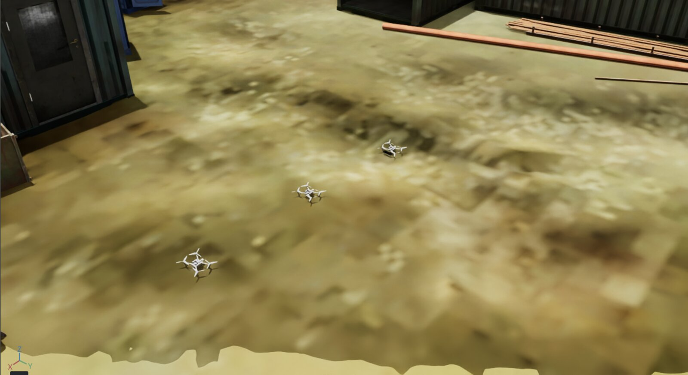
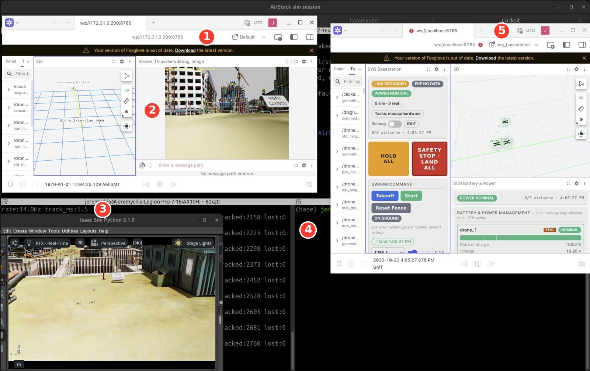
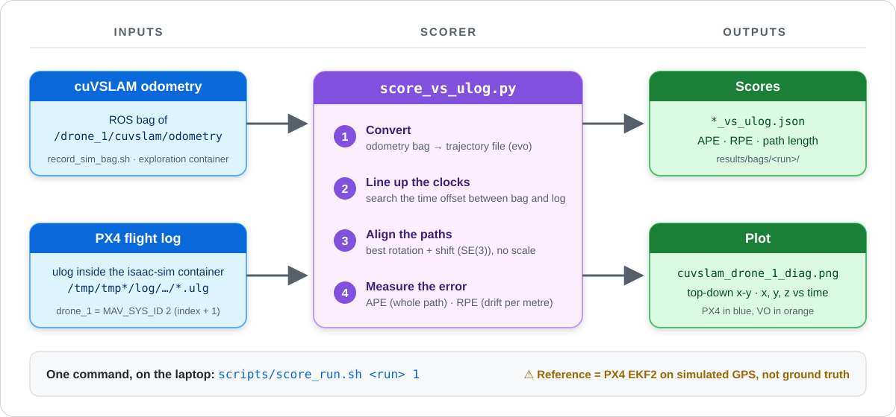
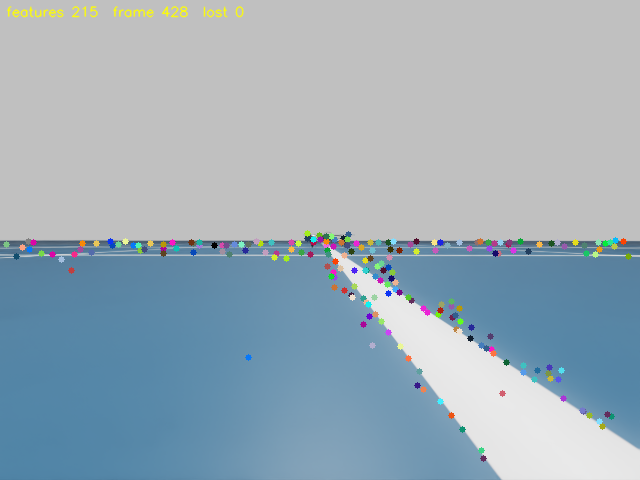
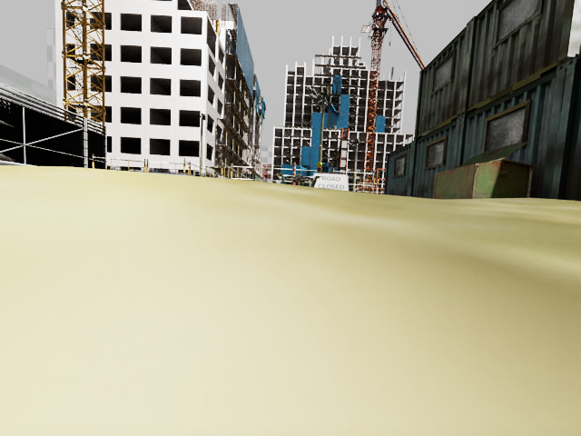
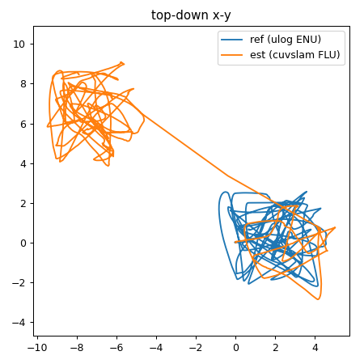
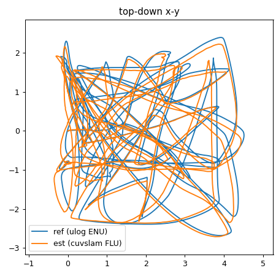
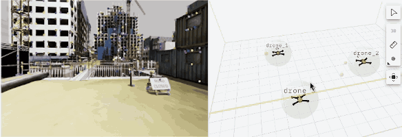

# localisation/ — camera-world sim runs (stereo VO with cuVSLAM)

> **DO · SIM.** Fly the three simulated Starlings in a textured construction site and track drone_1 with
> stereo visual odometry (VO), then score it. A sibling of `AirStack/`, never inside CMU's tree; nothing
> here touches the real drone.

## Which run do you want?

| Goal | Drones | Config | Go to |
|---|---|---|---|
| Scored camera run: fly, record and score cuVSLAM | 3 | `cbf_sim.yaml`, `random_goals` | [Run it](#run-it) |
| Fly it yourself by keyboard | 1 | `teleop_single_ours.yaml` | [Fly it with the keyboard](#fly-it-with-the-keyboard-one-drone-sim-only): [evidence](#evidence) · [keys](#keys) · [cold start](#cold-start) |



*Three Starlings in the construction-site world. drone_1 carries the simulated ZED stereo camera.*

## Where it runs

| Prompt | Where | What runs there |
|---|---|---|
| `jeremychia@…$` | laptop terminal | `scripts/slam_up.sh` · `scripts/score_run.sh` · `scripts/sim_resources_watch.sh` · `scenes/construction_site/install.sh` |
| `root@…:/exploration#` | exploration container (`./docker/run.sh`) | `scripts/record_sim_bag.sh` · `scripts/sim_check.py` · `scripts/grab_frame.py` |
| Isaac Sim tab | isaac-sim container | the launch line with `ENV_USD` (Run it, step 3) |
| Interfaces · Commander · Cockpit tabs | robot container | unchanged — [RUNBOOK §A2–A4](../docs/RUNBOOK.md) |
| Cockpit tab · `jeremychia@…$` | robot container · laptop terminal | keyboard session only: `teleop.launch.py` in the Cockpit tab; `tools/sim.sh relay` in a laptop terminal (it starts the relay inside the robot container) |

## Run it

This is the scored three-drone run. To fly drone_1 yourself by keyboard, start at that session's [Cold start](#cold-start), not here. Every command, from a cold laptop. Pick a new run name each time (`sim_site_run3`, `sim_site_run4`, …) and use it in steps 7 and 9.

**1 · Laptop terminal — open the four tabs** (starts the containers if needed)
```bash
cd ~/AirStack-starling-max2 && tools/sim_terminals.sh
```

**2 · New laptop terminal — resource and WiFi watch** (leave it running)
```bash
cd ~/AirStack-starling-max2/localisation && scripts/sim_resources_watch.sh results/site_ladder/res_$(date +%m%d).log
```
Expect one line per second; `WIFI-ALERT` means the WiFi firmware crashed ([why](../docs/TROUBLESHOOTING.md#simulation-isaac-sim--px4-sitl--mavros)).

**3 · Isaac Sim tab — the sim with the camera, in the construction site** (one line)
```bash
ENV_USD=/isaac-sim/.local/share/ov/data/scenes/construction_site/construction_site_full.usdc ENABLE_CAMERA=true CAMERA_DRONES=drone_1 DRONE_USD=/isaac-sim/AirStack/simulation/isaac-sim/assets/robots/starling2max.usd PX4_VEHICLE_MODEL=pegasus_starling2max NUM_ROBOTS=3 SVG_DOMAIN_ID=1 PLAY_SIM_ON_START=true ISAAC_SIM_HEADLESS=false PYTHONPATH="$ISAAC_SIM_PYTHONPATH" /isaac-sim/python.sh /isaac-sim/AirStack/simulation/isaac-sim/launch_scripts/svg_multi_drone_single_domain.py --ext-folder ~/.local/share/ov/data/documents/Kit/shared/exts
```
Wait for `Ready for takeoff!` ×3 (about 90 s longer than the flat world). Lighter world: `construction_site_r40.usdc`. Never press Stop/Play in the Isaac window.

**4 · Interfaces tab — MAVROS for the three drones**
```bash
./src/svg_ground_control/scripts/launch_sim_interfaces.sh 3
```

**5 · Commander tab — the swarm commander + Basestation Studio**
```bash
ros2 launch svg_ground_control ground_control.launch.py config:=$(ros2 pkg prefix svg_ground_control)/share/svg_ground_control/config/cbf_sim.yaml scenario:=random_goals use_foxglove_studio:=true
```
Basestation Studio opens on `ws://localhost:8765`. First time only: import `/root/AirStack/robot/ros_ws/src/svg_ground_control/foxglove/svg_basestation.json`.

**6 · New laptop terminal — the SLAM side** (stays in the foreground; Ctrl-C stops it)
```bash
cd ~/AirStack-starling-max2/localisation && scripts/slam_up.sh
```
Expect `tracker ready`, a status line at ≥ 10 Hz, and SLAM Studio on `ws://172.31.0.200:8766`. First time only: Layouts → Import from file → `/exploration/foxglove/cuvslam_slam_view.json`. The keyboard session is a separate session (one drone, `teleop_single_ours.yaml`). Shut this one down and start at its [Cold start](#cold-start).

**7 · New laptop terminal — record the run** (two commands: the second runs inside the container)
```bash
cd ~/AirStack-starling-max2/localisation && ./docker/run.sh
scripts/record_sim_bag.sh sim_site_run3
```

**8 · Cockpit tab — fly**
```bash
ros2 service call /swarm_commander/takeoff std_srvs/srv/Trigger
```
Wait for `holding takeoff position` ×3 in the Commander tab (~30 s), then:
```bash
ros2 service call /swarm_commander/start std_srvs/srv/Trigger
```
Fly about 3 minutes, then:
```bash
ros2 service call /swarm_commander/hold std_srvs/srv/Trigger
ros2 service call /swarm_commander/land std_srvs/srv/Trigger
```
Wait for `landed, disarmed` ×3 in the Commander tab. Then press Ctrl-C in the step 7 terminal to close the bag.

**9 · Laptop terminal — score it** (same run name as step 7)
```bash
cd ~/AirStack-starling-max2/localisation && scripts/score_run.sh sim_site_run3 1
```
Writes `results/bags/sim_site_run3/cuvslam_drone_1_vs_ulog.json` (APE/RPE) and `cuvslam_drone_1_diag.png` (top-down plot).

**10 · Shut down**

Press Ctrl-C in the step 6 terminal (that runs `scripts/slam_down.sh`), then in the Commander, Interfaces and Isaac Sim tabs. Close the Foxglove windows, then:
```bash
cd ~/AirStack-starling-max2/AirStack && ./airstack.sh down
```
Finally press Ctrl-C in the step 2 watch.

New to a change (a different world, more cameras)? Test one change at a time: [VALIDATION.md](scenes/construction_site/VALIDATION.md).

## Fly it with the keyboard (one drone, sim only)

You fly drone_1 by hand in the construction site, from the keyboard strip in the cuVSLAM Foxglove window. This runs in the simulator only: the drone flies on PX4's own sim estimate, and nothing flies on cuVSLAM.

Jump to: [Evidence](#evidence) · [Keys](#keys) · [Cold start](#cold-start) · [The layout](#the-layout-first-time-only) · [The strip](#the-strip)

### Evidence

- Video (simulation): [sim_keyboard_teleop_2026-11-04.mp4](../videos/sim_keyboard_teleop_2026-11-04.mp4), 79 s, recorded 2026-11-04. The strip flies drone_1 in Drive mode, beside the cuVSLAM image and the chase view.
- Test (simulation, flat world, no camera): a forward push follows the nose in Drive mode, [ledger #32](../docs/record/LEDGER.md) → [record](../docs/record/sim_teleop_frame_run1_record.md), PASS, 2026-11-03. The test script drove the relay's input. `safe_teleop` and the keyboard were not in the loop. The numbers are in [HTX-R1, S5](../docs/projects/HTX-R1.md#s5-finish-basic-sim-flight-checks--sim-only-isaac).
- Owner-confirmed (simulation), not on video or in a record, on 2026-11-05: clicking the image stops the drone, and the grid and the layout load by themselves.
- Linear (simulation): NEAR-789, NEAR-920 and NEAR-921. Their status, and what is still open, is on [HTX-R1, S5](../docs/projects/HTX-R1.md#s5-finish-basic-sim-flight-checks--sim-only-isaac).

### Keys

| Key | On screen | Pad equivalent |
|---|---|---|
| ↑ / ↓ | pitch: forward / back | right stick |
| ← / → | roll: slide left / right | right stick |
| W / S | climb / descend | left stick |
| A / D | turn (yaw) left / right | left stick |
| Space | STOP (every key let go, zeros published) | — |
| F | drive mode ⇄ room mode | — |
| 1 / 2 / 3 | 25 / 50 / 100 % = x.x m/s (from `safe_teleop`'s live `max_speed_mps`) | — |

Drive mode (BODY) is the default: ↑ goes where the nose points, like driving a car. Room mode (WORLD) is the
pad's behaviour: ↑ is always the far wall, like moving a chess piece. `F` only asks the relay to switch.
The switch waits until every key is up, so a push in flight is never reversed. The header shows the
mode in words and turns red when the heading is lost.

The keyboard window instead of the strip (`tools/sim.sh keys`), with its focus and let-go rules, is in [TELEOP.md §3b](../docs/TELEOP.md#3b--keyboard-instead-of-a-pad-sim-only-ours).

### Cold start

Steps 0, 1, 6, 7 and 10 go in a terminal on the laptop. Steps 2 to 5 go in the tabs of the Terminator window that step 1 opens. Lines marked "first time only" are needed once per laptop.

```bash
# 0 · Laptop terminal, first time only — let the cuVSLAM container reach the drone side
sudo ufw allow from 172.31.0.0/24

# 1 · Laptop terminal — containers, then one Terminator window with four tabs
cd ~/AirStack-starling-max2/AirStack && ./airstack.sh up
cd ~/AirStack-starling-max2 && tools/sim_terminals.sh

# 2 · Isaac Sim tab — wait for "Ready for takeoff!"
ENV_USD=/isaac-sim/.local/share/ov/data/scenes/construction_site/construction_site_full.usdc ENABLE_CAMERA=true CAMERA_DRONES=drone_1 DRONE_USD=/isaac-sim/AirStack/simulation/isaac-sim/assets/robots/starling2max.usd PX4_VEHICLE_MODEL=pegasus_starling2max NUM_ROBOTS=1 SVG_DOMAIN_ID=1 PLAY_SIM_ON_START=true ISAAC_SIM_HEADLESS=false PYTHONPATH="$ISAAC_SIM_PYTHONPATH" /isaac-sim/python.sh /isaac-sim/AirStack/simulation/isaac-sim/launch_scripts/svg_multi_drone_single_domain.py --ext-folder ~/.local/share/ov/data/documents/Kit/shared/exts

# 3 · Interfaces tab
./src/svg_ground_control/scripts/launch_sim_interfaces.sh 1

# 4 · Cockpit tab (first time only, before the launch: bws && sws)
CFG=$(ros2 pkg prefix svg_ground_control)/share/svg_ground_control/config/teleop_single_ours.yaml
ros2 launch svg_ground_control teleop.launch.py config:=$CFG

# 5 · Commander tab
CFG=$(ros2 pkg prefix svg_ground_control)/share/svg_ground_control/config/teleop_single_ours.yaml
ros2 launch svg_ground_control ground_control.launch.py config:=$CFG use_foxglove_studio:=true

# 6 · New laptop terminal — the relay (the command starts it inside the robot container)
cd ~/AirStack-starling-max2 && tools/sim.sh relay

# 7 · New laptop terminal — cuVSLAM, its Foxglove window, the strip, the grid, the layout
cd ~/AirStack-starling-max2/localisation && scripts/slam_up.sh
#     First time only: import the layout, see The layout below
#     No Foxglove? `tools/sim.sh keys` (laptop) opens the keyboard window instead; it starts the relay itself.

# 8 · Take off — Basestation panel, or a robot-container shell (new laptop terminal: tools/sim_tab.sh cockpit)
ros2 service call /swarm_commander/takeoff std_srvs/srv/Trigger   # wait for "holding takeoff position" (~30 s)
ros2 service call /swarm_commander/start std_srvs/srv/Trigger

# 9 · Click the strip and fly. Land — panel "Land All", or
ros2 service call /swarm_commander/land std_srvs/srv/Trigger

# 10 · Shut down — Ctrl-C the Commander, Cockpit and Interfaces tabs first
cd ~/AirStack-starling-max2/localisation && scripts/slam_down.sh
cd ~/AirStack-starling-max2 && tools/sim.sh down
cd AirStack && ./airstack.sh down
```

### The layout (first time only)

`localisation/scripts/slam_up.sh` installs the SVG Teleop panel into the SLAM Studio. On a new machine, import the layout once:
Layouts → Import from file → `/teleop-foxglove/teleop-cuvslam.json` (the file is `tools/teleop/foxglove/teleop-cuvslam.json`).
After that, `slam_up.sh` loads the shipped layout by itself each time it starts Studio. Studio then always opens on `teleop-cuvslam` when it exists.
Your edits stay until the shipped file changes. Your saved chase view survives that change too.
The old copy is saved to `localisation/results/layout_backups/` first. `slam_up.sh` pushes nothing to your Foxglove account. Import and Save do push.
Do not import the layout again, because that makes a second `teleop-cuvslam`. Delete any extra one.
Revert in Studio shows the old cloud copy. To get the shipped layout back, run `rm localisation/results/teleop_layout.marker` and restart Studio with `slam_down.sh` then `slam_up.sh`.
It shows the cuVSLAM image and a chase view of the drone, with the strip below. The strip has the same keys and words as the keyboard window.

### The strip

- `tools/sim.sh relay` must be running. The strip cannot start it.
- Click the strip to fly. Click anything else and the drone holds.
- `FLYING drone_1` proves your keys came back from the bridge. A grey dashed frame with keys pressed means not proven, and keys may still be going out.
- If you hold ↑ and tap A, ↑ stops about 1 s after A is released, because the keyboard stops repeating the older key. Let go of ↑ and press it again.
- Keys stuck by a lost connection stop after 1 s.
- Once the strip has been used, the keyboard window (`tools/sim.sh keys`) warns about another publisher on `/joy`. The strip itself refuses to fly while the keyboard window is sending.
- The keyboard window is the fallback if the strip misbehaves.
- The chase view sits behind the drone and turns with it. Tune its distance and angle in the 3D panel's settings.
- The first `slam_up.sh` after the strip was added needs `slam_down.sh` before it, so the container gets the panel mount. `slam_up.sh` says so if it is missing.

**Grid.** The grid in the cuVSLAM window grows by itself, so the drone never flies off it. `slam_up.sh` starts it. The squares start at 1 m and widen as the grid grows. It stops growing at 1600 m. The grid arrives with the shipped layout, which `slam_up.sh` loads when it starts Studio. To reset a grid grown by a bad cuVSLAM jump, stop it with `pkill -f auto_grid.py` in the exploration container and run `scripts/slam_up.sh` again. In the Basestation window turn on topic `/svg/viz/grid` once in the 3D panel's settings.

## What you should see



*The full session just after landing (2026-10-23).*

| # | What | Healthy sign |
|---|---|---|
| ① | SLAM Studio, `ws://172.31.0.200:8766` | connected; 3D panel follows `drone_1/cuvslam_odom` |
| ② | `/drone_1/cuvslam/debug_image` | feature dots spread over scaffolding and containers |
| ③ | `slam_up.sh` status line | `node:up bridge:up`, rate ≥ 10 Hz, `lost` stays 0 |
| ④ | bag recorder | `tracked … lost:0` |
| ⑤ | Basestation Studio, `ws://localhost:8765` | `LINK DEGRADED · EKF NO DATA · 0 sim · 3 real` are known sim cosmetics |

The SLAM Studio clock reads `1970-01-01`: that is sim time, not a fault.

## How a run is scored


*Reference = PX4 EKF2 on simulated GPS, not ground truth.* One command: `scripts/score_run.sh <run> 1` (laptop).

## Why the construction site

| | Flat default world | Construction site |
|---|---|---|
| Camera frame (640×480) |  |  |
| Top-down x-y, PX4 (blue) vs VO (orange) |  |  |

*Same tracker, same drone, different world: APE RMSE 0.88–5.3 m with 1–4 jumps > 1 m per run on the flat grid
(`sim_cam_run2–4`, 2026-10-22) vs **0.081 m over 162 m, no jumps** in the site (`sim_site_run1`, 2026-10-22, 40 m crop;
reference = EKF2).* Records: [sim_site_run1](results/sim_site_run1_record.md) · [sim_cam_run1](results/sim_cam_run1_record.md).

## The flight on video



*2026-10-23 random-goals flight in the full site (unscored). Six frames of the whole desktop:*
[contact sheet](../pictures/randompos_construction_sheet.jpg). The 64 s recording stays outside git.

The keyboard flight (one drone, simulation) is on video under [Evidence](#evidence).

## Prerequisites (this laptop only)

| What | Where it comes from |
|---|---|
| Exploration image `localisation-exploration:cu12` (~30 GB) | `docker/build.sh` (CMU robot image + cuVSLAM 17.0.1 + GTSAM + pyulog) |
| World files `construction_site_full.usdc`, `_r40.usdc` (gitignored) | `scenes/construction_site/install.sh` builds them from the UE4 export in `~/Documents/Meerkat_robot_JAZZY/…` with `~/.venvs/usd` |
| cuVSLAM wheel, SDK source | `data/downloads/` (SHA256SUMS), `data/cuVSLAM-src/` (gitignored) |
| Firewall rule for the keyboard session: `sudo ufw allow from 172.31.0.0/24` (lets the cuVSLAM container reach the drone side) | you, once per laptop ([Cold start](#cold-start) step 0); `tools/sim.sh doctor` checks it |

## Folder map

| Folder | What |
|---|---|
| `nodes/` | `cuvslam_stereo_node.py`: stereo VO node (odometry, path, TF, debug image, status) |
| `scripts/` | session (`slam_up/down/status`), recording, scoring, checks, the resource and WiFi watch |
| `scenes/construction_site/` | the world: [README](scenes/construction_site/README.md), [VALIDATION.md](scenes/construction_site/VALIDATION.md), build scripts |
| `docker/` | the exploration image and container (`up.sh` joins the Isaac network) |
| `foxglove/` | the SLAM Studio layout (the teleop layout and panel are in `tools/teleop/foxglove/`, mounted at `/teleop-foxglove`) |
| (auto grid) | `slam_up.sh` also starts `auto_grid.py`, a ground grid that grows with the drone ([The strip](#the-strip)) |
| `results/` | run records, the [effort log](results/effort_log.md); bags and ladder logs are gitignored |
| `reports/`, `research_notes/` | day-1 literature review on multi-drone localisation (every number sourced; nothing is our result) |

Licence note: cuVSLAM is under the NVIDIA Community License (use on NVIDIA platforms); flag it to the lead like YOLO's AGPL.
