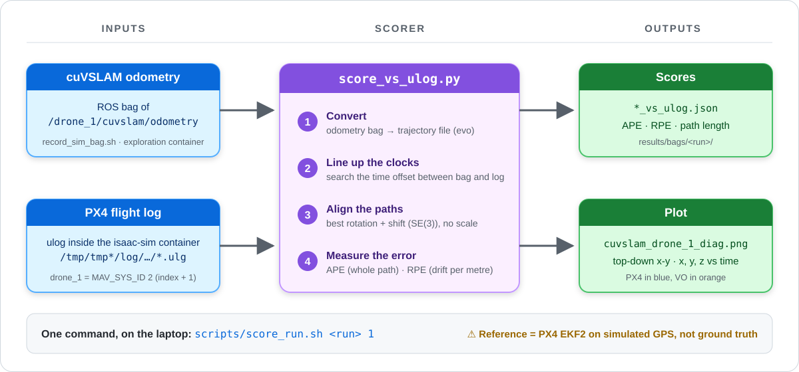

# localisation/ — camera-world sim runs (stereo VO with cuVSLAM)

> **DO · SIM.** Fly the three simulated Starlings in a textured construction site and track drone_1 with
> stereo visual odometry (VO), then score it. A sibling of `AirStack/`, never inside CMU's tree; nothing
> here touches the real drone.


*Three Starlings in the construction-site world. drone_1 carries the simulated ZED stereo camera.*

## Where it runs

| Prompt | Where | What runs there |
|---|---|---|
| `jeremychia@…$` | laptop terminal | `scripts/slam_up.sh` · `scripts/score_run.sh` · `scripts/sim_resources_watch.sh` · `scenes/construction_site/install.sh` |
| `root@…:/exploration#` | exploration container (`./docker/run.sh`) | `scripts/record_sim_bag.sh` · `scripts/sim_check.py` · `scripts/grab_frame.py` |
| Isaac Sim tab | isaac-sim container | the launch line with `ENV_USD` (step 3 below) |
| Interfaces · Commander · Cockpit tabs | robot container | unchanged — [RUNBOOK §A2–A4](../docs/RUNBOOK.md) |

## Run it

Every command, from a cold laptop. Pick a new run name each time (`sim_site_run3`, `sim_site_run4`, …) and use it in steps 7 and 9.

**1 · Laptop terminal — open the four tabs** (starts the containers if needed)
```bash
cd ~/AirStack-starling-max2 && tools/sim_terminals.sh
```

**2 · New laptop terminal — resource and WiFi watch** (leave it running)
```bash
cd ~/AirStack-starling-max2/localisation && scripts/sim_resources_watch.sh results/site_ladder/res_$(date +%m%d).log
```
Expect one line per second; `WIFI-ALERT` means the WiFi firmware crashed ([why](../docs/TROUBLESHOOTING.md#simulation-isaac-sim--px4-sitl--mavros)).

**3 · Isaac Sim tab — the sim with the camera, in the construction site** (one line)
```bash
ENV_USD=/isaac-sim/.local/share/ov/data/scenes/construction_site/construction_site_full.usdc ENABLE_CAMERA=true CAMERA_DRONES=drone_1 DRONE_USD=/isaac-sim/AirStack/simulation/isaac-sim/assets/robots/starling2max.usd PX4_VEHICLE_MODEL=pegasus_starling2max NUM_ROBOTS=3 SVG_DOMAIN_ID=1 PLAY_SIM_ON_START=true ISAAC_SIM_HEADLESS=false PYTHONPATH="$ISAAC_SIM_PYTHONPATH" /isaac-sim/python.sh /isaac-sim/AirStack/simulation/isaac-sim/launch_scripts/svg_multi_drone_single_domain.py --ext-folder ~/.local/share/ov/data/documents/Kit/shared/exts
```
Wait for `Ready for takeoff!` ×3 (about 90 s longer than the flat world). Lighter world: `construction_site_r40.usdc`. Never press Stop/Play in the Isaac window.

**4 · Interfaces tab — MAVROS for the three drones**
```bash
./src/svg_ground_control/scripts/launch_sim_interfaces.sh 3
```

**5 · Commander tab — the swarm commander + Basestation Studio**
```bash
ros2 launch svg_ground_control ground_control.launch.py config:=$(ros2 pkg prefix svg_ground_control)/share/svg_ground_control/config/cbf_sim.yaml scenario:=random_goals use_foxglove_studio:=true
```
Basestation Studio opens on `ws://localhost:8765`. First time only: import `/root/AirStack/robot/ros_ws/src/svg_ground_control/foxglove/svg_basestation.json`.

**6 · New laptop terminal — the SLAM side** (stays in the foreground; Ctrl-C stops it)
```bash
cd ~/AirStack-starling-max2/localisation && scripts/slam_up.sh
```
Expect `tracker ready`, a status line at ≥ 10 Hz, and SLAM Studio on `ws://172.31.0.200:8766`. First time only: Layouts → Import from file → `/exploration/foxglove/cuvslam_slam_view.json`.

**7 · New laptop terminal — record the run** (two commands: the second runs inside the container)
```bash
cd ~/AirStack-starling-max2/localisation && ./docker/run.sh
scripts/record_sim_bag.sh sim_site_run3
```

**8 · Cockpit tab — fly**
```bash
ros2 service call /swarm_commander/takeoff std_srvs/srv/Trigger
```
Wait for `holding takeoff position` ×3 in the Commander tab (~30 s), then:
```bash
ros2 service call /swarm_commander/start std_srvs/srv/Trigger
```
Fly about 3 minutes, then:
```bash
ros2 service call /swarm_commander/hold std_srvs/srv/Trigger
ros2 service call /swarm_commander/land std_srvs/srv/Trigger
```
Wait for `landed, disarmed` ×3 in the Commander tab. Then press Ctrl-C in the step 7 terminal to close the bag.

**9 · Laptop terminal — score it** (same run name as step 7)
```bash
cd ~/AirStack-starling-max2/localisation && scripts/score_run.sh sim_site_run3 1
```
Writes `results/bags/sim_site_run3/cuvslam_drone_1_vs_ulog.json` (APE/RPE) and `cuvslam_drone_1_diag.png` (top-down plot).

**10 · Shut down**

Press Ctrl-C in the step 6 terminal (that runs `scripts/slam_down.sh`), then in the Commander, Interfaces and Isaac Sim tabs. Close the Foxglove windows, then:
```bash
cd ~/AirStack-starling-max2/AirStack && ./airstack.sh down
```
Finally press Ctrl-C in the step 2 watch.

New to a change (a different world, more cameras)? Test one change at a time: [VALIDATION.md](scenes/construction_site/VALIDATION.md).

## What you should see


*The full session just after landing (2026-10-23).*

| # | What | Healthy sign |
|---|---|---|
| ① | SLAM Studio, `ws://172.31.0.200:8766` | connected; 3D panel follows `drone_1/cuvslam_odom` |
| ② | `/drone_1/cuvslam/debug_image` | feature dots spread over scaffolding and containers |
| ③ | `slam_up.sh` status line | `node:up bridge:up`, rate ≥ 10 Hz, `lost` stays 0 |
| ④ | bag recorder | `tracked … lost:0` |
| ⑤ | Basestation Studio, `ws://localhost:8765` | `LINK DEGRADED · EKF NO DATA · 0 sim · 3 real` are known sim cosmetics |

The SLAM Studio clock reads `1970-01-01`: that is sim time, not a fault.

## How a run is scored


*Reference = PX4 EKF2 on simulated GPS, not ground truth.* One command: `scripts/score_run.sh <run> 1` (laptop).

## Why the construction site

| | Flat default world | Construction site |
|---|---|---|
| Camera frame (640×480) |  |  |
| Top-down x-y, PX4 (blue) vs VO (orange) |  |  |

*Same tracker, same drone, different world: APE RMSE 0.88–5.3 m with 1–4 jumps > 1 m per run on the flat grid
(`sim_cam_run2–4`, 2026-10-22) vs **0.081 m over 162 m, no jumps** in the site (`sim_site_run1`, 2026-10-22, 40 m crop;
reference = EKF2).* Records: [sim_site_run1](results/sim_site_run1_record.md) · [sim_cam_run1](results/sim_cam_run1_record.md).

## The flight on video


*2026-10-23 random-goals flight in the full site (unscored). Six frames of the whole desktop:*
[contact sheet](../pictures/randompos_construction_sheet.jpg). The 64 s recording stays outside git.

## Prerequisites (this laptop only)

| What | Where it comes from |
|---|---|
| Exploration image `localisation-exploration:cu12` (~30 GB) | `docker/build.sh` (CMU robot image + cuVSLAM 17.0.1 + GTSAM + pyulog) |
| World files `construction_site_full.usdc`, `_r40.usdc` (gitignored) | `scenes/construction_site/install.sh` builds them from the UE4 export in `~/Documents/Meerkat_robot_JAZZY/…` with `~/.venvs/usd` |
| cuVSLAM wheel, SDK source | `data/downloads/` (SHA256SUMS), `data/cuVSLAM-src/` (gitignored) |

## Folder map

| Folder | What |
|---|---|
| `nodes/` | `cuvslam_stereo_node.py`: stereo VO node (odometry, path, TF, debug image, status) |
| `scripts/` | session (`slam_up/down/status`), recording, scoring, checks, the resource and WiFi watch |
| `scenes/construction_site/` | the world: [README](scenes/construction_site/README.md), [VALIDATION.md](scenes/construction_site/VALIDATION.md), build scripts |
| `docker/` | the exploration image and container (`up.sh` joins the Isaac network) |
| `foxglove/` | the SLAM Studio layout |
| `results/` | run records, the [effort log](results/effort_log.md); bags and ladder logs are gitignored |
| `reports/`, `research_notes/` | day-1 literature review on multi-drone localisation (every number sourced; nothing is our result) |

Licence note: cuVSLAM is under the NVIDIA Community License (use on NVIDIA platforms); flag it to the lead like YOLO's AGPL.
