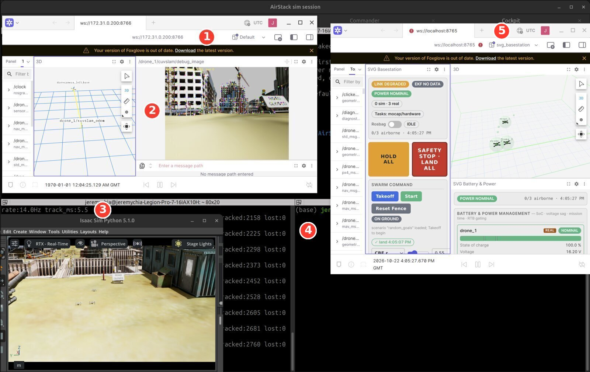
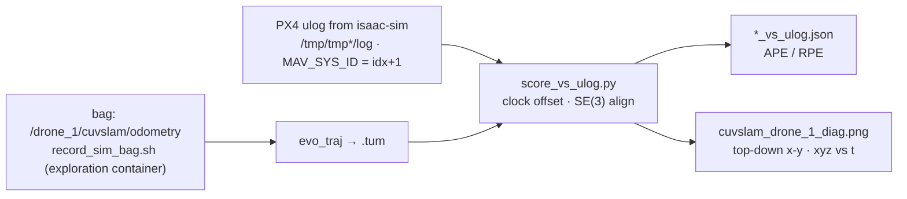
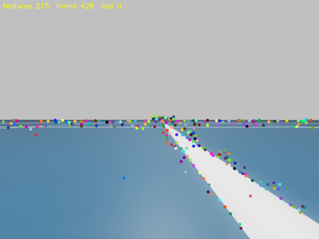
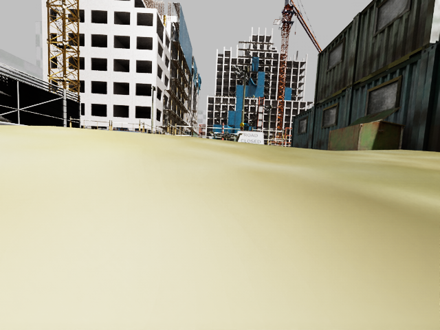

# localisation/ — camera-world sim runs (stereo VO with cuVSLAM)

> **DO · SIM.** Fly the three simulated Starlings in a textured construction site and track drone_1 with
> stereo visual odometry (VO), then score it. A sibling of `AirStack/`, never inside CMU's tree; nothing
> here touches the real drone.

*Three Starlings in the construction-site world. drone_1 carries the simulated ZED stereo camera.*

## Where it runs

| Prompt | Where | What runs there |
|---|---|---|
| `jeremychia@…$` | laptop terminal | `scripts/slam_up.sh` · `scripts/score_run.sh` · `scripts/sim_resources_watch.sh` · `scenes/construction_site/install.sh` |
| `root@…:/exploration#` | exploration container (`./docker/run.sh`) | `scripts/record_sim_bag.sh` · `scripts/sim_check.py` · `scripts/grab_frame.py` |
| Isaac Sim tab | isaac-sim container | the launch line with `ENV_USD` (step 1 below) |
| Interfaces · Commander · Cockpit tabs | robot container | unchanged — [RUNBOOK §A2–A4](../docs/RUNBOOK.md) |

## Run it

Start from a cold laptop: `~/AirStack-starling-max2/tools/sim_terminals.sh` opens the four tabs. Paths below are relative to this folder (`cd ~/AirStack-starling-max2/localisation`).

| Step | Where | Command | Expect |
|---|---|---|---|
| 0 | laptop | `scripts/sim_resources_watch.sh results/site_ladder/res_$(date +%m%d).log` | one line per second; `WIFI-ALERT` if the WiFi firmware crashes ([why](../docs/TROUBLESHOOTING.md#simulation-isaac-sim--px4-sitl--mavros)) |
| 1 | Isaac Sim tab | the tab's printed line with `ENV_USD=/isaac-sim/.local/share/ov/data/scenes/construction_site/construction_site_full.usdc ENABLE_CAMERA=true CAMERA_DRONES=drone_1` in front | `Ready for takeoff!` ×3 (the stage takes ~90 s longer) |
| 2 | Interfaces, Commander tabs | RUNBOOK §A2, §A3 with `scenario:=random_goals` | Basestation Studio on `:8765` |
| 3 | laptop | `scripts/slam_up.sh` | `tracker ready`, status line ≥ 10 Hz, SLAM Studio opens on `:8766`. First time only: Layouts → Import → `foxglove/cuvslam_slam_view.json` |
| 4 | exploration container | `./docker/run.sh`, then `scripts/record_sim_bag.sh <run>` (a new name each run) | `Recording...` |
| 5 | Cockpit tab | takeoff → start → ~3 min → hold → land (RUNBOOK §A4) | `landed, disarmed` ×3; then Ctrl-C the recorder |
| 6 | laptop | `scripts/score_run.sh <run> 1` | `results/bags/<run>/cuvslam_drone_1_vs_ulog.json` + `cuvslam_drone_1_diag.png` |
| 7 | laptop | Ctrl-C in the `slam_up.sh` terminal (= `scripts/slam_down.sh`), then RUNBOOK shutdown | SLAM Studio closes, container removed |

Lighter world: `construction_site_r40.usdc` (40 m crop) in place of `_full.usdc`. One change at a time for anything new: [VALIDATION.md](scenes/construction_site/VALIDATION.md).

## What you should see

*The full session just after landing (2026-10-23).*

| # | What | Healthy sign |
|---|---|---|
| ① | SLAM Studio, `ws://172.31.0.200:8766` | connected; 3D panel follows `drone_1/cuvslam_odom` |
| ② | `/drone_1/cuvslam/debug_image` | feature dots spread over scaffolding and containers |
| ③ | `slam_up.sh` status line | `node:up bridge:up`, rate ≥ 10 Hz, `lost` stays 0 |
| ④ | bag recorder | `tracked … lost:0` |
| ⑤ | Basestation Studio, `ws://localhost:8765` | `LINK DEGRADED · EKF NO DATA · 0 sim · 3 real` are known sim cosmetics |

The SLAM Studio clock reads `1970-01-01`: that is sim time, not a fault.

## How a run is scored

<!-- F2 · 2026-10-23 · summarises: scripts/record_sim_bag.sh, scripts/score_run.sh, scripts/score_vs_ulog.py · redraw if: topics, ulog location or the scorer's outputs change -->

*Reference = PX4 EKF2 on simulated GPS, not ground truth.* One command: `scripts/score_run.sh <run> 1` (laptop).

## Why the construction site

| | Flat default world | Construction site |
|---|---|---|
| Camera frame (640×480) |  |  |
| Top-down x-y, PX4 (blue) vs VO (orange) |  |  |

*Same tracker, same drone, different world: APE RMSE 0.88–5.3 m with 1–4 jumps > 1 m per run on the flat grid
(`sim_cam_run2–4`, 2026-10-22) vs **0.081 m over 162 m, no jumps** in the site (`sim_site_run1`, 2026-10-22, 40 m crop;
reference = EKF2).* Records: [sim_site_run1](results/sim_site_run1_record.md) · [sim_cam_run1](results/sim_cam_run1_record.md).

## The flight on video

*2026-10-23 random-goals flight in the full site (unscored). Six frames of the whole desktop:*
[contact sheet](../pictures/randompos_construction_sheet.jpg). The 64 s recording stays outside git.

## Prerequisites (this laptop only)

| What | Where it comes from |
|---|---|
| Exploration image `localisation-exploration:cu12` (~30 GB) | `docker/build.sh` (CMU robot image + cuVSLAM 17.0.1 + GTSAM + pyulog) |
| World files `construction_site_full.usdc`, `_r40.usdc` (gitignored) | `scenes/construction_site/install.sh` builds them from the UE4 export in `~/Documents/Meerkat_robot_JAZZY/…` with `~/.venvs/usd` |
| cuVSLAM wheel, SDK source | `data/downloads/` (SHA256SUMS), `data/cuVSLAM-src/` (gitignored) |

## Folder map

| Folder | What |
|---|---|
| `nodes/` | `cuvslam_stereo_node.py`: stereo VO node (odometry, path, TF, debug image, status) |
| `scripts/` | session (`slam_up/down/status`), recording, scoring, checks, the resource and WiFi watch |
| `scenes/construction_site/` | the world: [README](scenes/construction_site/README.md), [VALIDATION.md](scenes/construction_site/VALIDATION.md), build scripts |
| `docker/` | the exploration image and container (`up.sh` joins the Isaac network) |
| `foxglove/` | the SLAM Studio layout |
| `results/` | run records, the [effort log](results/effort_log.md); bags and ladder logs are gitignored |
| `reports/`, `research_notes/` | day-1 literature review on multi-drone localisation (every number sourced; nothing is our result) |

Licence note: cuVSLAM is under the NVIDIA Community License (use on NVIDIA platforms); flag it to the lead like YOLO's AGPL.
