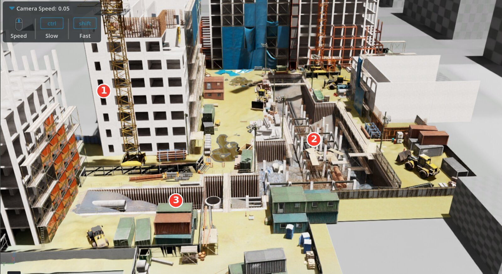

# Construction-site arena (textured world for the camera / stereo-VO sim runs)

Why: the Pegasus default environment is a flat grid plane with no walls. cuVSLAM teleported 5–10 m in
sim_cam_run2–4 every time drone_1 faced outward at the fence edge, pitched up, seeing only sky, horizon and a
repeating grid (see `results/sim_cam_run*_record.md`). A world with nearby structure fixes the input, not the tracker.

*The site from above. ① cranes and building frames, ② the excavation (the spot picker keeps 8 m away), ③ containers and plant: the near structure stereo VO tracks.*

Source: the lab's UE4-exported scene `~/Documents/Meerkat_robot_JAZZY/Simulation Files/AI_training/Construction_site/Scene02_nohumans.usd`
(546 × 575 m site, 5.3 k objects, 12 k UsdPreviewSurface materials, all references resolve). Not modified.

Files here
- `construction_site_arena.usda` — wrapper. References `/World/construction_site_withrobot` and `/World/Added_Assets`
  from Scene02 (NOT the Meerkat robot, its OmniGraphs, render products or PhysicsScene) under `/stage/site`, translated by
  (+32.0, +12.5, −0.17) so the level clear patch at site (−32, −12.5) is the drones' origin at ground level
  (4 m clear radius; pipes/rebar at 3–6 m, cargo container at 5 m, scaffolding at 5 m; 135 props within 12 m).
  Default prim `stage` → Pegasus references it to `/World/stage`; the launcher clears that prim's xform ops, so the
  translation sits on the child `site`.
- `build_arena_usda.py` — the generator (needs `pip install usd-core scipy numpy` in a venv): reads the Landscape2
  terrain mesh for a height map, rejects spots that are rough (>0.3 m over a 10 m window), within 8 m of the excavation
  ("Landscape" mesh / pit contents below −1 m) or inside objects, and ranks by distinct props within 12 m.
  `--spot X Y` forces a site coordinate.
- `install.sh` — copies wrapper + Scene02 + its Assets folder (143 MB) into `~/docker/isaac-sim/data/scenes/construction_site`,
  which is mounted into the isaac-sim container at `/isaac-sim/.local/share/ov/data/scenes/construction_site`.

Derivatives built by `crop_site.py` (flatten by hand, one copy per unique material, textures beside the file; the raw wrapper is
too heavy to be worth loading): `build/construction_site_full.usdc` (all objects, 25k prims, 137 materials, DEFAULT) and
`build/construction_site_r40.usdc` (40 m around the flight spot, 4.8k prims, 68 materials).

Launch: add `ENV_USD=/isaac-sim/.local/share/ov/data/scenes/construction_site/construction_site_full.usdc` in front of the
usual **Isaac Sim tab** line (RUNBOOK §A1). `_full.usdc` is the default; `_r40.usdc` is the lighter fallback. Launcher support
added 2026-10-22 in `svg_multi_drone_single_domain.py` (`patches/0005`); 90 s stage wait when set.

Known texture limitation: the UE4 export baked 672 of 682 textures at 128 × 128 px (only the landscape sets are 1024²),
so surfaces look soft up close. Geometry (edges, props) is what stereo VO tracks, so this is accepted for now. Fixing it means
re-exporting from UE 4.21 with a larger texture size, or extracting the originals from the project's uassets.
