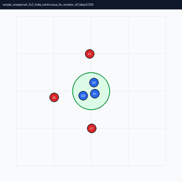
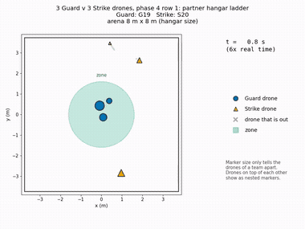
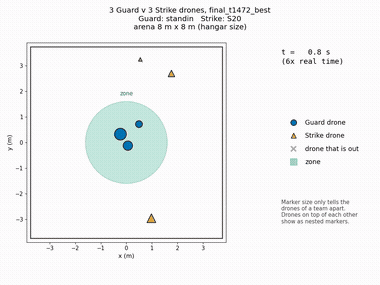

READ FIRST · TRAINING SIMULATOR ONLY: what this folder is, what we did with NUS's code, and where to go next.

# svg_training: drone teams that learn in a simulator

**For** anyone new here, including the NUS team. You need no drone, ROS or Isaac knowledge. *Italic* words are in the
[glossary](docs/GLOSSARY.md). Every number was observed in a training simulator; nothing in this folder has flown.

**What this is.** The rest of this repository flies two small indoor drones (ModalAI Starling 2 Max) with CMU's
ground-control software, AirStack. This folder is separate: a game on one graphics card (GPU) where a *Guard team*
holds a circular zone and a *Strike team* tries to reach it, thousands of games at once. We use it to train team
strategies and to test whether a strategy trained elsewhere still works with our drones' limits.

## For the NUS team: what we did with your code

Your *defender* is our Guard team and your *attacker* our Strike team; on our hangar set-up 1 unit = 0.40 m and
1 step = 0.60 s. We ran your `area-denial-continuous-space-self-play` code (commit `2d2b904`) unchanged and trained
policies with it on that set-up. We copied your game into PyTorch, converted those policies, then changed the game one
step at a time towards our drones. Every PASS below grades our copy against your code, never your code.

| Phase | What | Simulator | Result | Evidence |
|---|---|---|---|---|
| 1 | your code, installed | your 2-D game (JAX) | 65 of your 66 tests pass; the one failure checks an older Guard safety distance, which you confirmed is out of date | [record](records/2026-11-17_nus_phase1_install_record.md) (INFO, written after the fact) |
| 2a | policies trained with your code: 3 self-play seeds × 8 generations (your default is 32), seed 2 continued to 20 | your 2-D game | seed 2's Guard *G19* against its Strike *S20*: Strike wins 0.023 of 256 games (your evaluator and starts) | [training](records/2026-11-17_nus_phase2a_training_record.md), [matrix](records/2026-11-18_nus_selfplay_matrix_record.md) (INFO, after the fact) |
| 2 | your game, copied to PyTorch | our replica | same game step by step: position error ≤ 5.7e-6 units (limit 1e-4). PASS | [T15](records/2026-11-17_nus_phase2_parity_record.md) |
| 3 | the policies, converted to PyTorch | our replica | action error ≤ 0.0105 units (limit 0.02); reach counts inside your code's 95 % interval. PASS | [T16](records/2026-11-18_nus_phase3_conversion_record.md), [T17](records/2026-11-18_nus_phase4_w3_reference_gates_record.md) |
| 4 | one change at a time, towards our drones | replica → our drone model → Isaac Lab | G19 v S20, Strike reaches of 1,000: 9 → 17 → 43 → 740 → 983 → 979 | [NUS_RESULTS Q3](docs/NUS_RESULTS.md#q3-what-does-each-drone-limit-do) |
| 5 | your training method, ported to PyTorch | our replica, then our drone model | **in progress.** Reference rebuilt (R0 PASS); our test fails untrained learners (N0 PASS) and passes your own code with new seeds (C0 PASS), as it must; 5.1 (our copy, 3 seeds) running. Our own simple learner did not learn at first (pilot P1: a faulty set-up); fixed (pilot P1b) it holds the zone against your S20 in 829 of 1,000 games (a parked Guard: 429), one seed, one opponent ([T41](records/2026-11-19_nus_phase5_pilot_p1b_run4_record.md)) | T29, T30, [T33](records/2026-11-19_nus_phase5_c0_positive_control_record.md); [NUS_PORT §12](docs/NUS_PORT.md#12-phase-5-your-training-method-in-pytorch-in-progress) |

**What it shows.** Phase 2a's 0.023 and row 1's 9 of 1,000 come from different start sets
([Q2](docs/NUS_RESULTS.md#q2-does-the-converted-policy-match-yours)). The ladder measures how policies trained for your
game transfer to our drones, not your method. The Guards likely hold by pushing Strike drones aside. Our flight
software's *safety filter* makes *both* drones of every close pair give way, team-mates included, so pushing likely
stops working (row 4: 43 → 740). With free height, Strike drones pass over or under (row 5: 983). "Likely": row 4
changes two things at once (no push, and no stacking of team-mates), and we have not split them yet. The caveats sit
beside each number in [NUS_RESULTS](docs/NUS_RESULTS.md).

*Figure 1. Strike reach rate (Wilson 95 %) of the 12 core pairs, rows 1–6; dashed: a Guard team that stands still. T18–T24.*

## Watch it

The pictures play here; click one for the full video. Top-down view, Guard team blue circles, Strike team orange
triangles, the zone green. Every clip is observed in the training simulator; nothing here has flown. All
286 clips, with what each shows: [docs/media/nus/](docs/media/nus/README.md) (GitHub plays GIFs inside a page, but an
MP4 link opens the file on its own page).

| | |
|---|---|
|  1 · your 2-D game: your Guard G19 holds your Strike S20 |  2 · our copy of your game (row 1): G19 still holds |
|  3 · our safety filter on every pair (row 4): S20 gets in |  4 · free height, 3-D (row 5): S20 gets in |
|  5 · Isaac Lab Starlings (row 6): the same |  6 · Isaac Lab: one of the 21 in 1,000 games G19 still holds |
|  7 · a Guard team that just parks (row 5): holds 429 of 1,000 |  8 · our own simple learner (pilot P1b): holds 829 of 1,000 |

## Questions for you

1. Is our copy of your game missing any rule that matters?
2. Would you retrain on your side with action hold, delay, our safety filter and free height?
3. Is `train_self_play` (no APEX) the right baseline for us to copy?
4. Is 3 v 3 in 3-D with no drop-outs the right first goal?
5. Should any of your settings change for a slower environment?

## Try it: commands for every level in [TRY_IT](docs/TRY_IT.md)

| Level | You need | Needs | Time | Verified from a fresh clone |
|---|---|---|---|---|
| A · watch the games | a browser | `none` | 5 min | yes |
| B · install, run the tests, score a strategy | Python 3.11, any CPU | `none` | ~5 min + ~10 min tests | yes (0 failed) |
| C · the same at full size | an NVIDIA GPU | `GPU` | ~1 h | not yet |
| D · repeat our ladder rows | our PROVISIONAL files (or your NUS clone) | `none` | under 2 min for row 1 (CPU) | yes (row 1) |
| E · the Isaac Lab row and clips | + Isaac Lab 2.3.2 | `Isaac` | hours | not yet |

## Read next

| I want to… | Page |
|---|---|
| the answers, one table per question | [docs/NUS_RESULTS.md](docs/NUS_RESULTS.md) |
| every phase, in order | [docs/NUS_PORT.md](docs/NUS_PORT.md) |
| the game as an RL environment | [docs/HOW_IT_WORKS.md](docs/HOW_IT_WORKS.md) |
| plug in my own strategy or trainer | [docs/PLUG_IN.md](docs/PLUG_IN.md) |
| every run | [records/LEDGER.md](records/LEDGER.md) (how to read it: [records/README.md](records/README.md)) |
| a map of every page | [docs/README.md](docs/README.md) |

Files marked INTERNAL are the lab's working notes and AI-assistant set-up: you never need them.
We used AI coding assistants for much of this work; every number links to the record of the run that produced it.
