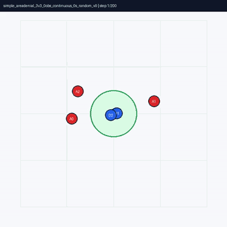
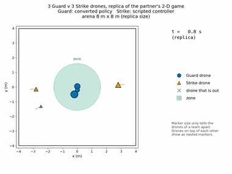
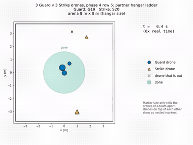
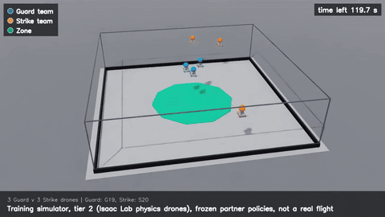
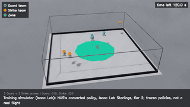
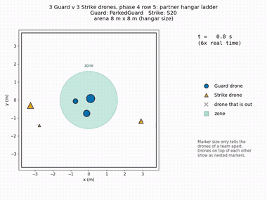

READ FIRST · TRAINING SIMULATOR ONLY: what this folder is, what was done with NUS's code, and where to go next.

# svg_training: drone teams that learn in a simulator

**For** NUS researchers and anyone new here; no drone, ROS or Isaac knowledge is assumed. **STE**: the lab that wrote
this repository. *Italic* terms are defined in the [glossary](docs/GLOSSARY.md). Every number was observed in a
training simulator; nothing in this folder has flown. T numbers (T15, …) are rows of the [run ledger](records/LEDGER.md),
each with its record; PASS and FAIL mean a pass mark set before the run was met or missed, INFO means measured with
no pass mark.

## At a glance: what was done

The whole story on one screen; sections 1–8 below give the numbers, caveats and records behind each line.

**The six tests** (G19 vs S20; the same 1,000 starts in every test), and on the right, in Test 5 conditions, how often
each Guard holds the zone:

*Figures drawn by `scripts/make_overview_figures.py`.*

### The whole story

1. **Trained with NUS's code (JAX)**, in NUS's conditions. Gave G19, S20, P3G and P3S. *(Phase 2a)*
2. **Copied NUS's game into PyTorch.** Same conditions, checked it matches exactly. *(Phase 2)*
3. **Converted the policies to PyTorch.** Same conditions, checked they act the same. *(Phase 3)*
4. **Tested the policies, changing conditions one at a time.** Nothing was trained here. *(Phase 4)*

   | Test | Conditions | Strike reaches, of 1,000 |
   |---|---|---|
   | 1 | NUS's conditions, in PyTorch (the baseline) | 9 |
   | 2 | + STE game engine: 0.6 s decisions, walls, simple keep-apart | 17 |
   | 3 | + drone delay and lag | 43 |
   | 4 | + **safety filter**: no pushing | **740** |
   | 5 | + **3-D**: over and under | **983** |
   | 6 | same, on **Isaac Lab** physics drones (test only) | **979** |

   **Why it breaks:** NUS's Guards learned to **push** Strikes away, which STE drones cannot do (Test 4). In 3-D,
   Strikes also slip over or under (Test 5). ("Likely": Test 4 changes two things at once; see section 5.)
5. **Retraining, so a policy works in STE conditions.** *(Phase 5, in progress)*
   - **STE Guard policy (pilot P1b):** trained in **Test 5 conditions**, on the STE drone model in PyTorch, not in Isaac
     Lab. **Holds 829 of 1,000.** ✅ It learned a different defence: spread out inside the zone and let the safety
     filter act like a wall.
   - **STE port of NUS's training method (PyTorch):** being checked in NUS's conditions (stage 5.1). Stage 5.2 would
     then train with it in STE conditions.
6. **Next:** test the trained Guard in **Isaac Lab** (5.3), then the AirStack hand-over and a flight plan, with CMU.

**In one line:** trained in NUS's game, tested on STE drones (NUS's policies failed), retrained in STE drone conditions
(the STE Guard policy works), Isaac Lab check next.

### NUS's conditions vs STE drone conditions

| | NUS's game (original) | STE drones | Added in |
|---|---|---|---|
| **How a drone moves** | a point; each step it simply jumps to its new position, no inertia | a drone given a **speed command** through CMU's commander, with the **delay and lag** of a real Starling; it speeds up and slows down gradually | Test 3 |
| **Decision timing** | one action per game step | one action held for **0.6 s** (scale: 1 unit = 0.4 m, 1 step = 0.6 s) | Test 2 |
| **Contact between drones** | drones may touch; overlapping drones **push each other apart**, so a Guard can shove a Strike away | **no contact allowed.** Test 2 uses a simple keep-apart rule between opposing drones; Test 4 uses the real **safety filter** from the flight software: every pair, team-mates too, slows or swerves to stay **1.10 m apart** | Tests 2 and 4 |
| **Height** | flat 2-D plane | **free height (3-D)**: drones fly at about 1.2 m, but the filter can move them up or down, so Strikes can pass **over or under** Guards | Test 5 |
| **Arena** | open plane, no walls (Guards kept inside a circle of 8 units) | the **7.5 m hangar**, with walls | Test 2 |
| **Physics** | none (simple maths) | **Isaac Lab**: full rigid-body Starling drones with a PX4-style controller | Test 6 |

## 1. Overview

STE flies small indoor drones (ModalAI *Starling* 2 Max) with CMU's flight software, AirStack. This folder holds a
drone-team game that runs thousands of copies at once on one graphics card (GPU): a Guard team holds a circular zone,
a Strike team tries to reach it. It was used to test policies trained with NUS's self-play code under STE drone conditions, and to train a Guard team
in those conditions.

**Policies named on these pages.** NUS's code calls the teams `defender` and `attacker`: here, defender (Guard team)
and attacker (Strike team), then Guard and Strike. NUS shared its code, not trained checkpoints, so STE trained the
NUS-code policies itself with that code. Full definitions: [glossary, policies](docs/GLOSSARY.md#policies).

| Label | NUS run folder → entry | Trained by | Code / simulator / library |
|---|---|---|---|
| G19 | `2026-11-17_selfplay_3v3_seed2` → `archive/0019_defender` | STE, using NUS's code (NUS gave no checkpoints) | NUS self-play runner / NUS 2-D game / JAX |
| S20 | same run → `archive/0020_attacker` | STE, using NUS's code | same |
| P3G | `2026-11-17_fixed_apf_3v3_defender` | STE, using NUS's code | NUS fixed-opponent runner / NUS 2-D game / JAX |
| P3S | `2026-11-17_fixed_apf_3v3_attacker` | STE, using NUS's code | same |
| APF defender / APF attacker | NUS's scripted `apf` opponent (config `scripted_opponent: apf`) | written by NUS, no training | ported to PyTorch by STE |
| Parked Guard | — | STE baseline, no training | every Guard drone commands zero speed from its start point; one starts at the zone centre |
| STE Guard policy | `pilot_p1b` run 4 | STE | skrl IPPO / STE drone model, Test 5 conditions / PyTorch |

G19 = Guard of generation 19 and S20 = Strike of generation 20 of self-play seed 2; P3G and P3S = the Guard and Strike
converted in Phase 3 (each trained against NUS's scripted opponent); IPPO = independent PPO, one learner per drone.
The STE drone model and Test 5 conditions are defined in section 3, pilot P1b in section 6.

## 2. Porting NUS's code

The port ran in numbered phases. STE installed NUS's `area-denial-continuous-space-self-play` code (commit `2d2b904`) unchanged, trained the policies
above with it on the STE *hangar set-up* (1 unit = 0.40 m, 1 step = 0.60 s, a 7.5 m square arena), then copied the
game and the trained policies into the STE pipeline (PyTorch). Each copy was checked against NUS's code; every PASS
grades the copy, never NUS's code.

| Phase | What | Simulator | Result | Evidence |
|---|---|---|---|---|
| 1 | NUS's code, installed | NUS 2-D game (JAX) | 65 of NUS's 66 tests pass; the one failure checks an older Guard safety distance, which NUS confirmed is out of date | [record](records/2026-11-17_nus_phase1_install_record.md) (INFO, written after the fact) |
| 2a | policies trained with NUS's code: 3 self-play seeds × 8 generations (NUS default 32), seed 2 continued to 20 | NUS 2-D game (JAX) | G19 v S20: Strike reaches the zone in 0.023 of 256 games (NUS's evaluator and starts) | [training](records/2026-11-17_nus_phase2a_training_record.md), [matrix](records/2026-11-18_nus_selfplay_matrix_record.md) (INFO, after the fact) |
| 2 | the game, copied to PyTorch | Copy of NUS 2-D game (PyTorch) | the same game step by step: position error ≤ 5.7e-6 units (limit 1e-4). PASS | T15, [record](records/2026-11-17_nus_phase2_parity_record.md), [the copy checked](docs/WHAT_WE_FOUND.md#1-copy-of-nus-2-d-game-pytorch-matches-nus-2-d-game-jax) |
| 3 | the policies, converted to PyTorch | Copy of NUS 2-D game (PyTorch) | action error ≤ 0.0105 units (limit 0.02); reach counts inside the 95 % interval of NUS's code. PASS | T16, [record](records/2026-11-18_nus_phase3_conversion_record.md); T17, [record](records/2026-11-18_nus_phase4_w3_reference_gates_record.md); [the conversion checked](docs/WHAT_WE_FOUND.md#2-converted-policies-match-the-jax-originals) |

### The same match in NUS's JAX code and in the PyTorch copy

Each match-up was played on the same 1,000 starts twice: in NUS's own JAX game with NUS's JAX policy, and in the Copy
of NUS 2-D game (PyTorch) with the converted policy.

| Match-up (Guard vs Strike) | NUS's JAX code | PyTorch copy | Games that differ | Evidence |
|---|:-:|:-:|:-:|---|
| P3G vs APF attacker | 48 | 46 | 6 | T16, [record](records/2026-11-18_nus_phase3_conversion_record.md) |
| APF defender vs P3S | 1,000 | 1,000 | 0 | T16, [record](records/2026-11-18_nus_phase3_conversion_record.md) |
| G19 vs S20 | 17 | 15 | — | T17, [record](records/2026-11-18_nus_phase4_w3_reference_gates_record.md) |

*Strike reaches the zone, of 1,000 games. The counts agree within chance.*

**What the policy names mean:**

| Name | Team | What it is |
|---|---|---|
| **P3G** | Guard | trained against NUS's scripted attacker (the set-up of NUS's October report); trained by STE with NUS's code |
| **P3S** | Strike | trained against NUS's scripted defender; trained by STE with NUS's code |
| **G19** | Guard | from NUS's self-play (Guard and Strike trained in turns), generation 19; trained by STE with NUS's code |
| **S20** | Strike | the same self-play run, generation 20 |
| **APF attacker** | Strike | NUS's scripted Strike: hand-written rules (a potential field), no learning |
| **APF defender** | Guard | NUS's scripted Guard: hand-written rules, no learning |

**Videos** (one game each; the two in a row are not the same start; click for the full video):

| Match-up | NUS's JAX game | Copy of NUS 2-D game (PyTorch) |
|---|:-:|:-:|
| **P3G vs APF attacker** Guard holds |  |  |
| **APF defender vs P3S** Strike reaches the zone |  |  |
| **G19 vs S20** Guard holds |  |  |

P3G and P3S used NUS's learning settings with two changes: 3,000 updates per team (76.8 million environment steps,
about 6.5 minutes; NUS's default has no practical limit) and the hangar arena (start distance and Guard boundary 8 units
instead of 20). Their strength is therefore not directly comparable with the policies in NUS's October report.

## 3. The game: NUS 2-D game vs STE drone set-up

Both sides play the same Strike vs Guard game: 3 Guard drones hold a zone of 1.6 m radius (NUS: 4 units) at the
centre, 3 Strike drones, 1.5 times as fast, try to reach it, and a game lasts 200 steps (120 s on the hangar set-up).
They differ in how the drones move and meet. The STE column is the set-up of Test 5 (the STE Guard policy was trained
in it) and Test 6 (the same on the Isaac Lab physics drones); the tests of section 4 add its conditions one at a time,
and the table says where each enters.

| | NUS 2-D game | STE drone set-up |
|---|---|---|
| Movement | point drones that jump each step by a move up to the team's cap (Guard 0.5, Strike 0.75 units: 0.20 m and 0.30 m per step on the hangar set-up) | each speed command goes through a copy of CMU's commander, then the delay and lag of a model fitted to one Starling flight log (from Test 3; exploratory: it answers more slowly than the real drone); in Test 6, rigid-body Starling models flown by a copy of PX4's control loops. Same team speeds: Guard 0.333 m/s, Strike 0.50 m/s |
| Contact | a soft push keeps the teams apart within each step (1.2 m around a Guard drone, 1.0 m around a Strike drone, on the hangar set-up), so pushing a Strike drone aside is allowed; team-mates may overlap | no contact: the safety filter makes both drones of any close pair give way, team-mates included, keeping them 1.10 m apart (from Test 4; Tests 2–3 use the push-apart). It acts on speed commands, not positions, so drones can come closer: 1.083 m in a test on the STE drone model; with the STE Guard policy in Test 5 conditions the closest Guard–Strike approach was 0.87 m in 3-D, and 0.5 % of games had a rule breach (closer than 1.10 m) |
| Height | 2-D: every drone in one plane | every drone at 1.2 m in Tests 2–4; free height from Test 5: the policies send no vertical command, but with a ±1 mm start jitter the filter's give-way can turn vertical, and drones pass over or under each other |
| Arena and walls | no walls; Guard drones kept inside a circle of 8 units (3.2 m), Strike drones start 8 units (3.2 m) from the centre (`defender_boundary` and `spawn_distance` 8.0 on the hangar set-up; NUS's defaults are 20 units) | the hangar box: a 7.5 m square with walls at ±3.75 m (from sub-test 2.2), inside the hangar's usable flying box of about 7.6 m × 7.9 m; the same zone and starts. Flying it would first need the flight software's keep-in fence (±3.25 m today) moved |
| Decision rate | one action per step; NUS's game has no seconds, and STE's scale makes a step 0.60 s | one action per 0.60 s, held for 12 ticks of 0.05 s (from Test 2) while the commander and the filter act every tick |
| Simulator / library | NUS 2-D game, JAX (NUS's code); for Test 1, STE's Copy of NUS 2-D game in PyTorch | STE game engine and STE drone model, PyTorch (Tests 2–5); Isaac Lab physics drones on Isaac Sim 5.1 (Test 6) |
| One game |  G19 vs S20 · NUS 2-D game (JAX) · Guard holds |  G19 vs S20 · Test 5: STE drone model + free height · Strike reaches the zone |

Values: [what we did, day by day, NUS's game](docs/WHAT_WE_DID_DAY_BY_DAY.md#1-the-nus-code-three-branches) and
[the hangar geometry](docs/WHAT_WE_DID_DAY_BY_DAY.md#3-phase-0-answers-and-the-hangar-geometry). Click a picture for the
full video. Terms, one line each (all in the [glossary](docs/GLOSSARY.md)):

- *Copy of NUS 2-D game*: STE's batched PyTorch copy of NUS's game, checked step by step against it (section 2).
- *STE game engine*: STE's batched game in PyTorch; in Test 2 with NUS's speeds, zone and scoring, square walls and the push-apart.
- *Push-apart*: an STE rule that cuts short a move that would bring a drone within 1.10 m of an opposing drone (Tests 2–3).
- *STE drone model*: a point drone that follows its speed command through a copy of CMU's commander (the AirStack
  program that turns speed commands into drone instructions), then the delay and lag of a model fitted to one Starling
  flight log (exploratory: it answers more slowly than the real drone).
- *Safety filter*: CMU's collision filter in the flight software; when two drones come close it makes both give way,
  keeping them 1.10 m apart.
- *Isaac Lab physics drones*: rigid-body Starling models in NVIDIA Isaac Lab (a robot-learning framework on NVIDIA's
  Isaac Sim simulator), flown by a copy of PX4's control loops (PX4: the drone's flight software).
- *Test 5 conditions*: the hangar game of Test 5 (STE drone model, safety filter on every pair, free height), the game
  the STE Guard policy was trained in.

## 4. Testing NUS's policies on STE drones

Phase 4 scored the converted policies (G19, S20, P3G, P3S: trained by STE with NUS's code), frozen, in six tests; each test adds one real-drone condition (Tests 2 and 4
change two things at once; [test results](docs/WHAT_WE_FOUND.md#3-six-tests-towards-ste-drones)). 1,000 games per
pair, the same 1,000 starts in every test.

| Test | Played in | G19 v S20: Strike reaches of 1,000 | Evidence |
|---|---|---|---|
| 1 | Copy of NUS 2-D game, in PyTorch | 9 | T18, [record](records/2026-11-18_nus_phase4_rung1_record.md) |
| 2 | STE game engine (PyTorch), NUS rules, action held for each 0.6 s step | 17 | T19, [record](records/2026-11-18_nus_phase4_rung2_record.md) |
| 3 | STE drone model (PyTorch): + Starling delay and lag | 43 | T20, [record](records/2026-11-18_nus_phase4_rung3_record.md) |
| 4 | STE drone model: + safety filter on every drone pair | 740 | T22, [record](records/2026-11-18_nus_phase4_rung4_2_record.md) |
| 5 | STE drone model: + free height (3-D) | 983 | T23, [record](records/2026-11-18_nus_phase4_rung5_record.md) |
| 6 | Isaac Lab physics drones (Isaac Sim 5.1) | 979 | T24, [record](records/2026-11-18_nus_phase4_rung6_record.md) |

Terms: [the game, section 3](#3-the-game-nus-2-d-game-vs-ste-drone-set-up). The records call the tests "ladder rows": Test N = ladder row N.

*Figure 1. Strike reach rate (with a Wilson 95 % confidence interval) of 12 pairs, G19, P3G, APF defender and Parked
Guard against S20, P3S and APF attacker, Tests 1–6 (the axis says "row": row N = Test N); dashed: the Parked Guard.
T18–T24.*

## 5. Why performance drops

- **No physical contact: the safety filter.** The NUS-code Guards likely hold by pushing Strike drones aside, which
  NUS's game allows. The safety filter makes *both* drones of every close pair give way, team-mates included, so
  pushing likely stops working (Test 4: 43 → 740). "Likely": Test 4 changes two things at once (no push, and no
  stacking of team-mates), and the two have not been split yet.
- **Drones pass above and below each other: 3-D.** With free height, Strike drones pass over or under the Guards
  (Test 5: 983); the horizontal closest approach falls while the 3-D one stays at 1.09 m.
- The Isaac Lab physics drones agree with the STE drone model (Test 6: 979). These numbers measure how policies
  trained for NUS's game transfer to STE drones, not NUS's method. Caveats beside each number:
  [test results](docs/WHAT_WE_FOUND.md#3-six-tests-towards-ste-drones).

## 6. Training in STE conditions

The STE Guard policy (trained in pilot P1b; a *pilot* is a short training run with no gate) holds the zone against
S20 in **829 of 1,000** games in Test 5 conditions, against 429 for the Parked Guard (evidence: T41, [record](records/2026-11-19_nus_phase5_pilot_p1b_run4_record.md)). Its Guards spread
out across the zone and the safety filter likely acts as a wall around each one (read from the videos, not tested).
One seed, one opponent, not checked on the Isaac Lab physics drones:
[the result](docs/WHAT_WE_FOUND.md#7-ste-guard-policy-trained-in-test-5-conditions),
[training recipe](docs/TRAIN_A_GUARD.md). The STE port of NUS's training method (PyTorch) is in progress: the test it will face
is calibrated (it passes NUS's own code run with new seeds and fails untrained policies; R0, N0, C0 PASS), and its own
seeds have no result yet
([training method](docs/WHAT_WE_FOUND.md#6-ste-port-of-nus-training-method-no-result-yet)).

## Watch it

Top-down view: Guard team blue circles, Strike team orange triangles, the zone green. The pictures play here; click
one for the full video. Observed in the training simulator; nothing here has flown. All 275 clips of the NUS port,
each with a preview that plays in the page: [videos of the NUS port](docs/media/nus/README.md).

| | |
|---|---|
|  G19 vs S20 · NUS 2-D game (JAX) · Guard holds |  G19 vs S20 · Test 1: Copy of NUS 2-D game (PyTorch) · Guard holds |
|  G19 vs S20 · Test 4: STE drone model + safety filter · Strike reaches the zone |  G19 vs S20 · Test 5: STE drone model + free height · Strike reaches the zone |
|  G19 vs S20 · Test 6: Isaac Lab physics drones · Strike reaches the zone |  G19 vs S20 · Test 6: Isaac Lab physics drones · Guard holds (21 of 1,000) |
|  Parked Guard vs S20 · Test 5: STE drone model + free height · Guard holds (429 of 1,000) |  STE Guard policy vs S20 · Test 5 conditions · Guard holds (829 of 1,000) |

## 7. Next steps and open questions

Next on the STE side: the first results of the STE port of NUS's training method; the STE Guard policy against other
Strike behaviours and on the Isaac Lab physics drones; two control tests that split the two effects of Test 4.
Five questions to NUS:

1. Is any rule that matters missing from the Copy of NUS 2-D game (PyTorch)?
2. Would NUS retrain with its own code under action hold, delay, the safety filter and free height?
3. Is `train_self_play` (no APEX) the right baseline for the STE port of NUS's training method?
4. Is 3 v 3 in 3-D with no drop-outs the right first goal?
5. Should any NUS setting change for a slower environment?

## 8. Run it yourself

Commands for every level, with what each must print: [how to run it yourself](docs/RUN_IT_YOURSELF.md). Badges:
`none` = any laptop, no GPU; `GPU` = an NVIDIA GPU; `Isaac` = NVIDIA Isaac Lab 2.3.2 on Isaac Sim 5.1.0.

| Level | What | Needs | Time | Verified from a fresh clone |
|---|---|---|---|---|
| A | watch the games | `none` | 5 min | yes |
| B | install, run the tests, score a strategy | `none` (Python 3.11, any CPU) | ~5 min + ~10 min tests | yes (0 failed) |
| C | the same at full size | `GPU` | ~1 h | not yet |
| D | repeat Tests 1–5 from the PROVISIONAL files (the converted weights and STE settings, committed only so the numbers can be repeated) | `none` | under 2 min for Test 1 (CPU) | yes (Test 1) |
| E | Test 6 and the Isaac Lab clips | `GPU` `Isaac` | hours | not yet |
| F | train the STE Guard policy: [training recipe](docs/TRAIN_A_GUARD.md) | `none` for the CPU check, `GPU` for the run | 2 min (CPU check); 2.1 h (RTX 5090) | not yet (the CPU check ran in a lab worktree) |

| Page | What it holds |
|---|---|
| [What we found](docs/WHAT_WE_FOUND.md) | every result, with its caveat and record |
| [What we did, day by day](docs/WHAT_WE_DID_DAY_BY_DAY.md) | the NUS port, phase by phase |
| [The game](docs/THE_GAME.md) | the pipeline in one picture; the game as an RL environment |
| [Plug in your code](docs/PLUG_IN_YOUR_CODE.md) | connect a strategy or a training method, and score it |
| [Glossary](docs/GLOSSARY.md) | every term: NUS terms and the terms used here |
| [Run ledger](records/LEDGER.md) | every run, one row each ([how to read a record](records/README.md)) |
| [Map of the pages](docs/README.md) | every page with its label, and the history |

Files marked INTERNAL are STE's working notes and AI-assistant set-up; they are not needed. AI coding assistants did
much of this work; every number links to the record of the run that produced it.
