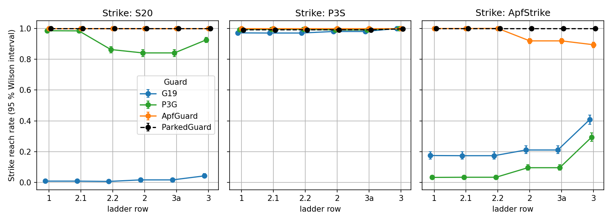

# NUS port, Phase 4: the transfer ladder (complete: rungs 1 to 6)

Observed in the training simulator (the replica of the partner's 2-D game, then our game with point drones, with the exploratory fitted drone
model, and on Isaac Lab physics drones). Nothing is flown. The partner's converted policies stay frozen; each row changes one behaviour (rung 2 changes two, owner answer 3). INFO runs
without gates; T17 (the archive pair through Phase 3's gates) PASSED. Every number is a Strike reach rate with its Wilson 95 % interval from 1,000 paired
games per pair on one starts file and one seed: no method claim. The records mark values that equal a local (partner or hangar) value as "at the local value"; since 18 Nov 2026 NUS agreed that its settings may be stated, and they are in [NUS_PORT §3](NUS_PORT.md#3-phase-0-answers-and-the-hangar-geometry).

**Rows 4, 5a, 5 and 6** (the all-pairs safety filter, 3-D at one height, the physics drone in Isaac Lab) ran one after another in the background
with `--accept-long`, 05:52 to 13:54 on 18 November 2026 (T22–T24; the first foreground attempt at row 4 is T21 ABORTED:
`records/2026-11-18_nus_phase4_rung4_record.md`). The whole NUS port, with NUS's own runs, the self-play matrix, the full table and every
clip: [NUS_PORT](NUS_PORT.md).

*Figure 1. Strike reach rate (95 % Wilson interval) for the twelve core pairs, one panel per Strike player, one line per Guard player; the parked
Guard (the baseline) is dashed black. Rows: 1 replica, 2.1 our engine with the partner's rules, 2.2 square walls, 2 our push with hold, 3a identity drone
(equals row 2), 3 drone response, 4 safety filter, 5a free height (equals row 4), 5 free height with a ±1 mm start jitter, 6 Isaac Lab physics drone.
Made by `scripts/make_nus_phase4_figures.py` from `nus/ladder.py`'s outputs. Observed in the training simulator.*

## Reading, rung by rung

- **Rung 1 (T18), replica baseline.** The parked Guard lets every Strike policy through, so the geometry does not close the zone on its own. G19 holds S20
  (9 of 1,000 reach); the Phase 3 pair (P3G, P3S) is dominated by P3S; against the partner's scripted Strike controller P3G holds best. The T16 replay is equal
  game by game.
- **Rung 2 (T19), our engine and rules.** The split fired: five core pairs moved outside rung 1's interval. Row 2.1 (our engine, the partner's rules) matches
  row 1 up to the float32 noise floor of an independent implementation (one step equals one step; game-by-game equality cannot hold, diagnosed in the
  record). Square walls (2.2) already lower P3G against S20; our push with hold (2) moves the rest.
- **Rung 3 (T20), drone response.** An identity drone equals row 2 in every game. The commander copy, delay and lag (exploratory model, which answers more
  slowly than the real drone) raise the Strike reach rate for most pairs against the policy Guards and break our scripted `guard_mark_edge` against S20.
- **Rung 4 (T22), the all-pairs safety filter.** The largest change on the ladder. G19 against S20: 43 to 740 of 1,000 Strike reaches; against the
  partner's scripted Strike controller both policy Guards concede every game (G19 408, P3G 294 to 1,000). The parked Guard, which never moves, now holds
  444 of 1,000 against S20 (it held none on rows 1 to 3). Likely reading, not tested: both drones of a close pair give way under the filter, so pushing
  no longer blocks, and a still drone becomes a wall (the filter's 1.10 m keep-out).
- **Rung 5 (T23), free height.** Control row 5a equals row 4 in every one of 12 × 1,000 games. With the ±1 mm start-height jitter (row 5) G19 against
  S20 rises to 983 (251 games differ); pairs already at 1,000 stay there. The scores point to drones passing over or under each other: for G19 against
  S20 the median closest approach in the horizontal plane drops from 1.09 m to 0.93 m (smallest 0.27 m) while the 3-D one stays at 1.09 m (as on the
  physics drone in S2b, T13).
- **Rung 6 (T24), Isaac Lab physics drone.** Agrees with tier 1: G19 against S20 979 (983 on row 5, 16 games differ), P3G 928 (924). Largest change:
  the parked Guard against S20, 571 to 524 (247 games differ). No upset in 24 × 1,000 games; fewer rule breaches than row 5 in every pair.

**The safety columns of the records.** "Contact" counts games in which any two drones, team-mates included, come closer than the tier 1 contact
distance (0.50 m). The partner's start layout packs the three Guard drones into a 0.8 m disc, so 853 of the 1,000 paired starts already hold such a pair
(923 with the parked layout), and rows 4 to 6 read exactly 853 (parked 923, once 924) whatever the Strike policy. "Start miss" (1,000 of 1,000) and "Filter
breach" (998 to 1,000) have the same cause. They describe the partner's starts, not evidence of a flight hazard: in flight each drone starts on its own takeoff point. Guard–Strike
closeness is the closest-approach column (3-D; rows 4–6: medians 1.05–1.14 m; the lowest, 0.48 m, inside the contact distance, is one game
between two scripted players, row 5 ApfGuard against ApfStrike; every pair with a partner policy stays at 0.57 m or more).

## Records

`records/2026-11-18_nus_phase4_w3_reference_gates_record.md`, `..._rung1_record.md`, `..._rung2_record.md`, `..._rung3_record.md`, `..._rung4_record.md`
(ABORTED, with the estimates), `..._rung4_2_record.md`, `..._rung5_record.md`, `..._rung6_record.md`. Ledger rows T17 to T24. Videos (every clip,
published 18 Nov 2026): [media/nus](media/nus/README.md) (`phase4/row_*/`, `w3/`, `isaac/`); the full-size originals stay in the git-ignored
`runs/nus_port/` on the 5090.
