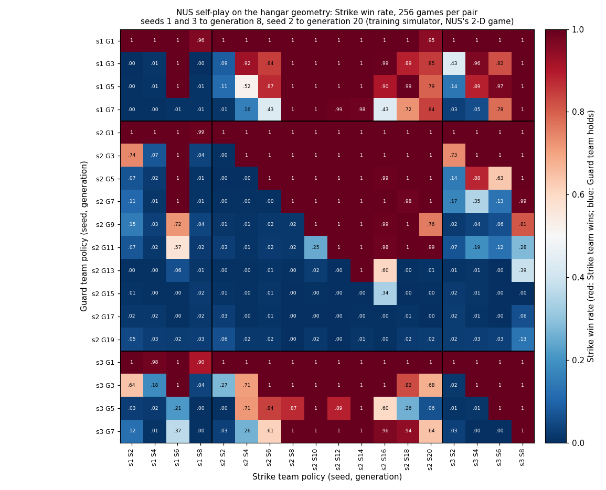
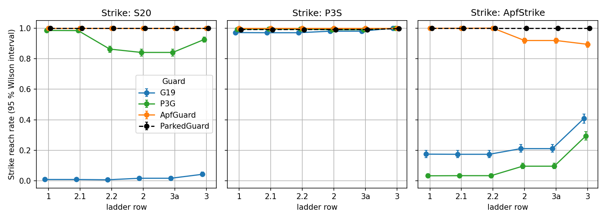
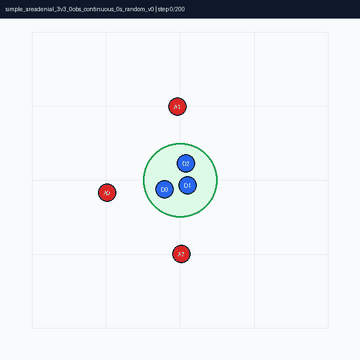
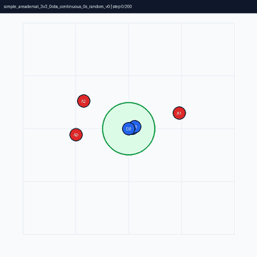

# The NUS port: NUS's team strategy in this training pipeline

NUS (National University of Singapore, a programme partner) trains Strike vs Guard team strategies with its own code.
This page says what we did with that code, phase by phase, and what we observed. It is written for NUS and for anyone
new to the work. Every number here was **observed in the training simulator**: NUS's own 2-D game, our copy of it, or
our game with Starling-like drones. Nothing has flown, and nothing here authorises a flight.

NUS agreed (18 November 2026) that their code details, their game settings and our results on their code may be
published here (STANDARDS §2). NUS's source code itself stays in NUS's own repository. Words: NUS's "defender" is our
**Guard team**, NUS's "attacker" is our **Strike team**; NUS call their game "area denial".

Last updated: 18 November 2026, Phase 6 pass 1. **Phase 4 rows 4, 5a, 5 and 6 (the safety filter, 3-D and Isaac
Lab): results pending (running since 18 Nov 05:52); they come in pass 2.**

## At a glance

| Phase | What | Maths library | Simulator | Machine | Result |
|---|---|---|---|---|---|
| 0 | questions to NUS | none | none | none | answered 17 Nov (§3) |
| 1 | NUS's code installed as the reference | JAX | NUS 2-D game | home RTX 5090 | NUS's tests 65 passed, 1 failed: FAIL as written, accepted by the owner (cause: a stale NUS test) |
| 2a | train reference policies with NUS's own code | JAX | NUS 2-D game | 5090 | speed benchmark, fixed-opponent runs, Run 0, self-play 3 seeds × 8 generations and seed 2 to 20 (INFO, §3–§5) |
| 2 | a copy (replica) of NUS's game in PyTorch | PyTorch | our replica of NUS's 2-D game | 5090 (CPU) | T15 **PASS**: same game step by step |
| 3 | NUS's policy converted to PyTorch | PyTorch (JAX for the reference) | replica | 5090 (CPU) | T16 **PASS**; T17 **PASS** on the self-play pair |
| 4 | the transfer ladder: one change at a time, from NUS's game to our drones | PyTorch; Isaac Lab for row 6 | replica, tier 1, tier 2 (Isaac Lab) | 5090 | rows 1–3 scored (T18–T20); rows 4, 5a, 5, 6: results pending (running since 18 Nov 05:52) |
| 5 | close the gap | — | — | — | owner's choice after Phase 4 (§12) |
| 6 | this public documentation | — | — | — | pass 1 done 18 Nov; pass 2 after Phase 4 |

*Tier 1* is our fast GPU game with a fitted drone model; *tier 2* is the same game on rigid-body Starlings in Isaac Lab
([HOW_IT_WORKS](HOW_IT_WORKS.md)). Ledger rows T15–T21 are workstation rows; they get T numbers when the branch merges
([LEDGER](../records/LEDGER.md)).

## 1. NUS's code: three branches

NUS shared three branches of one repository (private to NUS). We cloned them on the home RTX 5090 only.

| Branch | What it is | What we did |
|---|---|---|
| `area-denial-continuous-space-self-play` (commit `2d2b904`) | continuous 2-D moves, ensemble self-play; the one NUS pointed us to as the most recent | **used**: installed, tested, trained, converted, scored |
| `area-denial-self-play` | the older version, discrete actions | read only (reviewed, not run) |
| `smackx-self-play` | continuous actions plus robustness experiments on SMAX (a StarCraft-style multi-agent benchmark); not drone-specific | read only (reviewed, not run) |

**NUS's game, in short** (read from their code; the replica in Phase 2 reproduces it step by step):

- Drones are points in a plane. Each game step, each drone moves by a displacement up to its team's cap: Guard 0.5,
  Strike 0.75 units (the 1.5 speed ratio of STANDARDS §4).
- A Strike drone *reaches the zone* when its centre is inside the zone radius (4 units); the flag stays set. A game
  is 200 steps.
- Opposite teams are kept apart by a soft push in the same step: a drone of the other team inside the push radius is
  pushed out; a drone's whole move in one step, push included, is capped at 1.0 unit. Push radius = twice the body radius (1.0 unit) plus the team's safety distance
  (Guard 1.0, Strike 0.5): 3.0 units around a Guard drone, 2.5 around a Strike drone. Team-mates may overlap. Guard
  drones stay inside a circle (default 20 units). No walls, no height, no drone dynamics.
- Starts: Guard drones at random inside a disc of half the zone radius; Strike drones in a cluster (radius 3 units)
  on a ring at the spawn distance (default 20 units).
- Scripted opponents ("APF", artificial potential field): the Strike controller is pulled to the zone and pushed
  from Guards (gains 1.0 and 24.0); the Guard controller moves towards the nearest Strike drone.
- Observation per drone: for itself, then team-mates, then opponents, direction and distance to the zone now, at the
  previous policy step and of the last move (9 numbers per drone), then the zone radius and the reached flag: 56
  numbers for 3 v 3. The team size is built into the network (no padding), so a 3 v 3 policy plays 3 v 3 only.
- Policy: a small network (two dense layers, two residual blocks with LayerNorm and Mish, a dense output), tanh
  scaled to the team speed and projected onto a disc; deterministic mean action at evaluation; computed in bfloat16.
- Training: alternating multi-agent PPO (one team learns while the other is frozen), an archive of up to 15 earlier
  policies plus one scripted slot as opponents; 6,000 updates per generation.

## 2. Phase 1: NUS's code as the reference (17 November 2026)

`scripts/workstation/setup_nus_jax.sh` built the conda env `nus_jax` (Python 3.12, jax 0.10.2, flax 0.12.8, CUDA 13
JAX) and ran NUS's tests on the CPU: **65 passed, 1 failed** in 42.8 s. The failing test expects the Guard safety
distance of an older NUS specification; NUS's config has used another value since commit `7509c36`. NUS confirmed the
test is stale. The gate "0 failed" is a **FAIL as written**; the owner accepted it with that cause. Source: the Phase 1
note on the 5090 (5090 only; no ledger row, see §11).

## 3. Phase 0 answers and the hangar geometry

NUS's game has no metres or seconds. NUS's answers (17 November 2026, night):

| Question | NUS's answer | What we did |
|---|---|---|
| metres per unit, seconds per step | the units were scaled to the arena size; pick a zone radius that suits your arena | the scale is ours: fitted to the owner's hangar (below) |
| which Guard safety value | both configs work, but **a policy trained with one config usually works only with that config** | train every reference policy on the exact geometry it will be scored on |
| a drone that drops out | the method does not support drones colliding or being disabled | fixed team size for the whole game; if a drone drops out in flight, the game ends |

**The hangar geometry** (decided 17 November 2026 by the lead from three reviews: training balance, drone dynamics,
flight stack; the owner asked the agents to decide). A first proposal of 0.2 m per unit failed three ways: the zone
(0.8 m) would sit inside the flight stack's 1.10 m keep-out, so one parked Guard drone could close it; the safety
filter would become a much larger push than NUS's; and the start ring would lie outside the fence.

| Item | Value | Status |
|---|---|---|
| Scale | 0.40 m per unit; 0.60 s per step (12 simulator ticks of 0.05 s) | PROPOSED, adopted |
| Speeds | Strike 0.75 × 0.40 / 0.60 = 0.50 m/s; Guard 0.333 m/s | as STANDARDS §4 |
| Game length | 200 steps = 120 s | NUS's default |
| Zone | NUS's default 4 units = 1.6 m radius, at the arena centre | PROPOSED |
| Arena | square, fitted to the owner's hangar less margins; the side is kept in the local file (owner, 18 Nov 2026: his lab's value, not published) | PROPOSED |
| Starts | spawn distance 8 units (3.2 m), Guard circle 8 units (overrides `spawn_distance=8.0`, `defender_boundary=8.0`); Guard start disc as NUS's (half the zone radius) | PROPOSED |
| Teams | 3 v 3 fixed (5 v 3 does not fit the hangar) | PROPOSED |
| Height | 1.2 m, all drones | PROPOSED |

At this scale NUS's push radii are 1.2 m (around a Guard drone) and 1.0 m (around a Strike drone), close to the
flight stack's 1.10 m keep-out. The code reads every one of these values from the git-ignored files in
`configs/local/` (`nus_rules.toml`, `nus_deploy.toml`, `nus_hangar.toml`; templates in `configs/`), so a new
geometry is a new local file, not a code change.

**Run 0** (a check before any training; NUS's environment with NUS's scripted Strike controller and simple scripted Guards, CPU, 1,000 games per cell, seed
12345). Strike team = NUS's scripted APF Strike controller. Pre-set triggers: a parked Guard holds at least 0.90 (the
zone is too easy), or the APF Strike controller beats the rim Guards more than 0.30 of the time or reaches the zone
before step 15 in the median game (the zone is too hard).

| Geometry | Guard team | Strike win [Wilson 95 %] | Median reach step |
|---|---|---|---|
| hangar | mirror Guards on the zone rim | 0.067 [0.053, 0.084] | 24 |
| hangar | mirror Guards inside the zone | 0.000 [0.000, 0.004] | — |
| hangar | NUS's APF Guard controller | 1.000 [0.996, 1.000] | 7 |
| hangar | one Guard parked at the centre | 1.000 [0.996, 1.000] | 6 |
| hangar | static Guards | 1.000 [0.996, 1.000] | 6 |
| NUS default | mirror Guards (rim and inside) | 0.000 | — |
| NUS default | APF, parked, static | 1.000 | 22 |

No trigger fired: the geometry passed Run 0. Limit: NUS has one scripted Strike behaviour, so only the Guard side
was varied.

## 4. Phase 2a: training with NUS's own code (17–18 November 2026)

All on the home RTX 5090 with NUS's code, through `scripts/workstation/run_nus_job.sh` (logging service off).
INFO runs: no gates, no records (§11).

| Run | Setting | Observed |
|---|---|---|
| Speed benchmark | NUS's `benchmark_self_play_2048`, 3 v 3 against fixed APF opponents | 0.0565 s per update, 25,600 game-steps per update: about 453,000 game-steps/s (compile and warm-up 14.8 s) |
| Fixed opponent, NUS default geometry | 3,000 updates per team, about 6.5 min each, 1.7 GB GPU each | Guard team 20 of 20 evaluation games held; Strike team 20 of 20 reached |
| Fixed opponent, hangar geometry | same, with the hangar overrides | Guard team 19 of 20 held; Strike team 20 of 20 reached. These are the Phase 3 pair (P3G, P3S) |
| Self-play, hangar | 3 seeds × 8 generations, 6,000 updates per generation, three jobs sharing the GPU (about 0.13 s per update); 22:42 to 01:27 | below |
| Self-play, seed 2 continued | to 20 generations, alone on the GPU (about 0.07 s per update); 02:16 to 03:51 | below |

Lesson: two NUS jobs started in the same second share one output folder; always pass a unique `hydra.run.dir`.
NUS's self-play runner writes no GIFs even with `save_eval_gif=True`; we rendered them afterwards with NUS's
`ma_skills/scripts/eval.py` (§9).

## 5. Self-play: who beats whom

Each archived policy played every policy of the other team, 256 games per pair, NUS's own evaluator, deterministic
actions on both sides, evaluation seed 20261118 ([Figure 1](#figure-1)). Strike win = 1 − Guard hold.

*Figure 1. Strike win rate for each Guard policy (rows) against each Strike policy (columns), seeds 1 and 3 to
generation 8 and seed 2 to generation 20, 256 games per pair on the hangar geometry, in NUS's 2-D game. Red: the
Strike team wins; blue: the Guard team holds. Made by `scripts/make_nus_selfplay_figures.py` from the 5090's matrix
file. Observed in the training simulator.*

**Go/no-go after 8 generations** (criteria set before the run by the training review, approved by the owner):

| Criterion | Value | Verdict |
|---|---|---|
| (a) a team's learner fails from scratch in 2 or more consecutive generations, up to generation 6 | longest run 1 (seed 1, Strike generation 4) | PASS |
| (b) final policies' cross-play mean (generation 7 Guard × generation 8 Strike, 9 pairs) inside 0.2–0.8 | 0.668 | PASS |

The mean passes, but no single pair is balanced: every cell of (b) is 0.008 or less, or 0.988 or more. Within a seed
the later generation mostly beats every earlier one ("last mover wins"). Every Strike policy beats NUS's APF Guard
controller in every game; every Guard policy holds the APF Strike controller to 0.02–0.08.

**Seed 2 to 20 generations: settling.** Generations 1 to 12 keep the last-mover cycle. From generation 13 the cycle
stops in the Guard team's favour: Guards 13–19 hold every earlier Strike policy (worst 0.06), Guards 17–19 also hold
every later one (0.02 or less), and Strike learners 16, 18 and 20 no longer beat all earlier Guards (worst 0.34, 0.00,
0.00). About 0.95 of all cells stay near-shutouts (≤ 0.05 or ≥ 0.95): the game settles towards the Guard team, not
towards balanced games.

| Final policy | Against the other seeds' policies | Against NUS's scripted controller |
|---|---|---|
| seed 2 Guard generation 19 (**G19**) | mean Strike win 0.042 over 8 Strike policies of seeds 1 and 3 (worst 0.13) | concedes 0.168 to the APF Strike |
| seed 2 Strike generation 20 (**S20**) | mean Strike win 0.726 over 8 Guard policies of seeds 1 and 3 (seed 3 generation 5 holds it to 0.06) | beats the APF Guard 1.00 |
| G19 against S20 | Strike win 0.023 | — |

Criterion (b) with the newest finals (5 distinct pairs): 0.333, PASS. G19 and S20 became the reference pair for
Phases 3 and 4. Limits: one seed went to 20 generations, so no claim about the method; 256 games per pair (our
standard for a result is 1,000); re-running old cells gave differences up to 0.047 (numerical; most likely the bfloat16 batch growing with the pool, not shown).

## 6. Phase 2: a replica of NUS's game (T15, 17 November 2026)

`source/svg_training/nus/replica.py` is a batched PyTorch copy of NUS's game: their one-pass soft push, the Guard
circle, 200 steps, the sticky reached flag and their starts. Recordings of NUS's own environment (100 episodes each,
3 v 3 and 5 v 3, random and rule-exercising actions) were replayed in it.

| Gate | Limit | 3 v 3 | 5 v 3 |
|---|---|---|---|
| largest position error per step | ≤ 1e-4 units | 3.8e-6 | 5.7e-6 |
| reached flag and step counter | equal | equal | equal |
| every rule exercised | ≥ 1 step each | yes | yes |

**T15 PASS** ([record](../records/2026-11-17_nus_phase2_parity_record.md)).

## 7. Phase 3: NUS's policy, converted (T16 and T17, 18 November 2026)

`source/svg_training/nus/actor.py` loads NUS's checkpoint files (msgpack, no JAX needed) and rebuilds the actor in
PyTorch, copying NUS's bfloat16 rounding points (a plain float32 copy misses gate (a): 0.022 and 0.030).
`svg_training.nus.strategy:NusPolicy` rebuilds NUS's 56-number observation from ours, holds each action for 12 ticks
and turns units per step into our speed command ([PLUG_IN](PLUG_IN.md#plug-in-a-trained-nus-policy)). Its interface
draft has layout id `nus_area_denial_v1`.

| Check | Limit | Phase 3 pair (T16) | Self-play pair G19 / S20 (T17) |
|---|---|---|---|
| (a) largest action error, converted vs NUS's JAX, 24,000 observations per team | ≤ 0.02 units | Guard 0.0074, Strike 0.0105 | Guard 0.0079, Strike 0.0095 |
| (b) Strike reach rate, converted inside the JAX arm's 95 % interval, 1,000 shared starts, against NUS's scripted opponent | inside | Guard arm: JAX 48, converted 46 of 1,000; Strike arm 1,000 v 1,000 | Guard arm: JAX 166, converted 172; Strike arm 1,000 v 1,000 |
| (b) archive arm: G19 against S20, both converted vs both JAX | inside | — | JAX 17, converted 15 of 1,000 (8 games differ) |

**T16 PASS** ([record](../records/2026-11-18_nus_phase3_conversion_record.md)), **T17 PASS**
([record](../records/2026-11-18_nus_phase4_w3_reference_gates_record.md)). The Strike arms are saturated (the Strike
policy reaches the zone in every game against the scripted Guards), so the Guard and archive arms carry the
information.

## 8. Phase 4: the transfer ladder

The converted policies stay frozen. Each row changes one thing on the way from NUS's game to our drones, 1,000 paired
games per pair from one starts file, one seed (so no method claim). Rows 1–3 run without the safety filter (an
exception to STANDARDS §6.2 for these INFO measurements); rows 4–6 restore it. Plan:
[2026-11-18-nus-phase4-transfer-ladder](plans/2026-11-18-nus-phase4-transfer-ladder.md); detail:
[NUS_PHASE4_RESULTS](NUS_PHASE4_RESULTS.md).

| Row | The one change | Ledger |
|---|---|---|
| 1 | baseline: the replica of NUS's game on the hangar geometry | T18 |
| 2.1 | our game engine with NUS's push and Guard circle | T19 |
| 2.2 | square walls (the hangar arena) instead of the Guard circle | T19 |
| 2 | our `block` push-apart instead of NUS's push; each action held for 12 ticks | T19 |
| 3a | an identity drone: flies the held command exactly (a control: must equal row 2) | T20 |
| 3 | the drone response: commander copy, delay and lag of the exploratory fitted model; filter still off | T20 |
| 4 | the all-pairs safety filter instead of the push, as in flight | results pending (running since 18 Nov 05:52) |
| 5a | free height, no jitter (a control: must equal row 4) | results pending (running since 18 Nov 05:52) |
| 5 | 3-D at one height, ±1 mm start jitter | results pending (running since 18 Nov 05:52) |
| 6 | the physics drone (tier 2, Isaac Lab, headless) | results pending (running since 18 Nov 05:52) |

**Strike reach count out of 1,000 games** (lower is better for the Guard team). G19 and S20: the self-play pair; P3G
and P3S: the Phase 3 pair; Apf: NUS's scripted controllers, ported; ParkedGuard: one Guard drone parked at the zone
centre (the baseline); `strike_*` and `guard_*`: our own scripted strategies (from row 2; they need our observation).

| Guard | Strike | 1 | 2.1 | 2.2 | 2 | 3a | 3 | 4 | 5a | 5 | 6 |
|---|---|---|---|---|---|---|---|---|---|---|---|
| G19 | S20 | 9 | 9 | 7 | 17 | 17 | 43 | … | … | … | … |
| G19 | P3S | 971 | 970 | 970 | 980 | 980 | 1000 | … | … | … | … |
| G19 | ApfStrike | 175 | 174 | 174 | 211 | 211 | 408 | … | … | … | … |
| P3G | S20 | 985 | 984 | 863 | 841 | 841 | 926 | … | … | … | … |
| P3G | P3S | 993 | 994 | 994 | 990 | 990 | 1000 | … | … | … | … |
| P3G | ApfStrike | 33 | 34 | 34 | 96 | 96 | 294 | … | … | … | … |
| ApfGuard | S20 / P3S / ApfStrike | 1000 / 1000 / 999 | 1000 / 1000 / 999 | 1000 / 1000 / 1000 | 1000 / 1000 / 919 | 1000 / 1000 / 919 | 1000 / 1000 / 894 | … | … | … | … |
| ParkedGuard | S20 / P3S / ApfStrike | 1000 / 991 / 1000 | 1000 / 991 / 1000 | 1000 / 991 / 1000 | 1000 / 991 / 1000 | 1000 / 991 / 1000 | 1000 / 997 / 1000 | … | … | … | … |
| G19 | strike_straight / strike_flank | — | — | — | 209 / 40 | 209 / 40 | 385 / 54 | … | … | … | … |
| P3G | strike_straight / strike_flank | — | — | — | 96 / 193 | 96 / 193 | 287 / 349 | … | … | … | … |
| guard_mirror | S20 / P3S / ApfStrike | — | — | — | 1 / 25 / 48 | 1 / 25 / 48 | 69 / 80 / 39 | … | … | … | … |
| guard_mark_edge | S20 / P3S / ApfStrike | — | — | — | 0 / 25 / 48 | 0 / 25 / 48 | 1000 / 999 / 38 | … | … | … | … |

"…" = results pending (running since 18 Nov 05:52). Sources: the rung records
[1](../records/2026-11-18_nus_phase4_rung1_record.md), [2](../records/2026-11-18_nus_phase4_rung2_record.md),
[3](../records/2026-11-18_nus_phase4_rung3_record.md) (with Wilson intervals, closest approaches, filter and contact
counts); the first attempt at row 4 stopped as too long for the foreground and is T21 ABORTED
([record](../records/2026-11-18_nus_phase4_rung4_record.md)).

*Figure 2. Strike reach rate (Wilson 95 % interval) of the twelve core pairs along rows 1 to 3, one panel per Strike
player, one line per Guard player; the parked Guard is dashed. Made by `scripts/make_nus_phase4_figures.py` from the rows'
scores. Observed in the training simulator; rows 4 to 6: results pending (running since 18 Nov 05:52).*

**What rows 1–3 show** ([Figure 2](#figure-2)).

- The parked Guard lets every Strike policy through (991–1,000 of 1,000), so the geometry does not close the zone by
  itself. G19 holds S20 (9 of 1,000) in NUS's game.
- Our engine with NUS's rules (2.1) matches the replica up to float32 rounding. Square walls (2.2) mostly matter for
  P3G against S20 (985 → 863). Our push with the held action (2) costs the trained Guards against the scripted Strike
  controller (G19 175 → 211, P3G 33 → 96).
- The identity drone (3a) equals row 2 in every game, as it must. The drone response (3) raises the Strike reach count
  for most pairs against the trained Guards (G19 v S20 17 → 43, G19 v ApfStrike 211 → 408, P3G v ApfStrike 96 → 294)
  and breaks our scripted `guard_mark_edge` against both Strike policies (0 → 1,000; 25 → 999). The drone model is
  the exploratory one (ledger T5 FAIL), which answers more slowly than the real drone, so row 3 overstates the cost of
  lag.

Row 4 (the all-pairs safety filter, as in flight), row 5 (3-D) and row 6 (Isaac Lab): results pending (running since 18 Nov 05:52).

## 9. Videos

Short clips, converted from the original GIFs and MP4s (list, sizes and captions:
[media/nus/README.md](media/nus/README.md)). NUS's renderer labels Guard drones D0–D2 (blue) and Strike drones A0–A2
(red); the title bar shows NUS's environment name and the step.

| | |
|---|---|
|  |  |
| *Self-play pair: seed 2 Guard generation 19 holds Strike generation 20 for 200 steps (NUS's 2-D game).* | *NUS's fixed-opponent Strike policy (the run converted as P3S) reaches the zone at about step 7 against NUS's scripted Guards (NUS's 2-D game).* |
| Phase 4 top-down clips: on the 5090 under `runs/nus_port/phase4/row_*/videos/` (not published: their title shows the hangar size) | Isaac Lab camera clips of the converted policies on physics Starlings: results pending (running since 18 Nov 05:52); they come with pass 2. |
| *Phase 4 row 3: G19 holds S20 with the commander copy, delay and lag of the fitted drone model, filter off (tier 1, 6× real time).* | |

## 10. What it means for flight

Nothing here has flown. What rows 1–3 say, in the training simulator only:

- NUS's trained Guard (G19) keeps most of its strength through our engine, walls, push and held actions, but drone
  lag costs it against simpler Strike behaviour (the scripted controller, a straight run).
- NUS's push keeps the two teams about 1.0–1.2 m apart at this scale. In flight, CMU's safety filter keeps every
  pair 1.10 m apart and both drones give way, so Guard drones cannot push. How much that changes the game is row 4:
  results pending (running since 18 Nov 05:52). Until then, expect the filter to change the game more than the
  walls did; that is an expectation, not a result.
- 3 v 3 in the hangar needs six drones; the lab has two Starlings, so a flight would need real and simulated drones
  in one game (the commander has a `drone_modes` real/sim setting; never flown) and floor checks (fence overshoot, two-drone pinning). That work belongs to the
  flight stack and needs the owner.
- A drone that drops out ends the game (NUS's method needs a fixed team size).

## 11. What is not recorded here, and limits

- Phases 1 and 2a, Run 0 and the self-play evaluation have **no record in `records/` and no ledger row**: they ran
  with NUS's code and are written up in the private notes on the 5090 (`~/ma_skills-self-play/_notes/`,
  `_probes/`; 5090 only). Their numbers above are INFO. Their evaluations use 20 games (fixed opponent) and 256 games
  (self-play) per pair, below our 1,000-game standard (STANDARDS §7).
- One seed for the 20-generation run and for every Phase 4 row: no method claim.
- The hangar arena side is the owner's lab value, not NUS's; it stays in the local file (owner, 18 Nov 2026). The 1.2 m flying height is the pipeline's own setting (STANDARDS).

## 12. Next steps (Phase 5, owner's choice after Phase 4)

| Option | What | Cost |
|---|---|---|
| (a) | NUS retrains with action hold, delay and our rules in their own code; we repeat Phases 3–4 on the result | NUS's time |
| (b) | we port NUS's method (alternating MAPPO, archive pool) to PyTorch in this pipeline and train on Starling-like drones | weeks; first a match with NUS's method on the replica (3 seeds, cross-play inside NUS's 95 % intervals) |
| (c) | fine-tune the converted policies in our pipeline | needs the same match first |

**The contact-tag track** is separate from the NUS port (owner, 17 November 2026). The NUS port is contact-free,
with the safety filter on every pair; the programme's design review (FR&PDR, confidential, cited by name only) keeps
a contact demonstration separate from it. Contact (a Guard drone touching a Strike drone) is its own one-on-one track:
[plan](plans/2026-11-17-contact-tag-track.md), DRAFT, nothing started. It cannot fly until CMU's safety filter can
exempt one pair (STANDARDS §5 rule 7).

## How to run it again

Set-up and commands: [GETTING_STARTED](GETTING_STARTED.md) (the `nus_jax` env), [TRAINING](TRAINING.md#nus-jobs)
(NUS jobs and the Phase 2–4 scripts) and [PLUG_IN](PLUG_IN.md#plug-in-a-trained-nus-policy). NUS's code, its outputs,
the converted weights and `configs/local/` exist on the home RTX 5090 only.
