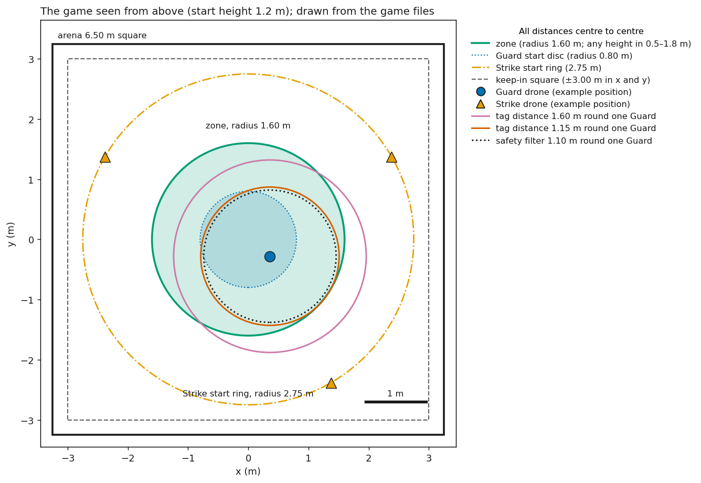
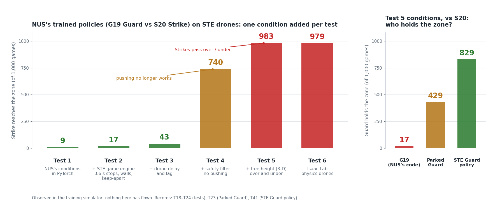

READ · TRAINING SIMULATOR ONLY: the two games' rules and the seven main learnings so far, each with its record.

# Overview: the game and what the work has shown

Two teams of drones play one game: a Guard team holds a circular zone and a Strike team tries to reach it. STE first
tested NUS's trained policies under STE's drone conditions, where NUS's way of blocking stopped working. STE then
trains its own teams in a game with a tag, and they beat hand-written tactics at the 1.6 m tag but not yet at 1.15 m.
Every result below was observed in a training simulator, except one analysis of real flight logs.

> **Training simulator only. Nothing here has flown. A tag is a game rule, not a contact.**

## The two games

| | NUS's game, as the NUS port ran it (hangar scale) | STE's game (rules fixed at gate G0, 22 November 2026) |
|---|---|---|
| Teams | 3 Guard v 3 Strike drones | 3 v 3 (1 v 1 also read; 2 v 1 and 5 v 3 not trained yet) |
| Space | 2-D: all drones in one plane; no walls; Guards kept inside a 3.2 m circle | 3-D: drones may pass over and under each other; 6.5 m square arena |
| Zone | circle of 1.6 m radius at the centre | circle of 1.6 m radius |
| Starts | Strike drones start 3.2 m from the centre | Strike drones start on a 2.75 m ring |
| Game length | 200 steps of 0.60 s = 120 s | 120 s |
| How a Guard stops a Strike | a soft push keeps the teams apart; pushing a Strike aside is allowed | a 1-for-1 tag: a Guard within the tag distance of a Strike takes it out and leaves too |
| Tag distance (centre to centre) | none | 1.6 m (1.15 m in later training) |
| Safety filter (the flight software's collision filter, 1.10 m) | none in NUS's game; STE added it in Test 4 | on every pair of drones, both teams |
| Speeds | Guard 0.33 m/s, Strike 0.50 m/s (0.20 and 0.30 m per step) | Guard 0.33 m/s, Strike 0.50 m/s |
| Decisions | one per 0.60 s step | one per 0.6 s (a working value) |
| Full values | [README section 3](../README.md#3-the-game-nus-2-d-game-vs-ste-drone-set-up), [NUS port report section 3](NUS_PORT_REPORT.md#3-phase-0-answers-and-the-hangar-geometry) | [game spec sheet](../ste_learning/GAME_SPEC.md) (every value with its label and source) |

At the 1.15 m tag the band between the 1.10 m filter distance and the tag is 5 cm. A real Starling's position estimate
differs from motion capture by about 1 cm in hover and up to 2.5 cm per axis while moving, and between two drones the
errors add, so a tag judged on the estimate would not be clean at that edge (learning 7, flight-log analysis); judging tags on
motion capture avoids it.

**Figure 1.** STE's game seen from above; the game itself is 3-D. It shows the arena, the zone, where each team
starts, the two tag distances and the filter distance. Drawn from the game files by `scripts/make_g0_report_figures.py`.

**Figure 2.** Left: how often NUS's Strike policy S20 reached the zone against NUS's Guard policy G19 as each of
STE's conditions was added, one per test. Right: in Test 5's conditions, how often each Guard holds the zone against
S20. Drawn by `scripts/make_overview_figures.py`.

## Seven learnings

Counts are games out of 1,000. A *hand-written tactic* is a scripted team (for example Guards that mark the zone edge);
the best one against the same opponent is the bar a trained team has to beat. G19 and S20 are NUS-method policies
trained by STE with NUS's code.

| Learning | Number | Evidence |
|---|---|---|
| 1. The safety filter and free height likely break NUS's push-blocking: STE's conditions, added one at a time, let NUS's Strike policy reach the zone more and more often against NUS's Guard policy | Strike reaches, G19 v S20: 9, 17, 43, then 740 with the filter, 983 with free height, 979 on Isaac Lab drones | T18 [record](../records/2026-11-18_nus_phase4_rung1_record.md), T19 [record](../records/2026-11-18_nus_phase4_rung2_record.md), T20 [record](../records/2026-11-18_nus_phase4_rung3_record.md), T22 [record](../records/2026-11-18_nus_phase4_rung4_2_record.md), T23 [record](../records/2026-11-18_nus_phase4_rung5_record.md), T24 [record](../records/2026-11-18_nus_phase4_rung6_record.md) |
| 2. STE's conditions are trainable: STE's own simple trainer made a Guard team that holds the zone against S20 | held 829; Guards parked in the zone hold 429 | T41 [record](../records/2026-11-19_nus_phase5_pilot_p1b_run4_record.md), T23 [record](../records/2026-11-18_nus_phase4_rung5_record.md) |
| 3. STE's copy of NUS's training method narrowly missed its pre-set check, so the NUS route was paused on 20 November and STE trains its own teams | 2 of 3 seeds passed every part; the third failed two parts by small margins | T43 [record](../records/2026-11-19_nus_phase5_s51_method_match_record.md) |
| 4. At the 1.6 m tag, trained teams beat the best hand-written tactic against the opponent they trained on; the Guard team stays above it against four of the six Strike tactics | Guard held 913 v 808; Strike reached 636 v 192 | T46 [record](../records/2026-11-21_ste_l012_best_response_record.md), T57 [record](../records/2026-11-22_ste_l112_score_record.md) |
| 5. A Strike team trained against a different Guard tactic only draws level with the hand-written Strike tactic | reached 277 v 284 | T58 [record](../records/2026-11-22_ste_l111_strike_record.md) |
| 6. At the 1.15 m tag both sides learn, but stay below the hand-written tactics | Guard held 572 v 645; Strike reached 134 v 355 | T56 [record](../records/2026-11-22_ste_l012d_cross_tag_record.md); trained teams: [Guard record](../records/2026-11-22_ste_l012c_tag_1p15_guard_record.md), [Strike record](../records/2026-11-22_ste_l012c_tag_1p15_strike_record.md) |
| 7. Isaac Lab's physics drones train as well as the fast engine at about 5× the GPU time; the 1.6 m teams moved onto Isaac Lab drones shift a little; the real drone's position estimate is close to motion capture in hover | held 832 v 836; shifts of −33 to +47 per matchup; about 1 cm in hover (flight-log analysis) | T53 [record](../records/2026-11-21_ste_l013_tier2_trains_record.md), T64 [record](../records/2026-11-23_ste_l18_tier2_record.md), T63 [record](../records/2026-11-23_ste_l13_fit_record.md) |

## What has not been done

- Nothing has flown: no trained team has played on real drones.
- One training seed per side; a second seed could land elsewhere.
- Each trained team is scored mainly against the opponent it trained on.
- No strategy is ready to deploy.

Open work is tracked in the [status page](../ste_learning/status/STATUS_LATEST.md) and in Linear.

## Where to read more

[Game spec sheet](../ste_learning/GAME_SPEC.md) · [gate G0 report](../ste_learning/G0_REPORT.md) ·
[NUS port report](NUS_PORT_REPORT.md) · [what was found in the NUS port](WHAT_WE_FOUND.md) · [glossary](GLOSSARY.md)
