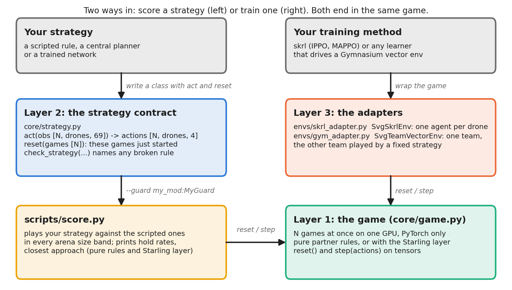

# Plug in: your strategy or your training method

This page is for an engineer from a partner team who has not opened this folder before. It shows how to
connect your own Strike vs Guard strategy, or your own training code, to our game, and how to score the
result. Everything below runs from `cd ~/AirStack-starling-max2/svg_training` (any clone of the repository) with
Python 3.11 and PyTorch; the adapters also need skrl 2.1.0 and gymnasium 1.2.1. Terms are in the
[glossary](GLOSSARY.md). Every result here is observed in the training simulator, not in flight.

The code is under `source/svg_training/` (paths below start there). Run the Python examples with
`PYTHONPATH=source:. python example.py`. In shapes, N = games played at once, G = Guard drones per game,
S = Strike drones per game.

## Three layers



*The two ways in. On the left, a strategy written to the contract is scored by `scripts/score.py`. On the
right, a training library drives the game through an adapter. Both play the same game, made by
`scripts/make_s2_plug_in_flowchart.py`.*

1. **The game** (`core/game.py`, `SvgGame`): thousands of games at once on one GPU, plain PyTorch tensors,
   `reset()` and `step(actions)`. Arena sizes, starts and zone sizes are drawn at random for every game.
2. **The strategy contract** (`core/strategy.py`): a strategy plays one team. It is called once per step with
   the observations of all its team's drones in all games, and returns all their actions. A scripted rule, a
   central planner or a trained network all fit.
3. **The adapters** (`envs/`): `SvgSkrlEnv` for skrl's multi-agent trainers and `SvgTeamVectorEnv` for any
   Gymnasium vector learner. Both refuse the fixed named scenarios: those exist for scoring and tests only.

## Plug a strategy in

A strategy is a class with `team`, `name`, `reset(games)` and `act(obs)`, and the constructor
`(team, cfg, num_games, device, seed)`. This one sends each Guard drone to the zone edge on the side of the
Strike drone nearest the zone. Save it as `my_guard.py` in this folder.

```python
# file: my_guard.py
import torch
from svg_training.core.observations import ObsView

V = ObsView()


class MyGuard:
    """Each Guard drone waits just outside the zone edge, on the side of the Strike drone nearest the zone."""

    def __init__(self, team, cfg, num_games, device, seed=0):
        self.team, self.name = "guard", "my_guard"
        self.first, self.count = cfg.pad_guards, cfg.pad_strikes   # Strike drones sit in slots 5, 6, 7

    def reset(self, games):          # games [N] bool: these games just started; no memory to clear here
        pass

    def act(self, obs):              # obs [N, G, 69] -> actions [N, G, 4] in [-1, 1]
        own = obs[..., V.own_pos][..., :2]                                     # [N, G, 2], from the zone centre
        s = obs[..., V.slot(self.first).start:V.slot(self.first + self.count - 1).stop]
        s = s.reshape(*obs.shape[:2], self.count, 7)                           # rel pos 3, rel vel 3, present 1
        strike = own[..., None, :] + s[..., 0:2]                               # [N, G, S, 2], from the zone centre
        d = strike.norm(dim=-1).masked_fill(s[..., 6] < 0.5, float("inf"))
        near = strike.gather(2, d.argmin(-1)[..., None, None].expand(-1, -1, 1, 2))[..., 0, :]
        goal = near / near.norm(dim=-1, keepdim=True).clamp(min=1e-6) * obs[..., V.zone_radius, None] * 1.2
        v = (goal - own) / 0.25                                                # full speed until 0.25 m away
        v = v / v.norm(dim=-1, keepdim=True).clamp(min=1.0)
        return torch.cat((v, torch.zeros_like(v)), dim=-1)                     # vz = 0, yaw rate = 0
```

Blocks that start with `# file:` or `# run` are executed by `tests/test_adapters.py` (on the CPU, with tiny
settings), so they stay correct.

Check it keeps the contract. `check_strategy` plays 50 steps and raises an error that names the broken rule
(shape, dtype, device, no autograd graph, finite, range).

```python
# run
import torch
from svg_training.core.game import SvgGame
from svg_training.core.game_config import load_game_cfg
from svg_training.core.strategy import check_strategy
from my_guard import MyGuard

cfg, _ = load_game_cfg(use_local=False)     # use_local=True (the default) adds your configs/local/ file
device = "cuda" if torch.cuda.is_available() else "cpu"
game = SvgGame(cfg, num_games=64, guards=2, strikes=1, device=device, seed=0)
check_strategy(MyGuard("guard", cfg, 64, device), game)
print("MyGuard keeps the contract")
```

Score it against our scripted Strike drones, beside one of our scripted Guard strategies for comparison:

```bash
# run
PYTHONPATH=source:. python scripts/score.py --guard my_guard:MyGuard,guard_field \
    --strike strike_straight,strike_flank --sizes 2v1 --presets pure,starling --no-local \
    --out runs/my_guard_score/
```

A strategy is named `module:Class` (your code) or by a scripted name: Guard `guard_mark_edge`,
`guard_mark_inside`, `guard_field`, `guard_mirror`; Strike `strike_straight`, `strike_flank`; either team
`random`, `zero`. The defaults play 1,000 games per arena band (lab 4–6 m, middle 6–10 m, large 10–16 m) on the
GPU; the Starling layer is much slower than the pure rules (minutes rather than seconds).

## What the scoring tool prints

One line per batch (preset, size, band, speed) and the hold rate of every Guard v Strike pair. Into `--out` it
writes `scores.md` (one table per preset and size, one row per band), `scores.json` (the same numbers),
`per_game.npz` (one value per game, for your own figures) and `gates.toml`. The columns:

| Column | Meaning |
|---|---|
| hold rate | share of games the Guard team held (no Strike drone reached the zone), with a 95 % interval |
| mean end step | when the games ended; 1,200 steps (60 s) = the game ran out of time |
| closest min / p5 / p50 | closest horizontal approach of a Guard and a Strike drone, in metres |
| 3-D | the same in 3-D (with the Starling layer drones can pass one above the other) |
| breach | share of games where an opposite pair came closer than the keep-out distance |
| filter | share of drone-steps the safety filter changed (Starling layer only) |
| start miss | share of games whose starting positions could not keep the spacing (crowded small arenas) |

## Pure rules and the Starling layer

The scoring tool reports every strategy twice:

- **Pure partner rules** (`pure`): drones are points that move at a fixed speed per team. A drone may not move
  closer to a drone of the other team than that team's keep-out distance (the push-apart rule); team-mates pass
  through each other. Flat: every drone stays at 1.2 m height.
- **With Starling layer** (`starling`): drones move as our Starling 2 Max drones fly. Each command goes through
  a copy of our flight commander, the safety filter (it keeps every pair of drones at least 1.10 m apart, in
  3-D) and a model of the drone's response fitted to one flight log (`real_exploratory_v0`, exploratory). The
  push-apart rule is off, so "breach" shows what the filter alone allowed.

## Plug a training method in

**skrl.** One skrl agent per drone (`guard_0`, `guard_1`, ...); a team you do not train is played by a fixed
strategy. Each agent sees `[N, 69]` and acts `[N, 4]`; reward and done are `[N, 1]`. This runs a
64-step smoke test, then wraps the trained networks as a strategy so `check_strategy` and `score.py` can use them.

```python
# run
import torch
from skrl.memories.torch import RandomMemory
from skrl.models.torch import DeterministicMixin, GaussianMixin, Model
from skrl.multi_agents.torch.ippo import IPPO, IPPO_CFG
from skrl.trainers.torch import SequentialTrainer
from svg_training.core.game import SvgGame
from svg_training.core.game_config import load_game_cfg
from svg_training.core.strategy import check_strategy
from svg_training.envs.skrl_adapter import SvgSkrlEnv, skrl_kwargs_defaults
from svg_training.opponents import make_strategy


class Policy(GaussianMixin, Model):
    def __init__(self, obs_space, act_space, device):
        Model.__init__(self, observation_space=obs_space, action_space=act_space, device=device)
        GaussianMixin.__init__(self, clip_actions=True)
        self.net = torch.nn.Sequential(torch.nn.Linear(69, 64), torch.nn.Tanh(), torch.nn.Linear(64, 4))
        self.log_std = torch.nn.Parameter(torch.zeros(4))

    def compute(self, inputs, role=""):
        return self.net(inputs["observations"]), {"log_std": self.log_std}


class Value(DeterministicMixin, Model):
    def __init__(self, obs_space, act_space, device):
        Model.__init__(self, observation_space=obs_space, action_space=act_space, device=device)
        DeterministicMixin.__init__(self)
        self.net = torch.nn.Sequential(torch.nn.Linear(69, 64), torch.nn.Tanh(), torch.nn.Linear(64, 1))

    def compute(self, inputs, role=""):
        return self.net(inputs["observations"]), {}


cfg, _ = load_game_cfg(use_local=False)
device = "cuda" if torch.cuda.is_available() else "cpu"
n = 256
env = SvgSkrlEnv(SvgGame(cfg, n, guards=2, strikes=1, device=device, seed=0), train_teams=("guard",),
                 opponents={"strike": make_strategy("strike_straight", "strike", cfg, n, device, seed=1)})
names = env.possible_agents                                    # ["guard_0", "guard_1"]
models = {a: {"policy": Policy(env.observation_space(a), env.action_space(a), device),
              "value": Value(env.observation_space(a), env.action_space(a), device)} for a in names}
memories = {a: RandomMemory(memory_size=16, num_envs=n, device=device) for a in names}
agent = IPPO(possible_agents=names, models=models, memories=memories, observation_spaces=env.observation_spaces,
             state_spaces=env.state_spaces, action_spaces=env.action_spaces, device=device,
             cfg=IPPO_CFG(rollouts=16, experiment={"write_interval": 0, "checkpoint_interval": 0},
                          **skrl_kwargs_defaults(names)))
SequentialTrainer(env=env, agents=agent, cfg={"timesteps": 64, "headless": True}).train()


class TrainedGuard:                                            # the trained networks as a strategy
    team, name = "guard", "ippo_smoke"

    def reset(self, games):
        pass

    def act(self, obs):                                        # drone k uses network guard_k, its mean action
        with torch.no_grad():
            return torch.stack([agent.policies[f"guard_{k}"].act({"observations": obs[:, k]}, role="policy")[1]
                                ["mean_actions"].clamp(-1, 1) for k in range(obs.shape[1])], dim=1)


check_strategy(TrainedGuard(), SvgGame(cfg, 64, 2, 1, device=device, seed=2))
print("trained Guard keeps the contract")
```

`skrl_kwargs_defaults` works around skrl 2.1.0 refusing its own default settings for multi-agent configs.
`env.state_spaces` holds the central state (`[N, 59]`, every drone's position and velocity) for critics such as
MAPPO's. A 64-step run learns nothing: it only proves the pipe. A real run uses many games on the GPU and far
more steps.

**Gymnasium.** One team is the learner: its drones' observations side by side (`[N, drones × 69]`) and its
actions side by side (`[N, drones × 4]`, drone k at columns 4k to 4k+3). The reward is the team's, `[N]`. The
other team is a fixed strategy; `SplitStrategy` mixes several on fixed slices of the games.

```python
# run
import torch
from svg_training.core.game import SvgGame
from svg_training.core.game_config import load_game_cfg
from svg_training.core.strategy import SplitStrategy
from svg_training.envs.gym_adapter import SvgTeamVectorEnv
from svg_training.opponents import make_strategy

cfg, _ = load_game_cfg(use_local=False)
device = "cuda" if torch.cuda.is_available() else "cpu"
n = 256
mix = SplitStrategy("strike", [(make_strategy("strike_straight", "strike", cfg, n, device, 1), slice(0, 128)),
                               (make_strategy("strike_flank", "strike", cfg, n, device, 2), slice(128, 256))])
env = SvgTeamVectorEnv(SvgGame(cfg, n, guards=2, strikes=1, device=device, seed=0), "guard", mix)
obs, info = env.reset(seed=0)                                  # obs [256, 138]; info["opponent"] names the mix
for _ in range(200):
    actions = torch.rand(n, 8, device=device) * 2 - 1           # your learner's actions go here
    obs, reward, terminated, truncated, info = env.step(actions)
print("games ended:", int(terminated.sum()), "| outcome codes:", info["outcome"][:8].tolist())
```

Two things differ from a textbook Gymnasium env. The tensors stay on the game's device (as Isaac Lab's vector
envs do), they are not NumPy arrays. And a finished game restarts inside the same `step` (`SAME_STEP`): on
the step a game ends, `terminated` is True, `reward` and `info["outcome"]` belong to the ended game, but the
returned observation is already the new game's. Every end is final (the time left is in the observation), so
`truncated` is always False and no final observation is needed. Outcome codes: 0 still running, 1 a Strike
drone reached the zone, 2 the Guard team held.

## What a drone sees and does

Each drone's observation is 69 numbers. It sees every drone's full state (`obs_view = "full"`); a limited view
may come later behind the same switch, with the same layout. Frame: x east, y north, z up; metres, m/s, s.

| Index | What |
|---|---|
| 0–2 | own position: x, y from the zone centre, z = height above the floor (m) |
| 3–5 | own velocity (m/s) |
| 6–7 | sin and cos of own heading (yaw) |
| 8 | zone radius (m) |
| 9 | half the arena side (m). The arena is a square; the zone may sit off its centre, and the observation does not say where, so a drone cannot place the walls exactly |
| 10 | time left in the game (s) |
| 11 | own team: −1 Guard, +1 Strike |
| 12 | 1 = still in the game, 0 = out (an out drone sees zeros except its team) |
| 13–19 | slot 0, the first Guard drone: position relative to me (3), velocity relative to me (3), present (1) |
| 20–47 | slots 1–4: Guard drones 2 to 5, the same 7 numbers each |
| 48–54 | slot 5, the first Strike drone, the same 7 numbers |
| 55–61 | slot 6, the second Strike drone |
| 62–68 | slot 7, the third Strike drone |

Slots that hold no drone (fewer drones than 5 Guard + 3 Strike, a drone that is out, and your own slot) are all
zeros. `ObsView` in `core/observations.py` names these ranges in code.

An action is four numbers in [−1, 1]: `[vx, vy, vz, yaw_rate]`. The velocity part is capped at length 1 and
multiplied by the team's speed (committed defaults: Strike 0.5 m/s, Guard 0.33 m/s). Under the pure rules
`vz` is ignored. Yaw rate is multiplied by 1.0 rad/s. The game takes one step every 0.05 s (20 a second);
a game lasts at most 1,200 steps (60 s). Reward: +1 to every Guard drone when the Guard team holds, −1 when a
Strike drone reaches the zone, 0 otherwise; the Strike team gets the opposite.

## Your own game numbers stay local

The committed game file (`configs/s2_game.toml`) holds neutral values. Put your team's real values (keep-out
distances, speeds, game length, units) in `configs/local/partner_rules.toml`, copied from
`configs/partner_rules.example.toml`. That folder is ignored by git: **never commit it, and never copy its
numbers into code, tests, documents or commit messages.** `load_game_cfg()` and `score.py` read it when it
is there; `score.py` names it only by file name and checksum (sha256), never by its values. Use `--no-local`
(or `load_game_cfg(use_local=False)`) to run on the neutral values, as every result we publish does.
