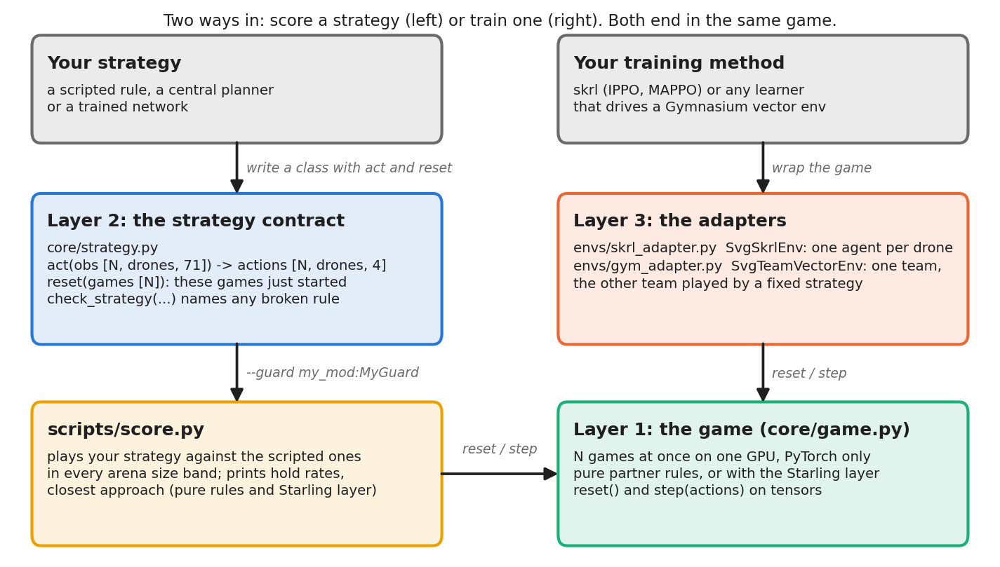

READ · connecting a strategy or a training method to the STE game, and scoring it.

# Plug in your code: a strategy or a training method

**For** an engineer from another team (NUS researchers included) who has not opened the `svg_training/` folder
before. **STE**: the lab that wrote this repository. The page shows how to connect a Strike vs Guard strategy, or a
training method, to the STE game, and how to score the result. NUS's `defender` is the defender (Guard team) here and
NUS's `attacker` the attacker (Strike team); from here on, Guard and Strike. Every result here is observed in the
training simulator, not in flight. The old name of this page, `PLUG_IN.md`, points here.

- **Where:** everything runs from the `svg_training/` folder of the clone. The code is under `source/svg_training/`; paths below start there.
- **Python:** a Python 3.11 environment made as in [how to run it yourself, B1](RUN_IT_YOURSELF.md#b-a-cpu-laptop-install-run-the-game-score-a-strategy-run-the-tests)
  (`pip install -e ".[test]"`; a CPU is enough). The lab's conda environment `env_isaaclab` has the same packages.
- **Running an example:** save it as a file and run `PYTHONPATH=source:. python example.py`.
- **Shapes:** N = games played at once, G = Guard drones per game, S = Strike drones per game.

## Words used here

| Word | Meaning |
|---|---|
| keep-out distance | how close a drone of the other team may come; 1.10 m for both teams in the committed values |
| push-apart rule | under the pure rules, a move that would break the keep-out is cut short |
| Starling layer | a switch that makes drones move like STE's Starling 2 Max drones (ModalAI's small indoor drone) instead of like points (below); with it the game is the *STE drone model* |
| `real_exploratory_v0` | the drone-response model the Starling layer uses, fitted to one flight log; exploratory |
| slot | 7 numbers in an observation that describe one other drone |
| `pad_guards`, `pad_strikes` | the number of slots kept for Guard drones (5) and Strike drones (3), used or not |
| SAME_STEP | a finished game restarts inside the same `step` call (Gymnasium's name for this) |
| IPPO, MAPPO | two multi-agent training methods in skrl: one learner per drone; MAPPO adds a critic that sees the whole game |

## Three layers



*The two ways in. On the left, a strategy written to the contract is scored by `scripts/score.py`. On the
right, a training library drives the game through an adapter. Both play the same game, made by
`scripts/make_s2_plug_in_flowchart.py`.*

1. **The game** (`core/game.py`, `SvgGame`): thousands of games at once on one GPU, plain PyTorch tensors,
   `reset()` and `step(actions)`. Arena sizes, starts and zone sizes are drawn at random for every game.
2. **The strategy contract** (`core/strategy.py`): a strategy plays one team. It is called once per step with
   the observations of all its team's drones in all games, and returns all their actions. A scripted rule, a
   central planner or a trained network all fit.
3. **The adapters** (`envs/`): `SvgSkrlEnv` for skrl's multi-agent trainers and `SvgTeamVectorEnv` for any
   Gymnasium vector learner. Both refuse the fixed named scenarios: those exist for scoring and tests only.

## Plug a strategy in

A strategy is a class with `team`, `name`, `reset(games)` and `act(obs)`, and the constructor
`(team, cfg, num_games, device, seed)`. This one sends each Guard drone to the zone edge on the side of the
Strike drone nearest the zone. Save it as `my_guard.py` in `svg_training/`. Blocks that start with `# file:` or
`# run` are executed by `tests/test_adapters.py` (on the CPU, with tiny settings), so they stay correct.

```python
# file: my_guard.py
import torch
from svg_training.core.observations import ObsView

V = ObsView()


class MyGuard:
    """Each Guard drone waits just outside the zone edge, on the side of the Strike drone nearest the zone."""

    def __init__(self, team, cfg, num_games, device, seed=0):
        self.team, self.name = "guard", "my_guard"
        self.first, self.count = cfg.pad_guards, cfg.pad_strikes   # Strike drones sit in slots 5, 6, 7

    def reset(self, games):          # games [N] bool: these games just started; no memory to clear here
        pass

    def act(self, obs):              # obs [N, G, 71] -> actions [N, G, 4] in [-1, 1]
        own = obs[..., V.own_pos][..., :2]                                     # [N, G, 2], from the zone centre
        s = obs[..., V.slot(self.first).start:V.slot(self.first + self.count - 1).stop]
        s = s.reshape(*obs.shape[:2], self.count, 7)                           # rel pos 3, rel vel 3, present 1
        strike = own[..., None, :] + s[..., 0:2]                               # [N, G, S, 2], from the zone centre
        d = strike.norm(dim=-1).masked_fill(s[..., 6] < 0.5, float("inf"))
        near = strike.gather(2, d.argmin(-1)[..., None, None].expand(-1, -1, 1, 2))[..., 0, :]
        goal = near / near.norm(dim=-1, keepdim=True).clamp(min=1e-6) * obs[..., V.zone_radius, None] * 1.2
        v = (goal - own) / 0.25                                                # full speed until 0.25 m away
        v = v / v.norm(dim=-1, keepdim=True).clamp(min=1.0)
        return torch.cat((v, torch.zeros_like(v)), dim=-1)                     # vz = 0, yaw rate = 0
```

Check it keeps the contract. `check_strategy` plays 50 steps and raises an error that names the broken rule
(shape, dtype, device, no autograd graph, finite, range).

```python
# run
import torch
from svg_training.core.game import SvgGame
from svg_training.core.game_config import load_game_cfg
from svg_training.core.strategy import check_strategy
from my_guard import MyGuard

cfg, _ = load_game_cfg(use_local=False)     # use_local=True (the default) adds your configs/local/ file
device = "cuda" if torch.cuda.is_available() else "cpu"
game = SvgGame(cfg, num_games=64, guards=2, strikes=1, device=device, seed=0)
check_strategy(MyGuard("guard", cfg, 64, device), game)
print("MyGuard keeps the contract")
```

Score it against the STE scripted Strikes (hand-written, no training), beside one of the STE scripted Guards for comparison:

```bash
# run
PYTHONPATH=source:. python scripts/score.py --guard my_guard:MyGuard,guard_field \
    --strike strike_straight,strike_flank --sizes 2v1 --presets pure,starling --no-local \
    --out runs/my_guard_score/
```

A strategy is named `module:Class` (any code on the path) or by a scripted name: Guard `guard_mark_edge`,
`guard_mark_inside`, `guard_field`, `guard_mirror`; Strike `strike_straight`, `strike_flank`; either team
`random`, `zero`. A Strike strategy goes in `--strike my_strike:MyStrike` the same way. The defaults play 1,000
games per arena band (lab 4–6 m, middle 6–10 m, large 10–16 m) on the GPU. The Starling layer runs 4 to 65 times
slower than the pure rules (ledger T9, `records/2026-11-16_s2_scripted_reference_2_record.md`).

`--device auto` (the default) picks the GPU when PyTorch sees one and the CPU otherwise. On a CPU add
`--games-per-band 100` and keep `--presets pure` (about 10 s; [how to run it yourself, B4](RUN_IT_YOURSELF.md#b-a-cpu-laptop-install-run-the-game-score-a-strategy-run-the-tests)).

## Plug in a trained NUS policy

The whole NUS port, phase by phase, with NUS's settings, STE's results and videos: [what we did, day by day](WHAT_WE_DID_DAY_BY_DAY.md).
Training policies with NUS's own code and every command below in order: [training scripts, NUS jobs](TRAINING.md#nus-jobs). To
repeat it from the PROVISIONAL files or from a NUS clone: [how to run it yourself, level D](RUN_IT_YOURSELF.md#d-repeat-the-six-tests).
The NUS-code policies of these pages (G19, S20, P3G, P3S) were trained by STE using NUS's code
([glossary, policies](GLOSSARY.md#policies)).

A policy trained with NUS's JAX code runs here without that code. The path (all observed in the training simulator, in the Copy of NUS 2-D game
(PyTorch), STE's batched copy of NUS's game; nothing is flown):

1. **Write the deploy file first** (the converter reads it; it only names the weights folders): `configs/local/nus_deploy.toml` (`guard_weights`, `strike_weights`; made by
   `scripts/nus_make_local_deploy.py`, keys in `configs/nus_deploy.template.toml`). The same file holds the scale (metres per unit,
   seconds per step), the hold length in simulator ticks and the checkpoint's geometry.
2. **Convert the checkpoint.** `scripts/nus_convert_checkpoint.py --checkpoint <folder> --team guard|strike --name <name>` reads a
   runner checkpoint (`config.json` + `state.msgpack`) or an archive entry (`actor.msgpack` + `metadata.json` + `config.json`) with
   `msgpack` and numpy, refuses anything else, and writes `runs/nus_port/weights/<name>/`. Only deterministic, non-prior checkpoints
   are accepted. The code reads the weights and the local settings (STE's hangar scale, NUS's game values) from `runs/` and `configs/local/` (git-ignored); `scripts/nus_install_provisional.sh` fills both from the committed PROVISIONAL bundle ([nus_provisional/](../nus_provisional/README.md)).
3. **Use the class** `svg_training.nus.strategy:NusPolicy` like any `module:Class` strategy (constructor
   `(team, cfg, num_games, device, seed)`). It rebuilds NUS's observation from the STE observation plus its own memory (the positions at the previous
   sample and the reached flag), holds each action for the hold length and turns units per step into the `[-1, 1]` command. It
   refuses a game configuration whose scale or team speeds differ from the deploy file, naming the keys, never the values.
4. **`interface.toml`** (draft, layout id `nus_area_denial_v1`): `scripts/nus_write_interface.py --clone <NUS clone>` writes it into the weights folder.

5. **Score it in the six tests (Phase 4).** `scripts/nus_phase4.py --row <id>` plays every Guard x Strike pair of a test (the script and the
   records call a test a row: `--row 5` = Test 5) from one paired
   starts file (`--make-starts` once), 1,000 games per pair, on the hangar geometry (a git-ignored `configs/local/nus_hangar.toml`, template
   `configs/nus_hangar.template.toml`), and writes the extra metrics, `per_game.npz` and top-down videos under `runs/nus_port/phase4/row_<id>/`.
   Tests are declared in `configs/nus_phase4.toml` (six keys each: engine, boundary, separation, motion, drone, height); players are named in
   `nus/players.py` (`G19`/`S20`, `P3G`/`P3S` bound to their deploy files, NUS's scripted opponent ported as `ApfGuard`/`ApfStrike`, the Parked Guard `ParkedGuard`; the STE scripted
   strategies by their names). `--tables <rows>` prints committed-text tables with every value that equals a local value replaced by "at the local value". A
   test estimated above 2 h stops with exit 4 until `--accept-long`. Test 6 (Isaac Lab physics drones) needs `--headless --device cuda` after
   `scripts/isaac_preflight.sh --approved-headless` exits 0. Reading: [test results](WHAT_WE_FOUND.md#3-six-tests-towards-ste-drones).

What it does not do: a drone that is removed from the game, other team sizes. All six tests are scored: the Copy of NUS 2-D game, the STE game engine, the
STE drone model with the filter off (`records/2026-11-18_nus_phase4_rung{1,2,3}_record.md`), then the filter, 3-D and Isaac Lab
(`records/2026-11-18_nus_phase4_rung{4_2,5,6}_record.md`; the first foreground attempt at Test 4 is `records/2026-11-18_nus_phase4_rung4_record.md`,
ABORTED). The gates of Phase 3 compare the converted policy with the JAX original, in the
Copy of NUS 2-D game (`records/2026-11-18_nus_phase3_conversion_record.md`; the archive pair in `records/2026-11-18_nus_phase4_w3_reference_gates_record.md`).

## What the scoring tool prints

One line per batch (preset, size, band, speed) and the hold rate of every Guard v Strike pair. Into `--out` it
writes `scores.md` (one table per preset and size, one row per band), `scores.json` (the same numbers),
`per_game.npz` (one value per game, for other figures) and `gates.toml`. The columns:

| Column | Meaning |
|---|---|
| hold rate | share of games the Guard team held (no Strike drone reached the zone), with a 95 % interval. For a Strike strategy, its win share = 1 − hold rate |
| mean end step | when the games ended; the game length (1,200 steps with the committed values) = the game ran out of time |
| closest min / p5 / p50 | closest horizontal approach of a Guard and a Strike drone, in metres |
| 3-D | the same in 3-D (with the Starling layer drones can pass one above the other) |
| breach | share of games where an opposite pair came closer than the keep-out distance |
| filter | share of drone-steps the safety filter changed (Starling layer only) |
| start miss | share of games whose starting positions could not keep the spacing (crowded small arenas) |

What to compare with (ledger T9, 2v1 and 5v3, three bands, 1,000 games per cell, committed values): the four STE
scripted Guards held 38–100 % under the pure rules and 14–100 % with the Starling layer; random Guard
moves held 0–37 % (pure) and 0–0.1 % (Starling layer). A Guard strategy worth having beats random clearly and
should be compared band by band with the scripted ones. The Starling-layer drops come from an exploratory drone model that reaches 63 % of a speed change in 0.6–0.9 s,
against about 0.35 s on the real drone (its check against a real flight, T5, is a FAIL), so they are not the
cost of flying a real Starling.

## Pure rules and the Starling layer

The scoring tool reports every strategy twice:

- **Pure partner rules** (`pure`): drones are points that move at a fixed speed per team. The push-apart rule
  keeps each team's drones out of its keep-out distance from the other team; team-mates pass through each
  other. Flat: every drone stays at 1.2 m height.
- **With Starling layer** (`starling`): drones move as STE's Starling 2 Max drones fly. Each command goes through
  a copy of CMU's flight commander, the safety filter (it keeps every pair of drones at least 1.10 m apart, in
  3-D) and `real_exploratory_v0`. The push-apart rule is off, so "breach" shows what the filter alone allowed.

## Plug a training method in

**skrl.** One skrl agent per drone (`guard_0`, `guard_1`, ...); a team that is not trained is played by a fixed
strategy. Each agent sees `[N, 71]` and acts `[N, 4]`; reward and done are `[N, 1]`. First the networks, in a
file so the training script and the scoring tool can both load them. `TrainedGuard` has the standard
constructor, so `score.py` can load it from the saved checkpoint.

```python
# file: my_ippo.py
import gymnasium
import torch
from skrl.models.torch import DeterministicMixin, GaussianMixin, Model
from svg_training.core.observations import OBS_DIM

OBS_SPACE = gymnasium.spaces.Box(-float("inf"), float("inf"), (OBS_DIM,))
ACT_SPACE = gymnasium.spaces.Box(-1.0, 1.0, (4,))
CHECKPOINT = "my_ippo_guard.pt"                 # written by the training script, read by TrainedGuard


class Policy(GaussianMixin, Model):
    def __init__(self, device):
        Model.__init__(self, observation_space=OBS_SPACE, action_space=ACT_SPACE, device=device)
        GaussianMixin.__init__(self, clip_actions=True)
        self.net = torch.nn.Sequential(torch.nn.Linear(OBS_DIM, 64), torch.nn.Tanh(), torch.nn.Linear(64, 4))
        self.log_std = torch.nn.Parameter(torch.zeros(4))

    def compute(self, inputs, role=""):
        return self.net(inputs["observations"]), {"log_std": self.log_std}


class Value(DeterministicMixin, Model):
    def __init__(self, device):
        Model.__init__(self, observation_space=OBS_SPACE, action_space=ACT_SPACE, device=device)
        DeterministicMixin.__init__(self)
        self.net = torch.nn.Sequential(torch.nn.Linear(OBS_DIM, 64), torch.nn.Tanh(), torch.nn.Linear(64, 1))

    def compute(self, inputs, role=""):
        return self.net(inputs["observations"]), {}


class TrainedGuard:
    """The saved networks as a strategy: Guard drone k uses network guard_k and plays its mean action."""

    def __init__(self, team, cfg, num_games, device, seed=0):
        self.team, self.name = "guard", "my_ippo"
        saved = torch.load(CHECKPOINT, map_location=device)
        self.nets = []
        for k in range(len(saved)):
            policy = Policy(device).to(device)
            policy.load_state_dict(saved[f"guard_{k}"])
            self.nets.append(policy.net.eval())

    def reset(self, games):
        pass

    def act(self, obs):              # obs [N, G, 71] -> [N, G, 4]
        with torch.no_grad():
            return torch.stack([self.nets[k](obs[:, k]).clamp(-1, 1) for k in range(obs.shape[1])], dim=1)
```

Then train (a 64-step smoke run), save, and check the result keeps the contract:

```python
# run
import torch
from skrl.memories.torch import RandomMemory
from skrl.multi_agents.torch.ippo import IPPO, IPPO_CFG
from skrl.trainers.torch import SequentialTrainer
from svg_training.core.game import SvgGame
from svg_training.core.game_config import load_game_cfg
from svg_training.core.strategy import check_strategy
from svg_training.envs.skrl_adapter import SvgSkrlEnv, skrl_kwargs_defaults
from svg_training.opponents import make_strategy
from my_ippo import CHECKPOINT, Policy, TrainedGuard, Value

cfg, _ = load_game_cfg(use_local=False)
device = "cuda" if torch.cuda.is_available() else "cpu"
n = 256
env = SvgSkrlEnv(SvgGame(cfg, n, guards=2, strikes=1, device=device, seed=0), train_teams=("guard",),
                 opponents={"strike": make_strategy("strike_straight", "strike", cfg, n, device, seed=1)})
names = env.possible_agents                                    # ["guard_0", "guard_1"]
models = {a: {"policy": Policy(device), "value": Value(device)} for a in names}
memories = {a: RandomMemory(memory_size=16, num_envs=n, device=device) for a in names}
agent = IPPO(possible_agents=names, models=models, memories=memories, observation_spaces=env.observation_spaces,
             state_spaces=env.state_spaces, action_spaces=env.action_spaces, device=device,
             cfg=IPPO_CFG(rollouts=16, experiment={"write_interval": 0, "checkpoint_interval": 0},
                          **skrl_kwargs_defaults(names)))
SequentialTrainer(env=env, agents=agent, cfg={"timesteps": 64, "headless": True}).train()
torch.save({a: agent.policies[a].state_dict() for a in names}, CHECKPOINT)
check_strategy(TrainedGuard("guard", cfg, 64, device), SvgGame(cfg, 64, 2, 1, device=device, seed=2))
print("trained Guard saved and keeps the contract")
```

Score the saved networks like any other strategy (they were trained on 2 Guard drones, so score them at 2v1):

```bash
# run
PYTHONPATH=source:. python scripts/score.py --guard my_ippo:TrainedGuard,random --strike strike_straight \
    --sizes 2v1 --presets pure --no-local --out runs/my_ippo_score/
```

`skrl_kwargs_defaults` works around skrl 2.1.0 refusing its own default settings for multi-agent configs.
`env.state_spaces` holds the central state `[N, 61]` for critics such as MAPPO's: zone radius, half the arena
side and time left (3), then 8 slots of 7 (each drone's position from the zone centre, velocity, present), then
the zone centre (2). A 64-step run learns nothing: it only proves the pipe. A real run uses many games on the GPU
and far more steps.

**Worked example: the STE stand-in trainer.** `scripts/train_standin.py` is a complete skrl IPPO training script built this
way (2 Guard drones v 1 scripted Strike drone, settings in `configs/s2.toml [standin]`). On this game it is a pipe test that
shows the whole chain works, not a strategy of record; the same script with the `pilot_p1b` settings on the hangar game
produced the STE Guard policy ([training recipe](TRAIN_A_GUARD.md)). Each run folder `runs/<name>/` holds `agent.pt`,
`interface.toml` (observation version, action scaling, game file and its sha256, seed, commit) and TensorBoard
curves. Load a run folder as a Guard strategy, score it, or train it again with the same command:

```python
from svg_training.opponents.learned import SkrlPolicyStrategy
guard = SkrlPolicyStrategy("runs/<name>", num_games=1024, device="cuda")   # Guard team, 2 drones only
```

```bash
PYTHONPATH=source python scripts/score.py --guard runs/<name>,random --strike strike_straight,strike_flank \
    --sizes 2v1 --presets pure --no-local --out runs/<name>_score/
PYTHONPATH=source python scripts/train_standin.py --seed 1 --name <new name>                    # pure rules
PYTHONPATH=source python scripts/train_standin.py --seed 1 --name <new name> --motion starling  # Starling layer
PYTHONPATH=source python scripts/train_standin.py --seed 1 --name <new name> --motion physics --headless \
    --settings standin_v2 --eval-every-updates 80
    # Isaac Lab physics drone, on the host after scripts/isaac_preflight.sh (needs skrl 2.x); --settings standin_v2 =
    # configs/s2b.toml [standin_v2], the settings of ledger T14 (the committed [standin] learned nothing in the pilots);
    # --eval-every-updates 80 gives curves comparable with T14's
tensorboard --logdir runs/        # then open http://localhost:6006; game/ curves at every evaluation
```

On a CPU, `--smoke` trains for a few seconds to check the pipe ([how to run it yourself, B5](RUN_IT_YOURSELF.md#b-a-cpu-laptop-install-run-the-game-score-a-strategy-run-the-tests)).

**Gymnasium.** One team is the learner: its drones' observations side by side (`[N, G × 71]`) and its actions
side by side (`[N, G × 4]`, drone k at columns 4k to 4k+3). The reward is the team's, `[N]`. The other team is
a fixed strategy; `SplitStrategy` mixes several on fixed slices of the games.

```python
# run
import torch
from svg_training.core.game import SvgGame
from svg_training.core.game_config import load_game_cfg
from svg_training.core.strategy import SplitStrategy
from svg_training.envs.gym_adapter import SvgTeamVectorEnv
from svg_training.opponents import make_strategy

cfg, _ = load_game_cfg(use_local=False)
device = "cuda" if torch.cuda.is_available() else "cpu"
n = 256
mix = SplitStrategy("strike", [(make_strategy("strike_straight", "strike", cfg, n, device, 1), slice(0, 128)),
                               (make_strategy("strike_flank", "strike", cfg, n, device, 2), slice(128, 256))])
env = SvgTeamVectorEnv(SvgGame(cfg, n, guards=2, strikes=1, device=device, seed=0), "guard", mix)
obs, info = env.reset(seed=0)                                  # obs [256, 142]; info["opponent"] names the mix
for _ in range(200):
    actions = torch.rand(n, 8, device=device) * 2 - 1           # your learner's actions go here
    obs, reward, terminated, truncated, info = env.step(actions)
print("games ended:", int(terminated.sum()), "| outcome codes:", info["outcome"][:8].tolist())
```

Two things differ from a textbook Gymnasium env. The tensors stay on the game's device (as Isaac Lab's vector
envs do), they are not NumPy arrays, and `info` is a plain dict of whole-batch tensors and strings. And a
finished game restarts inside the same `step` (SAME_STEP): on the step a game ends, `terminated` is True,
`reward` and `info["outcome"]` belong to the ended game, but the returned observation is already the new game's.
Every end is final (the time left is in the observation), so `truncated` is always False and no final
observation is needed. Outcome codes: 0 still running, 1 a Strike drone reached the zone, 2 the Guard team held.

**Training the Strike team** is the same with the teams swapped: the agent names become `strike_0`, ... and the
opponent is a Guard strategy.

```python
# run
import torch
from svg_training.core.game import SvgGame
from svg_training.core.game_config import load_game_cfg
from svg_training.envs.gym_adapter import SvgTeamVectorEnv
from svg_training.envs.skrl_adapter import SvgSkrlEnv
from svg_training.opponents import make_strategy

cfg, _ = load_game_cfg(use_local=False)
device = "cuda" if torch.cuda.is_available() else "cpu"
guard = make_strategy("guard_field", "guard", cfg, 64, device, seed=1)
env = SvgSkrlEnv(SvgGame(cfg, 64, 2, 1, device=device, seed=0), train_teams=("strike",), opponents={"guard": guard})
print(env.possible_agents)                                     # ['strike_0']
gym_env = SvgTeamVectorEnv(SvgGame(cfg, 64, 2, 1, device=device, seed=0), "strike", guard)
print(gym_env.single_action_space.shape)                       # (4,): one Strike drone
```

## What a drone sees and does

Each drone's observation is 71 numbers: policy interface version 0.1 (`INTERFACE_VERSION` in
`core/observations.py`, also `interface_version` on both adapters; version 0 had 69 numbers, before the zone centre
was added at the end on 16 November 2026). Save the version with any trained strategy. It sees every drone's full state (`obs_view = "full"`); a limited view
may come later behind the same switch, with the same layout. Frame: x east, y north, z up; metres, m/s, s.

| Index | What |
|---|---|
| 0–2 | own position: x, y from the zone centre, z = height above the floor (m) |
| 3–5 | own velocity (m/s) |
| 6–7 | sin and cos of own heading (yaw) |
| 8 | zone radius (m) |
| 9 | half the arena side (m); the arena is a square, walls at ± this value from the arena centre |
| 10 | time left in the game (s) |
| 11 | own team: −1 Guard, +1 Strike |
| 12 | 1 = still in the game, 0 = out (an out drone sees zeros except its team) |
| 13–19 | slot 0, the first Guard drone: position relative to me (3), velocity relative to me (3), present (1) |
| 20–47 | slots 1–4: Guard drones 2 to 5, the same 7 numbers each |
| 48–54 | slot 5, the first Strike drone, the same 7 numbers |
| 55–61 | slot 6, the second Strike drone |
| 62–68 | slot 7, the third Strike drone |
| 69–70 | zone centre x, y from the arena centre (m); own x, y + these = own place in the arena, so the walls can be found |

Slots that hold no drone (fewer drones than 5 Guard + 3 Strike, a drone that is out, and the drone's own slot) are all
zeros. `ObsView` in `core/observations.py` names these ranges in code.

An action is four numbers in [−1, 1]: `[vx, vy, vz, yaw_rate]`. The velocity part is capped at length 1 and
multiplied by the team's speed: 0.5 m/s for the Strike team and 0.33 m/s for the Guard team in the committed
neutral values. Under the pure rules `vz` is ignored. Yaw rate is multiplied by 1.0 rad/s. The game takes one
step every 0.05 s (20 a second); with the committed values a game lasts at most 1,200 steps (60 s).

Reward: +1 to every Guard drone when the Guard team holds, −1 when a Strike drone reaches the zone, 0 otherwise;
the Strike team gets the opposite. An optional bonus (`shaping_weight` in `[rewards]`, 0 in the committed file)
adds, every step, that weight times the change in the nearest Strike drone's distance to the zone edge divided
by half the arena side.

## A team's own game numbers stay local

The committed game file (`configs/s2_game.toml`) holds neutral values. A team's real values go in
`configs/local/partner_rules.toml`, copied from `configs/partner_rules.example.toml` (run `mkdir -p configs/local` first). That file may change the
keep-out distances and the push-apart rule, the team speeds, the game length, the units (metres per unit,
seconds per step), the zone size range, whether teammates pass through each other and how many steps inside the zone win; nothing else. Only some
choices are built so far: teammates pass through each other (`teammates_pass = true`), one step inside the zone wins
(`win_steps_in_zone = 1`) and every drone sees the full state (`obs_view = "full"` in the committed file); any
other value stops the game at start with an error that names the key. The observation layout and the action meaning never
change. The game still steps every 0.05 s and converts the team's speeds and length; the Starling layer refuses a team
speed above 0.5 m/s (the real drones' stick limit).

That folder is ignored by git: **never commit it, and never copy its numbers into code, tests, documents or
commit messages.** `load_game_cfg()` and `score.py` read it when it is there; `score.py` names it only by file
name and checksum (sha256), never by its values. Use `--no-local` (or `load_game_cfg(use_local=False)`) to run
on the neutral values, as every published STE result does. A test (`tests/test_partner_privacy.py`) looks for the
local file's values in committed code, configs and scripts (until 18 November 2026 also in documents, commit messages and the deck), but only where they would be recognisable
(the key written next to a changed value, or a value with three or more significant digits): small common numbers
cannot be told apart from ordinary ones, so the rule relies on never typing a partner's values into a committed file.

**NUS, since 18 November 2026** (owner; NUS agreed; STANDARDS §2): documents, records and commit messages may state
NUS's settings and STE's results on NUS's code, and the value scan now covers code, configs and scripts only. The code
still reads NUS's values from `configs/local/` (the files above and `configs/local/nus_*.toml`), never from a typed
number, and NUS's source code itself is never committed (`tests/test_partner_privacy.py` checks both). Any other
partner's values stay local until that partner agrees.
