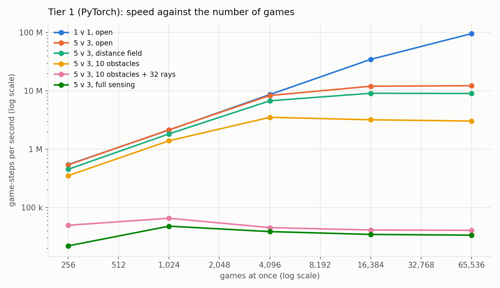
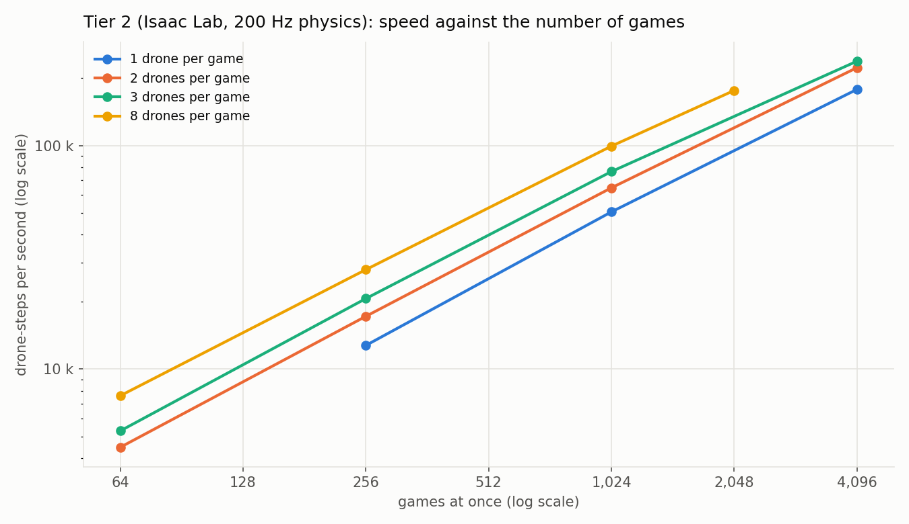
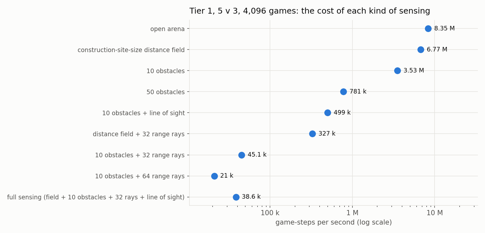

REFERENCE · results of build step S0, observed in the training simulator.

# S0 results: how fast the training simulator runs

S0 asks one question: **how many games can the training simulator play per second on one GPU, and is that fast
enough to train on?** The answer sets the compute budget for S2–S4 ([DESIGN §8](DESIGN.md#8-build-order)).
Terms are in the [glossary](GLOSSARY.md). How we got here: [History](README.md#history).

The training simulator has two parts. *Tier 1* is a fast, simple drone model in plain PyTorch. *Tier 2* is a full
physics drone in Isaac Lab. The official run whose numbers we keep (the *run of record*) is T1. Its written
summary (the *record*) is never edited. The table gives the facts of that run.

| Item | Value |
|---|---|
| Run of record | T1, `2026-11-15_s0_laptop`, started 15 November 2026 at 00:54 Singapore time, finished 02:41 |
| Verdict | **FAIL** on one [gate](GLOSSARY.md) of four (see [The FAIL](#the-fail)); every number below is usable |
| Record | [records/2026-11-15_s0_laptop_record.md](../records/2026-11-15_s0_laptop_record.md) |
| Sweep | 96 points: 65 in tier 1 (13 cases × 5 game counts), 31 in tier 2 (8 cases) |

A *gate* is a pass/fail check written before the run and never moved afterwards. A *sweep point* is one set-up
run at one number of games.

## T1 throughput: **TRAINING SIMULATOR ONLY**

Scope: training simulator, laptop RTX 5070 Ti (12 GB), in the container (a sealed copy of the software). The
drone models are stand-ins (placeholders until S1 fits real ones). There was no safety filter and no policy
network, and the actions were random. The table shows the best point of each case, as the mean of two repeats.

| Case | Config name | Games | Game-steps / s | Drone-steps / s | Source |
|---|---|---|---|---|---|
| Tier 1, 5 v 3, open arena | `t1_5v3_open` | 65,536 | 12.3 million | 98.3 million | [record, tier 1](../records/2026-11-15_s0_laptop_record.md#tier-1) |
| Tier 1, 5 v 3, distance field of construction-site size | `t1_5v3_field` | 16,384 | 9.1 million | 72.9 million | [record, tier 1](../records/2026-11-15_s0_laptop_record.md#tier-1) |
| Tier 1, 5 v 3, full sensing (field, 10 obstacles, 32 range rays, line of sight) | `t1_5v3_full` | 1,024 | 47,776 | 382,206 | [record, tier 1](../records/2026-11-15_s0_laptop_record.md#tier-1) |
| Tier 2 (Isaac Lab), 3 drones per game, 100 Hz physics | `t2_k3_100hz` | 4,096 | 151,767 | 455,300 | [record, tier 2](../records/2026-11-15_s0_laptop_record.md#tier-2-arl-robot-1-airframe) |
| Tier 2 (Isaac Lab), 8 drones per game, 200 Hz physics | `t2_k8` | 2,048 | 22,045 | 176,361 | [record, tier 2](../records/2026-11-15_s0_laptop_record.md#tier-2-arl-robot-1-airframe) |

A *game-step* is one tick of game time (one 1/20 s policy step) for one game. A *drone-step* is the same for one
drone: drone-steps = game-steps × drones per game. Every other case and game count is in the record.

### The same data as charts

All three figures are drawn by [`scripts/make_s0_figures.py`](../scripts/make_s0_figures.py) from the run's own
`results.jsonl`. Each point is the mean of the two repeats, exactly as the record tabulates it. Both axes are log
scales, so a straight rising line means speed grows in proportion to the number of games.

**Figure 1.** Tier 1, game-steps per second against games at once. Without sensing, speed grows with the number of
games until about 16,384 games, then flattens: the GPU is full. With range rays, speed is flat from the start,
because the sensing sets the pace.

**Figure 2.** Tier 2 (Isaac Lab), drone-steps per second against games at once, 200 Hz physics. All four lines
still rise in a straight line at the largest size measured, so the GPU was not yet full: larger runs would be
faster still. The 1-drone case has no 64-game point (an Isaac Sim start-up crash, [below](#the-fail)).

**Figure 3.** What each kind of sensing costs, tier 1, 5 v 3, 4,096 games. Obstacles cost a factor of 2 to 10;
range rays against per-game obstacles cost about 200. Rays against the baked distance field alone cost about 25,
so making the rays read the field is the first speed-up for S3.

### Decision rules: **TRAINING SIMULATOR ONLY**

Scope: as above. A [decision rule](GLOSSARY.md) is a threshold we proposed in the config's `[decisions]` to help
choose the next step. It is read off the numbers and is not a gate: it cannot fail a run. The table shows both
rules and what T1 observed.

| Rule | Threshold (drone-steps / s) | Observed | Reading |
|---|---|---|---|
| Tier 1 can do bulk training on this laptop (`t1_5v3_full`) | at least 50,000 | 382,206 at 1,024 games | meets |
| Tier 2 is fast enough to train on, not only to cross-check (best tier 2 case) | at least 20,000 | 455,300 at 4,096 games (`t2_k3_100hz`) | meets |

## What it means

- **Both decision rules are met.** Tier 1 can carry bulk training on the laptop. Tier 2 is fast enough to train on.
- About 1.5 GPU-hours of simulator stepping per 2 billion drone-steps (full sensing, 382,206 drone-steps / s).
  This is a lower bound: no policy network, no learning update and no safety filter were in the step.
- Tier 2 speeds up as games are added. `t2_k3_100hz` went from 3,340 to 151,767 game-steps / s as games
  rose from 64 to 4,096. It used 5.2–6.8 GB of GPU memory, device-wide (all tier 2 points: 5.1–7.6 GB).
- Sensing is the slow part. The best full-sensing rate is about 1/257 of the best open-arena rate (both 5 v 3,
  game-steps per second).
  Rays against per-game obstacles cost most. With 32 rays the best was 65,367 game-steps / s among 10 obstacles,
  and 327,002 against the shared field alone. This is the first thing to speed up in S3.

## The FAIL

One of 96 sweep points has no measurement: tier 2 case `t2_k1` (1 drone per game) at 64 games. Isaac Sim
crashed while starting (segmentation fault in a Kit telemetry thread, exit 139), before any project code ran. So
the `sweep_complete` gate failed. The other three gates passed: tests `109 passed, 2 skipped` (`runs/2026-11-15_s0_laptop/tests.txt`); worst repeat spread
0.0562 (limit 0.10); no NaN ("not a number", a sign that the maths broke). The *repeat spread* is how far two
repeats of one point differ, divided by their mean. A second reviewer recomputed every number in the record
from `results.jsonl` and found them exact. The owner decided on 15 November 2026 that T1 stands as FAIL and its
numbers are used. `scripts/run_s0.sh` now retries such a start-up crash once ([GETTING_STARTED](GETTING_STARTED.md#when-it-fails)).

The program that writes the record had three faults. They are fixed for the next run (commit `fa33852`). The
record itself is never edited. The table sets each fault beside the facts.

| What the record says | What is true |
|---|---|
| "while it is untracked" and commit `unknown` | the folder is tracked since 14 November 2026; the container had no `.git` to read the commit from |
| no MEASURED / PROPOSED labels | the throughput is MEASURED; the decision rules and the compute budget are PROPOSED |
| date `2026-11-14T16:55:40` (also in the ledger) | container UTC (the first result row); in Singapore time that is 00:55 on 15 November 2026 |

## Limits

The table lists what T1 did not include and what that means for its numbers.

| Limit | What it means |
|---|---|
| Stand-in drone models: tier 1 a placeholder delay and lag, tier 2 Isaac Lab's ARL Robot 1 airframe, not a Starling | the numbers are for the stand-ins; the fitted models (S1 on) may run slower |
| Tier 2 has no flight controller and rewrites every drone's state each policy step | the PX4-style cascade is not in the timing yet |
| No safety filter, no policy network, no learning update in the step | the 1.5 GPU-hours budget is a lower bound |
| The budget assumes the published 2 billion samples are drone-steps | if they are game-steps, multiply by 8 (5 against 3) |
| Laptop only | S0 also needs a run on a training workstation ([DESIGN §8](DESIGN.md#8-build-order)) |

The record lists every limit ([Limits of this record](../records/2026-11-15_s0_laptop_record.md#limits-of-this-record)).
Nothing here is a flight result.

## Next

- S1: drone model and safety filter; [plan](plans/2026-11-15-s1-drone-model-and-safety-filter.md) approved by the owner on 15 November 2026; building.
- S0 again on a training workstation, when one is available.
