# S1 results: a drone model and a safety filter

S1 asks two questions. **How does a Starling's speed follow the speed a policy asks for? And can CMU's safety
filter run inside thousands of games at once?** This page gives the answers in the order we found them. Terms are
in the [glossary](GLOSSARY.md). How we got here, step by step: [WHAT_WE_DID](WHAT_WE_DID.md#6-s1-a-drone-model-and-a-safety-filter-15-november).

| Item | Value |
|---|---|
| Runs | T2 (filter copy), T3 (fit to the AirStack simulator), T4 (tier 1 with the new drone model); one exploratory fit to real flight logs, with no ledger row |
| Verdicts | T2 **FAIL**, accepted by the owner; T3 **FAIL**; real-log fit exploratory, no gates; T4 information only, no gates |
| Main finding | the real drone and the AirStack simulator feed PX4 in different ways, so the drone model for training must come from real flight logs |
| Drone model now in tier 1 | the commander's real-drone law plus a small PX4 model **observed in flight logs** at up to 0.5 m/s; not validated, not a run of record. No S1 gate on the drone model has passed yet |
| Plan and gates | [S1 plan](plans/2026-11-15-s1-drone-model-and-safety-filter.md), gates in `configs/s1.toml`, approved by the owner on 15 November 2026 |

A *run of record* is an official run whose numbers we keep. A *gate* is a pass/fail check written before the run
and never moved. *Exploratory* means a first look with no gates: its numbers guide the next step but prove nothing.

## What S1 set out to do

S0 measured speed with a stand-in drone: a guess at how a drone follows a speed command. S1 had two jobs.

1. **Fit a drone model.** Replace the guess in tier 1 with a model fitted to recorded flights. The model goes from
   the policy's speed command to the drone's measured speed. It must include the ground-control program in between,
   because a policy will plug in before it.
2. **Copy the safety filter.** CMU's *safety filter* nudges each drone's commanded speed so that no two drones come
   closer than the *keep-out distance*, 1.10 m centre to centre. CMU's version handles one scene at a time. We
   needed a copy that handles thousands of games at once, and acts only between drones of the same team.

The plan first meant to fit the model to the *AirStack simulator* (CMU's simulator with the PX4 flight software).
That changed half-way, for the reasons below.

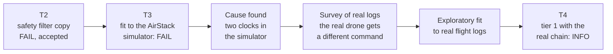

## What we found

### 1. The safety filter copy (T2): FAIL, accepted by the owner

**What we did.** We wrote a copy of CMU's filter (`core/safety_filter.py`) that works on all games at once. It
improves every drone's speed in small repeated corrections, called *sweeps*. We compared it with CMU's original on
2,000 random scenes of 2 to 8 drones, most of them with drones close together
([record](../records/2026-11-15_s1_filter_parity_record.md)).

**What we found.** Two gates passed and two failed.

| Gate | Limit | Measured | Result |
|---|---|---|---|
| Largest speed difference from CMU's filter | at most 0.02 m/s | 1.67 m/s | FAIL |
| How far the copy's answer breaks a keep-out rule | at most 0.002 | 2.09 | FAIL |
| Same decision on the "emergency push-apart" | at least 0.99 | 0.999 (1,998 of 2,000 scenes) | PASS |
| Corrections between a Guard drone and a Strike drone | 0 | 0 | PASS |

The speed gate is judged on the 1,779 scenes where CMU's filter did not push apart. Of these, **13 scenes** are
over the 0.02 m/s limit, 3 of them over 0.1 m/s. The worst two, 1.67 and 1.04 m/s, are scenes where our copy pushed
apart and CMU did not. **109 scenes** are over the 0.002 limit on how far an answer breaks a keep-out rule; CMU's
own filter is over that limit in 94 scenes. The emergency decision agreed in 1,998 of 2,000 scenes.

Every scene that CMU solves in its first, parallel phase (1,722 scenes) agrees within 0.0001 m/s. The scenes over
the speed limit are all ones that CMU finishes in a slower second phase, which handles one pair of drones at a time.
The copy does not have that phase.

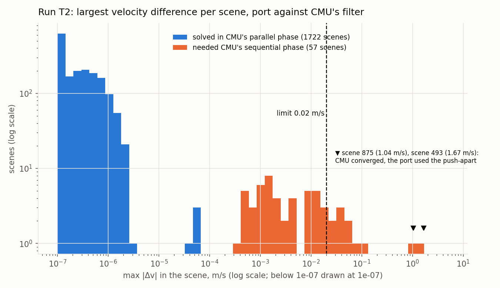

**Figure 1.** Each bar counts scenes by how far the copy's speeds are from CMU's. All blue scenes, which CMU solved
in its parallel phase, agree within 0.0001 m/s. Only orange scenes, which needed CMU's slower one-pair-at-a-time
phase, go past the 0.02 m/s limit; the two marked scenes are the worst.

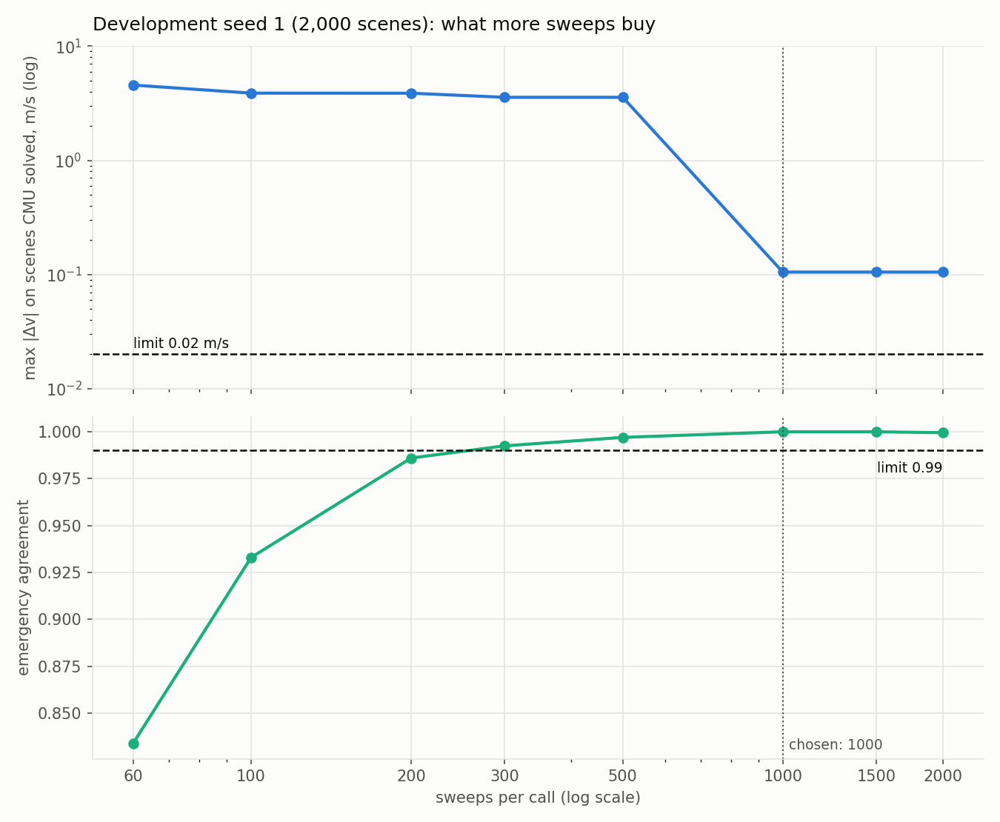

**Figure 2.** How the copy improves with more sweeps, on a separate test seed. From 1,000 sweeps the largest
difference stays at 0.105 m/s, which is how far CMU's own answer is from the exact one. Emergency agreement passes
0.99 from 300 sweeps.

**The owner's decision.** The owner accepted T2 on 15 November ('if 1998/2000 checks passed its ok'); that figure is the emergency-agreement count. Re-confirmation on the counts above was asked the same day. T2 stays a FAIL in the ledger, the gates
are unchanged, and S1 went on with this filter. Two costs remain: 1,000 sweeps is slow (section 6), and in emergency
scenes the push-apart speeds differ from CMU's (parked for the owner).

### 2. First fit to the AirStack simulator (T3): FAIL

**What we did.** We fitted two simple models to one recorded simulator session: five pushes of 0.5 m/s, each held
for 2 s ([record](../records/2026-11-15_s1_fit_v0_record.md)). Each model is a short wait (a *delay*) plus a smooth
catch-up (a *lag*). The fit used some pushes and was judged on the others, which it never saw (*held-out* pushes).

**What we found.** Three of four gates failed. The typical speed error on held-out pushes was 0.123 m/s (limit 0.10).
The time to reach 63 % of the new speed was off by 0.345 s (limit 0.10). Only 2 held-out pushes existed (8 needed).

The reason is the shape of the response. The simulated drone rises to 81–86 % of the command, sags to 50–65 % while
the command is still held, then moves backwards after release. No delay-plus-lag model can do that.

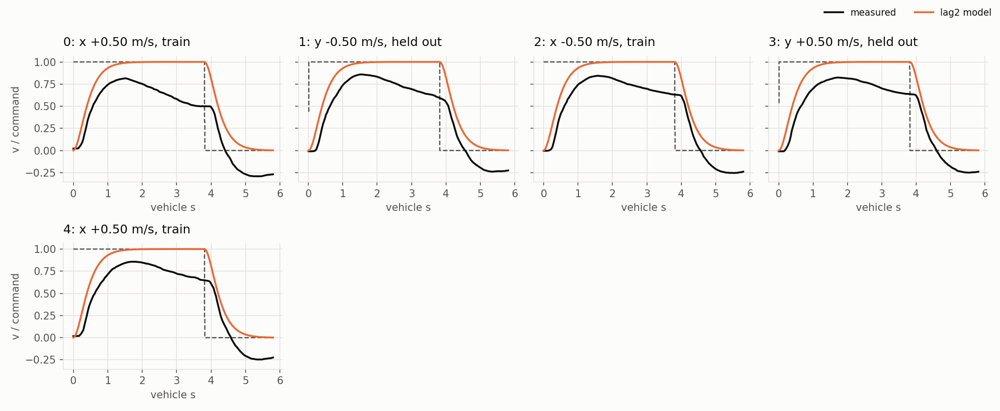

**Figure 3.** All five pushes in the AirStack simulator, speed as a fraction of the command (dashed). Black is
measured, orange the fitted model. The measured speed peaks at 81–86 %, sags while the push is held, and dips to
−24 to −29 % after release; the model cannot follow this.

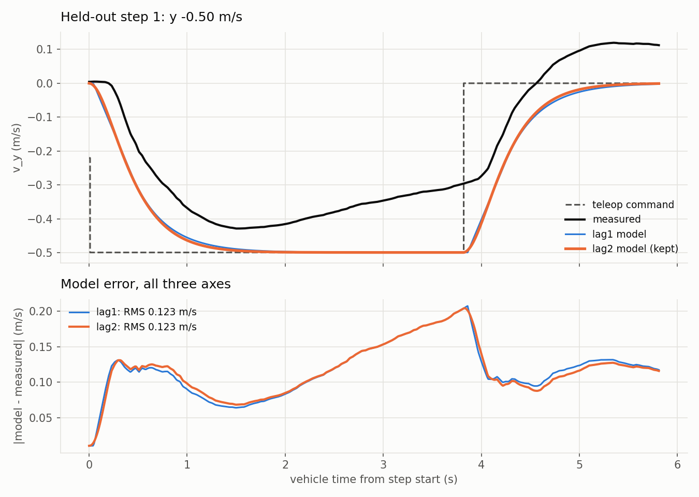

**Figure 4.** Held-out push 1, −0.5 m/s along y. The measured speed peaks at 0.43 m/s and reaches 63 % of the
command after 0.82 s, against 0.50 s for the model. The lower panel is the error the gate scores: 0.123 m/s, limit
0.10.

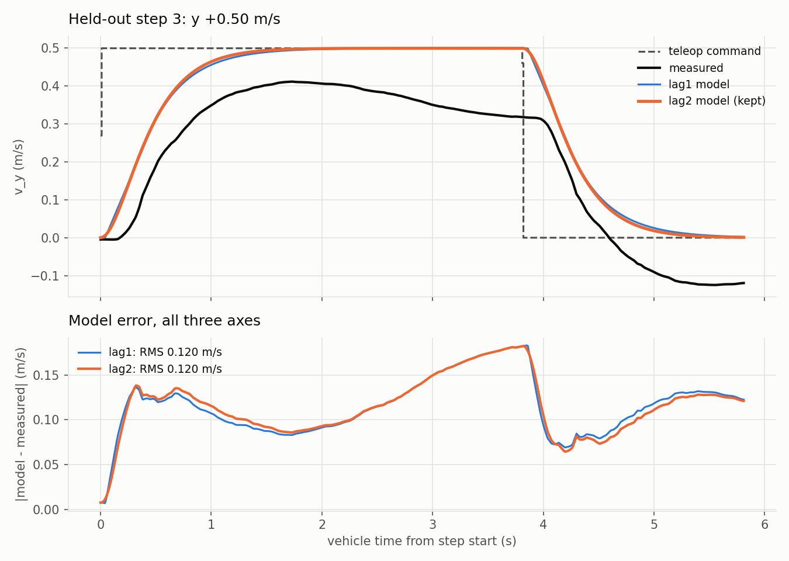

**Figure 5.** Held-out push 3, +0.5 m/s along y. The measured speed peaks at 0.41 m/s and reaches 63 % of the
command after 0.85 s, against 0.50 s for the model. Error 0.120 m/s, limit 0.10.

### 3. Why: two clocks in the simulator

The *commander* is CMU's ground-control program. It takes the policy's speed command 20 times a second and keeps a
*reference point*, a running "where the drone should be", which the command moves forward. It then adds a pull
towards that point.

In the AirStack simulator, the commander moves its reference point by the clock on the wall. PX4 runs on the
simulator's own clock, which ran **1.907 times faster** in this session. We call this ratio the *time scale*. So
the drone outruns its reference point, the pull turns backwards, and the speed sags to about 1 ÷ 1.907 = 52 % of the
command. On release, the drone is about 0.25 m past the point, so it flies back.

We checked this by re-running the commander's rules on the recorded inputs. The result matched what the commander
actually sent within 0.019 m/s on every tick of all five pushes ([cause notes](../runs/sdd/s1/task-4-cause.md)).

**This is a simulator effect only.** On the real drone both clocks are real time, and the same rules give no sag.
Making the commander use the simulator's clock would be a change to flight code, which is the owner's call. Nothing
was changed outside this folder.

### 4. The real drone takes a different route

A read-only survey of the real flight logs of 11–13 November found a bigger difference
([survey](../runs/sdd/s1/real-logs-survey.md)). On the real drone the commander does not send a bare speed. It sends
a *trajectory setpoint*: one instruction holding a position, a speed and an acceleration. PX4 then closes the
position loop on the drone itself. The simulator gets a speed only, through a different bridge program (MAVROS),
and runs a newer PX4.

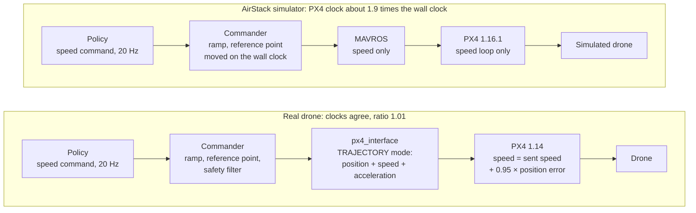

So a model fitted to the simulator describes the simulator's route, not the drone. It would teach a policy that the
drone is sluggish and swings back. The owner agreed (15 November) that the drone model for training is fitted from
real flight logs, with small random variation around it.

### 5. A first fit from real flight logs (exploratory)

**What we did.** We fitted a small model of PX4's law to the 13 November gamepad flight (flight ledger #36, drone_2,
156 s), using the drone's own gains read from its log. Six pushes trained the model and six were held out
([record](../records/2026-11-15_s1_real_px4_exploratory.md)). There were no gates: this is exploratory.

**What we found.**

- **PX4's position gain can be seen in the log.** The *position gain* turns "how far the drone is from where it
  should be" into extra speed. The drone's parameter says 0.95 per second; a fit to the log gives 0.98.
- **The drone flies roughly the speed it was sent, a little later.** On held-out pushes the model's typical error is
  0.058 m/s. A plain rule, "the drone flies the sent speed 0.15 s later", scores the same 0.058 m/s; with no delay
  it scores 0.095. So at up to 0.5 m/s the real drone is close to its setpoint delayed by about 0.1–0.15 s.
- **What the model misses.** While a push is held the drone runs 1.03–1.31 times the commanded speed; after release
  it drifts back by about 0.14 times. The model shows neither well.
- **The clocks agree.** On the real drone the time scale is 1.01.

Two more logs from the two-drone flight of 13 November (#37) score 0.058 and 0.061 m/s with the same numbers.

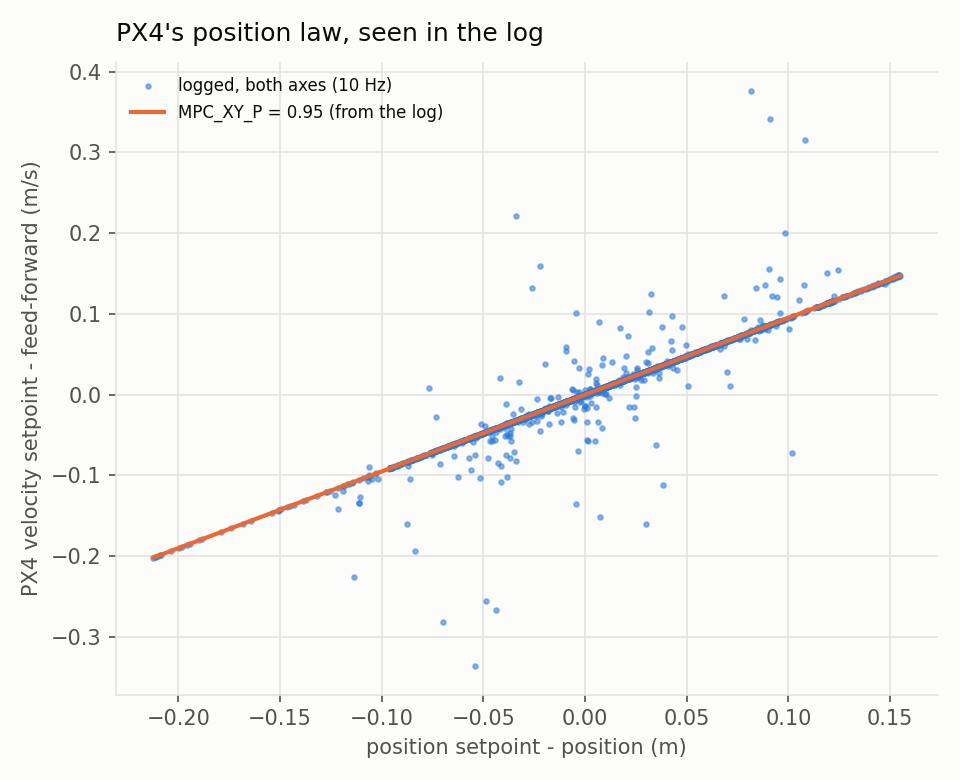

**Figure 6.** Each dot is one sample of the real flight: how far the drone was from its position setpoint, against
the extra speed PX4 added. The line is the drone's own position gain, 0.95 per second; a fit gives 0.98. This is
PX4's position law, seen in a real log.

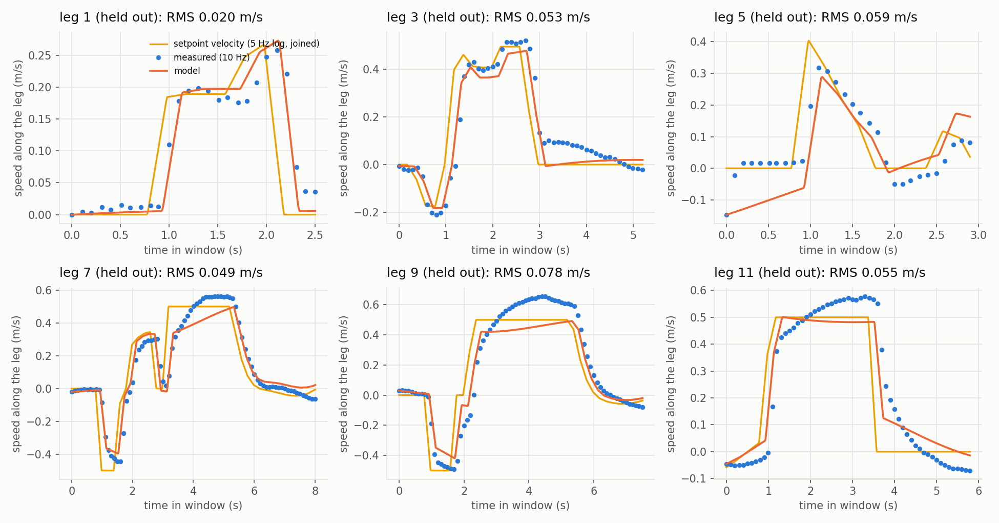

**Figure 7.** The six held-out pushes of the real flight. Yellow is the speed sent to PX4, blue dots the measured
speed, orange the model, fitted on the other six pushes only. The model follows the sent speed closely; the real
drone overshoots and drifts back more.

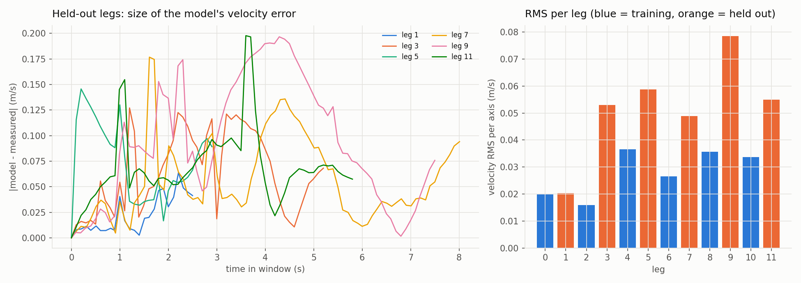

**Figure 8.** Left: the model's speed error over time on each held-out push; the peaks sit where pushes start and
stop. Right: error per push, training pushes blue, held-out pushes orange, from 0.020 to 0.079 m/s.

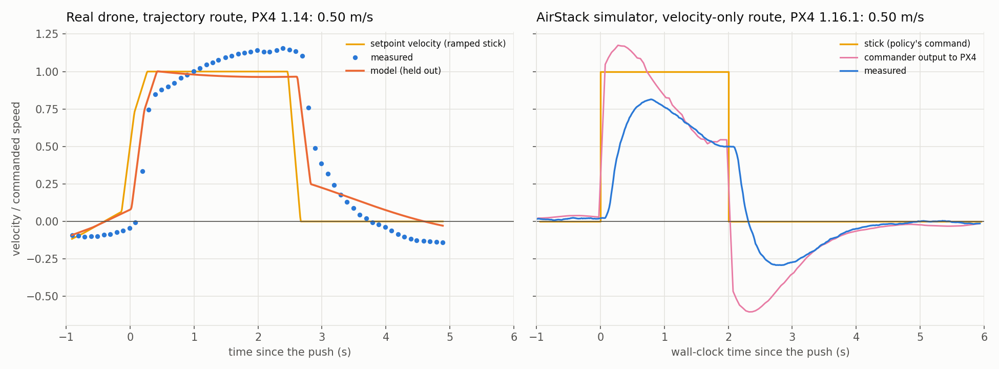

**Figure 9.** Left: one real 0.5 m/s push; the drone peaks at 1.16 times the command and drifts back slowly.
Right: one 0.5 m/s push in the AirStack simulator; the commander's own output peaks, sags and swings back. The two
routes and PX4 versions differ, so this compares routes, not drone physics.

**Limits.** Speeds of at most 0.5 m/s; the setpoint logged only 5 times a second; one flight, ad hoc pushes, no
stick recorded. This model was **observed in flight logs**. It is not validated and it is not a run of record.

### 6. Tier 1 with the real chain (T4): information only

**What we did.** We put the real-drone chain into tier 1: a copy of the commander's real-drone rules, the PX4 model
from section 5, and the filter copy at the point where the commander calls it, within each team. We then measured
speed with 5 Guard and 3 Strike drones per game ([record](../records/2026-11-15_s1_tier1_fitted_filter_record.md)).
This run had no gates.

| Case, 4,096 games | Filter off | Filter on, 200 sweeps (information) | Filter on, 1,000 sweeps |
|---|---|---|---|
| Open arena, no sensing | 2,271,956 | 48,438 | 10,027 |
| Full sensing | 38,303 | 21,279 | 7,938 |

Game-steps per second, mean of two repeats, laptop RTX 5070 Ti. For comparison, S0's stand-in model ran the open
arena at 8,532,832 at the same size.

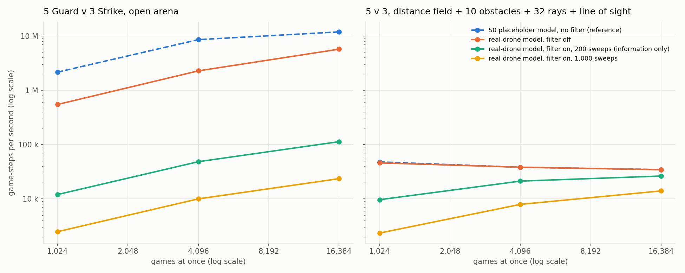

**Figure 10.** Tier 1 game-steps per second against games at once; left the open arena, right full sensing. Dashed
is S0's stand-in model; solid lines are the real-drone chain with the filter off, at 200 sweeps and at 1,000 sweeps.
The filter at 1,000 sweeps sets the pace.

**The speed cost.** The real-drone chain alone costs 2.1–3.9 times in the open arena and almost nothing with full
sensing, where the range rays dominate. The filter at 1,000 sweeps is the big cost: about 227 times slower than
filter off in the open arena, and about 5 times with full sensing. The lead's arithmetic from T4, not a
measured training run: with full sensing and the filter at 1,000 sweeps, 2 billion drone-steps would take about
9 hours of stepping at 4,096 games (7,938 game-steps a second) and about 5 hours at 16,384 games (14,042 game-steps
a second). S0, with no filter, gave about 1.5 hours. A faster filter is needed before training.

**A gap in the filter (HYPOTHESIS for the real drone).** The commander's filter corrects the speed it sends, but not
the position setpoint, which can sit up to 0.2 m ahead of the drone. PX4 still flies towards that point. In a
head-on test in tier 1, two teammates came to 1.083 m, inside the 1.10 m keep-out. With PX4's position gain set to
zero they stopped at 1.1001 m. The same code runs on the real drone, but this has **not been observed in flight**.
Training keeps the behaviour, because it is how the real chain works.

## Every run

| Ledger row | Run | Result | What it means |
|---|---|---|---|
| T2 | [filter copy against CMU's filter](../records/2026-11-15_s1_filter_parity_record.md) | FAIL, accepted by the owner (re-confirmation on the counts asked) | of 1,779 scenes, 13 are over the speed limit and 109 over the keep-out residual limit; emergency decision agreed in 1,998 of 2,000 |
| T3 | [fit to the AirStack simulator](../records/2026-11-15_s1_fit_v0_record.md) | FAIL | the simulator's sag-and-swing-back comes from its two clocks, which no simple model follows |
| none | [fit to real flight logs](../records/2026-11-15_s1_real_px4_exploratory.md) | exploratory, no gates | at up to 0.5 m/s the real drone flies close to its setpoint, about 0.1–0.15 s late |
| T4 | [tier 1 with the real chain and the filter](../records/2026-11-15_s1_tier1_fitted_filter_record.md) | INFO, no gates | the filter at 1,000 sweeps is too slow to train with; it cuts speed about 5 to 227 times |

All rows are in the [training ledger](../records/LEDGER.md). Nothing here is a flight result.

## What is still open

| Item | Status |
|---|---|
| A drone model with a run of record | waiting on a real flight with planned pushes (next section) |
| The owner's acceptance of T2 on the exact counts (13 and 109 scenes) | asked on 15 November; waiting on the owner |
| Filter speed: 1,000 sweeps is too slow to train with | to fix before S2: fewer sweeps, an early stop, or other speed-ups, each measured against T2's checks |
| Emergency push-apart speeds differ from CMU's | parked for the owner; matters only in scenes already flagged as emergencies |
| The filter gap through the position setpoint | HYPOTHESIS for the real drone; a fix would be in CMU's code, outside this folder |
| The commander moves its reference point on the wall clock in the simulator | simulator only; the owner decides whether AirStack changes |
| Up-and-down (vertical) response | not fitted; a working value only |
| Speeds above 0.5 m/s | not in the logs we fitted; one unlabelled log reaches 0.87 m/s |

## What the owner needs to do next

**1. Fly the planned-pushes flight.** This gives the drone model its run of record. What to record, from the
[exploratory record §8](../records/2026-11-15_s1_real_px4_exploratory.md#8-what-to-record-at-the-next-real-flight)
and the [survey §6](../runs/sdd/s1/real-logs-survey.md#6-what-to-record-at-the-next-real-flight):

1. Record a rosbag of every flight, with the stick command (`/svg/drone_N/teleop_command`) and the commander's output
   (`/drone_N/fmu/trajectory_command`) together.
2. Log the setpoint at its full rate: the setpoint at 20 Hz, and position and attitude at 50 Hz or more. This is a
   change to the drone's logging (`SDLOG_PROFILE`), so it is the owner's decision.
3. Start every push from rest, hold it 3–4 s, rest 3 s. Hold some for 5 s.
4. Fly speeds above 0.5 m/s too (0.75 and 1.0 m/s, as safety allows).
5. Fly both drones: drone_1 has a 30° tilt limit, drone_2 has 45°.
6. Write down the commander's config file, the laptop's time-sync state, each drone's PX4 build and
   `MPC_XY_VEL_MAX`, with the flight's ledger number.
7. Turn the safety filter off for the fit flight (one drone), and raise the stick limit above 0.5 m/s before the
   faster pushes.

**2. Decisions waiting on the owner.**

- Whether T2's acceptance stands on the exact counts: 13 scenes over the speed limit, 109 over the residual
  limit (his "1998/2000" is the emergency-agreement count).
- How to make the filter fast enough: which speed-up to try, and what agreement with CMU is good enough.
- Whether to fix the commander's clock in the AirStack simulator (flight code, outside this folder).
- Whether to tell CMU about the filter gap through the position setpoint.
- The speed caps: the rules say Guard 0.67 m/s from a 1.0 m/s cap, but the real stick limit is 0.5 m/s, which
  makes Strike 0.5 and Guard 0.33 m/s. Tier 1 uses 0.5 and 0.33 now.
- `docs/CONFIG.md` lists 20 m/s for `MPC_XY_VEL_MAX`; the 13 November logs show 3.0 m/s on both drones.
- What the unlabelled 13 November log `08_34_27.ulg` was (drone_1, 0.87 m/s, the fastest real data).
- Whether the simulator step session (scripts ready, not run) is still wanted. It measures the simulator's route,
  so it is optional now.
- S2's plan, once written.
