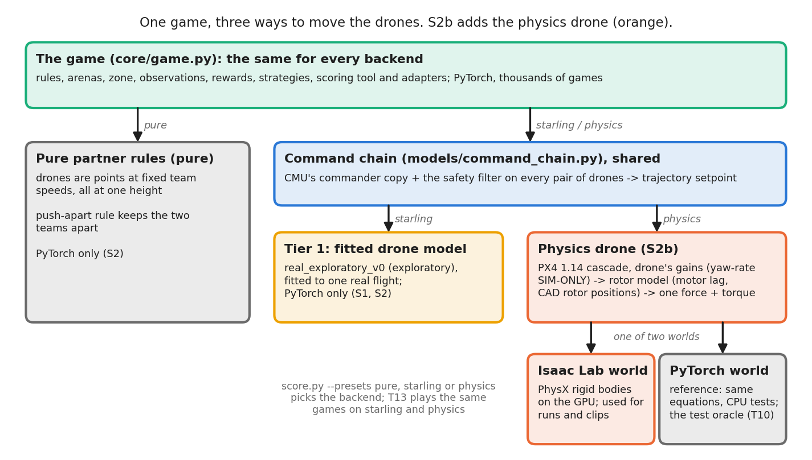
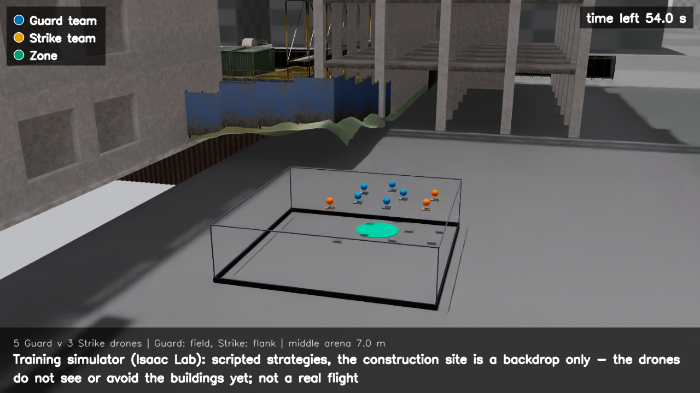
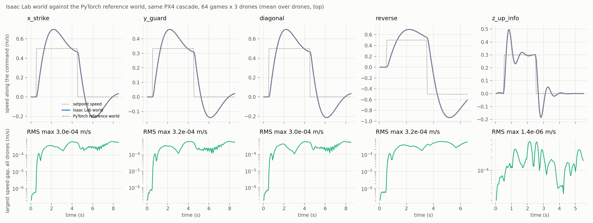
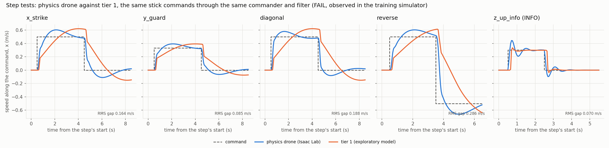
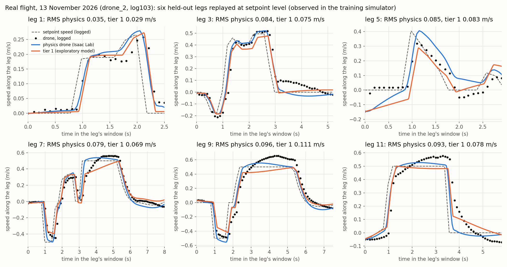
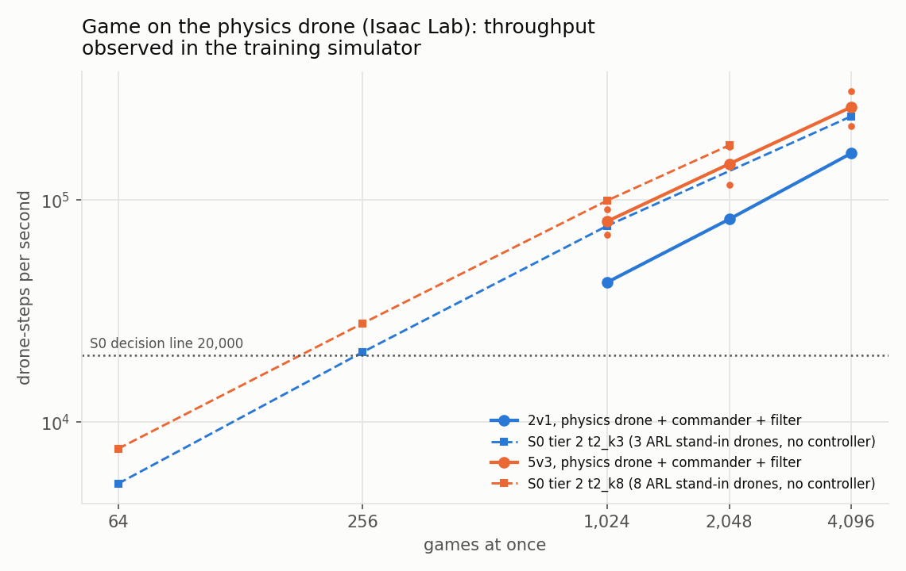
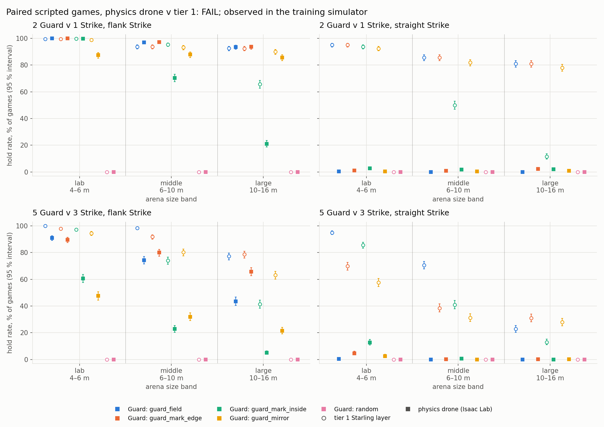
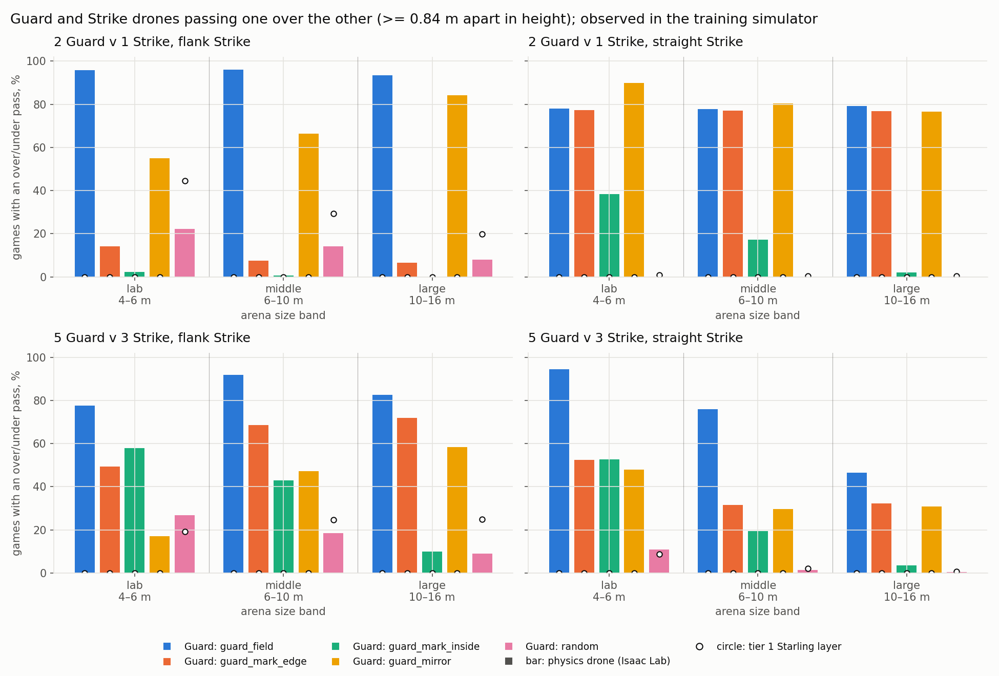
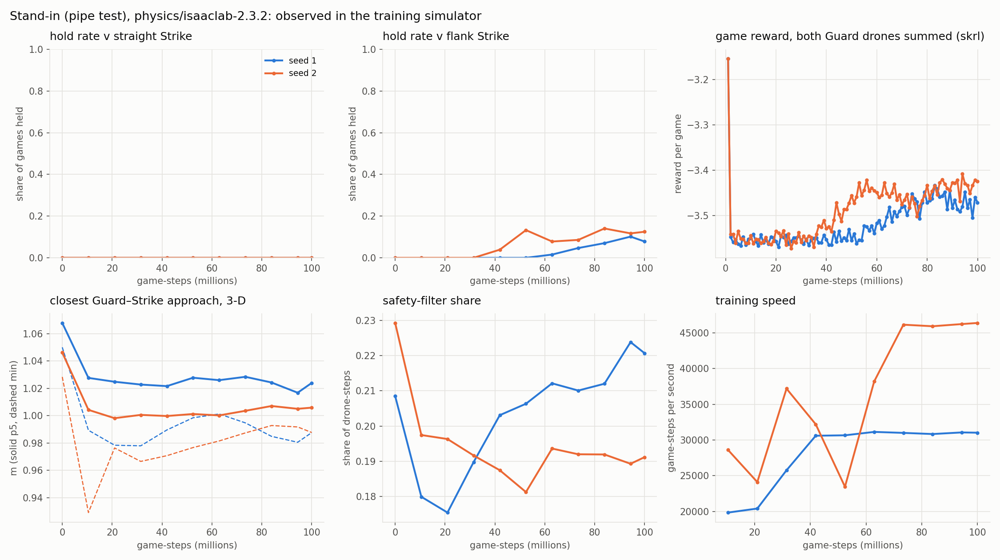
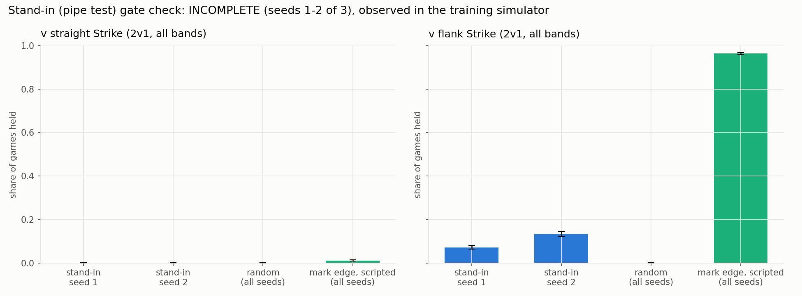

# S2b results: the game on Isaac Lab drones

S2b asks one question. **Does the S2 game give the same answers when each drone is a rigid-body Starling that
tilts, lags and saturates like the real one?** In S2 a drone was a point that followed the fitted drone model. S2b
adds a third way to move the drones, the *physics drone*: a rigid body in Isaac Lab, flown by a copy of PX4 1.14's
control loops with the drone's own gains. It then plays the same games on tier 1 and on the physics drone and compares them. This page says
what was built, what the runs showed and what waits on the owner. Terms are in the [glossary](GLOSSARY.md). How we
got here, step by step: [WHAT_WE_DID](WHAT_WE_DID.md#8-s2b-the-game-on-isaac-lab-drones-16-and-17-november).

| Item | Value |
|---|---|
| Runs | T10 (do the two physics worlds agree), T11 (step tests against tier 1 and a real flight log), T12 (speed), T13 (scripted games on both backends), T14 (the stand-in trainer on Isaac Lab, 2 of 3 seeds) |
| Verdicts | T10 **FAIL** on one gate (accepted by the owner); T11 **FAIL** on three gates; T12 information only, no gates; T13 **FAIL** on two gates; T14 **INCOMPLETE** (seed 3 not run; seeds 1 and 2 fail every gate cell, so it cannot pass) |
| Main result | with random actions, the game runs on Isaac Lab drones at 42,590–262,190 drone-steps a second on this laptop. That is above 20,000, S0's [decision rule](S0_RESULTS.md#decision-rules--training-simulator-only) for "tier 2 is fast enough to train on, not only to cross-check" |
| Main finding | on the physics drone a Strike drone often passes over or under a Guard drone, so against a straight Strike the scripted Guards hold 0–13 % of games, where tier 1 gave up to 95.1 %. The owner chose to keep this in the game (17 November 2026; option (a) of three put to him, §4) |
| Trained | no strategy. The stand-in trainer (a pipe test, not a strategy) trained 2 seeds on Isaac Lab; the pipe worked end to end, but the Guards learned almost nothing (T14) |
| Plan and gates | [S2b plan](plans/2026-11-16-s2b-isaac-lab-environment.md), gates in `configs/s2b.toml`, approved by the owner on 16 November 2026 |
| Linear | project P-NEAR-31, milestone S2b: NEAR-968, NEAR-973, NEAR-980, NEAR-981 ([snapshot of 16 November](linear/snapshots/2026-11-16-project-plan-linear.md)) |

Every number here was observed in the training simulator (tier 1 or tier 2, named in each section); T11 also uses
one real flight log. None is a flight result, and nothing here authorises a flight.

## What was built

**Figure 1.** One game, three ways to move the drones. The pure rules move points; the Starling layer sends each
command through CMU's commander copy and the safety filter, then to tier 1's fitted model or, new in S2b, to the
physics drone. The physics drone runs in Isaac Lab or in the PyTorch reference world used by the tests. Made by
`scripts/make_s2b_flowchart.py`.

| Part | What it does | Linear issue |
|---|---|---|
| Physics drone (`models/physics_drone.py`) | a rigid-body Starling: mass and inertia from CMU's system identification, four rotors with the measured motor lag (55 ms up, 85 ms down), CMU's CAD rotor positions for the body and the drone's own rotor parameters for PX4's motor mixing (owner, 16 November) | **NEAR-980: Wrap the S2 game as an Isaac Lab environment with a PX4-like controller.** |
| PX4 cascade (`models/px4_cascade.py`) | PX4 1.14's position, velocity, attitude and rate loops, ported line by line, at 200 Hz, with the drone's own gains. One exception, the owner's ruling of 16 November: the yaw-rate gains are the AirStack simulator's SIM-ONLY values (`params/sim_only_yaw_v0.toml`), never a drone value | NEAR-980 |
| Isaac Lab world (`compat/isaaclab_232.py`) | holds all drones of all games as PhysX rigid bodies on the GPU; no colliders, so contact stays the game's own 0.50 m rule | NEAR-980 |
| PyTorch reference world (`models/rigid_body.py`) | the same equations in plain PyTorch, so every CPU test runs without Isaac Sim; the *test oracle* T10 checks Isaac Lab against | NEAR-980 |
| Shared command chain (`models/command_chain.py`) | the commander copy and safety filter, moved out of tier 1 unchanged, so both drone models get exactly the same setpoints | NEAR-980 |
| Scoring on both (`score.py --presets physics --batch-per-pair`, `scripts/compare_backends.py`) | *paired games*: the same arenas, zones and starts on both backends, then a per-cell comparison against the gates | **NEAR-973: Cross-check the fast simulator against full drone physics in Isaac Lab.** |
| Preflight (`scripts/isaac_preflight.sh`) | runs before every Isaac start and stops on WiFi-only remote desktop or a busy GPU | NEAR-980 |
| Clips (`scripts/make_s2b_video.py`) | MP4 and GIF clips of scripted games on Isaac Lab drones, with the caption burnt in | **NEAR-981: Isaac Lab video of the game.** |
| Stand-in trainer (`scripts/train_standin.py`) | skrl IPPO (each Guard drone learns its own policy with PPO, a common learning method) for 2 Guard drones against scripted Strike drones, on any backend, logging to TensorBoard | **NEAR-968: Stand-in trainer: prove the training pipe end to end.** |

### The clips

**Figure 2.** A 5 Guard v 3 Strike game on Isaac Lab Starlings, 6 s in, with the construction-site world as a
backdrop only: the drones do not see or avoid the buildings. Blue balls mark Guard drones, orange balls Strike
drones; the green disc is the zone. A rendered drone model in the training simulator, not a photo.

Each clip is one scripted game on Isaac Lab drones, played at real time (MP4) or twice real time (GIF). Clips are
pictures, not measurements: no gates and no ledger row. How they are made and chosen: [media/README](media/README.md#isaac-lab-clips-s2b-the-same-game-on-rigid-body-starling-drones).

| Clip | Caption |
|---|---|
| `s2b_2v1_lab` ([MP4](media/s2b_2v1_lab.mp4), [GIF](media/s2b_2v1_lab.gif)) | 2 Guard drones v 1 Strike drone. Guards mark the zone edge, the Strike drone flanks. The Guard team holds the zone; the clip stops at 40 s of the 60 s game. Lab-size arena, 5.8 m. |
| `s2b_2v1_large` ([MP4](media/s2b_2v1_large.mp4), [GIF](media/s2b_2v1_large.gif)) | 2 v 1. Guards use the field tactic, the Strike drone flies straight and reaches the zone at 21.3 s. Large arena, 12.6 m. |
| `s2b_5v3_lab` ([MP4](media/s2b_5v3_lab.mp4), [GIF](media/s2b_5v3_lab.gif)) | 5 v 3. Guards mark the zone edge, Strike drones flank. The Guard team holds the zone; the clip stops at 40 s. Lab-size arena, 5.6 m. |
| `s2b_5v3_middle` ([MP4](media/s2b_5v3_middle.mp4), [GIF](media/s2b_5v3_middle.gif)) | 5 v 3. Guards mirror the Strike drones, which flank; a Strike drone reaches the zone at 38.1 s. Middle-size arena, 9.6 m. |
| `s2b_5v3_props` ([MP4](media/s2b_5v3_props.mp4), [GIF](media/s2b_5v3_props.gif)) | 5 v 3 among blocks and columns for show only: the drones neither see nor avoid them and fly through them. A Strike drone reaches the zone at 26.1 s. Middle-size arena, 9.1 m. |
| `s2b_5v3_site` ([MP4](media/s2b_5v3_site.mp4), [GIF](media/s2b_5v3_site.gif)) | 5 v 3 with the construction-site world as a backdrop. Guards use the field tactic, Strike drones flank; the Guard team holds the zone and the clip stops at 40 s. Middle-size arena, 7.0 m. |
| `s2b_2v1_site` ([MP4](media/s2b_2v1_site.mp4), [GIF](media/s2b_2v1_site.gif)) | 2 v 1 in the construction-site world, a backdrop only. Guards mirror the Strike drone, which flanks; the Guard team holds the zone and the clip stops at 40 s. Lab-size arena, 5.9 m. |

Two more stills: [Guard-team Starlings over the zone, close up](media/s2b_still_starlings_close.png) and
[the props clip's camera](media/s2b_still_5v3_props.png). Every clip uses the SIM-ONLY yaw-rate gains.

## What the runs showed

### 1. Do Isaac Lab and the PyTorch reference world move the drones the same way? (T10): FAIL, accepted

**What we did.** Both worlds got the same forces with no controller for 1 s (open loop), then the same PX4 cascade
on five speed steps (closed loop), 64 games of 3 drones each. This run used the drone's own yaw gains
([T10 record](../records/2026-11-16_s2b_agreement_record.md)).

**Figure 3.** Speed along the command for each step, averaged over all drones: Isaac Lab (solid) and the PyTorch
reference world (dashed) under the same PX4 cascade. Below, the largest speed gap between the two worlds, log
scale. The lines lie on top of each other. Training simulator, tier 2.

**What it shows.** Under the cascade, the way the game flies the drones, the two worlds agree about 30 times better
than the gates ask: speeds within 0.0003 m/s RMS (gate 0.01) and end positions within 0.6 mm (gate 20 mm). Open
loop, they drift 1.15 mm apart in 1 s against a 1.0 mm gate, the one FAIL. The gap comes from Isaac Lab's GPU
physics (PhysX on the CPU agrees to 0.021 mm); the owner accepted the FAIL and the gate was not moved.

### 2. Does the physics drone answer like the real drone, and like tier 1? (T11): FAIL

**What we did.** The physics drone was fed the setpoints PX4 logged on six held-out legs of a real flight (13
November, drone_2), and given the same stick commands as tier 1 through the same commander copy and filter. SIM-ONLY
yaw-rate gains ([T11 record](../records/2026-11-16_s2b_step_tests_record.md)).

**Figure 4.** Speed along the stick command for each step: the physics drone in Isaac Lab, tier 1's fitted drone
model and the command. Both get the same commands through the same commander copy and safety filter. Tier 1 rises
and stops far more slowly. Training simulator, tiers 1 and 2.

**Figure 5.** The six held-out legs of the 13 November flight (drone_2): the speed the drone logged, the physics
drone and tier 1's model, each fed PX4's logged setpoints. Worst leg: physics drone 0.096 m/s RMS (gate 0.10, which
applies to the physics drone only), tier 1 0.111 m/s. The physics drone mostly answers a little early.

**What it shows.** Against the real log the physics drone's speed is close enough (worst leg 0.096 m/s, gate 0.10),
but its timing is not: the time to reach 63 % of a speed change (a standard measure of how quickly a drone responds) is off by up to
0.38 s (gate 0.10). In 10 of the 12
changes it is early, by 0.05–0.13 s typically. The 0.38 s is leg 5's stop, where it is late, and that leg starts from
one suspect logged sample; without it the worst is 0.25 s (information only). Through the commander copy, tier 1 takes 0.56–0.88 s to reach 63 % of a
push against the physics drone's 0.19–0.25 s, so their speeds differ by up to 0.29 m/s RMS (gate 0.10) and their timing by up to 0.99 s (gate 0.10). Hover held to
2 mm and the largest tilt was 25° (gate 45.5°), with no upsets.

**Read with care.** Six of nine gates pass. Why the physics drone is early: candidate, not tested (it has no
estimator and no transport delay). Why tier 1 is slow through the commander copy: candidate, not tested in T11 (its
fitted 1.72 m/s² acceleration limit cuts the commander's 5 m/s² ramp; [T11 record](../records/2026-11-16_s2b_step_tests_record.md#what-this-run-shows)).
Tier 1 was not refitted; its model of record waits on a real flight with planned speed pushes (NEAR-962).

### 3. How fast does the game run on Isaac Lab drones? (T12): information only

**What we did.** The full game on the physics drone (commander copy, filter on every pair, PX4 cascade, PhysX),
random actions, no learner, at 1,024, 2,048 and 4,096 games of 2 v 1 and 5 v 3. SIM-ONLY yaw-rate gains
([T12 record](../records/2026-11-16_s2b_throughput_record.md)).

**Figure 6.** Drone-steps per second against the number of games, physics drone in Isaac Lab, random actions.
Dashed: S0's tier 2 benchmark (stand-in drones, no controller, no filter). Grey: S0's 20,000 decision line; every
physics-drone point is above it. Training simulator, tier 2, this laptop.

**What it shows.** Every physics-drone point is above S0's line of 20,000 drone-steps a second: the slowest is 42,590 (2 v 1, 1,024
games), the fastest 262,190 (5 v 3, 4,096 games). Speed still grows almost in step with the number of games, so the
GPU is not full at 4,096. The PX4 cascade takes 36–50 % of each tick, PhysX 20–24 % and the filter 11–27 %.

**Read with care.** This is S0's read-off (random actions, no learner), not a training speed. In 5 v 3 the two repeats
differ by 26–39 %, cause not found; the means are reported.

### 4. The scripted games on both backends (T13): FAIL

**What we did.** Five scripted Guard strategies played two scripted Strike strategies, 2 v 1 and 5 v 3, in three
arena bands, 1,000 paired games per cell, on tier 1's Starling layer and on the physics drone in Isaac Lab:
60,000 games each. SIM-ONLY yaw-rate gains
([T13 record](../records/2026-11-17_s2b_scripted_compare_record.md)).

**Figure 7.** Share of games the Guard team held, with 95 % intervals, per arena band; each point is 1,000 paired
games. Open circles: tier 1 Starling layer; filled squares: the physics drone in Isaac Lab. Colour is the Guard
strategy; one panel per team size and Strike behaviour. Training simulator.

A *cell* is one matchup: one Guard strategy against one Strike strategy, at one team size, in one arena band (5 × 2
× 2 × 3 = 60 cells, 1,000 games each).

**What it shows.** In 36 of the 60 cells the hold rate moves by more than the 0.10 gate, and always the same way:
the Guard team holds less on the physics drone. Against the straight Strike, scripted Guards hold 0–13 % on the
physics drone where tier 1 gave 11.5–95.1 %; the largest drop is field v straight, 2 v 1 lab, 95.1 % to 0.3 %.

**What we saw: the Strike drone passes over or under a Guard drone.** The safety filter is a copy of CMU's (its
check against the original, [S1's T2](S1_RESULTS.md#1-the-safety-filter-copy-t2-fail-accepted-by-the-owner), was a
FAIL accepted by the owner). It keeps drones 1.10 m apart in 3-D, so it may push two drones apart up and down as well as sideways. On tier 1, with scripted
Guards, every drone stayed at exactly 1.20 m (the scripted strategies never command up or down), so the filter could only push
sideways and the Guard blocked the Strike drone's path. On the physics drone, heights differ by millimetres, and
the filter's escape can become vertical (the 1 mm test below backs this for one cell only): one drone climbs towards 1.8 m, the other drops towards 0.6 m, and
the Strike drone flies over or under the Guard into the zone.

**Figure 8.** Share of games in which a Guard and a Strike drone passed one over the other: under 0.55 m apart
sideways but at least 1.0 m apart in 3-D, so at least 0.84 m apart in height. Bars: physics drone; circles: tier 1.
With scripted Guards, tier 1 never passes. Training simulator.

**A 1 mm test, one cell only.** Tier 1 (the fitted drone model, `--backend fitted`), on the CPU, 40 games of one cell:
2 v 1, lab arena, mark edge v straight Strike. As drawn, the Guards held 97.5 %. With every Strike drone started
**1 mm** higher, they held **0 %**. So in this cell tier 1's Guards held because all drones flew at exactly the
same height; other cells were not tested. A diagnosis, not a run of record: `scripts/diag_vertical_pass.py`,
[note](notes/2026-11-17_s2b_vertical_pass_note.md). A physics run with all drones pinned to one height was not done.

**Read with care.**

- Random Guards command up and down, so on tier 1 they pass over or under too (up to 44.5 % of games, 2 v 1 random
  v flank, lab).
- A pass alone does not decide a game: in 2 v 1 field v flank the drones pass in 93.5–96.1 % of physics games and
  the Guard team still holds 93.5–99.9 % (pass shares from T13's per-game arrays, as figure 8).
- The physics drone also answers faster (§2). In the one cell tested, the 1 mm test shows that speed is not needed
  for the collapse against the straight Strike; how much it adds elsewhere, for example 5 v 3 against the flank Strike, is not separated.
- **Closest approach is a second, separate FAIL.** In all 48 scripted-Guard cells the physics drone stays within the
  0.10 m gate of tier 1. The 4 failing cells are all *random* Guards in middle and large arenas, 0.12–0.23 m closer
  at their minimum. Cause not diagnosed.
- No upsets and no non-finite values in 60,000 physics games.

**The owner's choice, 17 November 2026: option (a).** Three options were put to him: (a) keep it, (b) pin every
drone's height in the game, (c) a narrower height band. He chose (a): passing over or under stays part of the game on the Starling
layer and the physics drone; the Guard team will have to learn to cover height. The pure partner rules stay flat, as
NUS's game is. The gate was not moved and the FAIL stands ([S2b plan, third round](plans/2026-11-16-s2b-isaac-lab-environment.md#owners-answer-third-round-17-november-2026-the-game-design-should-follow-a)).

### 5. The stand-in trainer

The stand-in is a short training run whose only job is to prove the pipe works end to end: game → adapter →
learning → saved strategy → scoring tool. It is not a strategy to fly. Its gates are S2's, unchanged
(`configs/s2.toml [standin_gates]`): the trained Guard team must beat random Guard moves by at least 0.20 in hold
rate against both scripted Strike behaviours, with non-overlapping 95 % intervals, in all three seeds.

**Why it first did not learn.** With skrl's default settings each Guard drone's moves started with random noise of
spread 1.0 on an action range of only −1 to +1. The drones' moves were then mostly noise, close to random moves,
and the learner pushed its average action to the ends of the range, where it stopped improving. In the diagnosis
pilots (pure rules, not of record) it held no games against the straight Strike.

**The fix, `[standin_v2]` in `configs/s2b.toml`.** Three settings changed; the gates did not:

- the starting noise is 0.20 instead of 1.0 (initial log std −1.6);
- the noise is frozen on action axes the game ignores, which carry no reward: height speed and yaw rate under the
  pure rules, yaw rate only on the Starling layer and the physics drone, where height speed now matters;
- 100 million game-steps per seed instead of 50 million.

The pilots' notes are not of record and not in git. The owner approved these settings for the runs of record on
17 November 2026 ([T14 record](../records/2026-11-17_s2b_standin_isaac_record.md#settings)).

#### 5a. On the physics drone in Isaac Lab

**What we did.** Two Guard drones trained against the scripted Strike mix on the physics drone in Isaac Lab, with
`[standin_v2]`: 100 million game-steps per seed, 4,096 games at once. Each seed was then scored on 3,000 fresh games
per Strike behaviour and checked against the gate. SIM-ONLY yaw-rate gains
([T14 record](../records/2026-11-17_s2b_standin_isaac_record.md)).

- Seeds 1 and 2 ran on this laptop (86 and 69 minutes). Seed 3 was not started: by the lead's ruling it would have
  ended at the laptop's hard stop, so it is queued for the home RTX 5090.
- **Deviation, disclosed in the record:** the learning curve was measured every 80 updates instead of the default
  20, so that two seeds fitted in the night. The curves have 11 points per seed instead of 40.

**Figure 9.** Learning curves, seed 1 (blue) and seed 2 (orange), against game-steps: hold rate against each Strike
behaviour (256 evaluation games), the game reward, the closest 3-D Guard–Strike approach, the safety-filter share and
the training speed. Hold v straight stays at 0; v flank rises to about 0.1 after 40–60 M game-steps. Training
simulator, tier 2.

**Figure 10.** Share of scoring games held, 2 v 1, 3,000 games per bar with 95 % intervals: stand-in seeds 1 and 2,
random Guards and the scripted mark-edge Guards (for comparison). Left: against the straight Strike; right: against
the flank Strike. The gate asks for the stand-in at least 0.20 above random in both panels.

**What it shows.** The pipe works on the Isaac Lab drones: both seeds trained the full 100 M game-steps with no NaN
and no upset drone, and loaded and scored in `score.py`. But the Guards learned almost nothing: against the straight
Strike both seeds hold 0 of 3,000 games, the same as random Guards, and against the flank Strike 7.2 % and 13.3 %
against random's 0 %, short of the 0.20 margin. All four gate cells of seeds 1 and 2 FAIL, so seed 3 cannot make
the gate pass.

**Read with care.** No tier 1 control was run, so why the Guards do not learn against the straight Strike is not
tested. Candidate, not tested: the Strike drone passes over or under the Guards, as in T13; the scripted mark-edge
Guards also hold only 1.1 % against the straight Strike on the same games.

#### 5b. On the PyTorch game

**Not run.** The plan has two PyTorch control runs, pure rules and the Starling layer, each with its own ledger row.
The lead ruled on 17 November to give the night's GPU time to the Isaac Lab run first; the diagnosis pilots on the pure
rules stand in as a control for now, but they are not runs of record. The PyTorch runs are not scheduled.

## The gates

| Ledger row | Run | Gates | Result | Record |
|---|---|---|---|---|
| T10 | two physics worlds agree | 5 of 6 pass; open-loop position 1.15 mm against 1.0 mm fails | **FAIL**, accepted by the owner (16 November) | [T10](../records/2026-11-16_s2b_agreement_record.md) |
| T11 | step tests | 6 of 9 pass; timing against the real log (0.38 s against 0.10 s), speed against tier 1 (0.29 against 0.10 m/s) and timing against tier 1 (0.99 against 0.10 s) fail | **FAIL** | [T11](../records/2026-11-16_s2b_step_tests_record.md) |
| T12 | speed | none; read-off 262,190 drone-steps a second, S0 line 20,000 | **INFO** | [T12](../records/2026-11-16_s2b_throughput_record.md) |
| T13 | scripted games, paired | 2 of 4 pass (upsets, NaN); hold-rate gap (36 of 60 cells over 0.10) and closest approach (4 random-Guard cells over 0.10 m) fail | **FAIL** | [T13](../records/2026-11-17_s2b_scripted_compare_record.md) |
| T14 | stand-in, Isaac Lab | `[standin_gates]`: seeds 1 and 2 fail all four cells (gain +0.000 v straight, +0.072 and +0.133 v flank, gate +0.20); seed 3 not run | **INCOMPLETE**, cannot pass | [T14](../records/2026-11-17_s2b_standin_isaac_record.md) |
| — | stand-in, PyTorch (pure, Starling layer) | `[standin_gates]` | **NOT RUN** | — |
| — | clips | none (pictures) | — | [media/README](media/README.md) |

All rows are in the [training ledger](../records/LEDGER.md).

## What S2b does not do

- No registered Isaac Lab task yet. The owner asked for one (Task 8b, `Isaac-SvG-StrikeGuard-v0`, a thin
  `DirectMARLEnv` over the same game); it is planned and not yet built.
- No world, obstacles or PhysX contact tags. Drones have no colliders; contact stays the game's 0.50 m rule. The
  construction-site world and the full cross-check stay in S4.
- No estimator, sensor noise, transport delay, drag (not identified), centre-of-mass offset or battery sag; the
  gyro low-pass is left out.
- No gain tuning of any kind, beyond the owner's SIM-ONLY yaw-rate gains, and no refit of tier 1. A gap between the
  backends is recorded, not closed.
- No flight-control (thrust and body-rate) policy and no camera policy; the clips' camera is for people only.
- No change to the S2 gates, tasks or results; `--batch-per-pair` and the `physics` preset leave S2's behaviour
  unchanged by default.
- Nothing here is a flight result or authorises a flight.

## What waits on the owner

> **This page does not authorise a flight.** Real flights follow [docs/PREFLIGHT.md](../../docs/PREFLIGHT.md) and
> [docs/RUNBOOK.md](../../docs/RUNBOOK.md) and the owner's decision.

| # | Item | Why it matters | Recommendation |
|---|---|---|---|
| A | The stand-in on Isaac Lab (**NEAR-968: Stand-in trainer: prove the training pipe end to end.**) | T14 is INCOMPLETE: seed 3 is queued for the home RTX 5090, but seeds 1 and 2 already fail every gate cell. The pipe works; the learner does not learn to hold the zone on the physics drone | owner: whether seed 3 still runs on the 5090, and what to do about a stand-in that does not learn (a different learner, a curriculum, a tier 1 control run, or a new gate) is his call |
| B | T13's hold-rate FAIL | it follows from option (a): the Strike drone now passes over or under scripted Guards that never move up or down | the FAIL stands; whether the S2b scripted-games gate is re-scoped later is the owner's call |
| C | T13's 4 random-Guard closest-approach cells | the physics drones came 0.12–0.23 m closer than on tier 1 at their minimum; not diagnosed | owner decides whether to diagnose before S4 |
| D | Task 8b, the registered Isaac Lab task `Isaac-SvG-StrikeGuard-v0` | the owner's answer 1: lets partners use Isaac Lab's usual tools and trainers | planned and not yet built; next session |
| E | Tier 1 is slower than the physics drone (T11) (**NEAR-962: Fit the drone model from a planned-pushes real flight.**) | through the commander copy tier 1 takes 0.56–0.88 s to 63 % of a push, the physics drone 0.19–0.25 s; how tier 1 compares with the real drone on this route is not measured | the planned-pushes real flight, as in [S1_RESULTS](S1_RESULTS.md#what-the-owner-needs-to-do-next) |

## Next

- Seed 3 of the Isaac stand-in, on the home RTX 5090, if the owner wants it. The two PyTorch stand-in runs are not
  scheduled.
- Task 8b, the registered Isaac Lab task, documented in [PLUG_IN](PLUG_IN.md) when built.
- S3 and S4 ([DESIGN §8](DESIGN.md#8-build-order)): the Guard team's strategy now has to cover height as well as
  position.
