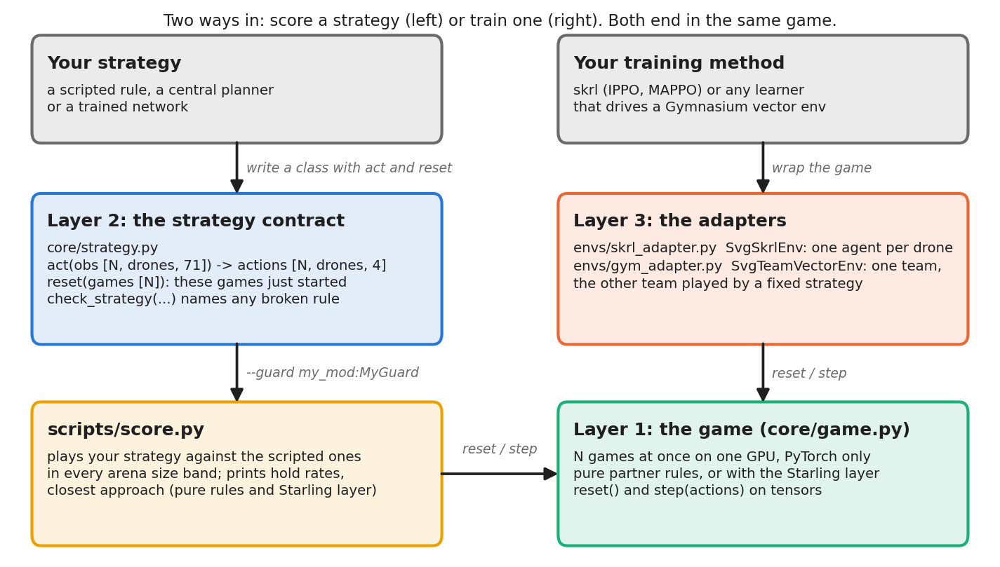
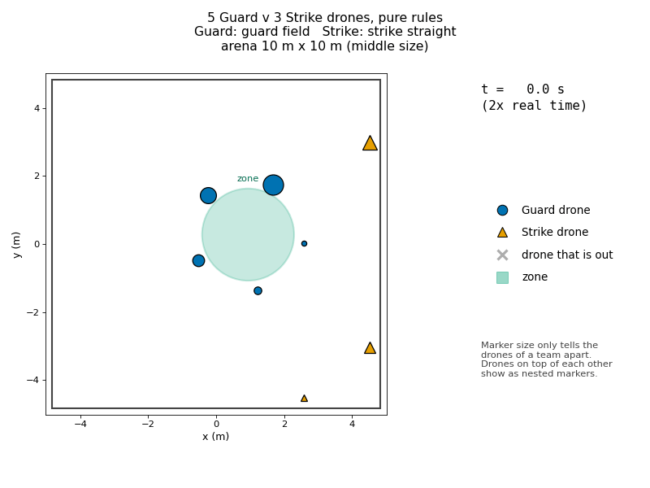
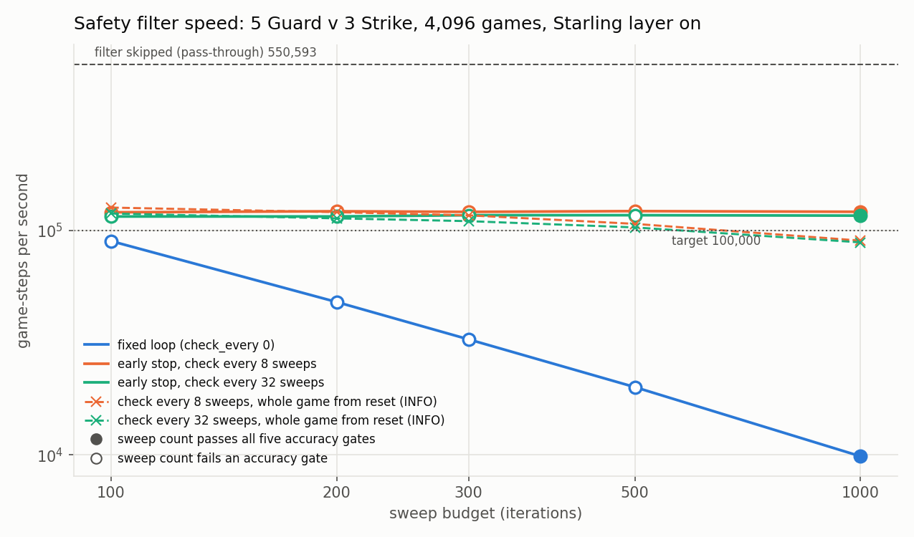
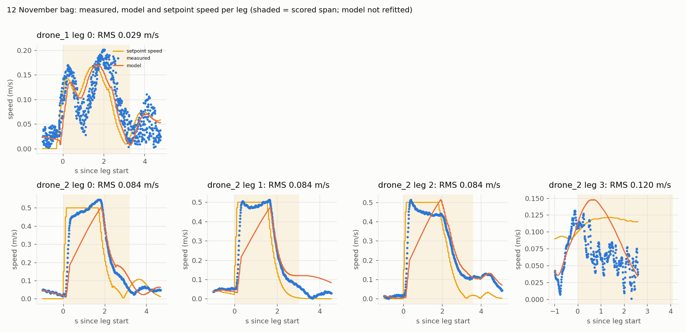
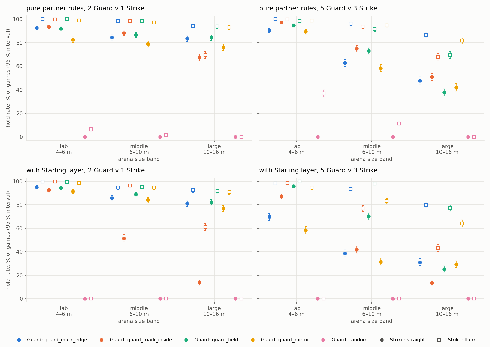
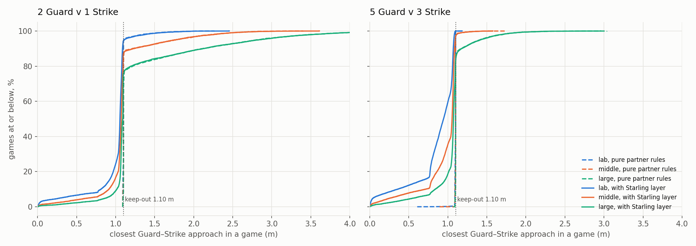
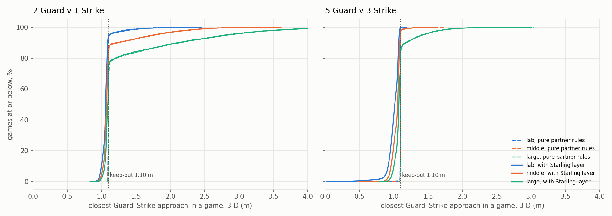

REFERENCE · results of build step S2, observed in the training simulator.

# S2 results: the game and the plug-in point

S2 asks one question. **Can we run the Strike vs Guard game thousands of times at once, with the real drone's
limits, so that any team's strategy can be plugged in and scored?** S2 was built so that NUS's strategy, and any partner's, could be scored
here; NUS's code reached this pipeline on 17 November (the NUS port). So S2 builds the track, not the runner. This page says what was built, what the
runs showed and what waits on the owner. Terms are in the [glossary](GLOSSARY.md). How we got here: [History](README.md#history).

| Item | Value |
|---|---|
| Runs | T5 (drone-model check on a real flight bag), T6 and T9 (scripted reference), T7 and T8 (faster safety filter) |
| Verdicts | T5 **FAIL**; T6 and T9 information only, no gates; T7 **ABORTED** (stopped for a bug fix); T8 **PASS** under the owner's ruling on one gate's rounding |
| Main result | the game, the scoring tool and the plug-in point exist and are tested; the chosen filter setting gives the same answers about 12 times faster than S1's (9 times over a whole game) |
| Main finding | with the real drone's limits, a Guard drone and a Strike drone can come about 0.3 m inside the 1.10 m keep-out when one of them is held against a wall; CMU's real commander has the same blind spot (a hypothesis for the real drone, not flown) |
| Trained | nothing. The stand-in trainer moved to S2b (owner, 16 November) |
| Plan and gates | [S2 design](specs/2026-11-15-s2-game-and-plug-in-design.md), [S2 plan](plans/2026-11-15-s2-game-and-plug-in.md), gates in `configs/s2.toml`, approved by the owner on 15 November 2026 |
| Linear | project P-NEAR-31, milestone S2: NEAR-963 to NEAR-969 ([snapshot of 16 November](linear/snapshots/2026-11-16-project-plan-linear.md)) |

Every number here was observed in the training simulator, or, for T5, in flight logs. None is a flight result, and
nothing here authorises a flight.

## What was built

**Figure 1.** The two ways in. A strategy written to the strategy contract is scored by `scripts/score.py`; a
training library drives the game through an adapter. Both play the same game, `core/game.py`. Made by
`scripts/make_s2_plug_in_flowchart.py`.

| Part | What it does | Linear issue |
|---|---|---|
| The game (`core/game.py`) | thousands of games at once on one GPU, in plain PyTorch. Each game draws its own arena (a square, 4 to 16 m a side) and its own zone (radius 10–25 % of the side, kept 0.5 m plus one radius from every wall) | **NEAR-963: Game core: thousands of games at once, varied arena and zone sizes.** |
| Partner rules preset | the main game, after NUS's rules: opposite teams kept apart by a *push-apart* rule, teammates pass through each other, one step inside the zone wins for the Strike team, a time-out wins for the Guard team. The committed values are neutral (keep-out 1.10 m for both teams, Strike 0.5 m/s, Guard 0.33 m/s, 60 s). NUS's own values sit only in the git-ignored `configs/local/`, and a test checks that none of them appears in a tracked file | NEAR-963 |
| Contact tags | the side quest's rule (a tag is physical contact). It exists as a tested game mode only; nothing is trained with it | NEAR-963 |
| Starling layer | a switch that makes drones fly like our Starlings: a copy of CMU's commander, the safety filter on every pair of drones (both teams, as on the real drones) and the drone model fitted to flight logs (`real_exploratory_v0`, exploratory). The push-apart rule is off, so only the filter keeps drones apart | NEAR-963 |
| Faster safety filter | an *early stop*: every 8 sweeps the filter checks which games still need work and stops when none is left (T8) | **NEAR-965: Faster collision filter, checked against CMU's.** |
| Scripted opponents | Guard: mark the zone edge, mark just inside it, field, mirror, random. Strike: straight at the zone, and flank round a Guard drone in the way | **NEAR-966: Scoring tool and scripted opponents.** |
| Strategy contract (`core/strategy.py`) | a strategy plays one team: it is called once per step with all its drones' observations in all games and returns all their actions. A scripted rule, a central planner or a trained network all fit | **NEAR-967: Plug-in point for a partner's strategy, with a written guide.** |
| Scoring tool (`scripts/score.py`) | plays any strategy against the scripted ones, per arena size band and team size, under the pure rules and with the Starling layer. It reports the *hold rate* with its 95 % interval, how close the teams came (horizontal and in 3-D), rule breaches, filter use and start misses | NEAR-966 |
| Adapters (`envs/`) | `SvgSkrlEnv` for skrl's multi-agent trainers, `SvgTeamVectorEnv` for any Gymnasium vector learner | NEAR-967 |
| Partner guide | [Plug in your code](PLUG_IN_YOUR_CODE.md): how to plug a strategy or a training method in and score it; its code examples are run by `tests/test_adapters.py` | NEAR-967 |
| Drone-model check | the S1 drone model checked against a real flight it never saw (T5) | **NEAR-964: Check the drone model against the 12 Nov rosbag.** |
| Replay clips | top-down GIF and MP4 clips of single games, in [media/](media/README.md) | — |

**Figure 2.** One 5 Guard v 3 Strike game under the pure rules, played at twice real time: Guard drones (blue
circles) use the field strategy, Strike drones (orange triangles) fly straight. The Guard team holds the zone for
the full 60 s. Training simulator, neutral values; made by `scripts/make_replay.py`.

## What the runs showed

### 1. A faster safety filter (T7 ABORTED, T8 PASS)

**What we did.** S1 left the filter far too slow to train with: about 10,000 game-steps a second at 1,000 sweeps.
T8 tried 15 settings: 1,000, 500, 300, 200 or 100 sweeps, each with no early stop or a check every 8 or 32 sweeps.
Each had to match S1's filter copy on T2's 2,000 test scenes (five accuracy gates) and reach 100,000 game-steps a
second in a 5 v 3 game with the Starling layer, 4,096 games at once
([T8 record](../records/2026-11-16_s2_filter_speed_2_record.md)). The first attempt, T7, was stopped by hand to
put in the wall fix of §4 ([T7 record](../records/2026-11-16_s2_filter_speed_record.md)).

**What we found.** Only 1,000 sweeps passes the accuracy gates; every lower count fails at least three of them. The early
stop changes no answer at all (largest difference 0 m/s on all 2,000 scenes). With a check every 8 sweeps, 1,000
sweeps ran at **121,118** game-steps a second, against 9,856 without the early stop. That passes the 100,000
gate, so this setting is now in `configs/s2_game.toml`.

| Setting (1,000 sweeps) | Game-steps per second | Source |
|---|---|---|
| no early stop | 9,856 | T8, timed window |
| check every 8 sweeps, chosen | 121,118 (gate: at least 100,000) | T8, timed window |
| the same, over one whole game from the start | 90,121 (information only) | T8, whole-game check |
| the same, first 100 steps of a game | 25,210 (information only) | T8, whole-game check |

**Figure 3.** Game-steps per second against the number of sweeps, 5 v 3, 4,096 games, Starling layer on. Blue is
the fixed loop; orange and green check for an early stop every 8 or 32 sweeps; dashed lines time one whole game.
Only 1,000 sweeps (filled marker) passes all accuracy gates.

**Read with care.** The 100,000 gate was met over the timed window, a quiet part of the game. Over a whole game
the chosen setting gave 90,121, because crowded starts cost more. In training, games restart at different times, so
some game is always at its crowded start; that case was **not measured**. An information run with staggered
restarts is needed before any claim about training time.

**The owner's ruling.** One accuracy gate was written as 1.6666 m/s, which is T2's own value 1.6666038 rounded
down, so even T2's setting failed it. The owner ruled on 16 November ("4 decimals. yes.") that the gate is compared
at its 4 written decimals. The gate file was not edited; the record gives the raw value and the ruling.

### 2. The drone model against a flight it never saw (T5): FAIL

**What we did.** The drone model in the Starling layer was fitted in S1 to one 13 November flight of drone_2. T5
checked it, without refitting, against the 12 November two-drone flight, recorded at the full command rate
([T5 record](../records/2026-11-15_s2_bag_check_record.md)). Gates: speed error at most 0.10 m/s on every leg, and
the time to reach 63 % of a speed change off by at most 0.10 s.

**What we found.** Both gates failed on drone_2. The worst leg's speed error was 0.120 m/s, from leg 3, which is
not a real push: the position setpoint barely moves and the drone's recorded speed stops part-way. The three real
pushes scored 0.084 m/s each. The 63 % time was off by up to 0.690 s, mostly because the check held each command
until the next one, as the plan prescribed; joining commands by straight lines, as the S1 fit did, gives 0.084 s
(information only). A plain rule, "the drone flies the sent speed 0.15 s later", fits this flight better than the
model (pooled error 0.066 against 0.093 m/s).

**Figure 4.** Each panel is one leg of the 12 November flight: amber the speed sent to the drone, blue dots the
measured speed, orange the model. The model rises far more slowly than the real drone on drone_2's three real
pushes. Leg 3 is not a push. Worst leg 0.120 m/s against a 0.10 m/s gate.

**What this means for the model.** Nothing in `params/` changed; the model of record waits on a real flight with
planned pushes. Its known limits, from the S2 build (listed in the
[T9 record](../records/2026-11-16_s2_scripted_reference_2_record.md#limits)):

- it reaches 63 % of a speed change in 0.6–0.9 s, against about 0.35 s on the real drone, because the commander's
  5 m/s² ramp is cut by the model's fitted 1.72 m/s² acceleration limit;
- it has a slow sway of about 9 s that the flight logs do not pin down (lag 1.65 s, position gain 0.95);
- flown head-on in open space, two drones stop at 1.050 m, about 0.05 m inside the 1.10 m keep-out;
- so in short games in small arenas the Strike team is not exactly 1.5 times as fast as the Guard team.

### 3. The scripted reference (T6, re-run as T9)

**What we did.** Five scripted Guard strategies played two scripted Strike strategies, at 2 v 1 and 5 v 3, in
three arena size bands (lab 4–6 m, middle 6–10 m, large 10–16 m), 1,000 games per cell, under the pure rules and
with the Starling layer. This is the reference every later strategy, trained or NUS's, is compared with. T6 ran
first ([T6 record](../records/2026-11-16_s2_scripted_reference_record.md)); T9 re-ran it after the wall fix of §4,
with the chosen filter setting ([T9 record](../records/2026-11-16_s2_scripted_reference_2_record.md)). T9 replaces
T6 as the reference.

**What we found.** The four scripted Guard strategies held the zone in 38–100 % of games under the pure rules and
14–100 % with the Starling layer. Random Guard moves held 0–37 % and 0–0.1 %. Hold rates fall as the arena grows,
most at 5 v 3, and the Starling layer lowers most of them: mark inside against straight, 2 v 1 large, falls from
67.5 % to 13.7 %. The Starling-layer drops come from an exploratory drone model that reaches 63 % of a speed change in 0.6–0.9 s,
against about 0.35 s on the real drone (its check against a real flight, T5, is a FAIL), so they are not the
cost of flying a real Starling.

**Figure 5.** Share of games the Guard team held, with 95 % intervals, per arena size band (T9); each point is
1,000 games. Colour is the Guard strategy; filled markers face the straight Strike, open ones the flank Strike.
Top: pure partner rules; bottom: with the Starling layer.

The pure-rule half of T9 matches T6 exactly, number for number. The Starling-layer hold rates moved by at most 1.8
points after the wall fix. T9 took 22 minutes against T6's 66, thanks to the faster filter.

### 4. How close Guard and Strike drones came

The keep-out is 1.10 m between drone centres. Under the pure rules the push-apart holds pairs within 0.012 m of it;
the deeper pure-rule values come from crowded starts (below). With the Starling layer only the safety filter keeps
drones apart, and four things showed up.

**A bug at the walls, found and fixed.** In T6, Guard and Strike drones under the Starling layer came to 0.75–0.77 m.
The reviewer found the cause: when a drone hit a wall, the layer stopped it, but the commander copy still believed
it was moving away. So the filter let the other drone close in, and pairs settled at 0.770 m. The fix (commit
`17197a7`) tells the commander copy about the stop, as the real commander's fence does
([T6 record](../records/2026-11-16_s2_scripted_reference_record.md#how-close-guard-and-strike-drones-came)).

**Figure 6.** T6, before the wall fix: share of games whose closest Guard–Strike distance, measured horizontally,
is at or below each value. Dashed: pure rules; solid: Starling layer. The kink near 0.77 m is the wall bug; the
tail towards zero is drones passing one above the other.

**Horizontal and 3-D distance differ.** The filter keeps drones apart in 3-D and may move them up or down, so two
drones can pass one above the other. In T6 the horizontal minimum was near zero; a probe of one case gave 0.004 m
horizontally but 0.851 m in 3-D. Since T9 the scoring tool reports both, and judges a breach in 3-D. In T9 the 3-D
minimum for 2 v 1 is 0.83–0.85 m while the horizontal one is 0.001–0.003 m.

**Crowded 5 v 3 games near walls: a limit, not a bug.** After the fix, most breaches are shallow: the median closest
approach in 3-D is 1.01–1.09 m, close to the model's 0.05 m open-space loss. But in 5 v 3 games, scripted pairs
still reach 0.75–0.80 m (2 v 1: 0.89–0.91 m) without a crowded start. Counting the four scripted Guard strategies
only, in games without a start miss, pairs came under 0.9 m in 4.1 %, 1.2 % and 0.2 % of 5 v 3 games (lab 212 of
5,223, middle 97 of 7,833, large 16 of 8,000), against 30.6 %, 13.9 % and 4.5 % before the fix.

The review traced it ([T9 record, Limits](../records/2026-11-16_s2_scripted_reference_2_record.md#limits)):

- in 98 % of games under 0.95 m, one drone of the pair is held at a wall, usually with a third drone nearby;
- the filter has settled (no emergency) and puts the escape on the walled drone, which the wall then stops; 5,000
  sweeps give the same answer;
- the filter does not know about walls, and the model's response is slow; each alone costs about 0.2 m (0.84 m and
  0.91 m), together 0.82 m, and with neither the pair keeps 1.084 m;
- **the copy is faithful:** CMU's real commander also runs the filter first and clips the speed at its fence
  afterwards (`swarm_commander.py`, about lines 2140 and 2210), and its filter knows no walls.

The review's probe is in the repository: `scripts/probe_wall_limit.py` (CPU, 3–10 minutes per variant), with its
command and output in [notes/s2_wall_limit_probe.md](notes/s2_wall_limit_probe.md).

**Crowded starts (start misses).** A start miss is a game whose drones could not be placed far enough apart at the
start. In 5 v 3 that is 34.7 % of lab games, 2.1 % of middle games and none of the large ones; in 2 v 1, none. A
4–6 m arena is simply too small for 8 drones 1.2 m apart in about a third of draws. These games are played and
counted. They give the lowest values: 0.025 m (5 v 3 lab) and 0.491 m (5 v 3 middle) in 3-D with the Starling
layer, and 0.608 m (5 v 3 lab) under the pure rules.

**Figure 7.** T9, after the wall fix: share of games whose closest Guard–Strike distance in 3-D is at or below
each value. Dashed: pure rules; solid: Starling layer; dotted: the 1.10 m keep-out. Most Starling games sit just
inside the keep-out; the 5 v 3 tail comes from walls and crowded starts.

### 5. The stand-in trainer: moved to S2b

The design's fourth done condition is a stand-in trainer: a short training run whose only job is to prove the pipe
works end to end (game → adapter → learning → saved strategy → scoring tool). On 16 November the owner moved it into
S2b, where it runs on both the PyTorch game and the Isaac Lab drones with the unchanged S2 gates
(`[standin_gates]` in `configs/s2.toml`). It was not run in S2, so this page has no result for it
(**NEAR-968: Stand-in trainer: prove the training pipe end to end.**).

## When S2 is done: the design's five conditions

From the [S2 design §7](specs/2026-11-15-s2-game-and-plug-in-design.md#7-when-s2-is-done).

| # | Condition | Result | Evidence |
|---|---|---|---|
| 1 | Game-rule tests pass without Isaac, with hand-worked cases (a tag, a score, a drop-out, a time-out) at the smallest and largest arena | **PASS** (tests) | `tests/test_game_core.py`, `tests/test_pair_rules.py`: each hand-worked case at 4 m and 16 m; full suite quoted in [HANDOFF §0](claude/HANDOFF.md#0-resume-here-for-a-new-session-or-another-claude-account) |
| 2 | The scoring tool gives the hand-worked answer on fixed scenarios | **PASS** (tests) | `tests/test_score.py::test_score_fixed_scenarios_hand_worked`: a straight Strike drone reaches the zone at step 37 (4 m) and step 205 (16 m); with the push-apart in the way the Guard team holds to the time-out |
| 3 | The chosen filter setting meets the speed gate (at least 100,000 game-steps/s) and is no worse than T2 on T2's checks | **PASS** (T8), under the owner's 4-decimal ruling. Whole game 90,121 game-steps/s: INFO. Staggered restarts: not measured | [T8 record](../records/2026-11-16_s2_filter_speed_2_record.md); T7 ABORTED ([record](../records/2026-11-16_s2_filter_speed_record.md)) |
| 4 | A stand-in trainer beats random actions by a margin set before the run | **MOVED to S2b** by the owner (16 November); not run in S2 | gates unchanged in `configs/s2.toml` `[standin_gates]`; [S2b plan](plans/2026-11-16-s2b-isaac-lab-environment.md) |
| 5 | A one-page partner guide with a worked example | **DONE in part**: the guide exists and its examples (a small skrl training script among them) run in the tests. The design's worked example uses the stand-in trainer, so it comes with the stand-in in S2b (lead's ruling, 16 November) | [Plug in your code](PLUG_IN_YOUR_CODE.md); `tests/test_adapters.py` |

Information runs: T6 and T9 (scripted reference, no gates) and T5 (drone-model check, **FAIL**). All rows are in the
[training ledger](../records/LEDGER.md).

## Every run

| Ledger row | Run | Result | What it means |
|---|---|---|---|
| T5 | [drone model against the 12 November flight](../records/2026-11-15_s2_bag_check_record.md) | FAIL | the model rises too slowly; worst leg 0.120 m/s, 63 % time off by 0.690 s; not refitted |
| T6 | [scripted reference](../records/2026-11-16_s2_scripted_reference_record.md) | INFO, no gates | pure-rule half stands; Starling closeness numbers spoilt by the wall bug |
| T7 | [faster filter, first attempt](../records/2026-11-16_s2_filter_speed_record.md) | ABORTED | stopped by hand to put in the wall fix |
| T8 | [faster filter](../records/2026-11-16_s2_filter_speed_2_record.md) | PASS | 1,000 sweeps with a check every 8: 121,118 game-steps/s (90,121 over a whole game) |
| T9 | [scripted reference on the fixed layer](../records/2026-11-16_s2_scripted_reference_2_record.md) | INFO, no gates | the reference for later strategies; crowded 5 v 3 near walls reaches 0.75–0.80 m |

## One change to the interface

On 16 November each drone's observation grew from **69 to 71 numbers**: the zone centre's position from the arena
centre was added at the end (indices 69–70). Without it a drone could not tell where the walls are. No earlier index
moved. The whole-game state for a central critic grew from 59 to 61. The layout is in
[Plug in your code](PLUG_IN_YOUR_CODE.md#what-a-drone-sees-and-does) and [STANDARDS §3](../STANDARDS.md#3-policy-interface-version-01-proposed).

## What S2 does not do

- No NUS training method, no self-play league, no training for the side quest (contact tags are a tested game mode
  only).
- No mixed team sizes inside one batch: each batch has fixed team sizes. The observation is padded to 5 Guard and
  3 Strike slots so one network can later serve every size.
- No "count the time in the zone" win rule (design §4b): the partner rules preset wins on one step in the zone.
- No limited view of other drones (every drone sees every drone); no range rays, obstacles or worlds (S3–S4); no
  Isaac Lab drones (S2b); no export to AirStack (S5).
- No refit of the drone model: T5 only checks it. The model of record waits on the planned-pushes flight.
- No training of any kind.

## What waits on the owner

> **This page does not authorise a flight.** Real flights follow [docs/PREFLIGHT.md](../../docs/PREFLIGHT.md) and
> [docs/RUNBOOK.md](../../docs/RUNBOOK.md) and the owner's decision.

| # | Item | Why it matters | Recommendation |
|---|---|---|---|
| A | The S2b gate "closest approach on the Isaac Lab drones at least 1.0 m in every game" (`physics_closest_cross_min_m` in the S2b plan) | it fails by construction: the same command chain already reaches 0.75–0.80 m near walls, and 0.025 m in crowded starts (T9). No S2b run has started, so the gate can still be replaced | **decided by the owner, 16 November 2026:** replaced before any S2b run by `closest_cross_3d_gap_max_m = 0.10` — per matchup cell, games without a start miss, the Isaac Lab drones' 3-D closest approach (minimum and 5th percentile) at most 0.10 m below tier 1's on the same paired games ([S2b plan](plans/2026-11-16-s2b-isaac-lab-environment.md)) |
| B | Keep the training filter faithful to CMU's, or give it the walls | a wall-aware filter would close most of the 0.3 m gap but would no longer match the real commander | **decided by the owner, 16 November 2026:** keep it faithful to CMU; the wall effect is a real-drone hazard hypothesis, a fix belongs in CMU's commander |
| C | How to read "one keep-out distance per team" (plan decision D1, the `block` push rule) | to be checked against NUS's report | owner checks; the other reading (`shove`) is a switch in the local file |
| D | NUS: metres per game unit, seconds per step, the strategy's code and its inputs and outputs (**NEAR-970: Get NUS's strategy and its rule details.**) | needed before any partner-rules result is quoted in metres, and before NUS's strategy can be scored | owner asks NUS |
| E | The planned-pushes real flight (**NEAR-962: Fit the drone model from a planned-pushes real flight.**) | gives the drone model its run of record and pins its slow sway; T5 shows the current model rises too slowly | what to record: [S1_RESULTS](S1_RESULTS.md#what-the-owner-needs-to-do-next) |
| F | A training workstation (**NEAR-959: Measure training speed on the training workstation.**) | the laptop is for development | owner |
| G | Two hazards on the real drones, **HYPOTHESES, not flown, not fixed**: (1) the filter runs before the keep-in fence, so a drone held at the fence may let another drone inside 1.10 m (T9's diagnosis); (2) the filter does not correct the position setpoint, so teammates flown head-on came to 1.083 m in tier 1 ([T4 record](../records/2026-11-15_s1_tier1_fitted_filter_record.md)) | both are in CMU's real commander, not only in our copy | owner decides whether to tell CMU or test it; nothing here changes flight code |

## Next

- **S2b, the S2 game on Isaac Lab drones** ([plan](plans/2026-11-16-s2b-isaac-lab-environment.md)), approved by
  the owner on 16 November with his answers to its seven questions. It adds rigid-body Starlings flown by a copy of
  PX4's control loops with the real gains, compares them with the PyTorch game, runs the stand-in trainer on both,
  and makes an Isaac Lab clip.
- **TensorBoard for every training run** (owner, 16 November): learning curves plus the game's own numbers (hold
  rate, closest approach, filter use, speed), viewed with `tensorboard --logdir runs/`
  ([TRAINING](TRAINING.md)).
- An information run with staggered game restarts, before any claim about training time.
