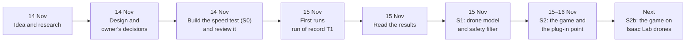
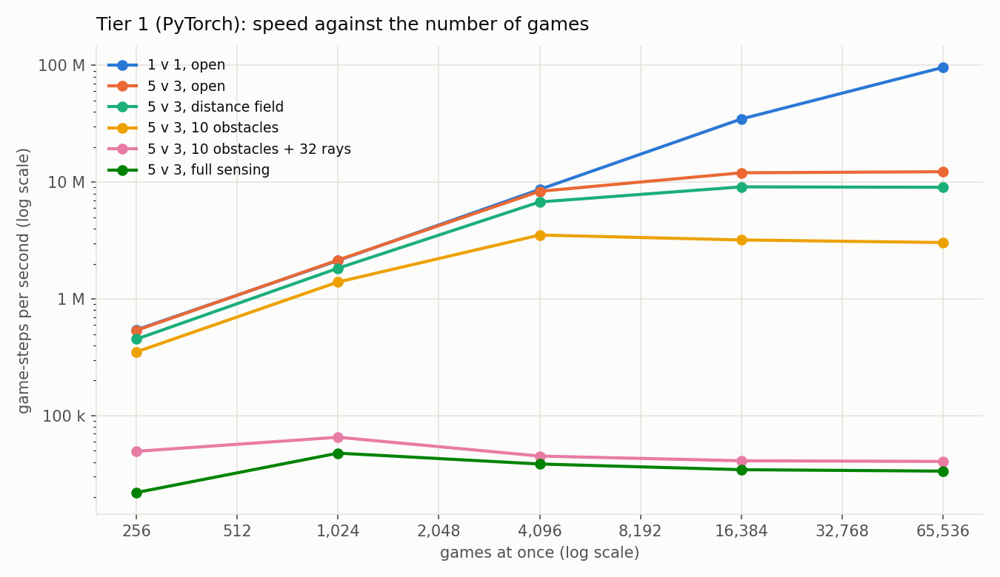
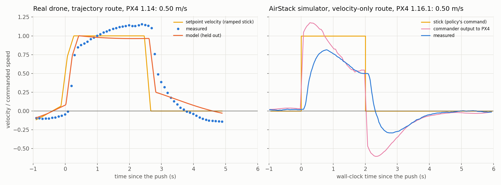
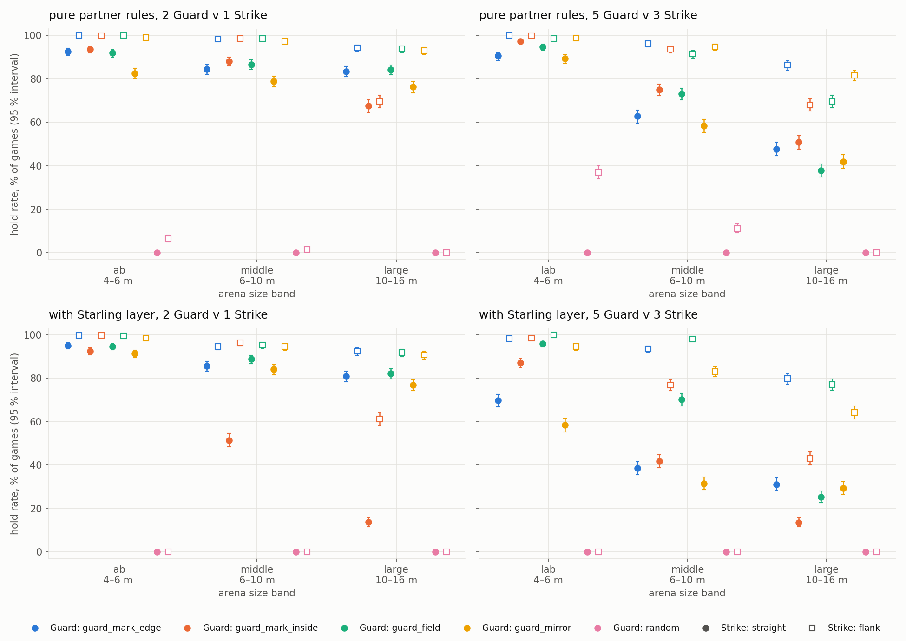

# What we did, step by step

This folder exists to train strategies for the Strike vs Guard game. In the game, a Guard team of drones holds
a circular zone and a Strike team tries to reach it. We want a computer to learn good team strategies by playing
thousands of games at once on one graphics card (GPU), and then fly those strategies on real Starling drones.

This page tells the story so far, in the order it happened. Nothing has been trained yet. Words in *italics* are
explained where they first appear; all of them are also in the [glossary](GLOSSARY.md).

## 1. The idea and the research (14 November 2026)

**What we did.** We read the flight software that already flies the drones (CMU's AirStack) and the programme's
website. Six helper agents read the code, checked the Isaac Lab copy on the laptop and searched
published work on training drone teams with NVIDIA's Isaac Lab ([HANDOFF §4](claude/HANDOFF.md#4-current-state)).
We drew the proposed pipeline as a slide deck ([training-pipeline.pptx](pipeline/training-pipeline.pptx)).

**Why.** Before building anything, we needed to know what others had done and what Isaac Lab could already do.

**What we found.** Isaac Lab can simulate a drone with four rotors, and it can run many games at once. It has no
controller that flies a drone by speed commands, and it has no way for a team to train against copies of itself.
We have to build both. Nobody had published how fast Isaac Lab runs a team of drones, so we had to measure it.
The sources are in [RESEARCH](RESEARCH.md).

## 2. The design and the owner's decisions (14 and 15 November)

**What we did.** We wrote the design ([DESIGN](DESIGN.md)) and the rules ([STANDARDS](../STANDARDS.md)), then asked
the owner to choose. His decisions are listed in [HANDOFF §4](claude/HANDOFF.md#4-current-state).

| Decision | What it means |
|---|---|
| Two simulators | A fast, simple drone model in plain PyTorch (*tier 1*) carries most of the training. A full physics drone in Isaac Lab (*tier 2*) checks it. Both play the same game code, and together they are the *training simulator* ([DESIGN §9](DESIGN.md#9-approaches-considered)). |
| A tag is contact | A Guard drone scores by touching a Strike drone. The rule and its limits are in [STANDARDS §2](../STANDARDS.md#2-wording) and [DESIGN §7](DESIGN.md#7-environments-and-contact-tags). |
| The safety filter works within a team | CMU's filter, which stops drones flying into each other, acts only between drones of the same team. |
| After a tag, both drones leave | By default the Strike drone and the Guard drone that touched it both leave the game. It is a setting, so it can be changed later ([STANDARDS §4](../STANDARDS.md)). |
| Realistic worlds | Games are played in 3D worlds shaped like real places, starting with an open arena and building up to the lab's construction-site world ([DESIGN §7](DESIGN.md#7-environments-and-contact-tags)). |
| Isaac Lab 2.3.2 now | Version 3.0 comes later, on a larger training computer. |

**Why.** A trained strategy must plug into AirStack unchanged. So the trainer sends the same command the flight
software already takes: a speed in x, y and z plus a turning rate, 20 times a second. The place where that command
enters the flight software is the *plug-in point* ([HOW_IT_WORKS](HOW_IT_WORKS.md#where-a-strategy-plugs-in)).

**What we found.** A realistic world makes training harder. Drones lose sight of each other behind walls, and the
cost of sensing the world grows fast. So the first build step, S0, measures speed with obstacles and sensing
switched on ([DESIGN §7](DESIGN.md#7-environments-and-contact-tags)).

## 3. Building the speed test, S0, and what the reviews caught (14 and 15 November)

**What we did.** S0 is a speed test of the two simulators. It plays random moves (no learning yet) and counts how
many games it can step through per second. It uses stand-in drone models: simple placeholders until S1 fits a
real one. Each part was built by one agent and checked by a second one. The lead agent then re-ran the tests.
Before the run we wrote down the pass/fail checks it had to meet (the *gates*). Gates are never changed after a
run starts ([STANDARDS §7](../STANDARDS.md#7-evaluation-and-gates)).

**Why.** The speed tells us how long training will take, and which kind of sensing is affordable.

**What the reviews caught.** These are recorded in [HANDOFF §0](claude/HANDOFF.md#0-resume-here-for-a-new-session-or-another-claude-account).

| What was wrong | What we changed |
|---|---|
| Guard drones could fly as fast as Strike drones when moving diagonally, because the speed limit was applied to each axis on its own. | The limit now applies to the total speed: Guard drones are capped at the Strike speed ÷ 1.5, with a test. |
| The written summary of a run (the *record*) could have said PASS when it should not. A NaN ("not a number") value means the maths broke. Three gaps were found: a bad NaN rate, a missing NaN count, and negative or duplicated rows. | The record maker now refuses such rows. After two rounds of fixes, 30 tests passed. |
| Isaac Sim's own shutdown could hide an error: the program could end as if it had succeeded. | The benchmark now leaves through its own exit, so the error code survives. |
| A cold laptop GPU made two repeats of the smallest point differ by 22 %. | Every point now warms up for at least 50 steps and 2 s before timing starts. |
| One slow distance routine in the tier 1 stand-in model took most of the time in the open arena, so that result came out many times too low. | The routine was replaced and measured before and after. |

The gate on how far two repeats may differ (the *repeat spread*) was also at risk: at the smallest point the timed
window lasted only a fraction of a second. The owner approved a longer timed window, at least 200 steps and at
least 2 s, on 15 November ([HANDOFF §0](claude/HANDOFF.md#0-resume-here-for-a-new-session-or-another-claude-account)).

## 4. The first runs (15 November)

**What we did.** We built a container: a sealed copy of the software (NVIDIA's Isaac Lab 2.3.2 image plus our test
tools), so every machine runs the same versions ([docker/README](../docker/README.md)). We started Isaac Lab inside
it for one small trial: 64 games with 2 drones each.

**What we found.** The trial worked: about 1,800 to 2,300 game-steps per second, no NaN values, and the two
repeats within 1 % of each other. A *game-step* is one tick of game time (1/20 s) for one game. Then the program
would not stop: Isaac Sim's shutdown kept running after the results were written. We fixed it by ending the
program directly once the work is done (commit `08107eb`).

**The run of record.** Next came the official run whose numbers we keep (the *run of record*), called T1. It ran
from 00:54 to 02:41 Singapore time on 15 November and tried 96 settings, called sweep points: 65 in tier 1 and 31
in tier 2 ([S0_RESULTS](S0_RESULTS.md)). One point has no measurement. Isaac Sim crashed while starting, before any
of our code ran, at tier 2 with 1 drone per game and 64 games. So the gate "every point measured" failed, and T1 is
a FAIL. The other three gates passed: the tests (`109 passed, 2 skipped`), the repeat spread (worst 0.0562, limit
0.10) and the NaN count (none) ([S0_RESULTS, The FAIL](S0_RESULTS.md#the-fail)).

A checking agent recomputed every number in the record from the raw results and found them exact. The owner
decided that T1 stays a FAIL and that its numbers are used. The benchmark now retries such a start-up crash once
([GETTING_STARTED](GETTING_STARTED.md#when-it-fails)). Each run also gets one line in a list of all runs (the
*ledger*, [records/LEDGER.md](../records/LEDGER.md)).

## 5. What the results mean

Figure 1 shows how tier 1's speed grows as more games run at once. It is copied from
[S0_RESULTS](S0_RESULTS.md#fig-1), where it is drawn from the run's own data.

**Figure 1.** Tier 1, game-steps per second against games at once (both axes on log scales). Without sensing,
speed grows until about 16,384 games, when the GPU is full. With range rays, speed is flat from the start: the
sensing sets the pace.

We had set two thresholds to help choose the next step (the *decision rules*). Unlike gates, they do not pass or
fail a run. Both were met ([S0_RESULTS](S0_RESULTS.md)). Speeds are counted in *drone-steps*: one tick of game time
for one drone.

- Tier 1 with full sensing reached 382,206 drone-steps per second; the rule asked for at least 50,000. So tier 1
  can carry training on the laptop.
- Tier 2 reached 455,300 drone-steps per second at best; the rule asked for at least 20,000. So tier 2 is fast
  enough to train on, as well as to check.
- Stepping the simulator for 2 billion drone-steps would take about 1.5 GPU-hours. This is a lower bound, because
  no learning was in the step.
- Sensing is the slow part. Full sensing ran at about 1/257 of the open-arena speed. Making it faster is the first
  job in S3.

These numbers were observed in the training simulator, with stand-in drone models. None is a flight result.

## 6. S1: a drone model and a safety filter (15 November)

**What we did.** S1 had two jobs. The first was to replace the stand-in drone with a model of how a Starling's speed
follows the speed a policy asks for. The second was to copy CMU's safety filter, which keeps drones of a team from
flying into each other, into a form that runs thousands of games at once. The owner approved the plan and its gates
on 15 November ([S1 plan](plans/2026-11-15-s1-drone-model-and-safety-filter.md)). The full results, with figures,
are in [S1_RESULTS](S1_RESULTS.md).

**Why.** Tier 1's drone was a guess. A strategy trained on a wrong drone may not fly well on the real one.

**What happened, in order.**

1. **The filter copy (run T2).** We compared our copy with CMU's on 2,000 random scenes. It made the same
   decision on the emergency push-apart in 1,998 of them, and it never acted between a Guard drone and a Strike
   drone. It failed two gates. Of the 1,779 scenes where CMU did not push apart, 13 are over the speed limit, all of
   them scenes CMU finishes in a slow, one-pair-at-a-time phase the copy does not have; 109 are over the limit on
   how far an answer breaks a keep-out rule. The owner accepted T2 on 15 November ('if 1998/2000 checks passed its ok'); that figure is the emergency-agreement count. Asked again with the counts above, the owner confirmed the same day. T2 stays a FAIL and S1 went on
   ([S1_RESULTS §1](S1_RESULTS.md#1-the-safety-filter-copy-t2-fail-accepted-by-the-owner)).
2. **The first fit (run T3).** We fitted a simple model to a recorded session in the *AirStack simulator* (CMU's
   simulator with the PX4 flight software). It failed: the simulated drone sped up, slowed down while the push was
   still held, then moved backwards after release. No simple model does that
   ([S1_RESULTS §2](S1_RESULTS.md#2-first-fit-to-the-airstack-simulator-t3-fail)).
3. **The cause: two clocks.** CMU's ground-control program, the *commander*, keeps a "where the drone should be"
   point and moves it by the clock on the wall. The simulator's PX4 ran 1.9 times faster than the wall clock. So
   the drone outran the point and was pulled back. This happens in the simulator only
   ([S1_RESULTS §3](S1_RESULTS.md#3-why-two-clocks-in-the-simulator)).
4. **The real drone is fed differently.** Reading the real flight logs showed that the real drone gets a position,
   a speed and an acceleration in one instruction (a *trajectory setpoint*), while the simulator gets a speed only.
   So a simulator fit describes the simulator, not the drone. The owner agreed that the drone model for training
   comes from real flight logs ([S1_RESULTS §4](S1_RESULTS.md#4-the-real-drone-takes-a-different-route)).
5. **A first look at real logs (exploratory, no gates).** On the 13 November gamepad flight the real drone flew
   close to the speed it was sent, about 0.1–0.15 s later, at up to 0.5 m/s. We could see PX4's position gain, 0.95,
   in the log ([S1_RESULTS §5](S1_RESULTS.md#5-a-first-fit-from-real-flight-logs-exploratory)).
6. **Tier 1 with the real chain (run T4, information only).** We put a copy of the commander, the real-log model
   and the filter copy into tier 1, and measured speed. The filter, at 1,000 sweeps, made tier 1 about 5 to 227
   times slower. We also found that the filter does not cover the position the commander sends, so two teammates
   came 1.7 cm inside the keep-out in a test. For the real drone this is a hypothesis, not seen in flight
   ([S1_RESULTS §6](S1_RESULTS.md#6-tier-1-with-the-real-chain-t4-information-only)).

**Figure 2.** Left: one real 0.5 m/s push; the drone flies close to the speed it was sent and drifts back slowly.
Right: a different 0.5 m/s push in the AirStack simulator, on its own route; the speed sags while the push is held
and swings back on release.
This difference is why the drone model for training comes from real flights.

**What we did not do.** We changed nothing in the flight software or the simulator. The drone model in tier 1 was
observed in flight logs; it is not validated and it has no run of record yet.

## 7. S2: the game and the plug-in point (15 and 16 November)

**What we did.** The strategy that will fly comes from NUS, and their code is not here yet. So S2 built the
track, not the runner: the game itself, thousands of copies at once, on arenas from 4 to 16 m across; the main
rules after NUS's game (the *partner rules preset*); a switch that makes the drones fly like our Starlings (the
*Starling layer*); scripted opponents; a scoring tool; and a plug-in point any training library can use
([S2 design](specs/2026-11-15-s2-game-and-plug-in-design.md)). NUS's own numbers are confidential, so the
committed game uses neutral values and theirs stay in a file git never sees. The owner approved the plan on
15 November ("just execute the rest"). The full results, with figures, are in [S2_RESULTS](S2_RESULTS.md).

**Why.** When NUS's strategy arrives, it should plug in with little work and be scored the same way as everything
else, both under its own rules and with a real drone's limits.

**What happened, in order.**

1. **The game and its rules.** Each part was built by one agent and reviewed by another. A review caught that
   5 Guard and 3 Strike drones often cannot be spaced out at the start of a small arena. That is geometry, not a
   bug, so these games are now flagged (*start miss*) and counted.
2. **The drone model against a second flight (run T5): FAIL.** The S1 model was checked, unchanged, against the
   12 November flight. It rises more slowly than the real drone ([S2_RESULTS §2](S2_RESULTS.md#2-the-drone-model-against-a-flight-it-never-saw-t5-fail)).
3. **The first scoring run (T6).** Scripted Guard strategies held the zone far more often than random moves. But
   with the Starling layer, Guard and Strike drones came to 0.77 m, well inside the 1.10 m keep-out.
4. **A bug at the walls.** A reviewer found why: when a wall stopped a drone, our copy of the commander still
   thought it was moving away, so the safety filter let the other drone close in. We fixed it as the real
   commander does. The filter speed run then in progress (T7) was stopped and restarted on the fixed code.
5. **A faster safety filter (run T8): PASS.** Letting the filter stop early once a game is settled made it about
   12 times faster over the timed stretch (9 times over a whole game), with exactly the same answers. One gate had been written as T2's value rounded down; the
   owner ruled it is compared at its 4 written decimals ([S2_RESULTS §1](S2_RESULTS.md#1-a-faster-safety-filter-t7-aborted-t8-pass)).
6. **The scoring run again (T9).** On the fixed code, most close approaches come only a few centimetres inside the keep-out. In crowded
   5 v 3 games, a drone pinned at a wall can still let another come about 0.3 m inside the keep-out. CMU's real
   commander has the same blind spot, so we kept our copy faithful and told the owner
   ([S2_RESULTS §4](S2_RESULTS.md#4-how-close-guard-and-strike-drones-came)).
7. **The plug-in point.** Two adapters (skrl and Gymnasium) and a guide for partners, [PLUG_IN](PLUG_IN.md). A
   reader new to the folder tried it, and the guide was fixed where they got lost. A review also showed that a
   drone could not tell where the walls were, so each drone now sees the zone's place in the arena: 71
   numbers instead of 69.
8. **The stand-in trainer moved.** The owner decided on 16 November to wrap the game for Isaac Lab next (S2b), and
   the short pipe-test training moved there, to run on both versions of the game.

**Figure 3.** How often each scripted Guard strategy held the zone, per arena size band (run T9, 1,000 games per
point). Top: the pure partner rules; bottom: with the Starling layer. Random Guard moves (pink) almost never hold.

**What we did not do.** Nothing was trained. No flight or simulator code changed. Every result is observed in the
training simulator (T5: in flight logs).

## 8. What comes next

- **S2b: the S2 game on Isaac Lab drones**, with PX4's control loops and the real gains, compared with the PyTorch
  game, and the stand-in trainer on both ([S2b plan](plans/2026-11-16-s2b-isaac-lab-environment.md)). Every
  training run will log to TensorBoard ([TRAINING](TRAINING.md)).
- **A real flight with planned pushes**, so the drone model gets its run of record. The list of what to record is
  in [S1_RESULTS](S1_RESULTS.md#what-the-owner-needs-to-do-next).
- **NUS's strategy and rule details**, so it can be plugged in and scored.
- Run S0 again on a training workstation, when one is available.

How to run the tests and the speed test yourself: [GETTING_STARTED](GETTING_STARTED.md).
