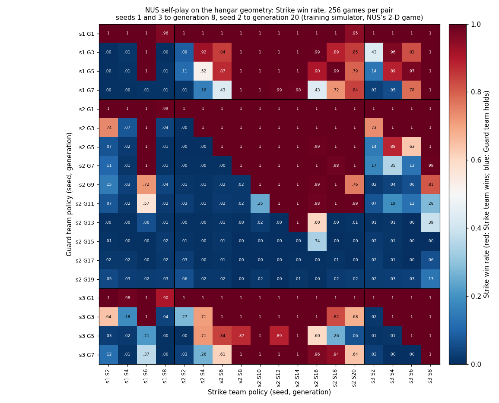
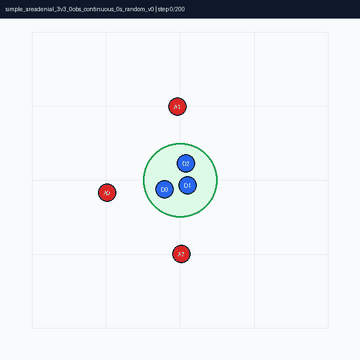
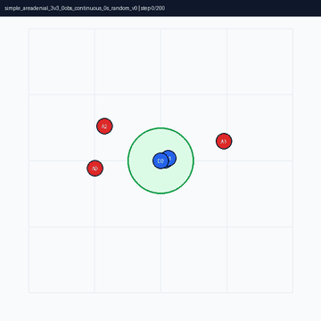
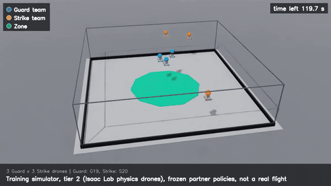
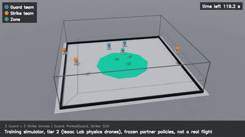

REFERENCE · TRAINING SIMULATOR ONLY: the NUS port as a dated log, phase by phase. Results by question: WHAT_WE_FOUND.md.

# The NUS port: what we did with your code, in order

**For** the NUS team and anyone new to the work: what we did with your code, phase by phase. Results by question:
[NUS_RESULTS](WHAT_WE_FOUND.md); how to repeat them: [TRY_IT](RUN_IT_YOURSELF.md). Every number was **observed in the training
simulator** (your 2-D game, our copy of it, or our game with Starling-like drones). Nothing here has flown.

You agreed (18 November 2026) that your code details, your game settings and our results on your code may be
published here ([STANDARDS §2](../STANDARDS.md#2-wording)). Your source code stays in your repository: we describe it
in words and cite `file:line`. The converted G19, S20, P3G and P3S and our local settings files are in this repository
marked PROVISIONAL, only so our numbers can be repeated. Words: your *defender* is our **Guard team**, your *attacker*
our **Strike team**; you call your game "area denial". Last updated 18 November 2026: Phase 5 in progress (§12).

## At a glance

| Phase | What | Maths library | Simulator | Result | Evidence |
|---|---|---|---|---|---|
| 0 | our questions to you | — | — | answered 17 Nov (§3) | §3 |
| 1 | your code installed | JAX | your 2-D game | 65 of your 66 tests pass; the one failure checks an older Guard distance (you confirmed it is out of date); INFO | [record](../records/2026-11-17_nus_phase1_install_record.md) |
| 2a | policies trained with your code on our hangar set-up | JAX | your 2-D game | speed check, fixed-opponent runs, Run 0, self-play 3 seeds × 8 generations and seed 2 to 20; INFO | [training](../records/2026-11-17_nus_phase2a_training_record.md), [Run 0](../records/2026-11-17_nus_run0_record.md), [matrix](../records/2026-11-18_nus_selfplay_matrix_record.md) |
| 2 | your game copied to PyTorch (the *replica*) | PyTorch | replica | T15 PASS: same game step by step | [Q1](WHAT_WE_FOUND.md#q1-does-our-replica-match-your-game) |
| 3 | your policies converted to PyTorch | PyTorch (JAX for the reference) | replica | T16 PASS; T17 PASS on G19 / S20 | [Q2](WHAT_WE_FOUND.md#q2-does-the-converted-policy-match-yours) |
| 4 | the transfer ladder: the game changed towards our drones, one row at a time | PyTorch; Isaac Lab for row 6 | replica, tier 1, tier 2 | INFO, T18–T20, T22–T24 (T21 ABORTED): G19 v S20 Strike reaches 9 → 17 → 43 → 740 → 983 → 979 of 1,000 | [Q3](WHAT_WE_FOUND.md#q3-what-does-each-drone-limit-do) |
| 5 | your training method ported to PyTorch | PyTorch | replica, then tier 1 | in progress: R0 PASS, N0 PASS, C0 PASS; 5.1 running; pilot P1b: our simple learner holds S20 in 829 of 1,000 | §12 |
| 6 | these documents | — | — | 18 Nov | — |

*Tier 1*: our fast game with a fitted drone model; *tier 2*: rigid-body Starlings in Isaac Lab; *hangar*: our flight room (§3).

## 1. Your code: three branches

| Branch | What it is | What we did |
|---|---|---|
| `area-denial-continuous-space-self-play` (commit `2d2b904`) | continuous 2-D moves, ensemble self-play; the one you pointed us to as the most recent | **used**: installed, tested, trained, converted, scored |
| `area-denial-self-play` | the older version, discrete actions | read only |
| `smackx-self-play` | continuous actions plus robustness experiments on SMAX (a StarCraft-style benchmark) | read only |

**Your game, as we read it** (the replica reproduces it step by step, §6):

- Drones are points in a plane. Each step a drone moves by a displacement up to its team's cap: Guard 0.5, Strike 0.75
  units (the 1.5 speed ratio of [STANDARDS §4](../STANDARDS.md#4-game-specification-version-0)).
- A Strike drone *reaches the zone* when its centre is inside the zone radius (4 units); the flag stays set. A game is
  200 steps.
- Opposite teams are kept apart by a soft push in the same step: push radius = twice the body radius (1.0 unit) plus
  the team's safety distance (Guard 1.0, Strike 0.5), so 3.0 units around a Guard drone and 2.5 around a Strike drone;
  a drone's whole move in one step, push included, is capped at 1.0 unit. Team-mates may overlap. Guard drones stay
  inside a circle (default 20 units). No walls, no height, no drone dynamics.
- Random starts (the ones we use): Guard drones inside a disc of half the zone radius; each Strike drone at the spawn
  distance (default 20 units) on its own random bearing. The fixed layout instead puts the Strike drones in a small
  cluster on the ring.
- Scripted opponents (*APF*, artificial potential field): the Strike controller is pulled to the zone and pushed from
  Guards (gains 1.0 and 24.0); the Guard controller moves towards the nearest Strike drone.
- Observation: 9 numbers per drone (itself, team-mates, opponents: the zone's direction and distance now, at the
  previous step and of the last move), then the zone radius and the reached flag: 56 for 3 v 3. No padding: a 3 v 3
  policy plays 3 v 3 only. Policy: two dense layers, two residual blocks (LayerNorm, Mish), tanh scaled to the team
  speed and projected onto a disc; bfloat16. Training: alternating multi-agent PPO against an archive of up to 15
  earlier policies plus one scripted slot; 6,000 updates per generation.

## 2. Phase 1: your code installed (17 November 2026)

`scripts/workstation/setup_nus_jax.sh` built a conda environment (Python 3.12, jax 0.10.2, flax 0.12.8, CUDA 13 JAX)
and ran your tests on the CPU: **65 of your 66 tests pass** (42.8 s). The one failure expects the Guard safety
distance of an older specification; your config has used another value since commit `7509c36`, and you confirmed the
test is out of date. INFO ([record](../records/2026-11-17_nus_phase1_install_record.md), written after the fact).

## 3. Phase 0 answers and the hangar geometry

Your game has no metres or seconds. Your answers (17 November 2026):

| Question | Your answer | What we did |
|---|---|---|
| metres per unit, seconds per step | the units were scaled to the arena; pick a zone radius that suits your arena | we fitted the scale to our hangar (below) |
| which Guard safety value | both configs work, but a policy trained with one config usually works only with that config | train every reference policy on the exact geometry it is scored on |
| a drone that drops out | the method does not support drones colliding or being disabled | a fixed team size for the whole game |

**The hangar geometry.** We chose 0.40 m per unit after a review of training balance, drone dynamics and the flight
software. A first proposal of 0.2 m per unit failed three ways: the zone (0.8 m) would sit inside the flight software's
1.10 m keep-out, so one parked Guard drone could close it; the safety filter would become a much larger push than
yours; and the start ring would lie outside the fence.

| Item | Value |
|---|---|
| Scale | 0.40 m per unit; 0.60 s per step (12 simulator ticks of 0.05 s) |
| Speeds | Strike 0.75 × 0.40 / 0.60 = 0.50 m/s; Guard 0.333 m/s |
| Game length; zone | 200 steps = 120 s; your default 4 units = 1.6 m radius, at the arena centre |
| Arena | square, **7.5 m** side (walls at ±3.75 m), inside the hangar's usable flying box |
| Starts | spawn distance 8 units (3.2 m) and Guard circle 8 units (`spawn_distance=8.0`, `defender_boundary=8.0`); Guard start disc as yours |
| Teams; height | 3 v 3 fixed (5 v 3 does not fit the hangar); 1.2 m for all drones |

The hangar's usable flying box (measured 17 November 2026, 1.0 m inside the free floor) is about 7.6 m × 7.9 m,
0.5–5.0 m high. The flight software's keep-in fence is ±3.25 m today, so flying this game would need it moved first.
At this scale your push radii are 1.2 m (Guard) and 1.0 m (Strike), close to the 1.10 m keep-out.

**Run 0** (before any training; your environment, CPU, 1,000 games per cell, seed 12345, limits set in advance): your
APF Strike controller beat mirror Guards on the zone rim in 0.067 [0.053, 0.084] of games (median reach step 24) and
beat your APF Guard, a parked Guard and static Guards in every game, so the zone was neither too easy nor too hard. Limit:
you have one scripted Strike behaviour, so only the Guard side was varied ([record](../records/2026-11-17_nus_run0_record.md)).

## 4. Phase 2a: training with your code (17–18 November 2026)

Through `scripts/workstation/run_nus_job.sh` (cloud logging off). INFO runs, no gates ([record](../records/2026-11-17_nus_phase2a_training_record.md), written after the fact).

| Run | Setting | Observed |
|---|---|---|
| Speed | your `benchmark_self_play_2048`, 3 v 3 against fixed APF opponents | 0.0565 s per update of 25,600 game-steps: about 453,000 game-steps/s |
| Fixed opponent (your default geometry; hangar) | 3,000 updates per team, about 6.5 min each | Guard held 20 of 20 evaluation games; 19 of 20 on the hangar. Strike reached in 20 of 20 on both. The hangar pair is **P3G** and **P3S** |
| Self-play, hangar | `train_self_play`, 3 seeds × 8 generations (`self_play.generations=8`; your default is 32), 6,000 updates per generation; seed 2 continued to 20 | §5 |

We observed that your self-play runner wrote no GIFs even with `save_eval_gif=True` (you may know a flag we missed);
we rendered clips afterwards with your `ma_skills/scripts/eval.py` (§9). Two jobs started in the same second share one
output folder, so each job gets its own `hydra.run.dir`.

## 5. Self-play: who beats whom

Each archived policy played every policy of the other team, 256 games per pair, your evaluator, deterministic actions,
evaluation seed 20261118 ([Figure 1](#figure-1); [record](../records/2026-11-18_nus_selfplay_matrix_record.md), written after the fact). Strike win = 1 − Guard hold.

*Figure 1. Strike win rate for each Guard policy (rows) against each Strike policy (columns): seeds 1 and 3 to
generation 8, seed 2 to generation 20, 256 games per pair, hangar geometry, your 2-D game. Red: the Strike team wins;
blue: the Guard team holds. Made by `scripts/make_nus_selfplay_figures.py` from the lab's matrix file.*

Go/no-go after 8 generations (set before the run): no learner failed two generations in a row (PASS); final cross-play
mean 0.668, inside 0.2–0.8 (PASS). No single pair is balanced (every cell ≤ 0.008 or ≥ 0.988), and within a seed the
later generation mostly beats every earlier one ("last mover wins").

**Seed 2 to 20 generations.** Generations 1–12 keep the last-mover cycle. From generation 13 it stops in the Guard
team's favour: Guards 13–19 hold every earlier Strike policy (worst 0.06), and about 0.95 of all cells stay
near-shutouts. With 8 generations per seed (your default is 32) and one seed continued, this describes these runs, not
your method.

| Final policy | Against the other seeds' policies | Against your scripted controller |
|---|---|---|
| seed 2 Guard generation 19 (**G19**) | mean Strike win 0.042 over 8 Strike policies (worst 0.13) | concedes 0.168 to the APF Strike |
| seed 2 Strike generation 20 (**S20**) | mean Strike win 0.726 over 8 Guard policies | beats the APF Guard 1.00 |
| G19 against S20 | Strike win 0.023 | — |

G19 and S20 became the reference pair for Phases 3 and 4. Re-running old cells gave differences up to 0.047 (cause not
tested).

## 6. Phase 2: a replica of your game (T15, 17 November 2026)

`source/svg_training/nus/replica.py` copies your game in batched PyTorch. Recordings of your own environment were
replayed in it: largest position error per step 3.8e-6 units (3 v 3) and 5.7e-6 (5 v 3), limit 1e-4. **T15 PASS**
([record](../records/2026-11-17_nus_phase2_parity_record.md); [Q1](WHAT_WE_FOUND.md#q1-does-our-replica-match-your-game)).

## 7. Phase 3: your policies, converted (T16 and T17, 18 November 2026)

`nus/actor.py` loads your checkpoints (msgpack, no JAX) with your bfloat16 rounding points; `nus.strategy:NusPolicy`
rebuilds your 56-number observation from ours and holds each action for 12 ticks ([PLUG_IN](PLUG_IN_YOUR_CODE.md#plug-in-a-trained-nus-policy)).
Largest action error 0.0105 units (limit 0.02); outcomes inside your code's 95 % interval. **T16 PASS** ([record](../records/2026-11-18_nus_phase3_conversion_record.md)), **T17 PASS**
on G19 / S20 ([record](../records/2026-11-18_nus_phase4_w3_reference_gates_record.md);
[Q2](WHAT_WE_FOUND.md#q2-does-the-converted-policy-match-yours)).

## 8. Phase 4: the transfer ladder

The converted policies stay frozen. Each row changes one thing on the way from your game to our drones, except row 2
(our push-apart and the 12-tick hold) and row 4 (the filter replaces the push and also keeps team-mates apart). 1,000
paired games per pair from one starts file, one seed, so no method claim. Rows 1–3 run without the safety filter (a
measurement only); rows 4–6 restore it. Full table, figure and reading: [NUS_RESULTS Q3](WHAT_WE_FOUND.md#q3-what-does-each-drone-limit-do);
[plan](plans/2026-11-18-nus-phase4-transfer-ladder.md).

| Strike reaches of 1,000 | 1 replica | 2 our engine, push-apart, hold | 3 drone lag | 4 safety filter | 5 free height | 6 Isaac Lab |
|---|---|---|---|---|---|---|
| G19 v S20 | 9 | 17 | 43 | 740 | 983 | 979 |
| G19 v ApfStrike | 175 | 211 | 408 | 1000 | 1000 | 1000 |
| ParkedGuard v S20 | 1000 | 1000 | 1000 | 556 | 571 | 524 |

Records T18–T20, T22–T24 (T21 ABORTED). Rows 4–6 ran the filter on a GPU, where its answer depends on the batch size
([record](../records/2026-11-18_filter_cuda_graph_record.md)), so a repeat agrees within intervals, not game by game.

## 9. Videos

Every clip is published: your 2-D game, the replica, every Phase 4 row top-down, and Isaac Lab clips of row 6 (a
second set in a world with props, a backdrop only). One line per clip: [media/nus/README.md](media/nus/README.md).
Your renderer draws Guard drones D0–D2 blue and Strike drones A0–A2 red; ours, blue circles and orange triangles.

| | |
|---|---|
|  |  |
| *G19 holds S20 for 200 steps (your 2-D game).* | *P3S reaches the zone at about step 7 against your scripted Guards (your 2-D game).* |
|  |  |
| *Row 6, Isaac Lab: G19 v S20, a Strike drone reaches the zone at 24.1 s (979 of 1,000 on this row; 4× real time).* | *Row 6, Isaac Lab: the parked Guard team holds S20 for 120 s (476 of 1,000 held; 8× real time).* |

Before-and-after pairs on the same start (rows 3 → 4 and 4 → 5): [TRY_IT A](RUN_IT_YOURSELF.md#a-watch-the-games) and
[media/nus](media/nus/README.md).

## 10. What it means for flight

Nothing here has flown. In the training simulator only:

- G19 keeps most of its strength through rows 1–2; drone lag costs it against simpler Strike behaviour (row 3).
- **With the all-pairs safety filter, Strike reaches for G19 v S20 rise from 43 to 740 of 1,000** (row 4). Likely
  reading, not yet tested: your Guards hold by pushing, and the filter makes both drones of a close pair give way; it
  also keeps team-mates 1.10 m apart, which your game allows. A Guard policy meant for flight likely has to be trained
  with the filter in the loop.
- **Height is a way past the Guards** (row 5: 983), with a ±1 mm start jitter, the exploratory drone model and the
  filter caveat of §8. Either a policy is trained in 3-D with the filter, or the flight side locks the height (a change
  to the flight software, not assumed).
- **Isaac Lab agrees with tier 1** for these frozen policies (983 and 979; no drone tipped over in 24,000 games).
- On rows 4–6 a Guard team that stands still holds more games than G19 or P3G (444, 429, 476 of 1,000 against S20).
  Both were trained in a game without the filter, so this measures transfer, not your method.
- 3 v 3 needs six drones and the lab has two; a drone that drops out ends the game (your method does not support it).

## 11. Limits

Phases 1 and 2a, Run 0 and the self-play matrix ran with your code before we kept ledger rows for it; their records
were written afterwards from the logs and outputs, and their numbers are INFO (20 or 256 games per pair, below our
1,000). The other limits (one seed, 8 generations, our
hangar values, the exploratory drone model, the filter's batch dependence) sit in
[NUS_RESULTS Q8](WHAT_WE_FOUND.md#q8-limits).

## 12. Phase 5: your training method in PyTorch (in progress)

**Why.** Phase 4 shows that policies trained for your game do not transfer to our drones as they are. Three routes
were weighed: (a) you retrain with action hold, delay and our rules in your own code, and we repeat Phases 3–4 on the
result; (b) we port your method to PyTorch and train on Starling-like drones; (c) we fine-tune the converted policies,
which needs the same check of the method first. We chose (b), and we ask whether you would also do (a)
([question 2](../README.md#questions-for-you)).

| Decision | What |
|---|---|
| Method | your `train_self_play`: alternating best-response multi-agent PPO with the archive pool and the scripted slot, no APEX |
| First check (5.1) | in 2-D, on the replica, with your observation layout: our copy, 3 seeds × 8 generations, scored against your 3 hangar lineages by a test written in advance |
| Then (5.2, 5.3), planned | on the hangar set-up of §3: train on tier 1 with drone lag and delay, the all-pairs filter and 3-D, keeping your reward; cross-check on Isaac Lab ([plan](plans/2026-11-18-nus-phase5-retraining.md)) |

**The 5.1 test.** Every seed finishes; the learner does not fail two generations in a row; each entry's score against
your scripted opponents lies inside the range of your 12 entries; and each lineage's mean strength against your other
lineages, over 3 seeds, is not told apart from yours by a pooled two-sample interval, with a cap on how much noisier
our seeds may be. It replaced an earlier per-cell rule (every cross-play cell inside your 95 % interval), which would
fail your own seeds against each other. Even a PASS will mean only that this screen for a broken learner does not tell
our copy apart from yours; it will not mean "equivalent".

| Step | Status (18 Nov 2026) | Evidence |
|---|---|---|
| R0: your 24 hangar entries converted and scored as the reference | PASS: 24 of 24 within 0.02 units (largest 0.0092); seed values match the 256-game matrix | T29, [record](../records/2026-11-18_nus_phase5_r0_reference_record.md) |
| N0: untrained actors scored as "ours": the test must fail them | PASS: it failed them, both intervals excluding 0 | T30, [record](../records/2026-11-18_nus_phase5_n0_negative_control_record.md) |
| C0: your code, seeds 101, 201, 301, scored as "ours": the test must pass them | PASS: both intervals contain 0 (Guards −0.027, Strikes +0.108) | T33, [record](../records/2026-11-19_nus_phase5_c0_positive_control_record.md) |
| 5.1: our copy, seeds 1001, 2001, 3001 | running, not yet a result | — |
| Pilots: our simple stand-in learner against S20, with the filter, no gates | P0 INFO (speed); P1 INFO, 0 holds of 1,000: its set-up was faulty (γ 0.99 per tick, a hold rewarded only at the 2,400-tick time-out, a non-zero starting mean); the fixed P1b: runs 1–3 ABORTED (starved GPU, reboot), run 4 INFO, **829 holds of 1,000** against S20 (parked Guard 429), its signal met; P2 ABORTED twice | T25–T28, T32, T39–T41; [Q7](WHAT_WE_FOUND.md#q7-can-we-train-a-guard-team-on-our-drone-model) |
| A faster safety-filter path on the GPU (opt-in, off by default) | INFO; it showed the existing filter's GPU answer depends on the batch size, and about 40 % of ParkedGuard v S20 games do not converge in 1,000 sweeps (ticks 30–33) | T31, [record](../records/2026-11-18_filter_cuda_graph_record.md) |

P1 tested a mis-set learner; it does not show that a learner cannot find the "filter as a wall" defence.

**The contact-tag track** (a Guard drone touching a Strike drone) is separate: this port is contact-free, and the
programme's design review (FR&PDR) treats contact separately ([plan](plans/2026-11-17-contact-tag-track.md), DRAFT).

## How to run it again

[TRY_IT](RUN_IT_YOURSELF.md) levels D and E: rebuild the local files from your clone (they come out byte-identical to ours) or
use our PROVISIONAL files, then repeat a ladder row. Every script and flag: [TRAINING, NUS jobs](TRAINING.md#nus-jobs).
