READ · TRAINING SIMULATOR ONLY: the results of the NUS port, one section per finding, each number beside its record and its caveat.

# What we found

**For** NUS researchers and anyone checking the numbers. **STE**: the lab that wrote this repository. Every number was
observed in a training simulator; nothing here has flown. The dated account is
[what we did, day by day](WHAT_WE_DID_DAY_BY_DAY.md); words in *italics* are in the [glossary](GLOSSARY.md).

**How to read the tables.**
- NUS's `defender` is the defender (Guard team) here, NUS's `attacker` the attacker (Strike team); from here on,
  Guard and Strike. A *Strike reach* is a game in which a Strike drone entered the zone (NUS's sticky "reached" flag);
  a *hold* is a game that ran to the time-out with no reach.
- Counts are out of 1,000 games, with a *Wilson 95 % interval* in brackets. The pass marks (*gates*) were written down
  before each run; PASS and FAIL grade STE's copies against the NUS code, never the NUS code. INFO means "measured, no
  gate".
- T numbers are rows of [the run ledger](../records/LEDGER.md); each links its record ([how to read a
  record](../records/README.md)). They appear only in the Evidence columns and lines.
- The records number the six tests as ladder rows: **Test N = ladder row N in the records** (file names say "rung").
- One seed and one set of starts per test: these tables measure how these policies transfer, not the NUS method.

**Policies** (full table with run folders: [glossary, policies](GLOSSARY.md#policies)). NUS shared its code, not
trained checkpoints, so STE trained the first four with the NUS code on the STE hangar set-up (0.40 m per unit,
0.60 s per step).

| Label | What it is |
|---|---|
| G19, S20 | the Guard of generation 19 and the Strike of generation 20 of NUS self-play seed 2; trained by STE using NUS's code |
| P3G, P3S | the Guard and the Strike trained by STE using NUS's code against NUS's scripted opponent; converted in Phase 3 |
| APF defender, APF attacker | NUS's scripted opponent (artificial potential field), no training; ported to PyTorch by STE (`ApfGuard`, `ApfStrike`) |
| Parked Guard | STE baseline, no training: every Guard drone commands zero speed from its start point; one starts at the zone centre (`ParkedGuard`) |
| STE Guard policy | trained by STE in pilot P1b (skrl IPPO, one seed, not gated) on the STE drone model in Test 5 conditions |
| STE scripted Guards and Strikes | hand-written STE strategies, no training: `guard_mirror`, `guard_mark_edge`, `strike_straight`, `strike_flank` |

**Tests** (one line each; detail in the [glossary, the six tests](GLOSSARY.md#the-six-tests)). Test 1 Copy of NUS
2-D game, in PyTorch · Test 2 STE game engine (PyTorch), NUS rules, action held for each 0.6 s step · Test 3 STE
drone model (PyTorch): + Starling delay and lag · Test 4 STE drone model: + safety filter on every drone pair · Test 5
STE drone model: + free height (3-D) · Test 6 Isaac Lab physics drones (Isaac Sim 5.1). *Starling*: the lab's small
indoor drone (ModalAI Starling 2 Max). *Safety filter*: CMU's collision filter in the flight software; when two
drones come close it makes both give way, keeping them 1.10 m apart. *STE drone model*: a point drone that follows
its speed command through a copy of CMU's commander and the delay and lag of an *exploratory* model fitted to one
Starling flight log. *Isaac Lab physics drones*: rigid-body Starling models in NVIDIA Isaac Lab.

## 1. Copy of NUS 2-D game (PyTorch) matches NUS 2-D game (JAX)

| [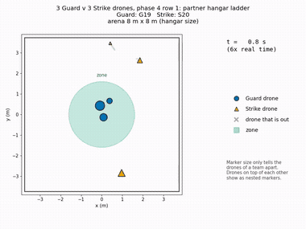](media/nus/phase4/row_1/G19_vs_S20_hold.mp4) |
|:--:|
| G19 vs S20 · Test 1: Copy of NUS 2-D game (PyTorch) · Guard holds (click for the full video) |

It matches to the step, within the limit set in advance. `source/svg_training/nus/replica.py` is a batched PyTorch
copy of the NUS game: the one-pass soft push, the Guard circle, 200 steps, the sticky reached flag and the NUS random
starts (Guard drones inside a disc of half the zone radius; each Strike drone at the spawn distance on its own random
bearing). Recordings of NUS's own environment were replayed in it (100 episodes per set-up, random and
rule-exercising actions).

| Check | Limit | 3 v 3 | 5 v 3 | Result |
|---|---|---|---|---|
| largest position error in one step | ≤ 1e-4 units | 3.8e-6 | 5.7e-6 | PASS |
| reached flag and step counter | equal | equal | equal | PASS |
| every rule exercised | ≥ 1 step each | yes | yes | PASS |

Evidence: T15, [record](../records/2026-11-17_nus_phase2_parity_record.md). Caveat: the check is step by step from
NUS's recorded states. Over a whole game two independent float32 programs drift apart, so the STE game engine with
NUS's rules (sub-test 2.1) matches Test 1 to rounding, not game by game (T19, [record](../records/2026-11-18_nus_phase4_rung2_record.md)).

## 2. Converted policies match the JAX originals

|  |  |  |
|:--:|:--:|:--:|
| <a href="media/nus/w3/archive_arm_G19_vs_S20_game0.mp4">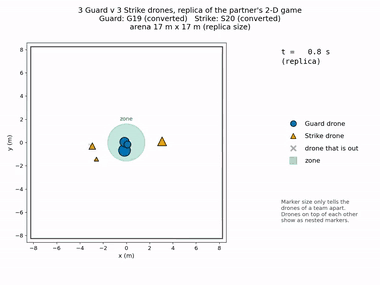</a> G19 vs S20 · Copy of NUS 2-D game (PyTorch), both converted · Guard holds | <a href="media/nus/phase3/strike_game0.mp4">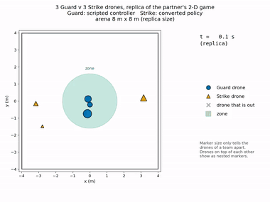</a> APF defender vs P3S · Copy of NUS 2-D game (PyTorch), P3S converted · Strike reaches the zone (4.2 s) | <a href="media/nus/phase3/guard_game0.mp4">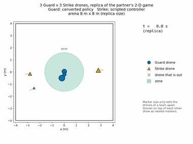</a> P3G vs APF attacker · Copy of NUS 2-D game (PyTorch), P3G converted · Guard holds |

Click a preview for the full video. Every clip of the conversion: [videos of the NUS port, Copy of NUS 2-D game](media/nus/README.md#copy-of-nus-2-d-game).

`nus/actor.py` reads NUS checkpoint files (msgpack, no JAX) and copies the NUS bfloat16 rounding points; a plain
float32 copy misses the action limit (0.022 and 0.030).

| Check | Limit | P3G / P3S (T16) | G19 / S20 (T17) | 24 entries of the 3 NUS-code hangar lineages (R0) |
|---|---|---|---|---|
| largest action error, converted v JAX, 24,000 observations per team | ≤ 0.02 units | Guard 0.0074, Strike 0.0105 | Guard 0.0079, Strike 0.0095 | 24 of 24 within; largest 0.0092 (10,800 rows each) |
| Strike reach v NUS's scripted opponent, 1,000 shared starts | converted inside the JAX interval | JAX 48 [0.036, 0.063], converted 46 [0.035, 0.061] | JAX 166 [0.144, 0.190], converted 172 [0.150, 0.197] | — |
| G19 v S20, both converted v both JAX | inside | — | JAX 17 [0.011, 0.027], converted 15 [0.009, 0.025]; 8 games differ | — |
| Result | | PASS | PASS | PASS |

Evidence: T16 [record](../records/2026-11-18_nus_phase3_conversion_record.md); T17
[record](../records/2026-11-18_nus_phase4_w3_reference_gates_record.md); R0, T29
[record](../records/2026-11-18_nus_phase5_r0_reference_record.md). Caveat: the Strike arms are saturated (the Strike
policies reach the zone in every game against the APF defender), so the Guard and G19 v S20 arms carry the
information.

**The same pair on three start sets.** One pair has three numbers on these pages. They come from different starts, and
their intervals overlap; the copy does not disagree with itself.

| Pair | NUS evaluator: NUS starts, evaluation seed 20261118 | NUS environment's starts, 1,000 games, seed 20261118: JAX / converted | STE *paired starts*, seed 20261119 (Test 1) |
|---|---|---|---|
| G19 v S20 | 0.023 of 256 games [0.011, 0.050] | 17 / 15 (T17) | 9 [0.005, 0.017] (T18) |
| G19 v APF attacker | 0.168 of 256 games | 166 / 172 (T17) | 175 [0.153, 0.200] (T18) |
| P3G v APF attacker | 1 of 20 games | 48 / 46 (T16) | 33 [0.024, 0.046] (T18) |

First column: INFO, [self-play matrix record](../records/2026-11-18_nus_selfplay_matrix_record.md) and [Phase 2a record](../records/2026-11-17_nus_phase2a_training_record.md) (written after the fact).
Test 1: T18, [record](../records/2026-11-18_nus_phase4_rung1_record.md).

## 3. Six tests towards STE drones

| [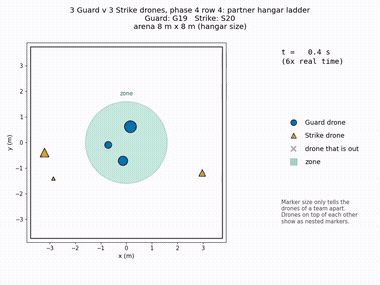](media/nus/phase4/row_4/G19_vs_S20_strike_win.mp4) |
|:--:|
| G19 vs S20 · Test 4: STE drone model + safety filter · Strike reaches the zone (click for the full video) |

The converted policies stay frozen, and each test changes the game one step towards the STE drones. 1,000 paired
games per pair on one starts file (*paired starts*: the same 1,000 starts in every test, so two tests compare game by
game). Tests 1–3 run without the safety filter (a measurement, not a training setting); Tests 4–6 restore it, as in
flight. The sub-tests 2.1, 2.2, 3a and 5a keep the records' numbers.

| Test | What changes from the test before | Ledger |
|---|---|---|
| 1 | nothing: the Copy of NUS 2-D game (PyTorch) on the hangar set-up | T18 |
| 2.1 | the STE game engine (PyTorch), with NUS's soft push and Guard circle | T19 |
| 2.2 | square walls (the 7.5 m hangar arena) in place of the Guard circle | T19 |
| 2 | **two changes:** the STE *push-apart* (a move that would bring a drone inside 1.10 m of an opposing drone is cut short) in place of NUS's soft push, and each action held for 12 ticks (0.60 s) | T19 |
| 3a | control: a drone that flies the held command exactly (must equal Test 2) | T20 |
| 3 | the STE drone model: a copy of CMU's commander, then the delay and lag of the exploratory drone model | T20 |
| 4 | the safety filter on every pair in place of the push-apart (**two effects**, below) | T22 |
| 5a | control: drones free in height, no jitter (must equal Test 4; 12 core pairs only) | T23 |
| 5 | drones free in height (3-D), start heights jittered by ±1 mm | T23 |
| 6 | Isaac Lab physics drones (Isaac Sim 5.1), flown by a copy of PX4's control loops | T24 |

**Strike reaches of 1,000** (lower is better for the Guard team; *core pairs* with intervals):

| Guard v Strike | 1 | 2.1 | 2.2 | 2 | 3a | 3 | 4 | 5a | 5 | 6 |
|---|---|---|---|---|---|---|---|---|---|---|
| G19 v S20 | 9 [.005, .017] | 9 | 7 [.003, .014] | 17 [.011, .027] | 17 | 43 [.032, .057] | 740 [.712, .766] | 740 | 983 [.973, .989] | 979 [.968, .986] |
| G19 v APF attacker | 175 [.153, .200] | 174 | 174 | 211 [.187, .237] | 211 | 408 [.378, .439] | 1000 | 1000 | 1000 | 1000 |
| P3G v S20 | 985 [.975, .991] | 984 | 863 [.840, .883] | 841 [.817, .862] | 841 | 926 [.908, .941] | 908 [.888, .924] | 908 | 924 [.906, .939] | 928 [.910, .942] |
| P3G v APF attacker | 33 [.024, .046] | 34 | 34 | 96 [.079, .116] | 96 | 294 [.267, .323] | 1000 | 1000 | 1000 | 1000 |
| Parked Guard v S20 | 1000 | 1000 | 1000 | 1000 | 1000 | 1000 | 556 [.525, .587] | 556 | 571 [.540, .601] | 524 [.493, .555] |

**All pairs, counts only** (same tests; "—" = not run: the STE scripted players need the STE observation, so they
start at Test 2, and sub-test 5a ran the core pairs only):

| Guard | Strike | 1 | 2.1 | 2.2 | 2 | 3a | 3 | 4 | 5a | 5 | 6 |
|---|---|---|---|---|---|---|---|---|---|---|---|
| G19 | P3S | 971 | 970 | 970 | 980 | 980 | 1000 | 1000 | 1000 | 1000 | 1000 |
| P3G | P3S | 993 | 994 | 994 | 990 | 990 | 1000 | 1000 | 1000 | 1000 | 1000 |
| APF defender | S20 / P3S / APF attacker | 1000 / 1000 / 999 | 1000 / 1000 / 999 | 1000 / 1000 / 1000 | 1000 / 1000 / 919 | 1000 / 1000 / 919 | 1000 / 1000 / 894 | 1000 / 1000 / 1000 | 1000 / 1000 / 1000 | 1000 / 1000 / 1000 | 1000 / 1000 / 1000 |
| Parked Guard | P3S / APF attacker | 991 / 1000 | 991 / 1000 | 991 / 1000 | 991 / 1000 | 991 / 1000 | 997 / 1000 | 1000 / 1000 | 1000 / 1000 | 1000 / 1000 | 1000 / 1000 |
| G19 | strike_straight / strike_flank | — | — | — | 209 / 40 | 209 / 40 | 385 / 54 | 1000 / 798 | — | 1000 / 1000 | 1000 / 1000 |
| P3G | strike_straight / strike_flank | — | — | — | 96 / 193 | 96 / 193 | 287 / 349 | 1000 / 978 | — | 1000 / 1000 | 1000 / 1000 |
| guard_mirror | S20 / P3S / APF attacker | — | — | — | 1 / 25 / 48 | 1 / 25 / 48 | 69 / 80 / 39 | 856 / 980 / 960 | — | 1000 / 1000 / 959 | 1000 / 1000 / 961 |
| guard_mark_edge | S20 / P3S / APF attacker | — | — | — | 0 / 25 / 48 | 0 / 25 / 48 | 1000 / 999 / 38 | 994 / 1000 / 958 | — | 1000 / 1000 / 962 | 1000 / 1000 / 945 |

Records: Tests [1](../records/2026-11-18_nus_phase4_rung1_record.md), [2.1, 2.2, 2](../records/2026-11-18_nus_phase4_rung2_record.md),
[3a, 3](../records/2026-11-18_nus_phase4_rung3_record.md), [4](../records/2026-11-18_nus_phase4_rung4_2_record.md) (a
first attempt stopped as too long, T21 ABORTED: [record](../records/2026-11-18_nus_phase4_rung4_record.md)),
[5a, 5](../records/2026-11-18_nus_phase4_rung5_record.md), [6](../records/2026-11-18_nus_phase4_rung6_record.md).

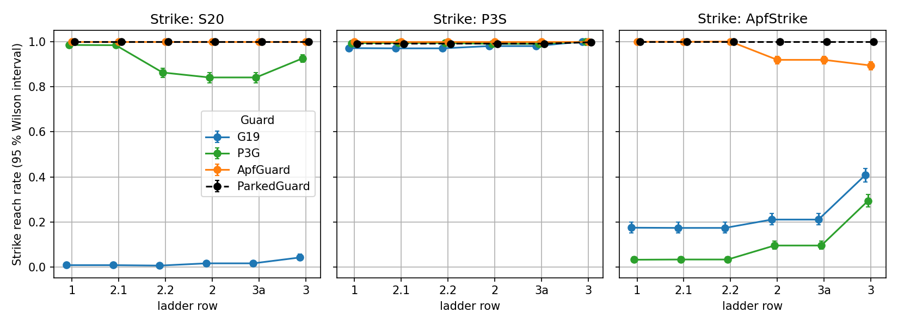

*Figure 1. Strike reach rate (Wilson 95 % interval) of the 12 core pairs along Tests 1–6, one panel per Strike player,
one line per Guard player; the dashed line is the Parked Guard. The axis says "row": row N = Test N. Made by
`scripts/make_nus_phase4_figures.py` from the tests' scores; ledger T18–T24.*

**G19 vs S20 on the same start (game 1), test by test.** Click a preview for the full video; every clip of the six
tests: [videos of the NUS port, Tests 1–6](media/nus/README.md#tests-1-6).

|  |  |  |
|:--:|:--:|:--:|
|  G19 vs S20 · Test 1: Copy of NUS 2-D game (PyTorch) · Guard holds |  G19 vs S20 · Test 2: STE game engine, action hold · Guard holds | <a href="media/nus/phase4/row_3/G19_vs_S20_hold.mp4">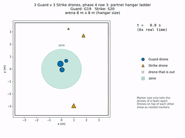</a> G19 vs S20 · Test 3: STE drone model + delay and lag · Guard holds |
|  G19 vs S20 · Test 4: STE drone model + safety filter · Guard holds | <a href="media/nus/phase4/row_5/G19_vs_S20_strike_win.mp4">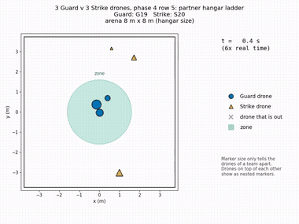</a> G19 vs S20 · Test 5: STE drone model + free height · Strike reaches the zone (22.9 s) | <a href="media/nus/phase4/row_6/G19_vs_S20_strike_win.mp4">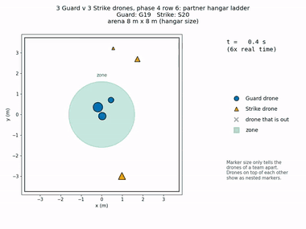</a> G19 vs S20 · Test 6: Isaac Lab physics drones, top-down · Strike reaches the zone (24.5 s) |

**Reading, test by test** ([Figure 1](#fig-1)), with the caveat beside each claim:

| Test | What was observed | Caveat |
|---|---|---|
| 1 | G19 holds S20 (9 reaches); the Parked Guard lets everything through (991–1,000), so the geometry alone does not close the zone | one starts file, one seed |
| 2.1–2.2 | the STE engine with NUS's rules equals Test 1 to rounding; square walls mostly cost P3G against S20 (985 → 863) | the walls also clamp Strike drones, which the NUS circle never does |
| 2 | G19 v S20 9 → 17; G19 v APF attacker 174 → 211 | two changes in one test (push-apart and action hold); not split |
| 3 | lag raises Strike reaches for most pairs (G19 v S20 17 → 43; G19 v APF attacker 211 → 408) | the exploratory drone model answers more slowly than the real drone (its check against a real flight is T5 FAIL), so Test 3 likely overstates the cost of lag |
| 4 | G19 v S20 43 → 740; both trained Guards concede every game to the APF attacker; Parked Guard v S20 1,000 → 556 | **likely, not tested:** see "Test 4 changes two things" below; and the filter caveat below |
| 5a | equals Test 4 in all 12,000 games, as it must | equal for one fixed batch shape (filter caveat) |
| 5 | G19 v S20 740 → 983 (251 games differ); horizontal closest approach falls (median 1.09 → 0.93 m, smallest 0.27 m) while the 3-D one stays at 1.09 m: drones pass over or under each other | a ±1 mm jitter, the exploratory drone model, and the filter caveat |
| 6 | the Isaac Lab physics drones agree with the STE drone model: G19 v S20 983 → 979 (16 games differ), P3G v S20 924 → 928; no drone tipped over in 24,000 games; fewer rule breaches than Test 5 in every pair | frozen policies only; see section 4 |

**Test 4 changes two things.** The filter replaces the push *and* keeps team-mates 1.10 m apart, which the NUS game
allows. The NUS-code Guards do stack: in Test 1 the median per-game closest same-team approach for G19 v S20 is
0.066 m (T18 record, second table), and every start already has a pair inside the 1.10 m keep-out (*start miss* 1,000
of 1,000). So the jump 43 → 740 has at least two candidate causes: (a) both drones of a close pair give way, so a
Guard cannot push a Strike drone off its path; (b) Guards can no longer stack, and the filter scatters the packed
start. Two control tests would split them, neither run yet: 4b, the filter between teams only; 4c, only the Strike
drone yields.

**The filter caveat (Tests 4–6).** Tests 4–6 ran the filter on a GPU with an early stop (a convergence check every 8
sweeps). On a GPU its answer for one game depends on how many other games are still sweeping, and in about 40 % of
games (Parked Guard v S20, ticks 30–33) it does not converge in 1,000 sweeps; there, tiny rounding differences grow to
m/s (T31, [record](../records/2026-11-18_filter_cuda_graph_record.md)). So Tests 4–6 cannot be repeated game by game
at another batch size or on another GPU; "5a = 4 in every game" holds for one fixed batch. How much the counts move is
not measured yet (re-scoring Tests 4 and 5 with the fixed loop would show it).

**The Contact column of the records is not a crash count.** It counts games in which *any* two drones, team-mates
included, come closer than 0.50 m. The NUS start puts the three Guard drones in a disc of 0.8 m radius, so 853 of the
1,000 starts already hold such a pair (923 with the parked layout); Tests 4–6 read exactly that. For Guard–Strike
closeness read the closest-approach column: in Tests 4–6 its median is 1.05–1.14 m in every pair, and every pair with
one of the NUS-code policies stays at 0.57 m or more.

## 4. Isaac Lab physics drones agree with the STE drone model

| [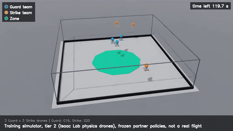](media/nus/isaac/g19_vs_s20_strike_win_1.mp4) |
|:--:|
| G19 vs S20 · Test 6: Isaac Lab physics drones · Strike reaches the zone (click for the full video) |

For these frozen policies they agree: Test 6 (Isaac Lab physics drones, flown by a copy of PX4's control loops)
against Test 5 (STE drone model), same starts.

| Pair | Test 5, STE drone model | Test 6, Isaac Lab physics drones | Games that differ |
|---|---|---|---|
| G19 v S20 | 983 [.973, .989] | 979 [.968, .986] | 16 |
| P3G v S20 | 924 [.906, .939] | 928 [.910, .942] | 68 |
| Parked Guard v S20 (largest change) | 571 [.540, .601] | 524 [.493, .555] | 247 |

Evidence: T23 [record](../records/2026-11-18_nus_phase4_rung5_record.md), T24
[record](../records/2026-11-18_nus_phase4_rung6_record.md). Caveats: one seed; the STE drone model still uses the
exploratory drone model; agreement for frozen policies says nothing yet about a policy trained on the STE drone model.

## 5. A Guard team that stands still

| [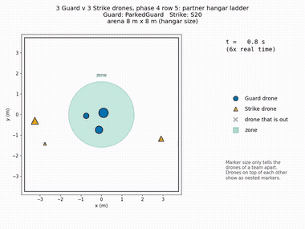](media/nus/phase4/row_5/ParkedGuard_vs_S20_hold.mp4) |
|:--:|
| Parked Guard vs S20 · Test 5: STE drone model + free height · Guard holds (click for the full video) |

In Tests 4–6 the Parked Guard holds more games against S20 than either NUS-code Guard: the filter's keep-out around
a still drone acts as a wall.

| Guard v S20, holds of 1,000 | Test 4 | Test 5 | Test 6 |
|---|---|---|---|
| Parked Guard | 444 [.413, .475] | 429 | 476 |
| G19 | 260 [.234, .288] | 17 | 21 |
| P3G | 92 | 76 | 72 |

Holds are 1,000 minus the Strike reaches of section 3 (same records). Caveats: G19 and P3G were trained in a game
without the filter, so this measures transfer, not the NUS method. Parked Guard v S20 is exactly the case where the
filter often does not converge (section 3, filter caveat). Section 7 asks whether a trained Guard finds this "filter
as a wall" defence.

## 6. STE port of NUS training method: no result yet

**Stage 5.1 result: FAIL on the test fixed in advance (one seed of three, small margins).** The STE port of NUS's training method (PyTorch)
copies the NUS alternating best-response multi-agent PPO with the archive pool (`train_self_play`, no APEX); the
records call it "route (b)", and its first stage "5.1": 3 seeds × 8 generations in 2-D, on the Copy of NUS 2-D game.
Before any of its seeds is scored, a test was fixed in advance:

| Step | What | Status (18 Nov 2026) | Evidence |
|---|---|---|---|
| R0 | the 3 NUS-code hangar lineages (24 archived entries; a *lineage* is the chain of archived Guard and Strike policies of one self-play seed, trained by STE with NUS's code) converted and scored as a 12 × 12 matrix at 1,000 games per pairing | PASS: 24 of 24 converted within 0.02 units | T29, [record](../records/2026-11-18_nus_phase5_r0_reference_record.md) |
| N0 | untrained actors scored as if they were the port: the test must fail them | PASS: the test failed them (Guard difference −0.366 [−0.499, −0.234], Strike −0.594 [−0.848, −0.341]) | T30, [record](../records/2026-11-18_nus_phase5_n0_negative_control_record.md) |
| C0 | the NUS code, 3 new seeds, scored as if it were the port: the test must pass it | PASS: Guard difference −0.027 [−0.171, +0.117], Strike +0.108 [−0.150, +0.366]; all 24 entries inside the scripted range | T33, [record](../records/2026-11-19_nus_phase5_c0_positive_control_record.md) |
| 5.1 | the port, 3 seeds × 8 generations | FAIL: seeds 1001 and 2001 pass every part; seed 3001 fails the learner check (Strike generations 4 and 6 in a row) and one scripted range (Guard generation 7 holds the APF Strike 0.909, NUS range 0.922–0.989); strength against NUS's lineages passes (Guard +0.157 [−0.008, +0.323], Strike −0.020 [−0.464, +0.424]) | T43, [record](../records/2026-11-19_nus_phase5_s51_method_match_record.md) |

**The test in plain words** (plan [§4.3](plans/2026-11-18-nus-phase5-retraining.md)): every seed finishes; the
learner does not fail two generations in a row; each entry's score against NUS's scripted opponent lies inside the
range of the 12 NUS-code entries; and each lineage's mean strength against the other NUS-code lineages, averaged over 3 seeds, is
not told apart from the NUS code's by a two-sample interval (with a cap on how much noisier the port's seeds may be).
An earlier per-cell rule ("every cross-play cell inside the NUS 95 % interval") was dropped: it would fail the NUS
code's own seeds against each other.

What will not be claimed, even after a PASS: that the port "matches", "reproduces" or "is equivalent to" the NUS
method. The claim is only that a pre-registered screen for a broken learner, 3 seeds a side, does not tell them
apart. N0 shows the test fails a learner that learned nothing; C0 shows it does not fail the NUS code with new seeds.
With three seeds a side it catches only large differences.

## 7. STE Guard policy: trained in Test 5 conditions

| [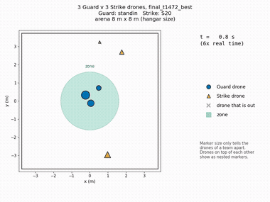](media/nus/pilots/p1b_run4_final_t1472_best_hold_slot0.mp4) |
|:--:|
| STE Guard policy vs S20 · Test 5 conditions · Guard holds (829 of 1,000) (click for the full video) |

**First signal, not yet a gated result.** The STE Guard policy (trained in pilot P1b) holds the zone against S20 in
829 of 1,000 games on the paired starts, against 429 for the Parked Guard. A *pilot* is a short training run with no
gate, run to look before planning. The STE Guard policy comes from STE's simple *stand-in trainer* (skrl IPPO:
independent PPO, one learner per drone; one seed) trained on the STE drone model in Test 5 conditions (safety filter
on every pair, delay and lag, free height) against S20. In the videos its Guards spread out across the zone and S20's
drones end pressed against the arena walls; the mechanism is likely the filter acting as a wall around each Guard
(read from the videos, not tested by a control). The recipe: [how to train the STE Guard policy](TRAIN_A_GUARD.md).

| Pilot | What | Result | Evidence |
|---|---|---|---|
| P0 | speed of the hangar game with the filter | INFO: the filter takes 89–99 % of each tick | T25, [record](../records/2026-11-18_nus_phase5_pilot_p0_record.md) |
| P1 | a Guard team (one learner per drone) trained v S20, 236 M game-steps | INFO, signal not met: 0 holds of 1,000 [0.000, 0.004]. Its set-up was faulty: γ 0.99 per 0.05 s tick, a hold rewarded only at the 2,400-tick time-out (no training game reached it), and a non-zero starting mean action | T26, [record](../records/2026-11-18_nus_phase5_pilot_p1_record.md) |
| P1b | P1 fixed (zero-mean start, one decision per 0.60 s, no shaping) | runs 1–3 ABORTED (a shared GPU starved runs 1 and 2; run 3 stopped for a reboot). **Run 4, alone on the GPU: INFO, signal met: 829 holds of 1,000 [0.804, 0.851]** (Parked Guard 429; the bar was a lower bound above 0.460). [Videos](media/nus/README.md#ste-guard-policy) | T32, T39, T40, **T41**, [record](../records/2026-11-19_nus_phase5_pilot_p1b_run4_record.md) |
| P2 | a Guard team trained v STE scripted Strikes, warm start from P1 | ABORTED twice before any update (a warm start from P1 told nothing) | T27, T28, [record](../records/2026-11-18_nus_phase5_pilot_p2_record.md) |

P1 tested a mis-set learner. P1b shows that a simple learner can find a wall-like defence against S20 on the STE
drone model; it does not show how the STE Guard policy does against other Strike behaviours (P2, not run), in
self-play, or on the Isaac Lab physics drones.

## 8. Limits

- One seed per test and one starts file: no claim about the NUS method.
- G19 and S20 come from 8-generation self-play (`self_play.generations=8`; seed 2 continued to 20); the NUS default is 32.
- Phase 1, Phase 2a, Run 0 and the self-play matrix are INFO records written after the fact from their logs and
  outputs ([Phase 1](../records/2026-11-17_nus_phase1_install_record.md), [Phase 2a](../records/2026-11-17_nus_phase2a_training_record.md), [Run 0](../records/2026-11-17_nus_run0_record.md), [matrix](../records/2026-11-18_nus_selfplay_matrix_record.md)). Their evaluations used 20 or
  256 games per pair, below the 1,000 used here.
- Tests 3–6 use the exploratory drone model (T5 FAIL), which answers more slowly than the real drone.
- Tests 4–6 depend on the filter's batch size on a GPU (section 3).
- The NUS network has no padding, so a policy plays 3 v 3 only (read from the NUS code). NUS's answer: the method does
  not support drones dropping out. NUS's answer: a policy trained with one config usually works only with that config.
- The hangar set-up (0.40 m per unit, 0.60 s per step, 7.5 m arena, 1.2 m height) is STE's, not NUS's.
- The converted G19, S20, P3G and P3S weights and the STE local settings files are in the repository marked
  PROVISIONAL (trained by STE with the NUS code, 8 generations, hangar set-up), only so that the numbers here can be
  repeated. NUS will retrain.
- Contact between drones (a *tag*) is a separate track; this port is contact-free.
