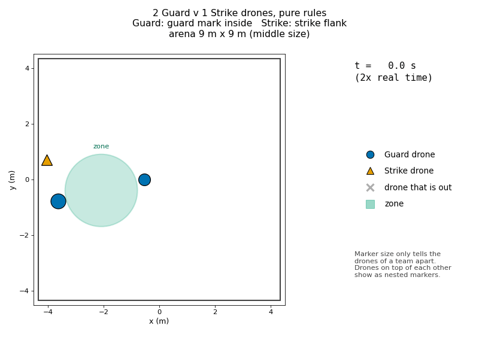
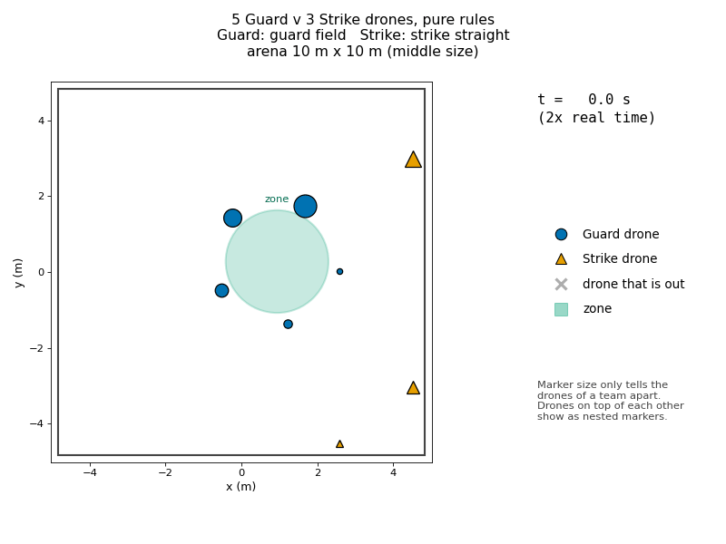
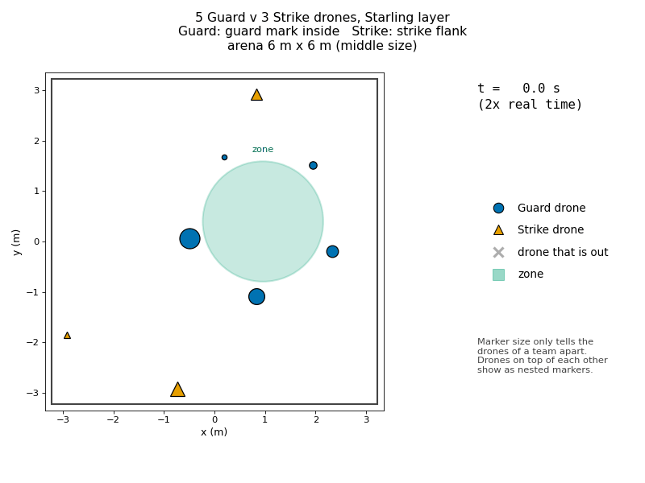
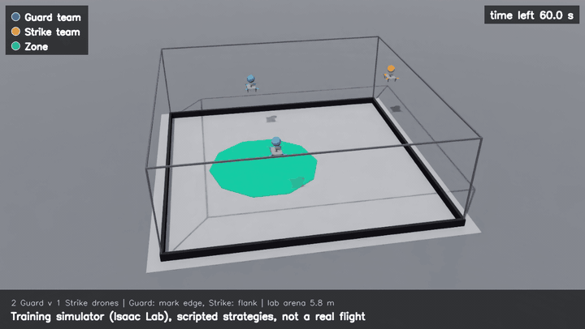
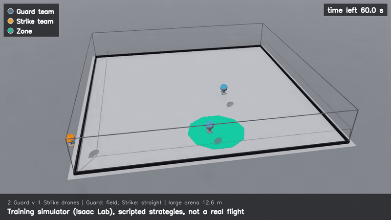
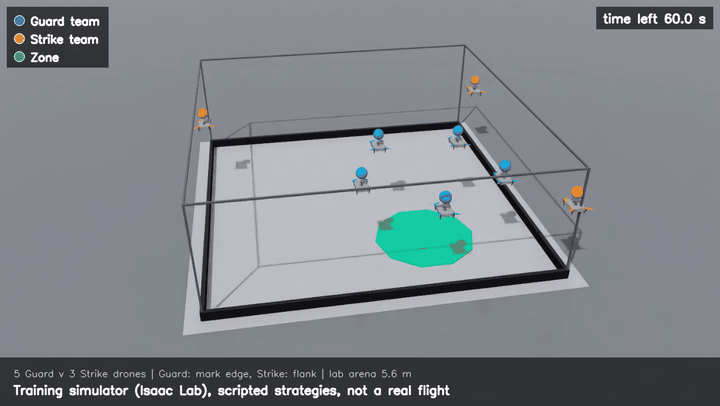
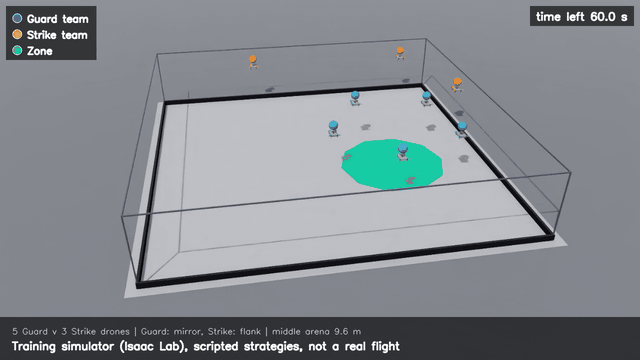
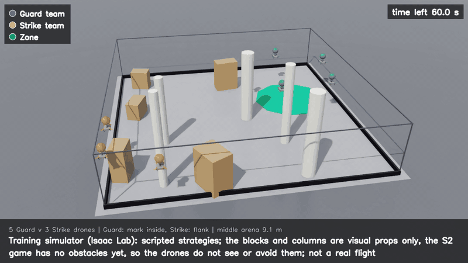
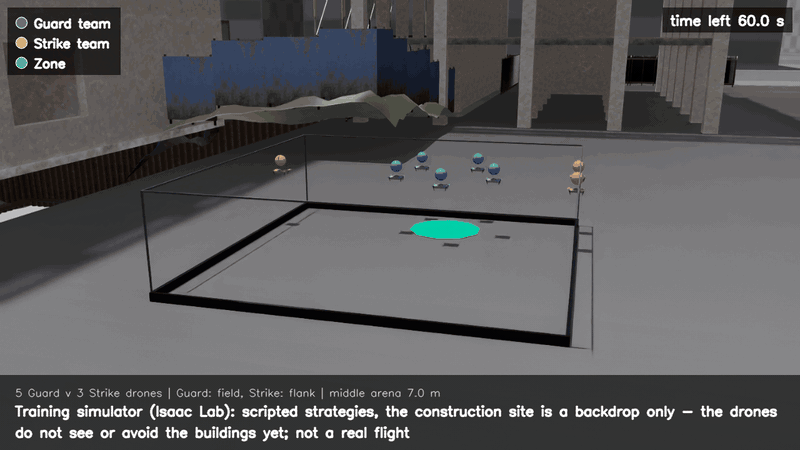
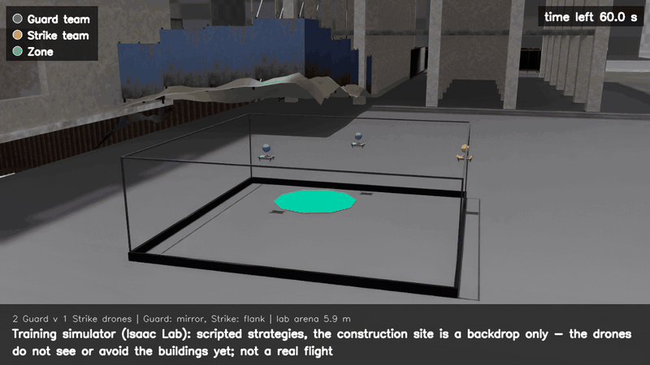

READ · TRAINING SIMULATOR ONLY: replay and Isaac Lab clips of our own scripted games. NUS port clips: [videos of the NUS port](nus/README.md).

# Replay animations of the training simulator

Training simulator (PyTorch, point drones), scripted strategies, committed neutral game settings; not a real flight.
Blue circles are Guard drones, orange triangles are Strike drones, the green disc is the zone, a faint x is a drone
that is out. Drones on top of each other show as nested markers; marker size only tells the drones of a team apart. Clips play at 2x real time (the game step is 0.05 s). MP4: 1280 x 960 px, 20 frames/s. GIF: 800 x 600 px, 10 frames/s (fewer frames to stay small; same 2x speed). Click a section's title line to open it, then a preview for the full MP4. Regenerate any clip with
`PYTHONPATH=source <pipeline env>/bin/python scripts/make_replay.py --only <name>` from `svg_training/`
(CPU only; the Starling-layer clip took about 75 s on this laptop on 16 November 2026). Each name gives `<name>.gif` and `<name>.mp4`.

Replay clips (S2): 4 clips

| Clip (click for the MP4) | Name · caption | Command (`--only`) |
|---|---|---|
|  2 Guards marking inside vs 1 Strike flanking · training simulator, pure rules · Guard holds | `2v1_pure` · 2 Guard drones v 1 Strike drone, pure rules. Guards mark inside, the Strike drone flanks. The Guard team holds the zone for the full 60 s. Middle-size arena, seed 0. | `2v1_pure` |
|  5 Guards, field tactic vs 3 Strikes flying straight · training simulator, pure rules · Guard holds | `5v3_pure` · 5 Guard drones v 3 Strike drones, pure rules. Guards use the field tactic, Strike drones go straight. The Guard team holds the zone for the full 60 s. Middle-size arena, seed 0. | `5v3_pure` |
|  5 Guards marking inside vs 3 Strikes flanking · training simulator, Starling layer · Guard holds | `5v3_starling` · 5 v 3 with the Starling layer on (commander, safety filter, fitted drone model; exploratory), after the wall fix. Guards mark inside, Strike drones flank. The Guard team holds the zone for the full 60 s. Middle-size arena, seed 0. | `5v3_starling` |
|  5 random Guards vs 3 Strikes flying straight · training simulator, pure rules · Strike reaches the zone | `strike_wins` · 5 v 3, pure rules, random Guards against straight-flying Strike drones: the Strike team reaches the zone after 7.1 s. Middle-size arena, seed 0. | `strike_wins` |

`5v3_starling` was made again on 16 November 2026 on the fixed Starling layer (wall fix, commit `17197a7`; filter check every 8). In the 8 games played for it, the closest Guard–Strike approach was 1.03–1.12 m (keep-out 1.10 m); the game shown comes to 1.03 m, the shallow open-space loss of the exploratory drone model. The earlier clip's 0.81 m dip came from the wall bug, not from the drone model.

## Isaac Lab clips (S2b): the same game on rigid-body Starling drones

Training simulator (Isaac Lab), scripted strategies, committed neutral game settings (never a partner's local file); not a real flight. A picture of the training simulator, not a measurement: no gates, no ledger row.

What you see:

- Each drone is a rigid body in PhysX, flown by the commander copy, the safety filter and a copy of PX4 1.14's controller. It is drawn with the Starling 2 Max model; a blue or orange ball above it marks its team.
- The green disc is the zone. The dark bars on the floor are where the walls stop the drones; the thin box shows the height band they fly in.
- MP4: one frame per game step, 20 frames/s, real time, 1280 x 720 px, H.264. If the game ends inside the clip, the last frame (with the result) is held 1 to 2 s.
- A game the Guard team holds to the 60 s time-out is cut at 40 s, so its clip shows no result.
- GIF: 2x real time, 5 to 7 frames/s, 640 to 800 px wide, under 5 MB.
- Which game: the first game of one of 4 played with the clip's seed (the slot rule in `configs/s2b.toml [video]`). The game was played twice with the same seeds; the two runs matched exactly (`replay_max_pos_diff_m = 0.0` in every sidecar).

How to make one again (host, GPU, headless; 2 to 6 minutes per clip on this laptop, 16 November 2026), from `svg_training/`:

- `PYTHONPATH=source ~/miniconda3/envs/env_isaaclab/bin/python scripts/make_s2b_video.py --headless --enable_cameras --clip <name>`. It runs `scripts/isaac_preflight.sh --approved-headless` first and stops on a busy GPU.
- Encode again from the saved frames, no Isaac: the same command with `--from-frames` instead of the two Isaac flags.
- Each name gives `<name>.mp4`, `<name>.gif` and `<name>.toml`, the sidecar: seeds, slot, arena, result, file sizes, the drone body read back from PhysX, the commit at recording time.
- Drone settings, the same for every clip: physics drone with motor lag, 200 Hz physics, the yaw-rate gains in each row (the text `yaw_gains_text` prints).

Isaac Lab clips (S2b): 7 clips

| Clip (click for the MP4) | `--clip` · caption | Settings |
|---|---|---|
|  2 Guards marking the zone edge vs 1 Strike flanking · Isaac Lab Starlings, lab-size arena · Guard holds | `s2b_2v1_lab` · 2 Guard drones v 1 Strike drone on Isaac Lab Starlings. Guards mark the zone edge, the Strike drone flanks. The Guard team holds the zone; the clip stops at 40 s of the 60 s game. Lab-size arena, 5.8 m. | `configs/s2b.toml [video]`, seed 1, slot 0; MP4 1.34 MB, GIF 4.73 MB; yaw-rate gains: `SIM-ONLY: AirStack simulator yaw-rate gains (CHG-0024), owner's ruling 16 Nov 2026; never port to the drone (params/sim_only_yaw_v0.toml, sha256 d0944b889f90): yaw-rate P/I/D 0.25/0.2/0` |
|  2 Guards, field tactic vs 1 Strike flying straight · Isaac Lab Starlings, large arena · Strike reaches the zone | `s2b_2v1_large` · 2 Guard drones v 1 Strike drone on Isaac Lab Starlings. Guards use the field tactic, the Strike drone flies straight and reaches the zone at 21.3 s. Large arena, 12.6 m. | `configs/s2b.toml [video]`, seed 2, slot 0; MP4 0.74 MB, GIF 4.58 MB; yaw-rate gains: `SIM-ONLY: AirStack simulator yaw-rate gains (CHG-0024), owner's ruling 16 Nov 2026; never port to the drone (params/sim_only_yaw_v0.toml, sha256 d0944b889f90): yaw-rate P/I/D 0.25/0.2/0` |
|  5 Guards marking the zone edge vs 3 Strikes flanking · Isaac Lab Starlings, lab-size arena · Guard holds | `s2b_5v3_lab` · 5 Guard drones v 3 Strike drones on Isaac Lab Starlings. Guards mark the zone edge, Strike drones flank. The Guard team holds the zone; the clip stops at 40 s of the 60 s game. Lab-size arena, 5.6 m. | `configs/s2b.toml [video]`, seed 3, slot 0; MP4 1.78 MB, GIF 4.46 MB; yaw-rate gains: `SIM-ONLY: AirStack simulator yaw-rate gains (CHG-0024), owner's ruling 16 Nov 2026; never port to the drone (params/sim_only_yaw_v0.toml, sha256 d0944b889f90): yaw-rate P/I/D 0.25/0.2/0` |
|  5 Guards mirroring vs 3 Strikes flanking · Isaac Lab Starlings, middle arena · Strike reaches the zone | `s2b_5v3_middle` · 5 Guard drones v 3 Strike drones on Isaac Lab Starlings. Guards mirror the Strike drones, which flank; a Strike drone reaches the zone at 38.1 s. Middle-size arena, 9.6 m. | `configs/s2b.toml [video]`, seed 4, slot 2; MP4 1.50 MB, GIF 4.45 MB; yaw-rate gains: `SIM-ONLY: AirStack simulator yaw-rate gains (CHG-0024), owner's ruling 16 Nov 2026; never port to the drone (params/sim_only_yaw_v0.toml, sha256 d0944b889f90): yaw-rate P/I/D 0.25/0.2/0` |
|  5 Guards marking inside vs 3 Strikes flanking · Isaac Lab Starlings, props backdrop · Strike reaches the zone | `s2b_5v3_props` · 5 v 3 on Isaac Lab Starlings among blocks and columns placed at random. The props are for show only: the S2 game has no obstacles yet, so the drones neither see nor avoid them and fly through them. Guards mark inside, Strike drones flank; a Strike drone reaches the zone at 26.1 s. Middle-size arena, 9.1 m. | `configs/s2b_video_scenes.toml`, seed 5, props seed 11 (10 props), slot 0; MP4 1.02 MB, GIF 4.44 MB; yaw-rate gains: `SIM-ONLY: AirStack simulator yaw-rate gains (CHG-0024), owner's ruling 16 Nov 2026; never port to the drone (params/sim_only_yaw_v0.toml, sha256 d0944b889f90): yaw-rate P/I/D 0.25/0.2/0` |
|  5 Guards, field tactic vs 3 Strikes flanking · Isaac Lab Starlings, construction-site backdrop · Guard holds | `s2b_5v3_site` · 5 v 3 on Isaac Lab Starlings, with the construction-site world (bought from CGTrader) as a backdrop on an open, flat patch (nearest object 10.4 m from its centre). The drones do not see or avoid the buildings. Guards use the field tactic, Strike drones flank; the Guard team holds the zone and the clip stops at 40 s. Middle-size arena, 7.0 m. | `configs/s2b_video_scenes.toml`, seed 6, slot 0; site file `construction_site_full.usdc` (read-only, not in git; sha256 in the sidecar); MP4 1.30 MB, GIF 4.33 MB; yaw-rate gains: `SIM-ONLY: AirStack simulator yaw-rate gains (CHG-0024), owner's ruling 16 Nov 2026; never port to the drone (params/sim_only_yaw_v0.toml, sha256 d0944b889f90): yaw-rate P/I/D 0.25/0.2/0` |
|  2 Guards mirroring vs 1 Strike flanking · Isaac Lab Starlings, construction-site backdrop · Guard holds | `s2b_2v1_site` · 2 v 1 on Isaac Lab Starlings in the construction-site world, a backdrop only: the drones do not see or avoid the buildings. Guards mirror the Strike drone, which flanks; the Guard team holds the zone and the clip stops at 40 s. Lab-size arena, 5.9 m. | `configs/s2b_video_scenes.toml`, seed 7, slot 0; site file as above; MP4 1.16 MB, GIF 4.64 MB; yaw-rate gains: `SIM-ONLY: AirStack simulator yaw-rate gains (CHG-0024), owner's ruling 16 Nov 2026; never port to the drone (params/sim_only_yaw_v0.toml, sha256 d0944b889f90): yaw-rate P/I/D 0.25/0.2/0` |

Still frames (PNG, 1280 x 720, caption burnt in), taken while the clip named was recorded; regenerate with that clip's command. `--stills-only` replays only up to the still but leaves the raw PNGs under `runs/s2b_video/<clip>/`: run `--from-frames` for that clip afterwards to write the captioned stills into `docs/media/`.

| File | What it shows | From |
|---|---|---|
| `s2b_still_5v3_site_wide.png` | A 5 v 3 game in the construction-site world, wide view from further back, 6 s into the game. Backdrop only: the drones do not see or avoid the buildings. | `s2b_5v3_site` |
| `s2b_still_starlings_close.png` | Close view of Guard-team Starlings (blue balls) over the zone, 3 s into the same game. Rendered drone model, not a photo. | `s2b_5v3_site` |
| `s2b_still_5v3_props.png` | The props clip's camera, 5 s in: blocks and columns for show only; the drones do not see or avoid them. | `s2b_5v3_props` |

## Live screenshots of the Isaac Sim window (S2b, 17 November 2026)

The real Isaac Sim 5.1.0 window on the laptop, with the app's own panels, taken while games or the stand-in trainer ran (launched with `--windowed`; runs of record stay headless). Pictures only: no gates, no ledger row. How they were made: the opt-in `--windowed` option of `scripts/make_s2b_video.py` and `scripts/train_standin.py`, window grabbed with ImageMagick `import`.

| Screenshot | Caption |
|---|---|
| [s2b_live_lab_arena.png](s2b_live_lab_arena.png) | Isaac Sim window, training simulator: 5 Guard drones (blue balls) v 3 Strike drones (orange balls) on rigid-body Starlings in a lab-size arena. Scripted strategies, early in a game; the green disc is the zone. A screenshot of the simulator, not a flight. |
| [s2b_live_large_arena.png](s2b_live_large_arena.png) | Isaac Sim window, training simulator: 2 Guard drones v 1 Strike drone in the large arena. Same Starling drones and game rules as the smaller arenas, only the space is bigger. Scripted strategies; a screenshot, not a flight. |
| [s2b_live_props.png](s2b_live_props.png) | Isaac Sim window, training simulator: 5 v 3 among blocks and columns placed at random. The props are for show only: the game has no obstacles yet, so the drones neither see nor avoid them. Scripted strategies; not a flight. |
| [s2b_live_construction_site.png](s2b_live_construction_site.png) | Isaac Sim window, training simulator: 5 v 3 on an open patch of the construction-site world, used as a backdrop only. The drones do not see or avoid the buildings. Scripted strategies; a screenshot, not a flight. |
| [s2b_live_standin_training.png](s2b_live_standin_training.png) | Isaac Sim window, training simulator, while the stand-in trainer runs: the first of 8 games, 2 Guard drones learning against 1 scripted Strike drone. A short pipe-test run stopped after a few minutes; nothing was learned and it is not a strategy. Not a flight. |

## NUS port clips

Every clip of the NUS port (NUS's 2-D game, the converted policies, Tests 1–6 top-down, Isaac Lab camera clips of Test 6 and the STE Guard policy; 275 clips, each with a GIF preview) is in [videos of the NUS port](nus/README.md).
