READ · TRAINING SIMULATOR ONLY: every clip of the NUS port, each with a preview that plays in the page.

# Videos of the NUS port

Training simulator only; nothing here is a flight. Published with NUS's agreement ([STANDARDS §2](../../../STANDARDS.md#2-wording));
every clip of the port is public, the Phase 4 ones included. **STE**: the lab that wrote this repository. The story
behind each clip: [what we did, day by day](../../WHAT_WE_DID_DAY_BY_DAY.md). NUS's `defender` is the defender (Guard
team) here, NUS's `attacker` the attacker (Strike team). The policies are defined in the
[glossary](../../GLOSSARY.md#policies): G19 and S20 (self-play seed 2) and P3G and P3S (fixed-opponent runs) were
trained by STE using NUS's code; the APF defender and APF attacker (`ApfGuard`, `ApfStrike` in file names) are NUS's
scripted opponent, ported to PyTorch by STE; the Parked Guard (`ParkedGuard`) is an STE baseline whose drones command
zero speed; `guard_*` and `strike_*` are STE scripted Guards and Strikes (hand-written, no training). The six tests
([glossary, the six tests](../../GLOSSARY.md#the-six-tests)) are folders `row_N` here: **Test N = ladder row N in the
records**.

**How to watch.** Every clip has a GIF preview that plays in the page. Click a section's title line to open it, then
click a preview for the full MP4 (GitHub opens an MP4 on its own page: play or download it there). Captions read
"Guard vs Strike · played in … · outcome". A preview runs faster than its MP4 (at most 14 s, the last frame held
1.5 s); the MP4 keeps the full speed and frame count. The front page's [video gallery](../../../README.md#watch-it) shows the key
clips.

| Section | What | Simulator | Clips |
|---|---|---|---|
| [NUS's 2-D game](#nus-2-d-game) | NUS's own game and the JAX policies trained by STE with NUS's code, drawn by NUS's renderer | NUS 2-D game (JAX) | 6 |
| [Copy of NUS 2-D game](#copy-of-nus-2-d-game) | P3G and P3S (Phase 3), then G19 and S20 (the Phase 3 gates), converted to PyTorch | Copy of NUS 2-D game (PyTorch) | 8 |
| [Tests 1–6, top-down](#tests-1-6) | the six tests and their sub-tests, one section each (`row_N` = Test N): the first Strike win and the first hold among the first 16 games of each pair | Copy of NUS 2-D game, STE game engine, STE drone model, Isaac Lab physics drones | 246 |
| [Isaac Lab clips](#isaac-lab-clips) | the converted policies on rigid-body Starling models in Isaac Lab, an oblique camera (Test 6): two sets | Isaac Lab physics drones | 12 |
| [STE Guard policy](#ste-guard-policy) | the STE Guard policy (pilot P1b run 4) against S20 | STE drone model, Test 5 conditions | 3 |

275 clips: 275 MP4 files and 275 GIF previews.

**How to read them.**

- **NUS-renderer clips** (`nus_*`): blue discs D0–D2 are Guard drones (NUS: "defender"), red discs A0–A2 are Strike drones
  (NUS: "attacker"), the green disc is the zone. The title bar shows NUS's environment name and the step (200 per
  game). NUS's game keeps the "reached" flag once a Strike drone has been inside the zone, and the game runs on to
  step 200, so a Strike drone may leave the zone again: the outcome is the first entry, not the last frame. 12.5
  frames/s (2 steps a second; about 6× real time at 0.6 s per step), all 201 frames.
- **STE top-down clips** (`phase3/`, `w3/`, `phase4/`): blue circles are Guard drones, orange triangles Strike drones,
  the green disc the zone (1.6 m radius); marker size only tells the drones of a team apart. The last frame names the
  outcome. Phase 4 clips play at 6× real time (one frame per 8 ticks of 0.05 s, 15 frames/s); `phase3/` and `w3/`
  interpolate between policy steps at 20 frames/s. The title rounds the arena to whole metres: the hangar arena is
  **7.5 m** square (walls at ±3.75 m), shown as "8 m x 8 m". The Copy of NUS 2-D game and sub-test 2.1 have no walls (NUS's
  Guard circle instead), so on `phase3/`, `w3/` and Tests 1 and 2.1 the drawn square is only the view (8 m or
  17 m across, depending on the clip).
- **Isaac Lab clips** (`isaac/`): real time, 20 frames/s, an oblique camera on Starling models, 2 s still at the end;
  the overlay names the players. Each recorded game repeats its dry run exactly (same positions, end step and
  outcome) and no drone tipped over.
- "Test's Strike reach" is the test's count over all 1,000 paired games of that pair (the records); one clip is one game.
  "Game *n*" is the *n*-th paired start, the same in every test, so a pair's clips can be compared test by test. The
  closest approach in the Phase 4 tables is measured in the horizontal plane; in Tests 5 and 6, where drones change
  height, it can be well under the 1.10 m keep-out while the 3-D distance is not (a drone passing over or under).

<a id="nus-2-d-game"></a>

## NUS's 2-D game

On the hangar set-up (0.40 m per unit, 0.60 s per step; [what we did, day by day, the hangar geometry](../../WHAT_WE_DID_DAY_BY_DAY.md#3-phase-0-answers-and-the-hangar-geometry)).
Evidence: [Phase 2a record](../../../records/2026-11-17_nus_phase2a_training_record.md) (the fixed-opponent runs) and
[self-play matrix record](../../../records/2026-11-18_nus_selfplay_matrix_record.md) (the self-play clips), both INFO, written after the fact.

<details>
<summary>NUS's 2-D game: 6 clips</summary>

| Clip (click for the MP4) | What it shows | Source (lab only) | Size |
|---|---|---|---|
| <a href="nus_fixed_guard_vs_scripted_strike.mp4">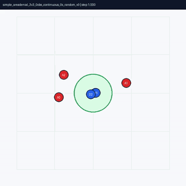</a><br>P3G vs APF attacker · NUS 2-D game (JAX) · Guard holds | Guard holds. The fixed-opponent Guard run (3,000 updates; trained by STE with NUS's code, converted as P3G): no Strike drone enters the zone in 200 steps (last evaluation: 19 of 20 held). | NUS outputs `hangar/2026-11-17_fixed_apf_3v3_defender/replays/defender_vs_apf_00003000_env0.gif` | MP4 58 kB · GIF 125 kB |
| <a href="nus_fixed_strike_vs_scripted_guard.mp4">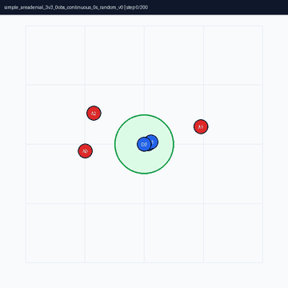</a><br>APF defender vs P3S · NUS 2-D game (JAX) · Strike reaches the zone | Strike reaches the zone. The fixed-opponent Strike run (trained by STE with NUS's code, converted as P3S): a Strike drone reaches the zone at about step 7 (last evaluation: 20 of 20 reached). | `hangar/2026-11-17_fixed_apf_3v3_attacker/replays/attacker_vs_apf_00003000_env0.gif` | MP4 76 kB · GIF 161 kB |
| <a href="nus_selfplay_s1_g7_vs_s1_s8.mp4">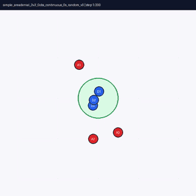</a><br>Seed 1 Guard gen. 7 vs seed 1 Strike gen. 8 · NUS 2-D game (JAX) · Guard holds | Guard holds (that pair: 0.005 Strike wins over 200 games). | `_probes/selfplay_eval/videos/s1_guard7_vs_strike8/` | MP4 49 kB · GIF 116 kB |
| <a href="nus_selfplay_s2_g7_vs_s2_s8.mp4">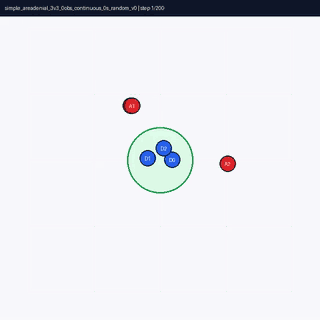</a><br>Seed 2 Guard gen. 7 vs seed 2 Strike gen. 8 · NUS 2-D game (JAX) · Strike reaches the zone | Strike reaches the zone at about step 25 (that pair: 1.000 over 200 games), the "last mover wins" pattern of generations 1–12. | `_probes/selfplay_eval/videos/s2_guard7_vs_strike8/` | MP4 73 kB · GIF 123 kB |
| <a href="nus_selfplay_s2_g19_vs_s2_s20.mp4">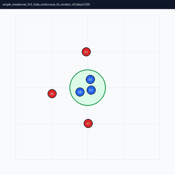</a><br>G19 vs S20 · NUS 2-D game (JAX) · Guard holds | Guard holds for 200 steps (that pair: 0.025 over 200 games). The reference pair: seed 2 Guard generation 19 against Strike generation 20. | `_probes/selfplay_eval/videos/s2_guard19_vs_strike20/` | MP4 58 kB · GIF 168 kB |
| <a href="nus_selfplay_s2_g19_vs_s3_s8.mp4">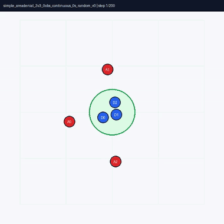</a><br>G19 vs seed 3 Strike gen. 8 · NUS 2-D game (JAX) · Guard holds | Guard holds (that pair: 0.120 over 200 games); a Strike policy G19 never met in training. | `_probes/selfplay_eval/videos/s2_guard19_vs_s3strike8/` | MP4 62 kB · GIF 139 kB |

</details>

<a id="copy-of-nus-2-d-game"></a>

## Copy of NUS 2-D game: the converted policies

The policies converted to PyTorch, played in the Copy of NUS 2-D game on the hangar set-up. `phase3/`: the
fixed-opponent pair P3G and P3S against the APF defender and attacker (evidence: T16,
[record](../../../records/2026-11-18_nus_phase3_conversion_record.md)). `w3/`: G19 and S20 through the Phase 3 gates
(evidence: T17, [record](../../../records/2026-11-18_nus_phase4_w3_reference_gates_record.md); the "W3" workstation row).

<details>
<summary>Copy of NUS 2-D game: 8 clips</summary>

| Clip (click for the MP4) | Folder | This game | Size |
|---|---|---|---|
| <a href="phase3/guard_game0.mp4">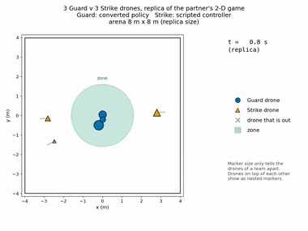</a><br>P3G vs APF attacker · Copy of NUS 2-D game (PyTorch) · Guard holds | `phase3/` | Guard team holds for 120 s | MP4 268 kB · GIF 120 kB |
| <a href="phase3/guard_game1.mp4">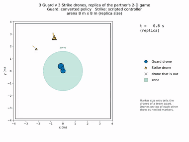</a><br>P3G vs APF attacker · Copy of NUS 2-D game (PyTorch) · Guard holds | `phase3/` | Guard team holds for 120 s | MP4 267 kB · GIF 118 kB |
| <a href="phase3/strike_game0.mp4">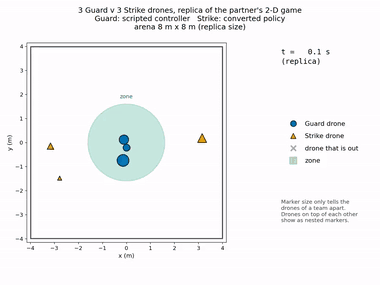</a><br>APF defender vs P3S · Copy of NUS 2-D game (PyTorch) · Strike reaches the zone | `phase3/` | Strike team reaches the zone at 4.2 s | MP4 31 kB · GIF 43 kB |
| <a href="phase3/strike_game1.mp4">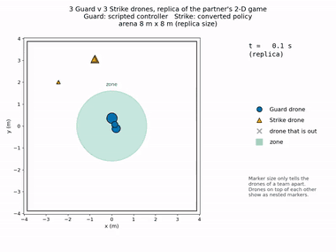</a><br>APF defender vs P3S · Copy of NUS 2-D game (PyTorch) · Strike reaches the zone | `phase3/` | Strike team reaches the zone at 3.6 s | MP4 29 kB · GIF 36 kB |
| <a href="w3/archive_arm_G19_vs_S20_game0.mp4">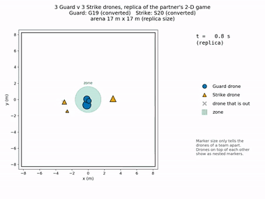</a><br>G19 vs S20 · Copy of NUS 2-D game (PyTorch) · Guard holds | `w3/` | Guard team holds for 120 s | MP4 257 kB · GIF 126 kB |
| <a href="w3/archive_arm_G19_vs_S20_game1.mp4">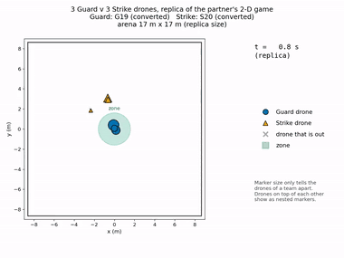</a><br>G19 vs S20 · Copy of NUS 2-D game (PyTorch) · Guard holds | `w3/` | Guard team holds for 120 s | MP4 242 kB · GIF 117 kB |
| <a href="w3/scripted_arm_G19_game0.mp4">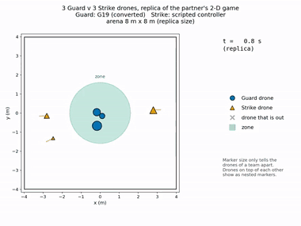</a><br>G19 vs APF attacker · Copy of NUS 2-D game (PyTorch) · Guard holds | `w3/` | Guard team holds for 120 s | MP4 269 kB · GIF 130 kB |
| <a href="w3/scripted_arm_S20_game0.mp4">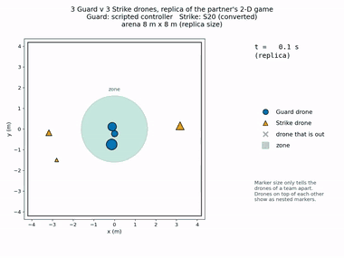</a><br>APF defender vs S20 · Copy of NUS 2-D game (PyTorch) · Strike reaches the zone | `w3/` | Strike team reaches the zone at 7.8 s | MP4 39 kB · GIF 57 kB |

</details>

## Same start: NUS's JAX game beside the PyTorch copy

One game from one start, played in NUS's own JAX game with NUS's JAX policies (left) and in the Copy of NUS 2-D game
(PyTorch) with the converted policies (right); both panels on one scale (evidence: T42,
[record](../../../records/2026-11-19_nus_pair_g19_p3s_jax_vs_pytorch_record.md)). `pairs/`.

| Clip (click for the MP4) | This game | Size |
|---|---|---|
| <a href="pairs/g19_vs_s20_game139_same_start.mp4">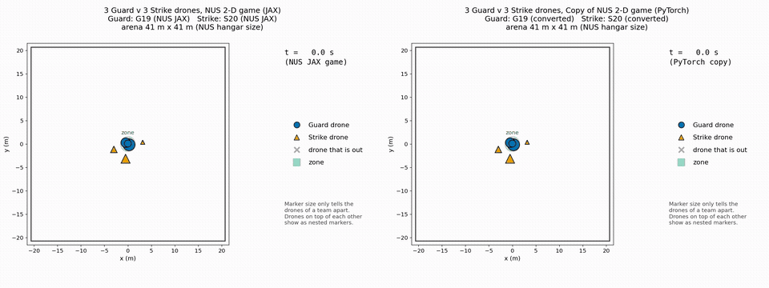</a> | G19 vs S20, game 139 · Guard holds in both; one Strike drone near x = −15 m in both | GIF 0.9 MB, MP4 0.9 MB |
| <a href="pairs/g19_vs_s20_game0_same_start.mp4">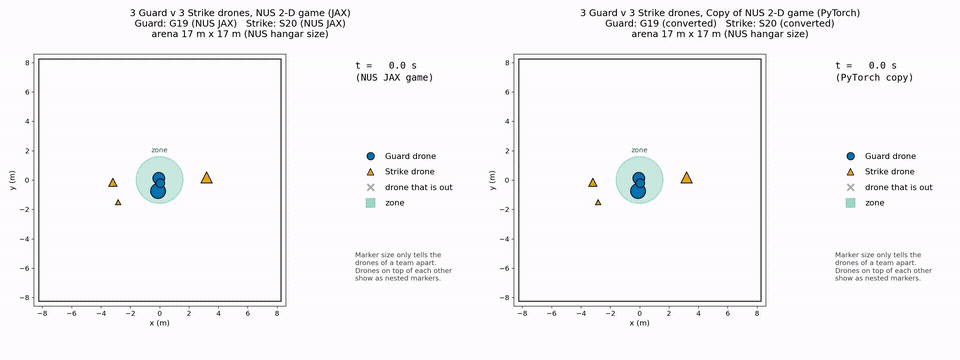</a> | G19 vs S20, game 0 · Guard holds in both | GIF 1.3 MB, MP4 1.0 MB |
| <a href="pairs/g19_vs_p3s_game0_same_start.mp4">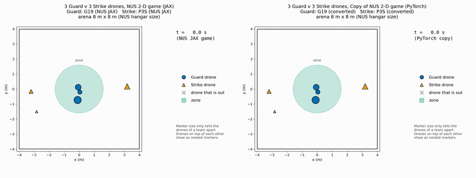</a> | G19 vs P3S, game 0 · Strike reaches the zone at step 26 in both | GIF 0.3 MB, MP4 0.2 MB |
| <a href="pairs/g19_vs_p3s_game121_same_start.mp4">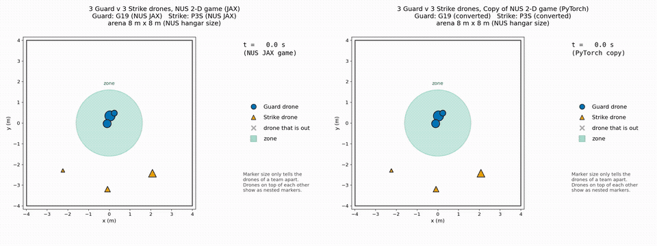</a> | G19 vs P3S, game 121 · Guard holds in both (one of 9 holds) | GIF 2.1 MB, MP4 1.4 MB |

<a id="tests-1-6"></a>

## Tests 1–6, top-down

One folder per test (`row_N` = Test N); each test changes one thing from the test before ([what we did, day by day, the six tests](../../WHAT_WE_DID_DAY_BY_DAY.md#8-phase-4-six-tests-towards-ste-drones)). Players: G19 and S20 (the self-play pair), P3G and P3S (the Phase 3 pair), ApfGuard and ApfStrike (the APF defender and attacker, NUS's scripted opponent ported to PyTorch), ParkedGuard (every Guard drone commands zero; Guard 0 starts at the zone centre), `strike_*` and `guard_*` (STE scripted Guards and Strikes, from Test 2). A pair has no `hold` clip when none of its first 16 games was held, and no `strike_win` clip when none was reached.

| Test | Clips | Evidence |
|---|---|---|
| [Test 1](#test-1) | 14 | T18, [record](../../../records/2026-11-18_nus_phase4_rung1_record.md) |
| [Sub-test 2.1](#test-2-1) | 14 | T19, [record](../../../records/2026-11-18_nus_phase4_rung2_record.md) |
| [Sub-test 2.2](#test-2-2) | 15 | T19, [record](../../../records/2026-11-18_nus_phase4_rung2_record.md) |
| [Test 2](#test-2) | 33 | T19, [record](../../../records/2026-11-18_nus_phase4_rung2_record.md) |
| [Sub-test 3a](#test-3a) | 33 | T20, [record](../../../records/2026-11-18_nus_phase4_rung3_record.md) |
| [Test 3](#test-3) | 35 | T20, [record](../../../records/2026-11-18_nus_phase4_rung3_record.md) |
| [Test 4](#test-4) | 33 | T22, [record](../../../records/2026-11-18_nus_phase4_rung4_2_record.md) |
| [Sub-test 5a](#test-5a) | 15 | T23, [record](../../../records/2026-11-18_nus_phase4_rung5_record.md) |
| [Test 5](#test-5) | 27 | T23, [record](../../../records/2026-11-18_nus_phase4_rung5_record.md) |
| [Test 6](#test-6) | 27 | T24, [record](../../../records/2026-11-18_nus_phase4_rung6_record.md) |

<a id="test-1"></a>

### Test 1: Copy of NUS 2-D game, in PyTorch

Evidence: T18, [record](../../../records/2026-11-18_nus_phase4_rung1_record.md).

<details>
<summary>Test 1: 14 clips</summary>

| Clip (click for the MP4) | This game | Test's Strike reach (of 1,000) | Size |
|---|---|---|---|
| <a href="phase4/row_1/ApfGuard_vs_ApfStrike_strike_win.mp4"></a><br>APF defender vs APF attacker · Test 1: Copy of NUS 2-D game (PyTorch) · Strike reaches the zone | game 1: Strike team reaches the zone at 15.6 s; closest Guard–Strike in the horizontal plane 1.20 m | 999 | MP4 33 kB · GIF 50 kB |
| <a href="phase4/row_1/ApfGuard_vs_P3S_strike_win.mp4"></a><br>APF defender vs P3S · Test 1: Copy of NUS 2-D game (PyTorch) · Strike reaches the zone | game 1: Strike team reaches the zone at 7.8 s; closest Guard–Strike in the horizontal plane 1.20 m | 1000 | MP4 30 kB · GIF 40 kB |
| <a href="phase4/row_1/ApfGuard_vs_S20_strike_win.mp4"></a><br>APF defender vs S20 · Test 1: Copy of NUS 2-D game (PyTorch) · Strike reaches the zone | game 1: Strike team reaches the zone at 9.0 s; closest Guard–Strike in the horizontal plane 1.20 m | 1000 | MP4 30 kB · GIF 37 kB |
| <a href="phase4/row_1/G19_vs_ApfStrike_hold.mp4"></a><br>G19 vs APF attacker · Test 1: Copy of NUS 2-D game (PyTorch) · Guard holds | game 1: Guard team holds for 120 s; closest Guard–Strike in the horizontal plane 1.20 m | 175 | MP4 95 kB · GIF 95 kB |
| <a href="phase4/row_1/G19_vs_ApfStrike_strike_win.mp4">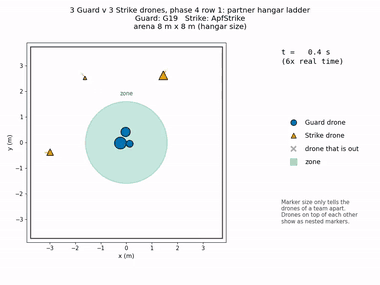</a><br>G19 vs APF attacker · Test 1: Copy of NUS 2-D game (PyTorch) · Strike reaches the zone | game 12: Strike team reaches the zone at 6.0 s; closest Guard–Strike in the horizontal plane 1.20 m | 175 | MP4 26 kB · GIF 32 kB |
| <a href="phase4/row_1/G19_vs_P3S_strike_win.mp4"></a><br>G19 vs P3S · Test 1: Copy of NUS 2-D game (PyTorch) · Strike reaches the zone | game 1: Strike team reaches the zone at 28.2 s; closest Guard–Strike in the horizontal plane 1.20 m | 971 | MP4 45 kB · GIF 81 kB |
| <a href="phase4/row_1/G19_vs_S20_hold.mp4"></a><br>G19 vs S20 · Test 1: Copy of NUS 2-D game (PyTorch) · Guard holds | game 1: Guard team holds for 120 s; closest Guard–Strike in the horizontal plane 1.20 m | 9 | MP4 89 kB · GIF 116 kB |
| <a href="phase4/row_1/P3G_vs_ApfStrike_hold.mp4">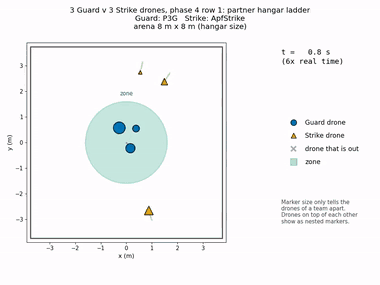</a><br>P3G vs APF attacker · Test 1: Copy of NUS 2-D game (PyTorch) · Guard holds | game 1: Guard team holds for 120 s; closest Guard–Strike in the horizontal plane 1.20 m | 33 | MP4 87 kB · GIF 97 kB |
| <a href="phase4/row_1/P3G_vs_ApfStrike_strike_win.mp4"></a><br>P3G vs APF attacker · Test 1: Copy of NUS 2-D game (PyTorch) · Strike reaches the zone | game 8: Strike team reaches the zone at 3.6 s; closest Guard–Strike in the horizontal plane 1.20 m | 33 | MP4 25 kB · GIF 28 kB |
| <a href="phase4/row_1/P3G_vs_P3S_strike_win.mp4"></a><br>P3G vs P3S · Test 1: Copy of NUS 2-D game (PyTorch) · Strike reaches the zone | game 1: Strike team reaches the zone at 19.2 s; closest Guard–Strike in the horizontal plane 1.20 m | 993 | MP4 36 kB · GIF 59 kB |
| <a href="phase4/row_1/P3G_vs_S20_strike_win.mp4"></a><br>P3G vs S20 · Test 1: Copy of NUS 2-D game (PyTorch) · Strike reaches the zone | game 1: Strike team reaches the zone at 18.6 s; closest Guard–Strike in the horizontal plane 1.20 m | 985 | MP4 32 kB · GIF 49 kB |
| <a href="phase4/row_1/ParkedGuard_vs_ApfStrike_strike_win.mp4"></a><br>Parked Guard vs APF attacker · Test 1: Copy of NUS 2-D game (PyTorch) · Strike reaches the zone | game 1: Strike team reaches the zone at 3.6 s; closest Guard–Strike in the horizontal plane 1.22 m | 1000 | MP4 24 kB · GIF 26 kB |
| <a href="phase4/row_1/ParkedGuard_vs_P3S_strike_win.mp4">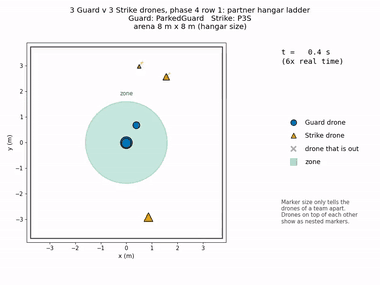</a><br>Parked Guard vs P3S · Test 1: Copy of NUS 2-D game (PyTorch) · Strike reaches the zone | game 1: Strike team reaches the zone at 7.8 s; closest Guard–Strike in the horizontal plane 1.20 m | 991 | MP4 26 kB · GIF 28 kB |
| <a href="phase4/row_1/ParkedGuard_vs_S20_strike_win.mp4"></a><br>Parked Guard vs S20 · Test 1: Copy of NUS 2-D game (PyTorch) · Strike reaches the zone | game 1: Strike team reaches the zone at 4.8 s; closest Guard–Strike in the horizontal plane 1.44 m | 1000 | MP4 23 kB · GIF 24 kB |

</details>

<a id="test-2-1"></a>

### Sub-test 2.1: the STE game engine with NUS's push and Guard circle

Evidence: T19, [record](../../../records/2026-11-18_nus_phase4_rung2_record.md).

<details>
<summary>Sub-test 2.1: 14 clips</summary>

| Clip (click for the MP4) | This game | Test's Strike reach (of 1,000) | Size |
|---|---|---|---|
| <a href="phase4/row_2.1/ApfGuard_vs_ApfStrike_strike_win.mp4"></a><br>APF defender vs APF attacker · Sub-test 2.1: STE game engine, NUS push and circle · Strike reaches the zone | game 1: Strike team reaches the zone at 15.1 s; closest Guard–Strike in the horizontal plane 1.20 m | 999 | MP4 32 kB · GIF 47 kB |
| <a href="phase4/row_2.1/ApfGuard_vs_P3S_strike_win.mp4"></a><br>APF defender vs P3S · Sub-test 2.1: STE game engine, NUS push and circle · Strike reaches the zone | game 1: Strike team reaches the zone at 7.2 s; closest Guard–Strike in the horizontal plane 1.20 m | 1000 | MP4 29 kB · GIF 37 kB |
| <a href="phase4/row_2.1/ApfGuard_vs_S20_strike_win.mp4"></a><br>APF defender vs S20 · Sub-test 2.1: STE game engine, NUS push and circle · Strike reaches the zone | game 1: Strike team reaches the zone at 8.5 s; closest Guard–Strike in the horizontal plane 1.20 m | 1000 | MP4 30 kB · GIF 37 kB |
| <a href="phase4/row_2.1/G19_vs_ApfStrike_hold.mp4">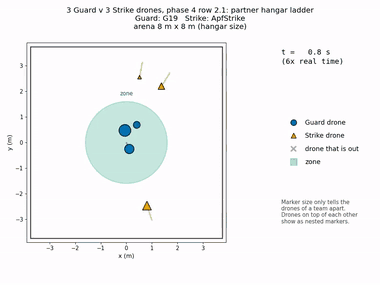</a><br>G19 vs APF attacker · Sub-test 2.1: STE game engine, NUS push and circle · Guard holds | game 1: Guard team holds for 120 s; closest Guard–Strike in the horizontal plane 1.20 m | 174 | MP4 90 kB · GIF 102 kB |
| <a href="phase4/row_2.1/G19_vs_ApfStrike_strike_win.mp4"></a><br>G19 vs APF attacker · Sub-test 2.1: STE game engine, NUS push and circle · Strike reaches the zone | game 12: Strike team reaches the zone at 5.5 s; closest Guard–Strike in the horizontal plane 1.20 m | 174 | MP4 25 kB · GIF 31 kB |
| <a href="phase4/row_2.1/G19_vs_P3S_strike_win.mp4"></a><br>G19 vs P3S · Sub-test 2.1: STE game engine, NUS push and circle · Strike reaches the zone | game 1: Strike team reaches the zone at 27.7 s; closest Guard–Strike in the horizontal plane 1.20 m | 970 | MP4 42 kB · GIF 78 kB |
| <a href="phase4/row_2.1/G19_vs_S20_hold.mp4">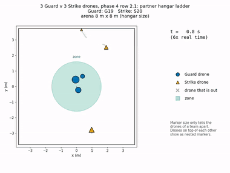</a><br>G19 vs S20 · Sub-test 2.1: STE game engine, NUS push and circle · Guard holds | game 1: Guard team holds for 120 s; closest Guard–Strike in the horizontal plane 1.20 m | 9 | MP4 86 kB · GIF 101 kB |
| <a href="phase4/row_2.1/P3G_vs_ApfStrike_hold.mp4"></a><br>P3G vs APF attacker · Sub-test 2.1: STE game engine, NUS push and circle · Guard holds | game 1: Guard team holds for 120 s; closest Guard–Strike in the horizontal plane 1.20 m | 34 | MP4 87 kB · GIF 96 kB |
| <a href="phase4/row_2.1/P3G_vs_ApfStrike_strike_win.mp4"></a><br>P3G vs APF attacker · Sub-test 2.1: STE game engine, NUS push and circle · Strike reaches the zone | game 8: Strike team reaches the zone at 3.1 s; closest Guard–Strike in the horizontal plane 1.20 m | 34 | MP4 25 kB · GIF 27 kB |
| <a href="phase4/row_2.1/P3G_vs_P3S_strike_win.mp4"></a><br>P3G vs P3S · Sub-test 2.1: STE game engine, NUS push and circle · Strike reaches the zone | game 1: Strike team reaches the zone at 18.7 s; closest Guard–Strike in the horizontal plane 1.20 m | 994 | MP4 36 kB · GIF 59 kB |
| <a href="phase4/row_2.1/P3G_vs_S20_strike_win.mp4">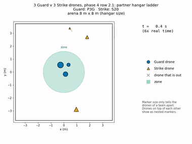</a><br>P3G vs S20 · Sub-test 2.1: STE game engine, NUS push and circle · Strike reaches the zone | game 1: Strike team reaches the zone at 18.1 s; closest Guard–Strike in the horizontal plane 1.20 m | 984 | MP4 31 kB · GIF 47 kB |
| <a href="phase4/row_2.1/ParkedGuard_vs_ApfStrike_strike_win.mp4"></a><br>Parked Guard vs APF attacker · Sub-test 2.1: STE game engine, NUS push and circle · Strike reaches the zone | game 1: Strike team reaches the zone at 3.1 s; closest Guard–Strike in the horizontal plane 1.22 m | 1000 | MP4 23 kB · GIF 23 kB |
| <a href="phase4/row_2.1/ParkedGuard_vs_P3S_strike_win.mp4"></a><br>Parked Guard vs P3S · Sub-test 2.1: STE game engine, NUS push and circle · Strike reaches the zone | game 1: Strike team reaches the zone at 7.2 s; closest Guard–Strike in the horizontal plane 1.20 m | 991 | MP4 25 kB · GIF 28 kB |
| <a href="phase4/row_2.1/ParkedGuard_vs_S20_strike_win.mp4"></a><br>Parked Guard vs S20 · Sub-test 2.1: STE game engine, NUS push and circle · Strike reaches the zone | game 1: Strike team reaches the zone at 4.2 s; closest Guard–Strike in the horizontal plane 1.44 m | 1000 | MP4 24 kB · GIF 23 kB |

</details>

<a id="test-2-2"></a>

### Sub-test 2.2: square walls instead of the Guard circle

Evidence: T19, [record](../../../records/2026-11-18_nus_phase4_rung2_record.md).

<details>
<summary>Sub-test 2.2: 15 clips</summary>

| Clip (click for the MP4) | This game | Test's Strike reach (of 1,000) | Size |
|---|---|---|---|
| <a href="phase4/row_2.2/ApfGuard_vs_ApfStrike_strike_win.mp4"></a><br>APF defender vs APF attacker · Sub-test 2.2: STE game engine, square walls · Strike reaches the zone | game 1: Strike team reaches the zone at 15.1 s; closest Guard–Strike in the horizontal plane 1.20 m | 1000 | MP4 32 kB · GIF 44 kB |
| <a href="phase4/row_2.2/ApfGuard_vs_P3S_strike_win.mp4"></a><br>APF defender vs P3S · Sub-test 2.2: STE game engine, square walls · Strike reaches the zone | game 1: Strike team reaches the zone at 7.2 s; closest Guard–Strike in the horizontal plane 1.20 m | 1000 | MP4 29 kB · GIF 35 kB |
| <a href="phase4/row_2.2/ApfGuard_vs_S20_strike_win.mp4"></a><br>APF defender vs S20 · Sub-test 2.2: STE game engine, square walls · Strike reaches the zone | game 1: Strike team reaches the zone at 8.5 s; closest Guard–Strike in the horizontal plane 1.20 m | 1000 | MP4 30 kB · GIF 34 kB |
| <a href="phase4/row_2.2/G19_vs_ApfStrike_hold.mp4"></a><br>G19 vs APF attacker · Sub-test 2.2: STE game engine, square walls · Guard holds | game 1: Guard team holds for 120 s; closest Guard–Strike in the horizontal plane 1.20 m | 174 | MP4 90 kB · GIF 100 kB |
| <a href="phase4/row_2.2/G19_vs_ApfStrike_strike_win.mp4">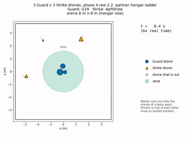</a><br>G19 vs APF attacker · Sub-test 2.2: STE game engine, square walls · Strike reaches the zone | game 12: Strike team reaches the zone at 5.5 s; closest Guard–Strike in the horizontal plane 1.20 m | 174 | MP4 26 kB · GIF 32 kB |
| <a href="phase4/row_2.2/G19_vs_P3S_strike_win.mp4"></a><br>G19 vs P3S · Sub-test 2.2: STE game engine, square walls · Strike reaches the zone | game 1: Strike team reaches the zone at 27.7 s; closest Guard–Strike in the horizontal plane 1.20 m | 970 | MP4 43 kB · GIF 76 kB |
| <a href="phase4/row_2.2/G19_vs_S20_hold.mp4"></a><br>G19 vs S20 · Sub-test 2.2: STE game engine, square walls · Guard holds | game 1: Guard team holds for 120 s; closest Guard–Strike in the horizontal plane 1.20 m | 7 | MP4 85 kB · GIF 99 kB |
| <a href="phase4/row_2.2/P3G_vs_ApfStrike_hold.mp4"></a><br>P3G vs APF attacker · Sub-test 2.2: STE game engine, square walls · Guard holds | game 1: Guard team holds for 120 s; closest Guard–Strike in the horizontal plane 1.20 m | 34 | MP4 86 kB · GIF 101 kB |
| <a href="phase4/row_2.2/P3G_vs_ApfStrike_strike_win.mp4">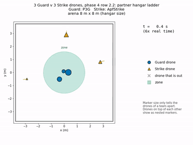</a><br>P3G vs APF attacker · Sub-test 2.2: STE game engine, square walls · Strike reaches the zone | game 8: Strike team reaches the zone at 3.1 s; closest Guard–Strike in the horizontal plane 1.20 m | 34 | MP4 25 kB · GIF 29 kB |
| <a href="phase4/row_2.2/P3G_vs_P3S_strike_win.mp4"></a><br>P3G vs P3S · Sub-test 2.2: STE game engine, square walls · Strike reaches the zone | game 1: Strike team reaches the zone at 18.7 s; closest Guard–Strike in the horizontal plane 1.20 m | 994 | MP4 35 kB · GIF 59 kB |
| <a href="phase4/row_2.2/P3G_vs_S20_hold.mp4">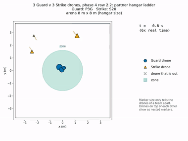</a><br>P3G vs S20 · Sub-test 2.2: STE game engine, square walls · Guard holds | game 6: Guard team holds for 120 s; closest Guard–Strike in the horizontal plane 1.20 m | 863 | MP4 89 kB · GIF 109 kB |
| <a href="phase4/row_2.2/P3G_vs_S20_strike_win.mp4"></a><br>P3G vs S20 · Sub-test 2.2: STE game engine, square walls · Strike reaches the zone | game 1: Strike team reaches the zone at 39.7 s; closest Guard–Strike in the horizontal plane 1.20 m | 863 | MP4 40 kB · GIF 80 kB |
| <a href="phase4/row_2.2/ParkedGuard_vs_ApfStrike_strike_win.mp4"></a><br>Parked Guard vs APF attacker · Sub-test 2.2: STE game engine, square walls · Strike reaches the zone | game 1: Strike team reaches the zone at 3.1 s; closest Guard–Strike in the horizontal plane 1.22 m | 1000 | MP4 23 kB · GIF 25 kB |
| <a href="phase4/row_2.2/ParkedGuard_vs_P3S_strike_win.mp4"></a><br>Parked Guard vs P3S · Sub-test 2.2: STE game engine, square walls · Strike reaches the zone | game 1: Strike team reaches the zone at 7.2 s; closest Guard–Strike in the horizontal plane 1.20 m | 991 | MP4 25 kB · GIF 28 kB |
| <a href="phase4/row_2.2/ParkedGuard_vs_S20_strike_win.mp4"></a><br>Parked Guard vs S20 · Sub-test 2.2: STE game engine, square walls · Strike reaches the zone | game 1: Strike team reaches the zone at 4.2 s; closest Guard–Strike in the horizontal plane 1.47 m | 1000 | MP4 24 kB · GIF 21 kB |

</details>

<a id="test-2"></a>

### Test 2: STE game engine (PyTorch), NUS rules, action held for each 0.6 s step; the STE push-apart instead of NUS's push

Evidence: T19, [record](../../../records/2026-11-18_nus_phase4_rung2_record.md).

<details>
<summary>Test 2: 33 clips</summary>

| Clip (click for the MP4) | This game | Test's Strike reach (of 1,000) | Size |
|---|---|---|---|
| <a href="phase4/row_2/ApfGuard_vs_ApfStrike_hold.mp4">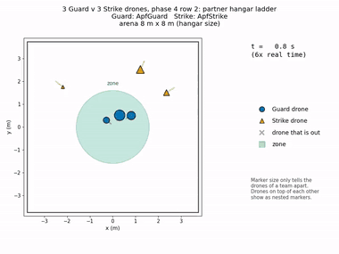</a><br>APF defender vs APF attacker · Test 2: STE game engine, action held 0.6 s · Guard holds | game 9: Guard team holds for 120 s; closest Guard–Strike in the horizontal plane 1.00 m | 919 | MP4 70 kB · GIF 51 kB |
| <a href="phase4/row_2/ApfGuard_vs_ApfStrike_strike_win.mp4"></a><br>APF defender vs APF attacker · Test 2: STE game engine, action held 0.6 s · Strike reaches the zone | game 1: Strike team reaches the zone at 17.6 s; closest Guard–Strike in the horizontal plane 0.99 m | 919 | MP4 35 kB · GIF 50 kB |
| <a href="phase4/row_2/ApfGuard_vs_P3S_strike_win.mp4"></a><br>APF defender vs P3S · Test 2: STE game engine, action held 0.6 s · Strike reaches the zone | game 1: Strike team reaches the zone at 8.8 s; closest Guard–Strike in the horizontal plane 1.18 m | 1000 | MP4 31 kB · GIF 39 kB |
| <a href="phase4/row_2/ApfGuard_vs_S20_strike_win.mp4"></a><br>APF defender vs S20 · Test 2: STE game engine, action held 0.6 s · Strike reaches the zone | game 1: Strike team reaches the zone at 10.4 s; closest Guard–Strike in the horizontal plane 1.04 m | 1000 | MP4 32 kB · GIF 41 kB |
| <a href="phase4/row_2/G19_vs_ApfStrike_hold.mp4"></a><br>G19 vs APF attacker · Test 2: STE game engine, action held 0.6 s · Guard holds | game 1: Guard team holds for 120 s; closest Guard–Strike in the horizontal plane 1.19 m | 211 | MP4 86 kB · GIF 105 kB |
| <a href="phase4/row_2/G19_vs_ApfStrike_strike_win.mp4">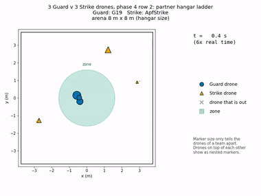</a><br>G19 vs APF attacker · Test 2: STE game engine, action held 0.6 s · Strike reaches the zone | game 10: Strike team reaches the zone at 3.2 s; closest Guard–Strike in the horizontal plane 1.18 m | 211 | MP4 24 kB · GIF 25 kB |
| <a href="phase4/row_2/G19_vs_P3S_strike_win.mp4"></a><br>G19 vs P3S · Test 2: STE game engine, action held 0.6 s · Strike reaches the zone | game 1: Strike team reaches the zone at 29.6 s; closest Guard–Strike in the horizontal plane 1.19 m | 980 | MP4 46 kB · GIF 86 kB |
| <a href="phase4/row_2/G19_vs_S20_hold.mp4"></a><br>G19 vs S20 · Test 2: STE game engine, action held 0.6 s · Guard holds | game 1: Guard team holds for 120 s; closest Guard–Strike in the horizontal plane 1.20 m | 17 | MP4 84 kB · GIF 97 kB |
| <a href="phase4/row_2/G19_vs_strike_flank_hold.mp4">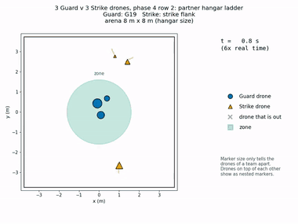</a><br>G19 vs strike_flank · Test 2: STE game engine, action held 0.6 s · Guard holds | game 1: Guard team holds for 120 s; closest Guard–Strike in the horizontal plane 1.19 m | 40 | MP4 94 kB · GIF 109 kB |
| <a href="phase4/row_2/G19_vs_strike_flank_strike_win.mp4">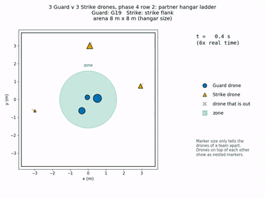</a><br>G19 vs strike_flank · Test 2: STE game engine, action held 0.6 s · Strike reaches the zone | game 8: Strike team reaches the zone at 91.8 s; closest Guard–Strike in the horizontal plane 1.19 m | 40 | MP4 84 kB · GIF 111 kB |
| <a href="phase4/row_2/G19_vs_strike_straight_hold.mp4"></a><br>G19 vs strike_straight · Test 2: STE game engine, action held 0.6 s · Guard holds | game 1: Guard team holds for 120 s; closest Guard–Strike in the horizontal plane 1.19 m | 209 | MP4 86 kB · GIF 98 kB |
| <a href="phase4/row_2/G19_vs_strike_straight_strike_win.mp4">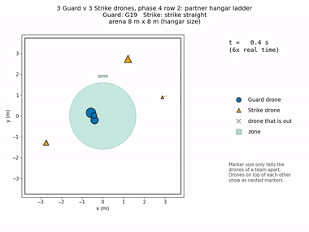</a><br>G19 vs strike_straight · Test 2: STE game engine, action held 0.6 s · Strike reaches the zone | game 10: Strike team reaches the zone at 3.2 s; closest Guard–Strike in the horizontal plane 1.18 m | 209 | MP4 24 kB · GIF 25 kB |
| <a href="phase4/row_2/guard_mark_edge_vs_ApfStrike_hold.mp4"></a><br>guard_mark_edge vs APF attacker · Test 2: STE game engine, action held 0.6 s · Guard holds | game 1: Guard team holds for 120 s; closest Guard–Strike in the horizontal plane 1.18 m | 48 | MP4 68 kB · GIF 52 kB |
| <a href="phase4/row_2/guard_mark_edge_vs_P3S_hold.mp4">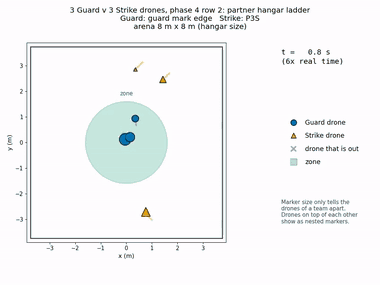</a><br>guard_mark_edge vs P3S · Test 2: STE game engine, action held 0.6 s · Guard holds | game 1: Guard team holds for 120 s; closest Guard–Strike in the horizontal plane 1.18 m | 25 | MP4 129 kB · GIF 139 kB |
| <a href="phase4/row_2/guard_mark_edge_vs_S20_hold.mp4">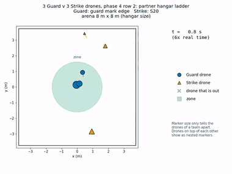</a><br>guard_mark_edge vs S20 · Test 2: STE game engine, action held 0.6 s · Guard holds | game 1: Guard team holds for 120 s; closest Guard–Strike in the horizontal plane 1.18 m | 0 | MP4 132 kB · GIF 149 kB |
| <a href="phase4/row_2/guard_mirror_vs_ApfStrike_hold.mp4"></a><br>guard_mirror vs APF attacker · Test 2: STE game engine, action held 0.6 s · Guard holds | game 1: Guard team holds for 120 s; closest Guard–Strike in the horizontal plane 1.18 m | 48 | MP4 69 kB · GIF 56 kB |
| <a href="phase4/row_2/guard_mirror_vs_P3S_hold.mp4">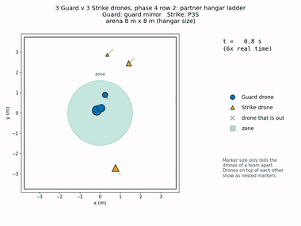</a><br>guard_mirror vs P3S · Test 2: STE game engine, action held 0.6 s · Guard holds | game 1: Guard team holds for 120 s; closest Guard–Strike in the horizontal plane 1.18 m | 25 | MP4 119 kB · GIF 135 kB |
| <a href="phase4/row_2/guard_mirror_vs_S20_hold.mp4"></a><br>guard_mirror vs S20 · Test 2: STE game engine, action held 0.6 s · Guard holds | game 1: Guard team holds for 120 s; closest Guard–Strike in the horizontal plane 1.18 m | 1 | MP4 118 kB · GIF 132 kB |
| <a href="phase4/row_2/P3G_vs_ApfStrike_hold.mp4"></a><br>P3G vs APF attacker · Test 2: STE game engine, action held 0.6 s · Guard holds | game 1: Guard team holds for 120 s; closest Guard–Strike in the horizontal plane 1.19 m | 96 | MP4 82 kB · GIF 98 kB |
| <a href="phase4/row_2/P3G_vs_ApfStrike_strike_win.mp4"></a><br>P3G vs APF attacker · Test 2: STE game engine, action held 0.6 s · Strike reaches the zone | game 8: Strike team reaches the zone at 3.2 s; closest Guard–Strike in the horizontal plane 1.18 m | 96 | MP4 24 kB · GIF 26 kB |
| <a href="phase4/row_2/P3G_vs_P3S_strike_win.mp4"></a><br>P3G vs P3S · Test 2: STE game engine, action held 0.6 s · Strike reaches the zone | game 1: Strike team reaches the zone at 19.5 s; closest Guard–Strike in the horizontal plane 1.19 m | 990 | MP4 35 kB · GIF 56 kB |
| <a href="phase4/row_2/P3G_vs_S20_hold.mp4"></a><br>P3G vs S20 · Test 2: STE game engine, action held 0.6 s · Guard holds | game 1: Guard team holds for 120 s; closest Guard–Strike in the horizontal plane 1.38 m | 841 | MP4 84 kB · GIF 101 kB |
| <a href="phase4/row_2/P3G_vs_S20_strike_win.mp4"></a><br>P3G vs S20 · Test 2: STE game engine, action held 0.6 s · Strike reaches the zone | game 2: Strike team reaches the zone at 14.7 s; closest Guard–Strike in the horizontal plane 1.20 m | 841 | MP4 30 kB · GIF 44 kB |
| <a href="phase4/row_2/P3G_vs_strike_flank_hold.mp4">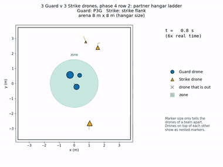</a><br>P3G vs strike_flank · Test 2: STE game engine, action held 0.6 s · Guard holds | game 1: Guard team holds for 120 s; closest Guard–Strike in the horizontal plane 1.19 m | 193 | MP4 106 kB · GIF 112 kB |
| <a href="phase4/row_2/P3G_vs_strike_flank_strike_win.mp4">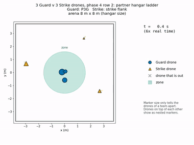</a><br>P3G vs strike_flank · Test 2: STE game engine, action held 0.6 s · Strike reaches the zone | game 4: Strike team reaches the zone at 13.7 s; closest Guard–Strike in the horizontal plane 1.20 m | 193 | MP4 31 kB · GIF 47 kB |
| <a href="phase4/row_2/P3G_vs_strike_straight_hold.mp4"></a><br>P3G vs strike_straight · Test 2: STE game engine, action held 0.6 s · Guard holds | game 1: Guard team holds for 120 s; closest Guard–Strike in the horizontal plane 1.19 m | 96 | MP4 85 kB · GIF 94 kB |
| <a href="phase4/row_2/P3G_vs_strike_straight_strike_win.mp4"></a><br>P3G vs strike_straight · Test 2: STE game engine, action held 0.6 s · Strike reaches the zone | game 8: Strike team reaches the zone at 3.2 s; closest Guard–Strike in the horizontal plane 1.18 m | 96 | MP4 24 kB · GIF 26 kB |
| <a href="phase4/row_2/ParkedGuard_vs_ApfStrike_strike_win.mp4"></a><br>Parked Guard vs APF attacker · Test 2: STE game engine, action held 0.6 s · Strike reaches the zone | game 1: Strike team reaches the zone at 3.2 s; closest Guard–Strike in the horizontal plane 1.20 m | 1000 | MP4 24 kB · GIF 24 kB |
| <a href="phase4/row_2/ParkedGuard_vs_P3S_strike_win.mp4"></a><br>Parked Guard vs P3S · Test 2: STE game engine, action held 0.6 s · Strike reaches the zone | game 1: Strike team reaches the zone at 7.2 s; closest Guard–Strike in the horizontal plane 1.20 m | 991 | MP4 25 kB · GIF 27 kB |
| <a href="phase4/row_2/ParkedGuard_vs_S20_strike_win.mp4">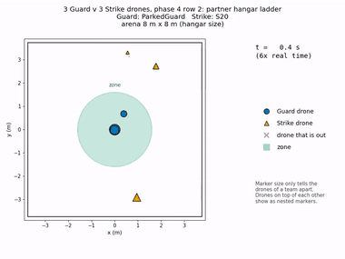</a><br>Parked Guard vs S20 · Test 2: STE game engine, action held 0.6 s · Strike reaches the zone | game 1: Strike team reaches the zone at 4.5 s; closest Guard–Strike in the horizontal plane 1.59 m | 1000 | MP4 24 kB · GIF 25 kB |
| <a href="phase4/row_2/ParkedGuard_vs_strike_flank_hold.mp4">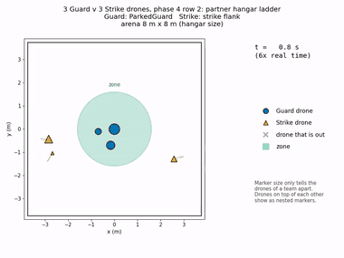</a><br>Parked Guard vs strike_flank · Test 2: STE game engine, action held 0.6 s · Guard holds | game 2: Guard team holds for 120 s; closest Guard–Strike in the horizontal plane 1.20 m | 879 | MP4 65 kB · GIF 55 kB |
| <a href="phase4/row_2/ParkedGuard_vs_strike_flank_strike_win.mp4"></a><br>Parked Guard vs strike_flank · Test 2: STE game engine, action held 0.6 s · Strike reaches the zone | game 1: Strike team reaches the zone at 3.9 s; closest Guard–Strike in the horizontal plane 1.20 m | 879 | MP4 23 kB · GIF 23 kB |
| <a href="phase4/row_2/ParkedGuard_vs_strike_straight_strike_win.mp4"></a><br>Parked Guard vs strike_straight · Test 2: STE game engine, action held 0.6 s · Strike reaches the zone | game 1: Strike team reaches the zone at 3.2 s; closest Guard–Strike in the horizontal plane 1.20 m | 1000 | MP4 23 kB · GIF 25 kB |

</details>

<a id="test-3a"></a>

### Sub-test 3a: control: a drone that flies the held command exactly; must equal Test 2

Evidence: T20, [record](../../../records/2026-11-18_nus_phase4_rung3_record.md).

<details>
<summary>Sub-test 3a: 33 clips</summary>

| Clip (click for the MP4) | This game | Test's Strike reach (of 1,000) | Size |
|---|---|---|---|
| <a href="phase4/row_3a/ApfGuard_vs_ApfStrike_hold.mp4">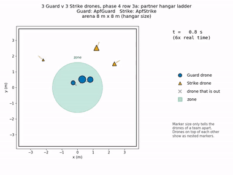</a><br>APF defender vs APF attacker · Sub-test 3a: exact-flight control · Guard holds | game 9: Guard team holds for 120 s; closest Guard–Strike in the horizontal plane 1.00 m | 919 | MP4 71 kB · GIF 58 kB |
| <a href="phase4/row_3a/ApfGuard_vs_ApfStrike_strike_win.mp4"></a><br>APF defender vs APF attacker · Sub-test 3a: exact-flight control · Strike reaches the zone | game 1: Strike team reaches the zone at 17.6 s; closest Guard–Strike in the horizontal plane 0.99 m | 919 | MP4 35 kB · GIF 52 kB |
| <a href="phase4/row_3a/ApfGuard_vs_P3S_strike_win.mp4">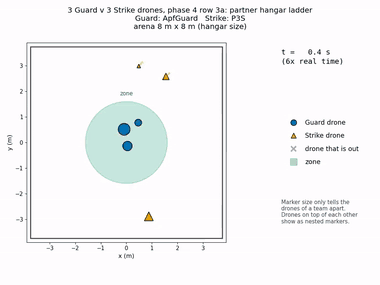</a><br>APF defender vs P3S · Sub-test 3a: exact-flight control · Strike reaches the zone | game 1: Strike team reaches the zone at 8.8 s; closest Guard–Strike in the horizontal plane 1.18 m | 1000 | MP4 31 kB · GIF 40 kB |
| <a href="phase4/row_3a/ApfGuard_vs_S20_strike_win.mp4"></a><br>APF defender vs S20 · Sub-test 3a: exact-flight control · Strike reaches the zone | game 1: Strike team reaches the zone at 10.4 s; closest Guard–Strike in the horizontal plane 1.04 m | 1000 | MP4 31 kB · GIF 38 kB |
| <a href="phase4/row_3a/G19_vs_ApfStrike_hold.mp4">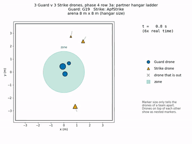</a><br>G19 vs APF attacker · Sub-test 3a: exact-flight control · Guard holds | game 1: Guard team holds for 120 s; closest Guard–Strike in the horizontal plane 1.19 m | 211 | MP4 85 kB · GIF 97 kB |
| <a href="phase4/row_3a/G19_vs_ApfStrike_strike_win.mp4">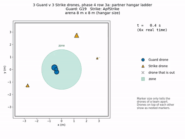</a><br>G19 vs APF attacker · Sub-test 3a: exact-flight control · Strike reaches the zone | game 10: Strike team reaches the zone at 3.2 s; closest Guard–Strike in the horizontal plane 1.18 m | 211 | MP4 24 kB · GIF 27 kB |
| <a href="phase4/row_3a/G19_vs_P3S_strike_win.mp4"></a><br>G19 vs P3S · Sub-test 3a: exact-flight control · Strike reaches the zone | game 1: Strike team reaches the zone at 29.6 s; closest Guard–Strike in the horizontal plane 1.19 m | 980 | MP4 45 kB · GIF 79 kB |
| <a href="phase4/row_3a/G19_vs_S20_hold.mp4"></a><br>G19 vs S20 · Sub-test 3a: exact-flight control · Guard holds | game 1: Guard team holds for 120 s; closest Guard–Strike in the horizontal plane 1.20 m | 17 | MP4 84 kB · GIF 101 kB |
| <a href="phase4/row_3a/G19_vs_strike_flank_hold.mp4"></a><br>G19 vs strike_flank · Sub-test 3a: exact-flight control · Guard holds | game 1: Guard team holds for 120 s; closest Guard–Strike in the horizontal plane 1.19 m | 40 | MP4 95 kB · GIF 111 kB |
| <a href="phase4/row_3a/G19_vs_strike_flank_strike_win.mp4"></a><br>G19 vs strike_flank · Sub-test 3a: exact-flight control · Strike reaches the zone | game 8: Strike team reaches the zone at 91.8 s; closest Guard–Strike in the horizontal plane 1.19 m | 40 | MP4 84 kB · GIF 113 kB |
| <a href="phase4/row_3a/G19_vs_strike_straight_hold.mp4"></a><br>G19 vs strike_straight · Sub-test 3a: exact-flight control · Guard holds | game 1: Guard team holds for 120 s; closest Guard–Strike in the horizontal plane 1.19 m | 209 | MP4 86 kB · GIF 94 kB |
| <a href="phase4/row_3a/G19_vs_strike_straight_strike_win.mp4">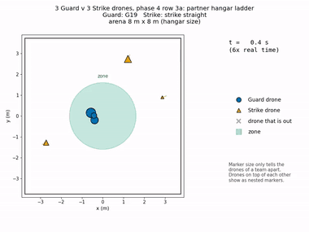</a><br>G19 vs strike_straight · Sub-test 3a: exact-flight control · Strike reaches the zone | game 10: Strike team reaches the zone at 3.2 s; closest Guard–Strike in the horizontal plane 1.18 m | 209 | MP4 24 kB · GIF 27 kB |
| <a href="phase4/row_3a/guard_mark_edge_vs_ApfStrike_hold.mp4"></a><br>guard_mark_edge vs APF attacker · Sub-test 3a: exact-flight control · Guard holds | game 1: Guard team holds for 120 s; closest Guard–Strike in the horizontal plane 1.18 m | 48 | MP4 69 kB · GIF 55 kB |
| <a href="phase4/row_3a/guard_mark_edge_vs_P3S_hold.mp4">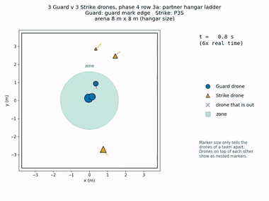</a><br>guard_mark_edge vs P3S · Sub-test 3a: exact-flight control · Guard holds | game 1: Guard team holds for 120 s; closest Guard–Strike in the horizontal plane 1.18 m | 25 | MP4 128 kB · GIF 139 kB |
| <a href="phase4/row_3a/guard_mark_edge_vs_S20_hold.mp4">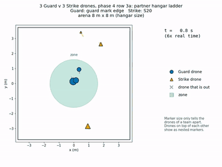</a><br>guard_mark_edge vs S20 · Sub-test 3a: exact-flight control · Guard holds | game 1: Guard team holds for 120 s; closest Guard–Strike in the horizontal plane 1.18 m | 0 | MP4 132 kB · GIF 149 kB |
| <a href="phase4/row_3a/guard_mirror_vs_ApfStrike_hold.mp4"></a><br>guard_mirror vs APF attacker · Sub-test 3a: exact-flight control · Guard holds | game 1: Guard team holds for 120 s; closest Guard–Strike in the horizontal plane 1.18 m | 48 | MP4 70 kB · GIF 61 kB |
| <a href="phase4/row_3a/guard_mirror_vs_P3S_hold.mp4">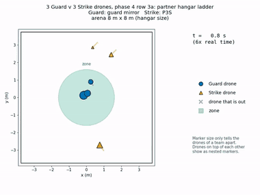</a><br>guard_mirror vs P3S · Sub-test 3a: exact-flight control · Guard holds | game 1: Guard team holds for 120 s; closest Guard–Strike in the horizontal plane 1.18 m | 25 | MP4 119 kB · GIF 136 kB |
| <a href="phase4/row_3a/guard_mirror_vs_S20_hold.mp4">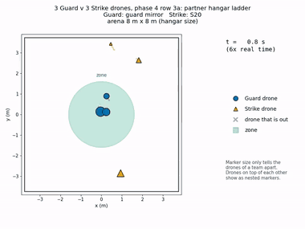</a><br>guard_mirror vs S20 · Sub-test 3a: exact-flight control · Guard holds | game 1: Guard team holds for 120 s; closest Guard–Strike in the horizontal plane 1.18 m | 1 | MP4 120 kB · GIF 131 kB |
| <a href="phase4/row_3a/P3G_vs_ApfStrike_hold.mp4"></a><br>P3G vs APF attacker · Sub-test 3a: exact-flight control · Guard holds | game 1: Guard team holds for 120 s; closest Guard–Strike in the horizontal plane 1.19 m | 96 | MP4 82 kB · GIF 96 kB |
| <a href="phase4/row_3a/P3G_vs_ApfStrike_strike_win.mp4"></a><br>P3G vs APF attacker · Sub-test 3a: exact-flight control · Strike reaches the zone | game 8: Strike team reaches the zone at 3.2 s; closest Guard–Strike in the horizontal plane 1.18 m | 96 | MP4 24 kB · GIF 26 kB |
| <a href="phase4/row_3a/P3G_vs_P3S_strike_win.mp4"></a><br>P3G vs P3S · Sub-test 3a: exact-flight control · Strike reaches the zone | game 1: Strike team reaches the zone at 19.5 s; closest Guard–Strike in the horizontal plane 1.19 m | 990 | MP4 35 kB · GIF 55 kB |
| <a href="phase4/row_3a/P3G_vs_S20_hold.mp4"></a><br>P3G vs S20 · Sub-test 3a: exact-flight control · Guard holds | game 1: Guard team holds for 120 s; closest Guard–Strike in the horizontal plane 1.38 m | 841 | MP4 85 kB · GIF 102 kB |
| <a href="phase4/row_3a/P3G_vs_S20_strike_win.mp4">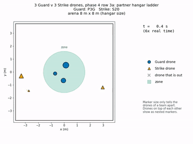</a><br>P3G vs S20 · Sub-test 3a: exact-flight control · Strike reaches the zone | game 2: Strike team reaches the zone at 14.7 s; closest Guard–Strike in the horizontal plane 1.20 m | 841 | MP4 30 kB · GIF 46 kB |
| <a href="phase4/row_3a/P3G_vs_strike_flank_hold.mp4">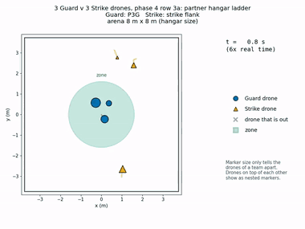</a><br>P3G vs strike_flank · Sub-test 3a: exact-flight control · Guard holds | game 1: Guard team holds for 120 s; closest Guard–Strike in the horizontal plane 1.19 m | 193 | MP4 106 kB · GIF 113 kB |
| <a href="phase4/row_3a/P3G_vs_strike_flank_strike_win.mp4"></a><br>P3G vs strike_flank · Sub-test 3a: exact-flight control · Strike reaches the zone | game 4: Strike team reaches the zone at 13.7 s; closest Guard–Strike in the horizontal plane 1.20 m | 193 | MP4 32 kB · GIF 51 kB |
| <a href="phase4/row_3a/P3G_vs_strike_straight_hold.mp4"></a><br>P3G vs strike_straight · Sub-test 3a: exact-flight control · Guard holds | game 1: Guard team holds for 120 s; closest Guard–Strike in the horizontal plane 1.19 m | 96 | MP4 85 kB · GIF 97 kB |
| <a href="phase4/row_3a/P3G_vs_strike_straight_strike_win.mp4"></a><br>P3G vs strike_straight · Sub-test 3a: exact-flight control · Strike reaches the zone | game 8: Strike team reaches the zone at 3.2 s; closest Guard–Strike in the horizontal plane 1.18 m | 96 | MP4 24 kB · GIF 25 kB |
| <a href="phase4/row_3a/ParkedGuard_vs_ApfStrike_strike_win.mp4"></a><br>Parked Guard vs APF attacker · Sub-test 3a: exact-flight control · Strike reaches the zone | game 1: Strike team reaches the zone at 3.2 s; closest Guard–Strike in the horizontal plane 1.20 m | 1000 | MP4 23 kB · GIF 26 kB |
| <a href="phase4/row_3a/ParkedGuard_vs_P3S_strike_win.mp4"></a><br>Parked Guard vs P3S · Sub-test 3a: exact-flight control · Strike reaches the zone | game 1: Strike team reaches the zone at 7.2 s; closest Guard–Strike in the horizontal plane 1.20 m | 991 | MP4 25 kB · GIF 28 kB |
| <a href="phase4/row_3a/ParkedGuard_vs_S20_strike_win.mp4"></a><br>Parked Guard vs S20 · Sub-test 3a: exact-flight control · Strike reaches the zone | game 1: Strike team reaches the zone at 4.5 s; closest Guard–Strike in the horizontal plane 1.59 m | 1000 | MP4 24 kB · GIF 23 kB |
| <a href="phase4/row_3a/ParkedGuard_vs_strike_flank_hold.mp4"></a><br>Parked Guard vs strike_flank · Sub-test 3a: exact-flight control · Guard holds | game 2: Guard team holds for 120 s; closest Guard–Strike in the horizontal plane 1.20 m | 879 | MP4 65 kB · GIF 48 kB |
| <a href="phase4/row_3a/ParkedGuard_vs_strike_flank_strike_win.mp4"></a><br>Parked Guard vs strike_flank · Sub-test 3a: exact-flight control · Strike reaches the zone | game 1: Strike team reaches the zone at 3.9 s; closest Guard–Strike in the horizontal plane 1.20 m | 879 | MP4 23 kB · GIF 23 kB |
| <a href="phase4/row_3a/ParkedGuard_vs_strike_straight_strike_win.mp4"></a><br>Parked Guard vs strike_straight · Sub-test 3a: exact-flight control · Strike reaches the zone | game 1: Strike team reaches the zone at 3.2 s; closest Guard–Strike in the horizontal plane 1.20 m | 1000 | MP4 24 kB · GIF 25 kB |

</details>

<a id="test-3"></a>

### Test 3: STE drone model (PyTorch): + Starling delay and lag (commander copy, exploratory fitted model); filter off

Evidence: T20, [record](../../../records/2026-11-18_nus_phase4_rung3_record.md).

<details>
<summary>Test 3: 35 clips</summary>

| Clip (click for the MP4) | This game | Test's Strike reach (of 1,000) | Size |
|---|---|---|---|
| <a href="phase4/row_3/ApfGuard_vs_ApfStrike_hold.mp4"></a><br>APF defender vs APF attacker · Test 3: STE drone model + delay and lag · Guard holds | game 11: Guard team holds for 120 s; closest Guard–Strike in the horizontal plane 1.00 m | 894 | MP4 79 kB · GIF 79 kB |
| <a href="phase4/row_3/ApfGuard_vs_ApfStrike_strike_win.mp4"></a><br>APF defender vs APF attacker · Test 3: STE drone model + delay and lag · Strike reaches the zone | game 1: Strike team reaches the zone at 13.6 s; closest Guard–Strike in the horizontal plane 0.99 m | 894 | MP4 34 kB · GIF 50 kB |
| <a href="phase4/row_3/ApfGuard_vs_P3S_strike_win.mp4"></a><br>APF defender vs P3S · Test 3: STE drone model + delay and lag · Strike reaches the zone | game 1: Strike team reaches the zone at 6.4 s; closest Guard–Strike in the horizontal plane 1.18 m | 1000 | MP4 28 kB · GIF 33 kB |
| <a href="phase4/row_3/ApfGuard_vs_S20_strike_win.mp4"></a><br>APF defender vs S20 · Test 3: STE drone model + delay and lag · Strike reaches the zone | game 1: Strike team reaches the zone at 7.9 s; closest Guard–Strike in the horizontal plane 1.18 m | 1000 | MP4 30 kB · GIF 37 kB |
| <a href="phase4/row_3/G19_vs_ApfStrike_hold.mp4"></a><br>G19 vs APF attacker · Test 3: STE drone model + delay and lag · Guard holds | game 1: Guard team holds for 120 s; closest Guard–Strike in the horizontal plane 1.19 m | 408 | MP4 85 kB · GIF 99 kB |
| <a href="phase4/row_3/G19_vs_ApfStrike_strike_win.mp4"></a><br>G19 vs APF attacker · Test 3: STE drone model + delay and lag · Strike reaches the zone | game 10: Strike team reaches the zone at 3.7 s; closest Guard–Strike in the horizontal plane 1.18 m | 408 | MP4 24 kB · GIF 24 kB |
| <a href="phase4/row_3/G19_vs_P3S_strike_win.mp4"></a><br>G19 vs P3S · Test 3: STE drone model + delay and lag · Strike reaches the zone | game 1: Strike team reaches the zone at 11.9 s; closest Guard–Strike in the horizontal plane 1.18 m | 1000 | MP4 31 kB · GIF 43 kB |
| <a href="phase4/row_3/G19_vs_S20_hold.mp4"></a><br>G19 vs S20 · Test 3: STE drone model + delay and lag · Guard holds | game 1: Guard team holds for 120 s; closest Guard–Strike in the horizontal plane 1.20 m | 43 | MP4 89 kB · GIF 104 kB |
| <a href="phase4/row_3/G19_vs_strike_flank_hold.mp4"></a><br>G19 vs strike_flank · Test 3: STE drone model + delay and lag · Guard holds | game 1: Guard team holds for 120 s; closest Guard–Strike in the horizontal plane 1.19 m | 54 | MP4 97 kB · GIF 106 kB |
| <a href="phase4/row_3/G19_vs_strike_flank_strike_win.mp4"></a><br>G19 vs strike_flank · Test 3: STE drone model + delay and lag · Strike reaches the zone | game 2: Strike team reaches the zone at 4.9 s; closest Guard–Strike in the horizontal plane 1.20 m | 54 | MP4 25 kB · GIF 27 kB |
| <a href="phase4/row_3/G19_vs_strike_straight_hold.mp4"></a><br>G19 vs strike_straight · Test 3: STE drone model + delay and lag · Guard holds | game 1: Guard team holds for 120 s; closest Guard–Strike in the horizontal plane 1.19 m | 385 | MP4 85 kB · GIF 99 kB |
| <a href="phase4/row_3/G19_vs_strike_straight_strike_win.mp4"></a><br>G19 vs strike_straight · Test 3: STE drone model + delay and lag · Strike reaches the zone | game 10: Strike team reaches the zone at 3.7 s; closest Guard–Strike in the horizontal plane 1.18 m | 385 | MP4 24 kB · GIF 24 kB |
| <a href="phase4/row_3/guard_mark_edge_vs_ApfStrike_hold.mp4"></a><br>guard_mark_edge vs APF attacker · Test 3: STE drone model + delay and lag · Guard holds | game 1: Guard team holds for 120 s; closest Guard–Strike in the horizontal plane 1.18 m | 38 | MP4 72 kB · GIF 57 kB |
| <a href="phase4/row_3/guard_mark_edge_vs_P3S_strike_win.mp4"></a><br>guard_mark_edge vs P3S · Test 3: STE drone model + delay and lag · Strike reaches the zone | game 1: Strike team reaches the zone at 22.0 s; closest Guard–Strike in the horizontal plane 1.18 m | 999 | MP4 40 kB · GIF 68 kB |
| <a href="phase4/row_3/guard_mark_edge_vs_S20_strike_win.mp4"></a><br>guard_mark_edge vs S20 · Test 3: STE drone model + delay and lag · Strike reaches the zone | game 1: Strike team reaches the zone at 10.8 s; closest Guard–Strike in the horizontal plane 1.18 m | 1000 | MP4 31 kB · GIF 42 kB |
| <a href="phase4/row_3/guard_mirror_vs_ApfStrike_hold.mp4"></a><br>guard_mirror vs APF attacker · Test 3: STE drone model + delay and lag · Guard holds | game 1: Guard team holds for 120 s; closest Guard–Strike in the horizontal plane 1.18 m | 39 | MP4 69 kB · GIF 56 kB |
| <a href="phase4/row_3/guard_mirror_vs_P3S_hold.mp4"></a><br>guard_mirror vs P3S · Test 3: STE drone model + delay and lag · Guard holds | game 1: Guard team holds for 120 s; closest Guard–Strike in the horizontal plane 1.18 m | 80 | MP4 120 kB · GIF 132 kB |
| <a href="phase4/row_3/guard_mirror_vs_P3S_strike_win.mp4"></a><br>guard_mirror vs P3S · Test 3: STE drone model + delay and lag · Strike reaches the zone | game 15: Strike team reaches the zone at 19.8 s; closest Guard–Strike in the horizontal plane 1.18 m | 80 | MP4 39 kB · GIF 65 kB |
| <a href="phase4/row_3/guard_mirror_vs_S20_hold.mp4"></a><br>guard_mirror vs S20 · Test 3: STE drone model + delay and lag · Guard holds | game 1: Guard team holds for 120 s; closest Guard–Strike in the horizontal plane 1.18 m | 69 | MP4 124 kB · GIF 139 kB |
| <a href="phase4/row_3/guard_mirror_vs_S20_strike_win.mp4"></a><br>guard_mirror vs S20 · Test 3: STE drone model + delay and lag · Strike reaches the zone | game 7: Strike team reaches the zone at 20.2 s; closest Guard–Strike in the horizontal plane 1.18 m | 69 | MP4 39 kB · GIF 63 kB |
| <a href="phase4/row_3/P3G_vs_ApfStrike_hold.mp4"></a><br>P3G vs APF attacker · Test 3: STE drone model + delay and lag · Guard holds | game 1: Guard team holds for 120 s; closest Guard–Strike in the horizontal plane 1.19 m | 294 | MP4 84 kB · GIF 98 kB |
| <a href="phase4/row_3/P3G_vs_ApfStrike_strike_win.mp4"></a><br>P3G vs APF attacker · Test 3: STE drone model + delay and lag · Strike reaches the zone | game 3: Strike team reaches the zone at 8.2 s; closest Guard–Strike in the horizontal plane 1.18 m | 294 | MP4 27 kB · GIF 35 kB |
| <a href="phase4/row_3/P3G_vs_P3S_strike_win.mp4"></a><br>P3G vs P3S · Test 3: STE drone model + delay and lag · Strike reaches the zone | game 1: Strike team reaches the zone at 20.9 s; closest Guard–Strike in the horizontal plane 1.18 m | 1000 | MP4 40 kB · GIF 64 kB |
| <a href="phase4/row_3/P3G_vs_S20_hold.mp4"></a><br>P3G vs S20 · Test 3: STE drone model + delay and lag · Guard holds | game 1: Guard team holds for 120 s; closest Guard–Strike in the horizontal plane 1.37 m | 926 | MP4 86 kB · GIF 103 kB |
| <a href="phase4/row_3/P3G_vs_S20_strike_win.mp4"></a><br>P3G vs S20 · Test 3: STE drone model + delay and lag · Strike reaches the zone | game 2: Strike team reaches the zone at 15.4 s; closest Guard–Strike in the horizontal plane 1.19 m | 926 | MP4 32 kB · GIF 53 kB |
| <a href="phase4/row_3/P3G_vs_strike_flank_hold.mp4"></a><br>P3G vs strike_flank · Test 3: STE drone model + delay and lag · Guard holds | game 1: Guard team holds for 120 s; closest Guard–Strike in the horizontal plane 1.19 m | 349 | MP4 105 kB · GIF 110 kB |
| <a href="phase4/row_3/P3G_vs_strike_flank_strike_win.mp4"></a><br>P3G vs strike_flank · Test 3: STE drone model + delay and lag · Strike reaches the zone | game 2: Strike team reaches the zone at 64.0 s; closest Guard–Strike in the horizontal plane 1.18 m | 349 | MP4 66 kB · GIF 115 kB |
| <a href="phase4/row_3/P3G_vs_strike_straight_hold.mp4"></a><br>P3G vs strike_straight · Test 3: STE drone model + delay and lag · Guard holds | game 1: Guard team holds for 120 s; closest Guard–Strike in the horizontal plane 1.19 m | 287 | MP4 84 kB · GIF 92 kB |
| <a href="phase4/row_3/P3G_vs_strike_straight_strike_win.mp4"></a><br>P3G vs strike_straight · Test 3: STE drone model + delay and lag · Strike reaches the zone | game 3: Strike team reaches the zone at 8.5 s; closest Guard–Strike in the horizontal plane 1.18 m | 287 | MP4 28 kB · GIF 38 kB |
| <a href="phase4/row_3/ParkedGuard_vs_ApfStrike_strike_win.mp4"></a><br>Parked Guard vs APF attacker · Test 3: STE drone model + delay and lag · Strike reaches the zone | game 1: Strike team reaches the zone at 3.7 s; closest Guard–Strike in the horizontal plane 1.20 m | 1000 | MP4 23 kB · GIF 24 kB |
| <a href="phase4/row_3/ParkedGuard_vs_P3S_strike_win.mp4"></a><br>Parked Guard vs P3S · Test 3: STE drone model + delay and lag · Strike reaches the zone | game 1: Strike team reaches the zone at 5.5 s; closest Guard–Strike in the horizontal plane 1.20 m | 997 | MP4 25 kB · GIF 26 kB |
| <a href="phase4/row_3/ParkedGuard_vs_S20_strike_win.mp4"></a><br>Parked Guard vs S20 · Test 3: STE drone model + delay and lag · Strike reaches the zone | game 1: Strike team reaches the zone at 4.8 s; closest Guard–Strike in the horizontal plane 1.58 m | 1000 | MP4 24 kB · GIF 26 kB |
| <a href="phase4/row_3/ParkedGuard_vs_strike_flank_hold.mp4"></a><br>Parked Guard vs strike_flank · Test 3: STE drone model + delay and lag · Guard holds | game 2: Guard team holds for 120 s; closest Guard–Strike in the horizontal plane 1.20 m | 876 | MP4 77 kB · GIF 73 kB |
| <a href="phase4/row_3/ParkedGuard_vs_strike_flank_strike_win.mp4"></a><br>Parked Guard vs strike_flank · Test 3: STE drone model + delay and lag · Strike reaches the zone | game 1: Strike team reaches the zone at 4.2 s; closest Guard–Strike in the horizontal plane 1.20 m | 876 | MP4 24 kB · GIF 22 kB |
| <a href="phase4/row_3/ParkedGuard_vs_strike_straight_strike_win.mp4"></a><br>Parked Guard vs strike_straight · Test 3: STE drone model + delay and lag · Strike reaches the zone | game 1: Strike team reaches the zone at 3.7 s; closest Guard–Strike in the horizontal plane 1.20 m | 1000 | MP4 23 kB · GIF 24 kB |

</details>

<a id="test-4"></a>

### Test 4: STE drone model: + safety filter on every drone pair, in place of the push, as in flight

Evidence: T22, [record](../../../records/2026-11-18_nus_phase4_rung4_2_record.md).

<details>
<summary>Test 4: 33 clips</summary>

| Clip (click for the MP4) | This game | Test's Strike reach (of 1,000) | Size |
|---|---|---|---|
| <a href="phase4/row_4/ApfGuard_vs_ApfStrike_strike_win.mp4"></a><br>APF defender vs APF attacker · Test 4: STE drone model + safety filter · Strike reaches the zone | game 1: Strike team reaches the zone at 9.6 s; closest Guard–Strike in the horizontal plane 1.06 m | 1000 | MP4 29 kB · GIF 39 kB |
| <a href="phase4/row_4/ApfGuard_vs_P3S_strike_win.mp4"></a><br>APF defender vs P3S · Test 4: STE drone model + safety filter · Strike reaches the zone | game 1: Strike team reaches the zone at 7.5 s; closest Guard–Strike in the horizontal plane 1.04 m | 1000 | MP4 28 kB · GIF 37 kB |
| <a href="phase4/row_4/ApfGuard_vs_S20_strike_win.mp4"></a><br>APF defender vs S20 · Test 4: STE drone model + safety filter · Strike reaches the zone | game 1: Strike team reaches the zone at 8.6 s; closest Guard–Strike in the horizontal plane 1.06 m | 1000 | MP4 29 kB · GIF 36 kB |
| <a href="phase4/row_4/G19_vs_ApfStrike_strike_win.mp4"></a><br>G19 vs APF attacker · Test 4: STE drone model + safety filter · Strike reaches the zone | game 1: Strike team reaches the zone at 4.4 s; closest Guard–Strike in the horizontal plane 1.06 m | 1000 | MP4 25 kB · GIF 26 kB |
| <a href="phase4/row_4/G19_vs_P3S_strike_win.mp4"></a><br>G19 vs P3S · Test 4: STE drone model + safety filter · Strike reaches the zone | game 1: Strike team reaches the zone at 5.9 s; closest Guard–Strike in the horizontal plane 1.02 m | 1000 | MP4 26 kB · GIF 34 kB |
| <a href="phase4/row_4/G19_vs_S20_hold.mp4"></a><br>G19 vs S20 · Test 4: STE drone model + safety filter · Guard holds | game 1: Guard team holds for 120 s; closest Guard–Strike in the horizontal plane 1.10 m | 740 | MP4 84 kB · GIF 102 kB |
| <a href="phase4/row_4/G19_vs_S20_strike_win.mp4"></a><br>G19 vs S20 · Test 4: STE drone model + safety filter · Strike reaches the zone | game 2: Strike team reaches the zone at 23.0 s; closest Guard–Strike in the horizontal plane 1.09 m | 740 | MP4 33 kB · GIF 56 kB |
| <a href="phase4/row_4/G19_vs_strike_flank_hold.mp4"></a><br>G19 vs strike_flank · Test 4: STE drone model + safety filter · Guard holds | game 2: Guard team holds for 120 s; closest Guard–Strike in the horizontal plane 1.06 m | 798 | MP4 99 kB · GIF 129 kB |
| <a href="phase4/row_4/G19_vs_strike_flank_strike_win.mp4"></a><br>G19 vs strike_flank · Test 4: STE drone model + safety filter · Strike reaches the zone | game 1: Strike team reaches the zone at 8.0 s; closest Guard–Strike in the horizontal plane 1.05 m | 798 | MP4 27 kB · GIF 36 kB |
| <a href="phase4/row_4/G19_vs_strike_straight_strike_win.mp4"></a><br>G19 vs strike_straight · Test 4: STE drone model + safety filter · Strike reaches the zone | game 1: Strike team reaches the zone at 4.5 s; closest Guard–Strike in the horizontal plane 1.05 m | 1000 | MP4 26 kB · GIF 27 kB |
| <a href="phase4/row_4/guard_mark_edge_vs_ApfStrike_strike_win.mp4"></a><br>guard_mark_edge vs APF attacker · Test 4: STE drone model + safety filter · Strike reaches the zone | game 1: Strike team reaches the zone at 3.7 s; closest Guard–Strike in the horizontal plane 1.06 m | 958 | MP4 25 kB · GIF 29 kB |
| <a href="phase4/row_4/guard_mark_edge_vs_P3S_strike_win.mp4"></a><br>guard_mark_edge vs P3S · Test 4: STE drone model + safety filter · Strike reaches the zone | game 1: Strike team reaches the zone at 5.1 s; closest Guard–Strike in the horizontal plane 1.05 m | 1000 | MP4 26 kB · GIF 30 kB |
| <a href="phase4/row_4/guard_mark_edge_vs_S20_strike_win.mp4"></a><br>guard_mark_edge vs S20 · Test 4: STE drone model + safety filter · Strike reaches the zone | game 1: Strike team reaches the zone at 13.2 s; closest Guard–Strike in the horizontal plane 1.10 m | 994 | MP4 32 kB · GIF 44 kB |
| <a href="phase4/row_4/guard_mirror_vs_ApfStrike_hold.mp4"></a><br>guard_mirror vs APF attacker · Test 4: STE drone model + safety filter · Guard holds | game 2: Guard team holds for 120 s; closest Guard–Strike in the horizontal plane 1.03 m | 960 | MP4 77 kB · GIF 92 kB |
| <a href="phase4/row_4/guard_mirror_vs_ApfStrike_strike_win.mp4"></a><br>guard_mirror vs APF attacker · Test 4: STE drone model + safety filter · Strike reaches the zone | game 1: Strike team reaches the zone at 3.7 s; closest Guard–Strike in the horizontal plane 1.06 m | 960 | MP4 25 kB · GIF 28 kB |
| <a href="phase4/row_4/guard_mirror_vs_P3S_hold.mp4"></a><br>guard_mirror vs P3S · Test 4: STE drone model + safety filter · Guard holds | game 2: Guard team holds for 120 s; closest Guard–Strike in the horizontal plane 1.06 m | 980 | MP4 125 kB · GIF 142 kB |
| <a href="phase4/row_4/guard_mirror_vs_P3S_strike_win.mp4"></a><br>guard_mirror vs P3S · Test 4: STE drone model + safety filter · Strike reaches the zone | game 1: Strike team reaches the zone at 5.1 s; closest Guard–Strike in the horizontal plane 1.04 m | 980 | MP4 26 kB · GIF 33 kB |
| <a href="phase4/row_4/guard_mirror_vs_S20_hold.mp4"></a><br>guard_mirror vs S20 · Test 4: STE drone model + safety filter · Guard holds | game 2: Guard team holds for 120 s; closest Guard–Strike in the horizontal plane 1.05 m | 856 | MP4 120 kB · GIF 135 kB |
| <a href="phase4/row_4/guard_mirror_vs_S20_strike_win.mp4"></a><br>guard_mirror vs S20 · Test 4: STE drone model + safety filter · Strike reaches the zone | game 1: Strike team reaches the zone at 8.6 s; closest Guard–Strike in the horizontal plane 1.08 m | 856 | MP4 29 kB · GIF 38 kB |
| <a href="phase4/row_4/P3G_vs_ApfStrike_strike_win.mp4"></a><br>P3G vs APF attacker · Test 4: STE drone model + safety filter · Strike reaches the zone | game 1: Strike team reaches the zone at 4.2 s; closest Guard–Strike in the horizontal plane 1.06 m | 1000 | MP4 25 kB · GIF 28 kB |
| <a href="phase4/row_4/P3G_vs_P3S_strike_win.mp4"></a><br>P3G vs P3S · Test 4: STE drone model + safety filter · Strike reaches the zone | game 1: Strike team reaches the zone at 22.9 s; closest Guard–Strike in the horizontal plane 1.04 m | 1000 | MP4 38 kB · GIF 64 kB |
| <a href="phase4/row_4/P3G_vs_S20_hold.mp4"></a><br>P3G vs S20 · Test 4: STE drone model + safety filter · Guard holds | game 1: Guard team holds for 120 s; closest Guard–Strike in the horizontal plane 1.53 m | 908 | MP4 88 kB · GIF 106 kB |
| <a href="phase4/row_4/P3G_vs_S20_strike_win.mp4"></a><br>P3G vs S20 · Test 4: STE drone model + safety filter · Strike reaches the zone | game 2: Strike team reaches the zone at 17.4 s; closest Guard–Strike in the horizontal plane 1.08 m | 908 | MP4 31 kB · GIF 49 kB |
| <a href="phase4/row_4/P3G_vs_strike_flank_hold.mp4"></a><br>P3G vs strike_flank · Test 4: STE drone model + safety filter · Guard holds | game 6: Guard team holds for 120 s; closest Guard–Strike in the horizontal plane 1.01 m | 978 | MP4 111 kB · GIF 144 kB |
| <a href="phase4/row_4/P3G_vs_strike_flank_strike_win.mp4"></a><br>P3G vs strike_flank · Test 4: STE drone model + safety filter · Strike reaches the zone | game 1: Strike team reaches the zone at 14.5 s; closest Guard–Strike in the horizontal plane 1.02 m | 978 | MP4 32 kB · GIF 46 kB |
| <a href="phase4/row_4/P3G_vs_strike_straight_strike_win.mp4"></a><br>P3G vs strike_straight · Test 4: STE drone model + safety filter · Strike reaches the zone | game 1: Strike team reaches the zone at 4.3 s; closest Guard–Strike in the horizontal plane 1.05 m | 1000 | MP4 25 kB · GIF 28 kB |
| <a href="phase4/row_4/ParkedGuard_vs_ApfStrike_strike_win.mp4"></a><br>Parked Guard vs APF attacker · Test 4: STE drone model + safety filter · Strike reaches the zone | game 1: Strike team reaches the zone at 3.7 s; closest Guard–Strike in the horizontal plane 0.99 m | 1000 | MP4 25 kB · GIF 28 kB |
| <a href="phase4/row_4/ParkedGuard_vs_P3S_strike_win.mp4"></a><br>Parked Guard vs P3S · Test 4: STE drone model + safety filter · Strike reaches the zone | game 1: Strike team reaches the zone at 5.4 s; closest Guard–Strike in the horizontal plane 1.04 m | 1000 | MP4 26 kB · GIF 34 kB |
| <a href="phase4/row_4/ParkedGuard_vs_S20_hold.mp4"></a><br>Parked Guard vs S20 · Test 4: STE drone model + safety filter · Guard holds | game 2: Guard team holds for 120 s; closest Guard–Strike in the horizontal plane 1.44 m | 556 | MP4 72 kB · GIF 71 kB |
| <a href="phase4/row_4/ParkedGuard_vs_S20_strike_win.mp4"></a><br>Parked Guard vs S20 · Test 4: STE drone model + safety filter · Strike reaches the zone | game 1: Strike team reaches the zone at 34.4 s; closest Guard–Strike in the horizontal plane 1.10 m | 556 | MP4 36 kB · GIF 53 kB |
| <a href="phase4/row_4/ParkedGuard_vs_strike_flank_hold.mp4"></a><br>Parked Guard vs strike_flank · Test 4: STE drone model + safety filter · Guard holds | game 7: Guard team holds for 120 s; closest Guard–Strike in the horizontal plane 1.06 m | 945 | MP4 85 kB · GIF 92 kB |
| <a href="phase4/row_4/ParkedGuard_vs_strike_flank_strike_win.mp4"></a><br>Parked Guard vs strike_flank · Test 4: STE drone model + safety filter · Strike reaches the zone | game 1: Strike team reaches the zone at 5.4 s; closest Guard–Strike in the horizontal plane 1.04 m | 945 | MP4 27 kB · GIF 31 kB |
| <a href="phase4/row_4/ParkedGuard_vs_strike_straight_strike_win.mp4"></a><br>Parked Guard vs strike_straight · Test 4: STE drone model + safety filter · Strike reaches the zone | game 1: Strike team reaches the zone at 3.7 s; closest Guard–Strike in the horizontal plane 1.02 m | 1000 | MP4 25 kB · GIF 27 kB |

</details>

<a id="test-5a"></a>

### Sub-test 5a: control: drones free in height, no start jitter; must equal Test 4 (12 core pairs only)

Evidence: T23, [record](../../../records/2026-11-18_nus_phase4_rung5_record.md).

<details>
<summary>Sub-test 5a: 15 clips</summary>

| Clip (click for the MP4) | This game | Test's Strike reach (of 1,000) | Size |
|---|---|---|---|
| <a href="phase4/row_5a/ApfGuard_vs_ApfStrike_strike_win.mp4"></a><br>APF defender vs APF attacker · Sub-test 5a: free-height control · Strike reaches the zone | game 1: Strike team reaches the zone at 9.6 s; closest Guard–Strike in the horizontal plane 1.06 m | 1000 | MP4 29 kB · GIF 40 kB |
| <a href="phase4/row_5a/ApfGuard_vs_P3S_strike_win.mp4"></a><br>APF defender vs P3S · Sub-test 5a: free-height control · Strike reaches the zone | game 1: Strike team reaches the zone at 7.5 s; closest Guard–Strike in the horizontal plane 1.04 m | 1000 | MP4 28 kB · GIF 38 kB |
| <a href="phase4/row_5a/ApfGuard_vs_S20_strike_win.mp4"></a><br>APF defender vs S20 · Sub-test 5a: free-height control · Strike reaches the zone | game 1: Strike team reaches the zone at 8.6 s; closest Guard–Strike in the horizontal plane 1.06 m | 1000 | MP4 28 kB · GIF 37 kB |
| <a href="phase4/row_5a/G19_vs_ApfStrike_strike_win.mp4"></a><br>G19 vs APF attacker · Sub-test 5a: free-height control · Strike reaches the zone | game 1: Strike team reaches the zone at 4.4 s; closest Guard–Strike in the horizontal plane 1.06 m | 1000 | MP4 25 kB · GIF 28 kB |
| <a href="phase4/row_5a/G19_vs_P3S_strike_win.mp4"></a><br>G19 vs P3S · Sub-test 5a: free-height control · Strike reaches the zone | game 1: Strike team reaches the zone at 5.9 s; closest Guard–Strike in the horizontal plane 1.02 m | 1000 | MP4 26 kB · GIF 32 kB |
| <a href="phase4/row_5a/G19_vs_S20_hold.mp4"></a><br>G19 vs S20 · Sub-test 5a: free-height control · Guard holds | game 1: Guard team holds for 120 s; closest Guard–Strike in the horizontal plane 1.10 m | 740 | MP4 85 kB · GIF 101 kB |
| <a href="phase4/row_5a/G19_vs_S20_strike_win.mp4"></a><br>G19 vs S20 · Sub-test 5a: free-height control · Strike reaches the zone | game 2: Strike team reaches the zone at 23.0 s; closest Guard–Strike in the horizontal plane 1.09 m | 740 | MP4 33 kB · GIF 57 kB |
| <a href="phase4/row_5a/P3G_vs_ApfStrike_strike_win.mp4"></a><br>P3G vs APF attacker · Sub-test 5a: free-height control · Strike reaches the zone | game 1: Strike team reaches the zone at 4.2 s; closest Guard–Strike in the horizontal plane 1.06 m | 1000 | MP4 25 kB · GIF 28 kB |
| <a href="phase4/row_5a/P3G_vs_P3S_strike_win.mp4"></a><br>P3G vs P3S · Sub-test 5a: free-height control · Strike reaches the zone | game 1: Strike team reaches the zone at 22.9 s; closest Guard–Strike in the horizontal plane 1.04 m | 1000 | MP4 39 kB · GIF 66 kB |
| <a href="phase4/row_5a/P3G_vs_S20_hold.mp4"></a><br>P3G vs S20 · Sub-test 5a: free-height control · Guard holds | game 1: Guard team holds for 120 s; closest Guard–Strike in the horizontal plane 1.53 m | 908 | MP4 88 kB · GIF 107 kB |
| <a href="phase4/row_5a/P3G_vs_S20_strike_win.mp4"></a><br>P3G vs S20 · Sub-test 5a: free-height control · Strike reaches the zone | game 2: Strike team reaches the zone at 17.4 s; closest Guard–Strike in the horizontal plane 1.08 m | 908 | MP4 31 kB · GIF 46 kB |
| <a href="phase4/row_5a/ParkedGuard_vs_ApfStrike_strike_win.mp4"></a><br>Parked Guard vs APF attacker · Sub-test 5a: free-height control · Strike reaches the zone | game 1: Strike team reaches the zone at 3.7 s; closest Guard–Strike in the horizontal plane 0.99 m | 1000 | MP4 25 kB · GIF 28 kB |
| <a href="phase4/row_5a/ParkedGuard_vs_P3S_strike_win.mp4"></a><br>Parked Guard vs P3S · Sub-test 5a: free-height control · Strike reaches the zone | game 1: Strike team reaches the zone at 5.4 s; closest Guard–Strike in the horizontal plane 1.04 m | 1000 | MP4 26 kB · GIF 34 kB |
| <a href="phase4/row_5a/ParkedGuard_vs_S20_hold.mp4"></a><br>Parked Guard vs S20 · Sub-test 5a: free-height control · Guard holds | game 2: Guard team holds for 120 s; closest Guard–Strike in the horizontal plane 1.44 m | 556 | MP4 72 kB · GIF 72 kB |
| <a href="phase4/row_5a/ParkedGuard_vs_S20_strike_win.mp4"></a><br>Parked Guard vs S20 · Sub-test 5a: free-height control · Strike reaches the zone | game 1: Strike team reaches the zone at 34.4 s; closest Guard–Strike in the horizontal plane 1.10 m | 556 | MP4 36 kB · GIF 56 kB |

</details>

<a id="test-5"></a>

### Test 5: STE drone model: + free height (3-D), start heights jittered by ±1 mm

Evidence: T23, [record](../../../records/2026-11-18_nus_phase4_rung5_record.md).

<details>
<summary>Test 5: 27 clips</summary>

| Clip (click for the MP4) | This game | Test's Strike reach (of 1,000) | Size |
|---|---|---|---|
| <a href="phase4/row_5/ApfGuard_vs_ApfStrike_strike_win.mp4"></a><br>APF defender vs APF attacker · Test 5: STE drone model + free height · Strike reaches the zone | game 1: Strike team reaches the zone at 9.3 s; closest Guard–Strike in the horizontal plane 1.02 m | 1000 | MP4 29 kB · GIF 38 kB |
| <a href="phase4/row_5/ApfGuard_vs_P3S_strike_win.mp4"></a><br>APF defender vs P3S · Test 5: STE drone model + free height · Strike reaches the zone | game 1: Strike team reaches the zone at 7.5 s; closest Guard–Strike in the horizontal plane 1.04 m | 1000 | MP4 28 kB · GIF 35 kB |
| <a href="phase4/row_5/ApfGuard_vs_S20_strike_win.mp4"></a><br>APF defender vs S20 · Test 5: STE drone model + free height · Strike reaches the zone | game 1: Strike team reaches the zone at 8.6 s; closest Guard–Strike in the horizontal plane 1.06 m | 1000 | MP4 29 kB · GIF 35 kB |
| <a href="phase4/row_5/G19_vs_ApfStrike_strike_win.mp4"></a><br>G19 vs APF attacker · Test 5: STE drone model + free height · Strike reaches the zone | game 1: Strike team reaches the zone at 4.4 s; closest Guard–Strike in the horizontal plane 1.05 m | 1000 | MP4 25 kB · GIF 27 kB |
| <a href="phase4/row_5/G19_vs_P3S_strike_win.mp4"></a><br>G19 vs P3S · Test 5: STE drone model + free height · Strike reaches the zone | game 1: Strike team reaches the zone at 5.9 s; closest Guard–Strike in the horizontal plane 1.02 m | 1000 | MP4 26 kB · GIF 31 kB |
| <a href="phase4/row_5/G19_vs_S20_strike_win.mp4"></a><br>G19 vs S20 · Test 5: STE drone model + free height · Strike reaches the zone | game 1: Strike team reaches the zone at 22.9 s; closest Guard–Strike in the horizontal plane 1.00 m | 983 | MP4 33 kB · GIF 54 kB |
| <a href="phase4/row_5/G19_vs_strike_flank_strike_win.mp4"></a><br>G19 vs strike_flank · Test 5: STE drone model + free height · Strike reaches the zone | game 1: Strike team reaches the zone at 7.9 s; closest Guard–Strike in the horizontal plane 1.05 m | 1000 | MP4 28 kB · GIF 36 kB |
| <a href="phase4/row_5/G19_vs_strike_straight_strike_win.mp4"></a><br>G19 vs strike_straight · Test 5: STE drone model + free height · Strike reaches the zone | game 1: Strike team reaches the zone at 4.5 s; closest Guard–Strike in the horizontal plane 1.05 m | 1000 | MP4 26 kB · GIF 29 kB |
| <a href="phase4/row_5/guard_mark_edge_vs_ApfStrike_strike_win.mp4"></a><br>guard_mark_edge vs APF attacker · Test 5: STE drone model + free height · Strike reaches the zone | game 1: Strike team reaches the zone at 3.7 s; closest Guard–Strike in the horizontal plane 1.07 m | 962 | MP4 25 kB · GIF 30 kB |
| <a href="phase4/row_5/guard_mark_edge_vs_P3S_strike_win.mp4"></a><br>guard_mark_edge vs P3S · Test 5: STE drone model + free height · Strike reaches the zone | game 1: Strike team reaches the zone at 5.1 s; closest Guard–Strike in the horizontal plane 1.05 m | 1000 | MP4 26 kB · GIF 33 kB |
| <a href="phase4/row_5/guard_mark_edge_vs_S20_strike_win.mp4"></a><br>guard_mark_edge vs S20 · Test 5: STE drone model + free height · Strike reaches the zone | game 1: Strike team reaches the zone at 13.0 s; closest Guard–Strike in the horizontal plane 1.07 m | 1000 | MP4 32 kB · GIF 44 kB |
| <a href="phase4/row_5/guard_mirror_vs_ApfStrike_hold.mp4"></a><br>guard_mirror vs APF attacker · Test 5: STE drone model + free height · Guard holds | game 2: Guard team holds for 120 s; closest Guard–Strike in the horizontal plane 0.46 m | 959 | MP4 77 kB · GIF 81 kB |
| <a href="phase4/row_5/guard_mirror_vs_ApfStrike_strike_win.mp4"></a><br>guard_mirror vs APF attacker · Test 5: STE drone model + free height · Strike reaches the zone | game 1: Strike team reaches the zone at 3.7 s; closest Guard–Strike in the horizontal plane 1.08 m | 959 | MP4 25 kB · GIF 28 kB |
| <a href="phase4/row_5/guard_mirror_vs_P3S_strike_win.mp4"></a><br>guard_mirror vs P3S · Test 5: STE drone model + free height · Strike reaches the zone | game 1: Strike team reaches the zone at 5.1 s; closest Guard–Strike in the horizontal plane 1.04 m | 1000 | MP4 26 kB · GIF 33 kB |
| <a href="phase4/row_5/guard_mirror_vs_S20_strike_win.mp4"></a><br>guard_mirror vs S20 · Test 5: STE drone model + free height · Strike reaches the zone | game 1: Strike team reaches the zone at 8.6 s; closest Guard–Strike in the horizontal plane 1.08 m | 1000 | MP4 29 kB · GIF 39 kB |
| <a href="phase4/row_5/P3G_vs_ApfStrike_strike_win.mp4"></a><br>P3G vs APF attacker · Test 5: STE drone model + free height · Strike reaches the zone | game 1: Strike team reaches the zone at 4.2 s; closest Guard–Strike in the horizontal plane 1.05 m | 1000 | MP4 25 kB · GIF 29 kB |
| <a href="phase4/row_5/P3G_vs_P3S_strike_win.mp4"></a><br>P3G vs P3S · Test 5: STE drone model + free height · Strike reaches the zone | game 1: Strike team reaches the zone at 10.4 s; closest Guard–Strike in the horizontal plane 0.91 m | 1000 | MP4 30 kB · GIF 42 kB |
| <a href="phase4/row_5/P3G_vs_S20_hold.mp4"></a><br>P3G vs S20 · Test 5: STE drone model + free height · Guard holds | game 1: Guard team holds for 120 s; closest Guard–Strike in the horizontal plane 1.53 m | 924 | MP4 88 kB · GIF 109 kB |
| <a href="phase4/row_5/P3G_vs_S20_strike_win.mp4"></a><br>P3G vs S20 · Test 5: STE drone model + free height · Strike reaches the zone | game 2: Strike team reaches the zone at 16.8 s; closest Guard–Strike in the horizontal plane 1.08 m | 924 | MP4 30 kB · GIF 50 kB |
| <a href="phase4/row_5/P3G_vs_strike_flank_strike_win.mp4"></a><br>P3G vs strike_flank · Test 5: STE drone model + free height · Strike reaches the zone | game 1: Strike team reaches the zone at 11.2 s; closest Guard–Strike in the horizontal plane 0.96 m | 1000 | MP4 30 kB · GIF 42 kB |
| <a href="phase4/row_5/P3G_vs_strike_straight_strike_win.mp4"></a><br>P3G vs strike_straight · Test 5: STE drone model + free height · Strike reaches the zone | game 1: Strike team reaches the zone at 4.3 s; closest Guard–Strike in the horizontal plane 1.05 m | 1000 | MP4 25 kB · GIF 26 kB |
| <a href="phase4/row_5/ParkedGuard_vs_ApfStrike_strike_win.mp4"></a><br>Parked Guard vs APF attacker · Test 5: STE drone model + free height · Strike reaches the zone | game 1: Strike team reaches the zone at 3.7 s; closest Guard–Strike in the horizontal plane 1.05 m | 1000 | MP4 25 kB · GIF 26 kB |
| <a href="phase4/row_5/ParkedGuard_vs_P3S_strike_win.mp4"></a><br>Parked Guard vs P3S · Test 5: STE drone model + free height · Strike reaches the zone | game 1: Strike team reaches the zone at 4.8 s; closest Guard–Strike in the horizontal plane 1.08 m | 1000 | MP4 25 kB · GIF 28 kB |
| <a href="phase4/row_5/ParkedGuard_vs_S20_hold.mp4"></a><br>Parked Guard vs S20 · Test 5: STE drone model + free height · Guard holds | game 2: Guard team holds for 120 s; closest Guard–Strike in the horizontal plane 1.44 m | 571 | MP4 71 kB · GIF 71 kB |
| <a href="phase4/row_5/ParkedGuard_vs_S20_strike_win.mp4"></a><br>Parked Guard vs S20 · Test 5: STE drone model + free height · Strike reaches the zone | game 1: Strike team reaches the zone at 8.3 s; closest Guard–Strike in the horizontal plane 1.51 m | 571 | MP4 26 kB · GIF 33 kB |
| <a href="phase4/row_5/ParkedGuard_vs_strike_flank_strike_win.mp4"></a><br>Parked Guard vs strike_flank · Test 5: STE drone model + free height · Strike reaches the zone | game 1: Strike team reaches the zone at 4.7 s; closest Guard–Strike in the horizontal plane 1.06 m | 1000 | MP4 25 kB · GIF 26 kB |
| <a href="phase4/row_5/ParkedGuard_vs_strike_straight_strike_win.mp4"></a><br>Parked Guard vs strike_straight · Test 5: STE drone model + free height · Strike reaches the zone | game 1: Strike team reaches the zone at 3.7 s; closest Guard–Strike in the horizontal plane 1.04 m | 1000 | MP4 25 kB · GIF 25 kB |

</details>

<a id="test-6"></a>

### Test 6: Isaac Lab physics drones (Isaac Sim 5.1), top-down

Evidence: T24, [record](../../../records/2026-11-18_nus_phase4_rung6_record.md).

<details>
<summary>Test 6: 27 clips</summary>

| Clip (click for the MP4) | This game | Test's Strike reach (of 1,000) | Size |
|---|---|---|---|
| <a href="phase4/row_6/ApfGuard_vs_ApfStrike_strike_win.mp4"></a><br>APF defender vs APF attacker · Test 6: Isaac Lab physics drones · Strike reaches the zone | game 1: Strike team reaches the zone at 4.8 s; closest Guard–Strike in the horizontal plane 1.05 m | 1000 | MP4 26 kB · GIF 29 kB |
| <a href="phase4/row_6/ApfGuard_vs_P3S_strike_win.mp4"></a><br>APF defender vs P3S · Test 6: Isaac Lab physics drones · Strike reaches the zone | game 1: Strike team reaches the zone at 7.8 s; closest Guard–Strike in the horizontal plane 1.07 m | 1000 | MP4 28 kB · GIF 36 kB |
| <a href="phase4/row_6/ApfGuard_vs_S20_strike_win.mp4"></a><br>APF defender vs S20 · Test 6: Isaac Lab physics drones · Strike reaches the zone | game 1: Strike team reaches the zone at 7.2 s; closest Guard–Strike in the horizontal plane 1.10 m | 1000 | MP4 28 kB · GIF 35 kB |
| <a href="phase4/row_6/G19_vs_ApfStrike_strike_win.mp4"></a><br>G19 vs APF attacker · Test 6: Isaac Lab physics drones · Strike reaches the zone | game 1: Strike team reaches the zone at 4.0 s; closest Guard–Strike in the horizontal plane 1.07 m | 1000 | MP4 25 kB · GIF 29 kB |
| <a href="phase4/row_6/G19_vs_P3S_strike_win.mp4"></a><br>G19 vs P3S · Test 6: Isaac Lab physics drones · Strike reaches the zone | game 1: Strike team reaches the zone at 7.5 s; closest Guard–Strike in the horizontal plane 1.09 m | 1000 | MP4 27 kB · GIF 34 kB |
| <a href="phase4/row_6/G19_vs_S20_strike_win.mp4"></a><br>G19 vs S20 · Test 6: Isaac Lab physics drones · Strike reaches the zone | game 1: Strike team reaches the zone at 24.5 s; closest Guard–Strike in the horizontal plane 0.97 m | 979 | MP4 33 kB · GIF 56 kB |
| <a href="phase4/row_6/G19_vs_strike_flank_strike_win.mp4"></a><br>G19 vs strike_flank · Test 6: Isaac Lab physics drones · Strike reaches the zone | game 1: Strike team reaches the zone at 7.2 s; closest Guard–Strike in the horizontal plane 1.09 m | 1000 | MP4 27 kB · GIF 34 kB |
| <a href="phase4/row_6/G19_vs_strike_straight_strike_win.mp4"></a><br>G19 vs strike_straight · Test 6: Isaac Lab physics drones · Strike reaches the zone | game 1: Strike team reaches the zone at 4.1 s; closest Guard–Strike in the horizontal plane 1.07 m | 1000 | MP4 26 kB · GIF 30 kB |
| <a href="phase4/row_6/guard_mark_edge_vs_ApfStrike_hold.mp4"></a><br>guard_mark_edge vs APF attacker · Test 6: Isaac Lab physics drones · Guard holds | game 2: Guard team holds for 120 s; closest Guard–Strike in the horizontal plane 0.64 m | 945 | MP4 84 kB · GIF 102 kB |
| <a href="phase4/row_6/guard_mark_edge_vs_ApfStrike_strike_win.mp4"></a><br>guard_mark_edge vs APF attacker · Test 6: Isaac Lab physics drones · Strike reaches the zone | game 1: Strike team reaches the zone at 3.2 s; closest Guard–Strike in the horizontal plane 1.10 m | 945 | MP4 25 kB · GIF 28 kB |
| <a href="phase4/row_6/guard_mark_edge_vs_P3S_strike_win.mp4"></a><br>guard_mark_edge vs P3S · Test 6: Isaac Lab physics drones · Strike reaches the zone | game 1: Strike team reaches the zone at 4.5 s; closest Guard–Strike in the horizontal plane 1.07 m | 1000 | MP4 26 kB · GIF 32 kB |
| <a href="phase4/row_6/guard_mark_edge_vs_S20_strike_win.mp4"></a><br>guard_mark_edge vs S20 · Test 6: Isaac Lab physics drones · Strike reaches the zone | game 1: Strike team reaches the zone at 14.1 s; closest Guard–Strike in the horizontal plane 1.06 m | 1000 | MP4 33 kB · GIF 50 kB |
| <a href="phase4/row_6/guard_mirror_vs_ApfStrike_hold.mp4"></a><br>guard_mirror vs APF attacker · Test 6: Isaac Lab physics drones · Guard holds | game 15: Guard team holds for 120 s; closest Guard–Strike in the horizontal plane 0.68 m | 961 | MP4 74 kB · GIF 79 kB |
| <a href="phase4/row_6/guard_mirror_vs_ApfStrike_strike_win.mp4"></a><br>guard_mirror vs APF attacker · Test 6: Isaac Lab physics drones · Strike reaches the zone | game 1: Strike team reaches the zone at 3.2 s; closest Guard–Strike in the horizontal plane 1.11 m | 961 | MP4 25 kB · GIF 28 kB |
| <a href="phase4/row_6/guard_mirror_vs_P3S_strike_win.mp4"></a><br>guard_mirror vs P3S · Test 6: Isaac Lab physics drones · Strike reaches the zone | game 1: Strike team reaches the zone at 4.3 s; closest Guard–Strike in the horizontal plane 1.09 m | 1000 | MP4 26 kB · GIF 30 kB |
| <a href="phase4/row_6/guard_mirror_vs_S20_strike_win.mp4"></a><br>guard_mirror vs S20 · Test 6: Isaac Lab physics drones · Strike reaches the zone | game 1: Strike team reaches the zone at 6.9 s; closest Guard–Strike in the horizontal plane 1.11 m | 1000 | MP4 28 kB · GIF 33 kB |
| <a href="phase4/row_6/P3G_vs_ApfStrike_strike_win.mp4"></a><br>P3G vs APF attacker · Test 6: Isaac Lab physics drones · Strike reaches the zone | game 1: Strike team reaches the zone at 4.0 s; closest Guard–Strike in the horizontal plane 1.08 m | 1000 | MP4 25 kB · GIF 28 kB |
| <a href="phase4/row_6/P3G_vs_P3S_strike_win.mp4"></a><br>P3G vs P3S · Test 6: Isaac Lab physics drones · Strike reaches the zone | game 1: Strike team reaches the zone at 15.6 s; closest Guard–Strike in the horizontal plane 0.76 m | 1000 | MP4 33 kB · GIF 50 kB |
| <a href="phase4/row_6/P3G_vs_S20_strike_win.mp4"></a><br>P3G vs S20 · Test 6: Isaac Lab physics drones · Strike reaches the zone | game 1: Strike team reaches the zone at 65.6 s; closest Guard–Strike in the horizontal plane 1.11 m | 928 | MP4 52 kB · GIF 105 kB |
| <a href="phase4/row_6/P3G_vs_strike_flank_strike_win.mp4"></a><br>P3G vs strike_flank · Test 6: Isaac Lab physics drones · Strike reaches the zone | game 1: Strike team reaches the zone at 10.1 s; closest Guard–Strike in the horizontal plane 1.08 m | 1000 | MP4 29 kB · GIF 40 kB |
| <a href="phase4/row_6/P3G_vs_strike_straight_strike_win.mp4"></a><br>P3G vs strike_straight · Test 6: Isaac Lab physics drones · Strike reaches the zone | game 1: Strike team reaches the zone at 4.2 s; closest Guard–Strike in the horizontal plane 1.08 m | 1000 | MP4 26 kB · GIF 30 kB |
| <a href="phase4/row_6/ParkedGuard_vs_ApfStrike_strike_win.mp4"></a><br>Parked Guard vs APF attacker · Test 6: Isaac Lab physics drones · Strike reaches the zone | game 1: Strike team reaches the zone at 3.2 s; closest Guard–Strike in the horizontal plane 1.06 m | 1000 | MP4 24 kB · GIF 25 kB |
| <a href="phase4/row_6/ParkedGuard_vs_P3S_strike_win.mp4"></a><br>Parked Guard vs P3S · Test 6: Isaac Lab physics drones · Strike reaches the zone | game 1: Strike team reaches the zone at 5.5 s; closest Guard–Strike in the horizontal plane 1.05 m | 1000 | MP4 26 kB · GIF 26 kB |
| <a href="phase4/row_6/ParkedGuard_vs_S20_hold.mp4"></a><br>Parked Guard vs S20 · Test 6: Isaac Lab physics drones · Guard holds | game 2: Guard team holds for 120 s; closest Guard–Strike in the horizontal plane 1.71 m | 524 | MP4 72 kB · GIF 67 kB |
| <a href="phase4/row_6/ParkedGuard_vs_S20_strike_win.mp4"></a><br>Parked Guard vs S20 · Test 6: Isaac Lab physics drones · Strike reaches the zone | game 1: Strike team reaches the zone at 8.2 s; closest Guard–Strike in the horizontal plane 1.44 m | 524 | MP4 26 kB · GIF 29 kB |
| <a href="phase4/row_6/ParkedGuard_vs_strike_flank_strike_win.mp4"></a><br>Parked Guard vs strike_flank · Test 6: Isaac Lab physics drones · Strike reaches the zone | game 1: Strike team reaches the zone at 4.2 s; closest Guard–Strike in the horizontal plane 1.17 m | 1000 | MP4 25 kB · GIF 28 kB |
| <a href="phase4/row_6/ParkedGuard_vs_strike_straight_strike_win.mp4"></a><br>Parked Guard vs strike_straight · Test 6: Isaac Lab physics drones · Strike reaches the zone | game 1: Strike team reaches the zone at 3.2 s; closest Guard–Strike in the horizontal plane 1.02 m | 1000 | MP4 25 kB · GIF 24 kB |

</details>

<a id="isaac-lab-clips"></a>

## Isaac Lab clips (Test 6)

Presentation only (no gates, not a measurement): `scripts/nus_isaac_clips.py` with `configs/nus_isaac_clips.toml`
plays the Phase 4 players in Test 6 (Isaac Lab physics drones, safety filter on, free height with the start jitter) from
the first 16 paired starts. Evidence: T24, [record](../../../records/2026-11-18_nus_phase4_rung6_record.md).

### First set

<details>
<summary>Isaac Lab clips, first set: 6 clips</summary>

| Clip (click for the MP4) | This game | Test 6 Strike reach (of 1,000) | Size |
|---|---|---|---|
| <a href="isaac/g19_vs_s20_strike_win_1.mp4"></a><br>G19 vs S20 · Test 6: Isaac Lab physics drones · Strike reaches the zone | game 1: Strike team reaches the zone at 24.1 s (no hold among the 16 candidates) | 979 | MP4 150 kB · GIF 762 kB |
| <a href="isaac/g19_vs_s20_strike_win_2.mp4"></a><br>G19 vs S20 · Test 6: Isaac Lab physics drones · Strike reaches the zone | game 2: Strike team reaches the zone at 28.7 s | 979 | MP4 172 kB · GIF 224 kB |
| <a href="isaac/parked_vs_s20_hold_1.mp4"></a><br>Parked Guard vs S20 · Test 6: Isaac Lab physics drones · Guard holds | game 2: Guard team holds for 120 s; the Guard drones command zero speed and no Strike drone gets into the zone | 524 | MP4 556 kB · GIF 1,549 kB |
| <a href="isaac/parked_vs_s20_strike_win_1.mp4"></a><br>Parked Guard vs S20 · Test 6: Isaac Lab physics drones · Strike reaches the zone | game 1: Strike team reaches the zone at 8.1 s | 524 | MP4 60 kB · GIF 307 kB |
| <a href="isaac/g19_vs_apf_strike_win_1.mp4"></a><br>G19 vs APF attacker · Test 6: Isaac Lab physics drones · Strike reaches the zone | game 1: Strike team reaches the zone at 4.1 s | 1000 | MP4 46 kB · GIF 146 kB |
| <a href="isaac/g19_vs_apf_strike_win_2.mp4"></a><br>G19 vs APF attacker · Test 6: Isaac Lab physics drones · Strike reaches the zone | game 2: Strike team reaches the zone at 3.2 s | 1000 | MP4 43 kB · GIF 144 kB |

</details>

The three GIFs made with the clips (`g19_vs_s20_strike_win_1` and both Parked Guard clips) are 480 px wide at 4× real time (the 120 s hold: 400 px at 8×), 5 frames/s, 128 colours; the other three were added on 19 November ([how they were made](#how-they-were-made)).

### Second set: more pairings and the props world

Requested by the lab on 18 November 2026: more pairings, and the props and construction-site worlds. Presentation only (no gates, not a measurement, no ledger row): `scripts/nus_isaac_clips.py` with the
second-set entries of `configs/nus_isaac_clips.toml`, recorded headless on the lab's RTX 5090. The game is Test 6
(Isaac Lab physics drones: rigid-body Starling models, safety filter on, free height with the start jitter) on the hangar arena,
7.5 m square, unchanged. **Props clips** add the blocks and columns of the S2b props clip (`make_s2b_video.py`'s scene
layer, seed 11, 8 objects). They are a backdrop only: the drones do not see or avoid them and can fly through them.
Every recorded game repeats its dry run exactly (0.0 m position difference, same end and outcome). What these clips show
was observed in the training simulator; nothing here is a flight.

"Game *n*" is the *n*-th paired start of the Phase 4 starts file, as in the Test 6 clips. "Test 6" is that pair's count
over all 1,000 Test 6 games (evidence: T24). Files are in [`isaac/`](isaac/); the MP4s are real time. The GIF previews made with the clips are 4× (a 120 s
hold: 8×); those added on 19 November follow [how they were made](#how-they-were-made).

<details>
<summary>Isaac Lab clips, second set: 6 clips</summary>

| Clip (click for the MP4) | World | Game, outcome | Test 6 Strike reach | What it shows | Size |
|---|---|---|---|---|---|
| <a href="isaac/open_p3g_vs_apf_strike_win_1.mp4"></a><br>P3G vs APF attacker · Test 6: Isaac Lab physics drones · Strike reaches the zone | hangar arena | game 1: Strike team reaches the zone at 4.0 s | 1,000 of 1,000 | P3G vs APF attacker · Test 6: Isaac Lab physics drones · Strike reaches the zone: a Strike drone gets past the Guards within 4 s | MP4 47 kB · GIF 170 kB |
| <a href="isaac/open_mirror_vs_s20_strike_win_1.mp4"></a><br>guard_mirror vs S20 · Test 6: Isaac Lab physics drones · Strike reaches the zone | hangar arena | game 1: Strike team reaches the zone at 6.9 s | 1,000 of 1,000 | guard_mirror vs S20 · Test 6: Isaac Lab physics drones · Strike reaches the zone (STE scripted mirroring Guards) | MP4 60 kB · GIF 132 kB |
| <a href="isaac/open_mirror_vs_p3s_strike_win_1.mp4"></a><br>guard_mirror vs P3S · Test 6: Isaac Lab physics drones · Strike reaches the zone | hangar arena | game 1: Strike team reaches the zone at 4.3 s | 1,000 of 1,000 | guard_mirror vs P3S · Test 6: Isaac Lab physics drones · Strike reaches the zone (STE scripted mirroring Guards) | MP4 49 kB · GIF 126 kB |
| <a href="isaac/open_mark_edge_vs_s20_strike_win_1.mp4"></a><br>guard_mark_edge vs S20 · Test 6: Isaac Lab physics drones · Strike reaches the zone | hangar arena | game 1: Strike team reaches the zone at 14.5 s | 1,000 of 1,000 | guard_mark_edge vs S20 · Test 6: Isaac Lab physics drones · Strike reaches the zone; the STE scripted Guards wait on the zone's edge and it takes the Strike team longer than against the mirroring Guards (Test 6 medians: 13.7 s and 8.0 s) | MP4 111 kB · GIF 516 kB |
| <a href="isaac/props_g19_vs_apf_strike_win_1.mp4"></a><br>G19 vs APF attacker · Test 6: Isaac Lab physics drones, props · Strike reaches the zone | props (backdrop only) | game 1: Strike team reaches the zone at 4.0 s | 1,000 of 1,000 | the same paired start as the published `g19_vs_apf_strike_win_1` (4.1 s there, with 16 games running at once; Test 6: 4.0 s), among blocks and columns that play no part in the game | MP4 52 kB · GIF 164 kB |
| <a href="isaac/open_g19_vs_s20_hold_1.mp4"></a><br>G19 vs S20 · Test 6: Isaac Lab physics drones · Guard holds | hangar arena | paired start 77 (index 76): the Guard team holds the zone to the end (120 s); the replay equals its dry run exactly | 979 of 1,000 | G19 vs S20 · Test 6: Isaac Lab physics drones · Guard holds: one of the 21 games in 1,000 where G19 still holds S20 with the safety filter on every pair | MP4 4,147 kB · GIF 1,693 kB |

</details>

**Not recorded yet.** The hold clips of ParkedGuard
v S20 in the props world (game 2) and P3G v S20 (a Strike win at game 2, the first hold at game 24). They wait until
the GPU is less busy. The construction-site clips (`site_g19_vs_s20`, `site_parked_vs_s20`) need the
laptop's `localisation/scenes/construction_site/build/` bundle; that bundle is not in git and not on the 5090. On a
machine without it the tool stops with exit 2 before Isaac starts.

**Recording conditions.** The GPU was shared with the Phase 5 jobs (the P1b pilot, NUS's C0 self-play jobs and the
trainers of the STE port of NUS's training method, at 91–99 % use). Ticks ran 10–30 times slower than for the first set: 3.4–3.7 s per dry-run
tick and about 4 s per rendered frame, against 0.1–0.3 s. The five clips above took 1.21 GPU-hours of the 1.5 h
cap (wall time of each launch, `runs/nus_port/isaac_clips_more/gpu_hours.log`, lab only). Re-encoded as the first
set: H.264 CRF 30 at 800 px; GIFs at 4× real time, 480 px, 5 frames/s, 128 colours
(`runs/nus_port/isaac_clips_more/publish.sh`).

<a id="ste-guard-policy"></a>

## STE Guard policy (pilot P1b) against S20

Recorded inside the run from its own evaluation games (evidence: T41, [record](../../../records/2026-11-19_nus_phase5_pilot_p1b_run4_record.md)). Test 5 conditions: the hangar game on the STE drone model (safety filter on every pair, drone lag, free height); the STE Guard policy (trained in pilot P1b by STE's stand-in trainer, skrl IPPO, one seed) against the converted S20. Recipe: [training recipe](../../TRAIN_A_GUARD.md). Observed in the training simulator; one seed, one opponent, not gated.

<details>
<summary>STE Guard policy: 3 clips</summary>

| Clip (click for the MP4) | What it shows | Size |
|---|---|---|
| <a href="pilots/p1b_run4_final_t1472_best_hold_slot0.mp4"></a><br>STE Guard policy vs S20 · Test 5 conditions · Guard holds | Guard holds (829 of 1,000). Final evaluation (best checkpoint): the three Guards spread out inside the zone; S20's drones end pressed against the arena walls, kept out by the safety filter around each Guard | MP4 395 kB · GIF 107 kB |
| <a href="pilots/p1b_run4_final_t1472_best_strike_win_slot6.mp4"></a><br>STE Guard policy vs S20 · Test 5 conditions · Strike reaches the zone | Strike reaches the zone: one of the 171 of 1,000 games S20 still wins (final evaluation) | MP4 77 kB · GIF 29 kB |
| <a href="pilots/p1b_run4_mid_t768_strike_win_slot2.mp4"></a><br>STE Guard policy (half-way) vs S20 · Test 5 conditions · Strike reaches the zone | Strike reaches the zone, at the half-way evaluation (hold rate then 0.758) | MP4 120 kB · GIF 46 kB |

</details>

<a id="how-they-were-made"></a>

## STE port of NUS's training method: stage 5.1

The STE port of NUS's training method (PyTorch), trained in the Copy of NUS 2-D game, recorded in the run (evidence: T43,
[record](../../../records/2026-11-19_nus_phase5_s51_method_match_record.md)). `s51/`.

| Clip (click for the MP4) | This game | Size |
|---|---|---|
| <a href="s51/seed1001_archive_g07_guard_game00.mp4"></a> | Stage 5.1, seed 1001, Guard generation 7 (archived entry), game 0 | GIF 0.7 MB, MP4 1.5 MB |
| <a href="s51/seed3001_archive_g07_guard_game00.mp4"></a> | Stage 5.1, seed 3001, Guard generation 7: the entry outside NUS's APF range, game 0 | GIF 0.6 MB, MP4 1.8 MB |
| <a href="s51/seed2001_archive_g08_strike_game00.mp4"></a> | Stage 5.1, seed 2001, Strike generation 8 (archived entry), game 0 | GIF 0.6 MB, MP4 1.4 MB |

## Size budget and how they were made

263 files added on 18 November 2026 (Phase 6 pass 2): 16.8 MB (260 MP4, 14.2 MB, and 3 GIF, 2.6 MB); with the 8 files of
pass 1 (0.7 MB) the folder holds 271 clip files, 17.5 MB. Sources (git-ignored, on the lab's workstation): `runs/nus_port/phase4/row_*/videos/` (59 MB),
`runs/nus_port/videos/` and `videos/w3/` (8.5 MB), `runs/nus_port/isaac_clips/` (6.8 MB of MP4). Every MP4 keeps
its frame rate and frame count (checked for all 260). GitHub shows GIFs inline on a page and MP4 files only as
downloads, hence the three GIF previews.

On the lab's RTX 5090, 18 November 2026, the `ffmpeg` of `imageio-ffmpeg` (pass 2) and a system `ffmpeg` (pass 1):

```bash
# pass 2: any run clip -> compact MP4 (H.264, CRF 30, at most 800 px wide, same frame rate, no audio)
ffmpeg -i <run clip.mp4> -c:v libx264 -crf 30 -preset slow -pix_fmt yuv420p -movflags +faststart -vf "scale='min(800,iw)':-2" -an <name>.mp4
# pass 2: Isaac Lab GIF preview (4x real time, 480 px; the 120 s hold: setpts=PTS/8 and scale=400)
ffmpeg -i <isaac clip.mp4> -vf "setpts=PTS/4,fps=5,scale=480:-1:flags=lanczos,split[a][b];[a]palettegen=max_colors=128:stats_mode=diff[p];[b][p]paletteuse=dither=none:diff_mode=rectangle" <name>.gif
# pass 1: NUS GIF -> MP4 (all frames) and a small inline GIF
ffmpeg -i <nus.gif> -movflags +faststart -pix_fmt yuv420p -c:v libx264 -crf 28 -preset slow -vf "scale=640:-2" <name>.mp4
ffmpeg -i <nus.gif> -vf "fps=6.25,scale=360:-1:flags=lanczos,split[a][b];[a]palettegen=max_colors=48[p];[b][p]paletteuse=dither=none" <name>.gif
```

Where the run clips come from: `scripts/nus_phase4.py --render <test folder>` (Phase 4, from each test's `clips.npz`),
`scripts/nus_phase4_w3.py` (T17), the Phase 3 video step (T16, `viz/replay.py`), `scripts/nus_isaac_clips.py`
(Isaac Lab). NUS's GIFs come from NUS's `eval.py` with `save_eval_gif=True`; for self-play policies the evaluation
config was edited so the opponent pool holds one archive entry (the self-play runner writes no GIFs itself).

**GIF previews (19 November 2026).** Every MP4 without a GIF got one of the same base name: 261 files, 15.9 MB, made on the lab's workstation CPU with the `ffmpeg` of `imageio-ffmpeg`. Each is 380 px wide at 6 frames/s with 64 colours, sped up so the moving part lasts at most 12.5 s, with the last frame (the outcome) held 1.5 s. The 19 previews over 150 kB were made again at 5 frames/s with 48 colours; 4 of them still over 150 kB were made at 320 px (`isaac/open_mirror_vs_s20_strike_win_1`, `isaac/g19_vs_s20_strike_win_2`, `nus_selfplay_s1_g7_vs_s1_s8`, `nus_selfplay_s2_g7_vs_s2_s8`). One stays over 150 kB: `isaac/g19_vs_s20_strike_win_2.gif`, 224 kB. The folder now holds 41.4 MB of clips, of which 21.8 MB are GIFs.

```bash
# pass 3: GIF preview of any MP4 (speed = max(1, duration / 12.5 s))
ffmpeg -i <name>.mp4 -vf "setpts=PTS/<speed>,fps=6,scale=380:-1:flags=lanczos,tpad=stop_mode=clone:stop_duration=1.5,split[a][b];[a]palettegen=max_colors=64:stats_mode=diff[p];[b][p]paletteuse=dither=none:diff_mode=rectangle" <name>.gif
```
