# 3-D replays of the L0.11 key games (VID-1)

These six clips were rendered on 21 Nov 2026 (VID-1), before the tag circles and the true-circle zone; they show neither. Re-render them in Isaac Lab before regenerating this page (an encode alone would not add them).

Training simulator. Each game is a tier-1 game of the L0.11 screen (record T44) played again on the record's device with the same starts, seeds and batch, checked equal to the record (outcome, end step, tags, Strike drones left, start positions) and then drawn in Isaac Lab with the Starling asset of the AirStack simulator. Visual replay only: no physics runs in the drawing, nothing changes the game. Tier 1 has no roll or pitch, so the drones are drawn level; a tagged drone disappears. Look: `own_ring` (PROPOSED, pending the owner's check of the L0.5 stills, D9). Played at 0.5x real time. Not a flight.

Rule for the games (fixed before the replay): in each shortlisted variant, the best scripted Guard against the best scripted Strike (g* v s*), the lowest game index that ended in a hold and the lowest that ended in a reach.

One hold and one reach per variant are shown; the column "In the record" gives how often each outcome happened in that cell (1,000 games), so the pair is not a 50/50 split. A cross marks where a drone was tagged out; in these 3v3 holds every Strike drone was traded for a Guard drone (T44). The zone is drawn as a 10-sided disc inside the true circle, so a Strike drone that reaches the circle's edge can sit just outside the drawn edge.

| Variant | Game | In the record | Top view | 3-D view | Caption |
|---|---|---|---|---|---|
| base | hold, game 0 | 808 holds and 192 reaches of 1000 | 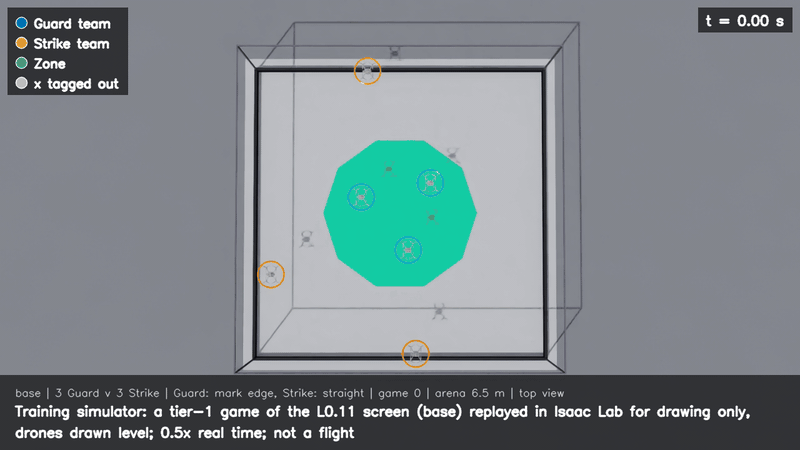 [MP4](base_hold_top.mp4) | 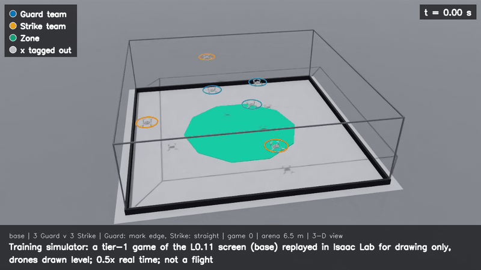 [MP4](base_hold_3d.mp4) | Mark edge Guards v straight Strikes, game 0 of the base cell in record T44: Guard team holds at 1.9 s: 3-for-3 tags, no Guard left. Training simulator tier 1, replayed in Isaac Lab for drawing only (drones drawn level); not a flight. |
| base | reach, game 6 | 808 holds and 192 reaches of 1000 | 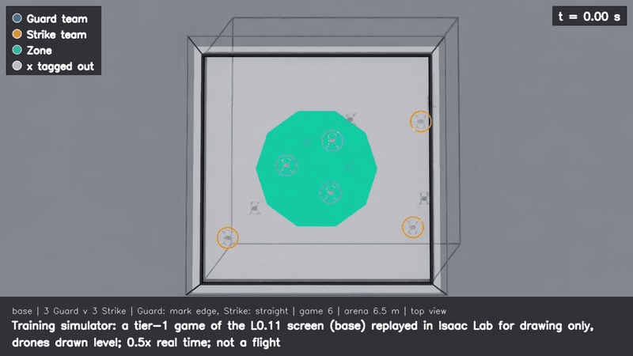 [MP4](base_reach_top.mp4) | 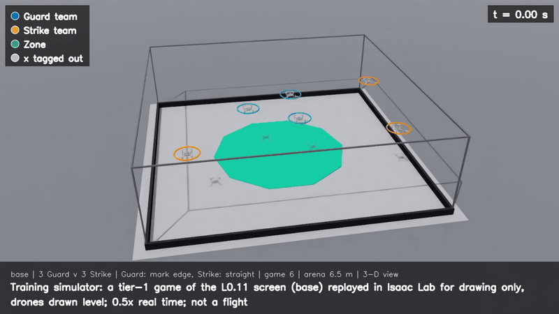 [MP4](base_reach_3d.mp4) | Mark edge Guards v straight Strikes, game 6 of the base cell in record T44: Strike team reaches the zone at 2.9 s. Training simulator tier 1, replayed in Isaac Lab for drawing only (drones drawn level); not a flight. |
| tag_1p2 | hold, game 0 | 645 holds and 355 reaches of 1000 | 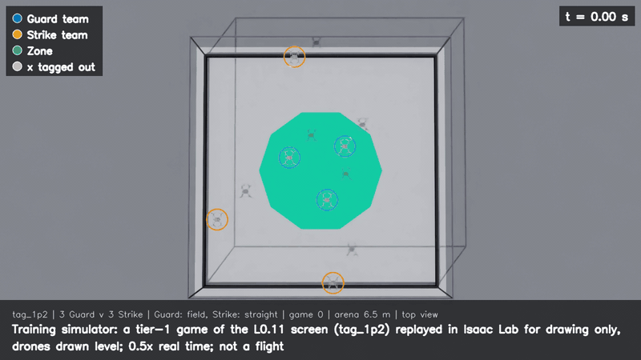 [MP4](tag_1p2_hold_top.mp4) | 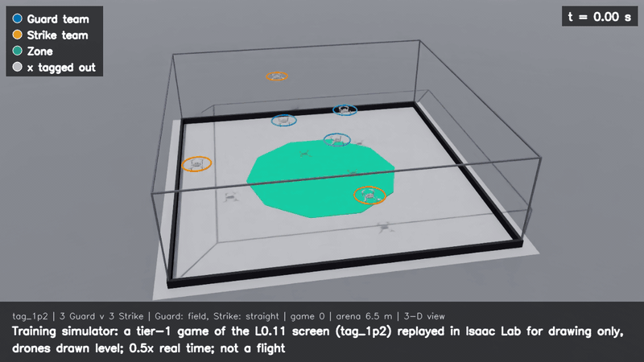 [MP4](tag_1p2_hold_3d.mp4) | Field Guards v straight Strikes, game 0 of the tag_1p2 cell in record T44: Guard team holds at 2.2 s: 3-for-3 tags, no Guard left. Training simulator tier 1, replayed in Isaac Lab for drawing only (drones drawn level); not a flight. |
| tag_1p2 | reach, game 4 | 645 holds and 355 reaches of 1000 | 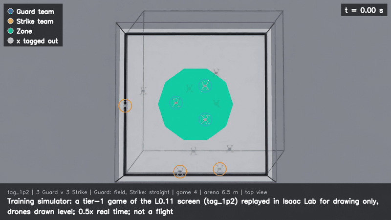 [MP4](tag_1p2_reach_top.mp4) | 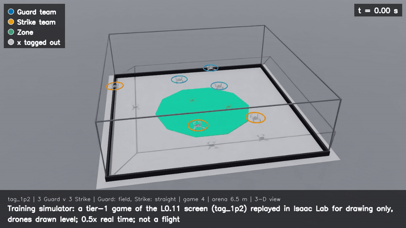 [MP4](tag_1p2_reach_3d.mp4) | Field Guards v straight Strikes, game 4 of the tag_1p2 cell in record T44: Strike team reaches the zone at 2.9 s. Training simulator tier 1, replayed in Isaac Lab for drawing only (drones drawn level); not a flight. |
| tag_1p4 | hold, game 0 | 672 holds and 328 reaches of 1000 | 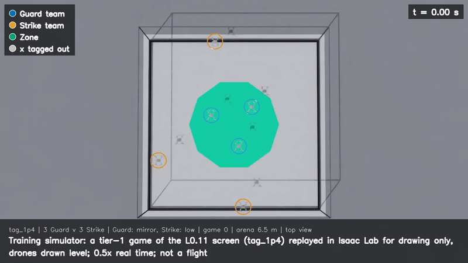 [MP4](tag_1p4_hold_top.mp4) | 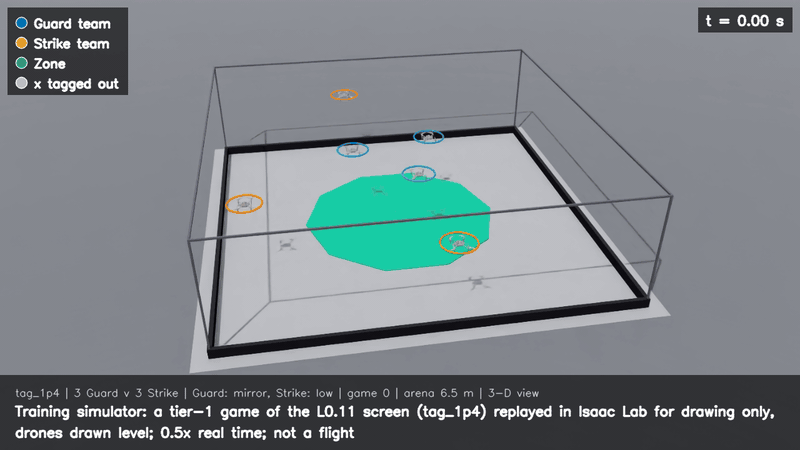 [MP4](tag_1p4_hold_3d.mp4) | Mirror Guards v low Strikes, game 0 of the tag_1p4 cell in record T44: Guard team holds at 2.6 s: 3-for-3 tags, no Guard left. Training simulator tier 1, replayed in Isaac Lab for drawing only (drones drawn level); not a flight. |
| tag_1p4 | reach, game 1 | 672 holds and 328 reaches of 1000 | 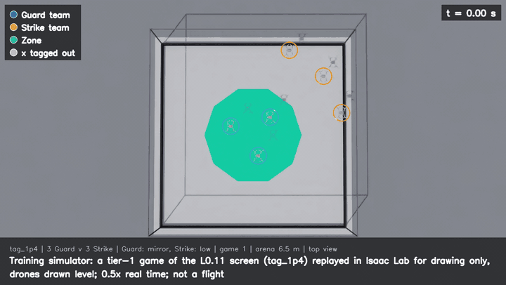 [MP4](tag_1p4_reach_top.mp4) | 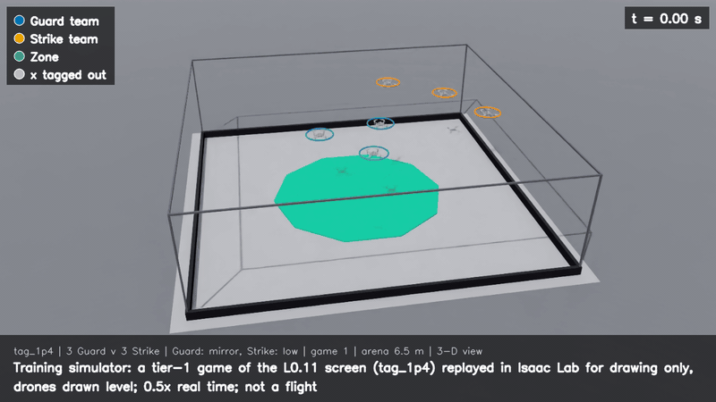 [MP4](tag_1p4_reach_3d.mp4) | Mirror Guards v low Strikes, game 1 of the tag_1p4 cell in record T44: Strike team reaches the zone at 3.7 s. Training simulator tier 1, replayed in Isaac Lab for drawing only (drones drawn level); not a flight. |

GIF 800 px wide, 10 frames/s (every tick kept) unless a row says otherwise; MP4 1280 x 720 at the same rate.
`tag_1p4_reach_top.gif`: 720 px wide, 10 frames/s.

Made by `scripts/make_ste_3d.py` from `scripts/ste_vid1_capture.py` trajectories; commit 5d3531457088 (working tree: uncommitted changes of tasks L0.4/L0.5/VID-1 on branch ste-l0.4 (added by hand after the render; not recorded at render time)), 2026-11-21, isaaclab-2.3.2, asset `starling2max.usd` (sha256 ae57650efa56...).
