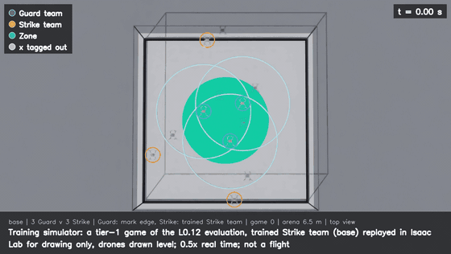
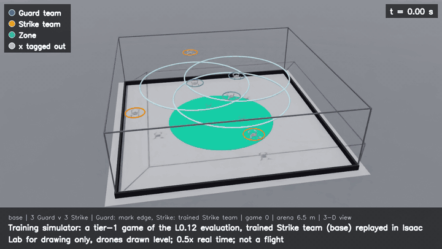
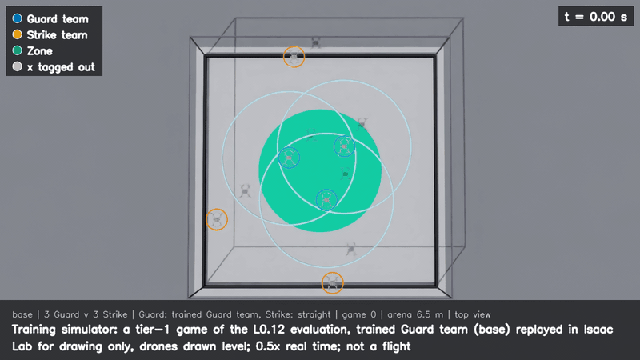
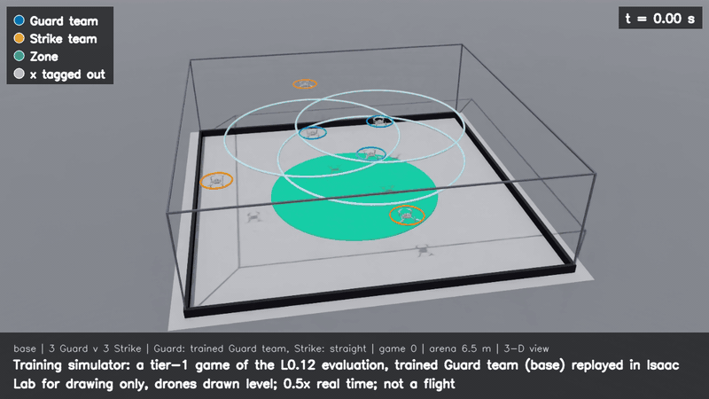
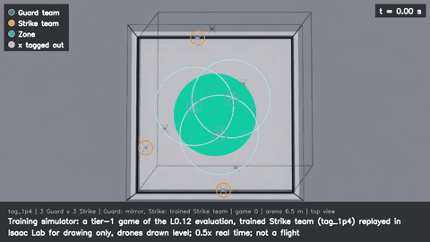
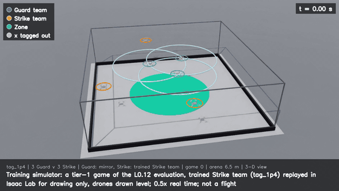
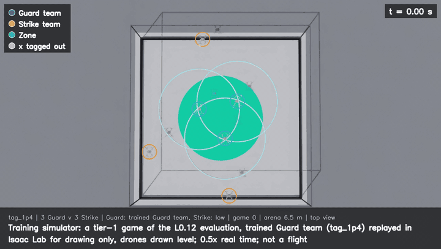
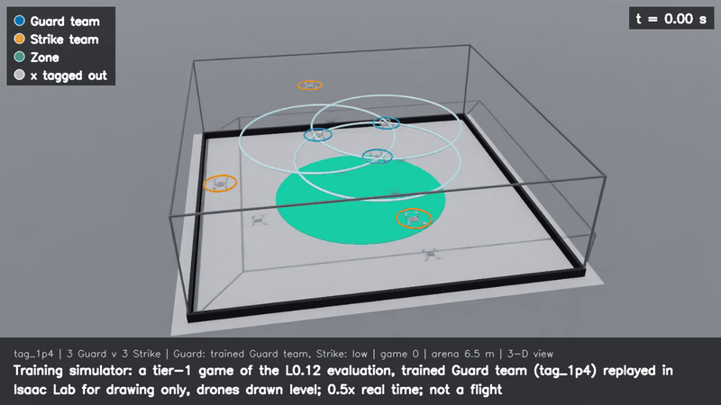

# 3-D replays of the L0.12 trained players' key games (VID-1b)

Training simulator. Each game is a game of an L0.12 run's own evaluation (record T46; T44's starts, the trained team deciding every 0.6 s with its mean action) played again on the run's device and checked equal to that evaluation (outcome, end step, tags, Strike drones left, start positions), then drawn in Isaac Lab with the Starling asset of the AirStack simulator. Visual replay only: no physics runs in the drawing. Tier 1 has no roll or pitch, so the drones are drawn level; a tagged drone disappears and a cross stays where it went out. Look: `own_ring` (owner, D9). Played at 0.5x real time. Not a flight.

Rule for the games (fixed before the replay): in each run, the lowest game index of the trained team's cell that the trained team won (a reach for a trained Strike team, a hold for a trained Guard team). The column "In the evaluation" gives how often each outcome happened in that cell. A faint circle around each Guard drone marks its tag distance (the game's tag radius, at the Guard's height: the tag is a 3-D distance), so a tag is seen when a Strike drone crosses it; the zone is drawn as a true circle. In the top view a drone in the air shows slightly further from the image centre than the floor point under it (perspective), so a Strike drone that reaches the zone's edge can look just outside it.

| Variant | Game | In the evaluation | Top view | 3-D view | Caption |
|---|---|---|---|---|---|
| base | trained strike, reach, game 0 | 364 holds and 636 reaches of 1000 |  [MP4](l012_base_strike_top.mp4) |  [MP4](l012_base_strike_3d.mp4) | Trained Strike team v mark edge Guards, game 0 of the base run's evaluation in record T46 (tag radius 1.6 m): Strike team reaches the zone at 6.1 s. Training simulator tier 1, replayed in Isaac Lab for drawing only (drones drawn level); not a flight. |
| base | trained guard, hold, game 0 | 913 holds and 87 reaches of 1000 |  [MP4](l012_base_guard_top.mp4) |  [MP4](l012_base_guard_3d.mp4) | Trained Guard team v straight Strikes, game 0 of the base run's evaluation in record T46 (tag radius 1.6 m): Guard team holds at 2.5 s: 3-for-3 tags, no Guard left. Training simulator tier 1, replayed in Isaac Lab for drawing only (drones drawn level); not a flight. |
| tag_1p4 | trained strike, reach, game 0 | 260 holds and 740 reaches of 1000 |  [MP4](l012_tag_1p4_strike_top.mp4) |  [MP4](l012_tag_1p4_strike_3d.mp4) | Trained Strike team v mirror Guards, game 0 of the tag_1p4 run's evaluation in record T46 (tag radius 1.4 m): Strike team reaches the zone at 7.6 s. Training simulator tier 1, replayed in Isaac Lab for drawing only (drones drawn level); not a flight. |
| tag_1p4 | trained guard, hold, game 0 | 747 holds and 253 reaches of 1000 |  [MP4](l012_tag_1p4_guard_top.mp4) |  [MP4](l012_tag_1p4_guard_3d.mp4) | Trained Guard team v low Strikes, game 0 of the tag_1p4 run's evaluation in record T46 (tag radius 1.4 m): Guard team holds at 3.4 s: 3-for-3 tags, no Guard left. Training simulator tier 1, replayed in Isaac Lab for drawing only (drones drawn level); not a flight. |

GIF 560 px wide, 10 frames/s (every tick kept) unless a row says otherwise; MP4 1280 x 720 at the same rate.
`l012_base_strike_3d.gif`: 720 px wide, 10 frames/s.
`l012_base_guard_top.gif`: 800 px wide, 10 frames/s.
`l012_base_guard_3d.gif`: 800 px wide, 10 frames/s.
`l012_tag_1p4_strike_top.gif`: 480 px wide, 10 frames/s.
`l012_tag_1p4_guard_top.gif`: 720 px wide, 10 frames/s.
`l012_tag_1p4_guard_3d.gif`: 800 px wide, 10 frames/s.

Made by `scripts/make_ste_3d.py` from `scripts/ste_vid1_capture.py` trajectories; commit 621c34deeb25 (working tree: uncommitted changes: svg_training/configs/ste_video.toml, svg_training/scripts/make_ste_3d.py, svg_training/scripts/redraw_ste_l03_clips.py, svg_training/scripts/ste_vid1_capture.py, svg_training/source/svg_training/compat/isaaclab_232.py, svg_training/source/svg_training/viz/replay3d.py, svg_training/source/svg_training/viz/starling_look.py), 2026-11-21, isaaclab-2.3.2, asset `starling2max.usd` (sha256 ae57650efa56...).
