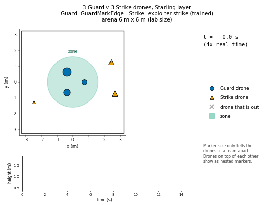
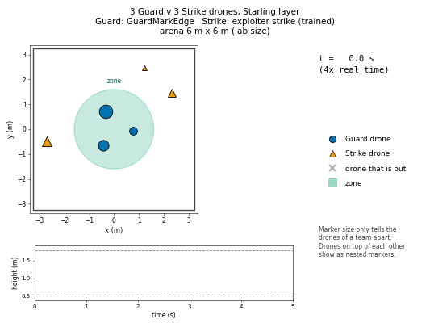
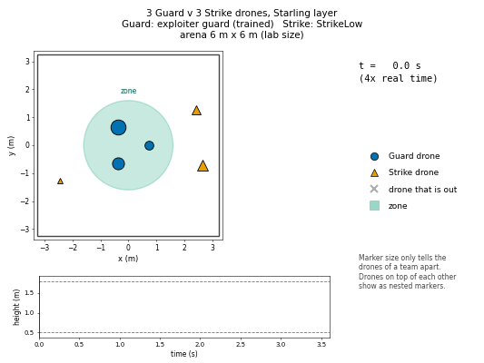
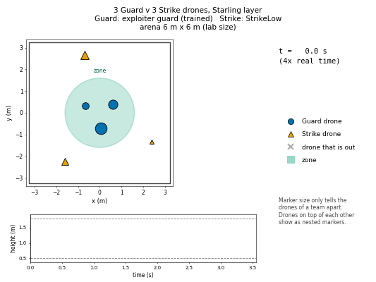
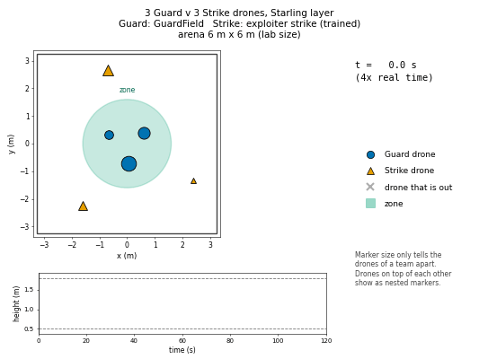
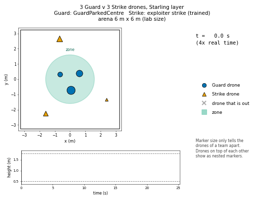

# 2-D clips of the L0.12 Best-response test (records T46 and T47)

Training simulator, tier 1, 3v3, on T44's starts; not a flight. Each clip is the run's own top-down view with a height
panel under it (Strike team orange triangles, Guard team blue circles, a cross where a drone was tagged out). "Trained"
names the side that was trained; the other side is the best scripted player of that variant. Games are shown at 4x real
time. Numbers: [record T46](../../../records/2026-11-21_ste_l012_best_response_record.md) and
[record T47](../../../records/2026-11-21_ste_l012_tag_1p2_strike_record.md). 3-D clips of the key games are pending
(task VID-1b).

| Clip | Caption |
|---|---|
|  | **base_trained_strike_game0_reach.** Base rules (tag 1.6 m): trained Strike team against the mark-edge Guards; the Strike team reaches the zone at 14.5 s. The Strike drones climb to the 1.8 m height limit, two trade with Guards, the last slips in. Over 1,000 games: 636 reaches, script 192. Training simulator, not a flight. |
|  | **base_trained_strike_game2_hold.** Base rules: trained Strike team against the mark-edge Guards; the Guard team holds at 5.0 s. Over 1,000 games the trained Strike team reaches 636 times. Training simulator, not a flight. |
|  | **base_trained_guard_game0_hold.** Base rules: trained Guard team against straight Strikes; the Guard team holds at 2.7 s. Over 1,000 games: 913 holds, script 808. Training simulator, not a flight. |
|  | **base_trained_guard_game1_hold.** Base rules: trained Guard team against straight Strikes; the Guard team holds at 2.6 s (second hold shown; games 0 and 1 both ended in a hold). Training simulator, not a flight. |
|  | **tag_1p4_trained_strike_game0_reach.** Tag 1.4 m: trained Strike team against the mirror Guards; the Strike team reaches the zone at 7.9 s. Over 1,000 games: 740 reaches, script 328. Training simulator, not a flight. |
|  | **tag_1p4_trained_strike_game2_hold.** Tag 1.4 m: trained Strike team against the mirror Guards; the Guard team holds at 5.8 s. Training simulator, not a flight. |
|  | **tag_1p4_trained_guard_game0_reach.** Tag 1.4 m: trained Guard team against low Strikes; the Strike team reaches the zone at 3.6 s. Over 1,000 games: 747 holds, script 672. Training simulator, not a flight. |
|  | **tag_1p4_trained_guard_game1_hold.** Tag 1.4 m: trained Guard team against low Strikes; the Guard team holds at 3.6 s. Training simulator, not a flight. |
|  | **tag_1p2_trained_guard_game0_reach.** Tag 1.2 m: trained Guard team against straight Strikes; the Strike team reaches the zone at 2.9 s. Over 1,000 games: 503 holds, below the field Guards' script 645. Training simulator, not a flight. |
|  | **tag_1p2_trained_guard_game2_hold.** Tag 1.2 m: trained Guard team against straight Strikes; the Guard team holds at 2.7 s. Training simulator, not a flight. |
|  | **tag_1p2_trained_strike_ABORTED_game0_hold.** ABORTED run (T47), proves nothing. Tag 1.2 m: trained Strike team against the field Guards; two pairs trade, the last Strike drone waits outside the zone until the 120 s clock ends (a hold). Training simulator, not a flight. |
|  | **tag_1p2_trained_strike_ABORTED_game1_hold.** ABORTED run (T47), proves nothing. Tag 1.2 m: trained Strike team against the field Guards; the game runs to the 120 s clock (a hold). Training simulator, not a flight. |
|  | **run0_trained_strike_v_parked_guard_game0_reach.** Run 0, the learner check: trained Strike team against Guards parked at the centre; the Strike team reaches the zone at 24.0 s. Read at update 10: 478 reaches of 1,000, script 466. Training simulator, not a flight. |
|  | **run0_trained_strike_v_parked_guard_game1_hold.** Run 0, the learner check: trained Strike team against Guards parked at the centre; the Guard team holds at 25.2 s. Training simulator, not a flight. |
