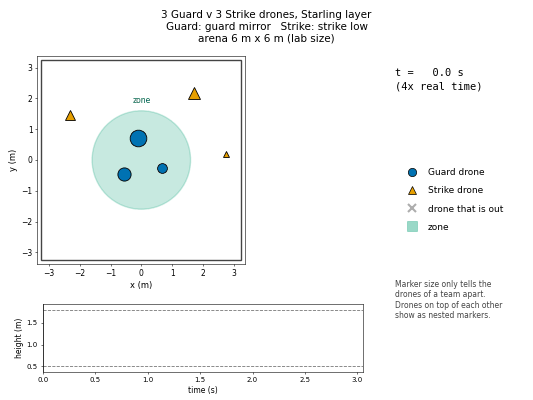
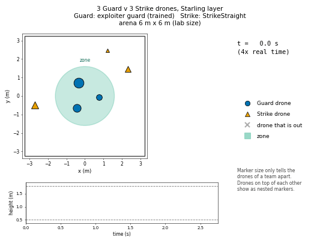
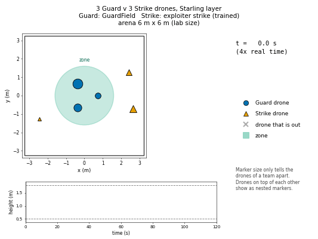
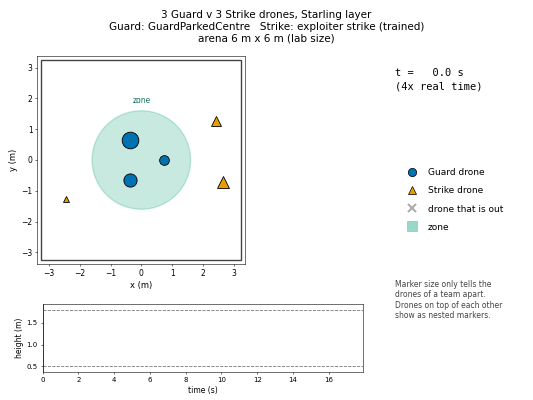
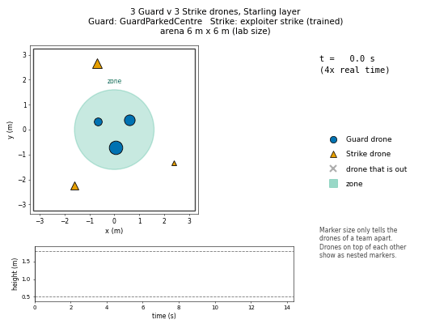

# 2-D clips of the bubble tag check, L0.12b (records T50, T51 and T52)

Training simulator, tier 1, 3v3, tag 1.15 m (the safety filter's 1.10 m keep-out plus 0.05 m), on T44's starts; not a
flight. Each clip is the run's own top-down view with a height panel under it, shown at 4x real time. Strike team orange triangles, Guard
team blue circles, a cross where a drone was tagged out. Numbers:
[record T50](../../../records/2026-11-21_ste_l012b_screen_record.md),
[record T51](../../../records/2026-11-21_ste_l012b_best_response_record.md),
[record T52](../../../records/2026-11-21_ste_l012b_tag_1p15_strike_record.md). 3-D clips of the key games are pending
(task VID-1b).

| Clip | Caption |
|---|---|
|  | **screen_guard_mark_edge_v_strike_straight.** Scripted screen at tag 1.15 m: mark-edge Guards against straight Strikes, game 0; the Guard team holds at 2.5 s. Training simulator, not a flight. |
|  | **screen_guard_field_v_strike_flank.** Scripted screen at tag 1.15 m: field Guards against flanking Strikes, game 0; the Guard team holds at 2.9 s. Training simulator, not a flight. |
|  | **screen_guard_mirror_v_strike_low.** Scripted screen at tag 1.15 m: mirror Guards against low Strikes, game 0; the Guard team holds at 3.1 s. Training simulator, not a flight. |
|  | **tag_1p15_trained_guard_game0_reach.** Trained Guard team against straight Strikes; the Strike team reaches the zone at 2.9 s. Over 1,000 games: 466 holds, below the field Guards' script 645. Training simulator, not a flight. |
|  | **tag_1p15_trained_guard_game2_hold.** Trained Guard team against straight Strikes; the Guard team holds at 2.8 s. Training simulator, not a flight. |
|  | **tag_1p15_trained_strike_ABORTED_game0_hold.** ABORTED run (T52), proves nothing. Trained Strike team against the field Guards: two pairs trade, the last Strike drone waits just outside the zone until the 120 s clock ends (a hold). Training simulator, not a flight. |
|  | **tag_1p15_trained_strike_ABORTED_game1_hold.** ABORTED run (T52), proves nothing. Trained Strike team against the field Guards; the game runs to the 120 s clock (a hold). Training simulator, not a flight. |
|  | **run0_trained_strike_v_parked_guard_game0_reach.** Run 0, the learner check at tag 1.15 m: trained Strike team against Guards parked at the centre; the Strike team reaches the zone at 17.9 s. Read at update 10: 909 reaches of 1,000, bar 849. Training simulator, not a flight. |
|  | **run0_trained_strike_v_parked_guard_game1_reach.** Run 0: trained Strike team against Guards parked at the centre; the Strike team reaches the zone at 14.4 s (games 0 and 1 both ended in a reach). Training simulator, not a flight. |
