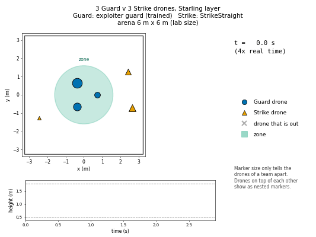
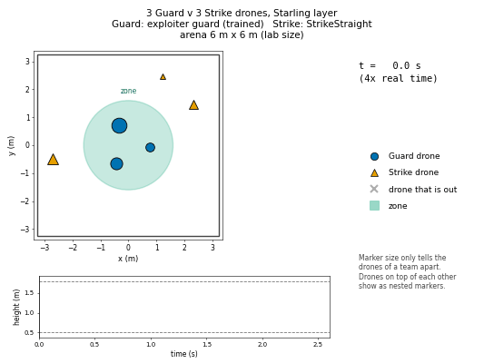
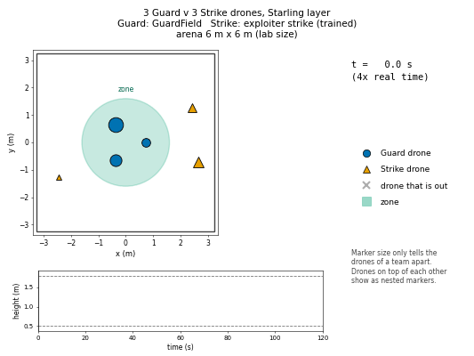
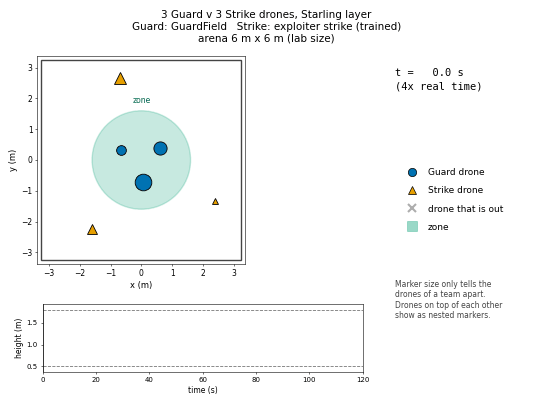

# 2-D clips of the longer 1.15 m runs, L0.12c (records T54 and T55)

Training simulator, tier 1, 3v3, tag 1.15 m (the safety filter's 1.10 m keep-out plus 0.05 m); not a flight. The clips
play the runs' own clip starts (`clip_seed` 120950 in the gate files), not T44's scoring starts, so a clip's game number
is not a scoring game's. Each clip is the run's own top-down view with a height panel under it, shown at 4x real time. Strike team orange triangles, Guard team
blue circles, a cross where a drone was tagged out. Numbers:
[record T54](../../../records/2026-11-22_ste_l012c_tag_1p15_guard_record.md),
[record T55](../../../records/2026-11-22_ste_l012c_tag_1p15_strike_record.md); figure
[longer_runs.png](../../figures/ste_l012c/longer_runs.png). 3-D clips of the key games are pending.

| Clip | Caption |
|---|---|
|  | **tag_1p15_trained_guard_3x_game0_reach.** Trained Guard team (3× training) against straight Strikes; the Strike team reaches the zone at 2.9 s. Over 1,000 games: 572 holds, below the field Guards' script 645. Training simulator, not a flight. |
|  | **tag_1p15_trained_guard_3x_game2_hold.** Trained Guard team (3× training) against straight Strikes; the Guard team holds at 2.6 s. Training simulator, not a flight. |
|  | **tag_1p15_trained_strike_5x_game0_hold.** Trained Strike team (5× training) against the field Guards; the game runs to the 120 s clock (a hold). Over 1,000 games: 134 reaches, below the straight Strikes' script 355. Training simulator, not a flight. |
|  | **tag_1p15_trained_strike_5x_game1_hold.** Trained Strike team (5× training) against the field Guards; the game runs to the 120 s clock (a hold). Training simulator, not a flight. |
