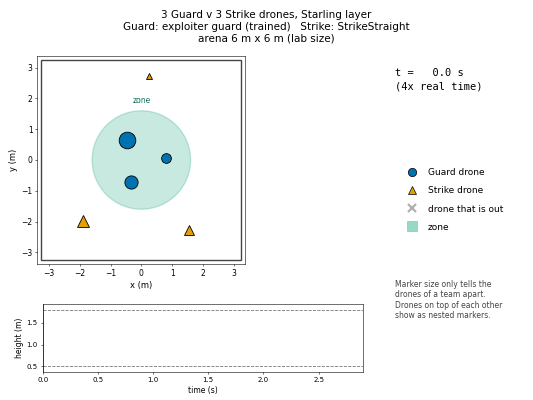
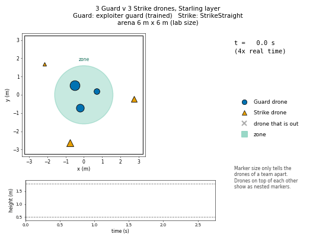
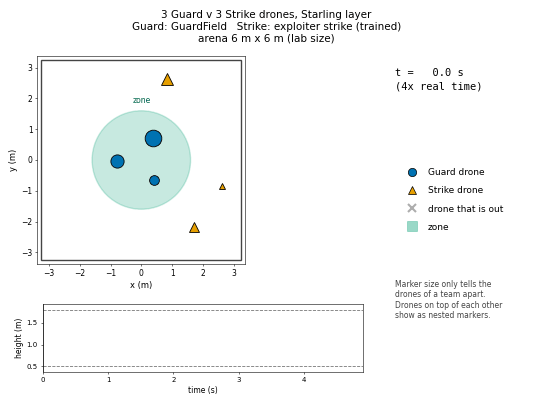

# 2-D clips of the cross-tag check, L0.12d (record T56)

Training simulator, tier 1, 3v3, tag 1.15 m (the safety filter's 1.10 m keep-out plus 0.05 m); not a flight. The
players are T46's, trained at tag 1.6 m. The clips play the clip seed's own starts (`clip_seed` 120950), drawn on the
CPU, not the 1,000 scoring starts, so a clip's game number is not a scoring game's. Each clip is a top-down view with a
height panel under it, at 4x real time. Strike team orange triangles, Guard team blue circles, a cross where a drone was
tagged out. Numbers: [record T56](../../../records/2026-11-22_ste_l012d_cross_tag_record.md).

| Clip | Caption |
|---|---|
|  | **X1, game 0, reach.** The 1.6 m-trained Guard team against straight Strikes at 1.15 m; the Strike team reaches the zone at 2.9 s. Over 1,000 games: 195 holds (1.15 m-trained Guard team 572, script 645). Training simulator, not a flight. |
|  | **X1, game 5, hold.** Same match; the Guard team holds at 2.8 s. Training simulator, not a flight. |
|  | **X2, game 2, reach.** The 1.6 m-trained Strike team against the field Guards at 1.15 m; it reaches the zone at 4.9 s. Over 1,000 games: 121 reaches (1.15 m-trained Strike team 134, script 355). Training simulator, not a flight. |
|  | **X2, game 0, hold.** Same match; the Guard team holds at 20.5 s. Training simulator, not a flight. |
