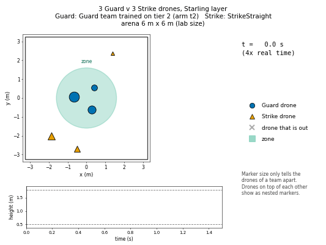
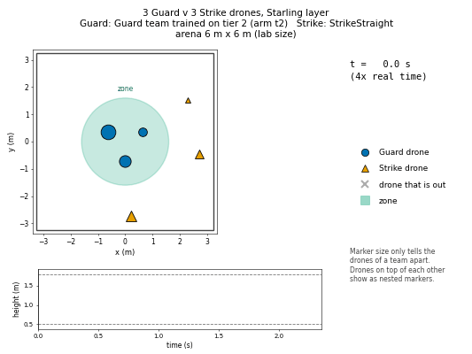
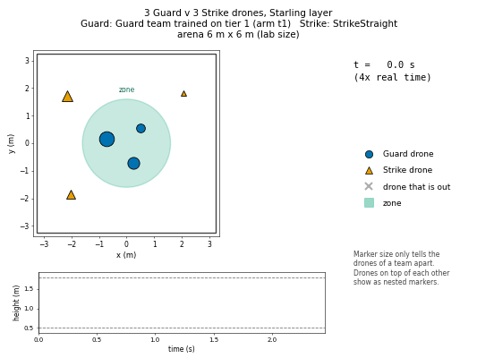
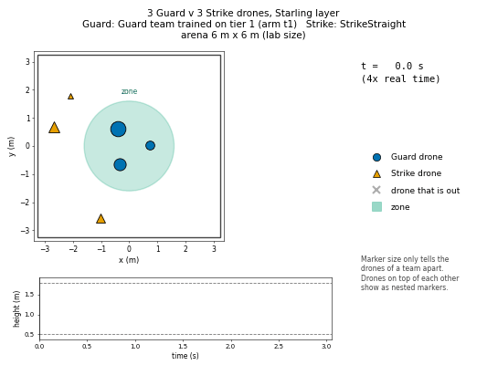

# 2-D clips of the tier 2 training check, L0.13 (record T53)

Training simulator, the L0.11 base game (3v3, tag 1.6 m); not a flight. **Correction (24 Nov 2026):** the clips' starts
are drawn from the clip seed (130950), not T44's starts, and the tier-2 clips' draw is made on the GPU, so the tier-1
and tier-2 clips do not show the same games; each clip is a genuine game of its own tier (side task CLIP-T2, recorded
in the L2.6 record T71). The record's numbers (T53) used T44's starts and are not affected. A Guard team trained on tier 1
(fast engine) and one trained on tier 2 (the Isaac Lab rigid-body Starling), each against straight Strikes, shown on its
own tier at 4x real time. Each clip is the run's top-down view with a height panel under it. Strike team orange
triangles, Guard team blue circles, a cross where a drone was tagged out. Numbers:
[record T53](../../../records/2026-11-21_ste_l013_tier2_trains_record.md). 3-D clips of the key games are pending (task
VID-1b).

| Clip | Caption |
|---|---|
|  | **tier2_trained_guard_game0_hold.** Guard team trained on tier 2 (Isaac Lab drone), played on tier 2 against straight Strikes, game 0: the Guard team holds at 1.5 s. Over 1,000 games: 832 holds, parked Guards 538. Training simulator, not a flight. |
|  | **tier2_trained_guard_game2_reach.** Guard team trained on tier 2, on tier 2, game 2: the Strike team reaches the zone at 2.4 s. Training simulator, not a flight. |
|  | **tier1_trained_guard_game0_hold.** Guard team trained on tier 1 (fast engine), played on tier 1 against straight Strikes, game 0: the Guard team holds at 2.5 s. Over 1,000 games: 836 holds, parked Guards 534. Training simulator, not a flight. |
|  | **tier1_trained_guard_game1_reach.** Guard team trained on tier 1, on tier 1, game 1: the Strike team reaches the zone at 3.1 s. Training simulator, not a flight. |
