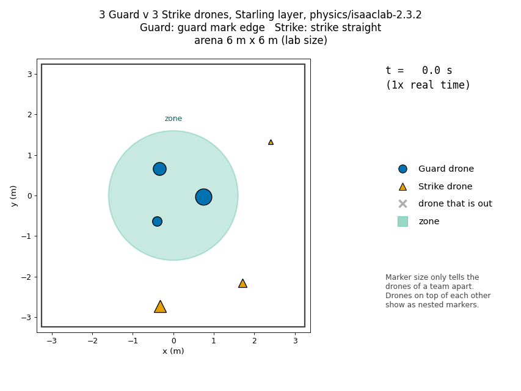
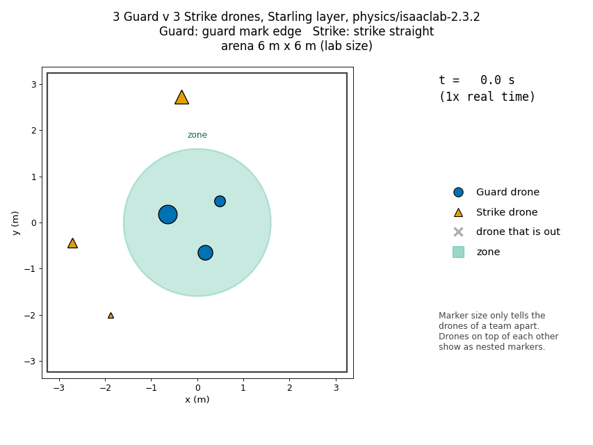
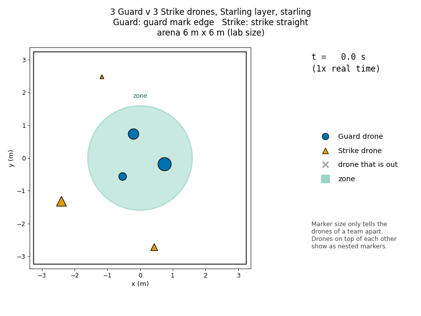
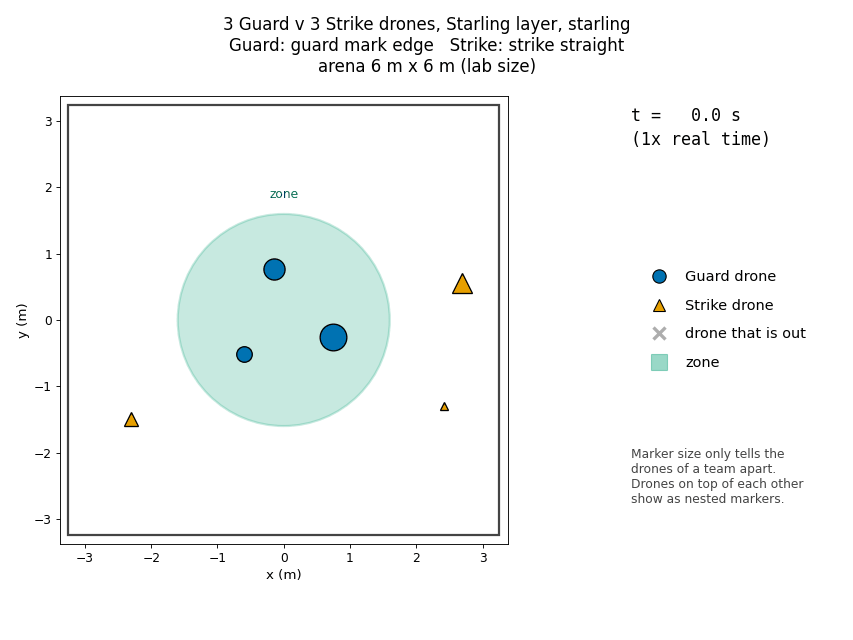

# 2-D clips of the L0.2 speed measurement (record T48)

Training simulator, the L0.11 base game (3v3, tag 1.6 m, 6.5 m lab arena); not a flight. Each clip is a scripted
reference game of a timed point (1,024 games at once): the mark-edge Guards against the straight Strikes, on tier 1
(fast engine) and on tier 2 (Isaac Lab physics drone). The clips show what was timed; they carry no result. No height
panel (standing rule: every 2-D clip carries one); the clips will be re-drawn later under task VID-1c. 3-D Isaac
Lab clips are pending (VID-1). Numbers:
[record T48](../../../records/2026-11-21_ste_l02_speed_record.md).

| Clip | Caption |
|---|---|
|  | **tier2_3v3_1024_games_hold_game0.** Tier 2 (Isaac Lab physics drone), mark-edge Guards against straight Strikes, game 0 of the 1,024-game point: the Guard team holds at 1.8 s. A scripted game timed for speed, not a result. Training simulator, not a flight. |
|  | **tier2_3v3_1024_games_reach_game2.** Tier 2 (Isaac Lab physics drone), same players, game 2: the Strike team reaches the zone at 2.3 s. A scripted game timed for speed, not a result. Training simulator, not a flight. |
|  | **tier1_3v3_1024_games_hold_game0.** Tier 1 (fast engine), mark-edge Guards against straight Strikes, game 0 of the 1,024-game point: the Guard team holds at 2.1 s. A scripted game timed for speed, not a result. Training simulator, not a flight. |
|  | **tier1_3v3_1024_games_reach_game6.** Tier 1 (fast engine), same players, game 6: the Strike team reaches the zone at 2.9 s. A scripted game timed for speed, not a result. Training simulator, not a flight. |
