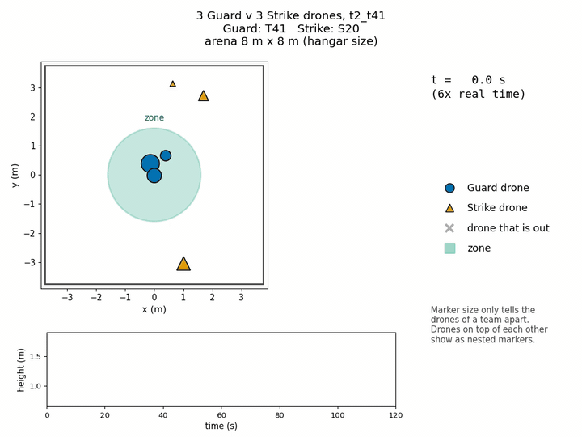
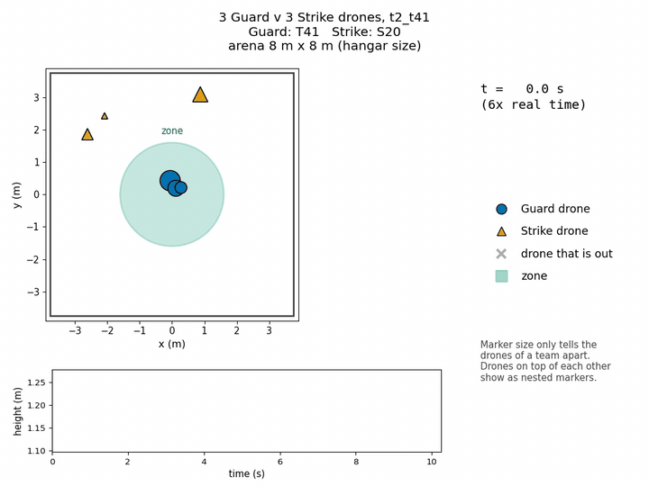
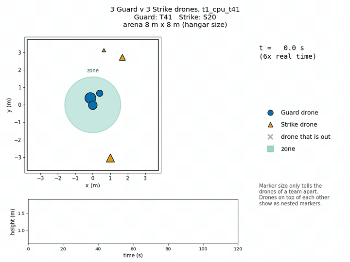
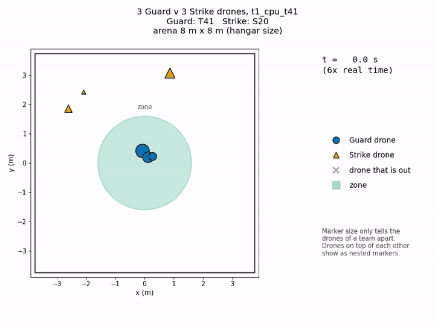
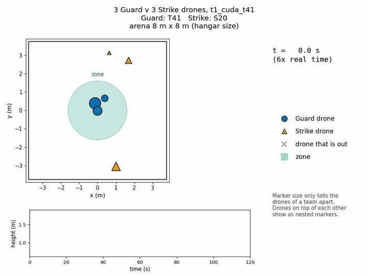
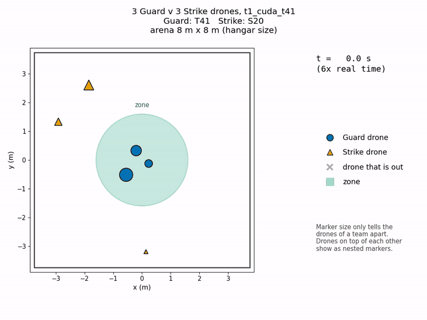
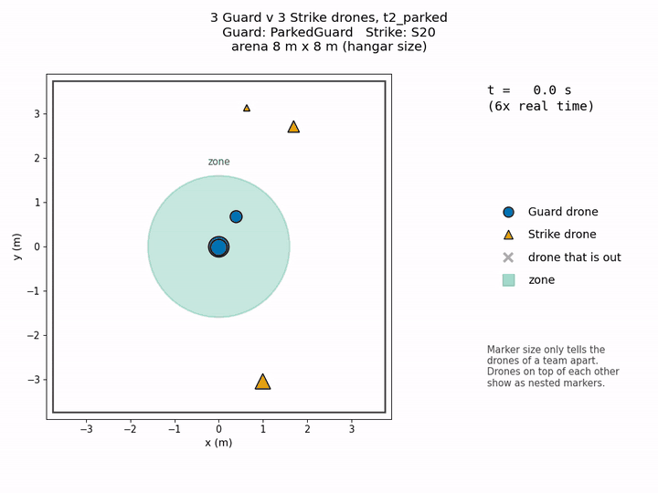
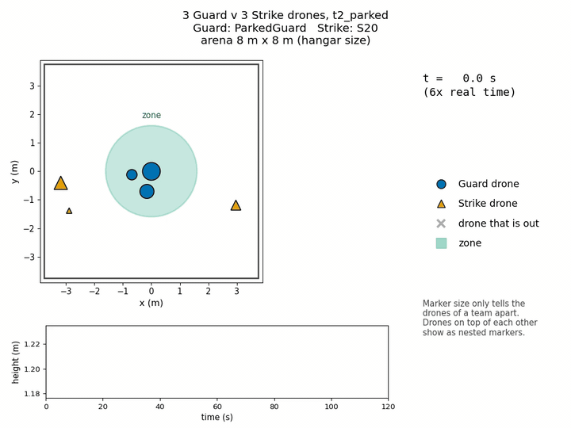

# 2-D clips of the L0.3 transfer check (record T49)

Training simulator, the hangar game (8 m arena, 3v3) on T41's 1,000 starts; not a flight. The STE Guard policy T41
(trained on tier 1) plays the S20 Strike team without retraining: on tier 1 (CPU and CUDA) and on tier 2 (Isaac Lab
physics drone), plus the parked Guard team as the control. Converted from the run's MP4s (10 frames/s, 720 px), shown
at 6x real time; no height panel. 3-D Isaac Lab clips are pending (VID-1). Numbers:
[record T49](../../../records/2026-11-21_ste_l03_transfer_record.md).

| Clip | Caption |
|---|---|
|  | **tier2_t41_v_s20_hold_slot0.** Tier 2 (Isaac Lab physics drone): T41 Guards against S20, start 0. The Guard team keeps the zone until the 120 s clock (a hold). Over 1,000 starts: 856 holds on tier 2, 831 on tier 1 (CPU). Training simulator, not a flight. |
|  | **tier2_t41_v_s20_reach_slot5.** Tier 2: T41 Guards against S20, start 5. The Strike team reaches the zone at 10.3 s. On tier 1 (CPU) the same start ended in a reach at 31.3 s. Training simulator, not a flight. |
|  | **tier1_cpu_t41_v_s20_hold_slot0.** Tier 1 (fast engine, CPU): T41 Guards against S20, start 0. A hold at the 120 s clock, as on tier 2. Training simulator, not a flight. |
|  | **tier1_cpu_t41_v_s20_reach_slot5.** Tier 1 (CPU): T41 Guards against S20, start 5. The Strike team reaches the zone at 31.3 s. Training simulator, not a flight. |
|  | **tier1_cuda_t41_v_s20_hold_slot0.** Tier 1 on the GPU (CUDA): T41 Guards against S20, start 0. A hold at the 120 s clock. The CUDA arm (829 holds) is information only; 10 of 1,000 games differ from the CPU arm. Training simulator, not a flight. |
|  | **tier1_cuda_t41_v_s20_reach_slot6.** Tier 1 on the GPU (CUDA): T41 Guards against S20, start 6. The Strike team reaches the zone at 6.0 s. Information only. Training simulator, not a flight. |
|  | **tier2_parked_v_s20_reach_slot0.** Control, tier 2: Guards parked in place against S20, start 0. The Strike team reaches the zone at 8.3 s. Over 1,000 starts S20 reaches 525 times (T24: 524). Training simulator, not a flight. |
|  | **tier2_parked_v_s20_hold_slot1.** Control, tier 2: parked Guards against S20, start 1. A hold at the 120 s clock. Training simulator, not a flight. |
