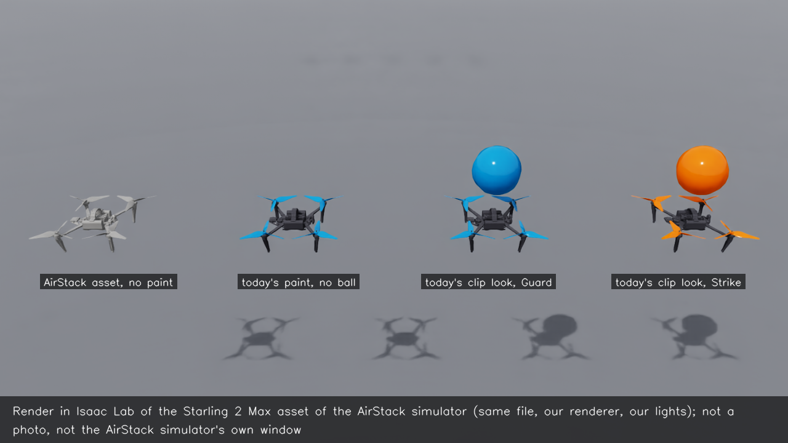
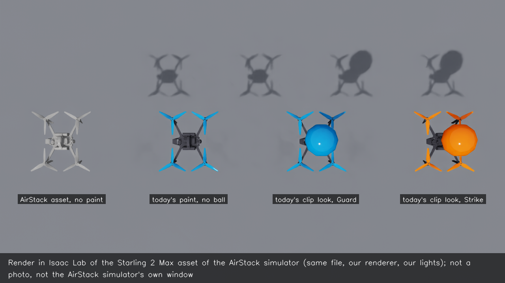
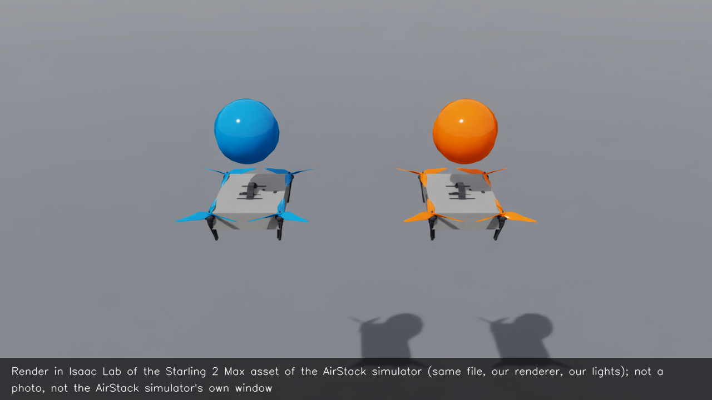
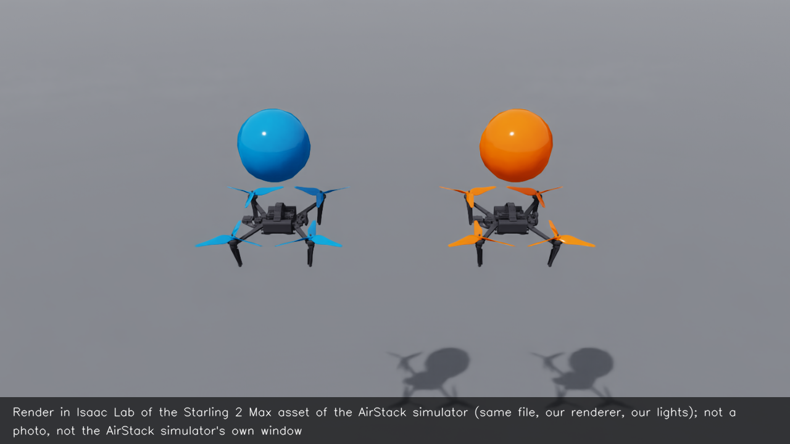

# L0.4 Side-by-side Starling render

Renders in Isaac Lab (Isaac Sim 5.1, the same version as the AirStack simulator) of the AirStack simulator's own Starling file, `AirStack/simulation/isaac-sim/assets/robots/starling2max.usd` (read only). The file carries no material and no colour, and the AirStack simulator adds none when it spawns it (Pegasus `vehicle.py` and `starling2max.py`, read), so the AirStack simulator should draw the renderer's default surface too (read from the files and code; not verified in its window). Not compared: the AirStack simulator's own lights, world, camera and spinning rotors (Pegasus turns the rotor joints); no AirStack window was opened (rule: the AirStack simulator is not run for this task).

**row_l04_close.** L0.4: the Starling asset of the AirStack simulator as the file draws it (left) beside today's clip paint and the clip look with its team ball. Same file and renderer; only paint and ball differ. Until the fix below, the clips also drew a grey box over the drone.

**row_l04_top.** L0.4 from above: the same four drones. Today's clip paint turns the body dark and the rotors to the team colour; the ball hides the drone from above.

**clip_drone_before_fix.** L0.4 finding: the S2b and NUS Isaac clips drew this. Their own code path (IsaacWorld) left the grey physics box (0.19 x 0.26 x 0.05 m) visible over the Starling: the hide call hit a prim that cannot be hidden. Box, rotor paint and ball made it unlike the Starling.

**clip_drone_after_fix.** The same code path after the one-line fix (the box's own mesh is hidden): the Starling with today's paint and ball, as in the row above. Visual only; the box never had a collider.

